# Prediction Assurance Harness

Web UI: https://persistentepiphany--pah-web.us-east.modal.run

HTTP API: https://persistentepiphany--pah-api.us-east.modal.run (health at `/health`)

A co-folding or docking model reports its own confidence, and that score does not establish that
the result is valid. PoseBusters showed that deep-learning docking methods often produce physically
implausible poses that RMSD alone does not reveal, and that none of the five it tested yet
outperformed classical docking on physical plausibility or on novel sequences
([Buttenschoen, Morris and Deane, Chem. Sci. 2024](https://doi.org/10.1039/d3sc04185a)). In the
perturbation benchmark below, an agent given only ipTM and pLDDT called all 12 Boltz-2 poses valid
after the pocket contacts had been cut to glycine; given the harness fact file it rejected all 12.

`pah` decides whether a co-folding or docking result can support the claim its user declares, such
as "the predicted pose of ATP in CDK2 is valid". It checks the inputs before the prediction and the
outputs after it in six layers: L0 provenance, L1 input integrity, L2 input adequacy,
L3 applicability, L4 output validity and L5 output support. Every check returns pass, warn, stop
or skip with the measured values, the thresholds with their origin, and the evidence.

Models it runs and checks: Boltz-1, Boltz-2, Chai-1, Protenix, ColabFold (AlphaFold2), OpenFold3,
DiffDock-L and Gnina on Modal A100 GPUs, AutoDock Vina on CPU, and AlphaFold3, HADDOCK3 and pyDock
outputs supplied by the user. Agents call it through the MCP server and the HTTP API, and their
steps appear in the web UI's Agent view.

The design is in [docs/SPECIFICATION.md](docs/SPECIFICATION.md) and the architecture in
[docs/ARCHITECTURE.md](docs/ARCHITECTURE.md). Working rules for contributors are in
[CLAUDE.md](CLAUDE.md).

## Web UI

The web UI (Dock Harness, Next.js, in [web/](web/README.md)) talks to `pah serve` through the
`/ui` routes in live mode, or runs on fixtures in mock mode. Its contract is
[docs/UI.md](docs/UI.md).

| New run | Jobs |
| --- | --- |
| 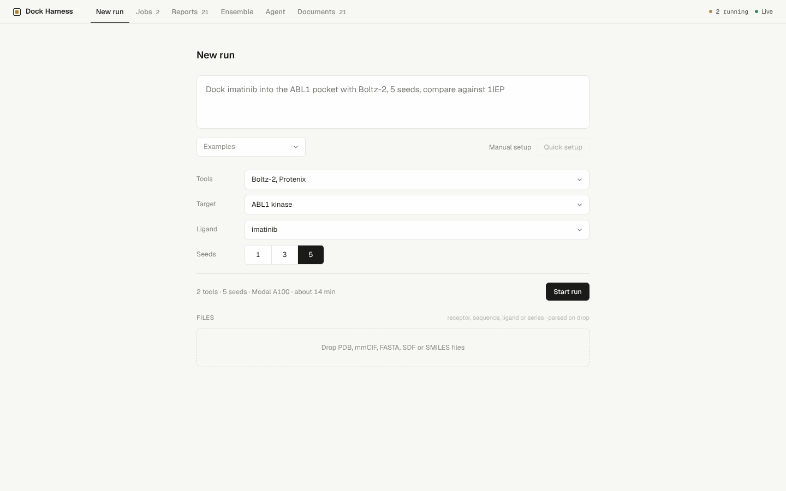 | 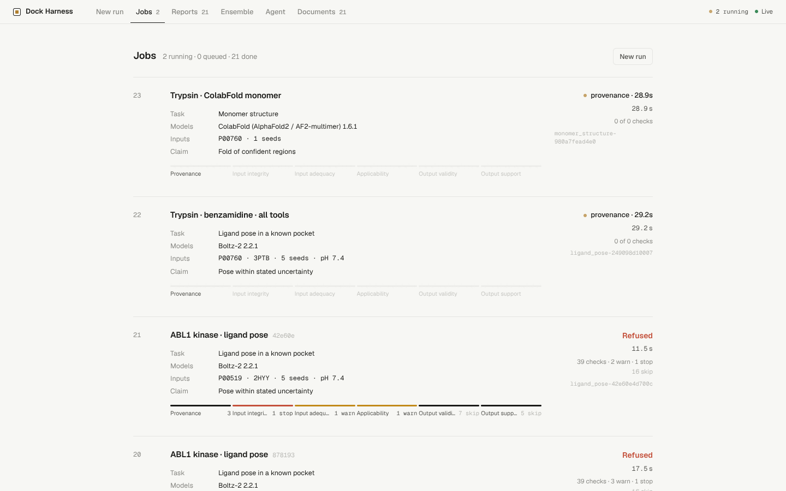 |

| Report | Ensemble |
| --- | --- |
| 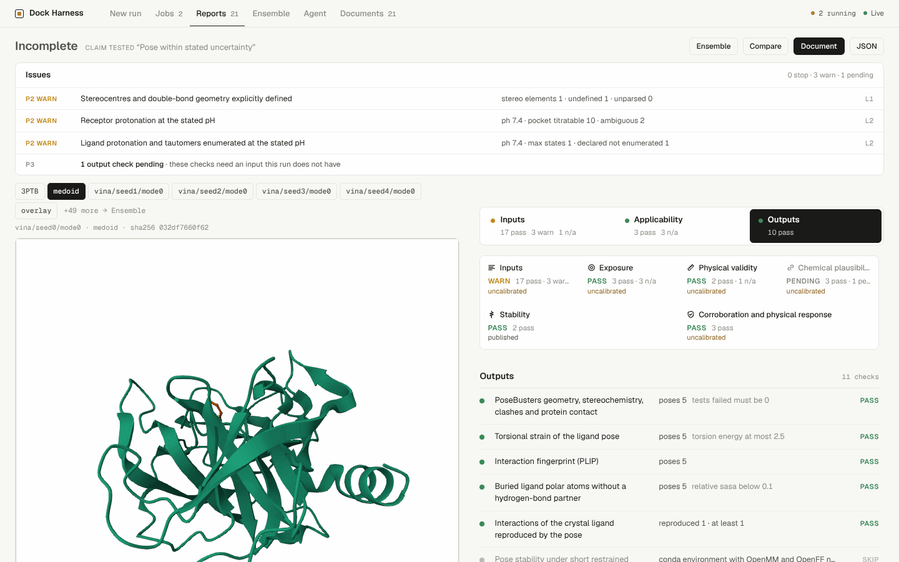 | 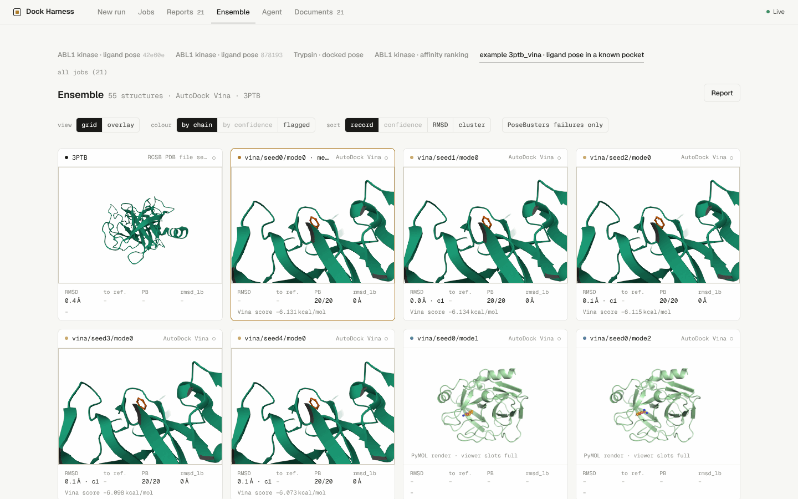 |

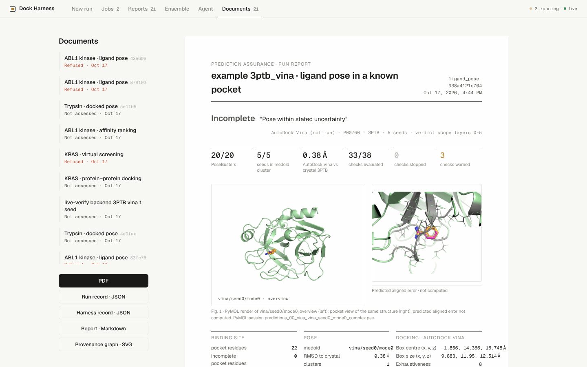

New run turns a request into tools, target, ligand and seeds and starts the run. Jobs lists runs
with their layer progress, verdict and live log.
Report shows the verdict, one section per layer and every check with `measured cmp threshold`.
Ensemble shows the poses in Mol* viewers with RMSD, PoseBusters and score per pose. Document is the
printable report with downloads of the run record, Markdown report and provenance graph.
The Agent view lists the steps an agent reported for its own tasks.

## Quick start

Python 3.11 or later and [uv](https://docs.astral.sh/uv/) are required.

```bash
git clone --recurse-submodules https://github.com/persistentepiphany/harness-hackathon
cd harness-hackathon
scripts/setup_env.sh
```

The script creates `.venv` with all Python extras and `.tools/conda-env` with the tools that are
not on PyPI (openff-toolkit, fpocket, OpenJDK, APBS), initialises the skill submodules and runs
`pah fetch`. Each step runs on its own; a failed step is listed at the end and the rest still
complete. To install only the Python side: `uv pip install -e ".[all,dev]"`.

```bash
.venv/bin/pah doctor                                                 # reachability of sources, tools, weights, skills
.venv/bin/pah run examples/3ptb_ligand_pose/manifest.yaml            # layers 0 and 1
.venv/bin/pah run examples/3ptb_ligand_pose/manifest.yaml --offline  # cache only, no network
.venv/bin/pah run examples/3ptb_faulty_inputs/manifest.yaml --no-halt
.venv/bin/pah run examples/3ptb_vina/manifest.yaml                   # all six layers on Vina poses
.venv/bin/pah run <manifest> --format jsonl                          # one JSON event per line
.venv/bin/pah dock <manifest> --out <dir>                            # local Vina, writes a manifest with predictions
.venv/bin/pah tasks && .venv/bin/pah checks                          # task specifications, registered checks
.venv/bin/pah serve                                                  # HTTP API for the web UI
```

`examples/3ptb_ligand_pose/` is a ligand pose run on PDB 3PTB: bovine trypsin (UniProt P00760)
with benzamidine (CCD BEN, PubChem 2332). Run live or offline, it gives 12 passes and one
warning: the amidine C=N bond in the SDF has no assigned geometry. Its MSA is synthetic test
data. `examples/3ptb_faulty_inputs/` has seven planted faults and gives seven stops: a sequence
with five N-terminal residues removed and three substitutions (two checks fail), a query-only MSA,
a benzylamine SMILES declared as CCD BEN (layer 0 and layer 1 identity checks fail), a chain B
that the entry does not have, and a missing checkpoint and database snapshot.

## How a run works

A manifest names the task, the claim, and the inputs as given to the executor: protein
accessions, PDB chain and sequence, MSA file, intended mutations, ligand SMILES, CCD code,
PubChem CID or SDF file, the receptor and the model version. Mutations are written in UniProt
numbering (`mutations: [L99A, M102Q]`), and each must match the UniProt wild-type residue.
Declared substitutions are applied to the reference sequence and accepted against SEQRES; any
other difference stops the run. Layers 4 and 5 read executor outputs declared in the manifest:

```yaml
predictions:
  - {executor: boltz2, path: seed_0, seeds: [0]}                      # co-folding output folder
  - {executor: vina, path: ../3ptb_vina/pose, receptor: ../3ptb_vina/pose/receptor_H.pdb}
controls:
  redocking: {executor: vina, path: redock, receptor: redock/receptor_H.pdb}
reference: {pdb_id: 3PTB, ligand: BEN}
```

Each output is parsed into poses (complex structure, ligand SDF with bond orders from the declared
SMILES, native scores, per-residue pLDDT and PAE where the tool writes them), and every pose
structure is registered for PyMOL renders. The engine runs each layer in order, prints every
finding the moment the check returns and writes it to `runs/<run-id>/findings/` at the same time.
Each layer ends with a count line. A stop in a pre-run layer skips the later layers unless
`--no-halt` is given.

Thresholds come from `configs/thresholds.yaml`, and per-model confidence cut-offs and training
cutoffs from `configs/models.yaml`. Every threshold in a finding carries its origin (a
specification section or "harness default, not yet calibrated") and an evidence level. A task can
turn specific warnings into stops for its claim (`escalate` in the task file). A check that does
not apply to the inputs (no MSA declared, no receptor) is skipped as `not_applicable` and does not
affect the verdict.

| Verdict | Condition |
| --- | --- |
| `pass` | Every applicable check passed |
| `pass_with_warnings` | No stop, at least one warn |
| `stop` | At least one stop; the claim is not supported by these inputs |
| `incomplete` | A check could not run because a tool was missing, it raised an error, or it is not registered |

70 checks are registered. Of the 13 task specifications in `configs/tasks/`, three are implemented
(`ligand_pose`, `interaction_discovery`, `virtual_screening`) and every check they list is
registered. Controls without a manifest input yet (known sites, non-cognate partners, scrambled
designs, wild-type noise floor, DockQ reference, refolding, scaffold consistency) report the
control as not supplied.

### Layers 0 and 1

| Check | Gate on failure | What it compares |
| --- | --- | --- |
| `l0.sources.resolved` | stop | Every declared identifier resolves to a record with checksum |
| `l0.cross.uniprot_seqres` | stop | UniProt sequence against PDB SEQRES over the SIFTS-mapped range |
| `l0.cross.ligand_inchikey` | stop; warn for metal ligands matching on skeleton only | InChIKey of the declared SMILES against CCD and PubChem |
| `l1.sequence.matches_record` | stop | Sequence given to the run against the record (SIFTS range when a PDB chain is declared) |
| `l1.sequence.no_truncation_substitution` | stop | N- and C-terminal truncation, substitutions, deletions, insertions, non-standard residues |
| `l1.msa.integrity` | stop | MSA query equals the chain, alignment is not query-only, one file is not shared by different chains |
| `l1.ligand.sanitization` | stop; warn above net charge ±2 | RDKit chemistry problems, valence, radicals |
| `l1.ligand.stereo_defined` | warn | Unassigned stereocentres and double bonds |
| `l1.ligand.identity` | stop; warn for metal ligands matching on skeleton only | InChIKey of the ligand file (3D stereo assigned) against CCD and PubChem |
| `l1.receptor.chains` | stop | Declared chains present; residue names against SEQRES at each label_seq position |
| `l1.receptor.altlocs` | warn | Alternate locations present without a declared `altloc_policy` |
| `l1.context.composition` | stop | Declared copies against the chains of the reference entity (co-folding tasks) |
| `l1.provenance.model_config` | stop | Executor, version, checkpoint (co-folding) and database snapshot (with an MSA) recorded |

Ligands containing a metal get one extra step. When every RDKit valence problem sits on an atom
bonded to the metal, the metal bonds are disconnected, as standard InChI does, and sanitisation
is retried. Any other valence problem still stops. The InChIKey stereo and charge blocks of such
ligands depend on how each toolkit draws the metal bonds, so a match on the first block alone is a
warning carrying that reason, and a different first block still stops.

Every record fetched for a run goes through a content-addressed cache (`cache/` by default, set by
the profile). Each payload is stored under its sha256 and indexed by request, with source,
accession, release, URL, size and retrieval time. A cached object that fails its checksum is
treated as missing. With `--offline`, or `offline: true` in the profile as on CSF3 compute nodes,
a cache miss is a stop finding in `l0.sources.resolved`; the run does not fall back to the network.

### Layers 2 to 5

| Layer | Checks | Tools |
| --- | --- | --- |
| 2 | MSA depth and Neff, pairing, paralog ambiguity, disorder, cofactors near the site, pocket completeness, apo or holo, receptor pKa at the stated pH, ligand protonation and tautomers, conformers, docking box, pocket detection, library properties | NumPy, UniProt, gemmi, PROPKA, Dimorphite-DL, RDKit, Meeko, fpocket |
| 3 | Training cutoff, pocket similarity to pre-cutoff complexes (SuCOS times pocket coverage), ligand prevalence, sequence exposure, chemotype, modality and token count, endpoint | RCSB search API, RDKit, gemmi |
| 4 | PoseBusters, torsions and strain after a 0.3 Å relaxation, PLIP fingerprint in reference numbering, interactions of the crystal ligand reproduced, buried unsatisfied polars, hydrophobic complementarity, restrained minimisation drift, clashes, chain topology, interface chemistry, MolProbity, score distribution, top hits | PoseBusters, RDKit MMFF94, PLIP, FreeSASA, OpenMM with AMBER14 and OpenFF Sage (worker in the conda environment) |
| 5 | Pocket confidence against per-model thresholds, independent seeds and duplicates, clusters and medoid with site placement and pose accuracy reported apart, rank stability, agreement weighted by method independence, redocking, RMSD to crystal, length confound, decoys, enrichment | spyrmsd, SciPy |

### Interfaces

A run can be started from the CLI (`pah run`), over HTTP (`pah serve`: `POST /runs`,
`POST /ui/runs`) or over MCP (`pah mcp`: `pah_run`). `pah serve` also has `GET /jobs`,
`GET /jobs/{id}`, `GET /jobs/{id}/log` (SSE or `?format=json`) and `GET /runs/{id}/record`; the
MCP server exposes `pah://runs/{run_id}/ui_record.json` and `pah_get_report(format="html")`. An
agent reports its own steps with `pah agent-log`, the MCP tools `agent_start`, `agent_step` and
`agent_finish`, or `POST /ui/agent/tasks`. Runs go to `runs/<id>/` and agent tasks to
`runs/agent-<id>/`. The web UI reads both through the `/ui` routes, so its Jobs and Agent views
show them whichever interface wrote them. Batch targets sit under `runs/batch-<id>/` and are not
listed in Jobs. Routes, tools and UI pages are in [docs/INTERFACES.md](docs/INTERFACES.md).
`scripts/e2e_interfaces.sh` checks each interface against a live `pah serve` (port 8120) or a
deployed API (`--base-url`).

## Example outputs

Each run writes to `runs/<run-id>/` as results appear.

| File | Contents |
| --- | --- |
| `events.jsonl` | Every event in order (start, finding, artifact, layer summary, end) |
| `findings/L<n>_<check>.json` | One finding: gate, measurements, thresholds with origin, evidence |
| `record.json` | Run record: manifest, findings, provenance, tool versions, verdict |
| `provenance.json` | Every source record used: source, accession, release, URL, sha256, size |
| `artifacts/sources/` | Fetched files, for example the receptor mmCIF |
| `report.html` | Report page in the web UI style, no scripts, read from the run record; prints to A4 |
| `report.md`, `report.json` | The same report as Markdown and as the report model |
| `ui_record.json` | The run as the web UI record (`UiRunRecord` in [docs/UI.md](docs/UI.md)) |
| `figures/` | SVG, PNG and CSV per figure; layer 4 and 5 figures appear when their values exist |
| `renders/` | PyMOL PNG renders and `.pse` sessions per structure |
| `graph.json`, `graph.mmd`, `graph.svg` | Provenance graph of sources, files, tools, checks, findings and the verdict |

`report.html` shows the verdict, the inputs, key numbers, one section per layer, the stats tables
from layers 4 and 5 (PoseBusters tests, per-pose physical checks, interactions, per-seed RMSD,
ensemble, agreement matrix, confidence metrics), the checks with `measured cmp threshold`, the
figures, the renders, provenance with sha256 prefixes, thresholds with origin and the file list.
Page elements carry `data-testid` and `data-state` attributes for browser tests.

PyMOL renders of 3PTB: the deposited entry (left) and the Vina seed 0 top pose on the receptor
(right).

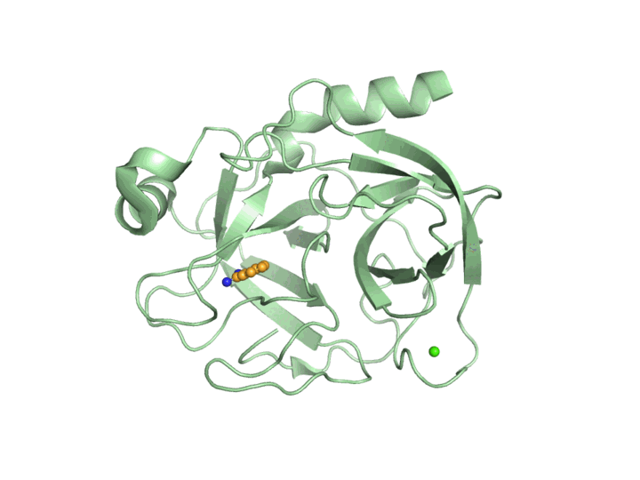 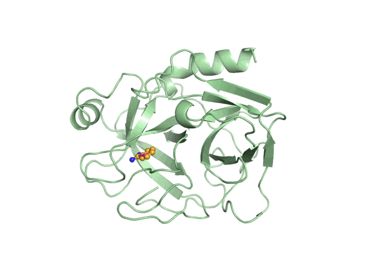

The figures below come from the benchmark run `cdk2_pert_boltz2` (Boltz-2, perturbed CDK2 with
ATP, reference 1B38) in
[bench/runs/2026-10-17T1859Z-849c856](bench/runs/2026-10-17T1859Z-849c856/harness/cdk2_pert_boltz2/run/report.md).
The verdict was stop.

| `figures/posebusters_grid.png` | `figures/interactions.png` |
| --- | --- |
| 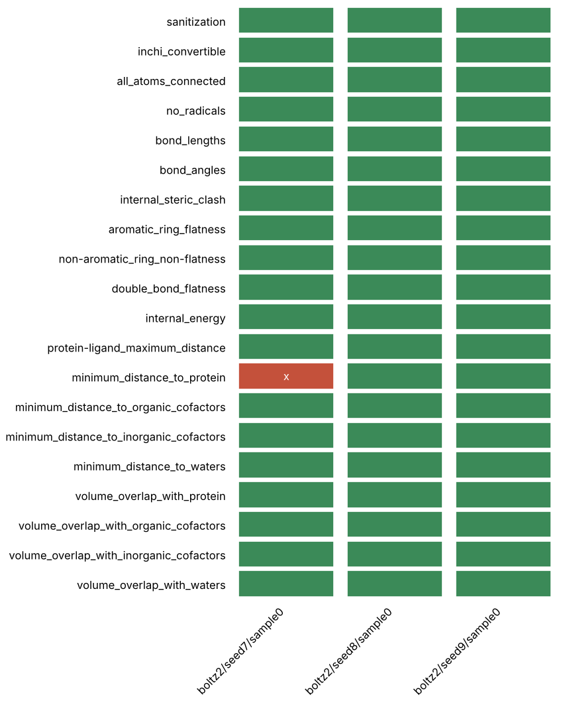 | 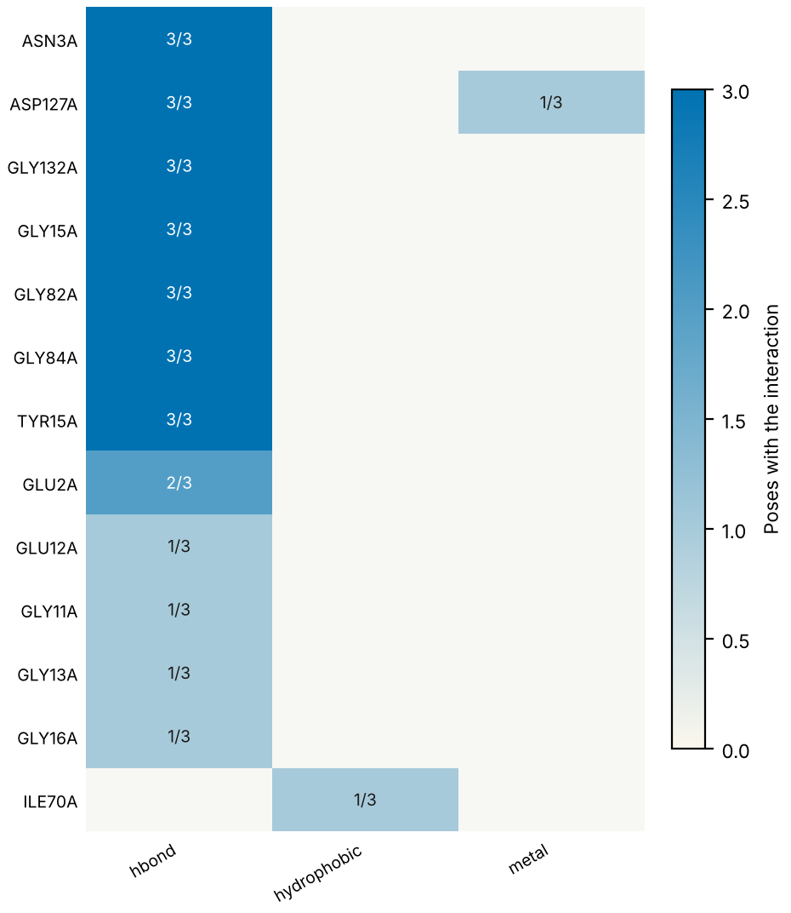 |
| 20 PoseBusters tests for the three seed poses; seed 7 fails `minimum_distance_to_protein` | PLIP interactions per residue and type, counted over the three poses |

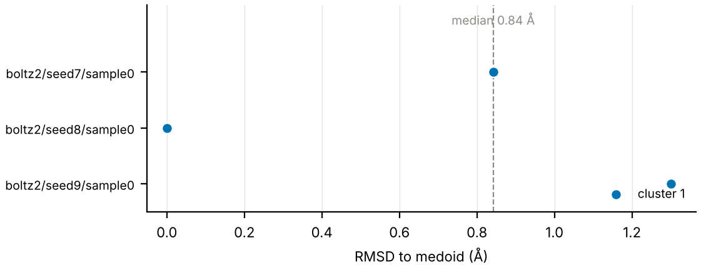

`figures/seed_spread.png`: RMSD of each seed pose to the medoid, median 0.84 Å.

<details>
<summary>Provenance graph of the same run (graph.svg rendered to PNG)</summary>

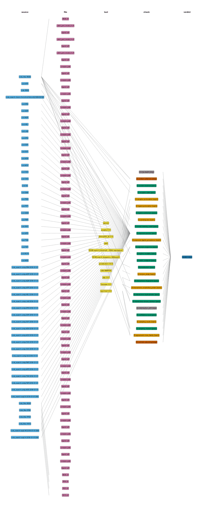

</details>

Excerpt of `report.md` from that run:

```text
Refused for the claim "Predicted pose of ATP in CDK2 is valid".

Refused over layers 2,3,4,5: 14 pass, 8 warn, 2 stop, 2 skip.
Stopped by l2.context.cofactors, l5.controls.redocking.
```

The first stop as it appears in `record.json`:

```json
{"check_id": "l2.context.cofactors", "layer": 2, "gate": "stop",
 "message": "components within 8.0 Å of ATP in 1B38 not supplied: MG",
 "thresholds": [{"name": "pocket_distance", "value": 8.0, "comparator": "<=",
   "origin": "Harness rule: a component of the reference entry within 8 Å of the declared ligand is required context; not yet calibrated",
   "evidence_level": "uncalibrated"}],
 "evidence": {"near_site_A": {"MG": 2.12}, "missing": ["MG"], "escalated_by_task": "ligand_pose"}}
```

## Tools used

The harness does not install co-folding or docking engines in its own environment. It writes their
inputs, parses their outputs and records their provenance. [docs/EXECUTORS.md](docs/EXECUTORS.md)
gives the input format, command line, output layout and field names of each executor, read from
the tool's source at a pinned commit with file and line. Output parsers for every executor except
pyDock are in `src/pah/executors/parsers/`. Versions are the runtime pins in
`configs/runtimes.yaml`; code licences are from `configs/executors.yaml`.

| Executor | Kind | Version | Role in the harness | Code licence |
| --- | --- | --- | --- | --- |
| [Boltz-1](https://github.com/jwohlwend/boltz) | Co-folding | boltz 2.2.1 | Runtime and parser | MIT |
| [Boltz-2](https://github.com/jwohlwend/boltz) | Co-folding and affinity | boltz 2.2.1 | Runtime and parser | MIT |
| [Chai-1](https://github.com/chaidiscovery/chai-lab) | Co-folding | chai-lab 0.6.1 | Runtime and parser | Apache-2.0 (code and weights) |
| [Protenix](https://github.com/bytedance/Protenix) | Co-folding | v1 1.1.0, v2 2.0.0 | Runtime and parser | Apache-2.0 |
| [ColabFold](https://github.com/sokrypton/ColabFold) | Co-folding (AlphaFold2-multimer v3) | 1.6.1 | Runtime and parser | MIT; AlphaFold2 weights CC-BY-4.0 |
| [OpenFold3](https://github.com/aqlaboratory/openfold-3) | Co-folding | openfold3 0.4.1, preview-2 weights | Runtime | not recorded |
| [AlphaFold3](https://github.com/google-deepmind/alphafold3) | Co-folding | commit `03f4f48` | Parser; runtime needs weights issued by request | Apache-2.0; weights under separate terms |
| [Gnina](https://github.com/gnina/gnina) | Docking with CNN rescoring | 1.3 | Runtime and parser | GPL-2.0 / Apache-2.0 |
| [DiffDock-L](https://github.com/gcorso/DiffDock) | Learned docking | v1.1.3 | Runtime and parser | MIT |
| [AutoDock Vina](https://github.com/ccsb-scripps/AutoDock-Vina) | Docking | 1.2.5; 1.2.7 in `pah dock` | Runtime, parser, `pah dock` | Apache-2.0 |
| [AutoDock-GPU](https://github.com/ccsb-scripps/AutoDock-GPU) | Docking | v1.6 | Runtime | not recorded |
| [HADDOCK3](https://github.com/haddocking/haddock3) | Protein-protein docking | n/a | Parser and checks only | Apache-2.0 |
| pyDock | Protein-protein docking | n/a | Checks only; no public source, contract unverified | Academic licence |

The web UI offers AlphaFold3, HADDOCK3 and pyDock for checks only.

Check libraries, with the versions exercised on 3PTB (trypsin with benzamidine, fetched live from
RCSB) in the development sandbox. All passed. Project links are from the tool register in
[docs/SPECIFICATION.md](docs/SPECIFICATION.md). Licences are the upstream project licences; check
the project before redistributing a tool.

| Library | Version | Exercised | Licence |
| --- | --- | --- | --- |
| [PoseBusters](https://github.com/maabuu/posebusters) | 0.6.5 | `dock` config, 22 tests | BSD-3-Clause |
| [RDKit](https://github.com/rdkit/rdkit) | 2026.9.1 | SDF parse, SMILES, InChIKey | BSD-3-Clause |
| [gemmi](https://github.com/project-gemmi/gemmi) | 0.7.5 | mmCIF parse, ligand and water removal | MPL-2.0 |
| [PLIP](https://github.com/pharmai/plip) | 3.0.1 | Interaction set for BEN:A:1 | GPL-2.0 |
| [PyMOL open source](https://github.com/schrodinger/pymol-open-source) | 3.2.0 | Headless ray-traced PNG and `.pse` session | PyMOL open-source licence |
| [OpenMM](https://github.com/openmm/openmm) | 8.6.1 | AMBER14 system, 50-step minimisation on CPU | MIT and LGPL |
| [PDBFixer](https://github.com/openmm/pdbfixer) | 1.12.0 | Missing residue and atom scan | MIT |
| [spyrmsd](https://github.com/RMeli/spyrmsd) | 0.9.0 | Symmetry-corrected RMSD | MIT |
| [FreeSASA](https://github.com/mittinatten/freesasa) | 2.2.1 | Total SASA | MIT |
| [Meeko](https://github.com/forlilab/Meeko) | 0.8.0 | PDBQT ligand preparation | LGPL-2.1 |
| [PROPKA](https://github.com/jensengroup/propka) | 3.5.1 | pKa run | LGPL-2.1 |
| [Dimorphite-DL](https://github.com/durrantlab/dimorphite_dl) | 2.1.0 | Protonation at pH 7.0 to 7.4 | Apache-2.0 |
| [fpocket](https://github.com/Discngine/fpocket) | conda-forge | Pocket detection on the receptor | MIT |
| [P2Rank](https://github.com/rdk/p2rank) | 2.6-alpha.8 | Top-ranked 3PTB pocket: A57, A189 to A192, A195, A214 to A216, A219 | MIT |
| [DockQ](https://github.com/bjornwallner/DockQ) | 2.1.3 | Import | MIT |
| [AlphaJudge](https://github.com/KosinskiLab/AlphaJudge) | 1.4.4 | Import | not recorded |
| openff-toolkit | 0.19.0 | Import (conda prefix) | not recorded |
| [APBS](https://github.com/Electrostatics/apbs) | 3.4.1 | Version | BSD-3-Clause |
| MolProbity | n/a | Ships with Phenix; runs only where Phenix is installed | Academic licence |

The register also lists [ProLIF](https://github.com/chemosim-lab/ProLIF),
[PDB2PQR](https://github.com/Electrostatics/pdb2pqr),
[MMseqs2](https://github.com/soedinglab/MMseqs2) and
[Foldseek](https://github.com/steineggerlab/foldseek).

Layer 0 clients and the records they keep:

| Source | Records |
| --- | --- |
| [UniProt](https://www.uniprot.org) REST | Sequence, entry and sequence version, MD5, release (`X-UniProt-Release`) |
| [RCSB PDB](https://www.rcsb.org) data API | Entry revision, release dates, resolution, method; CCD descriptors (InChIKey, SMILES) |
| RCSB PDB file service | mmCIF |
| [PDBe](https://www.ebi.ac.uk/pdbe/) API and SIFTS | Entity sequences (SEQRES), bound ligands; SIFTS UniProt mappings |
| [PubChem](https://pubchem.ncbi.nlm.nih.gov) PUG REST | InChIKey, SMILES |
| [AlphaFold DB](https://alphafold.ebi.ac.uk) | Entry, model version, sequence checksum |

[configs/sources.yaml](configs/sources.yaml) also declares, for `pah doctor` and later layers:
RCSB ModelServer and search API, PDBe-KB, the PDB Chemical Component Dictionary, ChEMBL,
BindingDB, Binding MOAD, BioLiP2, InterPro and Pfam, MobiDB, DisProt, STRING, IntAct, the
ColabFold MSA server and databases, MMseqs2 and Foldseek, PLINDER, PINDER, DUD-E, DEKOIS 2.0,
LIT-PCBA, CARD, the WHO TB mutation catalogue and Zenodo.

The platform is [Modal](https://modal.com) (deployment and GPU executors, `modal` 1.6.2, Apache-2.0),
[FastAPI](https://github.com/fastapi/fastapi) (HTTP API, 0.143.3, MIT),
[Next.js](https://github.com/vercel/next.js) 16.4.2 (web UI, MIT) with Tailwind CSS 4.3.3,
[Mol*](https://github.com/molstar/molstar) 5.13.1 (structure viewers in the browser, MIT), typer
(CLI) and the MCP Python SDK (MCP server).

## Results on real targets

On 3PTB with real executor outputs:

| Run | Verdict | Values |
| --- | --- | --- |
| `examples/3ptb_vina/` (Vina 1.2.7, 5 seeds, written by `pah dock`) | pass_with_warnings | PoseBusters 20/20; medoid 0.38 Å from the crystal ligand; redocking 0.42 Å; drift 0.34 Å; pairwise RMSD median 0.07 Å; warnings: imine stereo undefined, His57 and Asp189 pKa within 1 unit of pH 7.4, declared neutral benzamidine against the cation at pH 7.4 |
| `examples/3ptb_boltz2/` (Boltz-2 2.2.1 on CPU, 1 seed) | stop | pocket pLDDT 98.6, ligand ipTM 0.962; 0.43 Å from the crystal ligand and 0.51 Å from the Vina medoid; Asp189 hydrogen bond reproduced; pocket similarity 72.9 to 3PTB and 314 pre-cutoff entries with benzamidine (training exposure); drift 2.05 Å; stop: no redocking control supplied |

Layers 0 and 1 were run live on further entries with manifests built from SIFTS, UniProt and RCSB.

| Entry | Content | Verdict | Non-pass findings |
| --- | --- | --- | --- |
| 1STP | Streptavidin, biotin (3 stereocentres) | pass | none |
| 1HSG | HIV-1 protease homodimer, indinavir (5 stereocentres) | pass | none |
| 2RH1 | beta2 adrenergic receptor with T4 lysozyme insert, carazolol; 7 declared mutations over two UniProt entries on one chain | pass | none |
| 4HHB | Haemoglobin, two entities with two copies each, haem | pass_with_warnings | InChIKey skeleton-only match for haem (metal rule), layers 0 and 1 |
| 1M17 | EGFR kinase domain, erlotinib | pass_with_warnings | 2 residues with alternate locations, no policy declared |
| 3HTB | T4 lysozyme L99A, 6 declared mutations | pass_with_warnings | 10 residues with alternate locations, no policy declared |
| 4HHB alpha/beta | Interaction discovery task | pass | none |
| 1M17 + 4 ligands | Virtual screening task; one SMILES paired with the wrong CID, racemic ibuprofen | stop | InChIKey mismatch in layers 0 and 1; one undefined stereocentre |

Without declared mutations, 3HTB and 2RH1 stop in `l0.cross.uniprot_seqres` and list the
substitutions (L99A, M102Q, C54T, C97A, N187E and others). Declaring a mutation with the wrong
wild-type residue stops with the UniProt residue named. A missing ligand file stops in
`l1.ligand.sanitization`.

## Perturbation benchmark

`bench/` runs the perturbation benchmark from the runbook: four protein-ligand systems (FtsE 8X61,
CDK2 1B38, MEK1 7XLP, glucose dehydrogenase 2VWH), each wild type and perturbed, predicted by
Boltz-2 and DiffDock-L on Modal A100 GPUs with three seeds, checked by the harness, and judged by
GLM-4.6 once from the confidence score and once from the harness fact file. Ground truth is fixed
by construction. Setup, stages and files are in [bench/README.md](bench/README.md); each run
records its scores in `bench/scores.csv`.

| Run | Seeds | Predictions | Score only, balanced accuracy (95% CI) | Fact file, balanced accuracy (95% CI) | McNemar exact p |
| --- | --- | --- | --- | --- | --- |
| [2026-10-17T1611Z-426bfe9](bench/runs/2026-10-17T1611Z-426bfe9/report.md) | 1, 2, 3 | 16 (6 valid, 10 invalid) | 0.50 (0.24 to 0.77) | 0.53 (0.38 to 0.75) | 0.69 |
| [2026-10-17T1752Z-2f5a1c7](bench/runs/2026-10-17T1752Z-2f5a1c7/report.md) | 4, 5, 6 | 16 (6 valid, 10 invalid) | 0.50 (0.24 to 0.77) | 0.58 (0.50 to 0.75) | 0.45 |
| [2026-10-17T1859Z-849c856](bench/runs/2026-10-17T1859Z-849c856/report.md) | 7, 8, 9 | 16 (6 valid, 10 invalid) | 0.50 (0.24 to 0.77) | 0.75 (0.50 to 1.0) | 0.13 |

In run 2026-10-17T1859Z-849c856, cutting 7 FtsE contacts to glycine moves the ATP medoid 16 Å
(Boltz-2) and 18 Å (DiffDock-L) from the deposited position, and contact recovery falls from 9
and 10 of 16 to 1 and 1. In perturbed CDK2 the medoid still sits 2.2 Å from the deposited ATP but
recovers 1 of 9 contacts instead of 6. Confidence and PoseBusters stay clean on both.

In every run the score-only arm called each Boltz-2 prediction valid, the perturbed ones included,
and the fact-file arm rejected every perturbed Boltz-2 pose. The fact-file arm also rejected
between three and five of the six valid poses per run. Most of those false negatives are
DiffDock-L poses with sub-Å geometry and high estimated torsion strain, which points to a limit of
the strain method. Every interval overlaps 0.5 and no McNemar test reaches significance. Eight systems per executor are a demonstration and do not support a
statistical claim. Each report opens with the per-system cases, gives the agent's stated reason
for each misclassification, and keeps the pooled accuracy in a later section. Each run also writes
`results/deck.pptx`, reviewed against its own rendered slides and bound to them by a hash receipt,
and `results/walkthrough.mp4`.

## Deployment

### Modal

Modal is the default deployment. The live instances are:

- Web UI: https://persistentepiphany--pah-web.us-east.modal.run
- HTTP API: https://persistentepiphany--pah-api.us-east.modal.run (health at `/health`)

`scripts/deploy_modal.sh` deploys the HTTP API (`pah-api`, one CPU container with the `pah-runs`
and `pah-cache` volumes), builds the web UI against it, deploys it as `pah-web` and writes both
URLs to `deploy/modal/urls.json`. `modal deploy deploy/modal/api_app.py` deploys the API alone.
Executors run as separate GPU apps. Commands, volumes, cold start and Vercel settings are in
[deploy/modal/README.md](deploy/modal/README.md). The deployed API and web UI have no
authentication.

```bash
modal token new                          # or set MODAL_TOKEN_ID and MODAL_TOKEN_SECRET
modal run deploy/modal/doctor_app.py     # doctor on Modal; the report is copied to runs/<run-id>/
```

The doctor image installs the same extras as `pyproject.toml` and the same conda packages as
`environment/conda.yml`, then runs `pah fetch --profile modal`.

### Executors on GPU hosts

The optional `pah runtimes` commands install, build and run the executors on GPU hosts: Boltz-1/2,
Protenix v1 and v2, Chai-1, AlphaFold3, AlphaFold3 on OpenFold3 weights, ColabFold, OpenFold3,
DiffDock-L, Gnina, AutoDock Vina and AutoDock-GPU. Where an
[optimisation kit](https://github.com/anthropics/uplifting-biomolecular-modeling) exists for the
tool, it is used by default in `fast` mode whenever it can engage on the host; otherwise the stock
tool runs and the reason is recorded in `runtime_record.json` and a `runtime.accel` finding.
`--accel stock` or `PAH_ACCEL=stock` turns the kits off, and `--accel kit` makes them mandatory.

```bash
pah runtimes list
pah runtimes hardware                         # GPUs here and the route each executor would take
pah runtimes kits fetch                       # kits at the commit pinned in configs/accel.yaml
pah runtimes build boltz2 --target apptainer  # kit image; it also runs stock as mode off
pah runtimes run boltz2 -p input=x.yaml --out runs/b2
```

Routes, launchers (host, Docker, Apptainer), the CSF3 and Modal entry points and what was verified
without a GPU are in [docs/RUNTIMES.md](docs/RUNTIMES.md).

### CSF3

```bash
# login node
git clone --recurse-submodules https://github.com/persistentepiphany/harness-hackathon ~/harness-hackathon
cd ~/harness-hackathon && scripts/setup_env.sh ~/scratch/pah csf3
source deploy/csf3/env.sh
pah doctor --profile csf3

# compute node
sbatch deploy/csf3/doctor.sbatch
```

Compare the two reports. Sources that the login node reaches and the compute node does not have
to be fetched into the cache on the login node before a run. The partition and module names in
`configs/profiles/csf3.yaml` and `deploy/csf3/` have not been checked against CSF3 yet; confirm
them with `sinfo -s` and `module avail`.

### Fetch

`pah fetch` downloads assets from GitHub releases, static binary hosts, licensed sources or
authenticated buckets on the end user's host, as declared in
[configs/externals.yaml](configs/externals.yaml).

```bash
.venv/bin/pah fetch                      # default assets: P2Rank, MMseqs2, Foldseek, PLINDER/PINDER indexes
.venv/bin/pah fetch --only gnina         # one asset
.venv/bin/pah fetch --all                # also executor weights, gnina, ColabFold databases (large)
.venv/bin/pah fetch --dry-run --all      # list targets and sizes
```

| Asset | Source | Default | Note |
| --- | --- | --- | --- |
| `p2rank` | GitHub release `rdk/p2rank` | yes | Links `prank` into `.tools/bin` |
| `p2rank_source` | `git clone` and Gradle build | fallback | Runs only when the `p2rank` release download fails; needs Java 17+ |
| `mmseqs` | mmseqs.com static build | yes | Links `mmseqs` |
| `foldseek` | mmseqs.com static build | yes | Links `foldseek` |
| `plinder_index`, `pinder_index` | `gs://plinder`, `gs://pinder` | yes | Needs `gcloud auth login`; skipped when gcloud is absent |
| `gnina` | GitHub release `gnina/gnina` | no | Executor hosts |
| `protenix_weights` | Protenix checkpoint host | no | Executor hosts, about 1.4 GB |
| `colabfold_databases` | ColabFold `setup_databases.sh` | no | About 1 TB uncompressed |
| `alphafold3_weights`, `pydock`, `phenix` | By request or licence | manual | Set `PAH_AF3_WEIGHTS`, `PAH_PYDOCK_HOME`, `PAH_PHENIX_HOME` |

Downloads go to a `.part` file and are renamed only when complete, with the sha256 recorded in
`.tools/externals.lock.json`. Archives are checked for paths that leave the target directory
before extraction. Assets already present are skipped unless `--force` is given. Fetched binaries
get small wrapper scripts in `.tools/bin`, which the doctor searches.

### Doctor

`pah doctor` probes sources, tools, weights and skills (`--only sources` for one category,
`--format jsonl` for one JSON event per line, `--profile csf3 --dry-run` to validate a profile).
Each probe prints a line as soon as it finishes, and each category ends with a count line. The
report goes to `runs/<run-id>/` as `doctor_report.json`, `doctor_report.md` and `events.jsonl`.
A failed probe, download or registry entry is recorded with its cause and the others continue. A
bad profile name or an unwritable report directory stops the command with exit code 2.
`--strict` exits with code 1 if any probe is not `ok`.

A probe reports `ok` (reachable, importable or present), `blocked` (the network proxy refused the
host), `unreachable` (DNS failure, connection failure or timeout), `http_error` (unexpected HTTP
code, with a body excerpt in the detail), `missing` (module, binary, variable or file not found),
`manual` (needs a licence or a by-request download; set the environment variable named in the
detail) or `error` (the probe itself failed).

On 2026-10-17, after `pah fetch`, `pah doctor --profile local` in the development sandbox gave 101
probes: 95 ok, 3 http_error, 1 missing, 2 manual. PLINDER and PINDER need `gcloud auth login`,
the gnina release download was outside the session's GitHub scope, MolProbity needs Phenix, and
AlphaFold3 weights and pyDock need `PAH_AF3_WEIGHTS` and `PAH_PYDOCK_HOME`. The P2Rank release
download was refused there, so the `p2rank_source` fallback built it from source.

## Layout

| Path | Contents |
| --- | --- |
| `src/pah/core/` | Models, event bus, manifest, task specs, check registry, engine, verdict policy |
| `src/pah/sources/` | Content-addressed cache, cached HTTP, Layer 0 source clients |
| `src/pah/checks/` | Shared check library, one module per layer |
| `src/pah/executors/` | Input builders and output parsers per executor |
| `src/pah/report/` | PyMOL renders, figures, provenance graph, report writer, style lint |
| `src/pah/doctor/` | Probes, catalog, runner, report |
| `src/pah/externals/` | `pah fetch`: downloader, installers per asset kind, lock file |
| `src/pah/runtimes/` | Executor install, image recipes, kit or stock routing, launchers, runner |
| `src/pah/interfaces/` | CLI, MCP server, HTTP API (`pah serve`) |
| `src/pah/webui/` | `/ui` routes: run record adapter, job list and log stream, run settings to manifest, uploads, agent tasks |
| `web/` | Web UI (Next.js), see [web/README.md](web/README.md); contract in [docs/UI.md](docs/UI.md) |
| `configs/` | Sources, tools, executors, externals, task specifications and deployment profiles as YAML |
| `bench/` | Perturbation benchmark: design, Modal app, scoring and per-run results ([README](bench/README.md)) |
| `examples/` | Run manifests |
| `deploy/csf3/`, `deploy/modal/` | Slurm and Modal entry points |
| `environment/conda.yml` | Conda-only tools |
| `third_party/skills/` | Pinned writing, figure and documentation skills ([sources](third_party/skills/SOURCES.md)) |
| `docs/` | Specification, architecture, executor contracts, runtimes, interfaces, web UI contract |

## Development

```bash
make check     # ruff, ruff format --check, mypy --strict, pytest
```

Tests do not use the network. Source responses recorded from the public APIs live in
`tests/fixtures/sources/` and are served by `tests/fakeweb.py`. Live tests carry the `network`
marker and are excluded by `make check`.

Open work:

| Item | Scope |
| --- | --- |
| Read side | The native routes (`pah.api.adapter`, `runs/<id>/ui_record.json`) and the `/ui` routes (`pah.webui`) build the UI record separately; merge them into one implementation |
| Modal API image | Add the OpenMM and OpenFF conda environment, so `l4.minimisation_drift` runs on Modal instead of skipping with `tool_missing` |
| Access | Add authentication to the deployed API and web UI |
| Docking poses | Persist per-pose scores for every docking mode, not only mode 0 of each seed |
| Co-folding models | Copy model files into `runs/<id>/predictions/` so every ensemble member has a structure file in the run |

## Attributions

Project links and licences for each tool and data source are in [Tools used](#tools-used). Primary
citations for the main methods:

- Boltz-1: Wohlwend J, Corso G, Passaro S, et al. Boltz-1: democratizing biomolecular interaction modeling. bioRxiv, 2024.
- Boltz-2: Passaro S, Corso G, Wohlwend J, et al. Boltz-2: towards accurate and efficient binding affinity prediction. bioRxiv, 2025.
- Chai-1: Chai Discovery. Chai-1: decoding the molecular interactions of life. bioRxiv, 2024.
- Protenix: ByteDance AML AI4Science team. Protenix: advancing structure prediction through a comprehensive AlphaFold3 reproduction. bioRxiv, 2025.
- ColabFold: Mirdita M, Schütze K, Moriwaki Y, Heo L, Ovchinnikov S, Steinegger M. ColabFold: making protein folding accessible to all. Nature Methods 19, 679-682 (2022).
- AlphaFold3: Abramson J, Adler J, Dunger J, et al. Accurate structure prediction of biomolecular interactions with AlphaFold 3. Nature 630, 493-500 (2024).
- DiffDock-L: Corso G, Deng A, Fry B, Polizzi N, Barzilay R, Jaakkola T. Deep confident steps to new pockets: strategies for docking generalization. ICLR, 2024.
- Gnina: McNutt AT, Francoeur P, Aggarwal R, et al. GNINA 1.0: molecular docking with deep learning. J Cheminform 13, 43 (2021).
- AutoDock Vina: Trott O, Olson AJ. J Comput Chem 31, 455-461 (2010). Eberhardt J, Santos-Martins D, Tillack AF, Forli S. AutoDock Vina 1.2.0. J Chem Inf Model 61, 3891-3898 (2021).
- PoseBusters: Buttenschoen M, Morris GM, Deane CM. PoseBusters: AI-based docking methods fail to generate physically valid poses or generalise to novel sequences. Chem Sci 15, 3130-3139 (2024). https://doi.org/10.1039/d3sc04185a
- PLIP: Salentin S, Schreiber S, Haupt VJ, Adasme MF, Schroeder M. Nucleic Acids Res 43, W443-W447 (2015). Adasme MF, Linnemann KL, Bolz SN, et al. PLIP 2021. Nucleic Acids Res 49, W530-W534 (2021).
- RDKit: RDKit, open-source cheminformatics, https://www.rdkit.org.
- gemmi: Wojdyr M. GEMMI: a library for structural biology. J Open Source Softw 7(73), 4200 (2022).
- PyMOL: The PyMOL Molecular Graphics System, open-source version, Schrödinger, LLC.
- Mol*: Sehnal D, Bittrich S, Deshpande M, et al. Mol* Viewer: modern web app for 3D visualization and analysis of large biomolecular structures. Nucleic Acids Res 49, W431-W437 (2021).
- OpenMM: Eastman P, Galvelis R, Peláez RP, et al. OpenMM 8: molecular dynamics simulation with machine learning potentials. J Phys Chem B 128, 109-116 (2024).

Structures and records come from UniProt, the RCSB PDB, PDBe and SIFTS, PubChem, AlphaFold DB and
the other sources in [configs/sources.yaml](configs/sources.yaml). The benchmark uses PDB entries
8X61, 1B38, 7XLP and 2VWH; the examples use 3PTB, 1STP, 1HSG, 2RH1, 4HHB, 1M17 and 3HTB.

Skills vendored to write, plot, record and present this project, with commits in
[third_party/skills/SOURCES.md](third_party/skills/SOURCES.md) and
[.claude/skills/VENDORED.md](.claude/skills/VENDORED.md):

| Skill | Upstream | Licence |
| --- | --- | --- |
| humanizer | [blader/humanizer](https://github.com/blader/humanizer) v3.1.0 | MIT |
| scientific-writing | [K-Dense-AI/claude-scientific-writer](https://github.com/K-Dense-AI/claude-scientific-writer) v2.22.0 | MIT |
| scientific-visualization, matplotlib, markdown-mermaid-writing | [k-dense-ai/scientific-agent-skills](https://github.com/k-dense-ai/scientific-agent-skills) | MIT |
| readthedocs-search-api | [readthedocs/skills](https://github.com/readthedocs/skills) | MIT |
| presentation-skill | [siril9/presentation-skill](https://github.com/siril9/presentation-skill) v0.14.0 | MIT |
| product-film | [Rieranthony/product-film-skill](https://github.com/Rieranthony/product-film-skill) v1.1.0 | MIT |
| playwright-cli | [microsoft/playwright-cli](https://github.com/microsoft/playwright-cli) 0.1.22 | Apache-2.0 |
| sound-effects | [awesome-genmedia/skills](https://github.com/awesome-genmedia/skills) | MIT |

## Licence

GPL-3.0. See [LICENSE](LICENSE).
