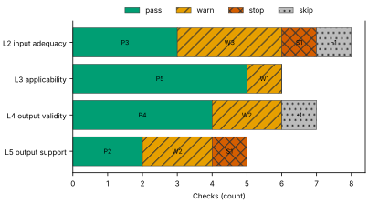
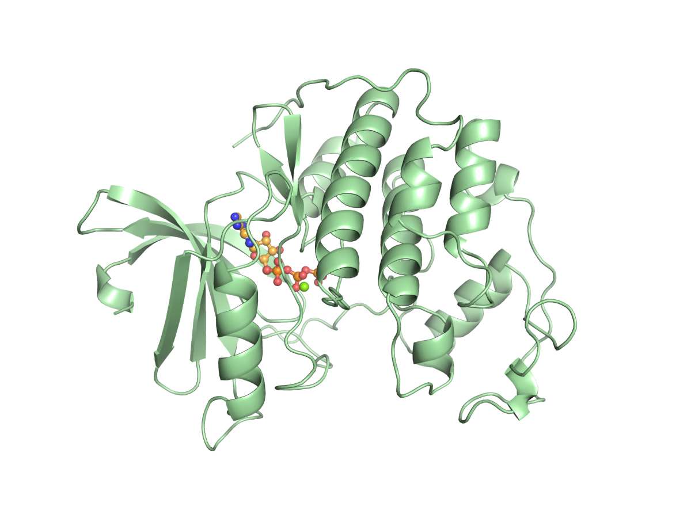
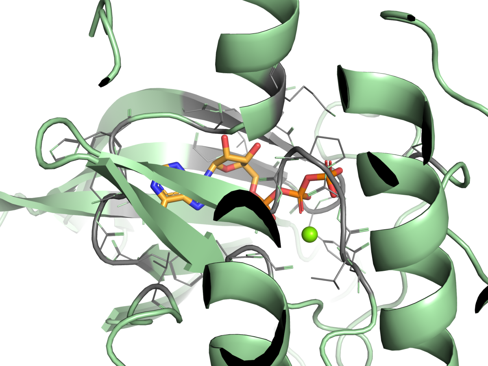
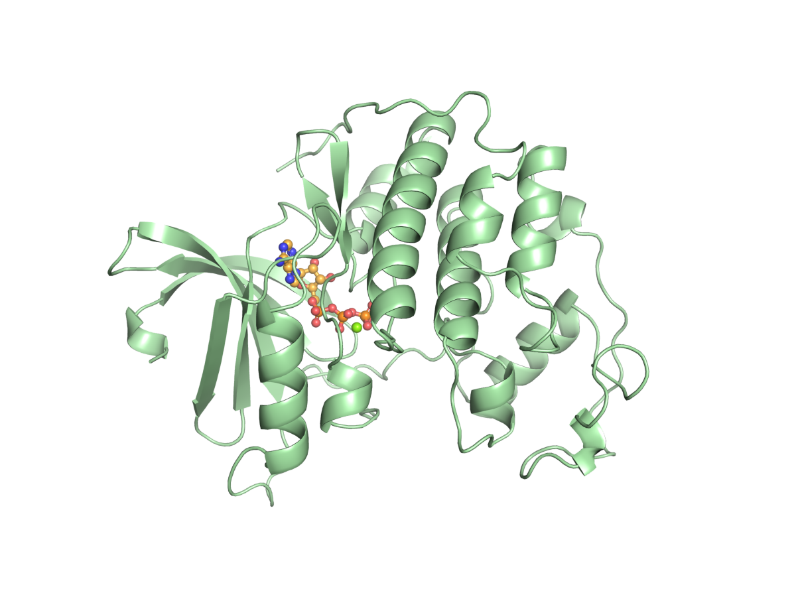
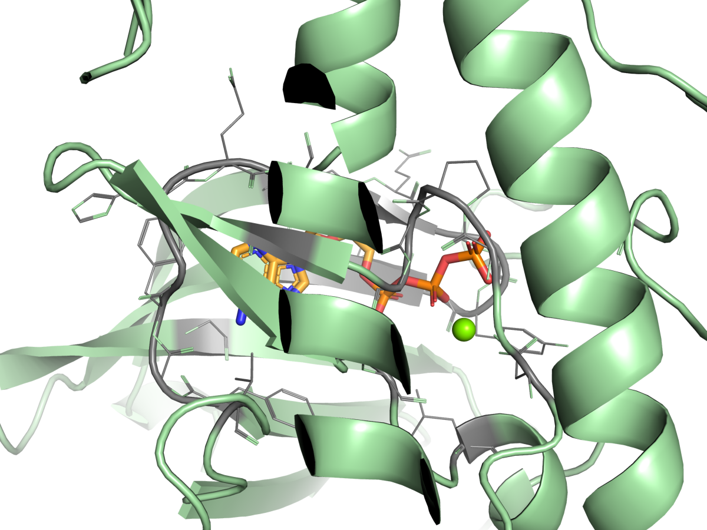
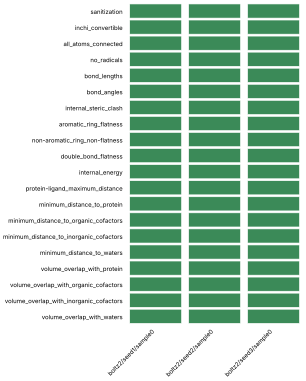
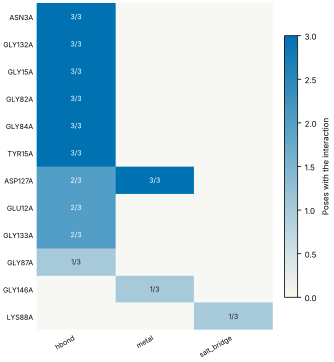
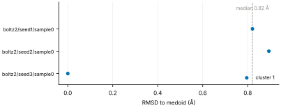
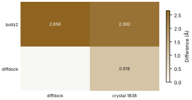
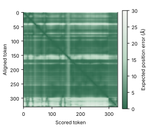

# Run report · Ligand pose in a known pocket

Prediction assurance · run `ligand_pose-e8bc8a7b2045` · 2026-10-17 16:48:08 UTC

**Refused** for the claim "Predicted pose of ATP in CDK2 is valid".

Refused over layers 2,3,4,5: 14 pass, 8 warn, 2 stop, 2 skip. Stopped by l2.context.cofactors, l5.controls.redocking. Warnings from l2.receptor.protonation, l2.ligand.protonation, l2.docking.box, l3.exposure.ligand_prevalence, l4.torsion_strain, l4.interactions.unsatisfied_polars, l5.sampling.seeds, l5.agreement.cross_family. 1 checks not verified.

Stops: `l2.context.cofactors`, `l5.controls.redocking`.

Warnings: `l2.receptor.protonation`, `l2.ligand.protonation`, `l2.docking.box`, `l3.exposure.ligand_prevalence`, `l4.torsion_strain`, `l4.interactions.unsatisfied_polars`, `l5.sampling.seeds`, `l5.agreement.cross_family`.

Not verified: 1 checks.

| Field | Value |
| --- | --- |
| Task | Ligand pose in a known pocket (`ligand_pose`) |
| Tools | Boltz-2 2.2.1 (co-folding), DiffDock-L (docking) |
| Target | `protein` |
| Ligand | `c1nc(c2c(n1)n(cn2)[C@H]3[C@@H]([C@@H]([C@H](O3)CO[P@@](=O)(O)O[P@](=O)(O)OP(=O)(O)O)O)O)N` |
| Reference | `1B38` |
| pH | 7.4 |
| Seeds | 3 |
| Layers run | 2, 3, 4, 5 |
| Run | `ligand_pose-e8bc8a7b2045` |
| Created | 2026-10-17 16:48:08 UTC |
| Finished | 2026-10-17 16:49:24 UTC |
| pah version | 0.1.0 |
| Report schema | 1 |

## Layers

| Layer | Status | Result | pass | warn | stop | skip | Time |
| --- | --- | --- | --- | --- | --- | --- | --- |
| L0 Provenance | not run | n/a | n/a | n/a | n/a | n/a | n/a |
| L1 Input integrity | not run | n/a | n/a | n/a | n/a | n/a | n/a |
| L2 Input adequacy | done | stop | 3 | 3 | 1 | 1 | 2.0 s |
| L3 Applicability | done | warn | 5 | 1 | 0 | 0 | 3.6 s |
| L4 Output validity | done | warn | 4 | 2 | 0 | 1 | 70.5 s |
| L5 Output support | done | stop | 2 | 2 | 1 | 0 | 163 ms |

## Figures

Fig. 1 · Check outcomes per layer for run ligand_pose-e8bc8a7b2045. Totals: pass 14, warn 8, stop 2, skip 2.
Files: data [figures/gates_by_layer.csv](figures/gates_by_layer.csv).

## Structures

74 PyMOL renders.

1B38 mmCIF (source_structure), whole structure. Chains A; organic components ACE, ATP. sha256 b851c5e8a98632f8. PyMOL session: [renders/1B38.pse](renders/1B38.pse).

1B38 mmCIF (source_structure), ligand environment within 5 Å. Chains A; organic components ACE, ATP. sha256 b851c5e8a98632f8. PyMOL session: [renders/1B38.pse](renders/1B38.pse).

boltz2/seed1/sample0 (prediction_structure), whole structure. Chains A, C1, L; organic components LIG1. sha256 22980f3efbb62362. PyMOL session: [renders/boltz2_seed1_sample0.pse](renders/boltz2_seed1_sample0.pse).

boltz2/seed1/sample0 (prediction_structure), ligand environment within 5 Å. Chains A, C1, L; organic components LIG1. sha256 22980f3efbb62362. PyMOL session: [renders/boltz2_seed1_sample0.pse](renders/boltz2_seed1_sample0.pse).

boltz2/seed2/sample0 (prediction_structure), whole structure. Chains A, C1, L; organic components LIG1. sha256 e2a6858f0b2770fc. PyMOL session: [renders/boltz2_seed2_sample0.pse](renders/boltz2_seed2_sample0.pse).

boltz2/seed2/sample0 (prediction_structure), ligand environment within 5 Å. Chains A, C1, L; organic components LIG1. sha256 e2a6858f0b2770fc. PyMOL session: [renders/boltz2_seed2_sample0.pse](renders/boltz2_seed2_sample0.pse).

boltz2/seed3/sample0 (prediction_structure), whole structure. Chains A, C1, L; organic components LIG1. sha256 c7f58a2c281a45ef. PyMOL session: [renders/boltz2_seed3_sample0.pse](renders/boltz2_seed3_sample0.pse).

boltz2/seed3/sample0 (prediction_structure), ligand environment within 5 Å. Chains A, C1, L; organic components LIG1. sha256 c7f58a2c281a45ef. PyMOL session: [renders/boltz2_seed3_sample0.pse](renders/boltz2_seed3_sample0.pse).

diffdock/seed1/mode0 (prediction_structure), whole structure. Chains A, L; organic components LIG. sha256 e51a72080198c9e7. PyMOL session: [renders/diffdock_seed1_mode0.pse](renders/diffdock_seed1_mode0.pse).

diffdock/seed1/mode0 (prediction_structure), ligand environment within 5 Å. Chains A, L; organic components LIG. sha256 e51a72080198c9e7. PyMOL session: [renders/diffdock_seed1_mode0.pse](renders/diffdock_seed1_mode0.pse).

diffdock/seed1/mode1 (prediction_structure), whole structure. Chains A, L; organic components LIG. sha256 6d8b8b37df4a5cbb. PyMOL session: [renders/diffdock_seed1_mode1.pse](renders/diffdock_seed1_mode1.pse).

diffdock/seed1/mode1 (prediction_structure), ligand environment within 5 Å. Chains A, L; organic components LIG. sha256 6d8b8b37df4a5cbb. PyMOL session: [renders/diffdock_seed1_mode1.pse](renders/diffdock_seed1_mode1.pse).

diffdock/seed1/mode2 (prediction_structure), whole structure. Chains A, L; organic components LIG. sha256 e858b71d045dfc31. PyMOL session: [renders/diffdock_seed1_mode2.pse](renders/diffdock_seed1_mode2.pse).

diffdock/seed1/mode2 (prediction_structure), ligand environment within 5 Å. Chains A, L; organic components LIG. sha256 e858b71d045dfc31. PyMOL session: [renders/diffdock_seed1_mode2.pse](renders/diffdock_seed1_mode2.pse).

diffdock/seed1/mode3 (prediction_structure), whole structure. Chains A, L; organic components LIG. sha256 3cff9da22a7b642d. PyMOL session: [renders/diffdock_seed1_mode3.pse](renders/diffdock_seed1_mode3.pse).

diffdock/seed1/mode3 (prediction_structure), ligand environment within 5 Å. Chains A, L; organic components LIG. sha256 3cff9da22a7b642d. PyMOL session: [renders/diffdock_seed1_mode3.pse](renders/diffdock_seed1_mode3.pse).

diffdock/seed1/mode4 (prediction_structure), whole structure. Chains A, L; organic components LIG. sha256 5cf044f308c732bd. PyMOL session: [renders/diffdock_seed1_mode4.pse](renders/diffdock_seed1_mode4.pse).

diffdock/seed1/mode4 (prediction_structure), ligand environment within 5 Å. Chains A, L; organic components LIG. sha256 5cf044f308c732bd. PyMOL session: [renders/diffdock_seed1_mode4.pse](renders/diffdock_seed1_mode4.pse).

diffdock/seed1/mode5 (prediction_structure), whole structure. Chains A, L; organic components LIG. sha256 cb253167c426125f. PyMOL session: [renders/diffdock_seed1_mode5.pse](renders/diffdock_seed1_mode5.pse).

diffdock/seed1/mode5 (prediction_structure), ligand environment within 5 Å. Chains A, L; organic components LIG. sha256 cb253167c426125f. PyMOL session: [renders/diffdock_seed1_mode5.pse](renders/diffdock_seed1_mode5.pse).

diffdock/seed1/mode6 (prediction_structure), whole structure. Chains A, L; organic components LIG. sha256 da5894a8e17b4366. PyMOL session: [renders/diffdock_seed1_mode6.pse](renders/diffdock_seed1_mode6.pse).

diffdock/seed1/mode6 (prediction_structure), ligand environment within 5 Å. Chains A, L; organic components LIG. sha256 da5894a8e17b4366. PyMOL session: [renders/diffdock_seed1_mode6.pse](renders/diffdock_seed1_mode6.pse).

diffdock/seed1/mode7 (prediction_structure), whole structure. Chains A, L; organic components LIG. sha256 7b20a0d7488dd54b. PyMOL session: [renders/diffdock_seed1_mode7.pse](renders/diffdock_seed1_mode7.pse).

diffdock/seed1/mode7 (prediction_structure), ligand environment within 5 Å. Chains A, L; organic components LIG. sha256 7b20a0d7488dd54b. PyMOL session: [renders/diffdock_seed1_mode7.pse](renders/diffdock_seed1_mode7.pse).

diffdock/seed1/mode8 (prediction_structure), whole structure. Chains A, L; organic components LIG. sha256 c85ecca37d7b329c. PyMOL session: [renders/diffdock_seed1_mode8.pse](renders/diffdock_seed1_mode8.pse).

diffdock/seed1/mode8 (prediction_structure), ligand environment within 5 Å. Chains A, L; organic components LIG. sha256 c85ecca37d7b329c. PyMOL session: [renders/diffdock_seed1_mode8.pse](renders/diffdock_seed1_mode8.pse).

diffdock/seed2/mode0 (prediction_structure), whole structure. Chains A, L; organic components LIG. sha256 c9a15a7c6f2e1863. PyMOL session: [renders/diffdock_seed2_mode0.pse](renders/diffdock_seed2_mode0.pse).

diffdock/seed2/mode0 (prediction_structure), ligand environment within 5 Å. Chains A, L; organic components LIG. sha256 c9a15a7c6f2e1863. PyMOL session: [renders/diffdock_seed2_mode0.pse](renders/diffdock_seed2_mode0.pse).

diffdock/seed2/mode1 (prediction_structure), whole structure. Chains A, L; organic components LIG. sha256 6a9ce13916898f07. PyMOL session: [renders/diffdock_seed2_mode1.pse](renders/diffdock_seed2_mode1.pse).

diffdock/seed2/mode1 (prediction_structure), ligand environment within 5 Å. Chains A, L; organic components LIG. sha256 6a9ce13916898f07. PyMOL session: [renders/diffdock_seed2_mode1.pse](renders/diffdock_seed2_mode1.pse).

diffdock/seed2/mode2 (prediction_structure), whole structure. Chains A, L; organic components LIG. sha256 668037be7b882d5a. PyMOL session: [renders/diffdock_seed2_mode2.pse](renders/diffdock_seed2_mode2.pse).

diffdock/seed2/mode2 (prediction_structure), ligand environment within 5 Å. Chains A, L; organic components LIG. sha256 668037be7b882d5a. PyMOL session: [renders/diffdock_seed2_mode2.pse](renders/diffdock_seed2_mode2.pse).

diffdock/seed2/mode3 (prediction_structure), whole structure. Chains A, L; organic components LIG. sha256 2fe41f76f2f3f382. PyMOL session: [renders/diffdock_seed2_mode3.pse](renders/diffdock_seed2_mode3.pse).

diffdock/seed2/mode3 (prediction_structure), ligand environment within 5 Å. Chains A, L; organic components LIG. sha256 2fe41f76f2f3f382. PyMOL session: [renders/diffdock_seed2_mode3.pse](renders/diffdock_seed2_mode3.pse).

diffdock/seed2/mode4 (prediction_structure), whole structure. Chains A, L; organic components LIG. sha256 03b9f0206111e3ca. PyMOL session: [renders/diffdock_seed2_mode4.pse](renders/diffdock_seed2_mode4.pse).

diffdock/seed2/mode4 (prediction_structure), ligand environment within 5 Å. Chains A, L; organic components LIG. sha256 03b9f0206111e3ca. PyMOL session: [renders/diffdock_seed2_mode4.pse](renders/diffdock_seed2_mode4.pse).

diffdock/seed2/mode5 (prediction_structure), whole structure. Chains A, L; organic components LIG. sha256 dc44e3e07de44269. PyMOL session: [renders/diffdock_seed2_mode5.pse](renders/diffdock_seed2_mode5.pse).

diffdock/seed2/mode5 (prediction_structure), ligand environment within 5 Å. Chains A, L; organic components LIG. sha256 dc44e3e07de44269. PyMOL session: [renders/diffdock_seed2_mode5.pse](renders/diffdock_seed2_mode5.pse).

diffdock/seed2/mode6 (prediction_structure), whole structure. Chains A, L; organic components LIG. sha256 9463ee6bef8f6078. PyMOL session: [renders/diffdock_seed2_mode6.pse](renders/diffdock_seed2_mode6.pse).

diffdock/seed2/mode6 (prediction_structure), ligand environment within 5 Å. Chains A, L; organic components LIG. sha256 9463ee6bef8f6078. PyMOL session: [renders/diffdock_seed2_mode6.pse](renders/diffdock_seed2_mode6.pse).

diffdock/seed2/mode7 (prediction_structure), whole structure. Chains A, L; organic components LIG. sha256 fce0a124bc9e5927. PyMOL session: [renders/diffdock_seed2_mode7.pse](renders/diffdock_seed2_mode7.pse).

diffdock/seed2/mode7 (prediction_structure), ligand environment within 5 Å. Chains A, L; organic components LIG. sha256 fce0a124bc9e5927. PyMOL session: [renders/diffdock_seed2_mode7.pse](renders/diffdock_seed2_mode7.pse).

diffdock/seed2/mode8 (prediction_structure), whole structure. Chains A, L; organic components LIG. sha256 543ef8d03245c61b. PyMOL session: [renders/diffdock_seed2_mode8.pse](renders/diffdock_seed2_mode8.pse).

diffdock/seed2/mode8 (prediction_structure), ligand environment within 5 Å. Chains A, L; organic components LIG. sha256 543ef8d03245c61b. PyMOL session: [renders/diffdock_seed2_mode8.pse](renders/diffdock_seed2_mode8.pse).

diffdock/seed2/mode9 (prediction_structure), whole structure. Chains A, L; organic components LIG. sha256 45ce5194680fc9bf. PyMOL session: [renders/diffdock_seed2_mode9.pse](renders/diffdock_seed2_mode9.pse).

diffdock/seed2/mode9 (prediction_structure), ligand environment within 5 Å. Chains A, L; organic components LIG. sha256 45ce5194680fc9bf. PyMOL session: [renders/diffdock_seed2_mode9.pse](renders/diffdock_seed2_mode9.pse).

diffdock/seed3/mode0 (prediction_structure), whole structure. Chains A, L; organic components LIG. sha256 6c1c9a69e52aafa8. PyMOL session: [renders/diffdock_seed3_mode0.pse](renders/diffdock_seed3_mode0.pse).

diffdock/seed3/mode0 (prediction_structure), ligand environment within 5 Å. Chains A, L; organic components LIG. sha256 6c1c9a69e52aafa8. PyMOL session: [renders/diffdock_seed3_mode0.pse](renders/diffdock_seed3_mode0.pse).

diffdock/seed3/mode1 (prediction_structure), whole structure. Chains A, L; organic components LIG. sha256 907e940fa5b7627a. PyMOL session: [renders/diffdock_seed3_mode1.pse](renders/diffdock_seed3_mode1.pse).

diffdock/seed3/mode1 (prediction_structure), ligand environment within 5 Å. Chains A, L; organic components LIG. sha256 907e940fa5b7627a. PyMOL session: [renders/diffdock_seed3_mode1.pse](renders/diffdock_seed3_mode1.pse).

diffdock/seed3/mode2 (prediction_structure), whole structure. Chains A, L; organic components LIG. sha256 73f6f4684d46b3fe. PyMOL session: [renders/diffdock_seed3_mode2.pse](renders/diffdock_seed3_mode2.pse).

diffdock/seed3/mode2 (prediction_structure), ligand environment within 5 Å. Chains A, L; organic components LIG. sha256 73f6f4684d46b3fe. PyMOL session: [renders/diffdock_seed3_mode2.pse](renders/diffdock_seed3_mode2.pse).

diffdock/seed3/mode3 (prediction_structure), whole structure. Chains A, L; organic components LIG. sha256 243d70b8b5448e05. PyMOL session: [renders/diffdock_seed3_mode3.pse](renders/diffdock_seed3_mode3.pse).

diffdock/seed3/mode3 (prediction_structure), ligand environment within 5 Å. Chains A, L; organic components LIG. sha256 243d70b8b5448e05. PyMOL session: [renders/diffdock_seed3_mode3.pse](renders/diffdock_seed3_mode3.pse).

diffdock/seed3/mode4 (prediction_structure), whole structure. Chains A, L; organic components LIG. sha256 49570343c9e1617f. PyMOL session: [renders/diffdock_seed3_mode4.pse](renders/diffdock_seed3_mode4.pse).

diffdock/seed3/mode4 (prediction_structure), ligand environment within 5 Å. Chains A, L; organic components LIG. sha256 49570343c9e1617f. PyMOL session: [renders/diffdock_seed3_mode4.pse](renders/diffdock_seed3_mode4.pse).

diffdock/seed3/mode5 (prediction_structure), whole structure. Chains A, L; organic components LIG. sha256 c428407126a94c2a. PyMOL session: [renders/diffdock_seed3_mode5.pse](renders/diffdock_seed3_mode5.pse).

diffdock/seed3/mode5 (prediction_structure), ligand environment within 5 Å. Chains A, L; organic components LIG. sha256 c428407126a94c2a. PyMOL session: [renders/diffdock_seed3_mode5.pse](renders/diffdock_seed3_mode5.pse).

diffdock/seed3/mode6 (prediction_structure), whole structure. Chains A, L; organic components LIG. sha256 ef16307f5994d6a7. PyMOL session: [renders/diffdock_seed3_mode6.pse](renders/diffdock_seed3_mode6.pse).

diffdock/seed3/mode6 (prediction_structure), ligand environment within 5 Å. Chains A, L; organic components LIG. sha256 ef16307f5994d6a7. PyMOL session: [renders/diffdock_seed3_mode6.pse](renders/diffdock_seed3_mode6.pse).

diffdock/seed3/mode7 (prediction_structure), whole structure. Chains A, L; organic components LIG. sha256 1cf4bf8dcdf62d83. PyMOL session: [renders/diffdock_seed3_mode7.pse](renders/diffdock_seed3_mode7.pse).

diffdock/seed3/mode7 (prediction_structure), ligand environment within 5 Å. Chains A, L; organic components LIG. sha256 1cf4bf8dcdf62d83. PyMOL session: [renders/diffdock_seed3_mode7.pse](renders/diffdock_seed3_mode7.pse).

diffdock/seed3/mode8 (prediction_structure), whole structure. Chains A, L; organic components LIG. sha256 fd5a408fa6d4be37. PyMOL session: [renders/diffdock_seed3_mode8.pse](renders/diffdock_seed3_mode8.pse).

diffdock/seed3/mode8 (prediction_structure), ligand environment within 5 Å. Chains A, L; organic components LIG. sha256 fd5a408fa6d4be37. PyMOL session: [renders/diffdock_seed3_mode8.pse](renders/diffdock_seed3_mode8.pse).

diffdock/seed3/mode9 (prediction_structure), whole structure. Chains A, L; organic components LIG. sha256 95b8546068c8ccf6. PyMOL session: [renders/diffdock_seed3_mode9.pse](renders/diffdock_seed3_mode9.pse).

diffdock/seed3/mode9 (prediction_structure), ligand environment within 5 Å. Chains A, L; organic components LIG. sha256 95b8546068c8ccf6. PyMOL session: [renders/diffdock_seed3_mode9.pse](renders/diffdock_seed3_mode9.pse).

1B39 mmCIF (source_structure), whole structure. Chains A; organic components ACE, ATP. sha256 43b7b7417024c3f4. PyMOL session: [renders/1B39.pse](renders/1B39.pse).

1B39 mmCIF (source_structure), ligand environment within 5 Å. Chains A; organic components ACE, ATP. sha256 43b7b7417024c3f4. PyMOL session: [renders/1B39.pse](renders/1B39.pse).

1FIN mmCIF (source_structure), whole structure. Chains A, B, C, D; organic components ATP. sha256 dfe5da37b2e28d3d. PyMOL session: [renders/1FIN.pse](renders/1FIN.pse).

1FIN mmCIF (source_structure), ligand environment within 5 Å. Chains A, B, C, D; organic components ATP. sha256 dfe5da37b2e28d3d. PyMOL session: [renders/1FIN.pse](renders/1FIN.pse).

1FQ1 mmCIF (source_structure), whole structure. Chains A, B; organic components ATP. sha256 f86aad4d11e29283. PyMOL session: [renders/1FQ1.pse](renders/1FQ1.pse).

1FQ1 mmCIF (source_structure), ligand environment within 5 Å. Chains A, B; organic components ATP. sha256 f86aad4d11e29283. PyMOL session: [renders/1FQ1.pse](renders/1FQ1.pse).

1GY3 mmCIF (source_structure), whole structure. Chains A, B, C, D, E, F; organic components ATP, GOL, TPO. sha256 fb1e8e095ae9fe28. PyMOL session: [renders/1GY3.pse](renders/1GY3.pse).

1GY3 mmCIF (source_structure), ligand environment within 5 Å. Chains A, B, C, D, E, F; organic components ATP, GOL, TPO. sha256 fb1e8e095ae9fe28. PyMOL session: [renders/1GY3.pse](renders/1GY3.pse).

## L0 Provenance

Where did every input come from?

Status: not run.

## L1 Input integrity

Did the run receive exactly what was declared?

Status: not run.

## L2 Input adequacy

Does the input carry enough information?

Status: done. Checks: pass 3 · warn 3 · stop 1 · skip 1. Time: 2.0 s.

#### Key figures

| Figure | Value |
| --- | --- |
| near site | 1 |
| missing | 1 |
| uniprot cofactors | 0 |
| pocket residues | 30 |
| incomplete | 0 |
| sequence gaps | 0 |
| state | holo |
| site ligands | 1 |

#### Docking

| Field | Value |
| --- | --- |
| center | -1.248, 27.587, 11.585 Å |
| size | 15.545 × 17.083 × 18.375 Å |
| origin | derived from ATP (+4 Å) |

#### Checks

| Check | Result | Measured cmp threshold | Evidence | Id · time |
| --- | --- | --- | --- | --- |
| Alignment depth, distinct sequences, Neff and gap fraction | skip | n/a | no MSA declared for a co-folding model · not applicable | `l2.msa.depth` |
| Required cofactors, ions and partners present | stop | `pocket_distance <= 8` | components within 8.0 Å of ATP in 1B38 not supplied: MG · near_site=1, missing=1, uniprot_cofactors=0 | `l2.context.cofactors` · 312 ms |
| Pocket residues resolved, no missing loops lining the pocket | pass | `pocket_distance <= 6` | 30 pocket residues complete in 1B38.cif · pocket_residues=30, incomplete=0, sequence_gaps=0 | `l2.pocket.resolved` · 9 ms |
| Receptor state apo or holo | pass | n/a | 1B38.cif holo: ATP in the site · state=holo, site_ligands=1 | `l2.receptor.state` · 10 ms |
| Receptor protonation at the stated pH | warn | `pka_margin > 1` | receptor has no hydrogens (protonation not assigned) · hydrogens_present=False, ph=7.4, pocket_titratable=14 | `l2.receptor.protonation` · 347 ms |
| Ligand protonation and tautomers enumerated at the stated pH | warn | `ph 7.4 == 1` | ligand: 2 states; ligand: declared form Nc1ncnc2c1ncn2[C@@H]1O[C@H](CO[P@@](=O)(O)O[P@](=O)(O)OP(=O)(O)O)[C@@H](O)[C@H]1O differs from enumerated Nc1ncnc2c1ncn2[C@@H]1O[C@H](CO[P@@](=O)([O-])O[P@](=O)([O-])OP(=O)([O-])O)[C@@H](O)[C@H]1O, Nc1ncnc2c1ncn2[C@@H]1O[C@H](CO[P@@](=O)([O-])O[P@](=O)([O-])OP(=O)([O-])[O-])[C@@H](O)[C@H]1O · ph=7.4, max_states=2, declared_not_enumerated=1 | `l2.ligand.protonation` · 76 ms |
| Ligand conformers generated and minimised | pass | `conformers >= 10` | 10 ETKDG conformers per ligand, MMFF minimised · ligands=1, failed=0, min_embedded=10 | `l2.ligand.conformers` · 1.2 s |
| Docking box encloses the pocket with margin | warn | `margin >= 2` | no box declared; derived box encloses 22 contact residues and the ATP ligand with 2.0 Å margin · volume_A3=4879.6, ligand_atoms_inside_margin=31, ligand_atoms=31 | `l2.docking.box` · 11 ms |

## L3 Applicability

Is the tool inside its validated regime?

Status: done. Checks: pass 5 · warn 1 · stop 0 · skip 0. Time: 3.6 s.

#### Key figures

| Figure | Value |
| --- | --- |
| executors | 2 |
| unknown | 0 |
| reference released | 1998-12-23 |
| cutoff | 2019-01-01 |
| entries compared | 5 |
| max similarity | 11.9 |
| pocket residues | 40 |
| systems | 3474 |

#### Checks

| Check | Result | Measured cmp threshold | Evidence | Id · time |
| --- | --- | --- | --- | --- |
| Model training cutoff recorded | pass | `training_cutoff == recorded` | boltz2 2023-06-01; diffdock 2019-01-01; reference 1B38 released 1998-12-23, before the cutoff of boltz2, diffdock · executors=2, unknown=0, reference_released=1998-12-23 | `l3.model.training_cutoff` · 1 ms |
| Pocket similarity to pre-cutoff complexes (SuCOS times pocket coverage) | pass | `similarity <= 50` | max similarity 11.9 to 1B39 (ATP, SuCOS 0.318, coverage 0.375), released before 2019-01-01 · cutoff=2019-01-01, entries_compared=5, max_similarity=11.9 | `l3.exposure.pocket` · 2.7 s |
| Ligand analogues in pre-cutoff training systems | warn | `tanimoto > 0.9` | 3474 PDB entries released before 2019-01-01 (diffdock cutoff) contain analogues of ligand above Tanimoto 0.9: 5FA, ADP, AQP, ATP, HEJ, LA8 · cutoff=2019-01-01, systems=3474, analogue_components=19 | `l3.exposure.ligand_prevalence` · 0 ms |
| Chain sequence identity to pre-cutoff entries (secondary measure) | pass | `identity < 0.4` | protein: 379 entries at 95 percent identity, 453 at 40 percent, released before 2019-01-01 (reported, not gating) · cutoff=2019-01-01, entries_95=379, entries_40=453 | `l3.exposure.sequence` · 931 ms |
| Modality inside the validated set; token count against the training crop | pass | n/a | modalities protein, protein_ligand inside the validated set; 330 tokens · modalities=2, tokens=330, outside=0 | `l3.regime.modality` · 22 ms |
| Endpoint fits the tool | pass | `endpoint pose in pose` | endpoint pose produced by boltz2, diffdock · endpoint=pose, executors=2, not_fitting=0 | `l3.metric.endpoint` · 0 ms |

## L4 Output validity

Is the result physically and chemically sensible?

Status: done. Checks: pass 4 · warn 2 · stop 0 · skip 1. Time: 70.5 s.

#### Key figures

| Figure | Value |
| --- | --- |
| poses | 3 |
| passed | 20 |
| total | 20 |
| poses all pass | 3 |
| unlikely torsions | 2 |
| torsions | 14 |
| strain kcal | 13.6 |
| poses with unlikely | 1 |

#### PoseBusters · 20/20 tests pass

| test | result | value |
| --- | --- | --- |
| sanitization | pass | pass |
| inchi_convertible | pass | pass |
| all_atoms_connected | pass | pass |
| no_radicals | pass | pass |
| bond_lengths | pass | 0 long outliers |
| bond_angles | pass | 0 outliers |
| internal_steric_clash | pass | 0 |
| aromatic_ring_flatness | pass | 0.00 Å |
| non-aromatic_ring_non-flatness | pass | pass |
| double_bond_flatness | pass | pass |
| internal_energy | pass | 3.0 times the ensemble mean |
| protein-ligand_maximum_distance | pass | 2.49 Å |
| minimum_distance_to_protein | pass | 2.49 Å |
| minimum_distance_to_organic_cofactors | pass | pass |
| minimum_distance_to_inorganic_cofactors | pass | pass |
| minimum_distance_to_waters | pass | pass |
| volume_overlap_with_protein | pass | 0.014 |
| volume_overlap_with_organic_cofactors | pass | pass |
| volume_overlap_with_inorganic_cofactors | pass | pass |
| volume_overlap_with_waters | pass | pass |

#### Per-pose physical checks

| pose | seed | unlikely torsions | unsat. polars | buried charged | PoseBusters |
| --- | --- | --- | --- | --- | --- |
| boltz2/seed1/sample0 | 1 | 0/14 | 4 | 0 | 20/20 |
| boltz2/seed2/sample0 | 2 | 0/14 | 4 | 0 | 20/20 |
| boltz2/seed3/sample0 | 3 | 2/14 | 5 | 0 | 20/20 |
| median | n/a | 0 | 4 | 0 | 20/20 |

#### Interaction fingerprint · representative pose boltz2/seed3/sample0

| residue | type | distance | poses |
| --- | --- | --- | --- |
| ASN3A | hbond | 3.04 Å | 3/3 |
| GLY132A | hbond | 2.84 Å | 3/3 |
| GLY15A | hbond | 3.18 Å | 3/3 |
| GLY82A | hbond | 2.73 Å | 3/3 |
| GLY84A | hbond | 2.8 Å | 3/3 |
| TYR15A | hbond | 3.24 Å | 3/3 |
| ASP127A | metal | 2.29 Å | 3/3 |
| ASP127A | hbond | 3.98 Å | 2/3 |
| GLU12A | hbond | 3.44 Å | 2/3 |
| GLY133A | hbond | 3.49 Å | 2/3 |
| GLY87A | hbond | 3.88 Å | 1/3 |
| GLY146A | metal | 2.77 Å | 1/3 |
| LYS88A | salt_bridge | 4.5 Å | 1/3 |

Fig. 2 · PoseBusters tests (20) by pose (3). Failed cells marked x: 0 of 60.
Files: data [figures/posebusters_grid.csv](figures/posebusters_grid.csv).

Fig. 3 · Interactions by residue (12) and type (3); cell label: poses with the interaction over poses assessed.
Files: data [figures/interactions.csv](figures/interactions.csv).

#### Checks

| Check | Result | Measured cmp threshold | Evidence | Id · time |
| --- | --- | --- | --- | --- |
| PoseBusters geometry, stereochemistry, clashes and protein contact | pass | `tests_failed == 0` | 20 of 20 tests pass for boltz2/seed3/sample0; 3 of 3 poses pass all · poses=3, passed=20, total=20 | `l4.posebusters` · 4.6 s |
| Torsional strain of the ligand pose | warn | `torsion_energy <= 2.5` | 2 of 14 torsions above 2.5 kcal/mol in boltz2/seed3/sample0 · poses=3, unlikely_torsions=2, torsions=14 | `l4.torsion_strain` · 7.4 s |
| Interaction fingerprint (PLIP) | pass | n/a | 13 interactions in boltz2/seed3/sample0 (hbond, metal); 13 distinct across 3 poses (reported) · poses=3, interactions_representative=13, distinct=13 | `l4.interactions.fingerprint` · 2.4 s |
| Buried ligand polar atoms without a hydrogen-bond partner | warn | `relative_sasa < 0.1` | 5 of 12 buried polar ligand atoms without a partner in boltz2/seed3/sample0 · poses=3, unsatisfied=5, buried_charged=0 | `l4.interactions.unsatisfied_polars` · 373 ms |
| Hydrophobic complementarity of buried ligand surface | pass | `fraction >= 0.35` | nonpolar fraction of protein contacts around 7 buried nonpolar ligand atoms in boltz2/seed3/sample0: 0.479 · poses=3, complementarity=0.479, buried_nonpolar=7 | `l4.interactions.hydrophobic` · 277 ms |
| Interactions of the crystal ligand reproduced by the pose | pass | `reproduced 1 >= 1` | boltz2/seed3/sample0 reproduces 1 of 9 ATP interactions: hbond TYR15A · key_interactions=9, reproduced=1, poses_reproducing_all=0 | `l4.interactions.known_binders` · 417 ms |
| Pose stability under short restrained minimisation (OpenMM, AMBER14 and OpenFF) | skip | n/a | OutputUnavailableError: minimisation failed for every pose: ValueError: No template found for residue 0 (UNK).  The set of heavy atoms matches NALA, but the residue is missing 1 H atom.  You may be able to add it with Modeller.addHydrogens().  For more information, see https://github.com/openmm/openmm/wiki/Frequently-Asked-Questions#template; ValueError: No template found for residue 0 (UNK).  The set of heavy atoms matches NALA, but the residue is missing 1 H atom.  You may be able to add it with Modeller.addHydrogens().  For more information, see https://github.com/openmm/openmm/wiki/Frequently-Asked-Questions#template; ValueError: No template found for residue 0 (UNK).  The set of heavy atoms matches NALA, but the residue is missing 1 H atom.  You may be able to add it with Modeller.addHydrogens().  For more information, see https://github.com/openmm/openmm/wiki/Frequently-Asked-Questions#template · error | `l4.minimisation_drift` · 55.0 s |

## L5 Output support

Is a valid result corroborated?

Status: done. Checks: pass 2 · warn 2 · stop 1 · skip 0. Time: 163 ms.

#### Key figures

| Figure | Value |
| --- | --- |
| poses | 3 |
| pocket plddt | 85 |
| global plddt | 91.1 |
| iptm | 0.947 |
| ptm | 0.955 |
| confidence score | 0.894 |
| independent seeds | 3 |
| samples | 3 |

#### Sampling

| Field | Value |
| --- | --- |
| site placement | 3 of 3 poses within 4.0 Å of the site (ATP in 1B38) |
| pose accuracy | 3 of 3 poses within 2.0 Å of the medoid |
| pairwise RMSD median | 0.89 Å |
| pairwise RMSD IQR | 0.86 to 0.98 Å |
| pairs | 3 |
| medoid | boltz2/seed3/sample0 |

#### Clusters

| Field | Value |
| --- | --- |
| cluster 1 | 3/3 poses (boltz2/seed3/sample0) |

#### Per-seed statistics

| seed | pose | cluster | RMSD to medoid | confidence |
| --- | --- | --- | --- | --- |
| 1 | boltz2/seed1/sample0 | 1 | 0.82 Å | 0.88 |
| 2 | boltz2/seed2/sample0 | 1 | 0.89 Å | 0.9 |
| 3 | boltz2/seed3/sample0 | 1 | 0 Å | 0.89 |
| median | n/a | n/a | 0.82 Å | 0.89 |

#### Ensemble

| structure | kind | source | RMSD to medoid | cluster | pocket pLDDT | ipTM |
| --- | --- | --- | --- | --- | --- | --- |
| boltz2/seed1/sample0 | seed | boltz2 | 0.82 Å | 1 | 82.6 | 0.92 |
| boltz2/seed2/sample0 | seed | boltz2 | 0.89 Å | 1 | 84.9 | 0.95 |
| boltz2/seed3/sample0 | medoid | boltz2 | 0 Å | 1 | 85 | 0.95 |

#### Agreement between methods

| method | diffdock | crystal 1B38 |
| --- | --- | --- |
| boltz2 | 2.66 Å (high) | 2.39 Å (decisive) |
| diffdock | n/a | 0.92 Å (decisive) |

#### Confidence metrics

| metric | value | read as | tool |
| --- | --- | --- | --- |
| affinity_pred_value | 0.5511729717254639 | ranking within a series, never pose quality | boltz2 |
| affinity_probability_binary | 0.24634790420532227 | ranking within a series, never pose quality | boltz2 |
| affinity_pred_value | 0.8192130327224731 | ranking within a series, never pose quality | boltz2 |
| affinity_probability_binary | 0.26794663071632385 | ranking within a series, never pose quality | boltz2 |
| affinity_pred_value | 0.8944306373596191 | ranking within a series, never pose quality | boltz2 |
| affinity_probability_binary | 0.25709277391433716 | ranking within a series, never pose quality | boltz2 |

Fig. 4 · RMSD to the medoid for 3 poses, coloured by cluster (1 clusters). Dashed line: median 0.82 Å; range 0.00 to 0.89 Å.
Files: data [figures/seed_spread.csv](figures/seed_spread.csv).

Fig. 5 · Agreement between 2 methods and 2 comparators; range 0.918 to 2.656 Å.
Files: data [figures/agreement.csv](figures/agreement.csv).

Fig. 6 · Predicted aligned error for pose boltz2/seed1/sample0, 331 by 331 tokens; values 0.2 to 27.4 Å, mean 5.1 Å.
Files: data [figures/pae.csv](figures/pae.csv).

#### Checks

| Check | Result | Measured cmp threshold | Evidence | Id · time |
| --- | --- | --- | --- | --- |
| Confidence restricted to the pocket; per-model thresholds | pass | `boltz2.pocket_plddt >= 70` | boltz2/seed3/sample0: pocket_plddt 85.0 · poses=3, pocket_plddt=85, global_plddt=91.1 | `l5.confidence.local` · 31 ms |
| Independent seeds counted separately from samples; duplicates flagged | warn | `seeds_cofolding >= 5` | 3 independent seeds (3 poses); task default 5 · independent_seeds=3, samples=3, duplicated_outputs=0 | `l5.sampling.seeds` · 0 ms |
| Medoid of the largest cluster, populations, pairwise spread, site and pose accuracy | pass | `cluster_rmsd <= 2` | medoid boltz2/seed3/sample0; 1 clusters, largest 3 of 3; pairwise RMSD median 0.89 Å (IQR 0.86 to 0.98); 3 of 3 poses within 4.0 Å of the site (ATP in 1B38); 3 of 3 poses within 2.0 Å of the medoid · poses=3, clusters=1, largest_cluster=3 | `l5.sampling.clusters` · 30 ms |
| Agreement between methods, weighted by independence | warn | `rmsd_to_crystal_A 2.39 <= 2` | boltz2 vs diffdock 2.656 Å (high); boltz2 vs crystal 1B38 2.392 Å (decisive); diffdock vs crystal 1B38 0.918 Å (decisive) · methods=2, comparisons=3, disagreeing=2 | `l5.agreement.cross_family` · 94 ms |
| Redocking control reproduces the crystal pose | stop | `rmsd <= 2` | redocking control required by the task and not supplied (controls.redocking) | `l5.controls.redocking` · 0 ms |

## Controls

| control | status | result |
| --- | --- | --- |
| redocking | incomplete | redocking control required by the task and not supplied (controls.redocking) |

## Provenance

54 objects · 51 cached · 3 network.

| Source | Accession | Release | SHA-256 | Retrieved | Bytes | Cache | Used by |
| --- | --- | --- | --- | --- | --- | --- | --- |
| rcsb_files | 1B38 | n/a | `b851c5e8a986` | 2026-10-17 16:42:54 UTC | 333302 | hit | l2.context.cofactors, l2.pocket.resolved, l2.receptor.state, l2.docking.box, l3.exposure.pocket, l3.regime.modality, l4.interactions.fingerprint, l4.interactions.known_binders, l5.sampling.clusters, l5.agreement.cross_family |
| ccd | ATP | 2011-06-04 | `a7dfd66192d9` | 2026-10-17 16:42:55 UTC | 14836 | hit | l2.context.cofactors, l3.exposure.pocket |
| rcsb | 1B38 | 1.4 | `64dd65fa1b0d` | 2026-10-17 16:42:56 UTC | 16633 | hit | l3.model.training_cutoff |
| rcsb_search | chem:c1nc(c2c(n1)n(cn2)[C@H]3[C@@H]([C@@H]([C@H](O3)CO[P@@](=O)(O)O[P@](=O)(O)OP(=O)(O)O)O)O)N | n/a | `c9ecdf87b8e2` | 2026-10-17 16:42:57 UTC | 1797 | hit | l3.exposure.pocket |
| ccd | 5FA | 2011-06-04 | `141da43b1fd4` | 2026-10-17 16:42:57 UTC | 5208 | hit | l3.exposure.pocket |
| ccd | ADP | 2025-10-10 | `9ebf239d6ded` | 2026-10-17 16:42:57 UTC | 5741 | hit | l3.exposure.pocket |
| ccd | AQP | 2011-06-04 | `d1f31df6170c` | 2026-10-17 16:42:57 UTC | 4700 | hit | l3.exposure.pocket |
| ccd | HEJ | 2021-03-01 | `3793d61303f5` | 2026-10-17 16:42:57 UTC | 4603 | hit | l3.exposure.pocket |
| ccd | LA8 | 2020-06-17 | `3c66f53baf33` | 2026-10-17 16:42:57 UTC | 4178 | hit | l3.exposure.pocket |
| ccd | ZF9 | 2024-03-08 | `b48f6ea5a0a0` | 2026-10-17 16:42:57 UTC | 4686 | hit | l3.exposure.pocket |
| ccd | ZSF | 2024-03-29 | `dde5989ea661` | 2026-10-17 16:42:57 UTC | 4903 | hit | l3.exposure.pocket |
| ccd | 50T | 2026-09-16 | `6be53fbf78af` | 2026-10-17 16:42:57 UTC | 4275 | hit | l3.exposure.pocket |
| ccd | AD9 | 2026-09-16 | `c8798e579e0a` | 2026-10-17 16:42:58 UTC | 4205 | hit | l3.exposure.pocket |
| ccd | AOV | 2026-09-16 | `300b793745cf` | 2026-10-17 16:42:58 UTC | 4330 | hit | l3.exposure.pocket |
| ccd | CX0 | 2022-03-25 | `fbc78ded25cd` | 2026-10-17 16:42:58 UTC | 3595 | hit | l3.exposure.pocket |
| ccd | CXC | 2022-03-25 | `d89a7023bd05` | 2026-10-17 16:42:58 UTC | 3941 | hit | l3.exposure.pocket |
| ccd | 0A | 2015-04-24 | `7f0b456f42e0` | 2026-10-17 16:42:58 UTC | 3972 | hit | l3.exposure.pocket |
| ccd | 3AN | 2011-06-04 | `a3d4d17a4a3e` | 2026-10-17 16:42:58 UTC | 4390 | hit | l3.exposure.pocket |
| ccd | 7DD | 2016-06-10 | `2265ea597be9` | 2026-10-17 16:42:58 UTC | 3425 | hit | l3.exposure.pocket |
| ccd | 7DT | 2016-06-10 | `c346b8a79ec0` | 2026-10-17 16:42:58 UTC | 3725 | hit | l3.exposure.pocket |
| ccd | AAM | 2011-06-04 | `ade365fd93cd` | 2026-10-17 16:42:58 UTC | 4244 | hit | l3.exposure.pocket |
| ccd | PAP | 2011-06-04 | `1a6bb6874f6f` | 2026-10-17 16:42:58 UTC | 4734 | hit | l3.exposure.pocket |
| ccd | XNY | 2021-04-30 | `7cb26ca44908` | 2026-10-17 16:42:58 UTC | 3977 | hit | l3.exposure.pocket |
| ccd | AP5 | 2011-06-04 | `43e554f584b7` | 2026-10-17 16:42:58 UTC | 6473 | hit | l3.exposure.pocket |
| ccd | T99 | 2018-06-01 | `68a3d15f3b6f` | 2026-10-17 16:42:58 UTC | 3399 | hit | l3.exposure.pocket |
| ccd | TAT | 2012-01-25 | `55287be9857e` | 2026-10-17 16:42:58 UTC | 4858 | hit | l3.exposure.pocket |
| ccd | A1L15 | 2025-01-24 | `57864c05fab0` | 2026-10-17 16:42:58 UTC | 5608 | hit | l3.exposure.pocket |
| ccd | AGS | 2020-06-17 | `dcdd428b77e4` | 2026-10-17 16:42:58 UTC | 10128 | hit | l3.exposure.pocket |
| rcsb_search | comp:5FA:2019-01-01 | n/a | `c60bf45b266d` | 2026-10-17 16:42:58 UTC | 282 | hit | l3.exposure.pocket |
| rcsb_search | comp:ADP:2019-01-01 | n/a | `d0ea634975e9` | 2026-10-17 16:42:58 UTC | 52129 | hit | l3.exposure.pocket |
| rcsb_search | comp:AQP:2019-01-01 | n/a | `94a619102faa` | 2026-10-17 16:42:58 UTC | 230 | hit | l3.exposure.pocket |
| rcsb_search | comp:ATP:2019-01-01 | n/a | `88190701e349` | 2026-10-17 16:42:59 UTC | 52129 | hit | l3.exposure.pocket |
| rcsb_search | comp:HEJ:2019-01-01 | n/a | `494129c6512c` | 2026-10-17 16:42:59 UTC | 178 | hit | l3.exposure.pocket |
| rcsb_search | comp:LA8:2019-01-01 | n/a | `185329a63a40` | 2026-10-17 16:42:59 UTC | 230 | hit | l3.exposure.pocket |
| rcsb_search | comp:ZF9:2019-01-01 | n/a | `e3b0c44298fc` | 2026-10-17 16:42:59 UTC | 0 | hit | l3.exposure.pocket |
| rcsb_search | comp:ZSF:2019-01-01 | n/a | `e3b0c44298fc` | 2026-10-17 16:42:59 UTC | 0 | hit | l3.exposure.pocket |
| rcsb_search | comp:50T:2019-01-01 | n/a | `927f39839b9d` | 2026-10-17 16:42:59 UTC | 178 | hit | l3.exposure.pocket |
| rcsb_search | comp:AD9:2019-01-01 | n/a | `ac65056f9aef` | 2026-10-17 16:42:59 UTC | 490 | hit | l3.exposure.pocket |
| rcsb_search | comp:AOV:2019-01-01 | n/a | `d8dd9b5a5778` | 2026-10-17 16:42:59 UTC | 334 | hit | l3.exposure.pocket |
| rcsb_search | comp:CX0:2019-01-01 | n/a | `e3b0c44298fc` | 2026-10-17 16:42:59 UTC | 0 | hit | l3.exposure.pocket |
| rcsb_search | comp:CXC:2019-01-01 | n/a | `e3b0c44298fc` | 2026-10-17 16:42:59 UTC | 0 | hit | l3.exposure.pocket |
| rcsb_search | comp:0A:2019-01-01 | n/a | `e3b0c44298fc` | 2026-10-17 16:42:59 UTC | 0 | hit | l3.exposure.pocket |
| rcsb_search | comp:PAP:2019-01-01 | n/a | `ded69bf4bbb0` | 2026-10-17 16:42:59 UTC | 542 | hit | l3.exposure.pocket |
| rcsb_search | comp:AP5:2019-01-01 | n/a | `ab39d336ec91` | 2026-10-17 16:42:59 UTC | 3247 | hit | l3.exposure.pocket |
| rcsb_search | comp:T99:2019-01-01 | n/a | `690266055a03` | 2026-10-17 16:42:59 UTC | 178 | hit | l3.exposure.pocket |
| rcsb_search | comp:TAT:2019-01-01 | n/a | `84486689d32b` | 2026-10-17 16:42:59 UTC | 438 | hit | l3.exposure.pocket |
| rcsb_search | comp:AGS:2019-01-01 | n/a | `aef54bf1fe1d` | 2026-10-17 16:42:59 UTC | 8188 | hit | l3.exposure.pocket |
| rcsb_search | seq0.9:2019-01-01:299 | n/a | `1c96978d1d1f` | 2026-10-17 16:48:12 UTC | 10528 | miss | l3.exposure.pocket |
| rcsb_files | 1B39 | n/a | `43b7b7417024` | 2026-10-17 16:43:01 UTC | 327760 | hit | l3.exposure.pocket |
| rcsb_files | 1FIN | n/a | `dfe5da37b2e2` | 2026-10-17 16:43:01 UTC | 999052 | hit | l3.exposure.pocket |
| rcsb_files | 1FQ1 | n/a | `f86aad4d11e2` | 2026-10-17 16:43:02 UTC | 464333 | hit | l3.exposure.pocket |
| rcsb_files | 1GY3 | n/a | `fb1e8e095ae9` | 2026-10-17 16:43:02 UTC | 1014441 | hit | l3.exposure.pocket |
| rcsb_search | seq0.95:2019-01-01:299 | n/a | `36c6559fbe50` | 2026-10-17 16:48:13 UTC | 388 | miss | l3.exposure.sequence |
| rcsb_search | seq0.4:2019-01-01:299 | n/a | `15714491660a` | 2026-10-17 16:48:13 UTC | 388 | miss | l3.exposure.sequence |

Provenance graph: [json](graph.json), [mmd](graph.mmd), [svg](graph.svg).

## Thresholds

| Check | Threshold | Value | Origin | Evidence level |
| --- | --- | --- | --- | --- |
| `l2.context.cofactors` | pocket_distance | <= 8 | Harness rule: a component of the reference entry within 8 Å of the declared ligand is required context; not yet calibrated | uncalibrated |
| `l2.pocket.resolved` | pocket_distance | <= 6 | Harness rule: pocket residues have a heavy atom within 6 Å of the ligand; not yet calibrated | uncalibrated |
| `l2.pocket.resolved` | missing_pocket_residues | == 0 | Specification layer 2: stop when the pocket is incomplete | published |
| `l2.receptor.protonation` | pka_margin | > 1 | Harness rule: a titratable pocket residue with PROPKA pKa within 1 unit of the stated pH has an ambiguous state; not yet calibrated | uncalibrated |
| `l2.ligand.protonation` | ph_window | == 1 | Harness rule: states enumerated by Dimorphite-DL within 1 pH unit of the stated pH; not yet calibrated | uncalibrated |
| `l2.ligand.protonation` | states | == 1 | Specification layer 2: warn when more than one plausible state | published |
| `l2.ligand.conformers` | conformers | >= 10 | Harness default number of ETKDG conformers; not yet calibrated | uncalibrated |
| `l2.docking.box` | margin | >= 2 | Harness rule: every pocket heavy atom lies at least 2 Å inside the box; not yet calibrated | uncalibrated |
| `l2.docking.box` | contact_distance | <= 4 | Harness rule: contact residues (heavy atom within 4 Å of the reference ligand) must have an atom inside the box; not yet calibrated | uncalibrated |
| `l3.model.training_cutoff` | training_cutoff | == recorded | Specification, Layer 3 (applicability): stop when unknown | published |
| `l3.exposure.pocket` | similarity | <= 50 | Specification layer 3: warn above a pocket similarity (SuCOS times pocket coverage) of 50 | published |
| `l3.exposure.pocket` | entries | <= 5 | Harness budget: pre-cutoff holo entries compared per run | uncalibrated |
| `l3.exposure.ligand_prevalence` | tanimoto | > 0.9 | Specification layer 3: analogues above 0.9 Tanimoto (RDKit topological fingerprint) | published |
| `l3.exposure.ligand_prevalence` | systems | <= 100 | Specification layer 3: prevalent when analogues occur in more than 100 training systems | published |
| `l3.exposure.sequence` | identity | < 0.4 | Specification layer 3: conventional 40 percent identity leakage threshold, reported as a secondary measure only | published |
| `l3.metric.endpoint` | endpoint | in pose | Specification, Layer 3 (applicability): no affinity from interface confidence, no protein-protein affinity from Boltz-2 | published |
| `l4.posebusters` | tests_failed | == 0 | Specification, Layer 4 (output validity): stop on failure | published |
| `l4.torsion_strain` | torsion_energy | <= 2.5 | Harness rule: a rotatable torsion whose MMFF energy lies more than 2.5 kcal/mol above the minimum of its rigid scan is unlikely; not yet calibrated | uncalibrated |
| `l4.interactions.unsatisfied_polars` | relative_sasa | < 0.1 | Harness rule: a ligand polar atom with relative SASA below 0.1 in the complex is buried; not yet calibrated | uncalibrated |
| `l4.interactions.unsatisfied_polars` | hbond_distance | <= 3.5 | PLIP hydrogen bond distance cut-off (donor-acceptor 4.1 Å; harness uses 3.5 Å heavy-atom distance) | published |
| `l4.interactions.hydrophobic` | fraction | >= 0.35 | Harness default anchored on 3PTB: the crystal benzamidine scores 0.51, Vina and Boltz-2 poses within 0.5 Å of it score 0.45 and 0.49; not calibrated on the benchmark | uncalibrated |
| `l4.interactions.hydrophobic` | relative_sasa | < 0.1 | Harness rule: a ligand polar atom with relative SASA below 0.1 in the complex is buried; not yet calibrated | uncalibrated |
| `l4.interactions.known_binders` | reproduced | >= 1 | Specification layer 4: warn when no key interaction is reproduced | published |
| `l5.confidence.local` | boltz2.pocket_plddt | >= 70 | AlphaFold DB pLDDT bands (70 and above: confident backbone), applied to pocket residues; not calibrated for ligand pose | published |
| `l5.sampling.seeds` | seeds_cofolding | >= 5 | Specification layer 5: default of five seeds per co-folding prediction | published |
| `l5.sampling.clusters` | cluster_rmsd | <= 2 | Specification layer 5: 2 Å symmetry-aware ligand RMSD (spyrmsd) separates pose clusters | published |
| `l5.sampling.clusters` | site_distance | <= 4 | Harness rule: a ligand centroid within 4 Å of the reference site centroid is placed in the site; not yet calibrated | uncalibrated |
| `l5.sampling.clusters` | largest_fraction | >= 0.5 | Harness rule: the largest cluster holds at least half of the poses; not yet calibrated | uncalibrated |
| `l5.agreement.cross_family` | rmsd | <= 2 | Specification layer 5: pose agreement by symmetry-aware ligand RMSD at 2 Å | published |
| `l5.controls.redocking` | rmsd | <= 2 | Specification layer 5: redocking must reproduce the crystal pose (2 Å ligand RMSD) | published |

Tool versions: dimorphite_dl 2.1.0, freesasa 2.2.1, gemmi 0.7.5, numpy 1.26.4, openbabel 3.2.1, plip 3.0.1, posebusters 0.6.5, propka 3.5.1, rdkit 2026.9.1, scipy 1.17.1, spyrmsd 0.9.0.

## Limitations

- This report covers layers 2, 3, 4, 5. Layers not run: 0, 1.
- The harness establishes when a result should not be trusted. Passing checks are not evidence that a prediction is correct.
- Thresholds marked uncalibrated come from the specification or harness defaults and have not been recalibrated on the harness benchmark.

## Files

| Path | Kind | Bytes | SHA-256 |
| --- | --- | --- | --- |
| artifacts/sources/1B38.cif | source_structure | 333302 | `b851c5e8a986` |
| /home/user/harness-hackathon/bench/runs/2026-10-17T1611Z-426bfe9/predictions/cdk2_pert/boltz2/seed_1/boltz_results_cdk2_pert/predictions/cdk2_pert/cdk2_pert_model_0.cif | prediction_structure | 210814 | `22980f3efbb6` |
| predictions/00_boltz2/boltz2/seed1/sample0/ligand.sdf | data | 2682 | `bc33a6b00bed` |
| /home/user/harness-hackathon/bench/runs/2026-10-17T1611Z-426bfe9/predictions/cdk2_pert/boltz2/seed_2/boltz_results_cdk2_pert/predictions/cdk2_pert/cdk2_pert_model_0.cif | prediction_structure | 210921 | `e2a6858f0b27` |
| predictions/00_boltz2/boltz2/seed2/sample0/ligand.sdf | data | 2682 | `f8828c0fd042` |
| /home/user/harness-hackathon/bench/runs/2026-10-17T1611Z-426bfe9/predictions/cdk2_pert/boltz2/seed_3/boltz_results_cdk2_pert/predictions/cdk2_pert/cdk2_pert_model_0.cif | prediction_structure | 210976 | `c7f58a2c281a` |
| predictions/00_boltz2/boltz2/seed3/sample0/ligand.sdf | data | 2682 | `fea8d47620e2` |
| predictions/01_diffdock/diffdock/seed1/mode0/complex.pdb | prediction_structure | 188163 | `e51a72080198` |
| predictions/01_diffdock/diffdock/seed1/mode0/ligand.sdf | data | 2682 | `8d4a2df92ffd` |
| predictions/01_diffdock/diffdock/seed1/mode1/complex.pdb | prediction_structure | 188163 | `6d8b8b37df4a` |
| predictions/01_diffdock/diffdock/seed1/mode1/ligand.sdf | data | 2682 | `4aafa9a65a4d` |
| predictions/01_diffdock/diffdock/seed1/mode2/complex.pdb | prediction_structure | 188163 | `e858b71d045d` |
| predictions/01_diffdock/diffdock/seed1/mode2/ligand.sdf | data | 2682 | `ace63a95bb7f` |
| predictions/01_diffdock/diffdock/seed1/mode3/complex.pdb | prediction_structure | 188163 | `3cff9da22a7b` |
| predictions/01_diffdock/diffdock/seed1/mode3/ligand.sdf | data | 2682 | `936490958c0c` |
| predictions/01_diffdock/diffdock/seed1/mode4/complex.pdb | prediction_structure | 188163 | `5cf044f308c7` |
| predictions/01_diffdock/diffdock/seed1/mode4/ligand.sdf | data | 2682 | `08213f4c41c6` |
| predictions/01_diffdock/diffdock/seed1/mode5/complex.pdb | prediction_structure | 188163 | `cb253167c426` |
| predictions/01_diffdock/diffdock/seed1/mode5/ligand.sdf | data | 2682 | `56d072748c96` |
| predictions/01_diffdock/diffdock/seed1/mode6/complex.pdb | prediction_structure | 188163 | `da5894a8e17b` |
| predictions/01_diffdock/diffdock/seed1/mode6/ligand.sdf | data | 2682 | `4b671f000274` |
| predictions/01_diffdock/diffdock/seed1/mode7/complex.pdb | prediction_structure | 188163 | `7b20a0d7488d` |
| predictions/01_diffdock/diffdock/seed1/mode7/ligand.sdf | data | 2682 | `f85c4c6eb1b9` |
| predictions/01_diffdock/diffdock/seed1/mode8/complex.pdb | prediction_structure | 188163 | `c85ecca37d7b` |
| predictions/01_diffdock/diffdock/seed1/mode8/ligand.sdf | data | 2682 | `01d6308dfa02` |
| predictions/01_diffdock/diffdock/seed2/mode0/complex.pdb | prediction_structure | 188163 | `c9a15a7c6f2e` |
| predictions/01_diffdock/diffdock/seed2/mode0/ligand.sdf | data | 2682 | `b73205de7ed7` |
| predictions/01_diffdock/diffdock/seed2/mode1/complex.pdb | prediction_structure | 188163 | `6a9ce1391689` |
| predictions/01_diffdock/diffdock/seed2/mode1/ligand.sdf | data | 2682 | `52d3757dbbed` |
| predictions/01_diffdock/diffdock/seed2/mode2/complex.pdb | prediction_structure | 188163 | `668037be7b88` |
| predictions/01_diffdock/diffdock/seed2/mode2/ligand.sdf | data | 2682 | `4100fefecb00` |
| predictions/01_diffdock/diffdock/seed2/mode3/complex.pdb | prediction_structure | 188163 | `2fe41f76f2f3` |
| predictions/01_diffdock/diffdock/seed2/mode3/ligand.sdf | data | 2682 | `f1a1a3c6f5b4` |
| predictions/01_diffdock/diffdock/seed2/mode4/complex.pdb | prediction_structure | 188163 | `03b9f0206111` |
| predictions/01_diffdock/diffdock/seed2/mode4/ligand.sdf | data | 2682 | `cdb07ab9618b` |
| predictions/01_diffdock/diffdock/seed2/mode5/complex.pdb | prediction_structure | 188163 | `dc44e3e07de4` |
| predictions/01_diffdock/diffdock/seed2/mode5/ligand.sdf | data | 2682 | `55b5d7df3e98` |
| predictions/01_diffdock/diffdock/seed2/mode6/complex.pdb | prediction_structure | 188163 | `9463ee6bef8f` |
| predictions/01_diffdock/diffdock/seed2/mode6/ligand.sdf | data | 2682 | `2695f1252d27` |
| predictions/01_diffdock/diffdock/seed2/mode7/complex.pdb | prediction_structure | 188163 | `fce0a124bc9e` |
| predictions/01_diffdock/diffdock/seed2/mode7/ligand.sdf | data | 2682 | `4056b03fca21` |
| predictions/01_diffdock/diffdock/seed2/mode8/complex.pdb | prediction_structure | 188163 | `543ef8d03245` |
| predictions/01_diffdock/diffdock/seed2/mode8/ligand.sdf | data | 2682 | `5b69f688e958` |
| predictions/01_diffdock/diffdock/seed2/mode9/complex.pdb | prediction_structure | 188163 | `45ce5194680f` |
| predictions/01_diffdock/diffdock/seed2/mode9/ligand.sdf | data | 2682 | `52b3adeface7` |
| predictions/01_diffdock/diffdock/seed3/mode0/complex.pdb | prediction_structure | 188163 | `6c1c9a69e52a` |
| predictions/01_diffdock/diffdock/seed3/mode0/ligand.sdf | data | 2682 | `eeec90649146` |
| predictions/01_diffdock/diffdock/seed3/mode1/complex.pdb | prediction_structure | 188163 | `907e940fa5b7` |
| predictions/01_diffdock/diffdock/seed3/mode1/ligand.sdf | data | 2682 | `8612bb5105e8` |
| predictions/01_diffdock/diffdock/seed3/mode2/complex.pdb | prediction_structure | 188163 | `73f6f4684d46` |
| predictions/01_diffdock/diffdock/seed3/mode2/ligand.sdf | data | 2682 | `dab9714e79d6` |
| predictions/01_diffdock/diffdock/seed3/mode3/complex.pdb | prediction_structure | 188163 | `243d70b8b544` |
| predictions/01_diffdock/diffdock/seed3/mode3/ligand.sdf | data | 2682 | `f67519246240` |
| predictions/01_diffdock/diffdock/seed3/mode4/complex.pdb | prediction_structure | 188163 | `49570343c9e1` |
| predictions/01_diffdock/diffdock/seed3/mode4/ligand.sdf | data | 2682 | `21b26c27d9a5` |
| predictions/01_diffdock/diffdock/seed3/mode5/complex.pdb | prediction_structure | 188163 | `c428407126a9` |
| predictions/01_diffdock/diffdock/seed3/mode5/ligand.sdf | data | 2682 | `8d70e01bf24c` |
| predictions/01_diffdock/diffdock/seed3/mode6/complex.pdb | prediction_structure | 188163 | `ef16307f5994` |
| predictions/01_diffdock/diffdock/seed3/mode6/ligand.sdf | data | 2682 | `4b537fe37e69` |
| predictions/01_diffdock/diffdock/seed3/mode7/complex.pdb | prediction_structure | 188163 | `1cf4bf8dcdf6` |
| predictions/01_diffdock/diffdock/seed3/mode7/ligand.sdf | data | 2682 | `2e59af0279a8` |
| predictions/01_diffdock/diffdock/seed3/mode8/complex.pdb | prediction_structure | 188163 | `fd5a408fa6d4` |
| predictions/01_diffdock/diffdock/seed3/mode8/ligand.sdf | data | 2682 | `ec21deabdbf3` |
| predictions/01_diffdock/diffdock/seed3/mode9/complex.pdb | prediction_structure | 188163 | `95b8546068c8` |
| predictions/01_diffdock/diffdock/seed3/mode9/ligand.sdf | data | 2682 | `0e8f370afa75` |
| artifacts/sources/1B39.cif | source_structure | 327760 | `43b7b7417024` |
| artifacts/sources/1FIN.cif | source_structure | 999052 | `dfe5da37b2e2` |
| artifacts/sources/1FQ1.cif | source_structure | 464333 | `f86aad4d11e2` |
| artifacts/sources/1GY3.cif | source_structure | 1014441 | `fb1e8e095ae9` |
| renders/1B38_overview.png | render | 312923 | `5a8622892a7a` |
| renders/1B38_pocket.png | render | 605194 | `5b2325472a55` |
| renders/1B38.pse | session | 789668 | `e64fc0f42e6e` |
| renders/boltz2_seed1_sample0_overview.png | render | 354335 | `1ccf5036eb88` |
| renders/boltz2_seed1_sample0_pocket.png | render | 550947 | `42d79f668285` |
| renders/boltz2_seed1_sample0.pse | session | 788830 | `92b4fb0a6ff6` |
| renders/boltz2_seed2_sample0_overview.png | render | 330188 | `4b3a37a95ed3` |
| renders/boltz2_seed2_sample0_pocket.png | render | 597431 | `361fc191313a` |
| renders/boltz2_seed2_sample0.pse | session | 788829 | `c1ec3ca1ec62` |
| renders/boltz2_seed3_sample0_overview.png | render | 329399 | `c0c11cd7b9ac` |
| renders/boltz2_seed3_sample0_pocket.png | render | 525496 | `dccb3049c4a6` |
| renders/boltz2_seed3_sample0.pse | session | 788817 | `aa0b30960afa` |
| renders/diffdock_seed1_mode0_overview.png | render | 304664 | `3ff0e1c7b129` |
| renders/diffdock_seed1_mode0_pocket.png | render | 485441 | `b1dfdfc29960` |
| renders/diffdock_seed1_mode0.pse | session | 659780 | `c4eeecd5961f` |
| renders/diffdock_seed1_mode1_overview.png | render | 304808 | `7a27a294a571` |
| renders/diffdock_seed1_mode1_pocket.png | render | 531881 | `71ca854899b9` |
| renders/diffdock_seed1_mode1.pse | session | 659792 | `7f2c4dd6b764` |
| renders/diffdock_seed1_mode2_overview.png | render | 303488 | `53fc7950e85b` |
| renders/diffdock_seed1_mode2_pocket.png | render | 519441 | `e79db926a921` |
| renders/diffdock_seed1_mode2.pse | session | 659797 | `ef4aa245c8ec` |
| renders/diffdock_seed1_mode3_overview.png | render | 304724 | `75ff1a1e35bb` |
| renders/diffdock_seed1_mode3_pocket.png | render | 507362 | `b828351c5786` |
| renders/diffdock_seed1_mode3.pse | session | 659797 | `2121cc43afcd` |
| renders/diffdock_seed1_mode4_overview.png | render | 305132 | `0e4a0a2e88df` |
| renders/diffdock_seed1_mode4_pocket.png | render | 507027 | `2f5ae19e0913` |
| renders/diffdock_seed1_mode4.pse | session | 659802 | `469250ef1320` |
| renders/diffdock_seed1_mode5_overview.png | render | 305400 | `eb90dbf3c14b` |
| renders/diffdock_seed1_mode5_pocket.png | render | 502194 | `2b2d27481438` |
| renders/diffdock_seed1_mode5.pse | session | 659795 | `103506d5dd9a` |
| renders/diffdock_seed1_mode6_overview.png | render | 305194 | `6e84da4ad46e` |
| renders/diffdock_seed1_mode6_pocket.png | render | 511270 | `bb6b3cf8db2f` |
| renders/diffdock_seed1_mode6.pse | session | 659803 | `a7e081f51640` |
| renders/diffdock_seed1_mode7_overview.png | render | 305546 | `a2d8b2cfd1e7` |
| renders/diffdock_seed1_mode7_pocket.png | render | 515329 | `a418bd040d8a` |
| renders/diffdock_seed1_mode7.pse | session | 659803 | `416cb8139648` |
| renders/diffdock_seed1_mode8_overview.png | render | 304626 | `1cd113451507` |
| renders/diffdock_seed1_mode8_pocket.png | render | 522809 | `79f31b5a8129` |
| renders/diffdock_seed1_mode8.pse | session | 659798 | `06777d7fe04a` |
| renders/diffdock_seed2_mode0_overview.png | render | 304627 | `7743f8b1cf70` |
| renders/diffdock_seed2_mode0_pocket.png | render | 474748 | `63bdc8cbd1be` |
| renders/diffdock_seed2_mode0.pse | session | 659795 | `f4dc7dac13c9` |
| renders/diffdock_seed2_mode1_overview.png | render | 305254 | `2214c738f256` |
| renders/diffdock_seed2_mode1_pocket.png | render | 484032 | `34316d739826` |
| renders/diffdock_seed2_mode1.pse | session | 659795 | `43f450fb25d9` |
| renders/diffdock_seed2_mode2_overview.png | render | 201541 | `926354bad1fc` |
| renders/diffdock_seed2_mode2_pocket.png | render | 342069 | `72988886348c` |
| renders/diffdock_seed2_mode2.pse | session | 659784 | `bd1cf7c4d89e` |
| renders/diffdock_seed2_mode3_overview.png | render | 201099 | `1a7de44809dd` |
| renders/diffdock_seed2_mode3_pocket.png | render | 348569 | `b4b503aad037` |
| renders/diffdock_seed2_mode3.pse | session | 659786 | `76a8bd4b9ef5` |
| renders/diffdock_seed2_mode4_overview.png | render | 200026 | `c0a2c22c2652` |
| renders/diffdock_seed2_mode4_pocket.png | render | 349894 | `9d81a20fd947` |
| renders/diffdock_seed2_mode4.pse | session | 659794 | `4e5a85823615` |
| renders/diffdock_seed2_mode5_overview.png | render | 200433 | `da948eb862d9` |
| renders/diffdock_seed2_mode5_pocket.png | render | 346457 | `178c84bd60a6` |
| renders/diffdock_seed2_mode5.pse | session | 659793 | `a3525bbcc2af` |
| renders/diffdock_seed2_mode6_overview.png | render | 200208 | `b4d779355ed6` |
| renders/diffdock_seed2_mode6_pocket.png | render | 348284 | `da106d2bd8db` |
| renders/diffdock_seed2_mode6.pse | session | 659799 | `ed9f6a8678ff` |
| renders/diffdock_seed2_mode7_overview.png | render | 200259 | `79753cd82639` |
| renders/diffdock_seed2_mode7_pocket.png | render | 338726 | `23ebf9fc3ac2` |
| renders/diffdock_seed2_mode7.pse | session | 659790 | `4e71dccbc623` |
| renders/diffdock_seed2_mode8_overview.png | render | 199987 | `417f09889312` |
| renders/diffdock_seed2_mode8_pocket.png | render | 339831 | `aaaea8bbb3f4` |
| renders/diffdock_seed2_mode8.pse | session | 659799 | `af6a2c76dea8` |
| renders/diffdock_seed2_mode9_overview.png | render | 200533 | `fa0adb5ba024` |
| renders/diffdock_seed2_mode9_pocket.png | render | 337456 | `af6a863d8ae6` |
| renders/diffdock_seed2_mode9.pse | session | 659799 | `e19f6bc4890a` |
| renders/diffdock_seed3_mode0_overview.png | render | 200665 | `681f3eb55f87` |
| renders/diffdock_seed3_mode0_pocket.png | render | 318912 | `cbd05b509dd1` |
| renders/diffdock_seed3_mode0.pse | session | 659796 | `cf8a275b3a0c` |
| renders/diffdock_seed3_mode1_overview.png | render | 200539 | `10e0738f4e01` |
| renders/diffdock_seed3_mode1_pocket.png | render | 323881 | `45783bede6b3` |
| renders/diffdock_seed3_mode1.pse | session | 659783 | `d7b59e08f90b` |
| renders/diffdock_seed3_mode2_overview.png | render | 200680 | `c39bf320a46a` |
| renders/diffdock_seed3_mode2_pocket.png | render | 351604 | `6753291f4f18` |
| renders/diffdock_seed3_mode2.pse | session | 659779 | `157330c15696` |
| renders/diffdock_seed3_mode3_overview.png | render | 201175 | `8c64ea53a46e` |
| renders/diffdock_seed3_mode3_pocket.png | render | 323923 | `9f0def7f9fcb` |
| renders/diffdock_seed3_mode3.pse | session | 659796 | `eead03c5e893` |
| renders/diffdock_seed3_mode4_overview.png | render | 200130 | `ddf605b4990d` |
| renders/diffdock_seed3_mode4_pocket.png | render | 330190 | `d2532567b8ee` |
| renders/diffdock_seed3_mode4.pse | session | 659789 | `1d0d07fd3898` |
| renders/diffdock_seed3_mode5_overview.png | render | 201161 | `07b34b06a036` |
| renders/diffdock_seed3_mode5_pocket.png | render | 336476 | `02a6c9ec631b` |
| renders/diffdock_seed3_mode5.pse | session | 659797 | `0291b7b678f7` |
| renders/diffdock_seed3_mode6_overview.png | render | 200144 | `0e844a87173f` |
| renders/diffdock_seed3_mode6_pocket.png | render | 346755 | `da7296748701` |
| renders/diffdock_seed3_mode6.pse | session | 659803 | `9c1e8f459c3c` |
| renders/diffdock_seed3_mode7_overview.png | render | 200133 | `d9603f573d54` |
| renders/diffdock_seed3_mode7_pocket.png | render | 343811 | `ba1b283ec6b4` |
| renders/diffdock_seed3_mode7.pse | session | 659794 | `1ce2df86eb1f` |
| renders/diffdock_seed3_mode8_overview.png | render | 200733 | `962842056bc3` |
| renders/diffdock_seed3_mode8_pocket.png | render | 342962 | `4bb6943c2617` |
| renders/diffdock_seed3_mode8.pse | session | 659791 | `008562ddc2b1` |
| renders/diffdock_seed3_mode9_overview.png | render | 200638 | `20ad32794269` |
| renders/diffdock_seed3_mode9_pocket.png | render | 342862 | `ecd3af9d14ff` |
| renders/diffdock_seed3_mode9.pse | session | 659805 | `479d9200f505` |
| renders/1B39_overview.png | render | 204833 | `6a9266526b71` |
| renders/1B39_pocket.png | render | 392694 | `7a5c6b96125c` |
| renders/1B39.pse | session | 789740 | `1abd3362deeb` |
| renders/1FIN_overview.png | render | 336196 | `44e3b62c1c6f` |
| renders/1FIN_pocket.png | render | 582815 | `c3072dd011b1` |
| renders/1FIN.pse | session | 3015799 | `1c43673a9ca9` |
| renders/1FQ1_overview.png | render | 245023 | `4b061886558e` |
| renders/1FQ1_pocket.png | render | 348687 | `dc7724dffd1c` |
| renders/1FQ1.pse | session | 1288915 | `628cebde5142` |
| renders/1GY3_overview.png | render | 316800 | `9d4aa99623e3` |
| renders/1GY3_pocket.png | render | 630699 | `0ea0cbf4378b` |
| renders/1GY3.pse | session | 3039558 | `77e1a984576a` |
| figures/gates_by_layer.svg | figure | 89918 | `09d097e8d42c` |
| figures/gates_by_layer.csv | data | 135 | `2cdbbfdb6ea1` |
| figures/seed_spread.svg | figure | 10098 | `bc71bc13e894` |
| figures/seed_spread.csv | data | 159 | `a5bd7f1bf352` |
| figures/posebusters_grid.svg | figure | 26733 | `5ec05029bd64` |
| figures/posebusters_grid.csv | data | 888 | `b07b9842f828` |
| figures/interactions.svg | figure | 20488 | `58429296a6cd` |
| figures/interactions.csv | data | 341 | `25dba073da5b` |
| figures/agreement.svg | figure | 10412 | `523d3ba2430e` |
| figures/agreement.csv | data | 140 | `03cda056a540` |
| figures/pae.svg | figure | 93301 | `fa2ce6329e80` |
| figures/pae.csv | data | 673520 | `a0e1465c4ae4` |
| graph.json | graph | 71851 | `35c83a2e7697` |
| graph.mmd | graph | 11173 | `aef7297a87bf` |
| graph.svg | graph | 156999 | `2e8843e50f60` |
