# Run report · Ligand pose in a known pocket

Prediction assurance · run `ligand_pose-b3f66e0a9064` · 2026-10-17 16:48:07 UTC

**Refused** for the claim "Predicted pose of ATP in CDK2 is valid".

Refused over layers 2,3,4,5: 14 pass, 7 warn, 3 stop, 2 skip. Stopped by l2.context.cofactors, l4.posebusters, l5.controls.redocking. Warnings from l2.receptor.protonation, l2.ligand.protonation, l2.docking.box, l3.exposure.pocket, l3.exposure.ligand_prevalence, l4.interactions.unsatisfied_polars, l5.sampling.seeds. 1 checks not verified.

Stops: `l2.context.cofactors`, `l4.posebusters`, `l5.controls.redocking`.

Warnings: `l2.receptor.protonation`, `l2.ligand.protonation`, `l2.docking.box`, `l3.exposure.pocket`, `l3.exposure.ligand_prevalence`, `l4.interactions.unsatisfied_polars`, `l5.sampling.seeds`.

Not verified: 1 checks.

| Field | Value |
| --- | --- |
| Task | Ligand pose in a known pocket (`ligand_pose`) |
| Tools | Boltz-2 2.2.1 (co-folding), DiffDock-L (docking) |
| Target | `protein` |
| Ligand | `c1nc(c2c(n1)n(cn2)[C@H]3[C@@H]([C@@H]([C@H](O3)CO[P@@](=O)(O)O[P@](=O)(O)OP(=O)(O)O)O)O)N` |
| Reference | `1B38` |
| pH | 7.4 |
| Seeds | 3 |
| Layers run | 2, 3, 4, 5 |
| Run | `ligand_pose-b3f66e0a9064` |
| Created | 2026-10-17 16:48:07 UTC |
| Finished | 2026-10-17 16:49:21 UTC |
| pah version | 0.1.0 |
| Report schema | 1 |

## Layers

| Layer | Status | Result | pass | warn | stop | skip | Time |
| --- | --- | --- | --- | --- | --- | --- | --- |
| L0 Provenance | not run | n/a | n/a | n/a | n/a | n/a | n/a |
| L1 Input integrity | not run | n/a | n/a | n/a | n/a | n/a | n/a |
| L2 Input adequacy | done | stop | 3 | 3 | 1 | 1 | 2.0 s |
| L3 Applicability | done | warn | 4 | 2 | 0 | 0 | 1.2 s |
| L4 Output validity | done | stop | 4 | 1 | 1 | 1 | 70.2 s |
| L5 Output support | done | stop | 3 | 1 | 1 | 0 | 166 ms |

## Figures

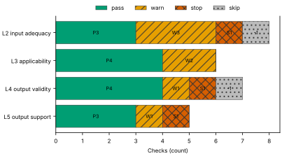

Fig. 1 · Check outcomes per layer for run ligand_pose-b3f66e0a9064. Totals: pass 14, warn 7, stop 3, skip 2.
Files: data [figures/gates_by_layer.csv](figures/gates_by_layer.csv).

## Structures

76 PyMOL renders.

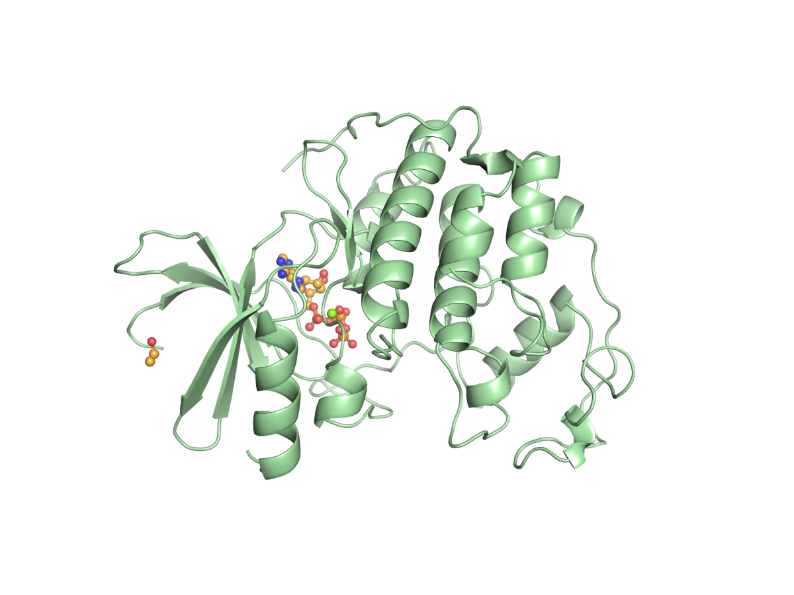

1B38 mmCIF (source_structure), whole structure. Chains A; organic components ACE, ATP. sha256 b851c5e8a98632f8. PyMOL session: [renders/1B38.pse](renders/1B38.pse).

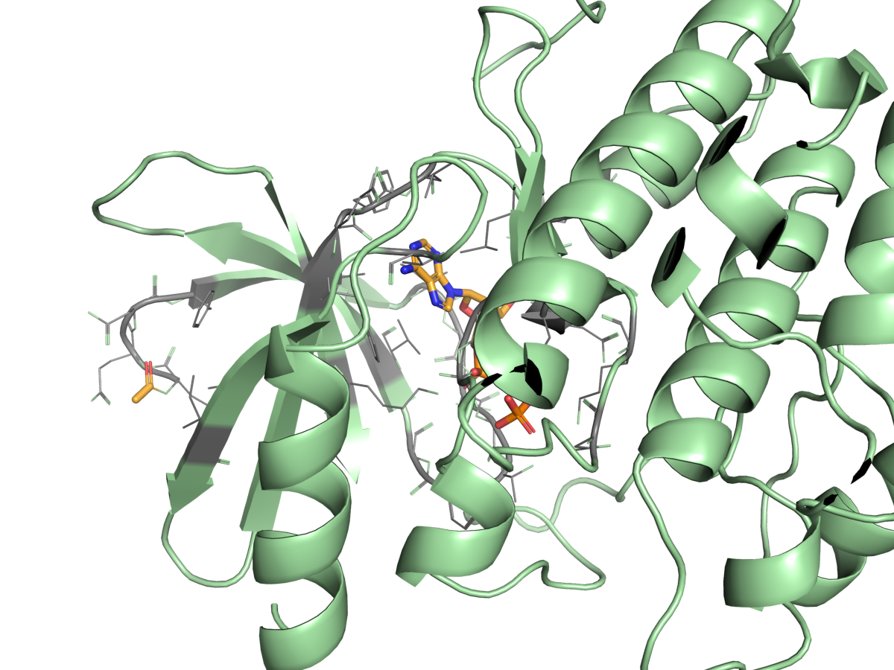

1B38 mmCIF (source_structure), ligand environment within 5 Å. Chains A; organic components ACE, ATP. sha256 b851c5e8a98632f8. PyMOL session: [renders/1B38.pse](renders/1B38.pse).

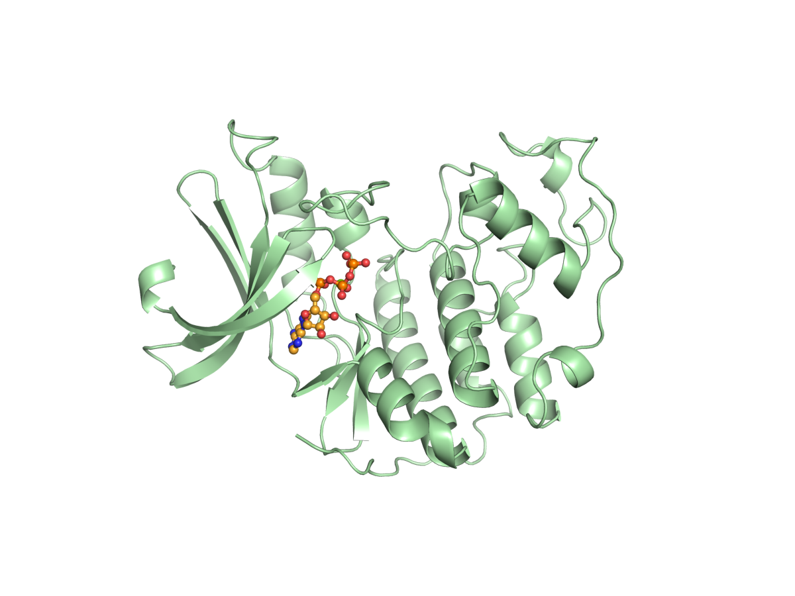

boltz2/seed1/sample0 (prediction_structure), whole structure. Chains A, C1, L; organic components LIG1. sha256 58727e8eeafe0654. PyMOL session: [renders/boltz2_seed1_sample0.pse](renders/boltz2_seed1_sample0.pse).

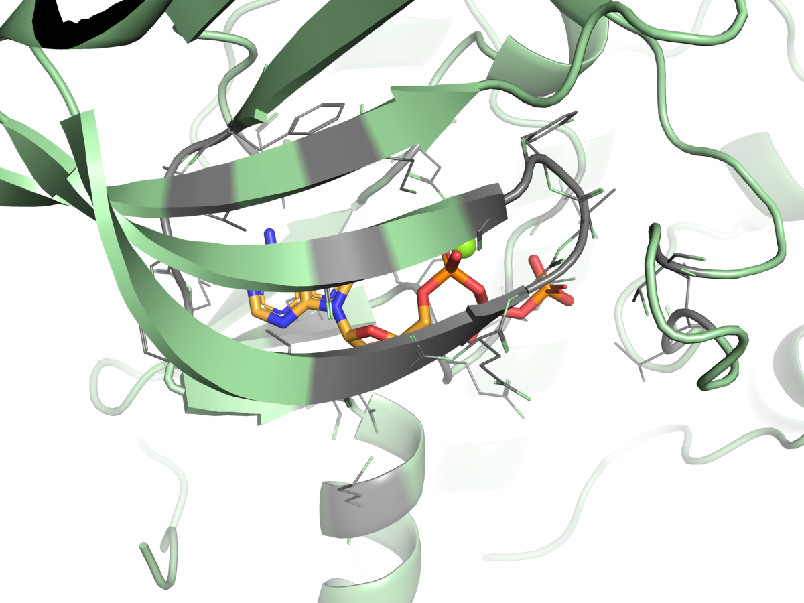

boltz2/seed1/sample0 (prediction_structure), ligand environment within 5 Å. Chains A, C1, L; organic components LIG1. sha256 58727e8eeafe0654. PyMOL session: [renders/boltz2_seed1_sample0.pse](renders/boltz2_seed1_sample0.pse).

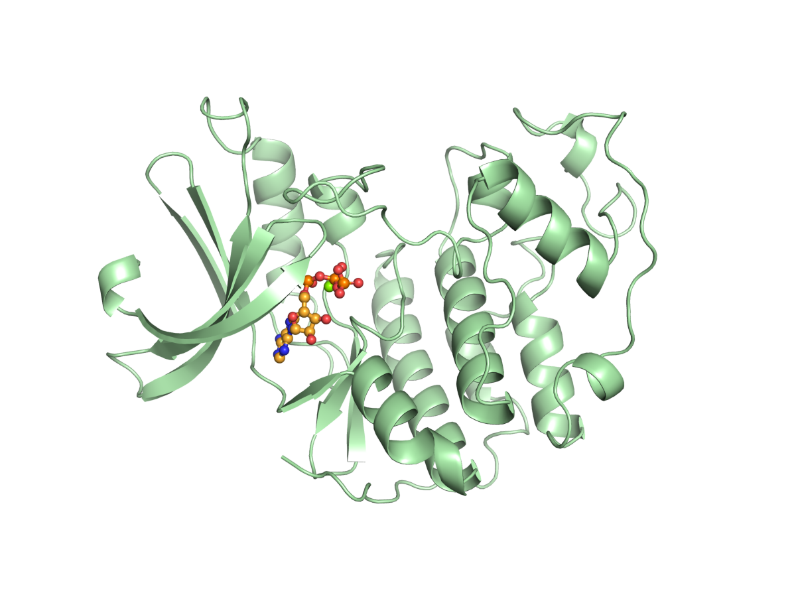

boltz2/seed2/sample0 (prediction_structure), whole structure. Chains A, C1, L; organic components LIG1. sha256 0612eaca25c00819. PyMOL session: [renders/boltz2_seed2_sample0.pse](renders/boltz2_seed2_sample0.pse).

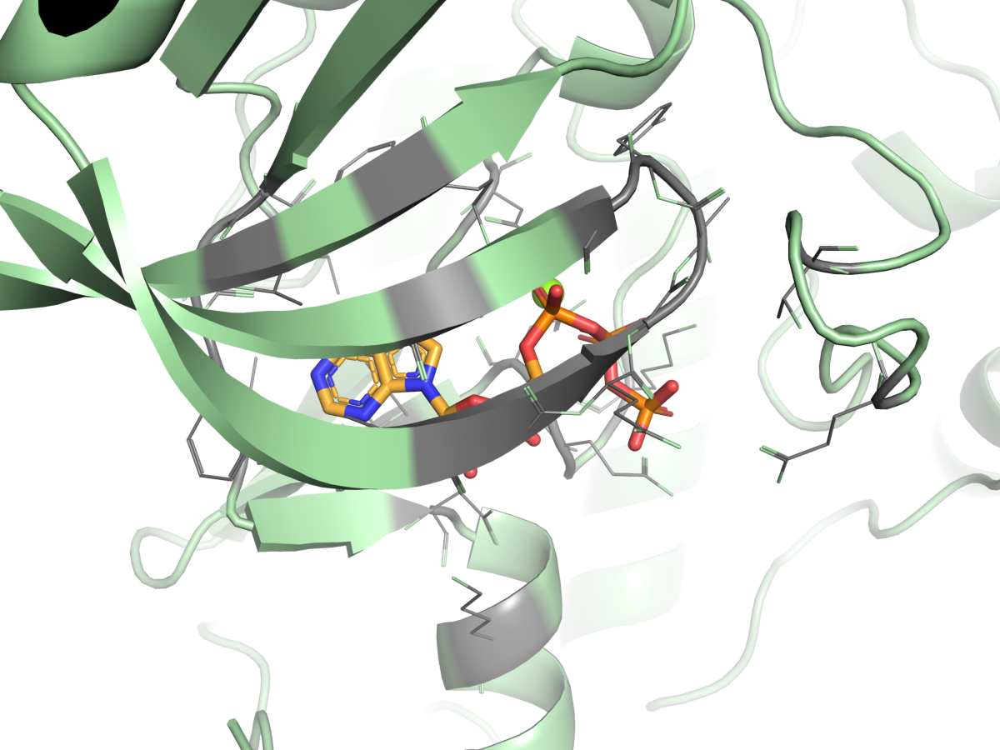

boltz2/seed2/sample0 (prediction_structure), ligand environment within 5 Å. Chains A, C1, L; organic components LIG1. sha256 0612eaca25c00819. PyMOL session: [renders/boltz2_seed2_sample0.pse](renders/boltz2_seed2_sample0.pse).

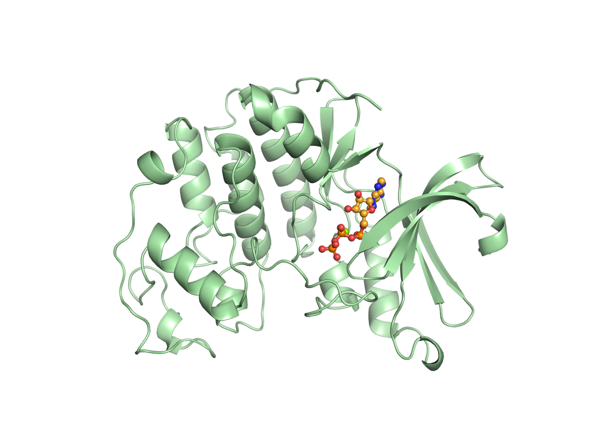

boltz2/seed3/sample0 (prediction_structure), whole structure. Chains A, C1, L; organic components LIG1. sha256 bacee41da600a964. PyMOL session: [renders/boltz2_seed3_sample0.pse](renders/boltz2_seed3_sample0.pse).

boltz2/seed3/sample0 (prediction_structure), ligand environment within 5 Å. Chains A, C1, L; organic components LIG1. sha256 bacee41da600a964. PyMOL session: [renders/boltz2_seed3_sample0.pse](renders/boltz2_seed3_sample0.pse).

diffdock/seed1/mode0 (prediction_structure), whole structure. Chains A, L; organic components LIG. sha256 77b91eeee1084bed. PyMOL session: [renders/diffdock_seed1_mode0.pse](renders/diffdock_seed1_mode0.pse).

diffdock/seed1/mode0 (prediction_structure), ligand environment within 5 Å. Chains A, L; organic components LIG. sha256 77b91eeee1084bed. PyMOL session: [renders/diffdock_seed1_mode0.pse](renders/diffdock_seed1_mode0.pse).

diffdock/seed1/mode1 (prediction_structure), whole structure. Chains A, L; organic components LIG. sha256 fbd1067a14a0cf25. PyMOL session: [renders/diffdock_seed1_mode1.pse](renders/diffdock_seed1_mode1.pse).

diffdock/seed1/mode1 (prediction_structure), ligand environment within 5 Å. Chains A, L; organic components LIG. sha256 fbd1067a14a0cf25. PyMOL session: [renders/diffdock_seed1_mode1.pse](renders/diffdock_seed1_mode1.pse).

diffdock/seed1/mode2 (prediction_structure), whole structure. Chains A, L; organic components LIG. sha256 eb453563c829dec3. PyMOL session: [renders/diffdock_seed1_mode2.pse](renders/diffdock_seed1_mode2.pse).

diffdock/seed1/mode2 (prediction_structure), ligand environment within 5 Å. Chains A, L; organic components LIG. sha256 eb453563c829dec3. PyMOL session: [renders/diffdock_seed1_mode2.pse](renders/diffdock_seed1_mode2.pse).

diffdock/seed1/mode3 (prediction_structure), whole structure. Chains A, L; organic components LIG. sha256 e6e1951476875f3d. PyMOL session: [renders/diffdock_seed1_mode3.pse](renders/diffdock_seed1_mode3.pse).

diffdock/seed1/mode3 (prediction_structure), ligand environment within 5 Å. Chains A, L; organic components LIG. sha256 e6e1951476875f3d. PyMOL session: [renders/diffdock_seed1_mode3.pse](renders/diffdock_seed1_mode3.pse).

diffdock/seed1/mode4 (prediction_structure), whole structure. Chains A, L; organic components LIG. sha256 92ebf3ea9d5bbf61. PyMOL session: [renders/diffdock_seed1_mode4.pse](renders/diffdock_seed1_mode4.pse).

diffdock/seed1/mode4 (prediction_structure), ligand environment within 5 Å. Chains A, L; organic components LIG. sha256 92ebf3ea9d5bbf61. PyMOL session: [renders/diffdock_seed1_mode4.pse](renders/diffdock_seed1_mode4.pse).

diffdock/seed1/mode5 (prediction_structure), whole structure. Chains A, L; organic components LIG. sha256 912bee111a8aa064. PyMOL session: [renders/diffdock_seed1_mode5.pse](renders/diffdock_seed1_mode5.pse).

diffdock/seed1/mode5 (prediction_structure), ligand environment within 5 Å. Chains A, L; organic components LIG. sha256 912bee111a8aa064. PyMOL session: [renders/diffdock_seed1_mode5.pse](renders/diffdock_seed1_mode5.pse).

diffdock/seed1/mode6 (prediction_structure), whole structure. Chains A, L; organic components LIG. sha256 316c95d918209fe1. PyMOL session: [renders/diffdock_seed1_mode6.pse](renders/diffdock_seed1_mode6.pse).

diffdock/seed1/mode6 (prediction_structure), ligand environment within 5 Å. Chains A, L; organic components LIG. sha256 316c95d918209fe1. PyMOL session: [renders/diffdock_seed1_mode6.pse](renders/diffdock_seed1_mode6.pse).

diffdock/seed1/mode7 (prediction_structure), whole structure. Chains A, L; organic components LIG. sha256 4b76d2e1bb2d6f10. PyMOL session: [renders/diffdock_seed1_mode7.pse](renders/diffdock_seed1_mode7.pse).

diffdock/seed1/mode7 (prediction_structure), ligand environment within 5 Å. Chains A, L; organic components LIG. sha256 4b76d2e1bb2d6f10. PyMOL session: [renders/diffdock_seed1_mode7.pse](renders/diffdock_seed1_mode7.pse).

diffdock/seed1/mode8 (prediction_structure), whole structure. Chains A, L; organic components LIG. sha256 3c8159766c45cdde. PyMOL session: [renders/diffdock_seed1_mode8.pse](renders/diffdock_seed1_mode8.pse).

diffdock/seed1/mode8 (prediction_structure), ligand environment within 5 Å. Chains A, L; organic components LIG. sha256 3c8159766c45cdde. PyMOL session: [renders/diffdock_seed1_mode8.pse](renders/diffdock_seed1_mode8.pse).

diffdock/seed1/mode9 (prediction_structure), whole structure. Chains A, L; organic components LIG. sha256 ab967970c90a4122. PyMOL session: [renders/diffdock_seed1_mode9.pse](renders/diffdock_seed1_mode9.pse).

diffdock/seed1/mode9 (prediction_structure), ligand environment within 5 Å. Chains A, L; organic components LIG. sha256 ab967970c90a4122. PyMOL session: [renders/diffdock_seed1_mode9.pse](renders/diffdock_seed1_mode9.pse).

diffdock/seed2/mode0 (prediction_structure), whole structure. Chains A, L; organic components LIG. sha256 fa1adffce9cc4cb0. PyMOL session: [renders/diffdock_seed2_mode0.pse](renders/diffdock_seed2_mode0.pse).

diffdock/seed2/mode0 (prediction_structure), ligand environment within 5 Å. Chains A, L; organic components LIG. sha256 fa1adffce9cc4cb0. PyMOL session: [renders/diffdock_seed2_mode0.pse](renders/diffdock_seed2_mode0.pse).

diffdock/seed2/mode1 (prediction_structure), whole structure. Chains A, L; organic components LIG. sha256 61230e84eea5a1b4. PyMOL session: [renders/diffdock_seed2_mode1.pse](renders/diffdock_seed2_mode1.pse).

diffdock/seed2/mode1 (prediction_structure), ligand environment within 5 Å. Chains A, L; organic components LIG. sha256 61230e84eea5a1b4. PyMOL session: [renders/diffdock_seed2_mode1.pse](renders/diffdock_seed2_mode1.pse).

diffdock/seed2/mode2 (prediction_structure), whole structure. Chains A, L; organic components LIG. sha256 4b053bbfdd995582. PyMOL session: [renders/diffdock_seed2_mode2.pse](renders/diffdock_seed2_mode2.pse).

diffdock/seed2/mode2 (prediction_structure), ligand environment within 5 Å. Chains A, L; organic components LIG. sha256 4b053bbfdd995582. PyMOL session: [renders/diffdock_seed2_mode2.pse](renders/diffdock_seed2_mode2.pse).

diffdock/seed2/mode3 (prediction_structure), whole structure. Chains A, L; organic components LIG. sha256 f27a34203161dc38. PyMOL session: [renders/diffdock_seed2_mode3.pse](renders/diffdock_seed2_mode3.pse).

diffdock/seed2/mode3 (prediction_structure), ligand environment within 5 Å. Chains A, L; organic components LIG. sha256 f27a34203161dc38. PyMOL session: [renders/diffdock_seed2_mode3.pse](renders/diffdock_seed2_mode3.pse).

diffdock/seed2/mode4 (prediction_structure), whole structure. Chains A, L; organic components LIG. sha256 c0fa8d7ff57ddc23. PyMOL session: [renders/diffdock_seed2_mode4.pse](renders/diffdock_seed2_mode4.pse).

diffdock/seed2/mode4 (prediction_structure), ligand environment within 5 Å. Chains A, L; organic components LIG. sha256 c0fa8d7ff57ddc23. PyMOL session: [renders/diffdock_seed2_mode4.pse](renders/diffdock_seed2_mode4.pse).

diffdock/seed2/mode5 (prediction_structure), whole structure. Chains A, L; organic components LIG. sha256 6fdbbcc4b201e43a. PyMOL session: [renders/diffdock_seed2_mode5.pse](renders/diffdock_seed2_mode5.pse).

diffdock/seed2/mode5 (prediction_structure), ligand environment within 5 Å. Chains A, L; organic components LIG. sha256 6fdbbcc4b201e43a. PyMOL session: [renders/diffdock_seed2_mode5.pse](renders/diffdock_seed2_mode5.pse).

diffdock/seed2/mode6 (prediction_structure), whole structure. Chains A, L; organic components LIG. sha256 777ea6850ff18dbb. PyMOL session: [renders/diffdock_seed2_mode6.pse](renders/diffdock_seed2_mode6.pse).

diffdock/seed2/mode6 (prediction_structure), ligand environment within 5 Å. Chains A, L; organic components LIG. sha256 777ea6850ff18dbb. PyMOL session: [renders/diffdock_seed2_mode6.pse](renders/diffdock_seed2_mode6.pse).

diffdock/seed2/mode7 (prediction_structure), whole structure. Chains A, L; organic components LIG. sha256 2eb8399250fee904. PyMOL session: [renders/diffdock_seed2_mode7.pse](renders/diffdock_seed2_mode7.pse).

diffdock/seed2/mode7 (prediction_structure), ligand environment within 5 Å. Chains A, L; organic components LIG. sha256 2eb8399250fee904. PyMOL session: [renders/diffdock_seed2_mode7.pse](renders/diffdock_seed2_mode7.pse).

diffdock/seed2/mode8 (prediction_structure), whole structure. Chains A, L; organic components LIG. sha256 c7f121df7755b705. PyMOL session: [renders/diffdock_seed2_mode8.pse](renders/diffdock_seed2_mode8.pse).

diffdock/seed2/mode8 (prediction_structure), ligand environment within 5 Å. Chains A, L; organic components LIG. sha256 c7f121df7755b705. PyMOL session: [renders/diffdock_seed2_mode8.pse](renders/diffdock_seed2_mode8.pse).

diffdock/seed2/mode9 (prediction_structure), whole structure. Chains A, L; organic components LIG. sha256 dbb5790c236ddbb7. PyMOL session: [renders/diffdock_seed2_mode9.pse](renders/diffdock_seed2_mode9.pse).

diffdock/seed2/mode9 (prediction_structure), ligand environment within 5 Å. Chains A, L; organic components LIG. sha256 dbb5790c236ddbb7. PyMOL session: [renders/diffdock_seed2_mode9.pse](renders/diffdock_seed2_mode9.pse).

diffdock/seed3/mode0 (prediction_structure), whole structure. Chains A, L; organic components LIG. sha256 d35295dcf205ea9b. PyMOL session: [renders/diffdock_seed3_mode0.pse](renders/diffdock_seed3_mode0.pse).

diffdock/seed3/mode0 (prediction_structure), ligand environment within 5 Å. Chains A, L; organic components LIG. sha256 d35295dcf205ea9b. PyMOL session: [renders/diffdock_seed3_mode0.pse](renders/diffdock_seed3_mode0.pse).

diffdock/seed3/mode1 (prediction_structure), whole structure. Chains A, L; organic components LIG. sha256 23f55576a7e09651. PyMOL session: [renders/diffdock_seed3_mode1.pse](renders/diffdock_seed3_mode1.pse).

diffdock/seed3/mode1 (prediction_structure), ligand environment within 5 Å. Chains A, L; organic components LIG. sha256 23f55576a7e09651. PyMOL session: [renders/diffdock_seed3_mode1.pse](renders/diffdock_seed3_mode1.pse).

diffdock/seed3/mode2 (prediction_structure), whole structure. Chains A, L; organic components LIG. sha256 b421082582358db0. PyMOL session: [renders/diffdock_seed3_mode2.pse](renders/diffdock_seed3_mode2.pse).

diffdock/seed3/mode2 (prediction_structure), ligand environment within 5 Å. Chains A, L; organic components LIG. sha256 b421082582358db0. PyMOL session: [renders/diffdock_seed3_mode2.pse](renders/diffdock_seed3_mode2.pse).

diffdock/seed3/mode3 (prediction_structure), whole structure. Chains A, L; organic components LIG. sha256 090bbb6586dca215. PyMOL session: [renders/diffdock_seed3_mode3.pse](renders/diffdock_seed3_mode3.pse).

diffdock/seed3/mode3 (prediction_structure), ligand environment within 5 Å. Chains A, L; organic components LIG. sha256 090bbb6586dca215. PyMOL session: [renders/diffdock_seed3_mode3.pse](renders/diffdock_seed3_mode3.pse).

diffdock/seed3/mode4 (prediction_structure), whole structure. Chains A, L; organic components LIG. sha256 61e298a3c5dba4d4. PyMOL session: [renders/diffdock_seed3_mode4.pse](renders/diffdock_seed3_mode4.pse).

diffdock/seed3/mode4 (prediction_structure), ligand environment within 5 Å. Chains A, L; organic components LIG. sha256 61e298a3c5dba4d4. PyMOL session: [renders/diffdock_seed3_mode4.pse](renders/diffdock_seed3_mode4.pse).

diffdock/seed3/mode5 (prediction_structure), whole structure. Chains A, L; organic components LIG. sha256 b50d2d67571e15d2. PyMOL session: [renders/diffdock_seed3_mode5.pse](renders/diffdock_seed3_mode5.pse).

diffdock/seed3/mode5 (prediction_structure), ligand environment within 5 Å. Chains A, L; organic components LIG. sha256 b50d2d67571e15d2. PyMOL session: [renders/diffdock_seed3_mode5.pse](renders/diffdock_seed3_mode5.pse).

diffdock/seed3/mode6 (prediction_structure), whole structure. Chains A, L; organic components LIG. sha256 4342fe88b15d1f40. PyMOL session: [renders/diffdock_seed3_mode6.pse](renders/diffdock_seed3_mode6.pse).

diffdock/seed3/mode6 (prediction_structure), ligand environment within 5 Å. Chains A, L; organic components LIG. sha256 4342fe88b15d1f40. PyMOL session: [renders/diffdock_seed3_mode6.pse](renders/diffdock_seed3_mode6.pse).

diffdock/seed3/mode7 (prediction_structure), whole structure. Chains A, L; organic components LIG. sha256 fcae2a49b9640ba6. PyMOL session: [renders/diffdock_seed3_mode7.pse](renders/diffdock_seed3_mode7.pse).

diffdock/seed3/mode7 (prediction_structure), ligand environment within 5 Å. Chains A, L; organic components LIG. sha256 fcae2a49b9640ba6. PyMOL session: [renders/diffdock_seed3_mode7.pse](renders/diffdock_seed3_mode7.pse).

diffdock/seed3/mode8 (prediction_structure), whole structure. Chains A, L; organic components LIG. sha256 30b58a86726f391b. PyMOL session: [renders/diffdock_seed3_mode8.pse](renders/diffdock_seed3_mode8.pse).

diffdock/seed3/mode8 (prediction_structure), ligand environment within 5 Å. Chains A, L; organic components LIG. sha256 30b58a86726f391b. PyMOL session: [renders/diffdock_seed3_mode8.pse](renders/diffdock_seed3_mode8.pse).

diffdock/seed3/mode9 (prediction_structure), whole structure. Chains A, L; organic components LIG. sha256 031da4c5bab17bb0. PyMOL session: [renders/diffdock_seed3_mode9.pse](renders/diffdock_seed3_mode9.pse).

diffdock/seed3/mode9 (prediction_structure), ligand environment within 5 Å. Chains A, L; organic components LIG. sha256 031da4c5bab17bb0. PyMOL session: [renders/diffdock_seed3_mode9.pse](renders/diffdock_seed3_mode9.pse).

1B39 mmCIF (source_structure), whole structure. Chains A; organic components ACE, ATP. sha256 43b7b7417024c3f4. PyMOL session: [renders/1B39.pse](renders/1B39.pse).

1B39 mmCIF (source_structure), ligand environment within 5 Å. Chains A; organic components ACE, ATP. sha256 43b7b7417024c3f4. PyMOL session: [renders/1B39.pse](renders/1B39.pse).

1FIN mmCIF (source_structure), whole structure. Chains A, B, C, D; organic components ATP. sha256 dfe5da37b2e28d3d. PyMOL session: [renders/1FIN.pse](renders/1FIN.pse).

1FIN mmCIF (source_structure), ligand environment within 5 Å. Chains A, B, C, D; organic components ATP. sha256 dfe5da37b2e28d3d. PyMOL session: [renders/1FIN.pse](renders/1FIN.pse).

1FQ1 mmCIF (source_structure), whole structure. Chains A, B; organic components ATP. sha256 f86aad4d11e29283. PyMOL session: [renders/1FQ1.pse](renders/1FQ1.pse).

1FQ1 mmCIF (source_structure), ligand environment within 5 Å. Chains A, B; organic components ATP. sha256 f86aad4d11e29283. PyMOL session: [renders/1FQ1.pse](renders/1FQ1.pse).

1GY3 mmCIF (source_structure), whole structure. Chains A, B, C, D, E, F; organic components ATP, GOL, TPO. sha256 fb1e8e095ae9fe28. PyMOL session: [renders/1GY3.pse](renders/1GY3.pse).

1GY3 mmCIF (source_structure), ligand environment within 5 Å. Chains A, B, C, D, E, F; organic components ATP, GOL, TPO. sha256 fb1e8e095ae9fe28. PyMOL session: [renders/1GY3.pse](renders/1GY3.pse).

## L0 Provenance

Where did every input come from?

Status: not run.

## L1 Input integrity

Did the run receive exactly what was declared?

Status: not run.

## L2 Input adequacy

Does the input carry enough information?

Status: done. Checks: pass 3 · warn 3 · stop 1 · skip 1. Time: 2.0 s.

#### Key figures

| Figure | Value |
| --- | --- |
| near site | 1 |
| missing | 1 |
| uniprot cofactors | 0 |
| pocket residues | 30 |
| incomplete | 0 |
| sequence gaps | 0 |
| state | holo |
| site ligands | 1 |

#### Docking

| Field | Value |
| --- | --- |
| center | -1.248, 27.587, 11.585 Å |
| size | 15.545 × 17.083 × 18.375 Å |
| origin | derived from ATP (+4 Å) |

#### Checks

| Check | Result | Measured cmp threshold | Evidence | Id · time |
| --- | --- | --- | --- | --- |
| Alignment depth, distinct sequences, Neff and gap fraction | skip | n/a | no MSA declared for a co-folding model · not applicable | `l2.msa.depth` |
| Required cofactors, ions and partners present | stop | `pocket_distance <= 8` | components within 8.0 Å of ATP in 1B38 not supplied: MG · near_site=1, missing=1, uniprot_cofactors=0 | `l2.context.cofactors` · 270 ms |
| Pocket residues resolved, no missing loops lining the pocket | pass | `pocket_distance <= 6` | 30 pocket residues complete in 1B38.cif · pocket_residues=30, incomplete=0, sequence_gaps=0 | `l2.pocket.resolved` · 9 ms |
| Receptor state apo or holo | pass | n/a | 1B38.cif holo: ATP in the site · state=holo, site_ligands=1 | `l2.receptor.state` · 14 ms |
| Receptor protonation at the stated pH | warn | `pka_margin > 1` | receptor has no hydrogens (protonation not assigned) · hydrogens_present=False, ph=7.4, pocket_titratable=19 | `l2.receptor.protonation` · 406 ms |
| Ligand protonation and tautomers enumerated at the stated pH | warn | `ph 7.4 == 1` | ligand: 2 states; ligand: declared form Nc1ncnc2c1ncn2[C@@H]1O[C@H](CO[P@@](=O)(O)O[P@](=O)(O)OP(=O)(O)O)[C@@H](O)[C@H]1O differs from enumerated Nc1ncnc2c1ncn2[C@@H]1O[C@H](CO[P@@](=O)([O-])O[P@](=O)([O-])OP(=O)([O-])O)[C@@H](O)[C@H]1O, Nc1ncnc2c1ncn2[C@@H]1O[C@H](CO[P@@](=O)([O-])O[P@](=O)([O-])OP(=O)([O-])[O-])[C@@H](O)[C@H]1O · ph=7.4, max_states=2, declared_not_enumerated=1 | `l2.ligand.protonation` · 64 ms |
| Ligand conformers generated and minimised | pass | `conformers >= 10` | 10 ETKDG conformers per ligand, MMFF minimised · ligands=1, failed=0, min_embedded=10 | `l2.ligand.conformers` · 1.2 s |
| Docking box encloses the pocket with margin | warn | `margin >= 2` | no box declared; derived box encloses 22 contact residues and the ATP ligand with 2.0 Å margin · volume_A3=4879.6, ligand_atoms_inside_margin=31, ligand_atoms=31 | `l2.docking.box` · 10 ms |

## L3 Applicability

Is the tool inside its validated regime?

Status: done. Checks: pass 4 · warn 2 · stop 0 · skip 0. Time: 1.2 s.

#### Key figures

| Figure | Value |
| --- | --- |
| executors | 2 |
| unknown | 0 |
| reference released | 1998-12-23 |
| cutoff | 2019-01-01 |
| entries compared | 5 |
| max similarity | 52.6 |
| pocket residues | 32 |
| systems | 3474 |

#### Checks

| Check | Result | Measured cmp threshold | Evidence | Id · time |
| --- | --- | --- | --- | --- |
| Model training cutoff recorded | pass | `training_cutoff == recorded` | boltz2 2023-06-01; diffdock 2019-01-01; reference 1B38 released 1998-12-23, before the cutoff of boltz2, diffdock · executors=2, unknown=0, reference_released=1998-12-23 | `l3.model.training_cutoff` · 1 ms |
| Pocket similarity to pre-cutoff complexes (SuCOS times pocket coverage) | warn | `similarity <= 50` | max similarity 52.6 to 1B39 (ATP, SuCOS 0.561, coverage 0.938), released before 2019-01-01 · cutoff=2019-01-01, entries_compared=5, max_similarity=52.6 | `l3.exposure.pocket` · 1.2 s |
| Ligand analogues in pre-cutoff training systems | warn | `tanimoto > 0.9` | 3474 PDB entries released before 2019-01-01 (diffdock cutoff) contain analogues of ligand above Tanimoto 0.9: 5FA, ADP, AQP, ATP, HEJ, LA8 · cutoff=2019-01-01, systems=3474, analogue_components=19 | `l3.exposure.ligand_prevalence` · 0 ms |
| Chain sequence identity to pre-cutoff entries (secondary measure) | pass | `identity < 0.4` | protein: 391 entries at 95 percent identity, 456 at 40 percent, released before 2019-01-01 (reported, not gating) · cutoff=2019-01-01, entries_95=391, entries_40=456 | `l3.exposure.sequence` · 1 ms |
| Modality inside the validated set; token count against the training crop | pass | n/a | modalities protein, protein_ligand inside the validated set; 330 tokens · modalities=2, tokens=330, outside=0 | `l3.regime.modality` · 5 ms |
| Endpoint fits the tool | pass | `endpoint pose in pose` | endpoint pose produced by boltz2, diffdock · endpoint=pose, executors=2, not_fitting=0 | `l3.metric.endpoint` · 0 ms |

## L4 Output validity

Is the result physically and chemically sensible?

Status: done. Checks: pass 4 · warn 1 · stop 1 · skip 1. Time: 70.2 s.

#### Key figures

| Figure | Value |
| --- | --- |
| poses | 3 |
| passed | 19 |
| total | 20 |
| poses all pass | 2 |
| unlikely torsions | 0 |
| torsions | 14 |
| strain kcal | 12.31 |
| poses with unlikely | 2 |

#### PoseBusters · 19/20 tests pass

| test | result | value |
| --- | --- | --- |
| sanitization | pass | pass |
| inchi_convertible | pass | pass |
| all_atoms_connected | pass | pass |
| no_radicals | pass | pass |
| bond_lengths | pass | 0 long outliers |
| bond_angles | pass | 0 outliers |
| internal_steric_clash | pass | 0 |
| aromatic_ring_flatness | pass | 0.00 Å |
| non-aromatic_ring_non-flatness | pass | pass |
| double_bond_flatness | pass | pass |
| internal_energy | pass | 3.2 times the ensemble mean |
| protein-ligand_maximum_distance | pass | 2.26 Å |
| minimum_distance_to_protein | fail | 2.26 Å |
| minimum_distance_to_organic_cofactors | pass | pass |
| minimum_distance_to_inorganic_cofactors | pass | pass |
| minimum_distance_to_waters | pass | pass |
| volume_overlap_with_protein | pass | 0.024 |
| volume_overlap_with_organic_cofactors | pass | pass |
| volume_overlap_with_inorganic_cofactors | pass | pass |
| volume_overlap_with_waters | pass | pass |

#### Per-pose physical checks

| pose | seed | unlikely torsions | unsat. polars | buried charged | PoseBusters |
| --- | --- | --- | --- | --- | --- |
| boltz2/seed1/sample0 | 1 | 2/14 | 5 | 0 | 20/20 |
| boltz2/seed2/sample0 | 2 | 2/14 | 7 | 0 | 20/20 |
| boltz2/seed3/sample0 | 3 | 0/14 | 5 | 0 | 19/20 |
| median | n/a | 2 | 5 | 0 | 20/20 |

#### Interaction fingerprint · representative pose boltz2/seed3/sample0

| residue | type | distance | poses |
| --- | --- | --- | --- |
| ASN3A | hbond | 2.8 Å | 3/3 |
| GLU81A | hbond | 2.96 Å | 3/3 |
| LEU83A | hbond | 3.22 Å | 3/3 |
| THR14A | hbond | 2.72 Å | 3/3 |
| ASP145A | metal | 1.89 Å | 3/3 |
| LYS129A | salt_bridge | 3.6 Å | 3/3 |
| LYS33A | salt_bridge | 3.31 Å | 3/3 |
| ASP86A | hbond | 2.56 Å | 2/3 |
| GLN131A | hbond | 3.12 Å | 2/3 |
| LYS89A | hbond | 3.13 Å | 2/3 |
| ASN132A | hbond | 4.08 Å | 1/3 |
| GLU12A | hbond | 3.92 Å | 1/3 |
| GLU2A | hbond | 4.08 Å | 1/3 |

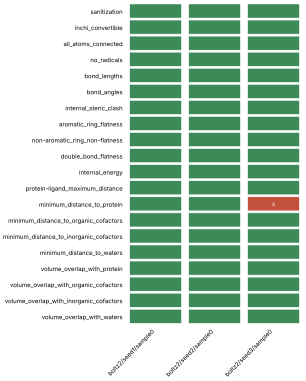

Fig. 2 · PoseBusters tests (20) by pose (3). Failed cells marked x: 1 of 60.
Files: data [figures/posebusters_grid.csv](figures/posebusters_grid.csv).

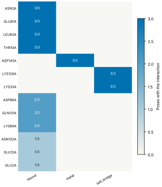

Fig. 3 · Interactions by residue (13) and type (3); cell label: poses with the interaction over poses assessed.
Files: data [figures/interactions.csv](figures/interactions.csv).

#### Checks

| Check | Result | Measured cmp threshold | Evidence | Id · time |
| --- | --- | --- | --- | --- |
| PoseBusters geometry, stereochemistry, clashes and protein contact | stop | `tests_failed == 0` | representative pose boltz2/seed3/sample0 fails minimum_distance_to_protein · poses=3, passed=19, total=20 | `l4.posebusters` · 2.5 s |
| Torsional strain of the ligand pose | pass | `torsion_energy <= 2.5` | 0 of 14 torsions above 2.5 kcal/mol in boltz2/seed3/sample0; strain 12.31 kcal/mol · poses=3, unlikely_torsions=0, torsions=14 | `l4.torsion_strain` · 8.1 s |
| Interaction fingerprint (PLIP) | pass | n/a | 12 interactions in boltz2/seed3/sample0 (hbond, metal, salt_bridge); 13 distinct across 3 poses (reported) · poses=3, interactions_representative=12, distinct=13 | `l4.interactions.fingerprint` · 2.3 s |
| Buried ligand polar atoms without a hydrogen-bond partner | warn | `relative_sasa < 0.1` | 5 of 10 buried polar ligand atoms without a partner in boltz2/seed3/sample0 · poses=3, unsatisfied=5, buried_charged=0 | `l4.interactions.unsatisfied_polars` · 523 ms |
| Hydrophobic complementarity of buried ligand surface | pass | `fraction >= 0.35` | nonpolar fraction of protein contacts around 8 buried nonpolar ligand atoms in boltz2/seed3/sample0: 0.639 · poses=3, complementarity=0.639, buried_nonpolar=8 | `l4.interactions.hydrophobic` · 624 ms |
| Interactions of the crystal ligand reproduced by the pose | pass | `reproduced 5 >= 1` | boltz2/seed3/sample0 reproduces 5 of 9 ATP interactions: hbond GLU81A, hbond LEU83A, hbond THR14A, salt_bridge LYS129A, salt_bridge LYS33A · key_interactions=9, reproduced=5, poses_reproducing_all=0 | `l4.interactions.known_binders` · 232 ms |
| Pose stability under short restrained minimisation (OpenMM, AMBER14 and OpenFF) | skip | n/a | OutputUnavailableError: minimisation failed for every pose: ValueError: No template found for residue 0 (UNK).  The set of heavy atoms matches NALA, but the residue is missing 1 H atom.  You may be able to add it with Modeller.addHydrogens().  For more information, see https://github.com/openmm/openmm/wiki/Frequently-Asked-Questions#template; ValueError: No template found for residue 0 (UNK).  The set of heavy atoms matches NALA, but the residue is missing 1 H atom.  You may be able to add it with Modeller.addHydrogens().  For more information, see https://github.com/openmm/openmm/wiki/Frequently-Asked-Questions#template; ValueError: No template found for residue 0 (UNK).  The set of heavy atoms matches NALA, but the residue is missing 1 H atom.  You may be able to add it with Modeller.addHydrogens().  For more information, see https://github.com/openmm/openmm/wiki/Frequently-Asked-Questions#template · error | `l4.minimisation_drift` · 56.0 s |

## L5 Output support

Is a valid result corroborated?

Status: done. Checks: pass 3 · warn 1 · stop 1 · skip 0. Time: 166 ms.

#### Key figures

| Figure | Value |
| --- | --- |
| poses | 3 |
| pocket plddt | 94.9 |
| global plddt | 96 |
| iptm | 0.975 |
| ptm | 0.972 |
| confidence score | 0.958 |
| independent seeds | 3 |
| samples | 3 |

#### Sampling

| Field | Value |
| --- | --- |
| site placement | 3 of 3 poses within 4.0 Å of the site (ATP in 1B38) |
| pose accuracy | 3 of 3 poses within 2.0 Å of the medoid |
| pairwise RMSD median | 1.16 Å |
| pairwise RMSD IQR | 0.91 to 1.34 Å |
| pairs | 3 |
| medoid | boltz2/seed3/sample0 |

#### Clusters

| Field | Value |
| --- | --- |
| cluster 1 | 3/3 poses (boltz2/seed3/sample0) |

#### Per-seed statistics

| seed | pose | cluster | RMSD to medoid | confidence |
| --- | --- | --- | --- | --- |
| 1 | boltz2/seed1/sample0 | 1 | 0.65 Å | 0.96 |
| 2 | boltz2/seed2/sample0 | 1 | 1.16 Å | 0.96 |
| 3 | boltz2/seed3/sample0 | 1 | 0 Å | 0.96 |
| median | n/a | n/a | 0.65 Å | 0.96 |

#### Ensemble

| structure | kind | source | RMSD to medoid | cluster | pocket pLDDT | ipTM |
| --- | --- | --- | --- | --- | --- | --- |
| boltz2/seed1/sample0 | seed | boltz2 | 0.65 Å | 1 | 95 | 0.97 |
| boltz2/seed2/sample0 | seed | boltz2 | 1.16 Å | 1 | 95.4 | 0.98 |
| boltz2/seed3/sample0 | medoid | boltz2 | 0 Å | 1 | 94.9 | 0.97 |

#### Agreement between methods

| method | diffdock | crystal 1B38 |
| --- | --- | --- |
| boltz2 | 1.67 Å (high) | 1.5 Å (decisive) |
| diffdock | n/a | 0.79 Å (decisive) |

#### Confidence metrics

| metric | value | read as | tool |
| --- | --- | --- | --- |
| affinity_pred_value | -0.13559332489967346 | ranking within a series, never pose quality | boltz2 |
| affinity_probability_binary | 0.5237208604812622 | ranking within a series, never pose quality | boltz2 |
| affinity_pred_value | -0.15546970069408417 | ranking within a series, never pose quality | boltz2 |
| affinity_probability_binary | 0.5306004285812378 | ranking within a series, never pose quality | boltz2 |
| affinity_pred_value | -0.15789160132408142 | ranking within a series, never pose quality | boltz2 |
| affinity_probability_binary | 0.5429002642631531 | ranking within a series, never pose quality | boltz2 |

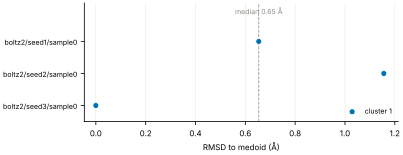

Fig. 4 · RMSD to the medoid for 3 poses, coloured by cluster (1 clusters). Dashed line: median 0.65 Å; range 0.00 to 1.16 Å.
Files: data [figures/seed_spread.csv](figures/seed_spread.csv).

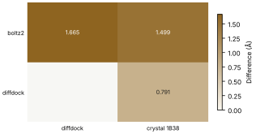

Fig. 5 · Agreement between 2 methods and 2 comparators; range 0.791 to 1.665 Å.
Files: data [figures/agreement.csv](figures/agreement.csv).

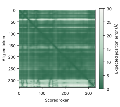

Fig. 6 · Predicted aligned error for pose boltz2/seed1/sample0, 331 by 331 tokens; values 0.2 to 28.2 Å, mean 4.0 Å.
Files: data [figures/pae.csv](figures/pae.csv).

#### Checks

| Check | Result | Measured cmp threshold | Evidence | Id · time |
| --- | --- | --- | --- | --- |
| Confidence restricted to the pocket; per-model thresholds | pass | `boltz2.pocket_plddt >= 70` | boltz2/seed3/sample0: pocket_plddt 94.9 · poses=3, pocket_plddt=94.9, global_plddt=96 | `l5.confidence.local` · 29 ms |
| Independent seeds counted separately from samples; duplicates flagged | warn | `seeds_cofolding >= 5` | 3 independent seeds (3 poses); task default 5 · independent_seeds=3, samples=3, duplicated_outputs=0 | `l5.sampling.seeds` · 0 ms |
| Medoid of the largest cluster, populations, pairwise spread, site and pose accuracy | pass | `cluster_rmsd <= 2` | medoid boltz2/seed3/sample0; 1 clusters, largest 3 of 3; pairwise RMSD median 1.16 Å (IQR 0.90 to 1.34); 3 of 3 poses within 4.0 Å of the site (ATP in 1B38); 3 of 3 poses within 2.0 Å of the medoid · poses=3, clusters=1, largest_cluster=3 | `l5.sampling.clusters` · 34 ms |
| Agreement between methods, weighted by independence | pass | `rmsd_to_crystal_A 1.5 <= 2` | boltz2 vs diffdock 1.665 Å (high); boltz2 vs crystal 1B38 1.499 Å (decisive); diffdock vs crystal 1B38 0.791 Å (decisive) · methods=2, comparisons=3, disagreeing=0 | `l5.agreement.cross_family` · 99 ms |
| Redocking control reproduces the crystal pose | stop | `rmsd <= 2` | redocking control required by the task and not supplied (controls.redocking) | `l5.controls.redocking` · 0 ms |

## Controls

| control | status | result |
| --- | --- | --- |
| redocking | incomplete | redocking control required by the task and not supplied (controls.redocking) |

## Provenance

54 objects · 54 cached · 0 network.

| Source | Accession | Release | SHA-256 | Retrieved | Bytes | Cache | Used by |
| --- | --- | --- | --- | --- | --- | --- | --- |
| rcsb_files | 1B38 | n/a | `b851c5e8a986` | 2026-10-17 16:42:54 UTC | 333302 | hit | l2.context.cofactors, l2.pocket.resolved, l2.receptor.state, l2.docking.box, l3.exposure.pocket, l3.regime.modality, l4.interactions.fingerprint, l4.interactions.known_binders, l5.sampling.clusters, l5.agreement.cross_family |
| ccd | ATP | 2011-06-04 | `a7dfd66192d9` | 2026-10-17 16:42:55 UTC | 14836 | hit | l2.context.cofactors, l3.exposure.pocket |
| rcsb | 1B38 | 1.4 | `64dd65fa1b0d` | 2026-10-17 16:42:56 UTC | 16633 | hit | l3.model.training_cutoff |
| rcsb_search | chem:c1nc(c2c(n1)n(cn2)[C@H]3[C@@H]([C@@H]([C@H](O3)CO[P@@](=O)(O)O[P@](=O)(O)OP(=O)(O)O)O)O)N | n/a | `c9ecdf87b8e2` | 2026-10-17 16:42:57 UTC | 1797 | hit | l3.exposure.pocket |
| ccd | 5FA | 2011-06-04 | `141da43b1fd4` | 2026-10-17 16:42:57 UTC | 5208 | hit | l3.exposure.pocket |
| ccd | ADP | 2025-10-10 | `9ebf239d6ded` | 2026-10-17 16:42:57 UTC | 5741 | hit | l3.exposure.pocket |
| ccd | AQP | 2011-06-04 | `d1f31df6170c` | 2026-10-17 16:42:57 UTC | 4700 | hit | l3.exposure.pocket |
| ccd | HEJ | 2021-03-01 | `3793d61303f5` | 2026-10-17 16:42:57 UTC | 4603 | hit | l3.exposure.pocket |
| ccd | LA8 | 2020-06-17 | `3c66f53baf33` | 2026-10-17 16:42:57 UTC | 4178 | hit | l3.exposure.pocket |
| ccd | ZF9 | 2024-03-08 | `b48f6ea5a0a0` | 2026-10-17 16:42:57 UTC | 4686 | hit | l3.exposure.pocket |
| ccd | ZSF | 2024-03-29 | `dde5989ea661` | 2026-10-17 16:42:57 UTC | 4903 | hit | l3.exposure.pocket |
| ccd | 50T | 2026-09-16 | `6be53fbf78af` | 2026-10-17 16:42:57 UTC | 4275 | hit | l3.exposure.pocket |
| ccd | AD9 | 2026-09-16 | `c8798e579e0a` | 2026-10-17 16:42:58 UTC | 4205 | hit | l3.exposure.pocket |
| ccd | AOV | 2026-09-16 | `300b793745cf` | 2026-10-17 16:42:58 UTC | 4330 | hit | l3.exposure.pocket |
| ccd | CX0 | 2022-03-25 | `fbc78ded25cd` | 2026-10-17 16:42:58 UTC | 3595 | hit | l3.exposure.pocket |
| ccd | CXC | 2022-03-25 | `d89a7023bd05` | 2026-10-17 16:42:58 UTC | 3941 | hit | l3.exposure.pocket |
| ccd | 0A | 2015-04-24 | `7f0b456f42e0` | 2026-10-17 16:42:58 UTC | 3972 | hit | l3.exposure.pocket |
| ccd | 3AN | 2011-06-04 | `a3d4d17a4a3e` | 2026-10-17 16:42:58 UTC | 4390 | hit | l3.exposure.pocket |
| ccd | 7DD | 2016-06-10 | `2265ea597be9` | 2026-10-17 16:42:58 UTC | 3425 | hit | l3.exposure.pocket |
| ccd | 7DT | 2016-06-10 | `c346b8a79ec0` | 2026-10-17 16:42:58 UTC | 3725 | hit | l3.exposure.pocket |
| ccd | AAM | 2011-06-04 | `ade365fd93cd` | 2026-10-17 16:42:58 UTC | 4244 | hit | l3.exposure.pocket |
| ccd | PAP | 2011-06-04 | `1a6bb6874f6f` | 2026-10-17 16:42:58 UTC | 4734 | hit | l3.exposure.pocket |
| ccd | XNY | 2021-04-30 | `7cb26ca44908` | 2026-10-17 16:42:58 UTC | 3977 | hit | l3.exposure.pocket |
| ccd | AP5 | 2011-06-04 | `43e554f584b7` | 2026-10-17 16:42:58 UTC | 6473 | hit | l3.exposure.pocket |
| ccd | T99 | 2018-06-01 | `68a3d15f3b6f` | 2026-10-17 16:42:58 UTC | 3399 | hit | l3.exposure.pocket |
| ccd | TAT | 2012-01-25 | `55287be9857e` | 2026-10-17 16:42:58 UTC | 4858 | hit | l3.exposure.pocket |
| ccd | A1L15 | 2025-01-24 | `57864c05fab0` | 2026-10-17 16:42:58 UTC | 5608 | hit | l3.exposure.pocket |
| ccd | AGS | 2020-06-17 | `dcdd428b77e4` | 2026-10-17 16:42:58 UTC | 10128 | hit | l3.exposure.pocket |
| rcsb_search | comp:5FA:2019-01-01 | n/a | `c60bf45b266d` | 2026-10-17 16:42:58 UTC | 282 | hit | l3.exposure.pocket |
| rcsb_search | comp:ADP:2019-01-01 | n/a | `d0ea634975e9` | 2026-10-17 16:42:58 UTC | 52129 | hit | l3.exposure.pocket |
| rcsb_search | comp:AQP:2019-01-01 | n/a | `94a619102faa` | 2026-10-17 16:42:58 UTC | 230 | hit | l3.exposure.pocket |
| rcsb_search | comp:ATP:2019-01-01 | n/a | `88190701e349` | 2026-10-17 16:42:59 UTC | 52129 | hit | l3.exposure.pocket |
| rcsb_search | comp:HEJ:2019-01-01 | n/a | `494129c6512c` | 2026-10-17 16:42:59 UTC | 178 | hit | l3.exposure.pocket |
| rcsb_search | comp:LA8:2019-01-01 | n/a | `185329a63a40` | 2026-10-17 16:42:59 UTC | 230 | hit | l3.exposure.pocket |
| rcsb_search | comp:ZF9:2019-01-01 | n/a | `e3b0c44298fc` | 2026-10-17 16:42:59 UTC | 0 | hit | l3.exposure.pocket |
| rcsb_search | comp:ZSF:2019-01-01 | n/a | `e3b0c44298fc` | 2026-10-17 16:42:59 UTC | 0 | hit | l3.exposure.pocket |
| rcsb_search | comp:50T:2019-01-01 | n/a | `927f39839b9d` | 2026-10-17 16:42:59 UTC | 178 | hit | l3.exposure.pocket |
| rcsb_search | comp:AD9:2019-01-01 | n/a | `ac65056f9aef` | 2026-10-17 16:42:59 UTC | 490 | hit | l3.exposure.pocket |
| rcsb_search | comp:AOV:2019-01-01 | n/a | `d8dd9b5a5778` | 2026-10-17 16:42:59 UTC | 334 | hit | l3.exposure.pocket |
| rcsb_search | comp:CX0:2019-01-01 | n/a | `e3b0c44298fc` | 2026-10-17 16:42:59 UTC | 0 | hit | l3.exposure.pocket |
| rcsb_search | comp:CXC:2019-01-01 | n/a | `e3b0c44298fc` | 2026-10-17 16:42:59 UTC | 0 | hit | l3.exposure.pocket |
| rcsb_search | comp:0A:2019-01-01 | n/a | `e3b0c44298fc` | 2026-10-17 16:42:59 UTC | 0 | hit | l3.exposure.pocket |
| rcsb_search | comp:PAP:2019-01-01 | n/a | `ded69bf4bbb0` | 2026-10-17 16:42:59 UTC | 542 | hit | l3.exposure.pocket |
| rcsb_search | comp:AP5:2019-01-01 | n/a | `ab39d336ec91` | 2026-10-17 16:42:59 UTC | 3247 | hit | l3.exposure.pocket |
| rcsb_search | comp:T99:2019-01-01 | n/a | `690266055a03` | 2026-10-17 16:42:59 UTC | 178 | hit | l3.exposure.pocket |
| rcsb_search | comp:TAT:2019-01-01 | n/a | `84486689d32b` | 2026-10-17 16:42:59 UTC | 438 | hit | l3.exposure.pocket |
| rcsb_search | comp:AGS:2019-01-01 | n/a | `aef54bf1fe1d` | 2026-10-17 16:42:59 UTC | 8188 | hit | l3.exposure.pocket |
| rcsb_search | seq0.9:2019-01-01:299 | n/a | `db535fa6304a` | 2026-10-17 16:43:01 UTC | 10528 | hit | l3.exposure.pocket |
| rcsb_files | 1B39 | n/a | `43b7b7417024` | 2026-10-17 16:43:01 UTC | 327760 | hit | l3.exposure.pocket |
| rcsb_files | 1FIN | n/a | `dfe5da37b2e2` | 2026-10-17 16:43:01 UTC | 999052 | hit | l3.exposure.pocket |
| rcsb_files | 1FQ1 | n/a | `f86aad4d11e2` | 2026-10-17 16:43:02 UTC | 464333 | hit | l3.exposure.pocket |
| rcsb_files | 1GY3 | n/a | `fb1e8e095ae9` | 2026-10-17 16:43:02 UTC | 1014441 | hit | l3.exposure.pocket |
| rcsb_search | seq0.95:2019-01-01:299 | n/a | `0e5b1db1762b` | 2026-10-17 16:43:02 UTC | 388 | hit | l3.exposure.sequence |
| rcsb_search | seq0.4:2019-01-01:299 | n/a | `b856cff26996` | 2026-10-17 16:43:03 UTC | 388 | hit | l3.exposure.sequence |

Provenance graph: [json](graph.json), [mmd](graph.mmd), [svg](graph.svg).

## Thresholds

| Check | Threshold | Value | Origin | Evidence level |
| --- | --- | --- | --- | --- |
| `l2.context.cofactors` | pocket_distance | <= 8 | Harness rule: a component of the reference entry within 8 Å of the declared ligand is required context; not yet calibrated | uncalibrated |
| `l2.pocket.resolved` | pocket_distance | <= 6 | Harness rule: pocket residues have a heavy atom within 6 Å of the ligand; not yet calibrated | uncalibrated |
| `l2.pocket.resolved` | missing_pocket_residues | == 0 | Specification layer 2: stop when the pocket is incomplete | published |
| `l2.receptor.protonation` | pka_margin | > 1 | Harness rule: a titratable pocket residue with PROPKA pKa within 1 unit of the stated pH has an ambiguous state; not yet calibrated | uncalibrated |
| `l2.ligand.protonation` | ph_window | == 1 | Harness rule: states enumerated by Dimorphite-DL within 1 pH unit of the stated pH; not yet calibrated | uncalibrated |
| `l2.ligand.protonation` | states | == 1 | Specification layer 2: warn when more than one plausible state | published |
| `l2.ligand.conformers` | conformers | >= 10 | Harness default number of ETKDG conformers; not yet calibrated | uncalibrated |
| `l2.docking.box` | margin | >= 2 | Harness rule: every pocket heavy atom lies at least 2 Å inside the box; not yet calibrated | uncalibrated |
| `l2.docking.box` | contact_distance | <= 4 | Harness rule: contact residues (heavy atom within 4 Å of the reference ligand) must have an atom inside the box; not yet calibrated | uncalibrated |
| `l3.model.training_cutoff` | training_cutoff | == recorded | Specification, Layer 3 (applicability): stop when unknown | published |
| `l3.exposure.pocket` | similarity | <= 50 | Specification layer 3: warn above a pocket similarity (SuCOS times pocket coverage) of 50 | published |
| `l3.exposure.pocket` | entries | <= 5 | Harness budget: pre-cutoff holo entries compared per run | uncalibrated |
| `l3.exposure.ligand_prevalence` | tanimoto | > 0.9 | Specification layer 3: analogues above 0.9 Tanimoto (RDKit topological fingerprint) | published |
| `l3.exposure.ligand_prevalence` | systems | <= 100 | Specification layer 3: prevalent when analogues occur in more than 100 training systems | published |
| `l3.exposure.sequence` | identity | < 0.4 | Specification layer 3: conventional 40 percent identity leakage threshold, reported as a secondary measure only | published |
| `l3.metric.endpoint` | endpoint | in pose | Specification, Layer 3 (applicability): no affinity from interface confidence, no protein-protein affinity from Boltz-2 | published |
| `l4.posebusters` | tests_failed | == 0 | Specification, Layer 4 (output validity): stop on failure | published |
| `l4.torsion_strain` | torsion_energy | <= 2.5 | Harness rule: a rotatable torsion whose MMFF energy lies more than 2.5 kcal/mol above the minimum of its rigid scan is unlikely; not yet calibrated | uncalibrated |
| `l4.interactions.unsatisfied_polars` | relative_sasa | < 0.1 | Harness rule: a ligand polar atom with relative SASA below 0.1 in the complex is buried; not yet calibrated | uncalibrated |
| `l4.interactions.unsatisfied_polars` | hbond_distance | <= 3.5 | PLIP hydrogen bond distance cut-off (donor-acceptor 4.1 Å; harness uses 3.5 Å heavy-atom distance) | published |
| `l4.interactions.hydrophobic` | fraction | >= 0.35 | Harness default anchored on 3PTB: the crystal benzamidine scores 0.51, Vina and Boltz-2 poses within 0.5 Å of it score 0.45 and 0.49; not calibrated on the benchmark | uncalibrated |
| `l4.interactions.hydrophobic` | relative_sasa | < 0.1 | Harness rule: a ligand polar atom with relative SASA below 0.1 in the complex is buried; not yet calibrated | uncalibrated |
| `l4.interactions.known_binders` | reproduced | >= 1 | Specification layer 4: warn when no key interaction is reproduced | published |
| `l5.confidence.local` | boltz2.pocket_plddt | >= 70 | AlphaFold DB pLDDT bands (70 and above: confident backbone), applied to pocket residues; not calibrated for ligand pose | published |
| `l5.sampling.seeds` | seeds_cofolding | >= 5 | Specification layer 5: default of five seeds per co-folding prediction | published |
| `l5.sampling.clusters` | cluster_rmsd | <= 2 | Specification layer 5: 2 Å symmetry-aware ligand RMSD (spyrmsd) separates pose clusters | published |
| `l5.sampling.clusters` | site_distance | <= 4 | Harness rule: a ligand centroid within 4 Å of the reference site centroid is placed in the site; not yet calibrated | uncalibrated |
| `l5.sampling.clusters` | largest_fraction | >= 0.5 | Harness rule: the largest cluster holds at least half of the poses; not yet calibrated | uncalibrated |
| `l5.agreement.cross_family` | rmsd | <= 2 | Specification layer 5: pose agreement by symmetry-aware ligand RMSD at 2 Å | published |
| `l5.controls.redocking` | rmsd | <= 2 | Specification layer 5: redocking must reproduce the crystal pose (2 Å ligand RMSD) | published |

Tool versions: dimorphite_dl 2.1.0, freesasa 2.2.1, gemmi 0.7.5, numpy 1.26.4, openbabel 3.2.1, plip 3.0.1, posebusters 0.6.5, propka 3.5.1, rdkit 2026.9.1, scipy 1.17.1, spyrmsd 0.9.0.

## Limitations

- This report covers layers 2, 3, 4, 5. Layers not run: 0, 1.
- The harness establishes when a result should not be trusted. Passing checks are not evidence that a prediction is correct.
- Thresholds marked uncalibrated come from the specification or harness defaults and have not been recalibrated on the harness benchmark.

## Files

| Path | Kind | Bytes | SHA-256 |
| --- | --- | --- | --- |
| artifacts/sources/1B38.cif | source_structure | 333302 | `b851c5e8a986` |
| /home/user/harness-hackathon/bench/runs/2026-10-17T1611Z-426bfe9/predictions/cdk2_wt/boltz2/seed_1/boltz_results_cdk2_wt/predictions/cdk2_wt/cdk2_wt_model_0.cif | prediction_structure | 214881 | `58727e8eeafe` |
| predictions/00_boltz2/boltz2/seed1/sample0/ligand.sdf | data | 2682 | `ae37f8ca1f33` |
| /home/user/harness-hackathon/bench/runs/2026-10-17T1611Z-426bfe9/predictions/cdk2_wt/boltz2/seed_2/boltz_results_cdk2_wt/predictions/cdk2_wt/cdk2_wt_model_0.cif | prediction_structure | 215141 | `0612eaca25c0` |
| predictions/00_boltz2/boltz2/seed2/sample0/ligand.sdf | data | 2682 | `848ad7250227` |
| /home/user/harness-hackathon/bench/runs/2026-10-17T1611Z-426bfe9/predictions/cdk2_wt/boltz2/seed_3/boltz_results_cdk2_wt/predictions/cdk2_wt/cdk2_wt_model_0.cif | prediction_structure | 214845 | `bacee41da600` |
| predictions/00_boltz2/boltz2/seed3/sample0/ligand.sdf | data | 2682 | `e49cf4e3d3b3` |
| predictions/01_diffdock/diffdock/seed1/mode0/complex.pdb | prediction_structure | 192294 | `77b91eeee108` |
| predictions/01_diffdock/diffdock/seed1/mode0/ligand.sdf | data | 2682 | `7ab2fa3f0d96` |
| predictions/01_diffdock/diffdock/seed1/mode1/complex.pdb | prediction_structure | 192294 | `fbd1067a14a0` |
| predictions/01_diffdock/diffdock/seed1/mode1/ligand.sdf | data | 2682 | `8d90f82dd1f3` |
| predictions/01_diffdock/diffdock/seed1/mode2/complex.pdb | prediction_structure | 192294 | `eb453563c829` |
| predictions/01_diffdock/diffdock/seed1/mode2/ligand.sdf | data | 2682 | `a3af637a2c95` |
| predictions/01_diffdock/diffdock/seed1/mode3/complex.pdb | prediction_structure | 192294 | `e6e195147687` |
| predictions/01_diffdock/diffdock/seed1/mode3/ligand.sdf | data | 2682 | `e04af8e130eb` |
| predictions/01_diffdock/diffdock/seed1/mode4/complex.pdb | prediction_structure | 192294 | `92ebf3ea9d5b` |
| predictions/01_diffdock/diffdock/seed1/mode4/ligand.sdf | data | 2682 | `bbb50a068ce6` |
| predictions/01_diffdock/diffdock/seed1/mode5/complex.pdb | prediction_structure | 192294 | `912bee111a8a` |
| predictions/01_diffdock/diffdock/seed1/mode5/ligand.sdf | data | 2682 | `d8a122ca2dad` |
| predictions/01_diffdock/diffdock/seed1/mode6/complex.pdb | prediction_structure | 192294 | `316c95d91820` |
| predictions/01_diffdock/diffdock/seed1/mode6/ligand.sdf | data | 2682 | `e4bdc51e126c` |
| predictions/01_diffdock/diffdock/seed1/mode7/complex.pdb | prediction_structure | 192294 | `4b76d2e1bb2d` |
| predictions/01_diffdock/diffdock/seed1/mode7/ligand.sdf | data | 2682 | `c5db906a9b3f` |
| predictions/01_diffdock/diffdock/seed1/mode8/complex.pdb | prediction_structure | 192294 | `3c8159766c45` |
| predictions/01_diffdock/diffdock/seed1/mode8/ligand.sdf | data | 2682 | `5c11bcbcf13d` |
| predictions/01_diffdock/diffdock/seed1/mode9/complex.pdb | prediction_structure | 192294 | `ab967970c90a` |
| predictions/01_diffdock/diffdock/seed1/mode9/ligand.sdf | data | 2682 | `f66f6650edc1` |
| predictions/01_diffdock/diffdock/seed2/mode0/complex.pdb | prediction_structure | 192294 | `fa1adffce9cc` |
| predictions/01_diffdock/diffdock/seed2/mode0/ligand.sdf | data | 2682 | `b86c36152533` |
| predictions/01_diffdock/diffdock/seed2/mode1/complex.pdb | prediction_structure | 192294 | `61230e84eea5` |
| predictions/01_diffdock/diffdock/seed2/mode1/ligand.sdf | data | 2682 | `09ed136ffe92` |
| predictions/01_diffdock/diffdock/seed2/mode2/complex.pdb | prediction_structure | 192294 | `4b053bbfdd99` |
| predictions/01_diffdock/diffdock/seed2/mode2/ligand.sdf | data | 2682 | `8a805804f574` |
| predictions/01_diffdock/diffdock/seed2/mode3/complex.pdb | prediction_structure | 192294 | `f27a34203161` |
| predictions/01_diffdock/diffdock/seed2/mode3/ligand.sdf | data | 2682 | `9624b8ab194d` |
| predictions/01_diffdock/diffdock/seed2/mode4/complex.pdb | prediction_structure | 192294 | `c0fa8d7ff57d` |
| predictions/01_diffdock/diffdock/seed2/mode4/ligand.sdf | data | 2682 | `0fab4395c5d8` |
| predictions/01_diffdock/diffdock/seed2/mode5/complex.pdb | prediction_structure | 192294 | `6fdbbcc4b201` |
| predictions/01_diffdock/diffdock/seed2/mode5/ligand.sdf | data | 2682 | `938bb7b22f35` |
| predictions/01_diffdock/diffdock/seed2/mode6/complex.pdb | prediction_structure | 192294 | `777ea6850ff1` |
| predictions/01_diffdock/diffdock/seed2/mode6/ligand.sdf | data | 2682 | `5eebfa1eacf8` |
| predictions/01_diffdock/diffdock/seed2/mode7/complex.pdb | prediction_structure | 192294 | `2eb8399250fe` |
| predictions/01_diffdock/diffdock/seed2/mode7/ligand.sdf | data | 2682 | `95564ebe206c` |
| predictions/01_diffdock/diffdock/seed2/mode8/complex.pdb | prediction_structure | 192294 | `c7f121df7755` |
| predictions/01_diffdock/diffdock/seed2/mode8/ligand.sdf | data | 2682 | `f19099f8d4a0` |
| predictions/01_diffdock/diffdock/seed2/mode9/complex.pdb | prediction_structure | 192294 | `dbb5790c236d` |
| predictions/01_diffdock/diffdock/seed2/mode9/ligand.sdf | data | 2682 | `cf60d9aaf612` |
| predictions/01_diffdock/diffdock/seed3/mode0/complex.pdb | prediction_structure | 192294 | `d35295dcf205` |
| predictions/01_diffdock/diffdock/seed3/mode0/ligand.sdf | data | 2682 | `aa1a97db52ac` |
| predictions/01_diffdock/diffdock/seed3/mode1/complex.pdb | prediction_structure | 192294 | `23f55576a7e0` |
| predictions/01_diffdock/diffdock/seed3/mode1/ligand.sdf | data | 2682 | `eb754d76a89d` |
| predictions/01_diffdock/diffdock/seed3/mode2/complex.pdb | prediction_structure | 192294 | `b42108258235` |
| predictions/01_diffdock/diffdock/seed3/mode2/ligand.sdf | data | 2682 | `f9e2af187c23` |
| predictions/01_diffdock/diffdock/seed3/mode3/complex.pdb | prediction_structure | 192294 | `090bbb6586dc` |
| predictions/01_diffdock/diffdock/seed3/mode3/ligand.sdf | data | 2682 | `75be9a6250b6` |
| predictions/01_diffdock/diffdock/seed3/mode4/complex.pdb | prediction_structure | 192294 | `61e298a3c5db` |
| predictions/01_diffdock/diffdock/seed3/mode4/ligand.sdf | data | 2682 | `c177a9c88a93` |
| predictions/01_diffdock/diffdock/seed3/mode5/complex.pdb | prediction_structure | 192294 | `b50d2d67571e` |
| predictions/01_diffdock/diffdock/seed3/mode5/ligand.sdf | data | 2682 | `7b792c9e4a98` |
| predictions/01_diffdock/diffdock/seed3/mode6/complex.pdb | prediction_structure | 192294 | `4342fe88b15d` |
| predictions/01_diffdock/diffdock/seed3/mode6/ligand.sdf | data | 2682 | `604bfa55b978` |
| predictions/01_diffdock/diffdock/seed3/mode7/complex.pdb | prediction_structure | 192294 | `fcae2a49b964` |
| predictions/01_diffdock/diffdock/seed3/mode7/ligand.sdf | data | 2682 | `089d33f70ae7` |
| predictions/01_diffdock/diffdock/seed3/mode8/complex.pdb | prediction_structure | 192294 | `30b58a86726f` |
| predictions/01_diffdock/diffdock/seed3/mode8/ligand.sdf | data | 2682 | `efd254e3e96a` |
| predictions/01_diffdock/diffdock/seed3/mode9/complex.pdb | prediction_structure | 192294 | `031da4c5bab1` |
| predictions/01_diffdock/diffdock/seed3/mode9/ligand.sdf | data | 2682 | `51a5b0a7035d` |
| artifacts/sources/1B39.cif | source_structure | 327760 | `43b7b7417024` |
| artifacts/sources/1FIN.cif | source_structure | 999052 | `dfe5da37b2e2` |
| artifacts/sources/1FQ1.cif | source_structure | 464333 | `f86aad4d11e2` |
| artifacts/sources/1GY3.cif | source_structure | 1014441 | `fb1e8e095ae9` |
| renders/1B38_overview.png | render | 312923 | `5a8622892a7a` |
| renders/1B38_pocket.png | render | 605194 | `5b2325472a55` |
| renders/1B38.pse | session | 789668 | `e64fc0f42e6e` |
| renders/boltz2_seed1_sample0_overview.png | render | 296865 | `9940fd9562cb` |
| renders/boltz2_seed1_sample0_pocket.png | render | 480955 | `3bfbbb6008fd` |
| renders/boltz2_seed1_sample0.pse | session | 805711 | `09720c96b959` |
| renders/boltz2_seed2_sample0_overview.png | render | 355763 | `61a7f918349f` |
| renders/boltz2_seed2_sample0_pocket.png | render | 482551 | `187534f6f1ec` |
| renders/boltz2_seed2_sample0.pse | session | 805746 | `0eefbf27e7bb` |
| renders/boltz2_seed3_sample0_overview.png | render | 333467 | `77361dad1955` |
| renders/boltz2_seed3_sample0_pocket.png | render | 502508 | `88836bb78dbd` |
| renders/boltz2_seed3_sample0.pse | session | 805707 | `22d420181e3f` |
| renders/diffdock_seed1_mode0_overview.png | render | 308085 | `36194bfece5b` |
| renders/diffdock_seed1_mode0_pocket.png | render | 515699 | `ba6e17a032e0` |
| renders/diffdock_seed1_mode0.pse | session | 674361 | `ee927a2ab89a` |
| renders/diffdock_seed1_mode1_overview.png | render | 308802 | `527ce3dd58a1` |
| renders/diffdock_seed1_mode1_pocket.png | render | 542923 | `8592ee83d9eb` |
| renders/diffdock_seed1_mode1.pse | session | 674341 | `00119b0d5cad` |
| renders/diffdock_seed1_mode2_overview.png | render | 308666 | `8045a17c716a` |
| renders/diffdock_seed1_mode2_pocket.png | render | 521230 | `ef1b5b211114` |
| renders/diffdock_seed1_mode2.pse | session | 674361 | `8c27908d7785` |
| renders/diffdock_seed1_mode3_overview.png | render | 309245 | `768229d7a309` |
| renders/diffdock_seed1_mode3_pocket.png | render | 524151 | `045ff9839401` |
| renders/diffdock_seed1_mode3.pse | session | 674356 | `8abb518c1202` |
| renders/diffdock_seed1_mode4_overview.png | render | 308771 | `dab881164183` |
| renders/diffdock_seed1_mode4_pocket.png | render | 513083 | `ce70249f82b7` |
| renders/diffdock_seed1_mode4.pse | session | 674341 | `0d703cc7cddc` |
| renders/diffdock_seed1_mode5_overview.png | render | 308189 | `a135f2b0efbd` |
| renders/diffdock_seed1_mode5_pocket.png | render | 542946 | `679fd58e41a1` |
| renders/diffdock_seed1_mode5.pse | session | 674335 | `1af6eb7c0f54` |
| renders/diffdock_seed1_mode6_overview.png | render | 308657 | `337ed27db4f8` |
| renders/diffdock_seed1_mode6_pocket.png | render | 507616 | `2f2f87114507` |
| renders/diffdock_seed1_mode6.pse | session | 674364 | `90a92dd1eb27` |
| renders/diffdock_seed1_mode7_overview.png | render | 309792 | `c0d6d46108e7` |
| renders/diffdock_seed1_mode7_pocket.png | render | 541863 | `493f6e252796` |
| renders/diffdock_seed1_mode7.pse | session | 674364 | `0d95f338686c` |
| renders/diffdock_seed1_mode8_overview.png | render | 308668 | `dba715387966` |
| renders/diffdock_seed1_mode8_pocket.png | render | 561345 | `496dea720e02` |
| renders/diffdock_seed1_mode8.pse | session | 674357 | `25243b939131` |
| renders/diffdock_seed1_mode9_overview.png | render | 308484 | `b916163c3bc7` |
| renders/diffdock_seed1_mode9_pocket.png | render | 570383 | `39faf7cb127d` |
| renders/diffdock_seed1_mode9.pse | session | 674359 | `8142677ccae9` |
| renders/diffdock_seed2_mode0_overview.png | render | 308874 | `667c746aab69` |
| renders/diffdock_seed2_mode0_pocket.png | render | 507231 | `5a87af517ea0` |
| renders/diffdock_seed2_mode0.pse | session | 674335 | `fdf24b42697a` |
| renders/diffdock_seed2_mode1_overview.png | render | 203349 | `d7de09d38c53` |
| renders/diffdock_seed2_mode1_pocket.png | render | 346593 | `7517b0d14a76` |
| renders/diffdock_seed2_mode1.pse | session | 674335 | `88db00c4aa63` |
| renders/diffdock_seed2_mode2_overview.png | render | 203291 | `adf9c553c826` |
| renders/diffdock_seed2_mode2_pocket.png | render | 332420 | `f2bbe7f614f8` |
| renders/diffdock_seed2_mode2.pse | session | 674335 | `9d81156df649` |
| renders/diffdock_seed2_mode3_overview.png | render | 202998 | `39aed2d0d7af` |
| renders/diffdock_seed2_mode3_pocket.png | render | 350939 | `c559e81fa68e` |
| renders/diffdock_seed2_mode3.pse | session | 674357 | `ef0ed3eb8fe6` |
| renders/diffdock_seed2_mode4_overview.png | render | 202958 | `de41a1400df7` |
| renders/diffdock_seed2_mode4_pocket.png | render | 323671 | `0c76df66f5d2` |
| renders/diffdock_seed2_mode4.pse | session | 674335 | `f7913aaac8d0` |
| renders/diffdock_seed2_mode5_overview.png | render | 203395 | `3e219e0de777` |
| renders/diffdock_seed2_mode5_pocket.png | render | 355594 | `315af3794878` |
| renders/diffdock_seed2_mode5.pse | session | 674367 | `b821288e39ea` |
| renders/diffdock_seed2_mode6_overview.png | render | 203308 | `5c9345f5178e` |
| renders/diffdock_seed2_mode6_pocket.png | render | 364924 | `a1ebd01ceaa7` |
| renders/diffdock_seed2_mode6.pse | session | 674337 | `fca76a6e3bd1` |
| renders/diffdock_seed2_mode7_overview.png | render | 202337 | `d57327fc5654` |
| renders/diffdock_seed2_mode7_pocket.png | render | 342575 | `21db79724b96` |
| renders/diffdock_seed2_mode7.pse | session | 674353 | `d299d40d485e` |
| renders/diffdock_seed2_mode8_overview.png | render | 203179 | `c2280d5b3ba3` |
| renders/diffdock_seed2_mode8_pocket.png | render | 361384 | `634eed377a56` |
| renders/diffdock_seed2_mode8.pse | session | 674319 | `e485a4b4b51f` |
| renders/diffdock_seed2_mode9_overview.png | render | 203069 | `e80764bdf21f` |
| renders/diffdock_seed2_mode9_pocket.png | render | 363430 | `261a816ec43d` |
| renders/diffdock_seed2_mode9.pse | session | 674419 | `9f83cf1a18f6` |
| renders/diffdock_seed3_mode0_overview.png | render | 203158 | `75639e5dd8e5` |
| renders/diffdock_seed3_mode0_pocket.png | render | 347142 | `52ea42d3ae31` |
| renders/diffdock_seed3_mode0.pse | session | 674376 | `c0c961159a78` |
| renders/diffdock_seed3_mode1_overview.png | render | 203041 | `8913d94aa074` |
| renders/diffdock_seed3_mode1_pocket.png | render | 335860 | `50da5ee3a58c` |
| renders/diffdock_seed3_mode1.pse | session | 674335 | `85700fbfca8f` |
| renders/diffdock_seed3_mode2_overview.png | render | 202910 | `272f59b64ad7` |
| renders/diffdock_seed3_mode2_pocket.png | render | 333480 | `ac92b6559191` |
| renders/diffdock_seed3_mode2.pse | session | 674361 | `a96946bd6610` |
| renders/diffdock_seed3_mode3_overview.png | render | 203271 | `32842037b760` |
| renders/diffdock_seed3_mode3_pocket.png | render | 335634 | `35f160178756` |
| renders/diffdock_seed3_mode3.pse | session | 674367 | `397feead6dd6` |
| renders/diffdock_seed3_mode4_overview.png | render | 203253 | `edae19a3e934` |
| renders/diffdock_seed3_mode4_pocket.png | render | 370754 | `572bb6a61484` |
| renders/diffdock_seed3_mode4.pse | session | 674341 | `8c67b0f1eeed` |
| renders/diffdock_seed3_mode5_overview.png | render | 203320 | `8a9185f3dfc4` |
| renders/diffdock_seed3_mode5_pocket.png | render | 343406 | `704c4bd80618` |
| renders/diffdock_seed3_mode5.pse | session | 674335 | `9d87c6cb3d61` |
| renders/diffdock_seed3_mode6_overview.png | render | 203207 | `20b13e5ffb67` |
| renders/diffdock_seed3_mode6_pocket.png | render | 355647 | `b0cac429614e` |
| renders/diffdock_seed3_mode6.pse | session | 674353 | `cae1ecfb3dc2` |
| renders/diffdock_seed3_mode7_overview.png | render | 203112 | `37329e3d17d1` |
| renders/diffdock_seed3_mode7_pocket.png | render | 386482 | `4523644ce3bb` |
| renders/diffdock_seed3_mode7.pse | session | 674446 | `b8ee3519c5f2` |
| renders/diffdock_seed3_mode8_overview.png | render | 203754 | `8da472a7ce0a` |
| renders/diffdock_seed3_mode8_pocket.png | render | 384648 | `870ed553cc6d` |
| renders/diffdock_seed3_mode8.pse | session | 674384 | `dc893aa971ec` |
| renders/diffdock_seed3_mode9_overview.png | render | 202894 | `583066379822` |
| renders/diffdock_seed3_mode9_pocket.png | render | 330640 | `4ff7f6048f07` |
| renders/diffdock_seed3_mode9.pse | session | 674494 | `45617702dba4` |
| renders/1B39_overview.png | render | 204833 | `6a9266526b71` |
| renders/1B39_pocket.png | render | 392694 | `7a5c6b96125c` |
| renders/1B39.pse | session | 789740 | `1abd3362deeb` |
| renders/1FIN_overview.png | render | 336196 | `44e3b62c1c6f` |
| renders/1FIN_pocket.png | render | 582815 | `c3072dd011b1` |
| renders/1FIN.pse | session | 3015799 | `1c43673a9ca9` |
| renders/1FQ1_overview.png | render | 245023 | `4b061886558e` |
| renders/1FQ1_pocket.png | render | 348687 | `dc7724dffd1c` |
| renders/1FQ1.pse | session | 1288915 | `628cebde5142` |
| renders/1GY3_overview.png | render | 316800 | `9d4aa99623e3` |
| renders/1GY3_pocket.png | render | 630699 | `0ea0cbf4378b` |
| renders/1GY3.pse | session | 3039558 | `77e1a984576a` |
| figures/gates_by_layer.svg | figure | 90271 | `b6cbf17a32f8` |
| figures/gates_by_layer.csv | data | 135 | `0ec5c6ecbc7b` |
| figures/seed_spread.svg | figure | 11634 | `95cdd66ba2b5` |
| figures/seed_spread.csv | data | 159 | `b4d2c23fd03f` |
| figures/posebusters_grid.svg | figure | 27100 | `99999826f6f0` |
| figures/posebusters_grid.csv | data | 888 | `a0f16584d12b` |
| figures/interactions.svg | figure | 21027 | `2a76170bc9f5` |
| figures/interactions.csv | data | 345 | `1c6c762102f0` |
| figures/agreement.svg | figure | 10977 | `ea3a73098ac9` |
| figures/agreement.csv | data | 140 | `8f78372fbf05` |
| figures/pae.svg | figure | 89445 | `dd944ebdbf87` |
| figures/pae.csv | data | 667776 | `5bc18d25273a` |
| graph.json | graph | 72347 | `2ac7691c2ffa` |
| graph.mmd | graph | 11254 | `634298828108` |
| graph.svg | graph | 158939 | `4806c6dd9947` |
