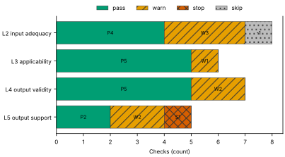
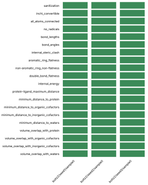
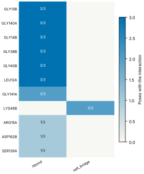
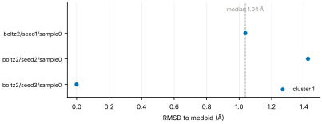
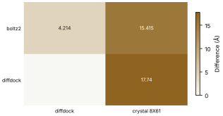
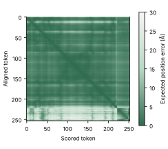

# Run report · Ligand pose in a known pocket

Prediction assurance · run `ligand_pose-475b14796ed3` · 2026-10-17 16:56:12 UTC

**Refused** for the claim "Predicted pose of ATP in FtsE is valid".

Refused over layers 2,3,4,5: 16 pass, 8 warn, 1 stop, 1 skip. Stopped by l5.controls.redocking. Warnings from l2.receptor.protonation, l2.ligand.protonation, l2.docking.box, l3.exposure.ligand_prevalence, l4.interactions.unsatisfied_polars, l4.interactions.known_binders, l5.sampling.seeds, l5.agreement.cross_family.

Stops: `l5.controls.redocking`.

Warnings: `l2.receptor.protonation`, `l2.ligand.protonation`, `l2.docking.box`, `l3.exposure.ligand_prevalence`, `l4.interactions.unsatisfied_polars`, `l4.interactions.known_binders`, `l5.sampling.seeds`, `l5.agreement.cross_family`.

| Field | Value |
| --- | --- |
| Task | Ligand pose in a known pocket (`ligand_pose`) |
| Tools | Boltz-2 2.2.1 (co-folding), DiffDock-L (docking) |
| Target | `protein` |
| Ligand | `c1nc(c2c(n1)n(cn2)[C@H]3[C@@H]([C@@H]([C@H](O3)CO[P@@](=O)(O)O[P@](=O)(O)OP(=O)(O)O)O)O)N` |
| Reference | `8X61` |
| pH | 7.4 |
| Seeds | 3 |
| Layers run | 2, 3, 4, 5 |
| Run | `ligand_pose-475b14796ed3` |
| Created | 2026-10-17 16:56:12 UTC |
| Finished | 2026-10-17 16:57:56 UTC |
| pah version | 0.1.0 |
| Report schema | 1 |

## Layers

| Layer | Status | Result | pass | warn | stop | skip | Time |
| --- | --- | --- | --- | --- | --- | --- | --- |
| L0 Provenance | not run | n/a | n/a | n/a | n/a | n/a | n/a |
| L1 Input integrity | not run | n/a | n/a | n/a | n/a | n/a | n/a |
| L2 Input adequacy | done | warn | 4 | 3 | 0 | 1 | 2.2 s |
| L3 Applicability | done | warn | 5 | 1 | 0 | 0 | 3.5 s |
| L4 Output validity | done | warn | 5 | 2 | 0 | 0 | 97.1 s |
| L5 Output support | done | stop | 2 | 2 | 1 | 0 | 471 ms |

## Figures

Fig. 1 · Check outcomes per layer for run ligand_pose-475b14796ed3. Totals: pass 16, warn 8, stop 1, skip 1.
Files: data [figures/gates_by_layer.csv](figures/gates_by_layer.csv).

## Structures

68 PyMOL renders.

8X61 mmCIF (source_structure), whole structure. Chains A, B, C, D; organic components ATP. sha256 ba2b64fd50fa3880. PyMOL session: [renders/8X61.pse](renders/8X61.pse).

8X61 mmCIF (source_structure), ligand environment within 5 Å. Chains A, B, C, D; organic components ATP. sha256 ba2b64fd50fa3880. PyMOL session: [renders/8X61.pse](renders/8X61.pse).

boltz2/seed1/sample0 (prediction_structure), whole structure. Chains A, L; organic components LIG1. sha256 27be3137580c98ba. PyMOL session: [renders/boltz2_seed1_sample0.pse](renders/boltz2_seed1_sample0.pse).

boltz2/seed1/sample0 (prediction_structure), ligand environment within 5 Å. Chains A, L; organic components LIG1. sha256 27be3137580c98ba. PyMOL session: [renders/boltz2_seed1_sample0.pse](renders/boltz2_seed1_sample0.pse).

boltz2/seed2/sample0 (prediction_structure), whole structure. Chains A, L; organic components LIG1. sha256 18de337ef18faa05. PyMOL session: [renders/boltz2_seed2_sample0.pse](renders/boltz2_seed2_sample0.pse).

boltz2/seed2/sample0 (prediction_structure), ligand environment within 5 Å. Chains A, L; organic components LIG1. sha256 18de337ef18faa05. PyMOL session: [renders/boltz2_seed2_sample0.pse](renders/boltz2_seed2_sample0.pse).

boltz2/seed3/sample0 (prediction_structure), whole structure. Chains A, L; organic components LIG1. sha256 b4d2962001814b2a. PyMOL session: [renders/boltz2_seed3_sample0.pse](renders/boltz2_seed3_sample0.pse).

boltz2/seed3/sample0 (prediction_structure), ligand environment within 5 Å. Chains A, L; organic components LIG1. sha256 b4d2962001814b2a. PyMOL session: [renders/boltz2_seed3_sample0.pse](renders/boltz2_seed3_sample0.pse).

diffdock/seed1/mode0 (prediction_structure), whole structure. Chains A, L; organic components LIG. sha256 8ea7d71411564476. PyMOL session: [renders/diffdock_seed1_mode0.pse](renders/diffdock_seed1_mode0.pse).

diffdock/seed1/mode0 (prediction_structure), ligand environment within 5 Å. Chains A, L; organic components LIG. sha256 8ea7d71411564476. PyMOL session: [renders/diffdock_seed1_mode0.pse](renders/diffdock_seed1_mode0.pse).

diffdock/seed1/mode1 (prediction_structure), whole structure. Chains A, L; organic components LIG. sha256 8b587be7d64f0655. PyMOL session: [renders/diffdock_seed1_mode1.pse](renders/diffdock_seed1_mode1.pse).

diffdock/seed1/mode1 (prediction_structure), ligand environment within 5 Å. Chains A, L; organic components LIG. sha256 8b587be7d64f0655. PyMOL session: [renders/diffdock_seed1_mode1.pse](renders/diffdock_seed1_mode1.pse).

diffdock/seed1/mode2 (prediction_structure), whole structure. Chains A, L; organic components LIG. sha256 d9a08f1163fa6f46. PyMOL session: [renders/diffdock_seed1_mode2.pse](renders/diffdock_seed1_mode2.pse).

diffdock/seed1/mode2 (prediction_structure), ligand environment within 5 Å. Chains A, L; organic components LIG. sha256 d9a08f1163fa6f46. PyMOL session: [renders/diffdock_seed1_mode2.pse](renders/diffdock_seed1_mode2.pse).

diffdock/seed1/mode3 (prediction_structure), whole structure. Chains A, L; organic components LIG. sha256 28b67d312616286a. PyMOL session: [renders/diffdock_seed1_mode3.pse](renders/diffdock_seed1_mode3.pse).

diffdock/seed1/mode3 (prediction_structure), ligand environment within 5 Å. Chains A, L; organic components LIG. sha256 28b67d312616286a. PyMOL session: [renders/diffdock_seed1_mode3.pse](renders/diffdock_seed1_mode3.pse).

diffdock/seed1/mode4 (prediction_structure), whole structure. Chains A, L; organic components LIG. sha256 01711bc1d0045939. PyMOL session: [renders/diffdock_seed1_mode4.pse](renders/diffdock_seed1_mode4.pse).

diffdock/seed1/mode4 (prediction_structure), ligand environment within 5 Å. Chains A, L; organic components LIG. sha256 01711bc1d0045939. PyMOL session: [renders/diffdock_seed1_mode4.pse](renders/diffdock_seed1_mode4.pse).

diffdock/seed1/mode5 (prediction_structure), whole structure. Chains A, L; organic components LIG. sha256 e4155cbed66be88a. PyMOL session: [renders/diffdock_seed1_mode5.pse](renders/diffdock_seed1_mode5.pse).

diffdock/seed1/mode5 (prediction_structure), ligand environment within 5 Å. Chains A, L; organic components LIG. sha256 e4155cbed66be88a. PyMOL session: [renders/diffdock_seed1_mode5.pse](renders/diffdock_seed1_mode5.pse).

diffdock/seed1/mode6 (prediction_structure), whole structure. Chains A, L; organic components LIG. sha256 8c266474edb01948. PyMOL session: [renders/diffdock_seed1_mode6.pse](renders/diffdock_seed1_mode6.pse).

diffdock/seed1/mode6 (prediction_structure), ligand environment within 5 Å. Chains A, L; organic components LIG. sha256 8c266474edb01948. PyMOL session: [renders/diffdock_seed1_mode6.pse](renders/diffdock_seed1_mode6.pse).

diffdock/seed1/mode7 (prediction_structure), whole structure. Chains A, L; organic components LIG. sha256 0457423c1ec8ffba. PyMOL session: [renders/diffdock_seed1_mode7.pse](renders/diffdock_seed1_mode7.pse).

diffdock/seed1/mode7 (prediction_structure), ligand environment within 5 Å. Chains A, L; organic components LIG. sha256 0457423c1ec8ffba. PyMOL session: [renders/diffdock_seed1_mode7.pse](renders/diffdock_seed1_mode7.pse).

diffdock/seed1/mode8 (prediction_structure), whole structure. Chains A, L; organic components LIG. sha256 ca1e67888c89f82e. PyMOL session: [renders/diffdock_seed1_mode8.pse](renders/diffdock_seed1_mode8.pse).

diffdock/seed1/mode8 (prediction_structure), ligand environment within 5 Å. Chains A, L; organic components LIG. sha256 ca1e67888c89f82e. PyMOL session: [renders/diffdock_seed1_mode8.pse](renders/diffdock_seed1_mode8.pse).

diffdock/seed1/mode9 (prediction_structure), whole structure. Chains A, L; organic components LIG. sha256 b13247d933a37bbc. PyMOL session: [renders/diffdock_seed1_mode9.pse](renders/diffdock_seed1_mode9.pse).

diffdock/seed1/mode9 (prediction_structure), ligand environment within 5 Å. Chains A, L; organic components LIG. sha256 b13247d933a37bbc. PyMOL session: [renders/diffdock_seed1_mode9.pse](renders/diffdock_seed1_mode9.pse).

diffdock/seed2/mode0 (prediction_structure), whole structure. Chains A, L; organic components LIG. sha256 2a66ee88d7210edc. PyMOL session: [renders/diffdock_seed2_mode0.pse](renders/diffdock_seed2_mode0.pse).

diffdock/seed2/mode0 (prediction_structure), ligand environment within 5 Å. Chains A, L; organic components LIG. sha256 2a66ee88d7210edc. PyMOL session: [renders/diffdock_seed2_mode0.pse](renders/diffdock_seed2_mode0.pse).

diffdock/seed2/mode1 (prediction_structure), whole structure. Chains A, L; organic components LIG. sha256 47ff0251bc279750. PyMOL session: [renders/diffdock_seed2_mode1.pse](renders/diffdock_seed2_mode1.pse).

diffdock/seed2/mode1 (prediction_structure), ligand environment within 5 Å. Chains A, L; organic components LIG. sha256 47ff0251bc279750. PyMOL session: [renders/diffdock_seed2_mode1.pse](renders/diffdock_seed2_mode1.pse).

diffdock/seed2/mode2 (prediction_structure), whole structure. Chains A, L; organic components LIG. sha256 f02170b807aa9dd0. PyMOL session: [renders/diffdock_seed2_mode2.pse](renders/diffdock_seed2_mode2.pse).

diffdock/seed2/mode2 (prediction_structure), ligand environment within 5 Å. Chains A, L; organic components LIG. sha256 f02170b807aa9dd0. PyMOL session: [renders/diffdock_seed2_mode2.pse](renders/diffdock_seed2_mode2.pse).

diffdock/seed2/mode3 (prediction_structure), whole structure. Chains A, L; organic components LIG. sha256 17ada48a09b2bffb. PyMOL session: [renders/diffdock_seed2_mode3.pse](renders/diffdock_seed2_mode3.pse).

diffdock/seed2/mode3 (prediction_structure), ligand environment within 5 Å. Chains A, L; organic components LIG. sha256 17ada48a09b2bffb. PyMOL session: [renders/diffdock_seed2_mode3.pse](renders/diffdock_seed2_mode3.pse).

diffdock/seed2/mode4 (prediction_structure), whole structure. Chains A, L; organic components LIG. sha256 58c97b68b429660d. PyMOL session: [renders/diffdock_seed2_mode4.pse](renders/diffdock_seed2_mode4.pse).

diffdock/seed2/mode4 (prediction_structure), ligand environment within 5 Å. Chains A, L; organic components LIG. sha256 58c97b68b429660d. PyMOL session: [renders/diffdock_seed2_mode4.pse](renders/diffdock_seed2_mode4.pse).

diffdock/seed2/mode5 (prediction_structure), whole structure. Chains A, L; organic components LIG. sha256 ac3dfcaa834e5a4f. PyMOL session: [renders/diffdock_seed2_mode5.pse](renders/diffdock_seed2_mode5.pse).

diffdock/seed2/mode5 (prediction_structure), ligand environment within 5 Å. Chains A, L; organic components LIG. sha256 ac3dfcaa834e5a4f. PyMOL session: [renders/diffdock_seed2_mode5.pse](renders/diffdock_seed2_mode5.pse).

diffdock/seed2/mode6 (prediction_structure), whole structure. Chains A, L; organic components LIG. sha256 b0e1681b3005bf3d. PyMOL session: [renders/diffdock_seed2_mode6.pse](renders/diffdock_seed2_mode6.pse).

diffdock/seed2/mode6 (prediction_structure), ligand environment within 5 Å. Chains A, L; organic components LIG. sha256 b0e1681b3005bf3d. PyMOL session: [renders/diffdock_seed2_mode6.pse](renders/diffdock_seed2_mode6.pse).

diffdock/seed2/mode7 (prediction_structure), whole structure. Chains A, L; organic components LIG. sha256 9f122ab7b302a926. PyMOL session: [renders/diffdock_seed2_mode7.pse](renders/diffdock_seed2_mode7.pse).

diffdock/seed2/mode7 (prediction_structure), ligand environment within 5 Å. Chains A, L; organic components LIG. sha256 9f122ab7b302a926. PyMOL session: [renders/diffdock_seed2_mode7.pse](renders/diffdock_seed2_mode7.pse).

diffdock/seed2/mode8 (prediction_structure), whole structure. Chains A, L; organic components LIG. sha256 22dbd0c84d1a790a. PyMOL session: [renders/diffdock_seed2_mode8.pse](renders/diffdock_seed2_mode8.pse).

diffdock/seed2/mode8 (prediction_structure), ligand environment within 5 Å. Chains A, L; organic components LIG. sha256 22dbd0c84d1a790a. PyMOL session: [renders/diffdock_seed2_mode8.pse](renders/diffdock_seed2_mode8.pse).

diffdock/seed2/mode9 (prediction_structure), whole structure. Chains A, L; organic components LIG. sha256 483118c1d48b1a05. PyMOL session: [renders/diffdock_seed2_mode9.pse](renders/diffdock_seed2_mode9.pse).

diffdock/seed2/mode9 (prediction_structure), ligand environment within 5 Å. Chains A, L; organic components LIG. sha256 483118c1d48b1a05. PyMOL session: [renders/diffdock_seed2_mode9.pse](renders/diffdock_seed2_mode9.pse).

diffdock/seed3/mode0 (prediction_structure), whole structure. Chains A, L; organic components LIG. sha256 c3626ffe5de4023f. PyMOL session: [renders/diffdock_seed3_mode0.pse](renders/diffdock_seed3_mode0.pse).

diffdock/seed3/mode0 (prediction_structure), ligand environment within 5 Å. Chains A, L; organic components LIG. sha256 c3626ffe5de4023f. PyMOL session: [renders/diffdock_seed3_mode0.pse](renders/diffdock_seed3_mode0.pse).

diffdock/seed3/mode1 (prediction_structure), whole structure. Chains A, L; organic components LIG. sha256 618b21b0b797b6d8. PyMOL session: [renders/diffdock_seed3_mode1.pse](renders/diffdock_seed3_mode1.pse).

diffdock/seed3/mode1 (prediction_structure), ligand environment within 5 Å. Chains A, L; organic components LIG. sha256 618b21b0b797b6d8. PyMOL session: [renders/diffdock_seed3_mode1.pse](renders/diffdock_seed3_mode1.pse).

diffdock/seed3/mode2 (prediction_structure), whole structure. Chains A, L; organic components LIG. sha256 4c18ba362b5cd6d4. PyMOL session: [renders/diffdock_seed3_mode2.pse](renders/diffdock_seed3_mode2.pse).

diffdock/seed3/mode2 (prediction_structure), ligand environment within 5 Å. Chains A, L; organic components LIG. sha256 4c18ba362b5cd6d4. PyMOL session: [renders/diffdock_seed3_mode2.pse](renders/diffdock_seed3_mode2.pse).

diffdock/seed3/mode3 (prediction_structure), whole structure. Chains A, L; organic components LIG. sha256 b6cca3be0e7ad7ff. PyMOL session: [renders/diffdock_seed3_mode3.pse](renders/diffdock_seed3_mode3.pse).

diffdock/seed3/mode3 (prediction_structure), ligand environment within 5 Å. Chains A, L; organic components LIG. sha256 b6cca3be0e7ad7ff. PyMOL session: [renders/diffdock_seed3_mode3.pse](renders/diffdock_seed3_mode3.pse).

diffdock/seed3/mode4 (prediction_structure), whole structure. Chains A, L; organic components LIG. sha256 7e481211165bd264. PyMOL session: [renders/diffdock_seed3_mode4.pse](renders/diffdock_seed3_mode4.pse).

diffdock/seed3/mode4 (prediction_structure), ligand environment within 5 Å. Chains A, L; organic components LIG. sha256 7e481211165bd264. PyMOL session: [renders/diffdock_seed3_mode4.pse](renders/diffdock_seed3_mode4.pse).

diffdock/seed3/mode5 (prediction_structure), whole structure. Chains A, L; organic components LIG. sha256 35a3c0f330a60677. PyMOL session: [renders/diffdock_seed3_mode5.pse](renders/diffdock_seed3_mode5.pse).

diffdock/seed3/mode5 (prediction_structure), ligand environment within 5 Å. Chains A, L; organic components LIG. sha256 35a3c0f330a60677. PyMOL session: [renders/diffdock_seed3_mode5.pse](renders/diffdock_seed3_mode5.pse).

diffdock/seed3/mode6 (prediction_structure), whole structure. Chains A, L; organic components LIG. sha256 03b756fa7d459521. PyMOL session: [renders/diffdock_seed3_mode6.pse](renders/diffdock_seed3_mode6.pse).

diffdock/seed3/mode6 (prediction_structure), ligand environment within 5 Å. Chains A, L; organic components LIG. sha256 03b756fa7d459521. PyMOL session: [renders/diffdock_seed3_mode6.pse](renders/diffdock_seed3_mode6.pse).

diffdock/seed3/mode7 (prediction_structure), whole structure. Chains A, L; organic components LIG. sha256 e1c3361931eee8f1. PyMOL session: [renders/diffdock_seed3_mode7.pse](renders/diffdock_seed3_mode7.pse).

diffdock/seed3/mode7 (prediction_structure), ligand environment within 5 Å. Chains A, L; organic components LIG. sha256 e1c3361931eee8f1. PyMOL session: [renders/diffdock_seed3_mode7.pse](renders/diffdock_seed3_mode7.pse).

diffdock/seed3/mode8 (prediction_structure), whole structure. Chains A, L; organic components LIG. sha256 f4c155a58a16dfb4. PyMOL session: [renders/diffdock_seed3_mode8.pse](renders/diffdock_seed3_mode8.pse).

diffdock/seed3/mode8 (prediction_structure), ligand environment within 5 Å. Chains A, L; organic components LIG. sha256 f4c155a58a16dfb4. PyMOL session: [renders/diffdock_seed3_mode8.pse](renders/diffdock_seed3_mode8.pse).

diffdock/seed3/mode9 (prediction_structure), whole structure. Chains A, L; organic components LIG. sha256 f86f96aa34260d46. PyMOL session: [renders/diffdock_seed3_mode9.pse](renders/diffdock_seed3_mode9.pse).

diffdock/seed3/mode9 (prediction_structure), ligand environment within 5 Å. Chains A, L; organic components LIG. sha256 f86f96aa34260d46. PyMOL session: [renders/diffdock_seed3_mode9.pse](renders/diffdock_seed3_mode9.pse).

## L0 Provenance

Where did every input come from?

Status: not run.

## L1 Input integrity

Did the run receive exactly what was declared?

Status: not run.

## L2 Input adequacy

Does the input carry enough information?

Status: done. Checks: pass 4 · warn 3 · stop 0 · skip 1. Time: 2.2 s.

#### Key figures

| Figure | Value |
| --- | --- |
| near site | 0 |
| missing | 0 |
| uniprot cofactors | 0 |
| pocket residues | 30 |
| incomplete | 0 |
| sequence gaps | 0 |
| state | holo |
| site ligands | 1 |

#### Docking

| Field | Value |
| --- | --- |
| center | 137.651, 149.997, 122.463 Å |
| size | 16.823 × 14.232 × 20.687 Å |
| origin | derived from ATP (+4 Å) |

#### Checks

| Check | Result | Measured cmp threshold | Evidence | Id · time |
| --- | --- | --- | --- | --- |
| Alignment depth, distinct sequences, Neff and gap fraction | skip | n/a | no MSA declared for a co-folding model · not applicable | `l2.msa.depth` |
| Required cofactors, ions and partners present | pass | `pocket_distance <= 8` | components within 8.0 Å of ATP: none · near_site=0, missing=0, uniprot_cofactors=0 | `l2.context.cofactors` · 733 ms |
| Pocket residues resolved, no missing loops lining the pocket | pass | `pocket_distance <= 6` | 30 pocket residues complete in 8X61.cif · pocket_residues=30, incomplete=0, sequence_gaps=0 | `l2.pocket.resolved` · 13 ms |
| Receptor state apo or holo | pass | n/a | 8X61.cif holo: ATP in the site · state=holo, site_ligands=1 | `l2.receptor.state` · 16 ms |
| Receptor protonation at the stated pH | warn | `pka_margin > 1` | receptor has no hydrogens (protonation not assigned); pKa within 1.0 of pH 7.4: HIS195A pKa 6.61 · hydrogens_present=False, ph=7.4, pocket_titratable=7 | `l2.receptor.protonation` · 260 ms |
| Ligand protonation and tautomers enumerated at the stated pH | warn | `ph 7.4 == 1` | ligand: 2 states; ligand: declared form Nc1ncnc2c1ncn2[C@@H]1O[C@H](CO[P@@](=O)(O)O[P@](=O)(O)OP(=O)(O)O)[C@@H](O)[C@H]1O differs from enumerated Nc1ncnc2c1ncn2[C@@H]1O[C@H](CO[P@@](=O)([O-])O[P@](=O)([O-])OP(=O)([O-])O)[C@@H](O)[C@H]1O, Nc1ncnc2c1ncn2[C@@H]1O[C@H](CO[P@@](=O)([O-])O[P@](=O)([O-])OP(=O)([O-])[O-])[C@@H](O)[C@H]1O · ph=7.4, max_states=2, declared_not_enumerated=1 | `l2.ligand.protonation` · 58 ms |
| Ligand conformers generated and minimised | pass | `conformers >= 10` | 10 ETKDG conformers per ligand, MMFF minimised · ligands=1, failed=0, min_embedded=10 | `l2.ligand.conformers` · 1.1 s |
| Docking box encloses the pocket with margin | warn | `margin >= 2` | no box declared; derived box encloses 21 contact residues and the ATP ligand with 2.0 Å margin · volume_A3=4953, ligand_atoms_inside_margin=31, ligand_atoms=31 | `l2.docking.box` · 14 ms |

## L3 Applicability

Is the tool inside its validated regime?

Status: done. Checks: pass 5 · warn 1 · stop 0 · skip 0. Time: 3.5 s.

#### Key figures

| Figure | Value |
| --- | --- |
| executors | 2 |
| unknown | 0 |
| reference released | 2024-05-08 |
| cutoff | 2019-01-01 |
| entries compared | 0 |
| pocket residues | 23 |
| systems | 3474 |
| analogue components | 19 |

#### Checks

| Check | Result | Measured cmp threshold | Evidence | Id · time |
| --- | --- | --- | --- | --- |
| Model training cutoff recorded | pass | `training_cutoff == recorded` | boltz2 2023-06-01; diffdock 2019-01-01; reference 8X61 released 2024-05-08 · executors=2, unknown=0, reference_released=2024-05-08 | `l3.model.training_cutoff` · 393 ms |
| Pocket similarity to pre-cutoff complexes (SuCOS times pocket coverage) | pass | `similarity <= 50` | no pre-cutoff holo entry with an analogue found (cutoff 2019-01-01) · cutoff=2019-01-01, entries_compared=0, max_similarity=None | `l3.exposure.pocket` · 1.9 s |
| Ligand analogues in pre-cutoff training systems | warn | `tanimoto > 0.9` | 3474 PDB entries released before 2019-01-01 (diffdock cutoff) contain analogues of ligand above Tanimoto 0.9: 5FA, ADP, AQP, ATP, HEJ, LA8 · cutoff=2019-01-01, systems=3474, analogue_components=19 | `l3.exposure.ligand_prevalence` · 0 ms |
| Chain sequence identity to pre-cutoff entries (secondary measure) | pass | `identity < 0.4` | protein: 0 entries at 95 percent identity, 0 at 40 percent, released before 2019-01-01 (reported, not gating) · cutoff=2019-01-01, entries_95=0, entries_40=0 | `l3.exposure.sequence` · 1.2 s |
| Modality inside the validated set; token count against the training crop | pass | n/a | modalities protein, protein_ligand inside the validated set; 253 tokens · modalities=2, tokens=253, outside=0 | `l3.regime.modality` · 16 ms |
| Endpoint fits the tool | pass | `endpoint pose in pose` | endpoint pose produced by boltz2, diffdock · endpoint=pose, executors=2, not_fitting=0 | `l3.metric.endpoint` · 0 ms |

## L4 Output validity

Is the result physically and chemically sensible?

Status: done. Checks: pass 5 · warn 2 · stop 0 · skip 0. Time: 97.1 s.

#### Key figures

| Figure | Value |
| --- | --- |
| poses | 3 |
| passed | 20 |
| total | 20 |
| poses all pass | 3 |
| unlikely torsions | 0 |
| torsions | 14 |
| strain kcal | 20.38 |
| poses with unlikely | 1 |

#### PoseBusters · 20/20 tests pass

| test | result | value |
| --- | --- | --- |
| sanitization | pass | pass |
| inchi_convertible | pass | pass |
| all_atoms_connected | pass | pass |
| no_radicals | pass | pass |
| bond_lengths | pass | 0 long outliers |
| bond_angles | pass | 0 outliers |
| internal_steric_clash | pass | 0 |
| aromatic_ring_flatness | pass | 0.00 Å |
| non-aromatic_ring_non-flatness | pass | pass |
| double_bond_flatness | pass | pass |
| internal_energy | pass | 3.3 times the ensemble mean |
| protein-ligand_maximum_distance | pass | 2.60 Å |
| minimum_distance_to_protein | pass | 2.60 Å |
| minimum_distance_to_organic_cofactors | pass | pass |
| minimum_distance_to_inorganic_cofactors | pass | pass |
| minimum_distance_to_waters | pass | pass |
| volume_overlap_with_protein | pass | 0.016 |
| volume_overlap_with_organic_cofactors | pass | pass |
| volume_overlap_with_inorganic_cofactors | pass | pass |
| volume_overlap_with_waters | pass | pass |

#### Per-pose physical checks

| pose | seed | drift Å | converged | unlikely torsions | unsat. polars | buried charged | PoseBusters |
| --- | --- | --- | --- | --- | --- | --- | --- |
| boltz2/seed1/sample0 | 1 | 1.31 | true | 2/14 | 4 | 0 | 20/20 |
| boltz2/seed2/sample0 | 2 | 2.29 | true | 0/14 | 3 | 0 | 20/20 |
| boltz2/seed3/sample0 | 3 | 1.49 | true | 0/14 | 3 | 0 | 20/20 |
| median | n/a | 1.49 | n/a | 0 | 3 | 0 | 20/20 |

#### Interaction fingerprint · representative pose boltz2/seed3/sample0

| residue | type | distance | poses |
| --- | --- | --- | --- |
| GLY13B | hbond | 2.97 Å | 3/3 |
| GLY140A | hbond | 2.48 Å | 3/3 |
| GLY14B | hbond | 2.62 Å | 3/3 |
| GLY38B | hbond | 2.52 Å | 3/3 |
| GLY40B | hbond | 2.65 Å | 3/3 |
| LEU12A | hbond | 2.72 Å | 3/3 |
| GLY141A | hbond | 3.4 Å | 2/3 |
| LYS46B | salt_bridge | 5.42 Å | 2/3 |
| ARG15A | hbond | 3.53 Å | 1/3 |
| ASP162B | hbond | 4.04 Å | 1/3 |
| SER139A | hbond | 3.08 Å | 1/3 |

Fig. 2 · PoseBusters tests (20) by pose (3). Failed cells marked x: 0 of 60.
Files: data [figures/posebusters_grid.csv](figures/posebusters_grid.csv).

Fig. 3 · Interactions by residue (11) and type (2); cell label: poses with the interaction over poses assessed.
Files: data [figures/interactions.csv](figures/interactions.csv).

#### Checks

| Check | Result | Measured cmp threshold | Evidence | Id · time |
| --- | --- | --- | --- | --- |
| PoseBusters geometry, stereochemistry, clashes and protein contact | pass | `tests_failed == 0` | 20 of 20 tests pass for boltz2/seed3/sample0; 3 of 3 poses pass all · poses=3, passed=20, total=20 | `l4.posebusters` · 4.3 s |
| Torsional strain of the ligand pose | pass | `torsion_energy <= 2.5` | 0 of 14 torsions above 2.5 kcal/mol in boltz2/seed3/sample0; strain 20.38 kcal/mol · poses=3, unlikely_torsions=0, torsions=14 | `l4.torsion_strain` · 6.1 s |
| Interaction fingerprint (PLIP) | pass | n/a | 9 interactions in boltz2/seed3/sample0 (hbond); 11 distinct across 3 poses (reported) · poses=3, interactions_representative=9, distinct=11 | `l4.interactions.fingerprint` · 1.3 s |
| Buried ligand polar atoms without a hydrogen-bond partner | warn | `relative_sasa < 0.1` | 3 of 5 buried polar ligand atoms without a partner in boltz2/seed3/sample0 · poses=3, unsatisfied=3, buried_charged=0 | `l4.interactions.unsatisfied_polars` · 276 ms |
| Hydrophobic complementarity of buried ligand surface | pass | `fraction >= 0.35` | nonpolar fraction of protein contacts around 2 buried nonpolar ligand atoms in boltz2/seed3/sample0: 0.732 · poses=3, complementarity=0.732, buried_nonpolar=2 | `l4.interactions.hydrophobic` · 294 ms |
| Interactions of the crystal ligand reproduced by the pose | warn | `reproduced 0 >= 1` | boltz2/seed3/sample0 reproduces none of 16 ATP interactions · key_interactions=16, reproduced=0, poses_reproducing_all=0 | `l4.interactions.known_binders` · 834 ms |
| Pose stability under short restrained minimisation (OpenMM, AMBER14 and OpenFF) | pass | `drift_A 1.49 <= 2` | boltz2/seed3/sample0 moves 1.488 Å under restrained minimisation; 1 of 3 poses above 2.0 Å · poses=3, drift_A=1.488, max_drift_A=2.294 | `l4.minimisation_drift` · 84.0 s |

## L5 Output support

Is a valid result corroborated?

Status: done. Checks: pass 2 · warn 2 · stop 1 · skip 0. Time: 471 ms.

#### Key figures

| Figure | Value |
| --- | --- |
| poses | 3 |
| pocket plddt | 85.5 |
| global plddt | 92.6 |
| iptm | 0.898 |
| ptm | 0.94 |
| confidence score | 0.893 |
| independent seeds | 3 |
| samples | 3 |

#### Sampling

| Field | Value |
| --- | --- |
| site placement | 0 of 3 poses within 4.0 Å of the site (ATP in 8X61) |
| pose accuracy | 3 of 3 poses within 2.0 Å of the medoid |
| pairwise RMSD median | 1.42 Å |
| pairwise RMSD IQR | 1.23 to 1.59 Å |
| pairs | 3 |
| medoid | boltz2/seed3/sample0 |

#### Clusters

| Field | Value |
| --- | --- |
| cluster 1 | 3/3 poses (boltz2/seed3/sample0) |

#### Per-seed statistics

| seed | pose | cluster | RMSD to medoid | confidence |
| --- | --- | --- | --- | --- |
| 1 | boltz2/seed1/sample0 | 1 | 1.04 Å | 0.89 |
| 2 | boltz2/seed2/sample0 | 1 | 1.42 Å | 0.89 |
| 3 | boltz2/seed3/sample0 | 1 | 0 Å | 0.89 |
| median | n/a | n/a | 1.04 Å | 0.89 |

#### Ensemble

| structure | kind | source | RMSD to medoid | cluster | pocket pLDDT | ipTM |
| --- | --- | --- | --- | --- | --- | --- |
| boltz2/seed1/sample0 | seed | boltz2 | 1.04 Å | 1 | 85.8 | 0.91 |
| boltz2/seed2/sample0 | seed | boltz2 | 1.42 Å | 1 | 83.3 | 0.9 |
| boltz2/seed3/sample0 | medoid | boltz2 | 0 Å | 1 | 85.5 | 0.9 |

#### Agreement between methods

| method | diffdock | crystal 8X61 |
| --- | --- | --- |
| boltz2 | 4.21 Å (high) | 15.4 Å (decisive) |
| diffdock | n/a | 17.7 Å (decisive) |

#### Confidence metrics

| metric | value | read as | tool |
| --- | --- | --- | --- |
| affinity_pred_value | 0.667865514755249 | ranking within a series, never pose quality | boltz2 |
| affinity_probability_binary | 0.3289666771888733 | ranking within a series, never pose quality | boltz2 |
| affinity_pred_value | 0.6961108446121216 | ranking within a series, never pose quality | boltz2 |
| affinity_probability_binary | 0.29148268699645996 | ranking within a series, never pose quality | boltz2 |
| affinity_pred_value | 0.7126880884170532 | ranking within a series, never pose quality | boltz2 |
| affinity_probability_binary | 0.33395737409591675 | ranking within a series, never pose quality | boltz2 |

Fig. 4 · RMSD to the medoid for 3 poses, coloured by cluster (1 clusters). Dashed line: median 1.04 Å; range 0.00 to 1.42 Å.
Files: data [figures/seed_spread.csv](figures/seed_spread.csv).

Fig. 5 · Agreement between 2 methods and 2 comparators; range 4.214 to 17.74 Å.
Files: data [figures/agreement.csv](figures/agreement.csv).

Fig. 6 · Predicted aligned error for pose boltz2/seed1/sample0, 253 by 253 tokens; values 0.2 to 28.6 Å, mean 4.6 Å.
Files: data [figures/pae.csv](figures/pae.csv).

#### Checks

| Check | Result | Measured cmp threshold | Evidence | Id · time |
| --- | --- | --- | --- | --- |
| Confidence restricted to the pocket; per-model thresholds | pass | `boltz2.pocket_plddt >= 70` | boltz2/seed3/sample0: pocket_plddt 85.5 · poses=3, pocket_plddt=85.5, global_plddt=92.6 | `l5.confidence.local` · 33 ms |
| Independent seeds counted separately from samples; duplicates flagged | warn | `seeds_cofolding >= 5` | 3 independent seeds (3 poses); task default 5 · independent_seeds=3, samples=3, duplicated_outputs=0 | `l5.sampling.seeds` · 0 ms |
| Medoid of the largest cluster, populations, pairwise spread, site and pose accuracy | pass | `cluster_rmsd <= 2` | medoid boltz2/seed3/sample0; 1 clusters, largest 3 of 3; pairwise RMSD median 1.42 Å (IQR 1.23 to 1.59); 0 of 3 poses within 4.0 Å of the site (ATP in 8X61); 3 of 3 poses within 2.0 Å of the medoid · poses=3, clusters=1, largest_cluster=3 | `l5.sampling.clusters` · 111 ms |
| Agreement between methods, weighted by independence | warn | `rmsd_to_crystal_A 15.4 <= 2` | boltz2 vs diffdock 4.214 Å (high); boltz2 vs crystal 8X61 15.415 Å (decisive); diffdock vs crystal 8X61 17.74 Å (decisive) · methods=2, comparisons=3, disagreeing=3 | `l5.agreement.cross_family` · 321 ms |
| Redocking control reproduces the crystal pose | stop | `rmsd <= 2` | redocking control required by the task and not supplied (controls.redocking) | `l5.controls.redocking` · 0 ms |

## Controls

| control | status | result |
| --- | --- | --- |
| redocking | incomplete | redocking control required by the task and not supplied (controls.redocking) |

## Provenance

50 objects · 46 cached · 4 network.

| Source | Accession | Release | SHA-256 | Retrieved | Bytes | Cache | Used by |
| --- | --- | --- | --- | --- | --- | --- | --- |
| rcsb_files | 8X61 | n/a | `ba2b64fd50fa` | 2026-10-17 16:56:13 UTC | 669464 | miss | l2.context.cofactors, l2.pocket.resolved, l2.receptor.state, l2.docking.box, l3.exposure.pocket, l3.regime.modality, l4.interactions.fingerprint, l4.interactions.known_binders, l5.sampling.clusters, l5.agreement.cross_family |
| ccd | ATP | 2011-06-04 | `a7dfd66192d9` | 2026-10-17 16:42:55 UTC | 14836 | hit | l2.context.cofactors, l3.exposure.pocket |
| rcsb | 8X61 | 1.2 | `40597bd4cb89` | 2026-10-17 16:56:15 UTC | 12259 | miss | l3.model.training_cutoff |
| rcsb_search | chem:c1nc(c2c(n1)n(cn2)[C@H]3[C@@H]([C@@H]([C@H](O3)CO[P@@](=O)(O)O[P@](=O)(O)OP(=O)(O)O)O)O)N | n/a | `c9ecdf87b8e2` | 2026-10-17 16:42:57 UTC | 1797 | hit | l3.exposure.pocket |
| ccd | 5FA | 2011-06-04 | `141da43b1fd4` | 2026-10-17 16:42:57 UTC | 5208 | hit | l3.exposure.pocket |
| ccd | ADP | 2025-10-10 | `9ebf239d6ded` | 2026-10-17 16:42:57 UTC | 5741 | hit | l3.exposure.pocket |
| ccd | AQP | 2011-06-04 | `d1f31df6170c` | 2026-10-17 16:42:57 UTC | 4700 | hit | l3.exposure.pocket |
| ccd | HEJ | 2021-03-01 | `3793d61303f5` | 2026-10-17 16:42:57 UTC | 4603 | hit | l3.exposure.pocket |
| ccd | LA8 | 2020-06-17 | `3c66f53baf33` | 2026-10-17 16:42:57 UTC | 4178 | hit | l3.exposure.pocket |
| ccd | ZF9 | 2024-03-08 | `b48f6ea5a0a0` | 2026-10-17 16:42:57 UTC | 4686 | hit | l3.exposure.pocket |
| ccd | ZSF | 2024-03-29 | `dde5989ea661` | 2026-10-17 16:42:57 UTC | 4903 | hit | l3.exposure.pocket |
| ccd | 50T | 2026-09-16 | `6be53fbf78af` | 2026-10-17 16:42:57 UTC | 4275 | hit | l3.exposure.pocket |
| ccd | AD9 | 2026-09-16 | `c8798e579e0a` | 2026-10-17 16:42:58 UTC | 4205 | hit | l3.exposure.pocket |
| ccd | AOV | 2026-09-16 | `300b793745cf` | 2026-10-17 16:42:58 UTC | 4330 | hit | l3.exposure.pocket |
| ccd | CX0 | 2022-03-25 | `fbc78ded25cd` | 2026-10-17 16:42:58 UTC | 3595 | hit | l3.exposure.pocket |
| ccd | CXC | 2022-03-25 | `d89a7023bd05` | 2026-10-17 16:42:58 UTC | 3941 | hit | l3.exposure.pocket |
| ccd | 0A | 2015-04-24 | `7f0b456f42e0` | 2026-10-17 16:42:58 UTC | 3972 | hit | l3.exposure.pocket |
| ccd | 3AN | 2011-06-04 | `a3d4d17a4a3e` | 2026-10-17 16:42:58 UTC | 4390 | hit | l3.exposure.pocket |
| ccd | 7DD | 2016-06-10 | `2265ea597be9` | 2026-10-17 16:42:58 UTC | 3425 | hit | l3.exposure.pocket |
| ccd | 7DT | 2016-06-10 | `c346b8a79ec0` | 2026-10-17 16:42:58 UTC | 3725 | hit | l3.exposure.pocket |
| ccd | AAM | 2011-06-04 | `ade365fd93cd` | 2026-10-17 16:42:58 UTC | 4244 | hit | l3.exposure.pocket |
| ccd | PAP | 2011-06-04 | `1a6bb6874f6f` | 2026-10-17 16:42:58 UTC | 4734 | hit | l3.exposure.pocket |
| ccd | XNY | 2021-04-30 | `7cb26ca44908` | 2026-10-17 16:42:58 UTC | 3977 | hit | l3.exposure.pocket |
| ccd | AP5 | 2011-06-04 | `43e554f584b7` | 2026-10-17 16:42:58 UTC | 6473 | hit | l3.exposure.pocket |
| ccd | T99 | 2018-06-01 | `68a3d15f3b6f` | 2026-10-17 16:42:58 UTC | 3399 | hit | l3.exposure.pocket |
| ccd | TAT | 2012-01-25 | `55287be9857e` | 2026-10-17 16:42:58 UTC | 4858 | hit | l3.exposure.pocket |
| ccd | A1L15 | 2025-01-24 | `57864c05fab0` | 2026-10-17 16:42:58 UTC | 5608 | hit | l3.exposure.pocket |
| ccd | AGS | 2020-06-17 | `dcdd428b77e4` | 2026-10-17 16:42:58 UTC | 10128 | hit | l3.exposure.pocket |
| rcsb_search | comp:5FA:2019-01-01 | n/a | `c60bf45b266d` | 2026-10-17 16:42:58 UTC | 282 | hit | l3.exposure.pocket |
| rcsb_search | comp:ADP:2019-01-01 | n/a | `d0ea634975e9` | 2026-10-17 16:42:58 UTC | 52129 | hit | l3.exposure.pocket |
| rcsb_search | comp:AQP:2019-01-01 | n/a | `94a619102faa` | 2026-10-17 16:42:58 UTC | 230 | hit | l3.exposure.pocket |
| rcsb_search | comp:ATP:2019-01-01 | n/a | `88190701e349` | 2026-10-17 16:42:59 UTC | 52129 | hit | l3.exposure.pocket |
| rcsb_search | comp:HEJ:2019-01-01 | n/a | `494129c6512c` | 2026-10-17 16:42:59 UTC | 178 | hit | l3.exposure.pocket |
| rcsb_search | comp:LA8:2019-01-01 | n/a | `185329a63a40` | 2026-10-17 16:42:59 UTC | 230 | hit | l3.exposure.pocket |
| rcsb_search | comp:ZF9:2019-01-01 | n/a | `e3b0c44298fc` | 2026-10-17 16:42:59 UTC | 0 | hit | l3.exposure.sequence |
| rcsb_search | comp:ZSF:2019-01-01 | n/a | `e3b0c44298fc` | 2026-10-17 16:42:59 UTC | 0 | hit | l3.exposure.sequence |
| rcsb_search | comp:50T:2019-01-01 | n/a | `927f39839b9d` | 2026-10-17 16:42:59 UTC | 178 | hit | l3.exposure.pocket |
| rcsb_search | comp:AD9:2019-01-01 | n/a | `ac65056f9aef` | 2026-10-17 16:42:59 UTC | 490 | hit | l3.exposure.pocket |
| rcsb_search | comp:AOV:2019-01-01 | n/a | `d8dd9b5a5778` | 2026-10-17 16:42:59 UTC | 334 | hit | l3.exposure.pocket |
| rcsb_search | comp:CX0:2019-01-01 | n/a | `e3b0c44298fc` | 2026-10-17 16:42:59 UTC | 0 | hit | l3.exposure.sequence |
| rcsb_search | comp:CXC:2019-01-01 | n/a | `e3b0c44298fc` | 2026-10-17 16:42:59 UTC | 0 | hit | l3.exposure.sequence |
| rcsb_search | comp:0A:2019-01-01 | n/a | `e3b0c44298fc` | 2026-10-17 16:42:59 UTC | 0 | hit | l3.exposure.sequence |
| rcsb_search | comp:PAP:2019-01-01 | n/a | `ded69bf4bbb0` | 2026-10-17 16:42:59 UTC | 542 | hit | l3.exposure.pocket |
| rcsb_search | comp:AP5:2019-01-01 | n/a | `ab39d336ec91` | 2026-10-17 16:42:59 UTC | 3247 | hit | l3.exposure.pocket |
| rcsb_search | comp:T99:2019-01-01 | n/a | `690266055a03` | 2026-10-17 16:42:59 UTC | 178 | hit | l3.exposure.pocket |
| rcsb_search | comp:TAT:2019-01-01 | n/a | `84486689d32b` | 2026-10-17 16:42:59 UTC | 438 | hit | l3.exposure.pocket |
| rcsb_search | comp:AGS:2019-01-01 | n/a | `aef54bf1fe1d` | 2026-10-17 16:42:59 UTC | 8188 | hit | l3.exposure.pocket |
| rcsb_search | seq0.9:2019-01-01:222 | n/a | `e3b0c44298fc` | 2026-10-17 16:56:17 UTC | 0 | miss | l3.exposure.sequence |
| rcsb_search | seq0.95:2019-01-01:222 | n/a | `e3b0c44298fc` | 2026-10-17 16:56:18 UTC | 0 | miss | l3.exposure.sequence |
| rcsb_search | seq0.4:2019-01-01:222 | n/a | `e3b0c44298fc` | 2026-10-17 16:56:18 UTC | 0 | hit | l3.exposure.sequence |

Provenance graph: [json](graph.json), [mmd](graph.mmd), [svg](graph.svg).

## Thresholds

| Check | Threshold | Value | Origin | Evidence level |
| --- | --- | --- | --- | --- |
| `l2.context.cofactors` | pocket_distance | <= 8 | Harness rule: a component of the reference entry within 8 Å of the declared ligand is required context; not yet calibrated | uncalibrated |
| `l2.pocket.resolved` | pocket_distance | <= 6 | Harness rule: pocket residues have a heavy atom within 6 Å of the ligand; not yet calibrated | uncalibrated |
| `l2.pocket.resolved` | missing_pocket_residues | == 0 | Specification layer 2: stop when the pocket is incomplete | published |
| `l2.receptor.protonation` | pka_margin | > 1 | Harness rule: a titratable pocket residue with PROPKA pKa within 1 unit of the stated pH has an ambiguous state; not yet calibrated | uncalibrated |
| `l2.ligand.protonation` | ph_window | == 1 | Harness rule: states enumerated by Dimorphite-DL within 1 pH unit of the stated pH; not yet calibrated | uncalibrated |
| `l2.ligand.protonation` | states | == 1 | Specification layer 2: warn when more than one plausible state | published |
| `l2.ligand.conformers` | conformers | >= 10 | Harness default number of ETKDG conformers; not yet calibrated | uncalibrated |
| `l2.docking.box` | margin | >= 2 | Harness rule: every pocket heavy atom lies at least 2 Å inside the box; not yet calibrated | uncalibrated |
| `l2.docking.box` | contact_distance | <= 4 | Harness rule: contact residues (heavy atom within 4 Å of the reference ligand) must have an atom inside the box; not yet calibrated | uncalibrated |
| `l3.model.training_cutoff` | training_cutoff | == recorded | Specification, Layer 3 (applicability): stop when unknown | published |
| `l3.exposure.pocket` | similarity | <= 50 | Specification layer 3: warn above a pocket similarity (SuCOS times pocket coverage) of 50 | published |
| `l3.exposure.pocket` | entries | <= 5 | Harness budget: pre-cutoff holo entries compared per run | uncalibrated |
| `l3.exposure.ligand_prevalence` | tanimoto | > 0.9 | Specification layer 3: analogues above 0.9 Tanimoto (RDKit topological fingerprint) | published |
| `l3.exposure.ligand_prevalence` | systems | <= 100 | Specification layer 3: prevalent when analogues occur in more than 100 training systems | published |
| `l3.exposure.sequence` | identity | < 0.4 | Specification layer 3: conventional 40 percent identity leakage threshold, reported as a secondary measure only | published |
| `l3.metric.endpoint` | endpoint | in pose | Specification, Layer 3 (applicability): no affinity from interface confidence, no protein-protein affinity from Boltz-2 | published |
| `l4.posebusters` | tests_failed | == 0 | Specification, Layer 4 (output validity): stop on failure | published |
| `l4.torsion_strain` | torsion_energy | <= 2.5 | Harness rule: a rotatable torsion whose MMFF energy lies more than 2.5 kcal/mol above the minimum of its rigid scan is unlikely; not yet calibrated | uncalibrated |
| `l4.interactions.unsatisfied_polars` | relative_sasa | < 0.1 | Harness rule: a ligand polar atom with relative SASA below 0.1 in the complex is buried; not yet calibrated | uncalibrated |
| `l4.interactions.unsatisfied_polars` | hbond_distance | <= 3.5 | PLIP hydrogen bond distance cut-off (donor-acceptor 4.1 Å; harness uses 3.5 Å heavy-atom distance) | published |
| `l4.interactions.hydrophobic` | fraction | >= 0.35 | Harness default anchored on 3PTB: the crystal benzamidine scores 0.51, Vina and Boltz-2 poses within 0.5 Å of it score 0.45 and 0.49; not calibrated on the benchmark | uncalibrated |
| `l4.interactions.hydrophobic` | relative_sasa | < 0.1 | Harness rule: a ligand polar atom with relative SASA below 0.1 in the complex is buried; not yet calibrated | uncalibrated |
| `l4.interactions.known_binders` | reproduced | >= 1 | Specification layer 4: warn when no key interaction is reproduced | published |
| `l4.minimisation_drift` | drift | <= 2 | Specification layer 4: warn when the pose moves beyond 2 Å under restrained minimisation | published |
| `l5.confidence.local` | boltz2.pocket_plddt | >= 70 | AlphaFold DB pLDDT bands (70 and above: confident backbone), applied to pocket residues; not calibrated for ligand pose | published |
| `l5.sampling.seeds` | seeds_cofolding | >= 5 | Specification layer 5: default of five seeds per co-folding prediction | published |
| `l5.sampling.clusters` | cluster_rmsd | <= 2 | Specification layer 5: 2 Å symmetry-aware ligand RMSD (spyrmsd) separates pose clusters | published |
| `l5.sampling.clusters` | site_distance | <= 4 | Harness rule: a ligand centroid within 4 Å of the reference site centroid is placed in the site; not yet calibrated | uncalibrated |
| `l5.sampling.clusters` | largest_fraction | >= 0.5 | Harness rule: the largest cluster holds at least half of the poses; not yet calibrated | uncalibrated |
| `l5.agreement.cross_family` | rmsd | <= 2 | Specification layer 5: pose agreement by symmetry-aware ligand RMSD at 2 Å | published |
| `l5.controls.redocking` | rmsd | <= 2 | Specification layer 5: redocking must reproduce the crystal pose (2 Å ligand RMSD) | published |

Tool versions: dimorphite_dl 2.1.0, freesasa 2.2.1, gemmi 0.7.5, numpy 1.26.4, openbabel 3.2.1, openmm 8.6.1, plip 3.0.1, posebusters 0.6.5, propka 3.5.1, rdkit 2026.9.1, scipy 1.17.1, spyrmsd 0.9.0.

## Limitations

- This report covers layers 2, 3, 4, 5. Layers not run: 0, 1.
- The harness establishes when a result should not be trusted. Passing checks are not evidence that a prediction is correct.
- Thresholds marked uncalibrated come from the specification or harness defaults and have not been recalibrated on the harness benchmark.

## Files

| Path | Kind | Bytes | SHA-256 |
| --- | --- | --- | --- |
| artifacts/sources/8X61.cif | source_structure | 669464 | `ba2b64fd50fa` |
| /home/user/harness-hackathon/bench/runs/2026-10-17T1611Z-426bfe9/predictions/ftse_pert/boltz2/seed_1/boltz_results_ftse_pert/predictions/ftse_pert/ftse_pert_model_0.cif | prediction_structure | 152480 | `27be3137580c` |
| predictions/00_boltz2/boltz2/seed1/sample0/ligand.sdf | data | 2682 | `69ad705ce423` |
| /home/user/harness-hackathon/bench/runs/2026-10-17T1611Z-426bfe9/predictions/ftse_pert/boltz2/seed_2/boltz_results_ftse_pert/predictions/ftse_pert/ftse_pert_model_0.cif | prediction_structure | 152501 | `18de337ef18f` |
| predictions/00_boltz2/boltz2/seed2/sample0/ligand.sdf | data | 2682 | `d0a256484db1` |
| /home/user/harness-hackathon/bench/runs/2026-10-17T1611Z-426bfe9/predictions/ftse_pert/boltz2/seed_3/boltz_results_ftse_pert/predictions/ftse_pert/ftse_pert_model_0.cif | prediction_structure | 152470 | `b4d296200181` |
| predictions/00_boltz2/boltz2/seed3/sample0/ligand.sdf | data | 2682 | `078a1cf71dfd` |
| predictions/01_diffdock/diffdock/seed1/mode0/complex.pdb | prediction_structure | 136809 | `8ea7d7141156` |
| predictions/01_diffdock/diffdock/seed1/mode0/ligand.sdf | data | 2682 | `e26a6a855861` |
| predictions/01_diffdock/diffdock/seed1/mode1/complex.pdb | prediction_structure | 136809 | `8b587be7d64f` |
| predictions/01_diffdock/diffdock/seed1/mode1/ligand.sdf | data | 2682 | `668dceb707b7` |
| predictions/01_diffdock/diffdock/seed1/mode2/complex.pdb | prediction_structure | 136809 | `d9a08f1163fa` |
| predictions/01_diffdock/diffdock/seed1/mode2/ligand.sdf | data | 2682 | `96bbef5d9f5b` |
| predictions/01_diffdock/diffdock/seed1/mode3/complex.pdb | prediction_structure | 136809 | `28b67d312616` |
| predictions/01_diffdock/diffdock/seed1/mode3/ligand.sdf | data | 2682 | `600c607d880a` |
| predictions/01_diffdock/diffdock/seed1/mode4/complex.pdb | prediction_structure | 136809 | `01711bc1d004` |
| predictions/01_diffdock/diffdock/seed1/mode4/ligand.sdf | data | 2682 | `05d636a7d1ff` |
| predictions/01_diffdock/diffdock/seed1/mode5/complex.pdb | prediction_structure | 136809 | `e4155cbed66b` |
| predictions/01_diffdock/diffdock/seed1/mode5/ligand.sdf | data | 2682 | `50b146600205` |
| predictions/01_diffdock/diffdock/seed1/mode6/complex.pdb | prediction_structure | 136809 | `8c266474edb0` |
| predictions/01_diffdock/diffdock/seed1/mode6/ligand.sdf | data | 2682 | `35f9e1d988ad` |
| predictions/01_diffdock/diffdock/seed1/mode7/complex.pdb | prediction_structure | 136809 | `0457423c1ec8` |
| predictions/01_diffdock/diffdock/seed1/mode7/ligand.sdf | data | 2682 | `33dc8067eb4e` |
| predictions/01_diffdock/diffdock/seed1/mode8/complex.pdb | prediction_structure | 136809 | `ca1e67888c89` |
| predictions/01_diffdock/diffdock/seed1/mode8/ligand.sdf | data | 2682 | `cd1132ea5634` |
| predictions/01_diffdock/diffdock/seed1/mode9/complex.pdb | prediction_structure | 136809 | `b13247d933a3` |
| predictions/01_diffdock/diffdock/seed1/mode9/ligand.sdf | data | 2682 | `8b617212ca47` |
| predictions/01_diffdock/diffdock/seed2/mode0/complex.pdb | prediction_structure | 136809 | `2a66ee88d721` |
| predictions/01_diffdock/diffdock/seed2/mode0/ligand.sdf | data | 2682 | `e95d18d99859` |
| predictions/01_diffdock/diffdock/seed2/mode1/complex.pdb | prediction_structure | 136809 | `47ff0251bc27` |
| predictions/01_diffdock/diffdock/seed2/mode1/ligand.sdf | data | 2682 | `7cac66a9a58c` |
| predictions/01_diffdock/diffdock/seed2/mode2/complex.pdb | prediction_structure | 136809 | `f02170b807aa` |
| predictions/01_diffdock/diffdock/seed2/mode2/ligand.sdf | data | 2682 | `0ef224e3c00c` |
| predictions/01_diffdock/diffdock/seed2/mode3/complex.pdb | prediction_structure | 136809 | `17ada48a09b2` |
| predictions/01_diffdock/diffdock/seed2/mode3/ligand.sdf | data | 2682 | `48c232c393da` |
| predictions/01_diffdock/diffdock/seed2/mode4/complex.pdb | prediction_structure | 136809 | `58c97b68b429` |
| predictions/01_diffdock/diffdock/seed2/mode4/ligand.sdf | data | 2682 | `d0464636d404` |
| predictions/01_diffdock/diffdock/seed2/mode5/complex.pdb | prediction_structure | 136809 | `ac3dfcaa834e` |
| predictions/01_diffdock/diffdock/seed2/mode5/ligand.sdf | data | 2682 | `debd8ad4eddf` |
| predictions/01_diffdock/diffdock/seed2/mode6/complex.pdb | prediction_structure | 136809 | `b0e1681b3005` |
| predictions/01_diffdock/diffdock/seed2/mode6/ligand.sdf | data | 2682 | `c5b1e764ff49` |
| predictions/01_diffdock/diffdock/seed2/mode7/complex.pdb | prediction_structure | 136809 | `9f122ab7b302` |
| predictions/01_diffdock/diffdock/seed2/mode7/ligand.sdf | data | 2682 | `3f1bd99b8199` |
| predictions/01_diffdock/diffdock/seed2/mode8/complex.pdb | prediction_structure | 136809 | `22dbd0c84d1a` |
| predictions/01_diffdock/diffdock/seed2/mode8/ligand.sdf | data | 2682 | `461f292e1094` |
| predictions/01_diffdock/diffdock/seed2/mode9/complex.pdb | prediction_structure | 136809 | `483118c1d48b` |
| predictions/01_diffdock/diffdock/seed2/mode9/ligand.sdf | data | 2682 | `7e91ef73feb9` |
| predictions/01_diffdock/diffdock/seed3/mode0/complex.pdb | prediction_structure | 136809 | `c3626ffe5de4` |
| predictions/01_diffdock/diffdock/seed3/mode0/ligand.sdf | data | 2682 | `a66ab6a6d074` |
| predictions/01_diffdock/diffdock/seed3/mode1/complex.pdb | prediction_structure | 136809 | `618b21b0b797` |
| predictions/01_diffdock/diffdock/seed3/mode1/ligand.sdf | data | 2682 | `b9916977a47b` |
| predictions/01_diffdock/diffdock/seed3/mode2/complex.pdb | prediction_structure | 136809 | `4c18ba362b5c` |
| predictions/01_diffdock/diffdock/seed3/mode2/ligand.sdf | data | 2682 | `0670d9fe84b8` |
| predictions/01_diffdock/diffdock/seed3/mode3/complex.pdb | prediction_structure | 136809 | `b6cca3be0e7a` |
| predictions/01_diffdock/diffdock/seed3/mode3/ligand.sdf | data | 2682 | `9df85c619e59` |
| predictions/01_diffdock/diffdock/seed3/mode4/complex.pdb | prediction_structure | 136809 | `7e481211165b` |
| predictions/01_diffdock/diffdock/seed3/mode4/ligand.sdf | data | 2682 | `fb5becf81c52` |
| predictions/01_diffdock/diffdock/seed3/mode5/complex.pdb | prediction_structure | 136809 | `35a3c0f330a6` |
| predictions/01_diffdock/diffdock/seed3/mode5/ligand.sdf | data | 2682 | `4b67b97f4b29` |
| predictions/01_diffdock/diffdock/seed3/mode6/complex.pdb | prediction_structure | 136809 | `03b756fa7d45` |
| predictions/01_diffdock/diffdock/seed3/mode6/ligand.sdf | data | 2682 | `7a64f02747f5` |
| predictions/01_diffdock/diffdock/seed3/mode7/complex.pdb | prediction_structure | 136809 | `e1c3361931ee` |
| predictions/01_diffdock/diffdock/seed3/mode7/ligand.sdf | data | 2682 | `b576a3a710b6` |
| predictions/01_diffdock/diffdock/seed3/mode8/complex.pdb | prediction_structure | 136809 | `f4c155a58a16` |
| predictions/01_diffdock/diffdock/seed3/mode8/ligand.sdf | data | 2682 | `15ecf9fbc070` |
| predictions/01_diffdock/diffdock/seed3/mode9/complex.pdb | prediction_structure | 136809 | `f86f96aa3426` |
| predictions/01_diffdock/diffdock/seed3/mode9/ligand.sdf | data | 2682 | `4df2694f4ff3` |
| renders/8X61_overview.png | render | 225386 | `5d1a3e17a0a4` |
| renders/8X61_pocket.png | render | 479865 | `08024ea747c8` |
| renders/8X61.pse | session | 2022247 | `e127cc207552` |
| renders/boltz2_seed1_sample0_overview.png | render | 204187 | `37987b975d48` |
| renders/boltz2_seed1_sample0_pocket.png | render | 222607 | `92e5cb091d28` |
| renders/boltz2_seed1_sample0.pse | session | 567696 | `c794edf6e39b` |
| renders/boltz2_seed2_sample0_overview.png | render | 192337 | `97f2c149b43b` |
| renders/boltz2_seed2_sample0_pocket.png | render | 233086 | `8b8f9a03d11b` |
| renders/boltz2_seed2_sample0.pse | session | 567698 | `2d23778509ca` |
| renders/boltz2_seed3_sample0_overview.png | render | 167921 | `986a327ff106` |
| renders/boltz2_seed3_sample0_pocket.png | render | 223821 | `b162d62c9628` |
| renders/boltz2_seed3_sample0.pse | session | 567693 | `b064b65dac9c` |
| renders/diffdock_seed1_mode0_overview.png | render | 197361 | `41fd8f5026ce` |
| renders/diffdock_seed1_mode0_pocket.png | render | 212447 | `a00ec30aff83` |
| renders/diffdock_seed1_mode0.pse | session | 477723 | `4202cf967c77` |
| renders/diffdock_seed1_mode1_overview.png | render | 197197 | `f8094b6ca43f` |
| renders/diffdock_seed1_mode1_pocket.png | render | 211583 | `8866ef23e319` |
| renders/diffdock_seed1_mode1.pse | session | 477723 | `8df61579e66f` |
| renders/diffdock_seed1_mode2_overview.png | render | 198158 | `e582e9a24501` |
| renders/diffdock_seed1_mode2_pocket.png | render | 209145 | `3e2ae79c833c` |
| renders/diffdock_seed1_mode2.pse | session | 477723 | `9ec27e22c2ef` |
| renders/diffdock_seed1_mode3_overview.png | render | 197621 | `1eb5c95a2085` |
| renders/diffdock_seed1_mode3_pocket.png | render | 210713 | `7b19afdfa86d` |
| renders/diffdock_seed1_mode3.pse | session | 477723 | `a2f88bf54abe` |
| renders/diffdock_seed1_mode4_overview.png | render | 197364 | `6647577932e6` |
| renders/diffdock_seed1_mode4_pocket.png | render | 217179 | `54cd6c31e857` |
| renders/diffdock_seed1_mode4.pse | session | 477717 | `dd41d0a3927a` |
| renders/diffdock_seed1_mode5_overview.png | render | 197759 | `e02206176e6c` |
| renders/diffdock_seed1_mode5_pocket.png | render | 210555 | `e3cadd534b99` |
| renders/diffdock_seed1_mode5.pse | session | 477723 | `61f2b86b717f` |
| renders/diffdock_seed1_mode6_overview.png | render | 198049 | `4c075c26b4bf` |
| renders/diffdock_seed1_mode6_pocket.png | render | 210080 | `51094b596070` |
| renders/diffdock_seed1_mode6.pse | session | 477723 | `9c056d25133d` |
| renders/diffdock_seed1_mode7_overview.png | render | 197635 | `1c00947134c8` |
| renders/diffdock_seed1_mode7_pocket.png | render | 211117 | `fd8b58c8dfb2` |
| renders/diffdock_seed1_mode7.pse | session | 477723 | `46c0ad770dbc` |
| renders/diffdock_seed1_mode8_overview.png | render | 197813 | `04b20265b708` |
| renders/diffdock_seed1_mode8_pocket.png | render | 199491 | `1d96a88a5fc1` |
| renders/diffdock_seed1_mode8.pse | session | 477725 | `f0ce78798026` |
| renders/diffdock_seed1_mode9_overview.png | render | 198345 | `59ef435c1855` |
| renders/diffdock_seed1_mode9_pocket.png | render | 206406 | `bbb551e49ae5` |
| renders/diffdock_seed1_mode9.pse | session | 477717 | `3864050b89bd` |
| renders/diffdock_seed2_mode0_overview.png | render | 198820 | `8f47dbf1c4c9` |
| renders/diffdock_seed2_mode0_pocket.png | render | 213987 | `e985c4cfec65` |
| renders/diffdock_seed2_mode0.pse | session | 477721 | `439766b401ee` |
| renders/diffdock_seed2_mode1_overview.png | render | 197912 | `dbb75545f4e0` |
| renders/diffdock_seed2_mode1_pocket.png | render | 210745 | `2849f86de436` |
| renders/diffdock_seed2_mode1.pse | session | 477723 | `541a5a04eb31` |
| renders/diffdock_seed2_mode2_overview.png | render | 197918 | `a2221914b1a3` |
| renders/diffdock_seed2_mode2_pocket.png | render | 206510 | `eb2863e38f34` |
| renders/diffdock_seed2_mode2.pse | session | 477723 | `a8bb5f77c117` |
| renders/diffdock_seed2_mode3_overview.png | render | 198155 | `08f78eaa3aab` |
| renders/diffdock_seed2_mode3_pocket.png | render | 207298 | `8dfafcf686f0` |
| renders/diffdock_seed2_mode3.pse | session | 477728 | `e9ffac30a4eb` |
| renders/diffdock_seed2_mode4_overview.png | render | 198241 | `511ffd42e089` |
| renders/diffdock_seed2_mode4_pocket.png | render | 208720 | `8cb5f89bcc82` |
| renders/diffdock_seed2_mode4.pse | session | 477723 | `ff99d1832dfc` |
| renders/diffdock_seed2_mode5_overview.png | render | 198250 | `00a5580eff7a` |
| renders/diffdock_seed2_mode5_pocket.png | render | 205914 | `f0515c3833f1` |
| renders/diffdock_seed2_mode5.pse | session | 477723 | `356ce5e1d02d` |
| renders/diffdock_seed2_mode6_overview.png | render | 197660 | `299a01eaaffa` |
| renders/diffdock_seed2_mode6_pocket.png | render | 206390 | `a742f9d9b19b` |
| renders/diffdock_seed2_mode6.pse | session | 477723 | `08d0cdced4c6` |
| renders/diffdock_seed2_mode7_overview.png | render | 198176 | `ffdfbab13395` |
| renders/diffdock_seed2_mode7_pocket.png | render | 205415 | `4ecd215287b7` |
| renders/diffdock_seed2_mode7.pse | session | 477729 | `1741d0fa2cf2` |
| renders/diffdock_seed2_mode8_overview.png | render | 197208 | `706abebdf510` |
| renders/diffdock_seed2_mode8_pocket.png | render | 211344 | `830547a63168` |
| renders/diffdock_seed2_mode8.pse | session | 477729 | `f1213b45106e` |
| renders/diffdock_seed2_mode9_overview.png | render | 198321 | `0fc1425f5304` |
| renders/diffdock_seed2_mode9_pocket.png | render | 201970 | `6dea58f023c8` |
| renders/diffdock_seed2_mode9.pse | session | 477719 | `b0f55e373861` |
| renders/diffdock_seed3_mode0_overview.png | render | 198870 | `2227312c3a24` |
| renders/diffdock_seed3_mode0_pocket.png | render | 212578 | `a6d1b5ee46b4` |
| renders/diffdock_seed3_mode0.pse | session | 477748 | `852a44c96b0b` |
| renders/diffdock_seed3_mode1_overview.png | render | 198002 | `52f4c0f98b51` |
| renders/diffdock_seed3_mode1_pocket.png | render | 208646 | `5c717f612a61` |
| renders/diffdock_seed3_mode1.pse | session | 477717 | `4d302b06a3d2` |
| renders/diffdock_seed3_mode2_overview.png | render | 198204 | `c3b8c53cbd82` |
| renders/diffdock_seed3_mode2_pocket.png | render | 200728 | `8017b81cbd27` |
| renders/diffdock_seed3_mode2.pse | session | 477719 | `7950e57f726d` |
| renders/diffdock_seed3_mode3_overview.png | render | 197718 | `f1319f469315` |
| renders/diffdock_seed3_mode3_pocket.png | render | 211059 | `eb313661105e` |
| renders/diffdock_seed3_mode3.pse | session | 477723 | `b97f6be31f61` |
| renders/diffdock_seed3_mode4_overview.png | render | 197839 | `e6be40f98311` |
| renders/diffdock_seed3_mode4_pocket.png | render | 210175 | `cc21d84f73fd` |
| renders/diffdock_seed3_mode4.pse | session | 477723 | `8afc9d6b533a` |
| renders/diffdock_seed3_mode5_overview.png | render | 198493 | `a58ba8def9f5` |
| renders/diffdock_seed3_mode5_pocket.png | render | 215416 | `2a6a9574dc1b` |
| renders/diffdock_seed3_mode5.pse | session | 477723 | `d63a611e6c76` |
| renders/diffdock_seed3_mode6_overview.png | render | 197207 | `da623f3589f7` |
| renders/diffdock_seed3_mode6_pocket.png | render | 211950 | `bf8b0dca4aba` |
| renders/diffdock_seed3_mode6.pse | session | 477723 | `df077f967b77` |
| renders/diffdock_seed3_mode7_overview.png | render | 198745 | `4bad8295ba6c` |
| renders/diffdock_seed3_mode7_pocket.png | render | 206277 | `71a101abb955` |
| renders/diffdock_seed3_mode7.pse | session | 477723 | `5243375e671a` |
| renders/diffdock_seed3_mode8_overview.png | render | 197708 | `38b4ad1a5d31` |
| renders/diffdock_seed3_mode8_pocket.png | render | 214796 | `7eba026c6ef2` |
| renders/diffdock_seed3_mode8.pse | session | 477717 | `a8919c594865` |
| renders/diffdock_seed3_mode9_overview.png | render | 197299 | `5d6204982bcd` |
| renders/diffdock_seed3_mode9_pocket.png | render | 201635 | `d6a9f6da7f42` |
| renders/diffdock_seed3_mode9.pse | session | 477729 | `2a3027783eec` |
| figures/gates_by_layer.svg | figure | 89214 | `7055a343f0fb` |
| figures/gates_by_layer.csv | data | 135 | `04a3f358a97f` |
| figures/seed_spread.svg | figure | 12399 | `802ac6d772f3` |
| figures/seed_spread.csv | data | 158 | `099436ff1df5` |
| figures/posebusters_grid.svg | figure | 26733 | `cbcda17cde4d` |
| figures/posebusters_grid.csv | data | 888 | `b07b9842f828` |
| figures/interactions.svg | figure | 18630 | `0068cfa6260b` |
| figures/interactions.csv | data | 296 | `4924ce2fb8f4` |
| figures/agreement.svg | figure | 9298 | `8ba52352dadd` |
| figures/agreement.csv | data | 141 | `aa01fe5c8f12` |
| figures/pae.svg | figure | 86245 | `bd695424f43a` |
| figures/pae.csv | data | 392073 | `087cc3ae11af` |
| graph.json | graph | 69243 | `d2558ae5d54e` |
| graph.mmd | graph | 10764 | `464e4a90d1a9` |
| graph.svg | graph | 151472 | `2571b4f26884` |
