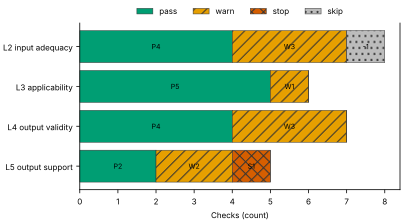
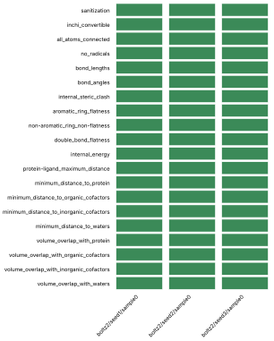
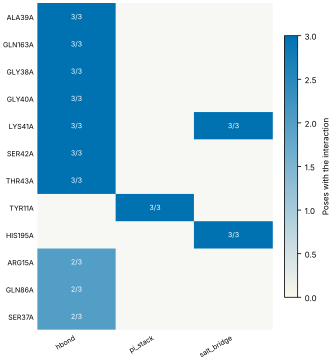
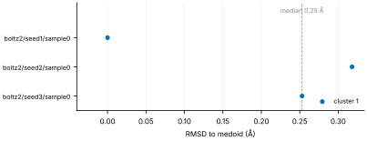
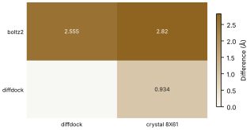
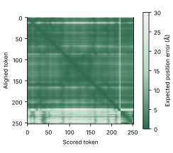

# Run report · Ligand pose in a known pocket

Prediction assurance · run `ligand_pose-71199ab48d55` · 2026-10-17 16:56:12 UTC

**Refused** for the claim "Predicted pose of ATP in FtsE is valid".

Refused over layers 2,3,4,5: 15 pass, 9 warn, 1 stop, 1 skip. Stopped by l5.controls.redocking. Warnings from l2.receptor.protonation, l2.ligand.protonation, l2.docking.box, l3.exposure.ligand_prevalence, l4.torsion_strain, l4.interactions.unsatisfied_polars, l4.minimisation_drift, l5.sampling.seeds, l5.agreement.cross_family.

Stops: `l5.controls.redocking`.

Warnings: `l2.receptor.protonation`, `l2.ligand.protonation`, `l2.docking.box`, `l3.exposure.ligand_prevalence`, `l4.torsion_strain`, `l4.interactions.unsatisfied_polars`, `l4.minimisation_drift`, `l5.sampling.seeds`, `l5.agreement.cross_family`.

| Field | Value |
| --- | --- |
| Task | Ligand pose in a known pocket (`ligand_pose`) |
| Tools | Boltz-2 2.2.1 (co-folding), DiffDock-L (docking) |
| Target | `protein` |
| Ligand | `c1nc(c2c(n1)n(cn2)[C@H]3[C@@H]([C@@H]([C@H](O3)CO[P@@](=O)(O)O[P@](=O)(O)OP(=O)(O)O)O)O)N` |
| Reference | `8X61` |
| pH | 7.4 |
| Seeds | 3 |
| Layers run | 2, 3, 4, 5 |
| Run | `ligand_pose-71199ab48d55` |
| Created | 2026-10-17 16:56:12 UTC |
| Finished | 2026-10-17 16:57:57 UTC |
| pah version | 0.1.0 |
| Report schema | 1 |

## Layers

| Layer | Status | Result | pass | warn | stop | skip | Time |
| --- | --- | --- | --- | --- | --- | --- | --- |
| L0 Provenance | not run | n/a | n/a | n/a | n/a | n/a | n/a |
| L1 Input integrity | not run | n/a | n/a | n/a | n/a | n/a | n/a |
| L2 Input adequacy | done | warn | 4 | 3 | 0 | 1 | 2.0 s |
| L3 Applicability | done | warn | 5 | 1 | 0 | 0 | 4.2 s |
| L4 Output validity | done | warn | 4 | 3 | 0 | 0 | 98.5 s |
| L5 Output support | done | stop | 2 | 2 | 1 | 0 | 232 ms |

## Figures

Fig. 1 · Check outcomes per layer for run ligand_pose-71199ab48d55. Totals: pass 15, warn 9, stop 1, skip 1.
Files: data [figures/gates_by_layer.csv](figures/gates_by_layer.csv).

## Structures

68 PyMOL renders.

8X61 mmCIF (source_structure), whole structure. Chains A, B, C, D; organic components ATP. sha256 ba2b64fd50fa3880. PyMOL session: [renders/8X61.pse](renders/8X61.pse).

8X61 mmCIF (source_structure), ligand environment within 5 Å. Chains A, B, C, D; organic components ATP. sha256 ba2b64fd50fa3880. PyMOL session: [renders/8X61.pse](renders/8X61.pse).

boltz2/seed1/sample0 (prediction_structure), whole structure. Chains A, L; organic components LIG1. sha256 b56e308bfe77d366. PyMOL session: [renders/boltz2_seed1_sample0.pse](renders/boltz2_seed1_sample0.pse).

boltz2/seed1/sample0 (prediction_structure), ligand environment within 5 Å. Chains A, L; organic components LIG1. sha256 b56e308bfe77d366. PyMOL session: [renders/boltz2_seed1_sample0.pse](renders/boltz2_seed1_sample0.pse).

boltz2/seed2/sample0 (prediction_structure), whole structure. Chains A, L; organic components LIG1. sha256 e0847f43fe1e456c. PyMOL session: [renders/boltz2_seed2_sample0.pse](renders/boltz2_seed2_sample0.pse).

boltz2/seed2/sample0 (prediction_structure), ligand environment within 5 Å. Chains A, L; organic components LIG1. sha256 e0847f43fe1e456c. PyMOL session: [renders/boltz2_seed2_sample0.pse](renders/boltz2_seed2_sample0.pse).

boltz2/seed3/sample0 (prediction_structure), whole structure. Chains A, L; organic components LIG1. sha256 c62c8bebb1217ff9. PyMOL session: [renders/boltz2_seed3_sample0.pse](renders/boltz2_seed3_sample0.pse).

boltz2/seed3/sample0 (prediction_structure), ligand environment within 5 Å. Chains A, L; organic components LIG1. sha256 c62c8bebb1217ff9. PyMOL session: [renders/boltz2_seed3_sample0.pse](renders/boltz2_seed3_sample0.pse).

diffdock/seed1/mode0 (prediction_structure), whole structure. Chains A, L; organic components LIG. sha256 1502632d4ccffaea. PyMOL session: [renders/diffdock_seed1_mode0.pse](renders/diffdock_seed1_mode0.pse).

diffdock/seed1/mode0 (prediction_structure), ligand environment within 5 Å. Chains A, L; organic components LIG. sha256 1502632d4ccffaea. PyMOL session: [renders/diffdock_seed1_mode0.pse](renders/diffdock_seed1_mode0.pse).

diffdock/seed1/mode1 (prediction_structure), whole structure. Chains A, L; organic components LIG. sha256 a75698476e19e0a5. PyMOL session: [renders/diffdock_seed1_mode1.pse](renders/diffdock_seed1_mode1.pse).

diffdock/seed1/mode1 (prediction_structure), ligand environment within 5 Å. Chains A, L; organic components LIG. sha256 a75698476e19e0a5. PyMOL session: [renders/diffdock_seed1_mode1.pse](renders/diffdock_seed1_mode1.pse).

diffdock/seed1/mode2 (prediction_structure), whole structure. Chains A, L; organic components LIG. sha256 f642755e6213af80. PyMOL session: [renders/diffdock_seed1_mode2.pse](renders/diffdock_seed1_mode2.pse).

diffdock/seed1/mode2 (prediction_structure), ligand environment within 5 Å. Chains A, L; organic components LIG. sha256 f642755e6213af80. PyMOL session: [renders/diffdock_seed1_mode2.pse](renders/diffdock_seed1_mode2.pse).

diffdock/seed1/mode3 (prediction_structure), whole structure. Chains A, L; organic components LIG. sha256 11fdc149a25f4d05. PyMOL session: [renders/diffdock_seed1_mode3.pse](renders/diffdock_seed1_mode3.pse).

diffdock/seed1/mode3 (prediction_structure), ligand environment within 5 Å. Chains A, L; organic components LIG. sha256 11fdc149a25f4d05. PyMOL session: [renders/diffdock_seed1_mode3.pse](renders/diffdock_seed1_mode3.pse).

diffdock/seed1/mode4 (prediction_structure), whole structure. Chains A, L; organic components LIG. sha256 e530aac9278f92b2. PyMOL session: [renders/diffdock_seed1_mode4.pse](renders/diffdock_seed1_mode4.pse).

diffdock/seed1/mode4 (prediction_structure), ligand environment within 5 Å. Chains A, L; organic components LIG. sha256 e530aac9278f92b2. PyMOL session: [renders/diffdock_seed1_mode4.pse](renders/diffdock_seed1_mode4.pse).

diffdock/seed1/mode5 (prediction_structure), whole structure. Chains A, L; organic components LIG. sha256 712bfdb026ee672d. PyMOL session: [renders/diffdock_seed1_mode5.pse](renders/diffdock_seed1_mode5.pse).

diffdock/seed1/mode5 (prediction_structure), ligand environment within 5 Å. Chains A, L; organic components LIG. sha256 712bfdb026ee672d. PyMOL session: [renders/diffdock_seed1_mode5.pse](renders/diffdock_seed1_mode5.pse).

diffdock/seed1/mode6 (prediction_structure), whole structure. Chains A, L; organic components LIG. sha256 5d67af73eec20666. PyMOL session: [renders/diffdock_seed1_mode6.pse](renders/diffdock_seed1_mode6.pse).

diffdock/seed1/mode6 (prediction_structure), ligand environment within 5 Å. Chains A, L; organic components LIG. sha256 5d67af73eec20666. PyMOL session: [renders/diffdock_seed1_mode6.pse](renders/diffdock_seed1_mode6.pse).

diffdock/seed1/mode7 (prediction_structure), whole structure. Chains A, L; organic components LIG. sha256 0a0e3ed8b44d58e6. PyMOL session: [renders/diffdock_seed1_mode7.pse](renders/diffdock_seed1_mode7.pse).

diffdock/seed1/mode7 (prediction_structure), ligand environment within 5 Å. Chains A, L; organic components LIG. sha256 0a0e3ed8b44d58e6. PyMOL session: [renders/diffdock_seed1_mode7.pse](renders/diffdock_seed1_mode7.pse).

diffdock/seed1/mode8 (prediction_structure), whole structure. Chains A, L; organic components LIG. sha256 d009559cf81f0df8. PyMOL session: [renders/diffdock_seed1_mode8.pse](renders/diffdock_seed1_mode8.pse).

diffdock/seed1/mode8 (prediction_structure), ligand environment within 5 Å. Chains A, L; organic components LIG. sha256 d009559cf81f0df8. PyMOL session: [renders/diffdock_seed1_mode8.pse](renders/diffdock_seed1_mode8.pse).

diffdock/seed1/mode9 (prediction_structure), whole structure. Chains A, L; organic components LIG. sha256 b4b5294f2a579ae5. PyMOL session: [renders/diffdock_seed1_mode9.pse](renders/diffdock_seed1_mode9.pse).

diffdock/seed1/mode9 (prediction_structure), ligand environment within 5 Å. Chains A, L; organic components LIG. sha256 b4b5294f2a579ae5. PyMOL session: [renders/diffdock_seed1_mode9.pse](renders/diffdock_seed1_mode9.pse).

diffdock/seed2/mode0 (prediction_structure), whole structure. Chains A, L; organic components LIG. sha256 f9d9c257fcb41f6b. PyMOL session: [renders/diffdock_seed2_mode0.pse](renders/diffdock_seed2_mode0.pse).

diffdock/seed2/mode0 (prediction_structure), ligand environment within 5 Å. Chains A, L; organic components LIG. sha256 f9d9c257fcb41f6b. PyMOL session: [renders/diffdock_seed2_mode0.pse](renders/diffdock_seed2_mode0.pse).

diffdock/seed2/mode1 (prediction_structure), whole structure. Chains A, L; organic components LIG. sha256 fabf54b5f3ccc0b0. PyMOL session: [renders/diffdock_seed2_mode1.pse](renders/diffdock_seed2_mode1.pse).

diffdock/seed2/mode1 (prediction_structure), ligand environment within 5 Å. Chains A, L; organic components LIG. sha256 fabf54b5f3ccc0b0. PyMOL session: [renders/diffdock_seed2_mode1.pse](renders/diffdock_seed2_mode1.pse).

diffdock/seed2/mode2 (prediction_structure), whole structure. Chains A, L; organic components LIG. sha256 4cb414b1b3887c22. PyMOL session: [renders/diffdock_seed2_mode2.pse](renders/diffdock_seed2_mode2.pse).

diffdock/seed2/mode2 (prediction_structure), ligand environment within 5 Å. Chains A, L; organic components LIG. sha256 4cb414b1b3887c22. PyMOL session: [renders/diffdock_seed2_mode2.pse](renders/diffdock_seed2_mode2.pse).

diffdock/seed2/mode3 (prediction_structure), whole structure. Chains A, L; organic components LIG. sha256 cf257a464776727a. PyMOL session: [renders/diffdock_seed2_mode3.pse](renders/diffdock_seed2_mode3.pse).

diffdock/seed2/mode3 (prediction_structure), ligand environment within 5 Å. Chains A, L; organic components LIG. sha256 cf257a464776727a. PyMOL session: [renders/diffdock_seed2_mode3.pse](renders/diffdock_seed2_mode3.pse).

diffdock/seed2/mode4 (prediction_structure), whole structure. Chains A, L; organic components LIG. sha256 45a9a38a6d6ded66. PyMOL session: [renders/diffdock_seed2_mode4.pse](renders/diffdock_seed2_mode4.pse).

diffdock/seed2/mode4 (prediction_structure), ligand environment within 5 Å. Chains A, L; organic components LIG. sha256 45a9a38a6d6ded66. PyMOL session: [renders/diffdock_seed2_mode4.pse](renders/diffdock_seed2_mode4.pse).

diffdock/seed2/mode5 (prediction_structure), whole structure. Chains A, L; organic components LIG. sha256 1f83648f2cae0e35. PyMOL session: [renders/diffdock_seed2_mode5.pse](renders/diffdock_seed2_mode5.pse).

diffdock/seed2/mode5 (prediction_structure), ligand environment within 5 Å. Chains A, L; organic components LIG. sha256 1f83648f2cae0e35. PyMOL session: [renders/diffdock_seed2_mode5.pse](renders/diffdock_seed2_mode5.pse).

diffdock/seed2/mode6 (prediction_structure), whole structure. Chains A, L; organic components LIG. sha256 078080a541478409. PyMOL session: [renders/diffdock_seed2_mode6.pse](renders/diffdock_seed2_mode6.pse).

diffdock/seed2/mode6 (prediction_structure), ligand environment within 5 Å. Chains A, L; organic components LIG. sha256 078080a541478409. PyMOL session: [renders/diffdock_seed2_mode6.pse](renders/diffdock_seed2_mode6.pse).

diffdock/seed2/mode7 (prediction_structure), whole structure. Chains A, L; organic components LIG. sha256 16ea99cda82094c0. PyMOL session: [renders/diffdock_seed2_mode7.pse](renders/diffdock_seed2_mode7.pse).

diffdock/seed2/mode7 (prediction_structure), ligand environment within 5 Å. Chains A, L; organic components LIG. sha256 16ea99cda82094c0. PyMOL session: [renders/diffdock_seed2_mode7.pse](renders/diffdock_seed2_mode7.pse).

diffdock/seed2/mode8 (prediction_structure), whole structure. Chains A, L; organic components LIG. sha256 62a4d96260da494f. PyMOL session: [renders/diffdock_seed2_mode8.pse](renders/diffdock_seed2_mode8.pse).

diffdock/seed2/mode8 (prediction_structure), ligand environment within 5 Å. Chains A, L; organic components LIG. sha256 62a4d96260da494f. PyMOL session: [renders/diffdock_seed2_mode8.pse](renders/diffdock_seed2_mode8.pse).

diffdock/seed2/mode9 (prediction_structure), whole structure. Chains A, L; organic components LIG. sha256 82b57739340b3bfe. PyMOL session: [renders/diffdock_seed2_mode9.pse](renders/diffdock_seed2_mode9.pse).

diffdock/seed2/mode9 (prediction_structure), ligand environment within 5 Å. Chains A, L; organic components LIG. sha256 82b57739340b3bfe. PyMOL session: [renders/diffdock_seed2_mode9.pse](renders/diffdock_seed2_mode9.pse).

diffdock/seed3/mode0 (prediction_structure), whole structure. Chains A, L; organic components LIG. sha256 e1c4c3c7cc5d85a6. PyMOL session: [renders/diffdock_seed3_mode0.pse](renders/diffdock_seed3_mode0.pse).

diffdock/seed3/mode0 (prediction_structure), ligand environment within 5 Å. Chains A, L; organic components LIG. sha256 e1c4c3c7cc5d85a6. PyMOL session: [renders/diffdock_seed3_mode0.pse](renders/diffdock_seed3_mode0.pse).

diffdock/seed3/mode1 (prediction_structure), whole structure. Chains A, L; organic components LIG. sha256 6233e0cd34e27dc2. PyMOL session: [renders/diffdock_seed3_mode1.pse](renders/diffdock_seed3_mode1.pse).

diffdock/seed3/mode1 (prediction_structure), ligand environment within 5 Å. Chains A, L; organic components LIG. sha256 6233e0cd34e27dc2. PyMOL session: [renders/diffdock_seed3_mode1.pse](renders/diffdock_seed3_mode1.pse).

diffdock/seed3/mode2 (prediction_structure), whole structure. Chains A, L; organic components LIG. sha256 30e0dec8e702fa3e. PyMOL session: [renders/diffdock_seed3_mode2.pse](renders/diffdock_seed3_mode2.pse).

diffdock/seed3/mode2 (prediction_structure), ligand environment within 5 Å. Chains A, L; organic components LIG. sha256 30e0dec8e702fa3e. PyMOL session: [renders/diffdock_seed3_mode2.pse](renders/diffdock_seed3_mode2.pse).

diffdock/seed3/mode3 (prediction_structure), whole structure. Chains A, L; organic components LIG. sha256 5cf7109d76771fad. PyMOL session: [renders/diffdock_seed3_mode3.pse](renders/diffdock_seed3_mode3.pse).

diffdock/seed3/mode3 (prediction_structure), ligand environment within 5 Å. Chains A, L; organic components LIG. sha256 5cf7109d76771fad. PyMOL session: [renders/diffdock_seed3_mode3.pse](renders/diffdock_seed3_mode3.pse).

diffdock/seed3/mode4 (prediction_structure), whole structure. Chains A, L; organic components LIG. sha256 e5693e391202889a. PyMOL session: [renders/diffdock_seed3_mode4.pse](renders/diffdock_seed3_mode4.pse).

diffdock/seed3/mode4 (prediction_structure), ligand environment within 5 Å. Chains A, L; organic components LIG. sha256 e5693e391202889a. PyMOL session: [renders/diffdock_seed3_mode4.pse](renders/diffdock_seed3_mode4.pse).

diffdock/seed3/mode5 (prediction_structure), whole structure. Chains A, L; organic components LIG. sha256 ecdaead52d4107c2. PyMOL session: [renders/diffdock_seed3_mode5.pse](renders/diffdock_seed3_mode5.pse).

diffdock/seed3/mode5 (prediction_structure), ligand environment within 5 Å. Chains A, L; organic components LIG. sha256 ecdaead52d4107c2. PyMOL session: [renders/diffdock_seed3_mode5.pse](renders/diffdock_seed3_mode5.pse).

diffdock/seed3/mode6 (prediction_structure), whole structure. Chains A, L; organic components LIG. sha256 6ce00fe49ac390d5. PyMOL session: [renders/diffdock_seed3_mode6.pse](renders/diffdock_seed3_mode6.pse).

diffdock/seed3/mode6 (prediction_structure), ligand environment within 5 Å. Chains A, L; organic components LIG. sha256 6ce00fe49ac390d5. PyMOL session: [renders/diffdock_seed3_mode6.pse](renders/diffdock_seed3_mode6.pse).

diffdock/seed3/mode7 (prediction_structure), whole structure. Chains A, L; organic components LIG. sha256 8b4740a873122f52. PyMOL session: [renders/diffdock_seed3_mode7.pse](renders/diffdock_seed3_mode7.pse).

diffdock/seed3/mode7 (prediction_structure), ligand environment within 5 Å. Chains A, L; organic components LIG. sha256 8b4740a873122f52. PyMOL session: [renders/diffdock_seed3_mode7.pse](renders/diffdock_seed3_mode7.pse).

diffdock/seed3/mode8 (prediction_structure), whole structure. Chains A, L; organic components LIG. sha256 5c643cec45835bcf. PyMOL session: [renders/diffdock_seed3_mode8.pse](renders/diffdock_seed3_mode8.pse).

diffdock/seed3/mode8 (prediction_structure), ligand environment within 5 Å. Chains A, L; organic components LIG. sha256 5c643cec45835bcf. PyMOL session: [renders/diffdock_seed3_mode8.pse](renders/diffdock_seed3_mode8.pse).

diffdock/seed3/mode9 (prediction_structure), whole structure. Chains A, L; organic components LIG. sha256 efe20b308358fd30. PyMOL session: [renders/diffdock_seed3_mode9.pse](renders/diffdock_seed3_mode9.pse).

diffdock/seed3/mode9 (prediction_structure), ligand environment within 5 Å. Chains A, L; organic components LIG. sha256 efe20b308358fd30. PyMOL session: [renders/diffdock_seed3_mode9.pse](renders/diffdock_seed3_mode9.pse).

## L0 Provenance

Where did every input come from?

Status: not run.

## L1 Input integrity

Did the run receive exactly what was declared?

Status: not run.

## L2 Input adequacy

Does the input carry enough information?

Status: done. Checks: pass 4 · warn 3 · stop 0 · skip 1. Time: 2.0 s.

#### Key figures

| Figure | Value |
| --- | --- |
| near site | 0 |
| missing | 0 |
| uniprot cofactors | 0 |
| pocket residues | 30 |
| incomplete | 0 |
| sequence gaps | 0 |
| state | holo |
| site ligands | 1 |

#### Docking

| Field | Value |
| --- | --- |
| center | 137.651, 149.997, 122.463 Å |
| size | 16.823 × 14.232 × 20.687 Å |
| origin | derived from ATP (+4 Å) |

#### Checks

| Check | Result | Measured cmp threshold | Evidence | Id · time |
| --- | --- | --- | --- | --- |
| Alignment depth, distinct sequences, Neff and gap fraction | skip | n/a | no MSA declared for a co-folding model · not applicable | `l2.msa.depth` |
| Required cofactors, ions and partners present | pass | `pocket_distance <= 8` | components within 8.0 Å of ATP: none · near_site=0, missing=0, uniprot_cofactors=0 | `l2.context.cofactors` · 684 ms |
| Pocket residues resolved, no missing loops lining the pocket | pass | `pocket_distance <= 6` | 30 pocket residues complete in 8X61.cif · pocket_residues=30, incomplete=0, sequence_gaps=0 | `l2.pocket.resolved` · 15 ms |
| Receptor state apo or holo | pass | n/a | 8X61.cif holo: ATP in the site · state=holo, site_ligands=1 | `l2.receptor.state` · 18 ms |
| Receptor protonation at the stated pH | warn | `pka_margin > 1` | receptor has no hydrogens (protonation not assigned); pKa within 1.0 of pH 7.4: HIS36A pKa 6.97 · hydrogens_present=False, ph=7.4, pocket_titratable=10 | `l2.receptor.protonation` · 213 ms |
| Ligand protonation and tautomers enumerated at the stated pH | warn | `ph 7.4 == 1` | ligand: 2 states; ligand: declared form Nc1ncnc2c1ncn2[C@@H]1O[C@H](CO[P@@](=O)(O)O[P@](=O)(O)OP(=O)(O)O)[C@@H](O)[C@H]1O differs from enumerated Nc1ncnc2c1ncn2[C@@H]1O[C@H](CO[P@@](=O)([O-])O[P@](=O)([O-])OP(=O)([O-])O)[C@@H](O)[C@H]1O, Nc1ncnc2c1ncn2[C@@H]1O[C@H](CO[P@@](=O)([O-])O[P@](=O)([O-])OP(=O)([O-])[O-])[C@@H](O)[C@H]1O · ph=7.4, max_states=2, declared_not_enumerated=1 | `l2.ligand.protonation` · 58 ms |
| Ligand conformers generated and minimised | pass | `conformers >= 10` | 10 ETKDG conformers per ligand, MMFF minimised · ligands=1, failed=0, min_embedded=10 | `l2.ligand.conformers` · 992 ms |
| Docking box encloses the pocket with margin | warn | `margin >= 2` | no box declared; derived box encloses 21 contact residues and the ATP ligand with 2.0 Å margin · volume_A3=4953, ligand_atoms_inside_margin=31, ligand_atoms=31 | `l2.docking.box` · 19 ms |

## L3 Applicability

Is the tool inside its validated regime?

Status: done. Checks: pass 5 · warn 1 · stop 0 · skip 0. Time: 4.2 s.

#### Key figures

| Figure | Value |
| --- | --- |
| executors | 2 |
| unknown | 0 |
| reference released | 2024-05-08 |
| cutoff | 2019-01-01 |
| entries compared | 0 |
| pocket residues | 22 |
| systems | 3474 |
| analogue components | 19 |

#### Checks

| Check | Result | Measured cmp threshold | Evidence | Id · time |
| --- | --- | --- | --- | --- |
| Model training cutoff recorded | pass | `training_cutoff == recorded` | boltz2 2023-06-01; diffdock 2019-01-01; reference 8X61 released 2024-05-08 · executors=2, unknown=0, reference_released=2024-05-08 | `l3.model.training_cutoff` · 341 ms |
| Pocket similarity to pre-cutoff complexes (SuCOS times pocket coverage) | pass | `similarity <= 50` | no pre-cutoff holo entry with an analogue found (cutoff 2019-01-01) · cutoff=2019-01-01, entries_compared=0, max_similarity=None | `l3.exposure.pocket` · 1.4 s |
| Ligand analogues in pre-cutoff training systems | warn | `tanimoto > 0.9` | 3474 PDB entries released before 2019-01-01 (diffdock cutoff) contain analogues of ligand above Tanimoto 0.9: 5FA, ADP, AQP, ATP, HEJ, LA8 · cutoff=2019-01-01, systems=3474, analogue_components=19 | `l3.exposure.ligand_prevalence` · 0 ms |
| Chain sequence identity to pre-cutoff entries (secondary measure) | pass | `identity < 0.4` | protein: 0 entries at 95 percent identity, 6 at 40 percent, released before 2019-01-01 (reported, not gating) · cutoff=2019-01-01, entries_95=0, entries_40=6 | `l3.exposure.sequence` · 2.4 s |
| Modality inside the validated set; token count against the training crop | pass | n/a | modalities protein, protein_ligand inside the validated set; 253 tokens · modalities=2, tokens=253, outside=0 | `l3.regime.modality` · 39 ms |
| Endpoint fits the tool | pass | `endpoint pose in pose` | endpoint pose produced by boltz2, diffdock · endpoint=pose, executors=2, not_fitting=0 | `l3.metric.endpoint` · 0 ms |

## L4 Output validity

Is the result physically and chemically sensible?

Status: done. Checks: pass 4 · warn 3 · stop 0 · skip 0. Time: 98.5 s.

#### Key figures

| Figure | Value |
| --- | --- |
| poses | 3 |
| passed | 20 |
| total | 20 |
| poses all pass | 3 |
| unlikely torsions | 1 |
| torsions | 14 |
| strain kcal | 5.15 |
| poses with unlikely | 3 |

#### PoseBusters · 20/20 tests pass

| test | result | value |
| --- | --- | --- |
| sanitization | pass | pass |
| inchi_convertible | pass | pass |
| all_atoms_connected | pass | pass |
| no_radicals | pass | pass |
| bond_lengths | pass | 0 long outliers |
| bond_angles | pass | 0 outliers |
| internal_steric_clash | pass | 0 |
| aromatic_ring_flatness | pass | 0.00 Å |
| non-aromatic_ring_non-flatness | pass | pass |
| double_bond_flatness | pass | pass |
| internal_energy | pass | 3.1 times the ensemble mean |
| protein-ligand_maximum_distance | pass | 2.45 Å |
| minimum_distance_to_protein | pass | 2.45 Å |
| minimum_distance_to_organic_cofactors | pass | pass |
| minimum_distance_to_inorganic_cofactors | pass | pass |
| minimum_distance_to_waters | pass | pass |
| volume_overlap_with_protein | pass | 0.022 |
| volume_overlap_with_organic_cofactors | pass | pass |
| volume_overlap_with_inorganic_cofactors | pass | pass |
| volume_overlap_with_waters | pass | pass |

#### Per-pose physical checks

| pose | seed | drift Å | converged | unlikely torsions | unsat. polars | buried charged | PoseBusters |
| --- | --- | --- | --- | --- | --- | --- | --- |
| boltz2/seed1/sample0 | 1 | 2.12 | true | 1/14 | 2 | 0 | 20/20 |
| boltz2/seed2/sample0 | 2 | 0.5 | true | 2/14 | 4 | 0 | 20/20 |
| boltz2/seed3/sample0 | 3 | 1.62 | true | 1/14 | 2 | 0 | 20/20 |
| median | n/a | 1.62 | n/a | 1 | 2 | 0 | 20/20 |

#### Interaction fingerprint · representative pose boltz2/seed1/sample0

| residue | type | distance | poses |
| --- | --- | --- | --- |
| ALA39A | hbond | 3.12 Å | 3/3 |
| GLN163A | hbond | 2.81 Å | 3/3 |
| GLY38A | hbond | 2.88 Å | 3/3 |
| GLY40A | hbond | 3.07 Å | 3/3 |
| LYS41A | hbond | 3.04 Å | 3/3 |
| SER42A | hbond | 2.81 Å | 3/3 |
| THR43A | hbond | 2.61 Å | 3/3 |
| TYR11A | pi_stack | 3.58 Å | 3/3 |
| HIS195A | salt_bridge | 4.99 Å | 3/3 |
| LYS41A | salt_bridge | 3.95 Å | 3/3 |
| ARG15A | hbond | 3.03 Å | 2/3 |
| GLN86A | hbond | 3.8 Å | 2/3 |
| SER37A | hbond | 2.5 Å | 2/3 |

Fig. 2 · PoseBusters tests (20) by pose (3). Failed cells marked x: 0 of 60.
Files: data [figures/posebusters_grid.csv](figures/posebusters_grid.csv).

Fig. 3 · Interactions by residue (12) and type (3); cell label: poses with the interaction over poses assessed.
Files: data [figures/interactions.csv](figures/interactions.csv).

#### Checks

| Check | Result | Measured cmp threshold | Evidence | Id · time |
| --- | --- | --- | --- | --- |
| PoseBusters geometry, stereochemistry, clashes and protein contact | pass | `tests_failed == 0` | 20 of 20 tests pass for boltz2/seed1/sample0; 3 of 3 poses pass all · poses=3, passed=20, total=20 | `l4.posebusters` · 4.1 s |
| Torsional strain of the ligand pose | warn | `torsion_energy <= 2.5` | 1 of 14 torsions above 2.5 kcal/mol in boltz2/seed1/sample0 · poses=3, unlikely_torsions=1, torsions=14 | `l4.torsion_strain` · 7.2 s |
| Interaction fingerprint (PLIP) | pass | n/a | 14 interactions in boltz2/seed1/sample0 (hbond, pi_stack, salt_bridge); 13 distinct across 3 poses (reported) · poses=3, interactions_representative=14, distinct=13 | `l4.interactions.fingerprint` · 1.5 s |
| Buried ligand polar atoms without a hydrogen-bond partner | warn | `relative_sasa < 0.1` | 2 of 7 buried polar ligand atoms without a partner in boltz2/seed1/sample0 · poses=3, unsatisfied=2, buried_charged=0 | `l4.interactions.unsatisfied_polars` · 291 ms |
| Hydrophobic complementarity of buried ligand surface | pass | `fraction >= 0.35` | nonpolar fraction of protein contacts around 3 buried nonpolar ligand atoms in boltz2/seed1/sample0: 0.556 · poses=3, complementarity=0.556, buried_nonpolar=3 | `l4.interactions.hydrophobic` · 426 ms |
| Interactions of the crystal ligand reproduced by the pose | pass | `reproduced 9 >= 1` | boltz2/seed1/sample0 reproduces 9 of 16 ATP interactions: hbond ALA39A, hbond GLN163A, hbond GLY38A, hbond GLY40A, hbond LYS41A, hbond SER42A, hbond THR43A, pi_stack TYR11A, salt_bridge LYS41A · key_interactions=16, reproduced=9, poses_reproducing_all=0 | `l4.interactions.known_binders` · 707 ms |
| Pose stability under short restrained minimisation (OpenMM, AMBER14 and OpenFF) | warn | `drift_A 2.12 <= 2` | boltz2/seed1/sample0 moves 2.121 Å under restrained minimisation · poses=3, drift_A=2.121, max_drift_A=2.121 | `l4.minimisation_drift` · 84.3 s |

## L5 Output support

Is a valid result corroborated?

Status: done. Checks: pass 2 · warn 2 · stop 1 · skip 0. Time: 232 ms.

#### Key figures

| Figure | Value |
| --- | --- |
| poses | 3 |
| pocket plddt | 94.8 |
| global plddt | 93.8 |
| iptm | 0.962 |
| ptm | 0.937 |
| confidence score | 0.939 |
| independent seeds | 3 |
| samples | 3 |

#### Sampling

| Field | Value |
| --- | --- |
| site placement | 3 of 3 poses within 4.0 Å of the site (ATP in 8X61) |
| pose accuracy | 3 of 3 poses within 2.0 Å of the medoid |
| pairwise RMSD median | 0.32 Å |
| pairwise RMSD IQR | 0.28 to 0.34 Å |
| pairs | 3 |
| medoid | boltz2/seed1/sample0 |

#### Clusters

| Field | Value |
| --- | --- |
| cluster 1 | 3/3 poses (boltz2/seed1/sample0) |

#### Per-seed statistics

| seed | pose | cluster | RMSD to medoid | confidence |
| --- | --- | --- | --- | --- |
| 1 | boltz2/seed1/sample0 | 1 | 0 Å | 0.94 |
| 2 | boltz2/seed2/sample0 | 1 | 0.32 Å | 0.94 |
| 3 | boltz2/seed3/sample0 | 1 | 0.25 Å | 0.94 |
| median | n/a | n/a | 0.25 Å | 0.94 |

#### Ensemble

| structure | kind | source | RMSD to medoid | cluster | pocket pLDDT | ipTM |
| --- | --- | --- | --- | --- | --- | --- |
| boltz2/seed1/sample0 | medoid | boltz2 | 0 Å | 1 | 94.8 | 0.96 |
| boltz2/seed2/sample0 | seed | boltz2 | 0.32 Å | 1 | 94.8 | 0.96 |
| boltz2/seed3/sample0 | seed | boltz2 | 0.25 Å | 1 | 94.9 | 0.97 |

#### Agreement between methods

| method | diffdock | crystal 8X61 |
| --- | --- | --- |
| boltz2 | 2.56 Å (high) | 2.82 Å (decisive) |
| diffdock | n/a | 0.93 Å (decisive) |

#### Confidence metrics

| metric | value | read as | tool |
| --- | --- | --- | --- |
| affinity_pred_value | 0.1830679178237915 | ranking within a series, never pose quality | boltz2 |
| affinity_probability_binary | 0.45022180676460266 | ranking within a series, never pose quality | boltz2 |
| affinity_pred_value | 0.21876266598701477 | ranking within a series, never pose quality | boltz2 |
| affinity_probability_binary | 0.43401533365249634 | ranking within a series, never pose quality | boltz2 |
| affinity_pred_value | 0.1942514181137085 | ranking within a series, never pose quality | boltz2 |
| affinity_probability_binary | 0.44725194573402405 | ranking within a series, never pose quality | boltz2 |

Fig. 4 · RMSD to the medoid for 3 poses, coloured by cluster (1 clusters). Dashed line: median 0.25 Å; range 0.00 to 0.32 Å.
Files: data [figures/seed_spread.csv](figures/seed_spread.csv).

Fig. 5 · Agreement between 2 methods and 2 comparators; range 0.934 to 2.82 Å.
Files: data [figures/agreement.csv](figures/agreement.csv).

Fig. 6 · Predicted aligned error for pose boltz2/seed1/sample0, 253 by 253 tokens; values 0.2 to 28.8 Å, mean 4.8 Å.
Files: data [figures/pae.csv](figures/pae.csv).

#### Checks

| Check | Result | Measured cmp threshold | Evidence | Id · time |
| --- | --- | --- | --- | --- |
| Confidence restricted to the pocket; per-model thresholds | pass | `boltz2.pocket_plddt >= 70` | boltz2/seed1/sample0: pocket_plddt 94.8 · poses=3, pocket_plddt=94.8, global_plddt=93.8 | `l5.confidence.local` · 20 ms |
| Independent seeds counted separately from samples; duplicates flagged | warn | `seeds_cofolding >= 5` | 3 independent seeds (3 poses); task default 5 · independent_seeds=3, samples=3, duplicated_outputs=0 | `l5.sampling.seeds` · 0 ms |
| Medoid of the largest cluster, populations, pairwise spread, site and pose accuracy | pass | `cluster_rmsd <= 2` | medoid boltz2/seed1/sample0; 1 clusters, largest 3 of 3; pairwise RMSD median 0.32 Å (IQR 0.29 to 0.34); 3 of 3 poses within 4.0 Å of the site (ATP in 8X61); 3 of 3 poses within 2.0 Å of the medoid · poses=3, clusters=1, largest_cluster=3 | `l5.sampling.clusters` · 46 ms |
| Agreement between methods, weighted by independence | warn | `rmsd_to_crystal_A 2.82 <= 2` | boltz2 vs diffdock 2.555 Å (high); boltz2 vs crystal 8X61 2.82 Å (decisive); diffdock vs crystal 8X61 0.934 Å (decisive) · methods=2, comparisons=3, disagreeing=2 | `l5.agreement.cross_family` · 162 ms |
| Redocking control reproduces the crystal pose | stop | `rmsd <= 2` | redocking control required by the task and not supplied (controls.redocking) | `l5.controls.redocking` · 0 ms |

## Controls

| control | status | result |
| --- | --- | --- |
| redocking | incomplete | redocking control required by the task and not supplied (controls.redocking) |

## Provenance

50 objects · 45 cached · 5 network.

| Source | Accession | Release | SHA-256 | Retrieved | Bytes | Cache | Used by |
| --- | --- | --- | --- | --- | --- | --- | --- |
| rcsb_files | 8X61 | n/a | `ba2b64fd50fa` | 2026-10-17 16:56:13 UTC | 669464 | miss | l2.context.cofactors, l2.pocket.resolved, l2.receptor.state, l2.docking.box, l3.exposure.pocket, l3.regime.modality, l4.interactions.fingerprint, l4.interactions.known_binders, l5.sampling.clusters, l5.agreement.cross_family |
| ccd | ATP | 2011-06-04 | `a7dfd66192d9` | 2026-10-17 16:42:55 UTC | 14836 | hit | l2.context.cofactors, l3.exposure.pocket |
| rcsb | 8X61 | 1.2 | `40597bd4cb89` | 2026-10-17 16:56:15 UTC | 12259 | miss | l3.model.training_cutoff |
| rcsb_search | chem:c1nc(c2c(n1)n(cn2)[C@H]3[C@@H]([C@@H]([C@H](O3)CO[P@@](=O)(O)O[P@](=O)(O)OP(=O)(O)O)O)O)N | n/a | `c9ecdf87b8e2` | 2026-10-17 16:42:57 UTC | 1797 | hit | l3.exposure.pocket |
| ccd | 5FA | 2011-06-04 | `141da43b1fd4` | 2026-10-17 16:42:57 UTC | 5208 | hit | l3.exposure.pocket |
| ccd | ADP | 2025-10-10 | `9ebf239d6ded` | 2026-10-17 16:42:57 UTC | 5741 | hit | l3.exposure.pocket |
| ccd | AQP | 2011-06-04 | `d1f31df6170c` | 2026-10-17 16:42:57 UTC | 4700 | hit | l3.exposure.pocket |
| ccd | HEJ | 2021-03-01 | `3793d61303f5` | 2026-10-17 16:42:57 UTC | 4603 | hit | l3.exposure.pocket |
| ccd | LA8 | 2020-06-17 | `3c66f53baf33` | 2026-10-17 16:42:57 UTC | 4178 | hit | l3.exposure.pocket |
| ccd | ZF9 | 2024-03-08 | `b48f6ea5a0a0` | 2026-10-17 16:42:57 UTC | 4686 | hit | l3.exposure.pocket |
| ccd | ZSF | 2024-03-29 | `dde5989ea661` | 2026-10-17 16:42:57 UTC | 4903 | hit | l3.exposure.pocket |
| ccd | 50T | 2026-09-16 | `6be53fbf78af` | 2026-10-17 16:42:57 UTC | 4275 | hit | l3.exposure.pocket |
| ccd | AD9 | 2026-09-16 | `c8798e579e0a` | 2026-10-17 16:42:58 UTC | 4205 | hit | l3.exposure.pocket |
| ccd | AOV | 2026-09-16 | `300b793745cf` | 2026-10-17 16:42:58 UTC | 4330 | hit | l3.exposure.pocket |
| ccd | CX0 | 2022-03-25 | `fbc78ded25cd` | 2026-10-17 16:42:58 UTC | 3595 | hit | l3.exposure.pocket |
| ccd | CXC | 2022-03-25 | `d89a7023bd05` | 2026-10-17 16:42:58 UTC | 3941 | hit | l3.exposure.pocket |
| ccd | 0A | 2015-04-24 | `7f0b456f42e0` | 2026-10-17 16:42:58 UTC | 3972 | hit | l3.exposure.pocket |
| ccd | 3AN | 2011-06-04 | `a3d4d17a4a3e` | 2026-10-17 16:42:58 UTC | 4390 | hit | l3.exposure.pocket |
| ccd | 7DD | 2016-06-10 | `2265ea597be9` | 2026-10-17 16:42:58 UTC | 3425 | hit | l3.exposure.pocket |
| ccd | 7DT | 2016-06-10 | `c346b8a79ec0` | 2026-10-17 16:42:58 UTC | 3725 | hit | l3.exposure.pocket |
| ccd | AAM | 2011-06-04 | `ade365fd93cd` | 2026-10-17 16:42:58 UTC | 4244 | hit | l3.exposure.pocket |
| ccd | PAP | 2011-06-04 | `1a6bb6874f6f` | 2026-10-17 16:42:58 UTC | 4734 | hit | l3.exposure.pocket |
| ccd | XNY | 2021-04-30 | `7cb26ca44908` | 2026-10-17 16:42:58 UTC | 3977 | hit | l3.exposure.pocket |
| ccd | AP5 | 2011-06-04 | `43e554f584b7` | 2026-10-17 16:42:58 UTC | 6473 | hit | l3.exposure.pocket |
| ccd | T99 | 2018-06-01 | `68a3d15f3b6f` | 2026-10-17 16:42:58 UTC | 3399 | hit | l3.exposure.pocket |
| ccd | TAT | 2012-01-25 | `55287be9857e` | 2026-10-17 16:42:58 UTC | 4858 | hit | l3.exposure.pocket |
| ccd | A1L15 | 2025-01-24 | `57864c05fab0` | 2026-10-17 16:42:58 UTC | 5608 | hit | l3.exposure.pocket |
| ccd | AGS | 2020-06-17 | `dcdd428b77e4` | 2026-10-17 16:42:58 UTC | 10128 | hit | l3.exposure.pocket |
| rcsb_search | comp:5FA:2019-01-01 | n/a | `c60bf45b266d` | 2026-10-17 16:42:58 UTC | 282 | hit | l3.exposure.pocket |
| rcsb_search | comp:ADP:2019-01-01 | n/a | `d0ea634975e9` | 2026-10-17 16:42:58 UTC | 52129 | hit | l3.exposure.pocket |
| rcsb_search | comp:AQP:2019-01-01 | n/a | `94a619102faa` | 2026-10-17 16:42:58 UTC | 230 | hit | l3.exposure.pocket |
| rcsb_search | comp:ATP:2019-01-01 | n/a | `88190701e349` | 2026-10-17 16:42:59 UTC | 52129 | hit | l3.exposure.pocket |
| rcsb_search | comp:HEJ:2019-01-01 | n/a | `494129c6512c` | 2026-10-17 16:42:59 UTC | 178 | hit | l3.exposure.pocket |
| rcsb_search | comp:LA8:2019-01-01 | n/a | `185329a63a40` | 2026-10-17 16:42:59 UTC | 230 | hit | l3.exposure.pocket |
| rcsb_search | comp:ZF9:2019-01-01 | n/a | `e3b0c44298fc` | 2026-10-17 16:42:59 UTC | 0 | hit | l3.exposure.sequence |
| rcsb_search | comp:ZSF:2019-01-01 | n/a | `e3b0c44298fc` | 2026-10-17 16:42:59 UTC | 0 | hit | l3.exposure.sequence |
| rcsb_search | comp:50T:2019-01-01 | n/a | `927f39839b9d` | 2026-10-17 16:42:59 UTC | 178 | hit | l3.exposure.pocket |
| rcsb_search | comp:AD9:2019-01-01 | n/a | `ac65056f9aef` | 2026-10-17 16:42:59 UTC | 490 | hit | l3.exposure.pocket |
| rcsb_search | comp:AOV:2019-01-01 | n/a | `d8dd9b5a5778` | 2026-10-17 16:42:59 UTC | 334 | hit | l3.exposure.pocket |
| rcsb_search | comp:CX0:2019-01-01 | n/a | `e3b0c44298fc` | 2026-10-17 16:42:59 UTC | 0 | hit | l3.exposure.sequence |
| rcsb_search | comp:CXC:2019-01-01 | n/a | `e3b0c44298fc` | 2026-10-17 16:42:59 UTC | 0 | hit | l3.exposure.sequence |
| rcsb_search | comp:0A:2019-01-01 | n/a | `e3b0c44298fc` | 2026-10-17 16:42:59 UTC | 0 | hit | l3.exposure.sequence |
| rcsb_search | comp:PAP:2019-01-01 | n/a | `ded69bf4bbb0` | 2026-10-17 16:42:59 UTC | 542 | hit | l3.exposure.pocket |
| rcsb_search | comp:AP5:2019-01-01 | n/a | `ab39d336ec91` | 2026-10-17 16:42:59 UTC | 3247 | hit | l3.exposure.pocket |
| rcsb_search | comp:T99:2019-01-01 | n/a | `690266055a03` | 2026-10-17 16:42:59 UTC | 178 | hit | l3.exposure.pocket |
| rcsb_search | comp:TAT:2019-01-01 | n/a | `84486689d32b` | 2026-10-17 16:42:59 UTC | 438 | hit | l3.exposure.pocket |
| rcsb_search | comp:AGS:2019-01-01 | n/a | `aef54bf1fe1d` | 2026-10-17 16:42:59 UTC | 8188 | hit | l3.exposure.pocket |
| rcsb_search | seq0.9:2019-01-01:222 | n/a | `e3b0c44298fc` | 2026-10-17 16:56:16 UTC | 0 | miss | l3.exposure.sequence |
| rcsb_search | seq0.95:2019-01-01:222 | n/a | `e3b0c44298fc` | 2026-10-17 16:56:17 UTC | 0 | miss | l3.exposure.sequence |
| rcsb_search | seq0.4:2019-01-01:222 | n/a | `10bbed45590c` | 2026-10-17 16:56:19 UTC | 457 | miss | l3.exposure.sequence |

Provenance graph: [json](graph.json), [mmd](graph.mmd), [svg](graph.svg).

## Thresholds

| Check | Threshold | Value | Origin | Evidence level |
| --- | --- | --- | --- | --- |
| `l2.context.cofactors` | pocket_distance | <= 8 | Harness rule: a component of the reference entry within 8 Å of the declared ligand is required context; not yet calibrated | uncalibrated |
| `l2.pocket.resolved` | pocket_distance | <= 6 | Harness rule: pocket residues have a heavy atom within 6 Å of the ligand; not yet calibrated | uncalibrated |
| `l2.pocket.resolved` | missing_pocket_residues | == 0 | Specification layer 2: stop when the pocket is incomplete | published |
| `l2.receptor.protonation` | pka_margin | > 1 | Harness rule: a titratable pocket residue with PROPKA pKa within 1 unit of the stated pH has an ambiguous state; not yet calibrated | uncalibrated |
| `l2.ligand.protonation` | ph_window | == 1 | Harness rule: states enumerated by Dimorphite-DL within 1 pH unit of the stated pH; not yet calibrated | uncalibrated |
| `l2.ligand.protonation` | states | == 1 | Specification layer 2: warn when more than one plausible state | published |
| `l2.ligand.conformers` | conformers | >= 10 | Harness default number of ETKDG conformers; not yet calibrated | uncalibrated |
| `l2.docking.box` | margin | >= 2 | Harness rule: every pocket heavy atom lies at least 2 Å inside the box; not yet calibrated | uncalibrated |
| `l2.docking.box` | contact_distance | <= 4 | Harness rule: contact residues (heavy atom within 4 Å of the reference ligand) must have an atom inside the box; not yet calibrated | uncalibrated |
| `l3.model.training_cutoff` | training_cutoff | == recorded | Specification, Layer 3 (applicability): stop when unknown | published |
| `l3.exposure.pocket` | similarity | <= 50 | Specification layer 3: warn above a pocket similarity (SuCOS times pocket coverage) of 50 | published |
| `l3.exposure.pocket` | entries | <= 5 | Harness budget: pre-cutoff holo entries compared per run | uncalibrated |
| `l3.exposure.ligand_prevalence` | tanimoto | > 0.9 | Specification layer 3: analogues above 0.9 Tanimoto (RDKit topological fingerprint) | published |
| `l3.exposure.ligand_prevalence` | systems | <= 100 | Specification layer 3: prevalent when analogues occur in more than 100 training systems | published |
| `l3.exposure.sequence` | identity | < 0.4 | Specification layer 3: conventional 40 percent identity leakage threshold, reported as a secondary measure only | published |
| `l3.metric.endpoint` | endpoint | in pose | Specification, Layer 3 (applicability): no affinity from interface confidence, no protein-protein affinity from Boltz-2 | published |
| `l4.posebusters` | tests_failed | == 0 | Specification, Layer 4 (output validity): stop on failure | published |
| `l4.torsion_strain` | torsion_energy | <= 2.5 | Harness rule: a rotatable torsion whose MMFF energy lies more than 2.5 kcal/mol above the minimum of its rigid scan is unlikely; not yet calibrated | uncalibrated |
| `l4.interactions.unsatisfied_polars` | relative_sasa | < 0.1 | Harness rule: a ligand polar atom with relative SASA below 0.1 in the complex is buried; not yet calibrated | uncalibrated |
| `l4.interactions.unsatisfied_polars` | hbond_distance | <= 3.5 | PLIP hydrogen bond distance cut-off (donor-acceptor 4.1 Å; harness uses 3.5 Å heavy-atom distance) | published |
| `l4.interactions.hydrophobic` | fraction | >= 0.35 | Harness default anchored on 3PTB: the crystal benzamidine scores 0.51, Vina and Boltz-2 poses within 0.5 Å of it score 0.45 and 0.49; not calibrated on the benchmark | uncalibrated |
| `l4.interactions.hydrophobic` | relative_sasa | < 0.1 | Harness rule: a ligand polar atom with relative SASA below 0.1 in the complex is buried; not yet calibrated | uncalibrated |
| `l4.interactions.known_binders` | reproduced | >= 1 | Specification layer 4: warn when no key interaction is reproduced | published |
| `l4.minimisation_drift` | drift | <= 2 | Specification layer 4: warn when the pose moves beyond 2 Å under restrained minimisation | published |
| `l5.confidence.local` | boltz2.pocket_plddt | >= 70 | AlphaFold DB pLDDT bands (70 and above: confident backbone), applied to pocket residues; not calibrated for ligand pose | published |
| `l5.sampling.seeds` | seeds_cofolding | >= 5 | Specification layer 5: default of five seeds per co-folding prediction | published |
| `l5.sampling.clusters` | cluster_rmsd | <= 2 | Specification layer 5: 2 Å symmetry-aware ligand RMSD (spyrmsd) separates pose clusters | published |
| `l5.sampling.clusters` | site_distance | <= 4 | Harness rule: a ligand centroid within 4 Å of the reference site centroid is placed in the site; not yet calibrated | uncalibrated |
| `l5.sampling.clusters` | largest_fraction | >= 0.5 | Harness rule: the largest cluster holds at least half of the poses; not yet calibrated | uncalibrated |
| `l5.agreement.cross_family` | rmsd | <= 2 | Specification layer 5: pose agreement by symmetry-aware ligand RMSD at 2 Å | published |
| `l5.controls.redocking` | rmsd | <= 2 | Specification layer 5: redocking must reproduce the crystal pose (2 Å ligand RMSD) | published |

Tool versions: dimorphite_dl 2.1.0, freesasa 2.2.1, gemmi 0.7.5, numpy 1.26.4, openbabel 3.2.1, openmm 8.6.1, plip 3.0.1, posebusters 0.6.5, propka 3.5.1, rdkit 2026.9.1, scipy 1.17.1, spyrmsd 0.9.0.

## Limitations

- This report covers layers 2, 3, 4, 5. Layers not run: 0, 1.
- The harness establishes when a result should not be trusted. Passing checks are not evidence that a prediction is correct.
- Thresholds marked uncalibrated come from the specification or harness defaults and have not been recalibrated on the harness benchmark.

## Files

| Path | Kind | Bytes | SHA-256 |
| --- | --- | --- | --- |
| artifacts/sources/8X61.cif | source_structure | 669464 | `ba2b64fd50fa` |
| /home/user/harness-hackathon/bench/runs/2026-10-17T1611Z-426bfe9/predictions/ftse_wt/boltz2/seed_1/boltz_results_ftse_wt/predictions/ftse_wt/ftse_wt_model_0.cif | prediction_structure | 154795 | `b56e308bfe77` |
| predictions/00_boltz2/boltz2/seed1/sample0/ligand.sdf | data | 2682 | `b4a2e064b032` |
| /home/user/harness-hackathon/bench/runs/2026-10-17T1611Z-426bfe9/predictions/ftse_wt/boltz2/seed_2/boltz_results_ftse_wt/predictions/ftse_wt/ftse_wt_model_0.cif | prediction_structure | 154743 | `e0847f43fe1e` |
| predictions/00_boltz2/boltz2/seed2/sample0/ligand.sdf | data | 2682 | `44dc959df4fe` |
| /home/user/harness-hackathon/bench/runs/2026-10-17T1611Z-426bfe9/predictions/ftse_wt/boltz2/seed_3/boltz_results_ftse_wt/predictions/ftse_wt/ftse_wt_model_0.cif | prediction_structure | 154772 | `c62c8bebb121` |
| predictions/00_boltz2/boltz2/seed3/sample0/ligand.sdf | data | 2682 | `18e888ec2a6b` |
| predictions/01_diffdock/diffdock/seed1/mode0/complex.pdb | prediction_structure | 139239 | `1502632d4ccf` |
| predictions/01_diffdock/diffdock/seed1/mode0/ligand.sdf | data | 2682 | `cbc0fb2b93ca` |
| predictions/01_diffdock/diffdock/seed1/mode1/complex.pdb | prediction_structure | 139239 | `a75698476e19` |
| predictions/01_diffdock/diffdock/seed1/mode1/ligand.sdf | data | 2682 | `c692ad838288` |
| predictions/01_diffdock/diffdock/seed1/mode2/complex.pdb | prediction_structure | 139239 | `f642755e6213` |
| predictions/01_diffdock/diffdock/seed1/mode2/ligand.sdf | data | 2682 | `9d17311728b2` |
| predictions/01_diffdock/diffdock/seed1/mode3/complex.pdb | prediction_structure | 139239 | `11fdc149a25f` |
| predictions/01_diffdock/diffdock/seed1/mode3/ligand.sdf | data | 2682 | `c77d859e72e4` |
| predictions/01_diffdock/diffdock/seed1/mode4/complex.pdb | prediction_structure | 139239 | `e530aac9278f` |
| predictions/01_diffdock/diffdock/seed1/mode4/ligand.sdf | data | 2682 | `bdba9bcddca8` |
| predictions/01_diffdock/diffdock/seed1/mode5/complex.pdb | prediction_structure | 139239 | `712bfdb026ee` |
| predictions/01_diffdock/diffdock/seed1/mode5/ligand.sdf | data | 2682 | `0c9f6cdc5a37` |
| predictions/01_diffdock/diffdock/seed1/mode6/complex.pdb | prediction_structure | 139239 | `5d67af73eec2` |
| predictions/01_diffdock/diffdock/seed1/mode6/ligand.sdf | data | 2682 | `d7d998977077` |
| predictions/01_diffdock/diffdock/seed1/mode7/complex.pdb | prediction_structure | 139239 | `0a0e3ed8b44d` |
| predictions/01_diffdock/diffdock/seed1/mode7/ligand.sdf | data | 2682 | `4b988c458020` |
| predictions/01_diffdock/diffdock/seed1/mode8/complex.pdb | prediction_structure | 139239 | `d009559cf81f` |
| predictions/01_diffdock/diffdock/seed1/mode8/ligand.sdf | data | 2682 | `872edc12dbae` |
| predictions/01_diffdock/diffdock/seed1/mode9/complex.pdb | prediction_structure | 139239 | `b4b5294f2a57` |
| predictions/01_diffdock/diffdock/seed1/mode9/ligand.sdf | data | 2682 | `0ae86454c33b` |
| predictions/01_diffdock/diffdock/seed2/mode0/complex.pdb | prediction_structure | 139239 | `f9d9c257fcb4` |
| predictions/01_diffdock/diffdock/seed2/mode0/ligand.sdf | data | 2682 | `ea4aeaecd39f` |
| predictions/01_diffdock/diffdock/seed2/mode1/complex.pdb | prediction_structure | 139239 | `fabf54b5f3cc` |
| predictions/01_diffdock/diffdock/seed2/mode1/ligand.sdf | data | 2682 | `8ad294ba1d52` |
| predictions/01_diffdock/diffdock/seed2/mode2/complex.pdb | prediction_structure | 139239 | `4cb414b1b388` |
| predictions/01_diffdock/diffdock/seed2/mode2/ligand.sdf | data | 2682 | `121143d20fb2` |
| predictions/01_diffdock/diffdock/seed2/mode3/complex.pdb | prediction_structure | 139239 | `cf257a464776` |
| predictions/01_diffdock/diffdock/seed2/mode3/ligand.sdf | data | 2682 | `6834c6fbcd98` |
| predictions/01_diffdock/diffdock/seed2/mode4/complex.pdb | prediction_structure | 139239 | `45a9a38a6d6d` |
| predictions/01_diffdock/diffdock/seed2/mode4/ligand.sdf | data | 2682 | `ff5c08f2bd91` |
| predictions/01_diffdock/diffdock/seed2/mode5/complex.pdb | prediction_structure | 139239 | `1f83648f2cae` |
| predictions/01_diffdock/diffdock/seed2/mode5/ligand.sdf | data | 2682 | `5f6a36cc64e6` |
| predictions/01_diffdock/diffdock/seed2/mode6/complex.pdb | prediction_structure | 139239 | `078080a54147` |
| predictions/01_diffdock/diffdock/seed2/mode6/ligand.sdf | data | 2682 | `5bb43c843e51` |
| predictions/01_diffdock/diffdock/seed2/mode7/complex.pdb | prediction_structure | 139239 | `16ea99cda820` |
| predictions/01_diffdock/diffdock/seed2/mode7/ligand.sdf | data | 2682 | `17c603e66d5c` |
| predictions/01_diffdock/diffdock/seed2/mode8/complex.pdb | prediction_structure | 139239 | `62a4d96260da` |
| predictions/01_diffdock/diffdock/seed2/mode8/ligand.sdf | data | 2682 | `8d01114cab01` |
| predictions/01_diffdock/diffdock/seed2/mode9/complex.pdb | prediction_structure | 139239 | `82b57739340b` |
| predictions/01_diffdock/diffdock/seed2/mode9/ligand.sdf | data | 2682 | `028d8f5d37d7` |
| predictions/01_diffdock/diffdock/seed3/mode0/complex.pdb | prediction_structure | 139239 | `e1c4c3c7cc5d` |
| predictions/01_diffdock/diffdock/seed3/mode0/ligand.sdf | data | 2682 | `956b2f3d48ec` |
| predictions/01_diffdock/diffdock/seed3/mode1/complex.pdb | prediction_structure | 139239 | `6233e0cd34e2` |
| predictions/01_diffdock/diffdock/seed3/mode1/ligand.sdf | data | 2682 | `be06b0b02f3d` |
| predictions/01_diffdock/diffdock/seed3/mode2/complex.pdb | prediction_structure | 139239 | `30e0dec8e702` |
| predictions/01_diffdock/diffdock/seed3/mode2/ligand.sdf | data | 2682 | `5223c465fdd3` |
| predictions/01_diffdock/diffdock/seed3/mode3/complex.pdb | prediction_structure | 139239 | `5cf7109d7677` |
| predictions/01_diffdock/diffdock/seed3/mode3/ligand.sdf | data | 2682 | `4906bbf1e31d` |
| predictions/01_diffdock/diffdock/seed3/mode4/complex.pdb | prediction_structure | 139239 | `e5693e391202` |
| predictions/01_diffdock/diffdock/seed3/mode4/ligand.sdf | data | 2682 | `8699e2ea4d7c` |
| predictions/01_diffdock/diffdock/seed3/mode5/complex.pdb | prediction_structure | 139239 | `ecdaead52d41` |
| predictions/01_diffdock/diffdock/seed3/mode5/ligand.sdf | data | 2682 | `226f89edd2f3` |
| predictions/01_diffdock/diffdock/seed3/mode6/complex.pdb | prediction_structure | 139239 | `6ce00fe49ac3` |
| predictions/01_diffdock/diffdock/seed3/mode6/ligand.sdf | data | 2682 | `cad354f3fc45` |
| predictions/01_diffdock/diffdock/seed3/mode7/complex.pdb | prediction_structure | 139239 | `8b4740a87312` |
| predictions/01_diffdock/diffdock/seed3/mode7/ligand.sdf | data | 2682 | `46f30ec211e2` |
| predictions/01_diffdock/diffdock/seed3/mode8/complex.pdb | prediction_structure | 139239 | `5c643cec4583` |
| predictions/01_diffdock/diffdock/seed3/mode8/ligand.sdf | data | 2682 | `0c041f3fdc9c` |
| predictions/01_diffdock/diffdock/seed3/mode9/complex.pdb | prediction_structure | 139239 | `efe20b308358` |
| predictions/01_diffdock/diffdock/seed3/mode9/ligand.sdf | data | 2682 | `b6bc96633a47` |
| renders/8X61_overview.png | render | 225386 | `5d1a3e17a0a4` |
| renders/8X61_pocket.png | render | 479865 | `08024ea747c8` |
| renders/8X61.pse | session | 2022247 | `e127cc207552` |
| renders/boltz2_seed1_sample0_overview.png | render | 203377 | `aeaeec3d1090` |
| renders/boltz2_seed1_sample0_pocket.png | render | 234967 | `df09bb9b0ed8` |
| renders/boltz2_seed1_sample0.pse | session | 577666 | `d32976498eed` |
| renders/boltz2_seed2_sample0_overview.png | render | 193253 | `cf63e7a01353` |
| renders/boltz2_seed2_sample0_pocket.png | render | 214801 | `7263922d39be` |
| renders/boltz2_seed2_sample0.pse | session | 577660 | `74c7d0855964` |
| renders/boltz2_seed3_sample0_overview.png | render | 187189 | `a05529aa10fb` |
| renders/boltz2_seed3_sample0_pocket.png | render | 221213 | `4ae67b1c36b5` |
| renders/boltz2_seed3_sample0.pse | session | 577654 | `f790032bb4ee` |
| renders/diffdock_seed1_mode0_overview.png | render | 195523 | `94113a9a4634` |
| renders/diffdock_seed1_mode0_pocket.png | render | 208707 | `5565fba49aa0` |
| renders/diffdock_seed1_mode0.pse | session | 486320 | `ea3858b5bed1` |
| renders/diffdock_seed1_mode1_overview.png | render | 196293 | `7b5b4a3b801b` |
| renders/diffdock_seed1_mode1_pocket.png | render | 204468 | `c941df514ee7` |
| renders/diffdock_seed1_mode1.pse | session | 486324 | `bb368f156fb1` |
| renders/diffdock_seed1_mode2_overview.png | render | 196322 | `7bc55bffbd8d` |
| renders/diffdock_seed1_mode2_pocket.png | render | 205788 | `a86b3abd613d` |
| renders/diffdock_seed1_mode2.pse | session | 486319 | `9731693ce4c8` |
| renders/diffdock_seed1_mode3_overview.png | render | 196449 | `660a86749f25` |
| renders/diffdock_seed1_mode3_pocket.png | render | 214466 | `337a45276fad` |
| renders/diffdock_seed1_mode3.pse | session | 486309 | `8643b46d394d` |
| renders/diffdock_seed1_mode4_overview.png | render | 196139 | `121ac926bcbb` |
| renders/diffdock_seed1_mode4_pocket.png | render | 213228 | `ef3e7d122713` |
| renders/diffdock_seed1_mode4.pse | session | 486315 | `f0c7f4cd5e03` |
| renders/diffdock_seed1_mode5_overview.png | render | 195045 | `08d135c544c5` |
| renders/diffdock_seed1_mode5_pocket.png | render | 222400 | `dfdbf31c63bc` |
| renders/diffdock_seed1_mode5.pse | session | 486319 | `745464257ed8` |
| renders/diffdock_seed1_mode6_overview.png | render | 196180 | `9ab37bbc179d` |
| renders/diffdock_seed1_mode6_pocket.png | render | 209258 | `04f1e07d6762` |
| renders/diffdock_seed1_mode6.pse | session | 486313 | `dcc558c25c7a` |
| renders/diffdock_seed1_mode7_overview.png | render | 197264 | `60bcff699ea4` |
| renders/diffdock_seed1_mode7_pocket.png | render | 204828 | `1dee09cae2ec` |
| renders/diffdock_seed1_mode7.pse | session | 486319 | `49381d10fc3c` |
| renders/diffdock_seed1_mode8_overview.png | render | 196665 | `5ad8e57f8874` |
| renders/diffdock_seed1_mode8_pocket.png | render | 216241 | `8c103d2c466f` |
| renders/diffdock_seed1_mode8.pse | session | 486324 | `8ce81ae66f31` |
| renders/diffdock_seed1_mode9_overview.png | render | 196140 | `f7a5d6a15508` |
| renders/diffdock_seed1_mode9_pocket.png | render | 227799 | `d082e9bc3b80` |
| renders/diffdock_seed1_mode9.pse | session | 486309 | `35c9a7432a70` |
| renders/diffdock_seed2_mode0_overview.png | render | 195824 | `e364caaf7609` |
| renders/diffdock_seed2_mode0_pocket.png | render | 221118 | `9c10d46aa260` |
| renders/diffdock_seed2_mode0.pse | session | 486309 | `f14f3d3d7e26` |
| renders/diffdock_seed2_mode1_overview.png | render | 196301 | `0682eec49401` |
| renders/diffdock_seed2_mode1_pocket.png | render | 200678 | `b66dc2874cbc` |
| renders/diffdock_seed2_mode1.pse | session | 486313 | `6d5a22f38ca5` |
| renders/diffdock_seed2_mode2_overview.png | render | 196999 | `4a307ee56075` |
| renders/diffdock_seed2_mode2_pocket.png | render | 212934 | `01dba5dbc0b1` |
| renders/diffdock_seed2_mode2.pse | session | 486319 | `11f8d6fb6fe5` |
| renders/diffdock_seed2_mode3_overview.png | render | 196138 | `5e42e5f61a35` |
| renders/diffdock_seed2_mode3_pocket.png | render | 217817 | `3c367ff810bc` |
| renders/diffdock_seed2_mode3.pse | session | 486313 | `437ef47c5e2e` |
| renders/diffdock_seed2_mode4_overview.png | render | 196473 | `42dd7a1358f5` |
| renders/diffdock_seed2_mode4_pocket.png | render | 216756 | `c7796b2c7b4d` |
| renders/diffdock_seed2_mode4.pse | session | 486318 | `96965bdd827c` |
| renders/diffdock_seed2_mode5_overview.png | render | 196785 | `b242ae4c4265` |
| renders/diffdock_seed2_mode5_pocket.png | render | 222904 | `98ba8a3ecd17` |
| renders/diffdock_seed2_mode5.pse | session | 486319 | `1f9ef75c9004` |
| renders/diffdock_seed2_mode6_overview.png | render | 196343 | `7b7fbaef8ae2` |
| renders/diffdock_seed2_mode6_pocket.png | render | 222204 | `effafbbee40b` |
| renders/diffdock_seed2_mode6.pse | session | 486333 | `3d56682e76f9` |
| renders/diffdock_seed2_mode7_overview.png | render | 196318 | `62756838cacf` |
| renders/diffdock_seed2_mode7_pocket.png | render | 213944 | `bea721874041` |
| renders/diffdock_seed2_mode7.pse | session | 486313 | `47a7d8a8326d` |
| renders/diffdock_seed2_mode8_overview.png | render | 195654 | `779dca8c8d10` |
| renders/diffdock_seed2_mode8_pocket.png | render | 217942 | `959c43a99091` |
| renders/diffdock_seed2_mode8.pse | session | 486319 | `3f47e30f98a1` |
| renders/diffdock_seed2_mode9_overview.png | render | 196581 | `7a7b11863282` |
| renders/diffdock_seed2_mode9_pocket.png | render | 207094 | `7bcce9d5542f` |
| renders/diffdock_seed2_mode9.pse | session | 486317 | `fa83c5324c1f` |
| renders/diffdock_seed3_mode0_overview.png | render | 195825 | `f1399be24b52` |
| renders/diffdock_seed3_mode0_pocket.png | render | 219422 | `80b8e3603098` |
| renders/diffdock_seed3_mode0.pse | session | 486309 | `66c1caeb2e95` |
| renders/diffdock_seed3_mode1_overview.png | render | 196250 | `94f0960e5ce4` |
| renders/diffdock_seed3_mode1_pocket.png | render | 220347 | `3e77b4cd55df` |
| renders/diffdock_seed3_mode1.pse | session | 486309 | `8c7adaeea504` |
| renders/diffdock_seed3_mode2_overview.png | render | 196502 | `0ce37326dc9c` |
| renders/diffdock_seed3_mode2_pocket.png | render | 210038 | `986ae935c976` |
| renders/diffdock_seed3_mode2.pse | session | 486313 | `b9e3298828fb` |
| renders/diffdock_seed3_mode3_overview.png | render | 196865 | `1d7ea260fa08` |
| renders/diffdock_seed3_mode3_pocket.png | render | 202121 | `ec5933def337` |
| renders/diffdock_seed3_mode3.pse | session | 486313 | `a9b18e1e792e` |
| renders/diffdock_seed3_mode4_overview.png | render | 195649 | `b6a97921f7ea` |
| renders/diffdock_seed3_mode4_pocket.png | render | 219218 | `a7aec51fde6c` |
| renders/diffdock_seed3_mode4.pse | session | 486309 | `bdf639b07986` |
| renders/diffdock_seed3_mode5_overview.png | render | 196634 | `32e8631f988c` |
| renders/diffdock_seed3_mode5_pocket.png | render | 219016 | `ed66c19c0dd9` |
| renders/diffdock_seed3_mode5.pse | session | 486313 | `d6006f342992` |
| renders/diffdock_seed3_mode6_overview.png | render | 196027 | `e5d8bf8e588c` |
| renders/diffdock_seed3_mode6_pocket.png | render | 219831 | `68d3df0ff162` |
| renders/diffdock_seed3_mode6.pse | session | 486309 | `5d6e59c4a124` |
| renders/diffdock_seed3_mode7_overview.png | render | 196781 | `dd57f3848a9b` |
| renders/diffdock_seed3_mode7_pocket.png | render | 213621 | `b3b6e91cc78c` |
| renders/diffdock_seed3_mode7.pse | session | 486324 | `eb586e0aff9e` |
| renders/diffdock_seed3_mode8_overview.png | render | 196515 | `cfad9d837da1` |
| renders/diffdock_seed3_mode8_pocket.png | render | 208004 | `8682a575a0a2` |
| renders/diffdock_seed3_mode8.pse | session | 486319 | `2a3105daff49` |
| renders/diffdock_seed3_mode9_overview.png | render | 195693 | `67f7813e8124` |
| renders/diffdock_seed3_mode9_pocket.png | render | 232615 | `123fc3466129` |
| renders/diffdock_seed3_mode9.pse | session | 486309 | `759a0ce31100` |
| figures/gates_by_layer.svg | figure | 89214 | `07ad8ea06ccf` |
| figures/gates_by_layer.csv | data | 135 | `dadeb5065801` |
| figures/seed_spread.svg | figure | 11644 | `f1ad26ab71c8` |
| figures/seed_spread.csv | data | 157 | `2942ab545f88` |
| figures/posebusters_grid.svg | figure | 26733 | `77eba15fd178` |
| figures/posebusters_grid.csv | data | 888 | `b07b9842f828` |
| figures/interactions.svg | figure | 20478 | `b52de977e338` |
| figures/interactions.csv | data | 348 | `5c8fb8ceafa8` |
| figures/agreement.svg | figure | 10411 | `83d3b4b22456` |
| figures/agreement.csv | data | 139 | `a90e0cbeae09` |
| figures/pae.svg | figure | 88237 | `e6f0a0be41a9` |
| figures/pae.csv | data | 392072 | `7d8b730b75e1` |
| graph.json | graph | 69213 | `855d2d5f2fc4` |
| graph.mmd | graph | 10758 | `061b138e1770` |
| graph.svg | graph | 151460 | `60c28b9d3e25` |
