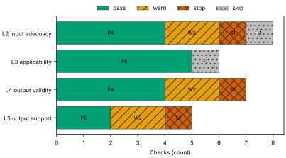
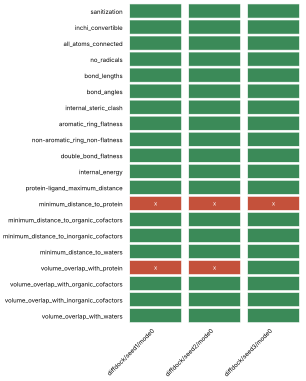
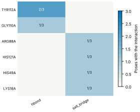
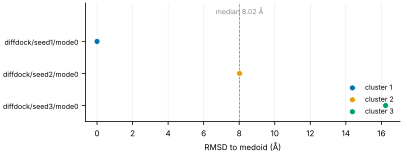
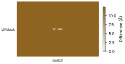

# Run report · Ligand pose in a known pocket

Prediction assurance · run `ligand_pose-93ea696e5d31` · 2026-10-17 16:59:49 UTC

**Refused** for the claim "Predicted pose of BGC in glucose dehydrogenase (glucose-binding) is valid".

Refused over layers 2,3,4,5: 15 pass, 6 warn, 3 stop, 2 skip. Stopped by l2.context.cofactors, l4.posebusters, l5.controls.redocking. Warnings from l2.receptor.protonation, l2.docking.box, l4.interactions.unsatisfied_polars, l4.interactions.known_binders, l5.sampling.clusters, l5.agreement.cross_family. 1 checks not verified.

Stops: `l2.context.cofactors`, `l4.posebusters`, `l5.controls.redocking`.

Warnings: `l2.receptor.protonation`, `l2.docking.box`, `l4.interactions.unsatisfied_polars`, `l4.interactions.known_binders`, `l5.sampling.clusters`, `l5.agreement.cross_family`.

Not verified: 1 checks.

| Field | Value |
| --- | --- |
| Task | Ligand pose in a known pocket (`ligand_pose`) |
| Tools | DiffDock-L v1.1.3 (docking), Boltz-2 (co-folding) |
| Target | `protein` |
| Ligand | `CO[C@@H]1[C@@H](OC)[C@H](O)O[C@H](CO)[C@H]1OC` |
| Reference | `2VWH` |
| pH | 7.4 |
| Seeds | 3 |
| Layers run | 2, 3, 4, 5 |
| Run | `ligand_pose-93ea696e5d31` |
| Created | 2026-10-17 16:59:49 UTC |
| Finished | 2026-10-17 17:02:08 UTC |
| pah version | 0.1.0 |
| Report schema | 1 |

## Layers

| Layer | Status | Result | pass | warn | stop | skip | Time |
| --- | --- | --- | --- | --- | --- | --- | --- |
| L0 Provenance | not run | n/a | n/a | n/a | n/a | n/a | n/a |
| L1 Input integrity | not run | n/a | n/a | n/a | n/a | n/a | n/a |
| L2 Input adequacy | done | stop | 4 | 2 | 1 | 1 | 2.3 s |
| L3 Applicability | done | pass | 5 | 0 | 0 | 1 | 4.0 s |
| L4 Output validity | done | stop | 4 | 2 | 1 | 0 | 131.8 s |
| L5 Output support | done | stop | 2 | 2 | 1 | 0 | 314 ms |

## Figures

Fig. 1 · Check outcomes per layer for run ligand_pose-93ea696e5d31. Totals: pass 15, warn 6, stop 3, skip 2.
Files: data [figures/gates_by_layer.csv](figures/gates_by_layer.csv).

## Structures

68 PyMOL renders.

2VWH mmCIF (source_structure), whole structure. Chains A; organic components BGC, NAP. sha256 563276ca06d2a22a. PyMOL session: [renders/2VWH.pse](renders/2VWH.pse).

2VWH mmCIF (source_structure), ligand environment within 5 Å. Chains A; organic components BGC, NAP. sha256 563276ca06d2a22a. PyMOL session: [renders/2VWH.pse](renders/2VWH.pse).

diffdock/seed1/mode0 (prediction_structure), whole structure. Chains A, L; organic components LIG. sha256 867c2eb118994d90. PyMOL session: [renders/diffdock_seed1_mode0.pse](renders/diffdock_seed1_mode0.pse).

diffdock/seed1/mode0 (prediction_structure), ligand environment within 5 Å. Chains A, L; organic components LIG. sha256 867c2eb118994d90. PyMOL session: [renders/diffdock_seed1_mode0.pse](renders/diffdock_seed1_mode0.pse).

diffdock/seed1/mode1 (prediction_structure), whole structure. Chains A, L; organic components LIG. sha256 76a95ad873a8fff9. PyMOL session: [renders/diffdock_seed1_mode1.pse](renders/diffdock_seed1_mode1.pse).

diffdock/seed1/mode1 (prediction_structure), ligand environment within 5 Å. Chains A, L; organic components LIG. sha256 76a95ad873a8fff9. PyMOL session: [renders/diffdock_seed1_mode1.pse](renders/diffdock_seed1_mode1.pse).

diffdock/seed1/mode2 (prediction_structure), whole structure. Chains A, L; organic components LIG. sha256 7b062c03fb668fdf. PyMOL session: [renders/diffdock_seed1_mode2.pse](renders/diffdock_seed1_mode2.pse).

diffdock/seed1/mode2 (prediction_structure), ligand environment within 5 Å. Chains A, L; organic components LIG. sha256 7b062c03fb668fdf. PyMOL session: [renders/diffdock_seed1_mode2.pse](renders/diffdock_seed1_mode2.pse).

diffdock/seed1/mode3 (prediction_structure), whole structure. Chains A, L; organic components LIG. sha256 b81e6c185f41f695. PyMOL session: [renders/diffdock_seed1_mode3.pse](renders/diffdock_seed1_mode3.pse).

diffdock/seed1/mode3 (prediction_structure), ligand environment within 5 Å. Chains A, L; organic components LIG. sha256 b81e6c185f41f695. PyMOL session: [renders/diffdock_seed1_mode3.pse](renders/diffdock_seed1_mode3.pse).

diffdock/seed1/mode4 (prediction_structure), whole structure. Chains A, L; organic components LIG. sha256 4f26a2b21e1703ac. PyMOL session: [renders/diffdock_seed1_mode4.pse](renders/diffdock_seed1_mode4.pse).

diffdock/seed1/mode4 (prediction_structure), ligand environment within 5 Å. Chains A, L; organic components LIG. sha256 4f26a2b21e1703ac. PyMOL session: [renders/diffdock_seed1_mode4.pse](renders/diffdock_seed1_mode4.pse).

diffdock/seed1/mode5 (prediction_structure), whole structure. Chains A, L; organic components LIG. sha256 40cdbefbea58e387. PyMOL session: [renders/diffdock_seed1_mode5.pse](renders/diffdock_seed1_mode5.pse).

diffdock/seed1/mode5 (prediction_structure), ligand environment within 5 Å. Chains A, L; organic components LIG. sha256 40cdbefbea58e387. PyMOL session: [renders/diffdock_seed1_mode5.pse](renders/diffdock_seed1_mode5.pse).

diffdock/seed1/mode6 (prediction_structure), whole structure. Chains A, L; organic components LIG. sha256 0a6b50d4ec95fb35. PyMOL session: [renders/diffdock_seed1_mode6.pse](renders/diffdock_seed1_mode6.pse).

diffdock/seed1/mode6 (prediction_structure), ligand environment within 5 Å. Chains A, L; organic components LIG. sha256 0a6b50d4ec95fb35. PyMOL session: [renders/diffdock_seed1_mode6.pse](renders/diffdock_seed1_mode6.pse).

diffdock/seed1/mode7 (prediction_structure), whole structure. Chains A, L; organic components LIG. sha256 90f795c5dba8ede2. PyMOL session: [renders/diffdock_seed1_mode7.pse](renders/diffdock_seed1_mode7.pse).

diffdock/seed1/mode7 (prediction_structure), ligand environment within 5 Å. Chains A, L; organic components LIG. sha256 90f795c5dba8ede2. PyMOL session: [renders/diffdock_seed1_mode7.pse](renders/diffdock_seed1_mode7.pse).

diffdock/seed1/mode8 (prediction_structure), whole structure. Chains A, L; organic components LIG. sha256 1bc4305c4cad09c3. PyMOL session: [renders/diffdock_seed1_mode8.pse](renders/diffdock_seed1_mode8.pse).

diffdock/seed1/mode8 (prediction_structure), ligand environment within 5 Å. Chains A, L; organic components LIG. sha256 1bc4305c4cad09c3. PyMOL session: [renders/diffdock_seed1_mode8.pse](renders/diffdock_seed1_mode8.pse).

diffdock/seed1/mode9 (prediction_structure), whole structure. Chains A, L; organic components LIG. sha256 9a4a4a3a1957ba88. PyMOL session: [renders/diffdock_seed1_mode9.pse](renders/diffdock_seed1_mode9.pse).

diffdock/seed1/mode9 (prediction_structure), ligand environment within 5 Å. Chains A, L; organic components LIG. sha256 9a4a4a3a1957ba88. PyMOL session: [renders/diffdock_seed1_mode9.pse](renders/diffdock_seed1_mode9.pse).

diffdock/seed2/mode0 (prediction_structure), whole structure. Chains A, L; organic components LIG. sha256 00cf3fa96024f782. PyMOL session: [renders/diffdock_seed2_mode0.pse](renders/diffdock_seed2_mode0.pse).

diffdock/seed2/mode0 (prediction_structure), ligand environment within 5 Å. Chains A, L; organic components LIG. sha256 00cf3fa96024f782. PyMOL session: [renders/diffdock_seed2_mode0.pse](renders/diffdock_seed2_mode0.pse).

diffdock/seed2/mode1 (prediction_structure), whole structure. Chains A, L; organic components LIG. sha256 bafc38fca1946d96. PyMOL session: [renders/diffdock_seed2_mode1.pse](renders/diffdock_seed2_mode1.pse).

diffdock/seed2/mode1 (prediction_structure), ligand environment within 5 Å. Chains A, L; organic components LIG. sha256 bafc38fca1946d96. PyMOL session: [renders/diffdock_seed2_mode1.pse](renders/diffdock_seed2_mode1.pse).

diffdock/seed2/mode2 (prediction_structure), whole structure. Chains A, L; organic components LIG. sha256 d9e3c68960171d8d. PyMOL session: [renders/diffdock_seed2_mode2.pse](renders/diffdock_seed2_mode2.pse).

diffdock/seed2/mode2 (prediction_structure), ligand environment within 5 Å. Chains A, L; organic components LIG. sha256 d9e3c68960171d8d. PyMOL session: [renders/diffdock_seed2_mode2.pse](renders/diffdock_seed2_mode2.pse).

diffdock/seed2/mode3 (prediction_structure), whole structure. Chains A, L; organic components LIG. sha256 98cc5f9e5dcd1b80. PyMOL session: [renders/diffdock_seed2_mode3.pse](renders/diffdock_seed2_mode3.pse).

diffdock/seed2/mode3 (prediction_structure), ligand environment within 5 Å. Chains A, L; organic components LIG. sha256 98cc5f9e5dcd1b80. PyMOL session: [renders/diffdock_seed2_mode3.pse](renders/diffdock_seed2_mode3.pse).

diffdock/seed2/mode4 (prediction_structure), whole structure. Chains A, L; organic components LIG. sha256 439573e839fcc8bc. PyMOL session: [renders/diffdock_seed2_mode4.pse](renders/diffdock_seed2_mode4.pse).

diffdock/seed2/mode4 (prediction_structure), ligand environment within 5 Å. Chains A, L; organic components LIG. sha256 439573e839fcc8bc. PyMOL session: [renders/diffdock_seed2_mode4.pse](renders/diffdock_seed2_mode4.pse).

diffdock/seed2/mode5 (prediction_structure), whole structure. Chains A, L; organic components LIG. sha256 7037875413416d57. PyMOL session: [renders/diffdock_seed2_mode5.pse](renders/diffdock_seed2_mode5.pse).

diffdock/seed2/mode5 (prediction_structure), ligand environment within 5 Å. Chains A, L; organic components LIG. sha256 7037875413416d57. PyMOL session: [renders/diffdock_seed2_mode5.pse](renders/diffdock_seed2_mode5.pse).

diffdock/seed2/mode6 (prediction_structure), whole structure. Chains A, L; organic components LIG. sha256 d0ee5cb9fcffc6e0. PyMOL session: [renders/diffdock_seed2_mode6.pse](renders/diffdock_seed2_mode6.pse).

diffdock/seed2/mode6 (prediction_structure), ligand environment within 5 Å. Chains A, L; organic components LIG. sha256 d0ee5cb9fcffc6e0. PyMOL session: [renders/diffdock_seed2_mode6.pse](renders/diffdock_seed2_mode6.pse).

diffdock/seed2/mode7 (prediction_structure), whole structure. Chains A, L; organic components LIG. sha256 8890469fc53acb5e. PyMOL session: [renders/diffdock_seed2_mode7.pse](renders/diffdock_seed2_mode7.pse).

diffdock/seed2/mode7 (prediction_structure), ligand environment within 5 Å. Chains A, L; organic components LIG. sha256 8890469fc53acb5e. PyMOL session: [renders/diffdock_seed2_mode7.pse](renders/diffdock_seed2_mode7.pse).

diffdock/seed2/mode8 (prediction_structure), whole structure. Chains A, L; organic components LIG. sha256 53e742425a026f5e. PyMOL session: [renders/diffdock_seed2_mode8.pse](renders/diffdock_seed2_mode8.pse).

diffdock/seed2/mode8 (prediction_structure), ligand environment within 5 Å. Chains A, L; organic components LIG. sha256 53e742425a026f5e. PyMOL session: [renders/diffdock_seed2_mode8.pse](renders/diffdock_seed2_mode8.pse).

diffdock/seed2/mode9 (prediction_structure), whole structure. Chains A, L; organic components LIG. sha256 6a50e895a097e99c. PyMOL session: [renders/diffdock_seed2_mode9.pse](renders/diffdock_seed2_mode9.pse).

diffdock/seed2/mode9 (prediction_structure), ligand environment within 5 Å. Chains A, L; organic components LIG. sha256 6a50e895a097e99c. PyMOL session: [renders/diffdock_seed2_mode9.pse](renders/diffdock_seed2_mode9.pse).

diffdock/seed3/mode0 (prediction_structure), whole structure. Chains A, L; organic components LIG. sha256 46e2fe8d23f7f2d9. PyMOL session: [renders/diffdock_seed3_mode0.pse](renders/diffdock_seed3_mode0.pse).

diffdock/seed3/mode0 (prediction_structure), ligand environment within 5 Å. Chains A, L; organic components LIG. sha256 46e2fe8d23f7f2d9. PyMOL session: [renders/diffdock_seed3_mode0.pse](renders/diffdock_seed3_mode0.pse).

diffdock/seed3/mode1 (prediction_structure), whole structure. Chains A, L; organic components LIG. sha256 5b825c759e0f54d0. PyMOL session: [renders/diffdock_seed3_mode1.pse](renders/diffdock_seed3_mode1.pse).

diffdock/seed3/mode1 (prediction_structure), ligand environment within 5 Å. Chains A, L; organic components LIG. sha256 5b825c759e0f54d0. PyMOL session: [renders/diffdock_seed3_mode1.pse](renders/diffdock_seed3_mode1.pse).

diffdock/seed3/mode2 (prediction_structure), whole structure. Chains A, L; organic components LIG. sha256 fa4ab7eda4cfd39a. PyMOL session: [renders/diffdock_seed3_mode2.pse](renders/diffdock_seed3_mode2.pse).

diffdock/seed3/mode2 (prediction_structure), ligand environment within 5 Å. Chains A, L; organic components LIG. sha256 fa4ab7eda4cfd39a. PyMOL session: [renders/diffdock_seed3_mode2.pse](renders/diffdock_seed3_mode2.pse).

diffdock/seed3/mode3 (prediction_structure), whole structure. Chains A, L; organic components LIG. sha256 66d674fa6cc669a0. PyMOL session: [renders/diffdock_seed3_mode3.pse](renders/diffdock_seed3_mode3.pse).

diffdock/seed3/mode3 (prediction_structure), ligand environment within 5 Å. Chains A, L; organic components LIG. sha256 66d674fa6cc669a0. PyMOL session: [renders/diffdock_seed3_mode3.pse](renders/diffdock_seed3_mode3.pse).

diffdock/seed3/mode4 (prediction_structure), whole structure. Chains A, L; organic components LIG. sha256 90947b66a913cf4c. PyMOL session: [renders/diffdock_seed3_mode4.pse](renders/diffdock_seed3_mode4.pse).

diffdock/seed3/mode4 (prediction_structure), ligand environment within 5 Å. Chains A, L; organic components LIG. sha256 90947b66a913cf4c. PyMOL session: [renders/diffdock_seed3_mode4.pse](renders/diffdock_seed3_mode4.pse).

diffdock/seed3/mode5 (prediction_structure), whole structure. Chains A, L; organic components LIG. sha256 16a777d91a41e9d4. PyMOL session: [renders/diffdock_seed3_mode5.pse](renders/diffdock_seed3_mode5.pse).

diffdock/seed3/mode5 (prediction_structure), ligand environment within 5 Å. Chains A, L; organic components LIG. sha256 16a777d91a41e9d4. PyMOL session: [renders/diffdock_seed3_mode5.pse](renders/diffdock_seed3_mode5.pse).

diffdock/seed3/mode6 (prediction_structure), whole structure. Chains A, L; organic components LIG. sha256 ff2a5014e3af975c. PyMOL session: [renders/diffdock_seed3_mode6.pse](renders/diffdock_seed3_mode6.pse).

diffdock/seed3/mode6 (prediction_structure), ligand environment within 5 Å. Chains A, L; organic components LIG. sha256 ff2a5014e3af975c. PyMOL session: [renders/diffdock_seed3_mode6.pse](renders/diffdock_seed3_mode6.pse).

diffdock/seed3/mode7 (prediction_structure), whole structure. Chains A, L; organic components LIG. sha256 b19742bb7420af12. PyMOL session: [renders/diffdock_seed3_mode7.pse](renders/diffdock_seed3_mode7.pse).

diffdock/seed3/mode7 (prediction_structure), ligand environment within 5 Å. Chains A, L; organic components LIG. sha256 b19742bb7420af12. PyMOL session: [renders/diffdock_seed3_mode7.pse](renders/diffdock_seed3_mode7.pse).

diffdock/seed3/mode8 (prediction_structure), whole structure. Chains A, L; organic components LIG. sha256 d8415a810392db9a. PyMOL session: [renders/diffdock_seed3_mode8.pse](renders/diffdock_seed3_mode8.pse).

diffdock/seed3/mode8 (prediction_structure), ligand environment within 5 Å. Chains A, L; organic components LIG. sha256 d8415a810392db9a. PyMOL session: [renders/diffdock_seed3_mode8.pse](renders/diffdock_seed3_mode8.pse).

diffdock/seed3/mode9 (prediction_structure), whole structure. Chains A, L; organic components LIG. sha256 f367553d07d36fa2. PyMOL session: [renders/diffdock_seed3_mode9.pse](renders/diffdock_seed3_mode9.pse).

diffdock/seed3/mode9 (prediction_structure), ligand environment within 5 Å. Chains A, L; organic components LIG. sha256 f367553d07d36fa2. PyMOL session: [renders/diffdock_seed3_mode9.pse](renders/diffdock_seed3_mode9.pse).

boltz2/seed1/sample0 (prediction_structure), whole structure. Chains A, C1, C2, L; organic components LIG1, NAP. sha256 2cf05d961f415619. PyMOL session: [renders/boltz2_seed1_sample0.pse](renders/boltz2_seed1_sample0.pse).

boltz2/seed1/sample0 (prediction_structure), ligand environment within 5 Å. Chains A, C1, C2, L; organic components LIG1, NAP. sha256 2cf05d961f415619. PyMOL session: [renders/boltz2_seed1_sample0.pse](renders/boltz2_seed1_sample0.pse).

boltz2/seed2/sample0 (prediction_structure), whole structure. Chains A, C1, C2, L; organic components LIG1, NAP. sha256 edaae86480a3f570. PyMOL session: [renders/boltz2_seed2_sample0.pse](renders/boltz2_seed2_sample0.pse).

boltz2/seed2/sample0 (prediction_structure), ligand environment within 5 Å. Chains A, C1, C2, L; organic components LIG1, NAP. sha256 edaae86480a3f570. PyMOL session: [renders/boltz2_seed2_sample0.pse](renders/boltz2_seed2_sample0.pse).

boltz2/seed3/sample0 (prediction_structure), whole structure. Chains A, C1, C2, L; organic components LIG1, NAP. sha256 4bfb8b86c054310e. PyMOL session: [renders/boltz2_seed3_sample0.pse](renders/boltz2_seed3_sample0.pse).

boltz2/seed3/sample0 (prediction_structure), ligand environment within 5 Å. Chains A, C1, C2, L; organic components LIG1, NAP. sha256 4bfb8b86c054310e. PyMOL session: [renders/boltz2_seed3_sample0.pse](renders/boltz2_seed3_sample0.pse).

## L0 Provenance

Where did every input come from?

Status: not run.

## L1 Input integrity

Did the run receive exactly what was declared?

Status: not run.

## L2 Input adequacy

Does the input carry enough information?

Status: done. Checks: pass 4 · warn 2 · stop 1 · skip 1. Time: 2.3 s.

#### Key figures

| Figure | Value |
| --- | --- |
| near site | 2 |
| missing | 2 |
| uniprot cofactors | 0 |
| pocket residues | 19 |
| incomplete | 0 |
| sequence gaps | 0 |
| state | holo |
| site ligands | 2 |

#### Docking

| Field | Value |
| --- | --- |
| center | 9.319, 36.788, 18.307 Å |
| size | 11.671 × 12.814 × 12.093 Å |
| origin | derived from BGC (+4 Å) |

#### Checks

| Check | Result | Measured cmp threshold | Evidence | Id · time |
| --- | --- | --- | --- | --- |
| Alignment depth, distinct sequences, Neff and gap fraction | skip | n/a | no MSA declared for a co-folding model · not applicable | `l2.msa.depth` |
| Required cofactors, ions and partners present | stop | `pocket_distance <= 8` | components within 8.0 Å of BGC in 2VWH not supplied: NAP, ZN · near_site=2, missing=2, uniprot_cofactors=0 | `l2.context.cofactors` · 1.0 s |
| Pocket residues resolved, no missing loops lining the pocket | pass | `pocket_distance <= 6` | 19 pocket residues complete in 2VWH.cif · pocket_residues=19, incomplete=0, sequence_gaps=0 | `l2.pocket.resolved` · 8 ms |
| Receptor state apo or holo | pass | n/a | 2VWH.cif holo: BGC, NAP in the site · state=holo, site_ligands=2 | `l2.receptor.state` · 7 ms |
| Receptor protonation at the stated pH | warn | `pka_margin > 1` | receptor has no hydrogens (protonation not assigned); pKa within 1.0 of pH 7.4: GLU64A pKa 6.96, GLU150A pKa 8.39 · hydrogens_present=False, ph=7.4, pocket_titratable=13 | `l2.receptor.protonation` · 552 ms |
| Ligand protonation and tautomers enumerated at the stated pH | pass | `ph 7.4 == 1` | one state at pH 7.4 for every ligand · ph=7.4, max_states=1, declared_not_enumerated=0 | `l2.ligand.protonation` · 63 ms |
| Ligand conformers generated and minimised | pass | `conformers >= 10` | 10 ETKDG conformers per ligand, MMFF minimised · ligands=1, failed=0, min_embedded=10 | `l2.ligand.conformers` · 610 ms |
| Docking box encloses the pocket with margin | warn | `margin >= 2` | no box declared; derived box encloses 11 contact residues and the BGC ligand with 2.0 Å margin · volume_A3=1808.5, ligand_atoms_inside_margin=12, ligand_atoms=12 | `l2.docking.box` · 10 ms |

## L3 Applicability

Is the tool inside its validated regime?

Status: done. Checks: pass 5 · warn 0 · stop 0 · skip 1. Time: 4.0 s.

#### Key figures

| Figure | Value |
| --- | --- |
| executors | 2 |
| unknown | 0 |
| reference released | 2009-01-13 |
| cutoff | 2019-01-01 |
| systems | 1 |
| analogue components | 6 |
| entries 95 | 6 |
| entries 40 | 6 |

#### Checks

| Check | Result | Measured cmp threshold | Evidence | Id · time |
| --- | --- | --- | --- | --- |
| Model training cutoff recorded | pass | `training_cutoff == recorded` | diffdock 2019-01-01; boltz2 2023-06-01; reference 2VWH released 2009-01-13, before the cutoff of diffdock, boltz2 · executors=2, unknown=0, reference_released=2009-01-13 | `l3.model.training_cutoff` · 1 ms |
| Pocket similarity to pre-cutoff complexes (SuCOS times pocket coverage) | skip | n/a | KeyError: 'sucos' · error | `l3.exposure.pocket` · 2.8 s |
| Ligand analogues in pre-cutoff training systems | pass | `tanimoto > 0.9` | 1 PDB entries released before 2019-01-01 (diffdock cutoff) contain analogues of ligand above Tanimoto 0.9: B8D, ZB0, 2GS, ZB2, GU8, GU9 · cutoff=2019-01-01, systems=1, analogue_components=6 | `l3.exposure.ligand_prevalence` · 0 ms |
| Chain sequence identity to pre-cutoff entries (secondary measure) | pass | `identity < 0.4` | protein: 6 entries at 95 percent identity, 6 at 40 percent, released before 2019-01-01 (reported, not gating) · cutoff=2019-01-01, entries_95=6, entries_40=6 | `l3.exposure.sequence` · 1.2 s |
| Modality inside the validated set; token count against the training crop | pass | n/a | modalities protein, protein_ligand inside the validated set; 372 tokens · modalities=2, tokens=372, outside=0 | `l3.regime.modality` · 5 ms |
| Endpoint fits the tool | pass | `endpoint pose in pose` | endpoint pose produced by diffdock, boltz2 · endpoint=pose, executors=2, not_fitting=0 | `l3.metric.endpoint` · 0 ms |

## L4 Output validity

Is the result physically and chemically sensible?

Status: done. Checks: pass 4 · warn 2 · stop 1 · skip 0. Time: 131.8 s.

#### Key figures

| Figure | Value |
| --- | --- |
| poses | 3 |
| passed | 18 |
| total | 20 |
| poses all pass | 0 |
| unlikely torsions | 0 |
| torsions | 9 |
| strain kcal | 15.35 |
| poses with unlikely | 0 |

#### PoseBusters · 18/20 tests pass

| test | result | value |
| --- | --- | --- |
| sanitization | pass | pass |
| inchi_convertible | pass | pass |
| all_atoms_connected | pass | pass |
| no_radicals | pass | pass |
| bond_lengths | pass | 0 long outliers |
| bond_angles | pass | 0 outliers |
| internal_steric_clash | pass | 0 |
| aromatic_ring_flatness | pass | pass |
| non-aromatic_ring_non-flatness | pass | pass |
| double_bond_flatness | pass | pass |
| internal_energy | pass | 1.7 times the ensemble mean |
| protein-ligand_maximum_distance | pass | 1.82 Å |
| minimum_distance_to_protein | fail | 1.82 Å |
| minimum_distance_to_organic_cofactors | pass | pass |
| minimum_distance_to_inorganic_cofactors | pass | pass |
| minimum_distance_to_waters | pass | pass |
| volume_overlap_with_protein | fail | 0.104 |
| volume_overlap_with_organic_cofactors | pass | pass |
| volume_overlap_with_inorganic_cofactors | pass | pass |
| volume_overlap_with_waters | pass | pass |

#### Per-pose physical checks

| pose | seed | drift Å | converged | unlikely torsions | unsat. polars | buried charged | PoseBusters |
| --- | --- | --- | --- | --- | --- | --- | --- |
| diffdock/seed1/mode0 | 1 | 1.82 | true | 0/9 | 1 | 0 | 18/20 |
| diffdock/seed2/mode0 | 2 | 2.17 | true | 0/9 | 1 | 0 | 18/20 |
| diffdock/seed3/mode0 | 3 | 1.33 | true | 0/9 | 0 | 0 | 19/20 |
| median | n/a | 1.82 | n/a | 0 | 1 | 0 | 18/20 |

#### Interaction fingerprint · representative pose diffdock/seed1/mode0

| residue | type | distance | poses |
| --- | --- | --- | --- |
| TYR112A | hbond | 3.02 Å | 2/3 |
| GLY110A | hbond | 3.3 Å | 1/3 |
| ARG88A | salt_bridge | 4.54 Å | 1/3 |
| HIS121A | salt_bridge | 5 Å | 1/3 |
| HIS49A | salt_bridge | 5.3 Å | 1/3 |
| LYS18A | salt_bridge | 3.97 Å | 1/3 |

Fig. 2 · PoseBusters tests (20) by pose (3). Failed cells marked x: 5 of 60.
Files: data [figures/posebusters_grid.csv](figures/posebusters_grid.csv).

Fig. 3 · Interactions by residue (6) and type (2); cell label: poses with the interaction over poses assessed.
Files: data [figures/interactions.csv](figures/interactions.csv).

#### Checks

| Check | Result | Measured cmp threshold | Evidence | Id · time |
| --- | --- | --- | --- | --- |
| PoseBusters geometry, stereochemistry, clashes and protein contact | stop | `tests_failed == 0` | representative pose diffdock/seed1/mode0 fails minimum_distance_to_protein, volume_overlap_with_protein · poses=3, passed=18, total=20 | `l4.posebusters` · 1.4 s |
| Torsional strain of the ligand pose | pass | `torsion_energy <= 2.5` | 0 of 9 torsions above 2.5 kcal/mol in diffdock/seed1/mode0; strain 15.35 kcal/mol · poses=3, unlikely_torsions=0, torsions=9 | `l4.torsion_strain` · 1.2 s |
| Interaction fingerprint (PLIP) | pass | n/a | 2 interactions in diffdock/seed1/mode0 (hbond); 6 distinct across 3 poses (reported) · poses=3, interactions_representative=2, distinct=6 | `l4.interactions.fingerprint` · 724 ms |
| Buried ligand polar atoms without a hydrogen-bond partner | warn | `relative_sasa < 0.1` | 1 of 3 buried polar ligand atoms without a partner in diffdock/seed1/mode0 · poses=3, unsatisfied=1, buried_charged=0 | `l4.interactions.unsatisfied_polars` · 321 ms |
| Hydrophobic complementarity of buried ligand surface | pass | `fraction >= 0.35` | nonpolar fraction of protein contacts around 4 buried nonpolar ligand atoms in diffdock/seed1/mode0: 0.693 · poses=3, complementarity=0.693, buried_nonpolar=4 | `l4.interactions.hydrophobic` · 288 ms |
| Interactions of the crystal ligand reproduced by the pose | warn | `reproduced 0 >= 1` | diffdock/seed1/mode0 reproduces none of 6 BGC interactions · key_interactions=6, reproduced=0, poses_reproducing_all=0 | `l4.interactions.known_binders` · 282 ms |
| Pose stability under short restrained minimisation (OpenMM, AMBER14 and OpenFF) | pass | `drift_A 1.82 <= 2` | diffdock/seed1/mode0 moves 1.816 Å under restrained minimisation; 1 of 3 poses above 2.0 Å · poses=3, drift_A=1.816, max_drift_A=2.174 | `l4.minimisation_drift` · 127.6 s |

## L5 Output support

Is a valid result corroborated?

Status: done. Checks: pass 2 · warn 2 · stop 1 · skip 0. Time: 314 ms.

#### Key figures

| Figure | Value |
| --- | --- |
| poses | 3 |
| diffdock confidence | -4.43 |
| independent seeds | 3 |
| samples | 30 |
| duplicated outputs | 0 |
| clusters | 3 |
| largest cluster | 1 |
| pairwise rmsd median A | 16.237 |

#### Sampling

| Field | Value |
| --- | --- |
| site placement | 0 of 3 poses within 4.0 Å of the site (BGC in 2VWH) |
| pose accuracy | 1 of 3 poses within 2.0 Å of the medoid |
| pairwise RMSD median | 16.2 Å |
| pairwise RMSD IQR | 12.1 to 18.2 Å |
| pairs | 3 |
| medoid | diffdock/seed1/mode0 |

#### Clusters

| Field | Value |
| --- | --- |
| cluster 1 | 1/3 poses (diffdock/seed1/mode0) |
| cluster 2 | 1/3 poses (diffdock/seed2/mode0) |
| cluster 3 | 1/3 poses (diffdock/seed3/mode0) |

#### Per-seed statistics

| seed | pose | cluster | RMSD to medoid | confidence |
| --- | --- | --- | --- | --- |
| 1 | diffdock/seed1/mode0 | 1 | 0 Å | -4.43 |
| 2 | diffdock/seed2/mode0 | 2 | 8.02 Å | -4.19 |
| 3 | diffdock/seed3/mode0 | 3 | 16.2 Å | -4.54 |
| median | n/a | n/a | 8.02 Å | -4.43 |

#### Ensemble

| structure | kind | source | RMSD to medoid | cluster | pocket pLDDT | ipTM |
| --- | --- | --- | --- | --- | --- | --- |
| diffdock/seed1/mode0 | medoid | diffdock | 0 Å | 1 | n/a | n/a |
| diffdock/seed2/mode0 | docking | diffdock | 8.02 Å | 2 | n/a | n/a |
| diffdock/seed3/mode0 | docking | diffdock | 16.2 Å | 3 | n/a | n/a |

#### Agreement between methods

| method | boltz2 |
| --- | --- |
| diffdock | 12.3 Å (high) |

Fig. 4 · RMSD to the medoid for 3 poses, coloured by cluster (3 clusters). Dashed line: median 8.02 Å; range 0.00 to 16.24 Å.
Files: data [figures/seed_spread.csv](figures/seed_spread.csv).

Fig. 5 · Agreement between 1 methods and 1 comparators; range 12.345 to 12.345 Å.
Files: data [figures/agreement.csv](figures/agreement.csv).

#### Checks

| Check | Result | Measured cmp threshold | Evidence | Id · time |
| --- | --- | --- | --- | --- |
| Confidence restricted to the pocket; per-model thresholds | pass | n/a | diffdock/seed1/mode0: diffdock_confidence -4.43; no per-model confidence threshold registered for diffdock (reported) · poses=3, diffdock_confidence=-4.43 | `l5.confidence.local` · 0 ms |
| Independent seeds counted separately from samples; duplicates flagged | pass | `seeds_docking >= 3` | 3 independent seeds, 30 poses, no duplicates · independent_seeds=3, samples=30, duplicated_outputs=0 | `l5.sampling.seeds` · 0 ms |
| Medoid of the largest cluster, populations, pairwise spread, site and pose accuracy | warn | `cluster_rmsd <= 2` | medoid diffdock/seed1/mode0; 3 clusters, largest 1 of 3; pairwise RMSD median 16.24 Å (IQR 12.13 to 18.18); 0 of 3 poses within 4.0 Å of the site (BGC in 2VWH); 1 of 3 poses within 2.0 Å of the medoid · poses=3, clusters=3, largest_cluster=1 | `l5.sampling.clusters` · 221 ms |
| Agreement between methods, weighted by independence | warn | `rmsd_to_crystal_A None <= 2` | diffdock vs boltz2 12.345 Å (high) · methods=2, comparisons=1, disagreeing=1 | `l5.agreement.cross_family` · 90 ms |
| Redocking control reproduces the crystal pose | stop | `rmsd <= 2` | redocking control required by the task and not supplied (controls.redocking) | `l5.controls.redocking` · 0 ms |

## Controls

| control | status | result |
| --- | --- | --- |
| redocking | incomplete | redocking control required by the task and not supplied (controls.redocking) |

## Provenance

34 objects · 2 cached · 32 network.

| Source | Accession | Release | SHA-256 | Retrieved | Bytes | Cache | Used by |
| --- | --- | --- | --- | --- | --- | --- | --- |
| rcsb_files | 2VWH | n/a | `563276ca06d2` | 2026-10-17 16:59:50 UTC | 364136 | miss | l2.context.cofactors, l2.pocket.resolved, l2.receptor.state, l2.docking.box, l3.exposure.pocket, l3.regime.modality, l4.interactions.fingerprint, l4.interactions.known_binders, l5.sampling.clusters, l5.agreement.cross_family |
| ccd | BGC | 2026-01-27 | `faaa9f919f4c` | 2026-10-17 16:59:50 UTC | 30741 | miss | l2.context.cofactors |
| rcsb | 2VWH | 1.5 | `5a990581b1c2` | 2026-10-17 16:59:51 UTC | 22370 | hit | l3.model.training_cutoff |
| rcsb_search | chem:CO[C@@H]1[C@@H](OC)[C@H](O)O[C@H](CO)[C@H]1OC | n/a | `abf2f0f21729` | 2026-10-17 16:59:52 UTC | 1583 | miss | l3.exposure.pocket |
| ccd | B8D | 2020-07-17 | `e5e54aeb141a` | 2026-10-17 16:59:52 UTC | 5891 | hit | l3.exposure.pocket |
| ccd | ZB0 | 2020-07-17 | `04a273063ebb` | 2026-10-17 16:59:52 UTC | 4670 | miss | l3.exposure.pocket |
| ccd | 2GS | 2020-07-17 | `f4c84b4386b2` | 2026-10-17 16:59:52 UTC | 6028 | miss | l3.exposure.pocket |
| ccd | ZB2 | 2020-07-17 | `ef6fe76c4398` | 2026-10-17 16:59:52 UTC | 4631 | miss | l3.exposure.pocket |
| ccd | 3MG | 2020-07-17 | `8459c0fa74f7` | 2026-10-17 16:59:52 UTC | 5661 | miss | l3.exposure.pocket |
| ccd | U90 | 2022-09-16 | `e5c8aa7c4958` | 2026-10-17 16:59:52 UTC | 3318 | miss | l3.exposure.pocket |
| ccd | ZB1 | 2020-07-17 | `27d026ba7397` | 2026-10-17 16:59:52 UTC | 4910 | miss | l3.exposure.pocket |
| ccd | X6N | 2024-10-04 | `d6183b2ee5d1` | 2026-10-17 16:59:52 UTC | 3255 | miss | l3.exposure.pocket |
| ccd | GU8 | 2020-07-17 | `8e0ab7528c76` | 2026-10-17 16:59:52 UTC | 6191 | miss | l3.exposure.pocket |
| ccd | GU9 | 2020-07-17 | `e66a84318f2b` | 2026-10-17 16:59:52 UTC | 6196 | miss | l3.exposure.pocket |
| ccd | 5TK | 2020-07-17 | `bc65062b9f8e` | 2026-10-17 16:59:53 UTC | 5226 | miss | l3.exposure.pocket |
| ccd | TWA | 2020-07-17 | `61fd3fb2d26e` | 2026-10-17 16:59:53 UTC | 4762 | miss | l3.exposure.pocket |
| ccd | PRD_900001 | n/a | `3d3cd6b11abe` | 2026-10-17 16:59:53 UTC | 5035 | miss | l3.exposure.pocket |
| ccd | PRD_900004 | n/a | `171b04f8d1a9` | 2026-10-17 16:59:53 UTC | 5785 | miss | l3.exposure.pocket |
| ccd | PRD_900005 | n/a | `c3d489ef5eea` | 2026-10-17 16:59:53 UTC | 6356 | miss | l3.exposure.pocket |
| ccd | PRD_900008 | n/a | `60144a234fc1` | 2026-10-17 16:59:53 UTC | 6742 | miss | l3.exposure.pocket |
| ccd | PRD_900016 | n/a | `4143a065d062` | 2026-10-17 16:59:53 UTC | 7667 | miss | l3.exposure.pocket |
| ccd | PRD_900018 | n/a | `19a0c6ba9772` | 2026-10-17 16:59:53 UTC | 5409 | miss | l3.exposure.pocket |
| ccd | PRD_900020 | n/a | `8dbf9d540311` | 2026-10-17 16:59:53 UTC | 8403 | miss | l3.exposure.pocket |
| ccd | PRD_900021 | n/a | `1e743d35bb91` | 2026-10-17 16:59:53 UTC | 5696 | miss | l3.exposure.pocket |
| ccd | PRD_900023 | n/a | `a736cb72100f` | 2026-10-17 16:59:53 UTC | 5423 | miss | l3.exposure.pocket |
| rcsb_search | comp:B8D:2019-01-01 | n/a | `e3b0c44298fc` | 2026-10-17 16:59:53 UTC | 0 | miss | l3.exposure.pocket |
| rcsb_search | comp:ZB0:2019-01-01 | n/a | `e3b0c44298fc` | 2026-10-17 16:59:53 UTC | 0 | miss | l3.exposure.pocket |
| rcsb_search | comp:2GS:2019-01-01 | n/a | `2ad8fb542fa9` | 2026-10-17 16:59:53 UTC | 178 | miss | l3.exposure.pocket |
| rcsb_search | comp:ZB2:2019-01-01 | n/a | `e3b0c44298fc` | 2026-10-17 16:59:53 UTC | 0 | miss | l3.exposure.pocket |
| rcsb_search | comp:GU8:2019-01-01 | n/a | `e3b0c44298fc` | 2026-10-17 16:59:53 UTC | 0 | miss | l3.exposure.pocket |
| rcsb_search | comp:GU9:2019-01-01 | n/a | `e3b0c44298fc` | 2026-10-17 16:59:53 UTC | 0 | miss | l3.exposure.pocket |
| rcsb_search | seq0.9:2019-01-01:357 | n/a | `621670d876c3` | 2026-10-17 16:59:54 UTC | 438 | miss | l3.exposure.pocket |
| rcsb_search | seq0.95:2019-01-01:357 | n/a | `2ded139e03ea` | 2026-10-17 16:59:55 UTC | 386 | miss | l3.exposure.sequence |
| rcsb_search | seq0.4:2019-01-01:357 | n/a | `d1c1f4adb44b` | 2026-10-17 16:59:55 UTC | 386 | miss | l3.exposure.sequence |

Provenance graph: [json](graph.json), [mmd](graph.mmd), [svg](graph.svg).

## Thresholds

| Check | Threshold | Value | Origin | Evidence level |
| --- | --- | --- | --- | --- |
| `l2.context.cofactors` | pocket_distance | <= 8 | Harness rule: a component of the reference entry within 8 Å of the declared ligand is required context; not yet calibrated | uncalibrated |
| `l2.pocket.resolved` | pocket_distance | <= 6 | Harness rule: pocket residues have a heavy atom within 6 Å of the ligand; not yet calibrated | uncalibrated |
| `l2.pocket.resolved` | missing_pocket_residues | == 0 | Specification layer 2: stop when the pocket is incomplete | published |
| `l2.receptor.protonation` | pka_margin | > 1 | Harness rule: a titratable pocket residue with PROPKA pKa within 1 unit of the stated pH has an ambiguous state; not yet calibrated | uncalibrated |
| `l2.ligand.protonation` | ph_window | == 1 | Harness rule: states enumerated by Dimorphite-DL within 1 pH unit of the stated pH; not yet calibrated | uncalibrated |
| `l2.ligand.protonation` | states | == 1 | Specification layer 2: warn when more than one plausible state | published |
| `l2.ligand.conformers` | conformers | >= 10 | Harness default number of ETKDG conformers; not yet calibrated | uncalibrated |
| `l2.docking.box` | margin | >= 2 | Harness rule: every pocket heavy atom lies at least 2 Å inside the box; not yet calibrated | uncalibrated |
| `l2.docking.box` | contact_distance | <= 4 | Harness rule: contact residues (heavy atom within 4 Å of the reference ligand) must have an atom inside the box; not yet calibrated | uncalibrated |
| `l3.model.training_cutoff` | training_cutoff | == recorded | Specification, Layer 3 (applicability): stop when unknown | published |
| `l3.exposure.ligand_prevalence` | tanimoto | > 0.9 | Specification layer 3: analogues above 0.9 Tanimoto (RDKit topological fingerprint) | published |
| `l3.exposure.ligand_prevalence` | systems | <= 100 | Specification layer 3: prevalent when analogues occur in more than 100 training systems | published |
| `l3.exposure.sequence` | identity | < 0.4 | Specification layer 3: conventional 40 percent identity leakage threshold, reported as a secondary measure only | published |
| `l3.metric.endpoint` | endpoint | in pose | Specification, Layer 3 (applicability): no affinity from interface confidence, no protein-protein affinity from Boltz-2 | published |
| `l4.posebusters` | tests_failed | == 0 | Specification, Layer 4 (output validity): stop on failure | published |
| `l4.torsion_strain` | torsion_energy | <= 2.5 | Harness rule: a rotatable torsion whose MMFF energy lies more than 2.5 kcal/mol above the minimum of its rigid scan is unlikely; not yet calibrated | uncalibrated |
| `l4.interactions.unsatisfied_polars` | relative_sasa | < 0.1 | Harness rule: a ligand polar atom with relative SASA below 0.1 in the complex is buried; not yet calibrated | uncalibrated |
| `l4.interactions.unsatisfied_polars` | hbond_distance | <= 3.5 | PLIP hydrogen bond distance cut-off (donor-acceptor 4.1 Å; harness uses 3.5 Å heavy-atom distance) | published |
| `l4.interactions.hydrophobic` | fraction | >= 0.35 | Harness default anchored on 3PTB: the crystal benzamidine scores 0.51, Vina and Boltz-2 poses within 0.5 Å of it score 0.45 and 0.49; not calibrated on the benchmark | uncalibrated |
| `l4.interactions.hydrophobic` | relative_sasa | < 0.1 | Harness rule: a ligand polar atom with relative SASA below 0.1 in the complex is buried; not yet calibrated | uncalibrated |
| `l4.interactions.known_binders` | reproduced | >= 1 | Specification layer 4: warn when no key interaction is reproduced | published |
| `l4.minimisation_drift` | drift | <= 2 | Specification layer 4: warn when the pose moves beyond 2 Å under restrained minimisation | published |
| `l5.sampling.seeds` | seeds_docking | >= 3 | Harness default for independent docking seeds; not yet calibrated | uncalibrated |
| `l5.sampling.clusters` | cluster_rmsd | <= 2 | Specification layer 5: 2 Å symmetry-aware ligand RMSD (spyrmsd) separates pose clusters | published |
| `l5.sampling.clusters` | site_distance | <= 4 | Harness rule: a ligand centroid within 4 Å of the reference site centroid is placed in the site; not yet calibrated | uncalibrated |
| `l5.sampling.clusters` | largest_fraction | >= 0.5 | Harness rule: the largest cluster holds at least half of the poses; not yet calibrated | uncalibrated |
| `l5.agreement.cross_family` | rmsd | <= 2 | Specification layer 5: pose agreement by symmetry-aware ligand RMSD at 2 Å | published |
| `l5.controls.redocking` | rmsd | <= 2 | Specification layer 5: redocking must reproduce the crystal pose (2 Å ligand RMSD) | published |

Tool versions: dimorphite_dl 2.1.0, freesasa 2.2.1, gemmi 0.7.5, numpy 1.26.4, openbabel 3.2.1, openmm 8.6.1, plip 3.0.1, posebusters 0.6.5, propka 3.5.1, rdkit 2026.9.1, scipy 1.17.1, spyrmsd 0.9.0.

## Limitations

- This report covers layers 2, 3, 4, 5. Layers not run: 0, 1.
- The harness establishes when a result should not be trusted. Passing checks are not evidence that a prediction is correct.
- Thresholds marked uncalibrated come from the specification or harness defaults and have not been recalibrated on the harness benchmark.

## Files

| Path | Kind | Bytes | SHA-256 |
| --- | --- | --- | --- |
| artifacts/sources/2VWH.cif | source_structure | 364136 | `563276ca06d2` |
| predictions/00_diffdock/diffdock/seed1/mode0/complex.pdb | prediction_structure | 225893 | `867c2eb11899` |
| predictions/00_diffdock/diffdock/seed1/mode0/ligand.sdf | data | 1328 | `8745b315fca6` |
| predictions/00_diffdock/diffdock/seed1/mode1/complex.pdb | prediction_structure | 225893 | `76a95ad873a8` |
| predictions/00_diffdock/diffdock/seed1/mode1/ligand.sdf | data | 1328 | `37bc19f094e9` |
| predictions/00_diffdock/diffdock/seed1/mode2/complex.pdb | prediction_structure | 225893 | `7b062c03fb66` |
| predictions/00_diffdock/diffdock/seed1/mode2/ligand.sdf | data | 1328 | `0225bad48093` |
| predictions/00_diffdock/diffdock/seed1/mode3/complex.pdb | prediction_structure | 225893 | `b81e6c185f41` |
| predictions/00_diffdock/diffdock/seed1/mode3/ligand.sdf | data | 1328 | `8c8d504e1965` |
| predictions/00_diffdock/diffdock/seed1/mode4/complex.pdb | prediction_structure | 225893 | `4f26a2b21e17` |
| predictions/00_diffdock/diffdock/seed1/mode4/ligand.sdf | data | 1328 | `20a15844da9e` |
| predictions/00_diffdock/diffdock/seed1/mode5/complex.pdb | prediction_structure | 225893 | `40cdbefbea58` |
| predictions/00_diffdock/diffdock/seed1/mode5/ligand.sdf | data | 1328 | `64792573d09c` |
| predictions/00_diffdock/diffdock/seed1/mode6/complex.pdb | prediction_structure | 225893 | `0a6b50d4ec95` |
| predictions/00_diffdock/diffdock/seed1/mode6/ligand.sdf | data | 1328 | `20ca27297f4e` |
| predictions/00_diffdock/diffdock/seed1/mode7/complex.pdb | prediction_structure | 225893 | `90f795c5dba8` |
| predictions/00_diffdock/diffdock/seed1/mode7/ligand.sdf | data | 1328 | `64827feb8328` |
| predictions/00_diffdock/diffdock/seed1/mode8/complex.pdb | prediction_structure | 225893 | `1bc4305c4cad` |
| predictions/00_diffdock/diffdock/seed1/mode8/ligand.sdf | data | 1328 | `42c6c1704f60` |
| predictions/00_diffdock/diffdock/seed1/mode9/complex.pdb | prediction_structure | 225893 | `9a4a4a3a1957` |
| predictions/00_diffdock/diffdock/seed1/mode9/ligand.sdf | data | 1328 | `08d0cb5e564b` |
| predictions/00_diffdock/diffdock/seed2/mode0/complex.pdb | prediction_structure | 225893 | `00cf3fa96024` |
| predictions/00_diffdock/diffdock/seed2/mode0/ligand.sdf | data | 1328 | `eccf99b3bb7a` |
| predictions/00_diffdock/diffdock/seed2/mode1/complex.pdb | prediction_structure | 225893 | `bafc38fca194` |
| predictions/00_diffdock/diffdock/seed2/mode1/ligand.sdf | data | 1328 | `5e09b14da9bd` |
| predictions/00_diffdock/diffdock/seed2/mode2/complex.pdb | prediction_structure | 225893 | `d9e3c6896017` |
| predictions/00_diffdock/diffdock/seed2/mode2/ligand.sdf | data | 1328 | `fcd709623f65` |
| predictions/00_diffdock/diffdock/seed2/mode3/complex.pdb | prediction_structure | 225893 | `98cc5f9e5dcd` |
| predictions/00_diffdock/diffdock/seed2/mode3/ligand.sdf | data | 1328 | `ee9d0af5e5ad` |
| predictions/00_diffdock/diffdock/seed2/mode4/complex.pdb | prediction_structure | 225893 | `439573e839fc` |
| predictions/00_diffdock/diffdock/seed2/mode4/ligand.sdf | data | 1328 | `448f8c65cf45` |
| predictions/00_diffdock/diffdock/seed2/mode5/complex.pdb | prediction_structure | 225893 | `703787541341` |
| predictions/00_diffdock/diffdock/seed2/mode5/ligand.sdf | data | 1328 | `de324072b166` |
| predictions/00_diffdock/diffdock/seed2/mode6/complex.pdb | prediction_structure | 225893 | `d0ee5cb9fcff` |
| predictions/00_diffdock/diffdock/seed2/mode6/ligand.sdf | data | 1328 | `2eec0f7d1072` |
| predictions/00_diffdock/diffdock/seed2/mode7/complex.pdb | prediction_structure | 225893 | `8890469fc53a` |
| predictions/00_diffdock/diffdock/seed2/mode7/ligand.sdf | data | 1328 | `fcdd4e0e46a0` |
| predictions/00_diffdock/diffdock/seed2/mode8/complex.pdb | prediction_structure | 225893 | `53e742425a02` |
| predictions/00_diffdock/diffdock/seed2/mode8/ligand.sdf | data | 1328 | `bee630949ce2` |
| predictions/00_diffdock/diffdock/seed2/mode9/complex.pdb | prediction_structure | 225893 | `6a50e895a097` |
| predictions/00_diffdock/diffdock/seed2/mode9/ligand.sdf | data | 1328 | `ce8afb245594` |
| predictions/00_diffdock/diffdock/seed3/mode0/complex.pdb | prediction_structure | 225893 | `46e2fe8d23f7` |
| predictions/00_diffdock/diffdock/seed3/mode0/ligand.sdf | data | 1328 | `c08256f2dff8` |
| predictions/00_diffdock/diffdock/seed3/mode1/complex.pdb | prediction_structure | 225893 | `5b825c759e0f` |
| predictions/00_diffdock/diffdock/seed3/mode1/ligand.sdf | data | 1328 | `2e1d5f0d4b2c` |
| predictions/00_diffdock/diffdock/seed3/mode2/complex.pdb | prediction_structure | 225893 | `fa4ab7eda4cf` |
| predictions/00_diffdock/diffdock/seed3/mode2/ligand.sdf | data | 1328 | `524b19b7a42f` |
| predictions/00_diffdock/diffdock/seed3/mode3/complex.pdb | prediction_structure | 225893 | `66d674fa6cc6` |
| predictions/00_diffdock/diffdock/seed3/mode3/ligand.sdf | data | 1328 | `32cd91e0d8c7` |
| predictions/00_diffdock/diffdock/seed3/mode4/complex.pdb | prediction_structure | 225893 | `90947b66a913` |
| predictions/00_diffdock/diffdock/seed3/mode4/ligand.sdf | data | 1328 | `9f2de8ea4e9d` |
| predictions/00_diffdock/diffdock/seed3/mode5/complex.pdb | prediction_structure | 225893 | `16a777d91a41` |
| predictions/00_diffdock/diffdock/seed3/mode5/ligand.sdf | data | 1328 | `5a84166e07c3` |
| predictions/00_diffdock/diffdock/seed3/mode6/complex.pdb | prediction_structure | 225893 | `ff2a5014e3af` |
| predictions/00_diffdock/diffdock/seed3/mode6/ligand.sdf | data | 1328 | `df0e9ca3fcc6` |
| predictions/00_diffdock/diffdock/seed3/mode7/complex.pdb | prediction_structure | 225893 | `b19742bb7420` |
| predictions/00_diffdock/diffdock/seed3/mode7/ligand.sdf | data | 1328 | `76690e9a23d7` |
| predictions/00_diffdock/diffdock/seed3/mode8/complex.pdb | prediction_structure | 225893 | `d8415a810392` |
| predictions/00_diffdock/diffdock/seed3/mode8/ligand.sdf | data | 1328 | `15ec0eebdaa6` |
| predictions/00_diffdock/diffdock/seed3/mode9/complex.pdb | prediction_structure | 225893 | `f367553d07d3` |
| predictions/00_diffdock/diffdock/seed3/mode9/ligand.sdf | data | 1328 | `2b3b80a179c4` |
| /home/user/harness-hackathon/bench/runs/2026-10-17T1611Z-426bfe9/predictions/glc_pert/boltz2/seed_1/boltz_results_glc_pert/predictions/glc_pert/glc_pert_model_0.cif | prediction_structure | 251086 | `2cf05d961f41` |
| predictions/01_boltz2/boltz2/seed1/sample0/ligand.sdf | data | 1328 | `5b82f86cef9d` |
| /home/user/harness-hackathon/bench/runs/2026-10-17T1611Z-426bfe9/predictions/glc_pert/boltz2/seed_2/boltz_results_glc_pert/predictions/glc_pert/glc_pert_model_0.cif | prediction_structure | 251067 | `edaae86480a3` |
| predictions/01_boltz2/boltz2/seed2/sample0/ligand.sdf | data | 1328 | `d482b77e53cc` |
| /home/user/harness-hackathon/bench/runs/2026-10-17T1611Z-426bfe9/predictions/glc_pert/boltz2/seed_3/boltz_results_glc_pert/predictions/glc_pert/glc_pert_model_0.cif | prediction_structure | 251169 | `4bfb8b86c054` |
| predictions/01_boltz2/boltz2/seed3/sample0/ligand.sdf | data | 1328 | `d0c61dfdc91b` |
| renders/2VWH_overview.png | render | 234730 | `b20baba3b461` |
| renders/2VWH_pocket.png | render | 448203 | `12a718262bbe` |
| renders/2VWH.pse | session | 942280 | `47120f14e331` |
| renders/diffdock_seed1_mode0_overview.png | render | 227468 | `2f51d1e53e9f` |
| renders/diffdock_seed1_mode0_pocket.png | render | 224006 | `36106c4b3e53` |
| renders/diffdock_seed1_mode0.pse | session | 794561 | `1bff23b6df33` |
| renders/diffdock_seed1_mode1_overview.png | render | 226679 | `870770a5fcc8` |
| renders/diffdock_seed1_mode1_pocket.png | render | 187460 | `670e38517f4d` |
| renders/diffdock_seed1_mode1.pse | session | 794537 | `f98f04553f24` |
| renders/diffdock_seed1_mode2_overview.png | render | 225309 | `3484cea84838` |
| renders/diffdock_seed1_mode2_pocket.png | render | 259182 | `ff2c7f612a0f` |
| renders/diffdock_seed1_mode2.pse | session | 794663 | `5b5652dc9a9b` |
| renders/diffdock_seed1_mode3_overview.png | render | 226797 | `bcb34f3ff127` |
| renders/diffdock_seed1_mode3_pocket.png | render | 240848 | `7513ee673e4d` |
| renders/diffdock_seed1_mode3.pse | session | 794901 | `86c0f1be0135` |
| renders/diffdock_seed1_mode4_overview.png | render | 225919 | `081b68f43023` |
| renders/diffdock_seed1_mode4_pocket.png | render | 299094 | `641137f24f6a` |
| renders/diffdock_seed1_mode4.pse | session | 794795 | `24bb9359a733` |
| renders/diffdock_seed1_mode5_overview.png | render | 225043 | `267653778f5c` |
| renders/diffdock_seed1_mode5_pocket.png | render | 292851 | `e47d40f7dc6d` |
| renders/diffdock_seed1_mode5.pse | session | 794733 | `8775f9f9b7b4` |
| renders/diffdock_seed1_mode6_overview.png | render | 225205 | `c7b4de6698b6` |
| renders/diffdock_seed1_mode6_pocket.png | render | 290419 | `b89cb21abbdb` |
| renders/diffdock_seed1_mode6.pse | session | 794744 | `3a7439770e2f` |
| renders/diffdock_seed1_mode7_overview.png | render | 224086 | `d2efa7554520` |
| renders/diffdock_seed1_mode7_pocket.png | render | 190788 | `c84dc80a2ee8` |
| renders/diffdock_seed1_mode7.pse | session | 794652 | `2b8414371cb5` |
| renders/diffdock_seed1_mode8_overview.png | render | 225934 | `fc184a155434` |
| renders/diffdock_seed1_mode8_pocket.png | render | 256240 | `3a1c9072c2c4` |
| renders/diffdock_seed1_mode8.pse | session | 794694 | `d16a7c641e78` |
| renders/diffdock_seed1_mode9_overview.png | render | 223657 | `a93d8a649371` |
| renders/diffdock_seed1_mode9_pocket.png | render | 181183 | `048750391e84` |
| renders/diffdock_seed1_mode9.pse | session | 794645 | `175004bd5cc8` |
| renders/diffdock_seed2_mode0_overview.png | render | 225386 | `d2ddb8e19e11` |
| renders/diffdock_seed2_mode0_pocket.png | render | 253544 | `0b6f1bb2ccd9` |
| renders/diffdock_seed2_mode0.pse | session | 794607 | `e1499c386ee6` |
| renders/diffdock_seed2_mode1_overview.png | render | 225416 | `e153e72d1cc6` |
| renders/diffdock_seed2_mode1_pocket.png | render | 199876 | `2eb5dd24b4ed` |
| renders/diffdock_seed2_mode1.pse | session | 794809 | `c362be750b2e` |
| renders/diffdock_seed2_mode2_overview.png | render | 224894 | `31b73fa4ffb2` |
| renders/diffdock_seed2_mode2_pocket.png | render | 239679 | `23dcf4a2fcac` |
| renders/diffdock_seed2_mode2.pse | session | 794609 | `2f4120d8d627` |
| renders/diffdock_seed2_mode3_overview.png | render | 225179 | `f73e891efaaf` |
| renders/diffdock_seed2_mode3_pocket.png | render | 242907 | `8443c8b8031f` |
| renders/diffdock_seed2_mode3.pse | session | 794609 | `2526dd2a28a4` |
| renders/diffdock_seed2_mode4_overview.png | render | 223892 | `d0a749920e5e` |
| renders/diffdock_seed2_mode4_pocket.png | render | 291310 | `8d77fcf71290` |
| renders/diffdock_seed2_mode4.pse | session | 794536 | `ed10b69df424` |
| renders/diffdock_seed2_mode5_overview.png | render | 224761 | `8cec8f54057f` |
| renders/diffdock_seed2_mode5_pocket.png | render | 274035 | `049da6d86f96` |
| renders/diffdock_seed2_mode5.pse | session | 794694 | `99acd7da95b3` |
| renders/diffdock_seed2_mode6_overview.png | render | 225532 | `522af66b8db7` |
| renders/diffdock_seed2_mode6_pocket.png | render | 291277 | `49663aca845b` |
| renders/diffdock_seed2_mode6.pse | session | 794794 | `276ee9f458d1` |
| renders/diffdock_seed2_mode7_overview.png | render | 224951 | `57ecae44a2a5` |
| renders/diffdock_seed2_mode7_pocket.png | render | 275743 | `e51fea6cffef` |
| renders/diffdock_seed2_mode7.pse | session | 794663 | `42c019d95c7e` |
| renders/diffdock_seed2_mode8_overview.png | render | 225000 | `0a05be24bcc2` |
| renders/diffdock_seed2_mode8_pocket.png | render | 288019 | `b897a275f95f` |
| renders/diffdock_seed2_mode8.pse | session | 794663 | `e860debaa4c7` |
| renders/diffdock_seed2_mode9_overview.png | render | 225374 | `d7c59426b640` |
| renders/diffdock_seed2_mode9_pocket.png | render | 202380 | `6db807245402` |
| renders/diffdock_seed2_mode9.pse | session | 794568 | `b2764883c5c3` |
| renders/diffdock_seed3_mode0_overview.png | render | 225224 | `c9e4ad559b56` |
| renders/diffdock_seed3_mode0_pocket.png | render | 189827 | `324c1423b756` |
| renders/diffdock_seed3_mode0.pse | session | 794555 | `4358f86a57e5` |
| renders/diffdock_seed3_mode1_overview.png | render | 224823 | `26c651b86f91` |
| renders/diffdock_seed3_mode1_pocket.png | render | 192637 | `fa86fe81d446` |
| renders/diffdock_seed3_mode1.pse | session | 794600 | `9deed203b071` |
| renders/diffdock_seed3_mode2_overview.png | render | 225796 | `c4f753fb1300` |
| renders/diffdock_seed3_mode2_pocket.png | render | 291320 | `cc9b358d197f` |
| renders/diffdock_seed3_mode2.pse | session | 794739 | `c9e228ad1ce3` |
| renders/diffdock_seed3_mode3_overview.png | render | 227162 | `af59ba055f58` |
| renders/diffdock_seed3_mode3_pocket.png | render | 276409 | `e18780be0a7d` |
| renders/diffdock_seed3_mode3.pse | session | 794897 | `9c4b172d64d7` |
| renders/diffdock_seed3_mode4_overview.png | render | 226372 | `078d9b4215e3` |
| renders/diffdock_seed3_mode4_pocket.png | render | 274100 | `8138667406af` |
| renders/diffdock_seed3_mode4.pse | session | 794759 | `36776d812a1b` |
| renders/diffdock_seed3_mode5_overview.png | render | 225001 | `66635f8ce462` |
| renders/diffdock_seed3_mode5_pocket.png | render | 266013 | `1c8a2ab42e84` |
| renders/diffdock_seed3_mode5.pse | session | 794689 | `b8b2a5b87d90` |
| renders/diffdock_seed3_mode6_overview.png | render | 227473 | `a374b5ceafc8` |
| renders/diffdock_seed3_mode6_pocket.png | render | 261891 | `54eb9b70d61c` |
| renders/diffdock_seed3_mode6.pse | session | 794681 | `bc9b976c3d5b` |
| renders/diffdock_seed3_mode7_overview.png | render | 226204 | `345ec6d622ff` |
| renders/diffdock_seed3_mode7_pocket.png | render | 269935 | `eadb73ba68cc` |
| renders/diffdock_seed3_mode7.pse | session | 794791 | `e0d1f3e40625` |
| renders/diffdock_seed3_mode8_overview.png | render | 225910 | `5a5884568617` |
| renders/diffdock_seed3_mode8_pocket.png | render | 312711 | `068c3b8845b3` |
| renders/diffdock_seed3_mode8.pse | session | 794633 | `dfed27542f02` |
| renders/diffdock_seed3_mode9_overview.png | render | 226811 | `92ac50ce1df0` |
| renders/diffdock_seed3_mode9_pocket.png | render | 271701 | `cb47416d7206` |
| renders/diffdock_seed3_mode9.pse | session | 794629 | `c50b8f525b0b` |
| renders/boltz2_seed1_sample0_overview.png | render | 231298 | `587f7d5270e8` |
| renders/boltz2_seed1_sample0_pocket.png | render | 451705 | `95a9e4aee43d` |
| renders/boltz2_seed1_sample0.pse | session | 938950 | `2039654c6c31` |
| renders/boltz2_seed2_sample0_overview.png | render | 260578 | `74a1dcab303a` |
| renders/boltz2_seed2_sample0_pocket.png | render | 471582 | `e66d11055c8b` |
| renders/boltz2_seed2_sample0.pse | session | 938988 | `215eb8478c55` |
| renders/boltz2_seed3_sample0_overview.png | render | 249290 | `55d8c5fc536d` |
| renders/boltz2_seed3_sample0_pocket.png | render | 461523 | `765762fea3ee` |
| renders/boltz2_seed3_sample0.pse | session | 938945 | `a1333b9fe4b2` |
| figures/gates_by_layer.svg | figure | 89918 | `163ea231bccd` |
| figures/gates_by_layer.csv | data | 135 | `643a31e33899` |
| figures/seed_spread.svg | figure | 15336 | `6089753b2432` |
| figures/seed_spread.csv | data | 160 | `dce6697421d1` |
| figures/posebusters_grid.svg | figure | 28556 | `6ab0b12ddd45` |
| figures/posebusters_grid.csv | data | 888 | `4edfc1a2bf46` |
| figures/interactions.svg | figure | 13872 | `c05ad6980971` |
| figures/interactions.csv | data | 196 | `a8b757642b0f` |
| figures/agreement.svg | figure | 7861 | `c4f319b4b6f7` |
| figures/agreement.csv | data | 61 | `b2a2c594a1f5` |
| graph.json | graph | 52768 | `9464cf4da472` |
| graph.mmd | graph | 9406 | `1dd134622605` |
| graph.svg | graph | 134896 | `b2c69578565f` |
