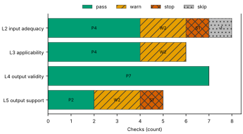
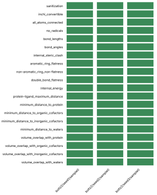
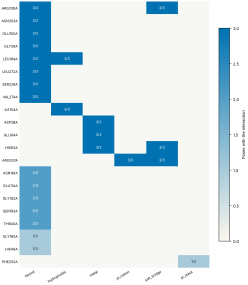
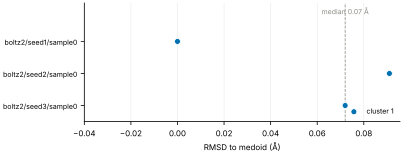
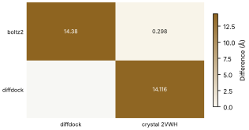
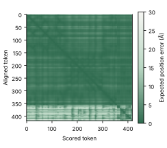

# Run report · Ligand pose in a known pocket

Prediction assurance · run `ligand_pose-ff6d75ceebd3` · 2026-10-17 16:59:51 UTC

**Refused** for the claim "Predicted pose of BGC in glucose dehydrogenase (glucose-binding) is valid".

Refused over layers 2,3,4,5: 17 pass, 6 warn, 2 stop, 1 skip. Stopped by l2.context.cofactors, l5.controls.redocking. Warnings from l2.receptor.protonation, l2.docking.box, l3.exposure.pocket, l3.exposure.ligand_prevalence, l5.sampling.seeds, l5.agreement.cross_family.

Stops: `l2.context.cofactors`, `l5.controls.redocking`.

Warnings: `l2.receptor.protonation`, `l2.docking.box`, `l3.exposure.pocket`, `l3.exposure.ligand_prevalence`, `l5.sampling.seeds`, `l5.agreement.cross_family`.

| Field | Value |
| --- | --- |
| Task | Ligand pose in a known pocket (`ligand_pose`) |
| Tools | Boltz-2 2.2.1 (co-folding), DiffDock-L (docking) |
| Target | `protein` |
| Ligand | `C([C@@H]1[C@H]([C@@H]([C@H]([C@@H](O1)O)O)O)O)O` |
| Reference | `2VWH` |
| pH | 7.4 |
| Seeds | 3 |
| Layers run | 2, 3, 4, 5 |
| Run | `ligand_pose-ff6d75ceebd3` |
| Created | 2026-10-17 16:59:51 UTC |
| Finished | 2026-10-17 17:01:56 UTC |
| pah version | 0.1.0 |
| Report schema | 1 |

## Layers

| Layer | Status | Result | pass | warn | stop | skip | Time |
| --- | --- | --- | --- | --- | --- | --- | --- |
| L0 Provenance | not run | n/a | n/a | n/a | n/a | n/a | n/a |
| L1 Input integrity | not run | n/a | n/a | n/a | n/a | n/a | n/a |
| L2 Input adequacy | done | stop | 4 | 2 | 1 | 1 | 1.4 s |
| L3 Applicability | done | warn | 4 | 2 | 0 | 0 | 4.0 s |
| L4 Output validity | done | pass | 7 | 0 | 0 | 0 | 119.2 s |
| L5 Output support | done | stop | 2 | 2 | 1 | 0 | 241 ms |

## Figures

Fig. 1 · Check outcomes per layer for run ligand_pose-ff6d75ceebd3. Totals: pass 17, warn 6, stop 2, skip 1.
Files: data [figures/gates_by_layer.csv](figures/gates_by_layer.csv).

## Structures

68 PyMOL renders.

2VWH mmCIF (source_structure), whole structure. Chains A; organic components BGC, NAP. sha256 563276ca06d2a22a. PyMOL session: [renders/2VWH.pse](renders/2VWH.pse).

2VWH mmCIF (source_structure), ligand environment within 5 Å. Chains A; organic components BGC, NAP. sha256 563276ca06d2a22a. PyMOL session: [renders/2VWH.pse](renders/2VWH.pse).

boltz2/seed1/sample0 (prediction_structure), whole structure. Chains A, C1, C2, L; organic components LIG1, NAP. sha256 f4536228b2ba4ad1. PyMOL session: [renders/boltz2_seed1_sample0.pse](renders/boltz2_seed1_sample0.pse).

boltz2/seed1/sample0 (prediction_structure), ligand environment within 5 Å. Chains A, C1, C2, L; organic components LIG1, NAP. sha256 f4536228b2ba4ad1. PyMOL session: [renders/boltz2_seed1_sample0.pse](renders/boltz2_seed1_sample0.pse).

boltz2/seed2/sample0 (prediction_structure), whole structure. Chains A, C1, C2, L; organic components LIG1, NAP. sha256 309cf6bd58c7cbee. PyMOL session: [renders/boltz2_seed2_sample0.pse](renders/boltz2_seed2_sample0.pse).

boltz2/seed2/sample0 (prediction_structure), ligand environment within 5 Å. Chains A, C1, C2, L; organic components LIG1, NAP. sha256 309cf6bd58c7cbee. PyMOL session: [renders/boltz2_seed2_sample0.pse](renders/boltz2_seed2_sample0.pse).

boltz2/seed3/sample0 (prediction_structure), whole structure. Chains A, C1, C2, L; organic components LIG1, NAP. sha256 ce2278afa44f2d9c. PyMOL session: [renders/boltz2_seed3_sample0.pse](renders/boltz2_seed3_sample0.pse).

boltz2/seed3/sample0 (prediction_structure), ligand environment within 5 Å. Chains A, C1, C2, L; organic components LIG1, NAP. sha256 ce2278afa44f2d9c. PyMOL session: [renders/boltz2_seed3_sample0.pse](renders/boltz2_seed3_sample0.pse).

diffdock/seed1/mode0 (prediction_structure), whole structure. Chains A, L; organic components LIG. sha256 b2d0102b0953e41b. PyMOL session: [renders/diffdock_seed1_mode0.pse](renders/diffdock_seed1_mode0.pse).

diffdock/seed1/mode0 (prediction_structure), ligand environment within 5 Å. Chains A, L; organic components LIG. sha256 b2d0102b0953e41b. PyMOL session: [renders/diffdock_seed1_mode0.pse](renders/diffdock_seed1_mode0.pse).

diffdock/seed1/mode1 (prediction_structure), whole structure. Chains A, L; organic components LIG. sha256 ce408b809051ef45. PyMOL session: [renders/diffdock_seed1_mode1.pse](renders/diffdock_seed1_mode1.pse).

diffdock/seed1/mode1 (prediction_structure), ligand environment within 5 Å. Chains A, L; organic components LIG. sha256 ce408b809051ef45. PyMOL session: [renders/diffdock_seed1_mode1.pse](renders/diffdock_seed1_mode1.pse).

diffdock/seed1/mode2 (prediction_structure), whole structure. Chains A, L; organic components LIG. sha256 305c0a1a55fb183d. PyMOL session: [renders/diffdock_seed1_mode2.pse](renders/diffdock_seed1_mode2.pse).

diffdock/seed1/mode2 (prediction_structure), ligand environment within 5 Å. Chains A, L; organic components LIG. sha256 305c0a1a55fb183d. PyMOL session: [renders/diffdock_seed1_mode2.pse](renders/diffdock_seed1_mode2.pse).

diffdock/seed1/mode3 (prediction_structure), whole structure. Chains A, L; organic components LIG. sha256 732b0f2b28ba5afe. PyMOL session: [renders/diffdock_seed1_mode3.pse](renders/diffdock_seed1_mode3.pse).

diffdock/seed1/mode3 (prediction_structure), ligand environment within 5 Å. Chains A, L; organic components LIG. sha256 732b0f2b28ba5afe. PyMOL session: [renders/diffdock_seed1_mode3.pse](renders/diffdock_seed1_mode3.pse).

diffdock/seed1/mode4 (prediction_structure), whole structure. Chains A, L; organic components LIG. sha256 8431a46dd474c011. PyMOL session: [renders/diffdock_seed1_mode4.pse](renders/diffdock_seed1_mode4.pse).

diffdock/seed1/mode4 (prediction_structure), ligand environment within 5 Å. Chains A, L; organic components LIG. sha256 8431a46dd474c011. PyMOL session: [renders/diffdock_seed1_mode4.pse](renders/diffdock_seed1_mode4.pse).

diffdock/seed1/mode5 (prediction_structure), whole structure. Chains A, L; organic components LIG. sha256 64e95ee95743d54b. PyMOL session: [renders/diffdock_seed1_mode5.pse](renders/diffdock_seed1_mode5.pse).

diffdock/seed1/mode5 (prediction_structure), ligand environment within 5 Å. Chains A, L; organic components LIG. sha256 64e95ee95743d54b. PyMOL session: [renders/diffdock_seed1_mode5.pse](renders/diffdock_seed1_mode5.pse).

diffdock/seed1/mode6 (prediction_structure), whole structure. Chains A, L; organic components LIG. sha256 0be51cebfd3345f0. PyMOL session: [renders/diffdock_seed1_mode6.pse](renders/diffdock_seed1_mode6.pse).

diffdock/seed1/mode6 (prediction_structure), ligand environment within 5 Å. Chains A, L; organic components LIG. sha256 0be51cebfd3345f0. PyMOL session: [renders/diffdock_seed1_mode6.pse](renders/diffdock_seed1_mode6.pse).

diffdock/seed1/mode7 (prediction_structure), whole structure. Chains A, L; organic components LIG. sha256 e272da3a29f7053e. PyMOL session: [renders/diffdock_seed1_mode7.pse](renders/diffdock_seed1_mode7.pse).

diffdock/seed1/mode7 (prediction_structure), ligand environment within 5 Å. Chains A, L; organic components LIG. sha256 e272da3a29f7053e. PyMOL session: [renders/diffdock_seed1_mode7.pse](renders/diffdock_seed1_mode7.pse).

diffdock/seed1/mode8 (prediction_structure), whole structure. Chains A, L; organic components LIG. sha256 e5fa7220155e5b9b. PyMOL session: [renders/diffdock_seed1_mode8.pse](renders/diffdock_seed1_mode8.pse).

diffdock/seed1/mode8 (prediction_structure), ligand environment within 5 Å. Chains A, L; organic components LIG. sha256 e5fa7220155e5b9b. PyMOL session: [renders/diffdock_seed1_mode8.pse](renders/diffdock_seed1_mode8.pse).

diffdock/seed1/mode9 (prediction_structure), whole structure. Chains A, L; organic components LIG. sha256 2b6a5a5cea1c57aa. PyMOL session: [renders/diffdock_seed1_mode9.pse](renders/diffdock_seed1_mode9.pse).

diffdock/seed1/mode9 (prediction_structure), ligand environment within 5 Å. Chains A, L; organic components LIG. sha256 2b6a5a5cea1c57aa. PyMOL session: [renders/diffdock_seed1_mode9.pse](renders/diffdock_seed1_mode9.pse).

diffdock/seed2/mode0 (prediction_structure), whole structure. Chains A, L; organic components LIG. sha256 23f77c211e09b1c5. PyMOL session: [renders/diffdock_seed2_mode0.pse](renders/diffdock_seed2_mode0.pse).

diffdock/seed2/mode0 (prediction_structure), ligand environment within 5 Å. Chains A, L; organic components LIG. sha256 23f77c211e09b1c5. PyMOL session: [renders/diffdock_seed2_mode0.pse](renders/diffdock_seed2_mode0.pse).

diffdock/seed2/mode1 (prediction_structure), whole structure. Chains A, L; organic components LIG. sha256 fe7f04fb2f4d0669. PyMOL session: [renders/diffdock_seed2_mode1.pse](renders/diffdock_seed2_mode1.pse).

diffdock/seed2/mode1 (prediction_structure), ligand environment within 5 Å. Chains A, L; organic components LIG. sha256 fe7f04fb2f4d0669. PyMOL session: [renders/diffdock_seed2_mode1.pse](renders/diffdock_seed2_mode1.pse).

diffdock/seed2/mode2 (prediction_structure), whole structure. Chains A, L; organic components LIG. sha256 a93d1e67750e5e5d. PyMOL session: [renders/diffdock_seed2_mode2.pse](renders/diffdock_seed2_mode2.pse).

diffdock/seed2/mode2 (prediction_structure), ligand environment within 5 Å. Chains A, L; organic components LIG. sha256 a93d1e67750e5e5d. PyMOL session: [renders/diffdock_seed2_mode2.pse](renders/diffdock_seed2_mode2.pse).

diffdock/seed2/mode3 (prediction_structure), whole structure. Chains A, L; organic components LIG. sha256 6ea294a2cc9c272b. PyMOL session: [renders/diffdock_seed2_mode3.pse](renders/diffdock_seed2_mode3.pse).

diffdock/seed2/mode3 (prediction_structure), ligand environment within 5 Å. Chains A, L; organic components LIG. sha256 6ea294a2cc9c272b. PyMOL session: [renders/diffdock_seed2_mode3.pse](renders/diffdock_seed2_mode3.pse).

diffdock/seed2/mode4 (prediction_structure), whole structure. Chains A, L; organic components LIG. sha256 2ba50b90fc95d998. PyMOL session: [renders/diffdock_seed2_mode4.pse](renders/diffdock_seed2_mode4.pse).

diffdock/seed2/mode4 (prediction_structure), ligand environment within 5 Å. Chains A, L; organic components LIG. sha256 2ba50b90fc95d998. PyMOL session: [renders/diffdock_seed2_mode4.pse](renders/diffdock_seed2_mode4.pse).

diffdock/seed2/mode5 (prediction_structure), whole structure. Chains A, L; organic components LIG. sha256 8ac819394ae887fd. PyMOL session: [renders/diffdock_seed2_mode5.pse](renders/diffdock_seed2_mode5.pse).

diffdock/seed2/mode5 (prediction_structure), ligand environment within 5 Å. Chains A, L; organic components LIG. sha256 8ac819394ae887fd. PyMOL session: [renders/diffdock_seed2_mode5.pse](renders/diffdock_seed2_mode5.pse).

diffdock/seed2/mode6 (prediction_structure), whole structure. Chains A, L; organic components LIG. sha256 b1c18e4b7b6efe42. PyMOL session: [renders/diffdock_seed2_mode6.pse](renders/diffdock_seed2_mode6.pse).

diffdock/seed2/mode6 (prediction_structure), ligand environment within 5 Å. Chains A, L; organic components LIG. sha256 b1c18e4b7b6efe42. PyMOL session: [renders/diffdock_seed2_mode6.pse](renders/diffdock_seed2_mode6.pse).

diffdock/seed2/mode7 (prediction_structure), whole structure. Chains A, L; organic components LIG. sha256 54cf78f20eb9f8e4. PyMOL session: [renders/diffdock_seed2_mode7.pse](renders/diffdock_seed2_mode7.pse).

diffdock/seed2/mode7 (prediction_structure), ligand environment within 5 Å. Chains A, L; organic components LIG. sha256 54cf78f20eb9f8e4. PyMOL session: [renders/diffdock_seed2_mode7.pse](renders/diffdock_seed2_mode7.pse).

diffdock/seed2/mode8 (prediction_structure), whole structure. Chains A, L; organic components LIG. sha256 61e3d3c88db4c898. PyMOL session: [renders/diffdock_seed2_mode8.pse](renders/diffdock_seed2_mode8.pse).

diffdock/seed2/mode8 (prediction_structure), ligand environment within 5 Å. Chains A, L; organic components LIG. sha256 61e3d3c88db4c898. PyMOL session: [renders/diffdock_seed2_mode8.pse](renders/diffdock_seed2_mode8.pse).

diffdock/seed2/mode9 (prediction_structure), whole structure. Chains A, L; organic components LIG. sha256 27c6420f6e60f8bf. PyMOL session: [renders/diffdock_seed2_mode9.pse](renders/diffdock_seed2_mode9.pse).

diffdock/seed2/mode9 (prediction_structure), ligand environment within 5 Å. Chains A, L; organic components LIG. sha256 27c6420f6e60f8bf. PyMOL session: [renders/diffdock_seed2_mode9.pse](renders/diffdock_seed2_mode9.pse).

diffdock/seed3/mode0 (prediction_structure), whole structure. Chains A, L; organic components LIG. sha256 82336c6ce28498c8. PyMOL session: [renders/diffdock_seed3_mode0.pse](renders/diffdock_seed3_mode0.pse).

diffdock/seed3/mode0 (prediction_structure), ligand environment within 5 Å. Chains A, L; organic components LIG. sha256 82336c6ce28498c8. PyMOL session: [renders/diffdock_seed3_mode0.pse](renders/diffdock_seed3_mode0.pse).

diffdock/seed3/mode1 (prediction_structure), whole structure. Chains A, L; organic components LIG. sha256 08264f8cf8c3ba2d. PyMOL session: [renders/diffdock_seed3_mode1.pse](renders/diffdock_seed3_mode1.pse).

diffdock/seed3/mode1 (prediction_structure), ligand environment within 5 Å. Chains A, L; organic components LIG. sha256 08264f8cf8c3ba2d. PyMOL session: [renders/diffdock_seed3_mode1.pse](renders/diffdock_seed3_mode1.pse).

diffdock/seed3/mode2 (prediction_structure), whole structure. Chains A, L; organic components LIG. sha256 96dd86ff074bbf46. PyMOL session: [renders/diffdock_seed3_mode2.pse](renders/diffdock_seed3_mode2.pse).

diffdock/seed3/mode2 (prediction_structure), ligand environment within 5 Å. Chains A, L; organic components LIG. sha256 96dd86ff074bbf46. PyMOL session: [renders/diffdock_seed3_mode2.pse](renders/diffdock_seed3_mode2.pse).

diffdock/seed3/mode3 (prediction_structure), whole structure. Chains A, L; organic components LIG. sha256 f4990dd94b93ad29. PyMOL session: [renders/diffdock_seed3_mode3.pse](renders/diffdock_seed3_mode3.pse).

diffdock/seed3/mode3 (prediction_structure), ligand environment within 5 Å. Chains A, L; organic components LIG. sha256 f4990dd94b93ad29. PyMOL session: [renders/diffdock_seed3_mode3.pse](renders/diffdock_seed3_mode3.pse).

diffdock/seed3/mode4 (prediction_structure), whole structure. Chains A, L; organic components LIG. sha256 1868a46699ac1d30. PyMOL session: [renders/diffdock_seed3_mode4.pse](renders/diffdock_seed3_mode4.pse).

diffdock/seed3/mode4 (prediction_structure), ligand environment within 5 Å. Chains A, L; organic components LIG. sha256 1868a46699ac1d30. PyMOL session: [renders/diffdock_seed3_mode4.pse](renders/diffdock_seed3_mode4.pse).

diffdock/seed3/mode5 (prediction_structure), whole structure. Chains A, L; organic components LIG. sha256 f87a38ece42495c2. PyMOL session: [renders/diffdock_seed3_mode5.pse](renders/diffdock_seed3_mode5.pse).

diffdock/seed3/mode5 (prediction_structure), ligand environment within 5 Å. Chains A, L; organic components LIG. sha256 f87a38ece42495c2. PyMOL session: [renders/diffdock_seed3_mode5.pse](renders/diffdock_seed3_mode5.pse).

diffdock/seed3/mode6 (prediction_structure), whole structure. Chains A, L; organic components LIG. sha256 bc38912834ad0d46. PyMOL session: [renders/diffdock_seed3_mode6.pse](renders/diffdock_seed3_mode6.pse).

diffdock/seed3/mode6 (prediction_structure), ligand environment within 5 Å. Chains A, L; organic components LIG. sha256 bc38912834ad0d46. PyMOL session: [renders/diffdock_seed3_mode6.pse](renders/diffdock_seed3_mode6.pse).

diffdock/seed3/mode7 (prediction_structure), whole structure. Chains A, L; organic components LIG. sha256 f3ee2fc55c5aef23. PyMOL session: [renders/diffdock_seed3_mode7.pse](renders/diffdock_seed3_mode7.pse).

diffdock/seed3/mode7 (prediction_structure), ligand environment within 5 Å. Chains A, L; organic components LIG. sha256 f3ee2fc55c5aef23. PyMOL session: [renders/diffdock_seed3_mode7.pse](renders/diffdock_seed3_mode7.pse).

diffdock/seed3/mode8 (prediction_structure), whole structure. Chains A, L; organic components LIG. sha256 729509735edfe7d1. PyMOL session: [renders/diffdock_seed3_mode8.pse](renders/diffdock_seed3_mode8.pse).

diffdock/seed3/mode8 (prediction_structure), ligand environment within 5 Å. Chains A, L; organic components LIG. sha256 729509735edfe7d1. PyMOL session: [renders/diffdock_seed3_mode8.pse](renders/diffdock_seed3_mode8.pse).

diffdock/seed3/mode9 (prediction_structure), whole structure. Chains A, L; organic components LIG. sha256 829fa43c0afe7540. PyMOL session: [renders/diffdock_seed3_mode9.pse](renders/diffdock_seed3_mode9.pse).

diffdock/seed3/mode9 (prediction_structure), ligand environment within 5 Å. Chains A, L; organic components LIG. sha256 829fa43c0afe7540. PyMOL session: [renders/diffdock_seed3_mode9.pse](renders/diffdock_seed3_mode9.pse).

## L0 Provenance

Where did every input come from?

Status: not run.

## L1 Input integrity

Did the run receive exactly what was declared?

Status: not run.

## L2 Input adequacy

Does the input carry enough information?

Status: done. Checks: pass 4 · warn 2 · stop 1 · skip 1. Time: 1.4 s.

#### Key figures

| Figure | Value |
| --- | --- |
| near site | 2 |
| missing | 2 |
| uniprot cofactors | 0 |
| pocket residues | 19 |
| incomplete | 0 |
| sequence gaps | 0 |
| state | holo |
| site ligands | 2 |

#### Docking

| Field | Value |
| --- | --- |
| center | 9.319, 36.788, 18.307 Å |
| size | 11.671 × 12.814 × 12.093 Å |
| origin | derived from BGC (+4 Å) |

#### Checks

| Check | Result | Measured cmp threshold | Evidence | Id · time |
| --- | --- | --- | --- | --- |
| Alignment depth, distinct sequences, Neff and gap fraction | skip | n/a | no MSA declared for a co-folding model · not applicable | `l2.msa.depth` |
| Required cofactors, ions and partners present | stop | `pocket_distance <= 8` | components within 8.0 Å of BGC in 2VWH not supplied: NAP, ZN · near_site=2, missing=2, uniprot_cofactors=0 | `l2.context.cofactors` · 214 ms |
| Pocket residues resolved, no missing loops lining the pocket | pass | `pocket_distance <= 6` | 19 pocket residues complete in 2VWH.cif · pocket_residues=19, incomplete=0, sequence_gaps=0 | `l2.pocket.resolved` · 8 ms |
| Receptor state apo or holo | pass | n/a | 2VWH.cif holo: BGC, NAP in the site · state=holo, site_ligands=2 | `l2.receptor.state` · 7 ms |
| Receptor protonation at the stated pH | warn | `pka_margin > 1` | receptor has no hydrogens (protonation not assigned); pKa within 1.0 of pH 7.4: GLU64A pKa 6.96, GLU150A pKa 8.39 · hydrogens_present=False, ph=7.4, pocket_titratable=13 | `l2.receptor.protonation` · 623 ms |
| Ligand protonation and tautomers enumerated at the stated pH | pass | `ph 7.4 == 1` | one state at pH 7.4 for every ligand · ph=7.4, max_states=1, declared_not_enumerated=0 | `l2.ligand.protonation` · 40 ms |
| Ligand conformers generated and minimised | pass | `conformers >= 10` | 10 ETKDG conformers per ligand, MMFF minimised · ligands=1, failed=0, min_embedded=10 | `l2.ligand.conformers` · 515 ms |
| Docking box encloses the pocket with margin | warn | `margin >= 2` | no box declared; derived box encloses 11 contact residues and the BGC ligand with 2.0 Å margin · volume_A3=1808.5, ligand_atoms_inside_margin=12, ligand_atoms=12 | `l2.docking.box` · 13 ms |

## L3 Applicability

Is the tool inside its validated regime?

Status: done. Checks: pass 4 · warn 2 · stop 0 · skip 0. Time: 4.0 s.

#### Key figures

| Figure | Value |
| --- | --- |
| executors | 2 |
| unknown | 0 |
| reference released | 2009-01-13 |
| cutoff | 2019-01-01 |
| entries compared | 1 |
| max similarity | 87.4 |
| pocket residues | 19 |
| systems | 1079 |

#### Checks

| Check | Result | Measured cmp threshold | Evidence | Id · time |
| --- | --- | --- | --- | --- |
| Model training cutoff recorded | pass | `training_cutoff == recorded` | boltz2 2023-06-01; diffdock 2019-01-01; reference 2VWH released 2009-01-13, before the cutoff of boltz2, diffdock · executors=2, unknown=0, reference_released=2009-01-13 | `l3.model.training_cutoff` · 1 ms |
| Pocket similarity to pre-cutoff complexes (SuCOS times pocket coverage) | warn | `similarity <= 50` | max similarity 87.4 to 2VWH (BGC, SuCOS 0.923, coverage 0.947), released before 2019-01-01 · cutoff=2019-01-01, entries_compared=1, max_similarity=87.4 | `l3.exposure.pocket` · 3.9 s |
| Ligand analogues in pre-cutoff training systems | warn | `tanimoto > 0.9` | 1079 PDB entries released before 2019-01-01 (diffdock cutoff) contain analogues of ligand above Tanimoto 0.9: 3MK, 4GL, 4N2, A1EKO, AFD, ALL · cutoff=2019-01-01, systems=1079, analogue_components=25 | `l3.exposure.ligand_prevalence` · 0 ms |
| Chain sequence identity to pre-cutoff entries (secondary measure) | pass | `identity < 0.4` | protein: 6 entries at 95 percent identity, 6 at 40 percent, released before 2019-01-01 (reported, not gating) · cutoff=2019-01-01, entries_95=6, entries_40=6 | `l3.exposure.sequence` · 1 ms |
| Modality inside the validated set; token count against the training crop | pass | n/a | modalities protein, protein_ligand inside the validated set; 369 tokens · modalities=2, tokens=369, outside=0 | `l3.regime.modality` · 6 ms |
| Endpoint fits the tool | pass | `endpoint pose in pose` | endpoint pose produced by boltz2, diffdock · endpoint=pose, executors=2, not_fitting=0 | `l3.metric.endpoint` · 0 ms |

## L4 Output validity

Is the result physically and chemically sensible?

Status: done. Checks: pass 7 · warn 0 · stop 0 · skip 0. Time: 119.2 s.

#### Key figures

| Figure | Value |
| --- | --- |
| poses | 3 |
| passed | 20 |
| total | 20 |
| poses all pass | 3 |
| unlikely torsions | 0 |
| torsions | 6 |
| strain kcal | 4.26 |
| poses with unlikely | 1 |

#### PoseBusters · 20/20 tests pass

| test | result | value |
| --- | --- | --- |
| sanitization | pass | pass |
| inchi_convertible | pass | pass |
| all_atoms_connected | pass | pass |
| no_radicals | pass | pass |
| bond_lengths | pass | 0 long outliers |
| bond_angles | pass | 0 outliers |
| internal_steric_clash | pass | 0 |
| aromatic_ring_flatness | pass | pass |
| non-aromatic_ring_non-flatness | pass | pass |
| double_bond_flatness | pass | pass |
| internal_energy | pass | 0.9 times the ensemble mean |
| protein-ligand_maximum_distance | pass | 2.52 Å |
| minimum_distance_to_protein | pass | 2.52 Å |
| minimum_distance_to_organic_cofactors | pass | pass |
| minimum_distance_to_inorganic_cofactors | pass | pass |
| minimum_distance_to_waters | pass | pass |
| volume_overlap_with_protein | pass | 0.033 |
| volume_overlap_with_organic_cofactors | pass | pass |
| volume_overlap_with_inorganic_cofactors | pass | pass |
| volume_overlap_with_waters | pass | pass |

#### Per-pose physical checks

| pose | seed | drift Å | converged | unlikely torsions | unsat. polars | buried charged | PoseBusters |
| --- | --- | --- | --- | --- | --- | --- | --- |
| boltz2/seed1/sample0 | 1 | 0.4 | true | 0/6 | 0 | 0 | 20/20 |
| boltz2/seed2/sample0 | 2 | 0.56 | true | 0/6 | 0 | 0 | 20/20 |
| boltz2/seed3/sample0 | 3 | 0.21 | true | 2/6 | 0 | 0 | 20/20 |
| median | n/a | 0.4 | n/a | 0 | 0 | 0 | 20/20 |

#### Interaction fingerprint · representative pose boltz2/seed1/sample0

| residue | type | distance | poses |
| --- | --- | --- | --- |
| ARG208A | hbond | 3.4 Å | 3/3 |
| ASN303A | hbond | 2.83 Å | 3/3 |
| GLU150A | hbond | 2.83 Å | 3/3 |
| GLY39A | hbond | 2.83 Å | 3/3 |
| LEU184A | hbond | 3.06 Å | 3/3 |
| LEU272A | hbond | 2.98 Å | 3/3 |
| SER228A | hbond | 2.66 Å | 3/3 |
| VAL274A | hbond | 3.22 Å | 3/3 |
| ILE154A | hydrophobic | 3.61 Å | 3/3 |
| LEU184A | hydrophobic | 3.62 Å | 3/3 |
| ASP38A | metal | 2.03 Å | 3/3 |
| GLU64A | metal | 2.36 Å | 3/3 |
| HIS63A | metal | 2.05 Å | 3/3 |
| ARG207A | pi_cation | 3.68 Å | 3/3 |
| ARG207A | salt_bridge | 4.43 Å | 3/3 |
| ARG208A | salt_bridge | 4.04 Å | 3/3 |
| HIS63A | salt_bridge | 4.35 Å | 3/3 |
| ASN181A | hbond | 4.06 Å | 2/3 |
| GLU114A | hbond | 3.64 Å | 2/3 |
| GLY182A | hbond | 3.82 Å | 2/3 |
| SER183A | hbond | 3.52 Å | 2/3 |
| THR40A | hbond | 2.73 Å | 2/3 |
| GLY185A | hbond | 4.07 Å | 1/3 |
| HIS49A | hbond | 2.97 Å | 1/3 |
| PHE252A | pi_stack | 4.52 Å | 1/3 |

Fig. 2 · PoseBusters tests (20) by pose (3). Failed cells marked x: 0 of 60.
Files: data [figures/posebusters_grid.csv](figures/posebusters_grid.csv).

Fig. 3 · Interactions by residue (21) and type (6); cell label: poses with the interaction over poses assessed.
Files: data [figures/interactions.csv](figures/interactions.csv).

#### Checks

| Check | Result | Measured cmp threshold | Evidence | Id · time |
| --- | --- | --- | --- | --- |
| PoseBusters geometry, stereochemistry, clashes and protein contact | pass | `tests_failed == 0` | 20 of 20 tests pass for boltz2/seed1/sample0; 3 of 3 poses pass all · poses=3, passed=20, total=20 | `l4.posebusters` · 973 ms |
| Torsional strain of the ligand pose | pass | `torsion_energy <= 2.5` | 0 of 6 torsions above 2.5 kcal/mol in boltz2/seed1/sample0; strain 4.26 kcal/mol · poses=3, unlikely_torsions=0, torsions=6 | `l4.torsion_strain` · 603 ms |
| Interaction fingerprint (PLIP) | pass | n/a | 23 interactions in boltz2/seed1/sample0 (hbond, hydrophobic, metal, pi_cation, salt_bridge); 25 distinct across 3 poses (reported) · poses=3, interactions_representative=23, distinct=25 | `l4.interactions.fingerprint` · 2.1 s |
| Buried ligand polar atoms without a hydrogen-bond partner | pass | `relative_sasa < 0.1` | 6 buried polar ligand atoms, all with a partner within 3.5 Å in boltz2/seed1/sample0 · poses=3, unsatisfied=0, buried_charged=0 | `l4.interactions.unsatisfied_polars` · 357 ms |
| Hydrophobic complementarity of buried ligand surface | pass | `fraction >= 0.35` | nonpolar fraction of protein contacts around 4 buried nonpolar ligand atoms in boltz2/seed1/sample0: 0.535 · poses=3, complementarity=0.535, buried_nonpolar=4 | `l4.interactions.hydrophobic` · 376 ms |
| Interactions of the crystal ligand reproduced by the pose | pass | `reproduced 4 >= 1` | boltz2/seed1/sample0 reproduces 4 of 6 BGC interactions: hbond ASN303A, hbond GLU150A, hbond HIS49A, salt_bridge HIS63A · key_interactions=6, reproduced=4, poses_reproducing_all=0 | `l4.interactions.known_binders` · 169 ms |
| Pose stability under short restrained minimisation (OpenMM, AMBER14 and OpenFF) | pass | `drift_A 0.4 <= 2` | boltz2/seed1/sample0 moves 0.399 Å under restrained minimisation; 0 of 3 poses above 2.0 Å · poses=3, drift_A=0.399, max_drift_A=0.556 | `l4.minimisation_drift` · 114.6 s |

## L5 Output support

Is a valid result corroborated?

Status: done. Checks: pass 2 · warn 2 · stop 1 · skip 0. Time: 241 ms.

#### Key figures

| Figure | Value |
| --- | --- |
| poses | 3 |
| pocket plddt | 97.3 |
| global plddt | 98 |
| iptm | 0.99 |
| ptm | 0.987 |
| confidence score | 0.982 |
| independent seeds | 3 |
| samples | 3 |

#### Sampling

| Field | Value |
| --- | --- |
| site placement | 3 of 3 poses within 4.0 Å of the site (BGC in 2VWH) |
| pose accuracy | 3 of 3 poses within 2.0 Å of the medoid |
| pairwise RMSD median | 0.09 Å |
| pairwise RMSD IQR | 0.08 to 0.12 Å |
| pairs | 3 |
| medoid | boltz2/seed1/sample0 |

#### Clusters

| Field | Value |
| --- | --- |
| cluster 1 | 3/3 poses (boltz2/seed1/sample0) |

#### Per-seed statistics

| seed | pose | cluster | RMSD to medoid | confidence |
| --- | --- | --- | --- | --- |
| 1 | boltz2/seed1/sample0 | 1 | 0 Å | 0.98 |
| 2 | boltz2/seed2/sample0 | 1 | 0.09 Å | 0.98 |
| 3 | boltz2/seed3/sample0 | 1 | 0.07 Å | 0.98 |
| median | n/a | n/a | 0.07 Å | 0.98 |

#### Ensemble

| structure | kind | source | RMSD to medoid | cluster | pocket pLDDT | ipTM |
| --- | --- | --- | --- | --- | --- | --- |
| boltz2/seed1/sample0 | medoid | boltz2 | 0 Å | 1 | 97.3 | 0.99 |
| boltz2/seed2/sample0 | seed | boltz2 | 0.09 Å | 1 | 97.2 | 0.99 |
| boltz2/seed3/sample0 | seed | boltz2 | 0.07 Å | 1 | 97.5 | 0.99 |

#### Agreement between methods

| method | diffdock | crystal 2VWH |
| --- | --- | --- |
| boltz2 | 14.4 Å (high) | 0.3 Å (decisive) |
| diffdock | n/a | 14.1 Å (decisive) |

#### Confidence metrics

| metric | value | read as | tool |
| --- | --- | --- | --- |
| affinity_pred_value | 1.7915303707122803 | ranking within a series, never pose quality | boltz2 |
| affinity_probability_binary | 0.4691814184188843 | ranking within a series, never pose quality | boltz2 |
| affinity_pred_value | 1.8903712034225464 | ranking within a series, never pose quality | boltz2 |
| affinity_probability_binary | 0.4600614011287689 | ranking within a series, never pose quality | boltz2 |
| affinity_pred_value | 1.9010051488876343 | ranking within a series, never pose quality | boltz2 |
| affinity_probability_binary | 0.46700161695480347 | ranking within a series, never pose quality | boltz2 |

Fig. 4 · RMSD to the medoid for 3 poses, coloured by cluster (1 clusters). Dashed line: median 0.07 Å; range 0.00 to 0.09 Å.
Files: data [figures/seed_spread.csv](figures/seed_spread.csv).

Fig. 5 · Agreement between 2 methods and 2 comparators; range 0.298 to 14.38 Å.
Files: data [figures/agreement.csv](figures/agreement.csv).

Fig. 6 · Predicted aligned error for pose boltz2/seed1/sample0, 418 by 418 tokens; values 0.2 to 27.7 Å, mean 2.9 Å.
Files: data [figures/pae.csv](figures/pae.csv).

#### Checks

| Check | Result | Measured cmp threshold | Evidence | Id · time |
| --- | --- | --- | --- | --- |
| Confidence restricted to the pocket; per-model thresholds | pass | `boltz2.pocket_plddt >= 70` | boltz2/seed1/sample0: pocket_plddt 97.3 · poses=3, pocket_plddt=97.3, global_plddt=98 | `l5.confidence.local` · 38 ms |
| Independent seeds counted separately from samples; duplicates flagged | warn | `seeds_cofolding >= 5` | 3 independent seeds (3 poses); task default 5 · independent_seeds=3, samples=3, duplicated_outputs=0 | `l5.sampling.seeds` · 0 ms |
| Medoid of the largest cluster, populations, pairwise spread, site and pose accuracy | pass | `cluster_rmsd <= 2` | medoid boltz2/seed1/sample0; 1 clusters, largest 3 of 3; pairwise RMSD median 0.09 Å (IQR 0.08 to 0.12); 3 of 3 poses within 4.0 Å of the site (BGC in 2VWH); 3 of 3 poses within 2.0 Å of the medoid · poses=3, clusters=1, largest_cluster=3 | `l5.sampling.clusters` · 72 ms |
| Agreement between methods, weighted by independence | warn | `rmsd_to_crystal_A 0.3 <= 2` | boltz2 vs diffdock 14.38 Å (high); boltz2 vs crystal 2VWH 0.298 Å (decisive); diffdock vs crystal 2VWH 14.116 Å (decisive) · methods=2, comparisons=3, disagreeing=2 | `l5.agreement.cross_family` · 119 ms |
| Redocking control reproduces the crystal pose | stop | `rmsd <= 2` | redocking control required by the task and not supplied (controls.redocking) | `l5.controls.redocking` · 0 ms |

## Controls

| control | status | result |
| --- | --- | --- |
| redocking | incomplete | redocking control required by the task and not supplied (controls.redocking) |

## Provenance

56 objects · 6 cached · 50 network.

| Source | Accession | Release | SHA-256 | Retrieved | Bytes | Cache | Used by |
| --- | --- | --- | --- | --- | --- | --- | --- |
| rcsb_files | 2VWH | n/a | `563276ca06d2` | 2026-10-17 16:59:50 UTC | 364136 | hit | l2.context.cofactors, l2.pocket.resolved, l2.receptor.state, l2.docking.box, l3.exposure.pocket, l3.regime.modality, l4.interactions.fingerprint, l4.interactions.known_binders, l5.sampling.clusters, l5.agreement.cross_family |
| ccd | BGC | 2026-01-27 | `faaa9f919f4c` | 2026-10-17 16:59:50 UTC | 30741 | hit | l2.context.cofactors, l3.exposure.pocket |
| rcsb | 2VWH | 1.5 | `5a990581b1c2` | 2026-10-17 16:59:51 UTC | 22370 | hit | l3.model.training_cutoff |
| rcsb_search | chem:C([C@@H]1[C@H]([C@@H]([C@H]([C@@H](O1)O)O)O)O)O | n/a | `0d5756d1e58b` | 2026-10-17 16:59:54 UTC | 1413 | miss | l3.exposure.pocket |
| ccd | 3MK | 2020-07-17 | `d97d4b552654` | 2026-10-17 16:59:54 UTC | 6432 | miss | l3.exposure.pocket |
| ccd | 4GL | 2020-07-17 | `54e556dfe7fd` | 2026-10-17 16:59:54 UTC | 6325 | miss | l3.exposure.pocket |
| ccd | 4N2 | 2024-09-27 | `f79b18096323` | 2026-10-17 16:59:54 UTC | 6840 | miss | l3.exposure.pocket |
| ccd | A1EKO | 2025-05-23 | `ad979697d06a` | 2026-10-17 16:59:54 UTC | 3352 | miss | l3.exposure.pocket |
| ccd | AFD | 2020-07-17 | `187112f21ade` | 2026-10-17 16:59:54 UTC | 6206 | miss | l3.exposure.pocket |
| ccd | ALL | 2020-07-17 | `598282a36137` | 2026-10-17 16:59:54 UTC | 7344 | miss | l3.exposure.pocket |
| ccd | BMA | 2024-09-27 | `7e30cba9c3f2` | 2026-10-17 16:59:55 UTC | 10486 | miss | l3.exposure.pocket |
| ccd | GIV | 2020-07-17 | `4569744b581c` | 2026-10-17 16:59:55 UTC | 6584 | miss | l3.exposure.pocket |
| ccd | GL0 | 2020-07-17 | `bbebd0ca21bb` | 2026-10-17 16:59:55 UTC | 6595 | miss | l3.exposure.pocket |
| ccd | GLA | 2024-09-27 | `7a00d8420d56` | 2026-10-17 16:59:55 UTC | 7618 | miss | l3.exposure.pocket |
| ccd | GLC | 2024-09-27 | `254da3afcadc` | 2026-10-17 16:59:55 UTC | 13396 | miss | l3.exposure.pocket |
| ccd | GUP | 2020-07-17 | `f89db705d642` | 2026-10-17 16:59:55 UTC | 6234 | miss | l3.exposure.pocket |
| ccd | GXL | 2020-07-17 | `b767fcdfce95` | 2026-10-17 16:59:55 UTC | 6457 | miss | l3.exposure.pocket |
| ccd | MAN | 2024-09-27 | `7152473b81ed` | 2026-10-17 16:59:55 UTC | 12288 | miss | l3.exposure.pocket |
| ccd | SDY | 2020-07-17 | `5d1e5b6ff718` | 2026-10-17 16:59:55 UTC | 5813 | miss | l3.exposure.pocket |
| ccd | SHD | 2020-07-17 | `f6d17409069d` | 2026-10-17 16:59:55 UTC | 6081 | miss | l3.exposure.pocket |
| ccd | WOO | 2020-07-17 | `9a8678927d94` | 2026-10-17 16:59:55 UTC | 6363 | miss | l3.exposure.pocket |
| ccd | Z0F | 2020-07-17 | `c55706645922` | 2026-10-17 16:59:55 UTC | 6421 | miss | l3.exposure.pocket |
| ccd | Z2D | 2020-07-17 | `689a6bb06802` | 2026-10-17 16:59:55 UTC | 6434 | miss | l3.exposure.pocket |
| ccd | Z6H | 2020-07-17 | `5a83d4f3e767` | 2026-10-17 16:59:55 UTC | 5982 | miss | l3.exposure.pocket |
| ccd | Z8H | 2020-07-17 | `2610342cf9e7` | 2026-10-17 16:59:55 UTC | 6321 | miss | l3.exposure.pocket |
| ccd | Z8T | 2020-07-17 | `379bdd554936` | 2026-10-17 16:59:55 UTC | 6328 | miss | l3.exposure.pocket |
| ccd | ZCD | 2020-07-17 | `0db91c424e63` | 2026-10-17 16:59:55 UTC | 6421 | miss | l3.exposure.pocket |
| ccd | ZEE | 2020-07-17 | `68a25c060a01` | 2026-10-17 16:59:55 UTC | 6839 | miss | l3.exposure.pocket |
| rcsb_search | comp:3MK:2019-01-01 | n/a | `e3b0c44298fc` | 2026-10-17 16:59:55 UTC | 0 | miss | l3.exposure.pocket |
| rcsb_search | comp:4GL:2019-01-01 | n/a | `e3b0c44298fc` | 2026-10-17 16:59:56 UTC | 0 | miss | l3.exposure.pocket |
| rcsb_search | comp:4N2:2019-01-01 | n/a | `1a398c0b2118` | 2026-10-17 16:59:56 UTC | 178 | miss | l3.exposure.pocket |
| rcsb_search | comp:A1EKO:2019-01-01 | n/a | `e3b0c44298fc` | 2026-10-17 16:59:56 UTC | 0 | miss | l3.exposure.pocket |
| rcsb_search | comp:AFD:2019-01-01 | n/a | `1b753220c03e` | 2026-10-17 16:59:56 UTC | 178 | miss | l3.exposure.pocket |
| rcsb_search | comp:ALL:2019-01-01 | n/a | `aa7eed16d698` | 2026-10-17 16:59:56 UTC | 282 | miss | l3.exposure.pocket |
| rcsb_search | comp:BGC:2019-01-01 | n/a | `39279015c780` | 2026-10-17 16:59:56 UTC | 16456 | miss | l3.exposure.pocket |
| rcsb_search | comp:BMA:2019-01-01 | n/a | `8abdb19b69b6` | 2026-10-17 16:59:56 UTC | 5223 | miss | l3.exposure.pocket |
| rcsb_search | comp:GIV:2019-01-01 | n/a | `180958654842` | 2026-10-17 16:59:56 UTC | 230 | miss | l3.exposure.pocket |
| rcsb_search | comp:GL0:2019-01-01 | n/a | `9b62fec3623e` | 2026-10-17 16:59:56 UTC | 230 | miss | l3.exposure.pocket |
| rcsb_search | comp:GLA:2019-01-01 | n/a | `02cfe2e610ae` | 2026-10-17 16:59:56 UTC | 3039 | miss | l3.exposure.pocket |
| rcsb_search | comp:GLC:2019-01-01 | n/a | `5e0520a8a72a` | 2026-10-17 16:59:56 UTC | 14064 | miss | l3.exposure.pocket |
| rcsb_search | comp:GUP:2019-01-01 | n/a | `e3b0c44298fc` | 2026-10-17 16:59:56 UTC | 0 | miss | l3.exposure.pocket |
| rcsb_search | comp:GXL:2019-01-01 | n/a | `76ee6d0d9de4` | 2026-10-17 16:59:56 UTC | 230 | miss | l3.exposure.pocket |
| rcsb_search | comp:MAN:2019-01-01 | n/a | `03c4da7e978a` | 2026-10-17 16:59:56 UTC | 17340 | miss | l3.exposure.pocket |
| rcsb_search | comp:SDY:2019-01-01 | n/a | `e3b0c44298fc` | 2026-10-17 16:59:56 UTC | 0 | miss | l3.exposure.pocket |
| rcsb_search | comp:SHD:2019-01-01 | n/a | `e3b0c44298fc` | 2026-10-17 16:59:56 UTC | 0 | miss | l3.exposure.pocket |
| rcsb_search | comp:WOO:2019-01-01 | n/a | `c2bb176d61ff` | 2026-10-17 16:59:56 UTC | 178 | miss | l3.exposure.pocket |
| rcsb_search | comp:Z0F:2019-01-01 | n/a | `e3b0c44298fc` | 2026-10-17 16:59:56 UTC | 0 | miss | l3.exposure.pocket |
| rcsb_search | comp:Z2D:2019-01-01 | n/a | `e3b0c44298fc` | 2026-10-17 16:59:56 UTC | 0 | miss | l3.exposure.pocket |
| rcsb_search | comp:Z6H:2019-01-01 | n/a | `e3b0c44298fc` | 2026-10-17 16:59:57 UTC | 0 | miss | l3.exposure.pocket |
| rcsb_search | comp:Z8H:2019-01-01 | n/a | `e3b0c44298fc` | 2026-10-17 16:59:57 UTC | 0 | miss | l3.exposure.pocket |
| rcsb_search | comp:Z8T:2019-01-01 | n/a | `e3b0c44298fc` | 2026-10-17 16:59:57 UTC | 0 | miss | l3.exposure.pocket |
| rcsb_search | comp:ZCD:2019-01-01 | n/a | `e3b0c44298fc` | 2026-10-17 16:59:57 UTC | 0 | miss | l3.exposure.pocket |
| rcsb_search | comp:ZEE:2019-01-01 | n/a | `e3b0c44298fc` | 2026-10-17 16:59:57 UTC | 0 | miss | l3.exposure.pocket |
| rcsb_search | seq0.9:2019-01-01:357 | n/a | `5cf9c6d3e615` | 2026-10-17 16:59:54 UTC | 438 | hit | l3.exposure.pocket |
| rcsb_search | seq0.95:2019-01-01:357 | n/a | `2ded139e03ea` | 2026-10-17 16:59:55 UTC | 386 | hit | l3.exposure.sequence |
| rcsb_search | seq0.4:2019-01-01:357 | n/a | `d1c1f4adb44b` | 2026-10-17 16:59:55 UTC | 386 | hit | l3.exposure.sequence |

Provenance graph: [json](graph.json), [mmd](graph.mmd), [svg](graph.svg).

## Thresholds

| Check | Threshold | Value | Origin | Evidence level |
| --- | --- | --- | --- | --- |
| `l2.context.cofactors` | pocket_distance | <= 8 | Harness rule: a component of the reference entry within 8 Å of the declared ligand is required context; not yet calibrated | uncalibrated |
| `l2.pocket.resolved` | pocket_distance | <= 6 | Harness rule: pocket residues have a heavy atom within 6 Å of the ligand; not yet calibrated | uncalibrated |
| `l2.pocket.resolved` | missing_pocket_residues | == 0 | Specification layer 2: stop when the pocket is incomplete | published |
| `l2.receptor.protonation` | pka_margin | > 1 | Harness rule: a titratable pocket residue with PROPKA pKa within 1 unit of the stated pH has an ambiguous state; not yet calibrated | uncalibrated |
| `l2.ligand.protonation` | ph_window | == 1 | Harness rule: states enumerated by Dimorphite-DL within 1 pH unit of the stated pH; not yet calibrated | uncalibrated |
| `l2.ligand.protonation` | states | == 1 | Specification layer 2: warn when more than one plausible state | published |
| `l2.ligand.conformers` | conformers | >= 10 | Harness default number of ETKDG conformers; not yet calibrated | uncalibrated |
| `l2.docking.box` | margin | >= 2 | Harness rule: every pocket heavy atom lies at least 2 Å inside the box; not yet calibrated | uncalibrated |
| `l2.docking.box` | contact_distance | <= 4 | Harness rule: contact residues (heavy atom within 4 Å of the reference ligand) must have an atom inside the box; not yet calibrated | uncalibrated |
| `l3.model.training_cutoff` | training_cutoff | == recorded | Specification, Layer 3 (applicability): stop when unknown | published |
| `l3.exposure.pocket` | similarity | <= 50 | Specification layer 3: warn above a pocket similarity (SuCOS times pocket coverage) of 50 | published |
| `l3.exposure.pocket` | entries | <= 5 | Harness budget: pre-cutoff holo entries compared per run | uncalibrated |
| `l3.exposure.ligand_prevalence` | tanimoto | > 0.9 | Specification layer 3: analogues above 0.9 Tanimoto (RDKit topological fingerprint) | published |
| `l3.exposure.ligand_prevalence` | systems | <= 100 | Specification layer 3: prevalent when analogues occur in more than 100 training systems | published |
| `l3.exposure.sequence` | identity | < 0.4 | Specification layer 3: conventional 40 percent identity leakage threshold, reported as a secondary measure only | published |
| `l3.metric.endpoint` | endpoint | in pose | Specification, Layer 3 (applicability): no affinity from interface confidence, no protein-protein affinity from Boltz-2 | published |
| `l4.posebusters` | tests_failed | == 0 | Specification, Layer 4 (output validity): stop on failure | published |
| `l4.torsion_strain` | torsion_energy | <= 2.5 | Harness rule: a rotatable torsion whose MMFF energy lies more than 2.5 kcal/mol above the minimum of its rigid scan is unlikely; not yet calibrated | uncalibrated |
| `l4.interactions.unsatisfied_polars` | relative_sasa | < 0.1 | Harness rule: a ligand polar atom with relative SASA below 0.1 in the complex is buried; not yet calibrated | uncalibrated |
| `l4.interactions.unsatisfied_polars` | hbond_distance | <= 3.5 | PLIP hydrogen bond distance cut-off (donor-acceptor 4.1 Å; harness uses 3.5 Å heavy-atom distance) | published |
| `l4.interactions.hydrophobic` | fraction | >= 0.35 | Harness default anchored on 3PTB: the crystal benzamidine scores 0.51, Vina and Boltz-2 poses within 0.5 Å of it score 0.45 and 0.49; not calibrated on the benchmark | uncalibrated |
| `l4.interactions.hydrophobic` | relative_sasa | < 0.1 | Harness rule: a ligand polar atom with relative SASA below 0.1 in the complex is buried; not yet calibrated | uncalibrated |
| `l4.interactions.known_binders` | reproduced | >= 1 | Specification layer 4: warn when no key interaction is reproduced | published |
| `l4.minimisation_drift` | drift | <= 2 | Specification layer 4: warn when the pose moves beyond 2 Å under restrained minimisation | published |
| `l5.confidence.local` | boltz2.pocket_plddt | >= 70 | AlphaFold DB pLDDT bands (70 and above: confident backbone), applied to pocket residues; not calibrated for ligand pose | published |
| `l5.sampling.seeds` | seeds_cofolding | >= 5 | Specification layer 5: default of five seeds per co-folding prediction | published |
| `l5.sampling.clusters` | cluster_rmsd | <= 2 | Specification layer 5: 2 Å symmetry-aware ligand RMSD (spyrmsd) separates pose clusters | published |
| `l5.sampling.clusters` | site_distance | <= 4 | Harness rule: a ligand centroid within 4 Å of the reference site centroid is placed in the site; not yet calibrated | uncalibrated |
| `l5.sampling.clusters` | largest_fraction | >= 0.5 | Harness rule: the largest cluster holds at least half of the poses; not yet calibrated | uncalibrated |
| `l5.agreement.cross_family` | rmsd | <= 2 | Specification layer 5: pose agreement by symmetry-aware ligand RMSD at 2 Å | published |
| `l5.controls.redocking` | rmsd | <= 2 | Specification layer 5: redocking must reproduce the crystal pose (2 Å ligand RMSD) | published |

Tool versions: dimorphite_dl 2.1.0, freesasa 2.2.1, gemmi 0.7.5, numpy 1.26.4, openbabel 3.2.1, openmm 8.6.1, plip 3.0.1, posebusters 0.6.5, propka 3.5.1, rdkit 2026.9.1, scipy 1.17.1, spyrmsd 0.9.0.

## Limitations

- This report covers layers 2, 3, 4, 5. Layers not run: 0, 1.
- The harness establishes when a result should not be trusted. Passing checks are not evidence that a prediction is correct.
- Thresholds marked uncalibrated come from the specification or harness defaults and have not been recalibrated on the harness benchmark.

## Files

| Path | Kind | Bytes | SHA-256 |
| --- | --- | --- | --- |
| artifacts/sources/2VWH.cif | source_structure | 364136 | `563276ca06d2` |
| /home/user/harness-hackathon/bench/runs/2026-10-17T1611Z-426bfe9/predictions/glc_wt/boltz2/seed_1/boltz_results_glc_wt/predictions/glc_wt/glc_wt_model_0.cif | prediction_structure | 250969 | `f4536228b2ba` |
| predictions/00_boltz2/boltz2/seed1/sample0/ligand.sdf | data | 1079 | `ca9ea7e0789c` |
| /home/user/harness-hackathon/bench/runs/2026-10-17T1611Z-426bfe9/predictions/glc_wt/boltz2/seed_2/boltz_results_glc_wt/predictions/glc_wt/glc_wt_model_0.cif | prediction_structure | 250739 | `309cf6bd58c7` |
| predictions/00_boltz2/boltz2/seed2/sample0/ligand.sdf | data | 1079 | `e621233c541c` |
| /home/user/harness-hackathon/bench/runs/2026-10-17T1611Z-426bfe9/predictions/glc_wt/boltz2/seed_3/boltz_results_glc_wt/predictions/glc_wt/glc_wt_model_0.cif | prediction_structure | 250861 | `ce2278afa44f` |
| predictions/00_boltz2/boltz2/seed3/sample0/ligand.sdf | data | 1079 | `11c16f36233c` |
| predictions/01_diffdock/diffdock/seed1/mode0/complex.pdb | prediction_structure | 225590 | `b2d0102b0953` |
| predictions/01_diffdock/diffdock/seed1/mode0/ligand.sdf | data | 1079 | `56c0416d562d` |
| predictions/01_diffdock/diffdock/seed1/mode1/complex.pdb | prediction_structure | 225590 | `ce408b809051` |
| predictions/01_diffdock/diffdock/seed1/mode1/ligand.sdf | data | 1079 | `b75d8f5e67b1` |
| predictions/01_diffdock/diffdock/seed1/mode2/complex.pdb | prediction_structure | 225590 | `305c0a1a55fb` |
| predictions/01_diffdock/diffdock/seed1/mode2/ligand.sdf | data | 1079 | `09cdafb7f129` |
| predictions/01_diffdock/diffdock/seed1/mode3/complex.pdb | prediction_structure | 225590 | `732b0f2b28ba` |
| predictions/01_diffdock/diffdock/seed1/mode3/ligand.sdf | data | 1079 | `720ed49ec323` |
| predictions/01_diffdock/diffdock/seed1/mode4/complex.pdb | prediction_structure | 225590 | `8431a46dd474` |
| predictions/01_diffdock/diffdock/seed1/mode4/ligand.sdf | data | 1079 | `97c4c592c047` |
| predictions/01_diffdock/diffdock/seed1/mode5/complex.pdb | prediction_structure | 225590 | `64e95ee95743` |
| predictions/01_diffdock/diffdock/seed1/mode5/ligand.sdf | data | 1079 | `f9b0d043966c` |
| predictions/01_diffdock/diffdock/seed1/mode6/complex.pdb | prediction_structure | 225590 | `0be51cebfd33` |
| predictions/01_diffdock/diffdock/seed1/mode6/ligand.sdf | data | 1079 | `97006417ce61` |
| predictions/01_diffdock/diffdock/seed1/mode7/complex.pdb | prediction_structure | 225590 | `e272da3a29f7` |
| predictions/01_diffdock/diffdock/seed1/mode7/ligand.sdf | data | 1079 | `77d432085011` |
| predictions/01_diffdock/diffdock/seed1/mode8/complex.pdb | prediction_structure | 225590 | `e5fa7220155e` |
| predictions/01_diffdock/diffdock/seed1/mode8/ligand.sdf | data | 1079 | `840417fb893b` |
| predictions/01_diffdock/diffdock/seed1/mode9/complex.pdb | prediction_structure | 225590 | `2b6a5a5cea1c` |
| predictions/01_diffdock/diffdock/seed1/mode9/ligand.sdf | data | 1079 | `fbf4e1010e23` |
| predictions/01_diffdock/diffdock/seed2/mode0/complex.pdb | prediction_structure | 225590 | `23f77c211e09` |
| predictions/01_diffdock/diffdock/seed2/mode0/ligand.sdf | data | 1079 | `2cfb9dc21f7e` |
| predictions/01_diffdock/diffdock/seed2/mode1/complex.pdb | prediction_structure | 225590 | `fe7f04fb2f4d` |
| predictions/01_diffdock/diffdock/seed2/mode1/ligand.sdf | data | 1079 | `965be65efff1` |
| predictions/01_diffdock/diffdock/seed2/mode2/complex.pdb | prediction_structure | 225590 | `a93d1e67750e` |
| predictions/01_diffdock/diffdock/seed2/mode2/ligand.sdf | data | 1079 | `bab5780ef32e` |
| predictions/01_diffdock/diffdock/seed2/mode3/complex.pdb | prediction_structure | 225590 | `6ea294a2cc9c` |
| predictions/01_diffdock/diffdock/seed2/mode3/ligand.sdf | data | 1079 | `f60e2ad4828a` |
| predictions/01_diffdock/diffdock/seed2/mode4/complex.pdb | prediction_structure | 225590 | `2ba50b90fc95` |
| predictions/01_diffdock/diffdock/seed2/mode4/ligand.sdf | data | 1079 | `8aa92d7ec9de` |
| predictions/01_diffdock/diffdock/seed2/mode5/complex.pdb | prediction_structure | 225590 | `8ac819394ae8` |
| predictions/01_diffdock/diffdock/seed2/mode5/ligand.sdf | data | 1079 | `1d525602f293` |
| predictions/01_diffdock/diffdock/seed2/mode6/complex.pdb | prediction_structure | 225590 | `b1c18e4b7b6e` |
| predictions/01_diffdock/diffdock/seed2/mode6/ligand.sdf | data | 1079 | `34d147272268` |
| predictions/01_diffdock/diffdock/seed2/mode7/complex.pdb | prediction_structure | 225590 | `54cf78f20eb9` |
| predictions/01_diffdock/diffdock/seed2/mode7/ligand.sdf | data | 1079 | `a697ce9decf2` |
| predictions/01_diffdock/diffdock/seed2/mode8/complex.pdb | prediction_structure | 225590 | `61e3d3c88db4` |
| predictions/01_diffdock/diffdock/seed2/mode8/ligand.sdf | data | 1079 | `fe8517302f26` |
| predictions/01_diffdock/diffdock/seed2/mode9/complex.pdb | prediction_structure | 225590 | `27c6420f6e60` |
| predictions/01_diffdock/diffdock/seed2/mode9/ligand.sdf | data | 1079 | `0bef455224b9` |
| predictions/01_diffdock/diffdock/seed3/mode0/complex.pdb | prediction_structure | 225590 | `82336c6ce284` |
| predictions/01_diffdock/diffdock/seed3/mode0/ligand.sdf | data | 1079 | `a6c9e0e17355` |
| predictions/01_diffdock/diffdock/seed3/mode1/complex.pdb | prediction_structure | 225590 | `08264f8cf8c3` |
| predictions/01_diffdock/diffdock/seed3/mode1/ligand.sdf | data | 1079 | `138bde6298fd` |
| predictions/01_diffdock/diffdock/seed3/mode2/complex.pdb | prediction_structure | 225590 | `96dd86ff074b` |
| predictions/01_diffdock/diffdock/seed3/mode2/ligand.sdf | data | 1079 | `5c277eaf6b94` |
| predictions/01_diffdock/diffdock/seed3/mode3/complex.pdb | prediction_structure | 225590 | `f4990dd94b93` |
| predictions/01_diffdock/diffdock/seed3/mode3/ligand.sdf | data | 1079 | `4ad9561d6a1b` |
| predictions/01_diffdock/diffdock/seed3/mode4/complex.pdb | prediction_structure | 225590 | `1868a46699ac` |
| predictions/01_diffdock/diffdock/seed3/mode4/ligand.sdf | data | 1079 | `cd970ba994d5` |
| predictions/01_diffdock/diffdock/seed3/mode5/complex.pdb | prediction_structure | 225590 | `f87a38ece424` |
| predictions/01_diffdock/diffdock/seed3/mode5/ligand.sdf | data | 1079 | `9bf31c1d5867` |
| predictions/01_diffdock/diffdock/seed3/mode6/complex.pdb | prediction_structure | 225590 | `bc38912834ad` |
| predictions/01_diffdock/diffdock/seed3/mode6/ligand.sdf | data | 1079 | `53a4b0546c02` |
| predictions/01_diffdock/diffdock/seed3/mode7/complex.pdb | prediction_structure | 225590 | `f3ee2fc55c5a` |
| predictions/01_diffdock/diffdock/seed3/mode7/ligand.sdf | data | 1079 | `a3cde4d7488b` |
| predictions/01_diffdock/diffdock/seed3/mode8/complex.pdb | prediction_structure | 225590 | `729509735edf` |
| predictions/01_diffdock/diffdock/seed3/mode8/ligand.sdf | data | 1079 | `e2306dc16e5a` |
| predictions/01_diffdock/diffdock/seed3/mode9/complex.pdb | prediction_structure | 225590 | `829fa43c0afe` |
| predictions/01_diffdock/diffdock/seed3/mode9/ligand.sdf | data | 1079 | `b96757dc71d4` |
| renders/2VWH_overview.png | render | 234730 | `b20baba3b461` |
| renders/2VWH_pocket.png | render | 448203 | `12a718262bbe` |
| renders/2VWH.pse | session | 942280 | `47120f14e331` |
| renders/boltz2_seed1_sample0_overview.png | render | 240713 | `23ca56c8036c` |
| renders/boltz2_seed1_sample0_pocket.png | render | 462421 | `6fc68304328f` |
| renders/boltz2_seed1_sample0.pse | session | 937964 | `c2ec149b84b7` |
| renders/boltz2_seed2_sample0_overview.png | render | 234967 | `f2b359744ac2` |
| renders/boltz2_seed2_sample0_pocket.png | render | 462789 | `2713ab178e72` |
| renders/boltz2_seed2_sample0.pse | session | 937997 | `b4ce63aa1302` |
| renders/boltz2_seed3_sample0_overview.png | render | 256026 | `3c70952ed536` |
| renders/boltz2_seed3_sample0_pocket.png | render | 452943 | `7ee42b365623` |
| renders/boltz2_seed3_sample0.pse | session | 937965 | `a2f67124171c` |
| renders/diffdock_seed1_mode0_overview.png | render | 226674 | `56ba59d41846` |
| renders/diffdock_seed1_mode0_pocket.png | render | 187747 | `d58506ee6820` |
| renders/diffdock_seed1_mode0.pse | session | 793747 | `25ac44ce93c9` |
| renders/diffdock_seed1_mode1_overview.png | render | 224488 | `0e20859005d8` |
| renders/diffdock_seed1_mode1_pocket.png | render | 240176 | `21d22e914191` |
| renders/diffdock_seed1_mode1.pse | session | 793836 | `8864be705f78` |
| renders/diffdock_seed1_mode2_overview.png | render | 225314 | `1b38f175fec7` |
| renders/diffdock_seed1_mode2_pocket.png | render | 258249 | `e14148789134` |
| renders/diffdock_seed1_mode2.pse | session | 794122 | `0b0330a48195` |
| renders/diffdock_seed1_mode3_overview.png | render | 226103 | `d033c4fa8872` |
| renders/diffdock_seed1_mode3_pocket.png | render | 250651 | `7d43d02bb2e6` |
| renders/diffdock_seed1_mode3.pse | session | 794051 | `c17310a31052` |
| renders/diffdock_seed1_mode4_overview.png | render | 226206 | `4158e6977c95` |
| renders/diffdock_seed1_mode4_pocket.png | render | 258958 | `2dde8c7ce2f4` |
| renders/diffdock_seed1_mode4.pse | session | 793953 | `2d04d9eaa2d3` |
| renders/diffdock_seed1_mode5_overview.png | render | 226352 | `78dae99f25a3` |
| renders/diffdock_seed1_mode5_pocket.png | render | 256291 | `f264365991f8` |
| renders/diffdock_seed1_mode5.pse | session | 794045 | `ab4c4b3bcb8a` |
| renders/diffdock_seed1_mode6_overview.png | render | 226530 | `7141e8d27aea` |
| renders/diffdock_seed1_mode6_pocket.png | render | 246035 | `a8e83f12864b` |
| renders/diffdock_seed1_mode6.pse | session | 793753 | `a88876cb7c96` |
| renders/diffdock_seed1_mode7_overview.png | render | 224982 | `7fdeddbffe39` |
| renders/diffdock_seed1_mode7_pocket.png | render | 248425 | `19ddbfdb6bd5` |
| renders/diffdock_seed1_mode7.pse | session | 794121 | `5e8c87067bab` |
| renders/diffdock_seed1_mode8_overview.png | render | 225871 | `c63dcff45da1` |
| renders/diffdock_seed1_mode8_pocket.png | render | 242256 | `b6a89e2453af` |
| renders/diffdock_seed1_mode8.pse | session | 793954 | `0c1dc1362bb1` |
| renders/diffdock_seed1_mode9_overview.png | render | 223330 | `4656cd3ea3aa` |
| renders/diffdock_seed1_mode9_pocket.png | render | 311526 | `ae9b33c556b6` |
| renders/diffdock_seed1_mode9.pse | session | 793972 | `30ea21a3b402` |
| renders/diffdock_seed2_mode0_overview.png | render | 225161 | `8b10494d2bfa` |
| renders/diffdock_seed2_mode0_pocket.png | render | 256888 | `58dcd8e351e0` |
| renders/diffdock_seed2_mode0.pse | session | 793808 | `bcd125a74035` |
| renders/diffdock_seed2_mode1_overview.png | render | 224147 | `39f671612b67` |
| renders/diffdock_seed2_mode1_pocket.png | render | 221709 | `0f428f4be0dc` |
| renders/diffdock_seed2_mode1.pse | session | 793729 | `696ef876f594` |
| renders/diffdock_seed2_mode2_overview.png | render | 225757 | `7a53ea856b01` |
| renders/diffdock_seed2_mode2_pocket.png | render | 271010 | `1b5c1959a4de` |
| renders/diffdock_seed2_mode2.pse | session | 793976 | `f75c775e4c60` |
| renders/diffdock_seed2_mode3_overview.png | render | 225815 | `dbf20d14fece` |
| renders/diffdock_seed2_mode3_pocket.png | render | 236953 | `28b47ae5768a` |
| renders/diffdock_seed2_mode3.pse | session | 794069 | `ab500110c2b0` |
| renders/diffdock_seed2_mode4_overview.png | render | 226165 | `c08ec544043e` |
| renders/diffdock_seed2_mode4_pocket.png | render | 228671 | `3ff19fec8d8c` |
| renders/diffdock_seed2_mode4.pse | session | 793986 | `0035fe33fafb` |
| renders/diffdock_seed2_mode5_overview.png | render | 226568 | `fabd83e11156` |
| renders/diffdock_seed2_mode5_pocket.png | render | 236364 | `f2eb22108bcb` |
| renders/diffdock_seed2_mode5.pse | session | 793964 | `74af9940e12a` |
| renders/diffdock_seed2_mode6_overview.png | render | 223263 | `cc9a9ecc3f23` |
| renders/diffdock_seed2_mode6_pocket.png | render | 354919 | `2d4ff3011e42` |
| renders/diffdock_seed2_mode6.pse | session | 793918 | `fada4ceca4c2` |
| renders/diffdock_seed2_mode7_overview.png | render | 225608 | `2ee0755edf85` |
| renders/diffdock_seed2_mode7_pocket.png | render | 236492 | `37fd90d03aa7` |
| renders/diffdock_seed2_mode7.pse | session | 793909 | `5e51e5b4d173` |
| renders/diffdock_seed2_mode8_overview.png | render | 223258 | `0c5c335c0145` |
| renders/diffdock_seed2_mode8_pocket.png | render | 318005 | `1fcc066c90ca` |
| renders/diffdock_seed2_mode8.pse | session | 794026 | `7dbbb85c760c` |
| renders/diffdock_seed2_mode9_overview.png | render | 223190 | `b7db8e2536a7` |
| renders/diffdock_seed2_mode9_pocket.png | render | 348156 | `f799639af95d` |
| renders/diffdock_seed2_mode9.pse | session | 793976 | `dcb2b2eaf4dd` |
| renders/diffdock_seed3_mode0_overview.png | render | 226130 | `4c8162917703` |
| renders/diffdock_seed3_mode0_pocket.png | render | 194117 | `254594d14da7` |
| renders/diffdock_seed3_mode0.pse | session | 793734 | `4193e7efe48e` |
| renders/diffdock_seed3_mode1_overview.png | render | 226261 | `84007936cb99` |
| renders/diffdock_seed3_mode1_pocket.png | render | 258410 | `7dabc8fb301e` |
| renders/diffdock_seed3_mode1.pse | session | 793771 | `11bddba5954c` |
| renders/diffdock_seed3_mode2_overview.png | render | 225824 | `067770e46cfc` |
| renders/diffdock_seed3_mode2_pocket.png | render | 274804 | `4b70559aa246` |
| renders/diffdock_seed3_mode2.pse | session | 793922 | `636db0af0396` |
| renders/diffdock_seed3_mode3_overview.png | render | 225419 | `1839cdff9188` |
| renders/diffdock_seed3_mode3_pocket.png | render | 277662 | `7f5ca0606ae5` |
| renders/diffdock_seed3_mode3.pse | session | 794054 | `baa6708f0621` |
| renders/diffdock_seed3_mode4_overview.png | render | 224045 | `dba01541e8e1` |
| renders/diffdock_seed3_mode4_pocket.png | render | 180476 | `0d6a72eaf38d` |
| renders/diffdock_seed3_mode4.pse | session | 793770 | `d455487ac69b` |
| renders/diffdock_seed3_mode5_overview.png | render | 225742 | `ce5ec011b098` |
| renders/diffdock_seed3_mode5_pocket.png | render | 251333 | `186e93c6a035` |
| renders/diffdock_seed3_mode5.pse | session | 793963 | `09f890c52611` |
| renders/diffdock_seed3_mode6_overview.png | render | 225938 | `05b3afd6b659` |
| renders/diffdock_seed3_mode6_pocket.png | render | 241158 | `4c8abd044093` |
| renders/diffdock_seed3_mode6.pse | session | 793932 | `be099dd35511` |
| renders/diffdock_seed3_mode7_overview.png | render | 226179 | `528596a2302d` |
| renders/diffdock_seed3_mode7_pocket.png | render | 236948 | `923fc28e0cf2` |
| renders/diffdock_seed3_mode7.pse | session | 793938 | `1198303208f1` |
| renders/diffdock_seed3_mode8_overview.png | render | 225443 | `dfe81ebc656c` |
| renders/diffdock_seed3_mode8_pocket.png | render | 261492 | `2353a59aa580` |
| renders/diffdock_seed3_mode8.pse | session | 794126 | `13cf83548d01` |
| renders/diffdock_seed3_mode9_overview.png | render | 224998 | `e4d8bd71c7d9` |
| renders/diffdock_seed3_mode9_pocket.png | render | 248131 | `da24517f7b68` |
| renders/diffdock_seed3_mode9.pse | session | 794035 | `fdd2b79fd488` |
| figures/gates_by_layer.svg | figure | 89212 | `c7dc46d63b0d` |
| figures/gates_by_layer.csv | data | 135 | `7f28de480ef3` |
| figures/seed_spread.svg | figure | 11635 | `b7b047d5a8c6` |
| figures/seed_spread.csv | data | 159 | `eb0c07dcb3d8` |
| figures/posebusters_grid.svg | figure | 26733 | `d7289241168a` |
| figures/posebusters_grid.csv | data | 888 | `b07b9842f828` |
| figures/interactions.svg | figure | 32319 | `0495fc8c96e6` |
| figures/interactions.csv | data | 663 | `844bb492a8fa` |
| figures/agreement.svg | figure | 10419 | `0c862e4696c2` |
| figures/agreement.csv | data | 141 | `adc7a422a4e9` |
| figures/pae.svg | figure | 87905 | `82d236f96cf6` |
| figures/pae.csv | data | 1062397 | `bf7b5382527b` |
| graph.json | graph | 76616 | `7a98e057d344` |
| graph.mmd | graph | 11251 | `f9d30a647225` |
| graph.svg | graph | 157684 | `42bf76696ad9` |
