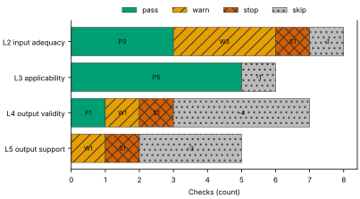
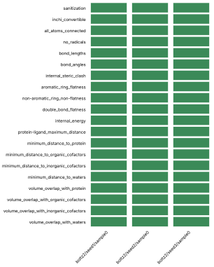
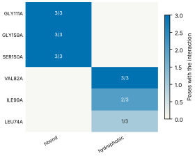
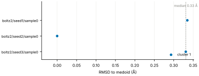
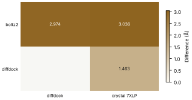
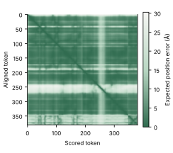

# Run report · Ligand pose in a known pocket

Prediction assurance · run `ligand_pose-9cc2b01de62f` · 2026-10-17 17:10:12 UTC

**Refused** for the claim "Predicted pose of FZC in MEK1 is valid".

Refused over layers 2,3,4,5: 16 pass, 7 warn, 2 stop, 1 skip. Stopped by l2.context.cofactors, l5.controls.redocking. Warnings from l2.receptor.protonation, l2.ligand.protonation, l2.docking.box, l4.interactions.unsatisfied_polars, l4.interactions.known_binders, l5.sampling.seeds, l5.agreement.cross_family.

Stops: `l2.context.cofactors`, `l5.controls.redocking`.

Warnings: `l2.receptor.protonation`, `l2.ligand.protonation`, `l2.docking.box`, `l4.interactions.unsatisfied_polars`, `l4.interactions.known_binders`, `l5.sampling.seeds`, `l5.agreement.cross_family`.

| Field | Value |
| --- | --- |
| Task | Ligand pose in a known pocket (`ligand_pose`) |
| Tools | Boltz-2 2.2.1 (co-folding), DiffDock-L (docking) |
| Target | `protein` |
| Ligand | `Cc1ccnc(n1)Oc2ccc(c(c2)Cl)c3cc4c(c(n[nH]4)C)c(c3)O[C@H]5CCC[C@H](C5)N` |
| Reference | `7XLP` |
| pH | 7.4 |
| Seeds | 3 |
| Layers run | 2, 3, 4, 5 |
| Run | `ligand_pose-9cc2b01de62f` |
| Created | 2026-10-17 17:10:12 UTC |
| Finished | 2026-10-17 17:12:16 UTC |
| pah version | 0.1.0 |
| Report schema | 1 |

## Layers

| Layer | Status | Result | pass | warn | stop | skip | Time |
| --- | --- | --- | --- | --- | --- | --- | --- |
| L0 Provenance | not run | n/a | n/a | n/a | n/a | n/a | n/a |
| L1 Input integrity | not run | n/a | n/a | n/a | n/a | n/a | n/a |
| L2 Input adequacy | done | stop | 3 | 3 | 1 | 1 | 2.4 s |
| L3 Applicability | done | pass | 6 | 0 | 0 | 0 | 3.4 s |
| L4 Output validity | done | warn | 5 | 2 | 0 | 0 | 118.5 s |
| L5 Output support | done | stop | 2 | 2 | 1 | 0 | 384 ms |

## Figures

Fig. 1 · Check outcomes per layer for run ligand_pose-9cc2b01de62f. Totals: pass 16, warn 7, stop 2, skip 1.
Files: data [figures/gates_by_layer.csv](figures/gates_by_layer.csv).

## Structures

78 PyMOL renders.

7XLP mmCIF (source_structure), whole structure. Chains A; organic components DMS, FZC. sha256 48ffbc34e5fd126d. PyMOL session: [renders/7XLP.pse](renders/7XLP.pse).

7XLP mmCIF (source_structure), ligand environment within 5 Å. Chains A; organic components DMS, FZC. sha256 48ffbc34e5fd126d. PyMOL session: [renders/7XLP.pse](renders/7XLP.pse).

boltz2/seed1/sample0 (prediction_structure), whole structure. Chains A, L; organic components LIG1. sha256 d3109735f7473f24. PyMOL session: [renders/boltz2_seed1_sample0.pse](renders/boltz2_seed1_sample0.pse).

boltz2/seed1/sample0 (prediction_structure), ligand environment within 5 Å. Chains A, L; organic components LIG1. sha256 d3109735f7473f24. PyMOL session: [renders/boltz2_seed1_sample0.pse](renders/boltz2_seed1_sample0.pse).

boltz2/seed2/sample0 (prediction_structure), whole structure. Chains A, L; organic components LIG1. sha256 320651246ca63deb. PyMOL session: [renders/boltz2_seed2_sample0.pse](renders/boltz2_seed2_sample0.pse).

boltz2/seed2/sample0 (prediction_structure), ligand environment within 5 Å. Chains A, L; organic components LIG1. sha256 320651246ca63deb. PyMOL session: [renders/boltz2_seed2_sample0.pse](renders/boltz2_seed2_sample0.pse).

boltz2/seed3/sample0 (prediction_structure), whole structure. Chains A, L; organic components LIG1. sha256 3dd5cb3f0f1e650b. PyMOL session: [renders/boltz2_seed3_sample0.pse](renders/boltz2_seed3_sample0.pse).

boltz2/seed3/sample0 (prediction_structure), ligand environment within 5 Å. Chains A, L; organic components LIG1. sha256 3dd5cb3f0f1e650b. PyMOL session: [renders/boltz2_seed3_sample0.pse](renders/boltz2_seed3_sample0.pse).

diffdock/seed1/mode0 (prediction_structure), whole structure. Chains A, L; organic components LIG. sha256 78ae8b3ed08f64a2. PyMOL session: [renders/diffdock_seed1_mode0.pse](renders/diffdock_seed1_mode0.pse).

diffdock/seed1/mode0 (prediction_structure), ligand environment within 5 Å. Chains A, L; organic components LIG. sha256 78ae8b3ed08f64a2. PyMOL session: [renders/diffdock_seed1_mode0.pse](renders/diffdock_seed1_mode0.pse).

diffdock/seed1/mode1 (prediction_structure), whole structure. Chains A, L; organic components LIG. sha256 3121e202f5ca9c7d. PyMOL session: [renders/diffdock_seed1_mode1.pse](renders/diffdock_seed1_mode1.pse).

diffdock/seed1/mode1 (prediction_structure), ligand environment within 5 Å. Chains A, L; organic components LIG. sha256 3121e202f5ca9c7d. PyMOL session: [renders/diffdock_seed1_mode1.pse](renders/diffdock_seed1_mode1.pse).

diffdock/seed1/mode2 (prediction_structure), whole structure. Chains A, L; organic components LIG. sha256 25b62ddb535f11d6. PyMOL session: [renders/diffdock_seed1_mode2.pse](renders/diffdock_seed1_mode2.pse).

diffdock/seed1/mode2 (prediction_structure), ligand environment within 5 Å. Chains A, L; organic components LIG. sha256 25b62ddb535f11d6. PyMOL session: [renders/diffdock_seed1_mode2.pse](renders/diffdock_seed1_mode2.pse).

diffdock/seed1/mode3 (prediction_structure), whole structure. Chains A, L; organic components LIG. sha256 fefcbc8cf1869cf2. PyMOL session: [renders/diffdock_seed1_mode3.pse](renders/diffdock_seed1_mode3.pse).

diffdock/seed1/mode3 (prediction_structure), ligand environment within 5 Å. Chains A, L; organic components LIG. sha256 fefcbc8cf1869cf2. PyMOL session: [renders/diffdock_seed1_mode3.pse](renders/diffdock_seed1_mode3.pse).

diffdock/seed1/mode4 (prediction_structure), whole structure. Chains A, L; organic components LIG. sha256 1e70558760f7cb82. PyMOL session: [renders/diffdock_seed1_mode4.pse](renders/diffdock_seed1_mode4.pse).

diffdock/seed1/mode4 (prediction_structure), ligand environment within 5 Å. Chains A, L; organic components LIG. sha256 1e70558760f7cb82. PyMOL session: [renders/diffdock_seed1_mode4.pse](renders/diffdock_seed1_mode4.pse).

diffdock/seed1/mode5 (prediction_structure), whole structure. Chains A, L; organic components LIG. sha256 8985a0a202b66ebe. PyMOL session: [renders/diffdock_seed1_mode5.pse](renders/diffdock_seed1_mode5.pse).

diffdock/seed1/mode5 (prediction_structure), ligand environment within 5 Å. Chains A, L; organic components LIG. sha256 8985a0a202b66ebe. PyMOL session: [renders/diffdock_seed1_mode5.pse](renders/diffdock_seed1_mode5.pse).

diffdock/seed1/mode6 (prediction_structure), whole structure. Chains A, L; organic components LIG. sha256 b312102dca3a2477. PyMOL session: [renders/diffdock_seed1_mode6.pse](renders/diffdock_seed1_mode6.pse).

diffdock/seed1/mode6 (prediction_structure), ligand environment within 5 Å. Chains A, L; organic components LIG. sha256 b312102dca3a2477. PyMOL session: [renders/diffdock_seed1_mode6.pse](renders/diffdock_seed1_mode6.pse).

diffdock/seed1/mode7 (prediction_structure), whole structure. Chains A, L; organic components LIG. sha256 6b7c31295f21af8f. PyMOL session: [renders/diffdock_seed1_mode7.pse](renders/diffdock_seed1_mode7.pse).

diffdock/seed1/mode7 (prediction_structure), ligand environment within 5 Å. Chains A, L; organic components LIG. sha256 6b7c31295f21af8f. PyMOL session: [renders/diffdock_seed1_mode7.pse](renders/diffdock_seed1_mode7.pse).

diffdock/seed1/mode8 (prediction_structure), whole structure. Chains A, L; organic components LIG. sha256 d7b509f2520e2937. PyMOL session: [renders/diffdock_seed1_mode8.pse](renders/diffdock_seed1_mode8.pse).

diffdock/seed1/mode8 (prediction_structure), ligand environment within 5 Å. Chains A, L; organic components LIG. sha256 d7b509f2520e2937. PyMOL session: [renders/diffdock_seed1_mode8.pse](renders/diffdock_seed1_mode8.pse).

diffdock/seed1/mode9 (prediction_structure), whole structure. Chains A, L; organic components LIG. sha256 fa249fa473e5bcf5. PyMOL session: [renders/diffdock_seed1_mode9.pse](renders/diffdock_seed1_mode9.pse).

diffdock/seed1/mode9 (prediction_structure), ligand environment within 5 Å. Chains A, L; organic components LIG. sha256 fa249fa473e5bcf5. PyMOL session: [renders/diffdock_seed1_mode9.pse](renders/diffdock_seed1_mode9.pse).

diffdock/seed2/mode0 (prediction_structure), whole structure. Chains A, L; organic components LIG. sha256 e930537ad18a4d3a. PyMOL session: [renders/diffdock_seed2_mode0.pse](renders/diffdock_seed2_mode0.pse).

diffdock/seed2/mode0 (prediction_structure), ligand environment within 5 Å. Chains A, L; organic components LIG. sha256 e930537ad18a4d3a. PyMOL session: [renders/diffdock_seed2_mode0.pse](renders/diffdock_seed2_mode0.pse).

diffdock/seed2/mode1 (prediction_structure), whole structure. Chains A, L; organic components LIG. sha256 ae5414248a0a237c. PyMOL session: [renders/diffdock_seed2_mode1.pse](renders/diffdock_seed2_mode1.pse).

diffdock/seed2/mode1 (prediction_structure), ligand environment within 5 Å. Chains A, L; organic components LIG. sha256 ae5414248a0a237c. PyMOL session: [renders/diffdock_seed2_mode1.pse](renders/diffdock_seed2_mode1.pse).

diffdock/seed2/mode2 (prediction_structure), whole structure. Chains A, L; organic components LIG. sha256 e98c6d24cc762313. PyMOL session: [renders/diffdock_seed2_mode2.pse](renders/diffdock_seed2_mode2.pse).

diffdock/seed2/mode2 (prediction_structure), ligand environment within 5 Å. Chains A, L; organic components LIG. sha256 e98c6d24cc762313. PyMOL session: [renders/diffdock_seed2_mode2.pse](renders/diffdock_seed2_mode2.pse).

diffdock/seed2/mode3 (prediction_structure), whole structure. Chains A, L; organic components LIG. sha256 7bf30c130e331c7d. PyMOL session: [renders/diffdock_seed2_mode3.pse](renders/diffdock_seed2_mode3.pse).

diffdock/seed2/mode3 (prediction_structure), ligand environment within 5 Å. Chains A, L; organic components LIG. sha256 7bf30c130e331c7d. PyMOL session: [renders/diffdock_seed2_mode3.pse](renders/diffdock_seed2_mode3.pse).

diffdock/seed2/mode4 (prediction_structure), whole structure. Chains A, L; organic components LIG. sha256 f7476a62c200ed09. PyMOL session: [renders/diffdock_seed2_mode4.pse](renders/diffdock_seed2_mode4.pse).

diffdock/seed2/mode4 (prediction_structure), ligand environment within 5 Å. Chains A, L; organic components LIG. sha256 f7476a62c200ed09. PyMOL session: [renders/diffdock_seed2_mode4.pse](renders/diffdock_seed2_mode4.pse).

diffdock/seed2/mode5 (prediction_structure), whole structure. Chains A, L; organic components LIG. sha256 0d395223e8eb6623. PyMOL session: [renders/diffdock_seed2_mode5.pse](renders/diffdock_seed2_mode5.pse).

diffdock/seed2/mode5 (prediction_structure), ligand environment within 5 Å. Chains A, L; organic components LIG. sha256 0d395223e8eb6623. PyMOL session: [renders/diffdock_seed2_mode5.pse](renders/diffdock_seed2_mode5.pse).

diffdock/seed2/mode6 (prediction_structure), whole structure. Chains A, L; organic components LIG. sha256 dc57ae3b328617d6. PyMOL session: [renders/diffdock_seed2_mode6.pse](renders/diffdock_seed2_mode6.pse).

diffdock/seed2/mode6 (prediction_structure), ligand environment within 5 Å. Chains A, L; organic components LIG. sha256 dc57ae3b328617d6. PyMOL session: [renders/diffdock_seed2_mode6.pse](renders/diffdock_seed2_mode6.pse).

diffdock/seed2/mode7 (prediction_structure), whole structure. Chains A, L; organic components LIG. sha256 826be0ee388f20bf. PyMOL session: [renders/diffdock_seed2_mode7.pse](renders/diffdock_seed2_mode7.pse).

diffdock/seed2/mode7 (prediction_structure), ligand environment within 5 Å. Chains A, L; organic components LIG. sha256 826be0ee388f20bf. PyMOL session: [renders/diffdock_seed2_mode7.pse](renders/diffdock_seed2_mode7.pse).

diffdock/seed2/mode8 (prediction_structure), whole structure. Chains A, L; organic components LIG. sha256 165c50d55a4c7361. PyMOL session: [renders/diffdock_seed2_mode8.pse](renders/diffdock_seed2_mode8.pse).

diffdock/seed2/mode8 (prediction_structure), ligand environment within 5 Å. Chains A, L; organic components LIG. sha256 165c50d55a4c7361. PyMOL session: [renders/diffdock_seed2_mode8.pse](renders/diffdock_seed2_mode8.pse).

diffdock/seed2/mode9 (prediction_structure), whole structure. Chains A, L; organic components LIG. sha256 85e4925ecf5057a1. PyMOL session: [renders/diffdock_seed2_mode9.pse](renders/diffdock_seed2_mode9.pse).

diffdock/seed2/mode9 (prediction_structure), ligand environment within 5 Å. Chains A, L; organic components LIG. sha256 85e4925ecf5057a1. PyMOL session: [renders/diffdock_seed2_mode9.pse](renders/diffdock_seed2_mode9.pse).

diffdock/seed3/mode0 (prediction_structure), whole structure. Chains A, L; organic components LIG. sha256 da7bdcff1411ce51. PyMOL session: [renders/diffdock_seed3_mode0.pse](renders/diffdock_seed3_mode0.pse).

diffdock/seed3/mode0 (prediction_structure), ligand environment within 5 Å. Chains A, L; organic components LIG. sha256 da7bdcff1411ce51. PyMOL session: [renders/diffdock_seed3_mode0.pse](renders/diffdock_seed3_mode0.pse).

diffdock/seed3/mode1 (prediction_structure), whole structure. Chains A, L; organic components LIG. sha256 6ccc9520567b38be. PyMOL session: [renders/diffdock_seed3_mode1.pse](renders/diffdock_seed3_mode1.pse).

diffdock/seed3/mode1 (prediction_structure), ligand environment within 5 Å. Chains A, L; organic components LIG. sha256 6ccc9520567b38be. PyMOL session: [renders/diffdock_seed3_mode1.pse](renders/diffdock_seed3_mode1.pse).

diffdock/seed3/mode2 (prediction_structure), whole structure. Chains A, L; organic components LIG. sha256 f1058ec975a0bd56. PyMOL session: [renders/diffdock_seed3_mode2.pse](renders/diffdock_seed3_mode2.pse).

diffdock/seed3/mode2 (prediction_structure), ligand environment within 5 Å. Chains A, L; organic components LIG. sha256 f1058ec975a0bd56. PyMOL session: [renders/diffdock_seed3_mode2.pse](renders/diffdock_seed3_mode2.pse).

diffdock/seed3/mode3 (prediction_structure), whole structure. Chains A, L; organic components LIG. sha256 6962856f161a8c07. PyMOL session: [renders/diffdock_seed3_mode3.pse](renders/diffdock_seed3_mode3.pse).

diffdock/seed3/mode3 (prediction_structure), ligand environment within 5 Å. Chains A, L; organic components LIG. sha256 6962856f161a8c07. PyMOL session: [renders/diffdock_seed3_mode3.pse](renders/diffdock_seed3_mode3.pse).

diffdock/seed3/mode4 (prediction_structure), whole structure. Chains A, L; organic components LIG. sha256 b39010b569d06e69. PyMOL session: [renders/diffdock_seed3_mode4.pse](renders/diffdock_seed3_mode4.pse).

diffdock/seed3/mode4 (prediction_structure), ligand environment within 5 Å. Chains A, L; organic components LIG. sha256 b39010b569d06e69. PyMOL session: [renders/diffdock_seed3_mode4.pse](renders/diffdock_seed3_mode4.pse).

diffdock/seed3/mode5 (prediction_structure), whole structure. Chains A, L; organic components LIG. sha256 c85f07d6aebe8c9d. PyMOL session: [renders/diffdock_seed3_mode5.pse](renders/diffdock_seed3_mode5.pse).

diffdock/seed3/mode5 (prediction_structure), ligand environment within 5 Å. Chains A, L; organic components LIG. sha256 c85f07d6aebe8c9d. PyMOL session: [renders/diffdock_seed3_mode5.pse](renders/diffdock_seed3_mode5.pse).

diffdock/seed3/mode6 (prediction_structure), whole structure. Chains A, L; organic components LIG. sha256 104722a469939ca8. PyMOL session: [renders/diffdock_seed3_mode6.pse](renders/diffdock_seed3_mode6.pse).

diffdock/seed3/mode6 (prediction_structure), ligand environment within 5 Å. Chains A, L; organic components LIG. sha256 104722a469939ca8. PyMOL session: [renders/diffdock_seed3_mode6.pse](renders/diffdock_seed3_mode6.pse).

diffdock/seed3/mode7 (prediction_structure), whole structure. Chains A, L; organic components LIG. sha256 8e33fd3f017cdc52. PyMOL session: [renders/diffdock_seed3_mode7.pse](renders/diffdock_seed3_mode7.pse).

diffdock/seed3/mode7 (prediction_structure), ligand environment within 5 Å. Chains A, L; organic components LIG. sha256 8e33fd3f017cdc52. PyMOL session: [renders/diffdock_seed3_mode7.pse](renders/diffdock_seed3_mode7.pse).

diffdock/seed3/mode8 (prediction_structure), whole structure. Chains A, L; organic components LIG. sha256 a59e361b1df755e8. PyMOL session: [renders/diffdock_seed3_mode8.pse](renders/diffdock_seed3_mode8.pse).

diffdock/seed3/mode8 (prediction_structure), ligand environment within 5 Å. Chains A, L; organic components LIG. sha256 a59e361b1df755e8. PyMOL session: [renders/diffdock_seed3_mode8.pse](renders/diffdock_seed3_mode8.pse).

diffdock/seed3/mode9 (prediction_structure), whole structure. Chains A, L; organic components LIG. sha256 14259246a04c1064. PyMOL session: [renders/diffdock_seed3_mode9.pse](renders/diffdock_seed3_mode9.pse).

diffdock/seed3/mode9 (prediction_structure), ligand environment within 5 Å. Chains A, L; organic components LIG. sha256 14259246a04c1064. PyMOL session: [renders/diffdock_seed3_mode9.pse](renders/diffdock_seed3_mode9.pse).

3ZLS mmCIF (source_structure), whole structure. Chains A; organic components 92P. sha256 ae30cf1ed7b4035f. PyMOL session: [renders/3ZLS.pse](renders/3ZLS.pse).

3ZLS mmCIF (source_structure), ligand environment within 5 Å. Chains A; organic components 92P. sha256 ae30cf1ed7b4035f. PyMOL session: [renders/3ZLS.pse](renders/3ZLS.pse).

3ZLX mmCIF (source_structure), whole structure. Chains A; organic components 5EZ. sha256 1334dfc31103f3e6. PyMOL session: [renders/3ZLX.pse](renders/3ZLX.pse).

3ZLX mmCIF (source_structure), ligand environment within 5 Å. Chains A; organic components 5EZ. sha256 1334dfc31103f3e6. PyMOL session: [renders/3ZLX.pse](renders/3ZLX.pse).

3ZM4 mmCIF (source_structure), whole structure. Chains A; organic components 22T. sha256 eccb79a35cb7a9f2. PyMOL session: [renders/3ZM4.pse](renders/3ZM4.pse).

3ZM4 mmCIF (source_structure), ligand environment within 5 Å. Chains A; organic components 22T. sha256 eccb79a35cb7a9f2. PyMOL session: [renders/3ZM4.pse](renders/3ZM4.pse).

5BX0 mmCIF (source_structure), whole structure. Chains A; organic components 4W5. sha256 7ef25dd3b72e153e. PyMOL session: [renders/5BX0.pse](renders/5BX0.pse).

5BX0 mmCIF (source_structure), ligand environment within 5 Å. Chains A; organic components 4W5. sha256 7ef25dd3b72e153e. PyMOL session: [renders/5BX0.pse](renders/5BX0.pse).

3ZLY mmCIF (source_structure), whole structure. Chains A; organic components YSO. sha256 e858c796adc5339d. PyMOL session: [renders/3ZLY.pse](renders/3ZLY.pse).

3ZLY mmCIF (source_structure), ligand environment within 5 Å. Chains A; organic components YSO. sha256 e858c796adc5339d. PyMOL session: [renders/3ZLY.pse](renders/3ZLY.pse).

## L0 Provenance

Where did every input come from?

Status: not run.

## L1 Input integrity

Did the run receive exactly what was declared?

Status: not run.

## L2 Input adequacy

Does the input carry enough information?

Status: done. Checks: pass 3 · warn 3 · stop 1 · skip 1. Time: 2.4 s.

#### Key figures

| Figure | Value |
| --- | --- |
| near site | 1 |
| missing | 1 |
| uniprot cofactors | 0 |
| pocket residues | 37 |
| incomplete | 0 |
| sequence gaps | 0 |
| state | holo |
| site ligands | 1 |

#### Docking

| Field | Value |
| --- | --- |
| center | -3.608, 64.879, 34.516 Å |
| size | 19.183 × 21.381 × 13.89 Å |
| origin | derived from FZC (+4 Å) |

#### Checks

| Check | Result | Measured cmp threshold | Evidence | Id · time |
| --- | --- | --- | --- | --- |
| Alignment depth, distinct sequences, Neff and gap fraction | skip | n/a | no MSA declared for a co-folding model · not applicable | `l2.msa.depth` |
| Required cofactors, ions and partners present | stop | `pocket_distance <= 8` | components within 8.0 Å of FZC in 7XLP not supplied: CA · near_site=1, missing=1, uniprot_cofactors=0 | `l2.context.cofactors` · 231 ms |
| Pocket residues resolved, no missing loops lining the pocket | pass | `pocket_distance <= 6` | 37 pocket residues complete in 7XLP.cif · pocket_residues=37, incomplete=0, sequence_gaps=0 | `l2.pocket.resolved` · 16 ms |
| Receptor state apo or holo | pass | n/a | 7XLP.cif holo: FZC in the site · state=holo, site_ligands=1 | `l2.receptor.state` · 14 ms |
| Receptor protonation at the stated pH | warn | `pka_margin > 1` | receptor has no hydrogens (protonation not assigned) · hydrogens_present=False, ph=7.4, pocket_titratable=12 | `l2.receptor.protonation` · 463 ms |
| Ligand protonation and tautomers enumerated at the stated pH | warn | `ph 7.4 == 1` | ligand: 16 states · ph=7.4, max_states=16, declared_not_enumerated=0 | `l2.ligand.protonation` · 131 ms |
| Ligand conformers generated and minimised | pass | `conformers >= 10` | 10 ETKDG conformers per ligand, MMFF minimised · ligands=1, failed=0, min_embedded=10 | `l2.ligand.conformers` · 1.5 s |
| Docking box encloses the pocket with margin | warn | `margin >= 2` | no box declared; derived box encloses 19 contact residues and the FZC ligand with 2.0 Å margin · volume_A3=5697, ligand_atoms_inside_margin=33, ligand_atoms=33 | `l2.docking.box` · 15 ms |

## L3 Applicability

Is the tool inside its validated regime?

Status: done. Checks: pass 6 · warn 0 · stop 0 · skip 0. Time: 3.4 s.

#### Key figures

| Figure | Value |
| --- | --- |
| executors | 2 |
| unknown | 0 |
| reference released | 2023-03-01 |
| cutoff | 2019-01-01 |
| entries compared | 5 |
| max similarity | 18.2 |
| pocket residues | 40 |
| systems | 0 |

#### Checks

| Check | Result | Measured cmp threshold | Evidence | Id · time |
| --- | --- | --- | --- | --- |
| Model training cutoff recorded | pass | `training_cutoff == recorded` | boltz2 2023-06-01; diffdock 2019-01-01; reference 7XLP released 2023-03-01, before the cutoff of boltz2 · executors=2, unknown=0, reference_released=2023-03-01 | `l3.model.training_cutoff` · 0 ms |
| Pocket similarity to pre-cutoff complexes (SuCOS times pocket coverage) | pass | `similarity <= 50` | max similarity 18.2 to 3ZLY (YSO, SuCOS 0.606, coverage 0.3), released before 2019-01-01 · cutoff=2019-01-01, entries_compared=5, max_similarity=18.2 | `l3.exposure.pocket` · 3.4 s |
| Ligand analogues in pre-cutoff training systems | pass | `tanimoto > 0.9` | 0 PDB entries released before 2019-01-01 (diffdock cutoff) contain analogues of ligand above Tanimoto 0.9: FZC · cutoff=2019-01-01, systems=0, analogue_components=1 | `l3.exposure.ligand_prevalence` · 0 ms |
| Chain sequence identity to pre-cutoff entries (secondary measure) | pass | `identity < 0.4` | protein: 35 entries at 95 percent identity, 44 at 40 percent, released before 2019-01-01 (reported, not gating) · cutoff=2019-01-01, entries_95=35, entries_40=44 | `l3.exposure.sequence` · 1 ms |
| Modality inside the validated set; token count against the training crop | pass | n/a | modalities protein, protein_ligand inside the validated set; 381 tokens · modalities=2, tokens=381, outside=0 | `l3.regime.modality` · 11 ms |
| Endpoint fits the tool | pass | `endpoint pose in pose` | endpoint pose produced by boltz2, diffdock · endpoint=pose, executors=2, not_fitting=0 | `l3.metric.endpoint` · 0 ms |

## L4 Output validity

Is the result physically and chemically sensible?

Status: done. Checks: pass 5 · warn 2 · stop 0 · skip 0. Time: 118.5 s.

#### Key figures

| Figure | Value |
| --- | --- |
| poses | 3 |
| passed | 20 |
| total | 20 |
| poses all pass | 3 |
| unlikely torsions | 0 |
| torsions | 7 |
| strain kcal | 2.15 |
| poses with unlikely | 0 |

#### PoseBusters · 20/20 tests pass

| test | result | value |
| --- | --- | --- |
| sanitization | pass | pass |
| inchi_convertible | pass | pass |
| all_atoms_connected | pass | pass |
| no_radicals | pass | pass |
| bond_lengths | pass | 0 long outliers |
| bond_angles | pass | 0 outliers |
| internal_steric_clash | pass | 0 |
| aromatic_ring_flatness | pass | 0.01 Å |
| non-aromatic_ring_non-flatness | pass | pass |
| double_bond_flatness | pass | pass |
| internal_energy | pass | 1.2 times the ensemble mean |
| protein-ligand_maximum_distance | pass | 2.68 Å |
| minimum_distance_to_protein | pass | 2.68 Å |
| minimum_distance_to_organic_cofactors | pass | pass |
| minimum_distance_to_inorganic_cofactors | pass | pass |
| minimum_distance_to_waters | pass | pass |
| volume_overlap_with_protein | pass | 0.011 |
| volume_overlap_with_organic_cofactors | pass | pass |
| volume_overlap_with_inorganic_cofactors | pass | pass |
| volume_overlap_with_waters | pass | pass |

#### Per-pose physical checks

| pose | seed | drift Å | converged | unlikely torsions | unsat. polars | buried charged | PoseBusters |
| --- | --- | --- | --- | --- | --- | --- | --- |
| boltz2/seed1/sample0 | 1 | 0.49 | true | 0/7 | 2 | 0 | 20/20 |
| boltz2/seed2/sample0 | 2 | 0.56 | true | 0/7 | 1 | 0 | 20/20 |
| boltz2/seed3/sample0 | 3 | 0.52 | true | 0/7 | 2 | 0 | 20/20 |
| median | n/a | 0.52 | n/a | 0 | 2 | 0 | 20/20 |

#### Interaction fingerprint · representative pose boltz2/seed2/sample0

| residue | type | distance | poses |
| --- | --- | --- | --- |
| GLY111A | hbond | 2.99 Å | 3/3 |
| GLY159A | hbond | 3.63 Å | 3/3 |
| SER150A | hbond | 3.18 Å | 3/3 |
| VAL82A | hydrophobic | 3.45 Å | 3/3 |
| ILE99A | hydrophobic | 3.23 Å | 2/3 |
| LEU74A | hydrophobic | 3.86 Å | 1/3 |

Fig. 2 · PoseBusters tests (20) by pose (3). Failed cells marked x: 0 of 60.
Files: data [figures/posebusters_grid.csv](figures/posebusters_grid.csv).

Fig. 3 · Interactions by residue (6) and type (2); cell label: poses with the interaction over poses assessed.
Files: data [figures/interactions.csv](figures/interactions.csv).

#### Checks

| Check | Result | Measured cmp threshold | Evidence | Id · time |
| --- | --- | --- | --- | --- |
| PoseBusters geometry, stereochemistry, clashes and protein contact | pass | `tests_failed == 0` | 20 of 20 tests pass for boltz2/seed2/sample0; 3 of 3 poses pass all · poses=3, passed=20, total=20 | `l4.posebusters` · 5.7 s |
| Torsional strain of the ligand pose | pass | `torsion_energy <= 2.5` | 0 of 7 torsions above 2.5 kcal/mol in boltz2/seed2/sample0; strain 2.15 kcal/mol · poses=3, unlikely_torsions=0, torsions=7 | `l4.torsion_strain` · 7.1 s |
| Interaction fingerprint (PLIP) | pass | n/a | 7 interactions in boltz2/seed2/sample0 (hbond, hydrophobic); 6 distinct across 3 poses (reported) · poses=3, interactions_representative=7, distinct=6 | `l4.interactions.fingerprint` · 1.1 s |
| Buried ligand polar atoms without a hydrogen-bond partner | warn | `relative_sasa < 0.1` | 1 of 4 buried polar ligand atoms without a partner in boltz2/seed2/sample0 · poses=3, unsatisfied=1, buried_charged=0 | `l4.interactions.unsatisfied_polars` · 303 ms |
| Hydrophobic complementarity of buried ligand surface | pass | `fraction >= 0.35` | nonpolar fraction of protein contacts around 16 buried nonpolar ligand atoms in boltz2/seed2/sample0: 0.653 · poses=3, complementarity=0.653, buried_nonpolar=16 | `l4.interactions.hydrophobic` · 377 ms |
| Interactions of the crystal ligand reproduced by the pose | warn | `reproduced 0 >= 1` | boltz2/seed2/sample0 reproduces none of 3 FZC interactions · key_interactions=3, reproduced=0, poses_reproducing_all=0 | `l4.interactions.known_binders` · 322 ms |
| Pose stability under short restrained minimisation (OpenMM, AMBER14 and OpenFF) | pass | `drift_A 0.56 <= 2` | boltz2/seed2/sample0 moves 0.562 Å under restrained minimisation; 0 of 3 poses above 2.0 Å · poses=3, drift_A=0.562, max_drift_A=0.562 | `l4.minimisation_drift` · 103.5 s |

## L5 Output support

Is a valid result corroborated?

Status: done. Checks: pass 2 · warn 2 · stop 1 · skip 0. Time: 384 ms.

#### Key figures

| Figure | Value |
| --- | --- |
| poses | 3 |
| pocket plddt | 90.5 |
| global plddt | 91.5 |
| iptm | 0.97 |
| ptm | 0.908 |
| confidence score | 0.92 |
| independent seeds | 3 |
| samples | 3 |

#### Sampling

| Field | Value |
| --- | --- |
| site placement | 3 of 3 poses within 4.0 Å of the site (FZC in 7XLP) |
| pose accuracy | 3 of 3 poses within 2.0 Å of the medoid |
| pairwise RMSD median | 0.34 Å |
| pairwise RMSD IQR | 0.33 to 0.35 Å |
| pairs | 3 |
| medoid | boltz2/seed2/sample0 |

#### Clusters

| Field | Value |
| --- | --- |
| cluster 1 | 3/3 poses (boltz2/seed2/sample0) |

#### Per-seed statistics

| seed | pose | cluster | RMSD to medoid | confidence |
| --- | --- | --- | --- | --- |
| 1 | boltz2/seed1/sample0 | 1 | 0.34 Å | 0.92 |
| 2 | boltz2/seed2/sample0 | 1 | 0 Å | 0.92 |
| 3 | boltz2/seed3/sample0 | 1 | 0.33 Å | 0.92 |
| median | n/a | n/a | 0.33 Å | 0.92 |

#### Ensemble

| structure | kind | source | RMSD to medoid | cluster | pocket pLDDT | ipTM |
| --- | --- | --- | --- | --- | --- | --- |
| boltz2/seed1/sample0 | seed | boltz2 | 0.34 Å | 1 | 92 | 0.97 |
| boltz2/seed2/sample0 | medoid | boltz2 | 0 Å | 1 | 90.5 | 0.97 |
| boltz2/seed3/sample0 | seed | boltz2 | 0.33 Å | 1 | 91.3 | 0.97 |

#### Agreement between methods

| method | diffdock | crystal 7XLP |
| --- | --- | --- |
| boltz2 | 2.97 Å (high) | 3.04 Å (decisive) |
| diffdock | n/a | 1.46 Å (decisive) |

#### Confidence metrics

| metric | value | read as | tool |
| --- | --- | --- | --- |
| affinity_pred_value | -0.32983407378196716 | ranking within a series, never pose quality | boltz2 |
| affinity_probability_binary | 0.1059332862496376 | ranking within a series, never pose quality | boltz2 |
| affinity_pred_value | -0.4878682494163513 | ranking within a series, never pose quality | boltz2 |
| affinity_probability_binary | 0.11251826584339142 | ranking within a series, never pose quality | boltz2 |
| affinity_pred_value | -0.30899977684020996 | ranking within a series, never pose quality | boltz2 |
| affinity_probability_binary | 0.10313746333122253 | ranking within a series, never pose quality | boltz2 |

Fig. 4 · RMSD to the medoid for 3 poses, coloured by cluster (1 clusters). Dashed line: median 0.33 Å; range 0.00 to 0.34 Å.
Files: data [figures/seed_spread.csv](figures/seed_spread.csv).

Fig. 5 · Agreement between 2 methods and 2 comparators; range 1.463 to 3.036 Å.
Files: data [figures/agreement.csv](figures/agreement.csv).

Fig. 6 · Predicted aligned error for pose boltz2/seed1/sample0, 381 by 381 tokens; values 0.2 to 30.2 Å, mean 6.7 Å.
Files: data [figures/pae.csv](figures/pae.csv).

#### Checks

| Check | Result | Measured cmp threshold | Evidence | Id · time |
| --- | --- | --- | --- | --- |
| Confidence restricted to the pocket; per-model thresholds | pass | `boltz2.pocket_plddt >= 70` | boltz2/seed2/sample0: pocket_plddt 90.5 · poses=3, pocket_plddt=90.5, global_plddt=91.5 | `l5.confidence.local` · 44 ms |
| Independent seeds counted separately from samples; duplicates flagged | warn | `seeds_cofolding >= 5` | 3 independent seeds (3 poses); task default 5 · independent_seeds=3, samples=3, duplicated_outputs=0 | `l5.sampling.seeds` · 0 ms |
| Medoid of the largest cluster, populations, pairwise spread, site and pose accuracy | pass | `cluster_rmsd <= 2` | medoid boltz2/seed2/sample0; 1 clusters, largest 3 of 3; pairwise RMSD median 0.33 Å (IQR 0.33 to 0.35); 3 of 3 poses within 4.0 Å of the site (FZC in 7XLP); 3 of 3 poses within 2.0 Å of the medoid · poses=3, clusters=1, largest_cluster=3 | `l5.sampling.clusters` · 84 ms |
| Agreement between methods, weighted by independence | warn | `rmsd_to_crystal_A 3.04 <= 2` | boltz2 vs diffdock 2.974 Å (high); boltz2 vs crystal 7XLP 3.036 Å (decisive); diffdock vs crystal 7XLP 1.463 Å (decisive) · methods=2, comparisons=3, disagreeing=2 | `l5.agreement.cross_family` · 242 ms |
| Redocking control reproduces the crystal pose | stop | `rmsd <= 2` | redocking control required by the task and not supplied (controls.redocking) | `l5.controls.redocking` · 0 ms |

## Controls

| control | status | result |
| --- | --- | --- |
| redocking | incomplete | redocking control required by the task and not supplied (controls.redocking) |

## Provenance

13 objects · 7 cached · 6 network.

| Source | Accession | Release | SHA-256 | Retrieved | Bytes | Cache | Used by |
| --- | --- | --- | --- | --- | --- | --- | --- |
| rcsb_files | 7XLP | n/a | `48ffbc34e5fd` | 2026-10-17 17:04:21 UTC | 527387 | hit | l2.context.cofactors, l2.pocket.resolved, l2.receptor.state, l2.docking.box, l3.exposure.pocket, l3.regime.modality, l4.interactions.fingerprint, l4.interactions.known_binders, l5.sampling.clusters, l5.agreement.cross_family |
| ccd | FZC | 2023-02-24 | `6ce219c20fef` | 2026-10-17 17:04:21 UTC | 3599 | hit | l2.context.cofactors, l3.exposure.pocket |
| rcsb | 7XLP | 1.2 | `66dacec771f9` | 2026-10-17 17:04:23 UTC | 12056 | hit | l3.model.training_cutoff |
| rcsb_search | chem:Cc1ccnc(n1)Oc2ccc(c(c2)Cl)c3cc4c(c(n[nH]4)C)c(c3)O[C@H]5CCC[C@H](C5)N | n/a | `b46bdf444038` | 2026-10-17 17:04:25 UTC | 186 | hit | l3.exposure.pocket |
| rcsb_search | comp:FZC:2019-01-01 | n/a | `e3b0c44298fc` | 2026-10-17 17:04:24 UTC | 0 | hit | l3.exposure.pocket |
| rcsb_search | seq0.9:2019-01-01:348 | n/a | `3df32e13c7dc` | 2026-10-17 17:10:15 UTC | 2411 | miss | l3.exposure.pocket |
| rcsb_files | 3ZLS | n/a | `ae30cf1ed7b4` | 2026-10-17 17:10:16 UTC | 315218 | miss | l3.exposure.pocket |
| rcsb_files | 3ZLX | n/a | `1334dfc31103` | 2026-10-17 17:10:17 UTC | 313366 | miss | l3.exposure.pocket |
| rcsb_files | 3ZM4 | n/a | `eccb79a35cb7` | 2026-10-17 17:10:17 UTC | 321513 | miss | l3.exposure.pocket |
| rcsb_files | 5BX0 | n/a | `7ef25dd3b72e` | 2026-10-17 17:10:17 UTC | 312068 | miss | l3.exposure.pocket |
| rcsb_files | 3ZLY | n/a | `e858c796adc5` | 2026-10-17 17:10:17 UTC | 310846 | miss | l3.exposure.pocket |
| rcsb_search | seq0.95:2019-01-01:348 | n/a | `137b5572110a` | 2026-10-17 17:04:26 UTC | 402 | hit | l3.exposure.sequence |
| rcsb_search | seq0.4:2019-01-01:348 | n/a | `d6df9b9b71ba` | 2026-10-17 17:04:27 UTC | 402 | hit | l3.exposure.sequence |

Provenance graph: [json](graph.json), [mmd](graph.mmd), [svg](graph.svg).

## Thresholds

| Check | Threshold | Value | Origin | Evidence level |
| --- | --- | --- | --- | --- |
| `l2.context.cofactors` | pocket_distance | <= 8 | Harness rule: a component of the reference entry within 8 Å of the declared ligand is required context; not yet calibrated | uncalibrated |
| `l2.pocket.resolved` | pocket_distance | <= 6 | Harness rule: pocket residues have a heavy atom within 6 Å of the ligand; not yet calibrated | uncalibrated |
| `l2.pocket.resolved` | missing_pocket_residues | == 0 | Specification layer 2: stop when the pocket is incomplete | published |
| `l2.receptor.protonation` | pka_margin | > 1 | Harness rule: a titratable pocket residue with PROPKA pKa within 1 unit of the stated pH has an ambiguous state; not yet calibrated | uncalibrated |
| `l2.ligand.protonation` | ph_window | == 1 | Harness rule: states enumerated by Dimorphite-DL within 1 pH unit of the stated pH; not yet calibrated | uncalibrated |
| `l2.ligand.protonation` | states | == 1 | Specification layer 2: warn when more than one plausible state | published |
| `l2.ligand.conformers` | conformers | >= 10 | Harness default number of ETKDG conformers; not yet calibrated | uncalibrated |
| `l2.docking.box` | margin | >= 2 | Harness rule: every pocket heavy atom lies at least 2 Å inside the box; not yet calibrated | uncalibrated |
| `l2.docking.box` | contact_distance | <= 4 | Harness rule: contact residues (heavy atom within 4 Å of the reference ligand) must have an atom inside the box; not yet calibrated | uncalibrated |
| `l3.model.training_cutoff` | training_cutoff | == recorded | Specification, Layer 3 (applicability): stop when unknown | published |
| `l3.exposure.pocket` | similarity | <= 50 | Specification layer 3: warn above a pocket similarity (SuCOS times pocket coverage) of 50 | published |
| `l3.exposure.pocket` | entries | <= 5 | Harness budget: pre-cutoff holo entries compared per run | uncalibrated |
| `l3.exposure.ligand_prevalence` | tanimoto | > 0.9 | Specification layer 3: analogues above 0.9 Tanimoto (RDKit topological fingerprint) | published |
| `l3.exposure.ligand_prevalence` | systems | <= 100 | Specification layer 3: prevalent when analogues occur in more than 100 training systems | published |
| `l3.exposure.sequence` | identity | < 0.4 | Specification layer 3: conventional 40 percent identity leakage threshold, reported as a secondary measure only | published |
| `l3.metric.endpoint` | endpoint | in pose | Specification, Layer 3 (applicability): no affinity from interface confidence, no protein-protein affinity from Boltz-2 | published |
| `l4.posebusters` | tests_failed | == 0 | Specification, Layer 4 (output validity): stop on failure | published |
| `l4.torsion_strain` | torsion_energy | <= 2.5 | Harness rule: a rotatable torsion whose MMFF energy lies more than 2.5 kcal/mol above the minimum of its rigid scan is unlikely; not yet calibrated | uncalibrated |
| `l4.interactions.unsatisfied_polars` | relative_sasa | < 0.1 | Harness rule: a ligand polar atom with relative SASA below 0.1 in the complex is buried; not yet calibrated | uncalibrated |
| `l4.interactions.unsatisfied_polars` | hbond_distance | <= 3.5 | PLIP hydrogen bond distance cut-off (donor-acceptor 4.1 Å; harness uses 3.5 Å heavy-atom distance) | published |
| `l4.interactions.hydrophobic` | fraction | >= 0.35 | Harness default anchored on 3PTB: the crystal benzamidine scores 0.51, Vina and Boltz-2 poses within 0.5 Å of it score 0.45 and 0.49; not calibrated on the benchmark | uncalibrated |
| `l4.interactions.hydrophobic` | relative_sasa | < 0.1 | Harness rule: a ligand polar atom with relative SASA below 0.1 in the complex is buried; not yet calibrated | uncalibrated |
| `l4.interactions.known_binders` | reproduced | >= 1 | Specification layer 4: warn when no key interaction is reproduced | published |
| `l4.minimisation_drift` | drift | <= 2 | Specification layer 4: warn when the pose moves beyond 2 Å under restrained minimisation | published |
| `l5.confidence.local` | boltz2.pocket_plddt | >= 70 | AlphaFold DB pLDDT bands (70 and above: confident backbone), applied to pocket residues; not calibrated for ligand pose | published |
| `l5.sampling.seeds` | seeds_cofolding | >= 5 | Specification layer 5: default of five seeds per co-folding prediction | published |
| `l5.sampling.clusters` | cluster_rmsd | <= 2 | Specification layer 5: 2 Å symmetry-aware ligand RMSD (spyrmsd) separates pose clusters | published |
| `l5.sampling.clusters` | site_distance | <= 4 | Harness rule: a ligand centroid within 4 Å of the reference site centroid is placed in the site; not yet calibrated | uncalibrated |
| `l5.sampling.clusters` | largest_fraction | >= 0.5 | Harness rule: the largest cluster holds at least half of the poses; not yet calibrated | uncalibrated |
| `l5.agreement.cross_family` | rmsd | <= 2 | Specification layer 5: pose agreement by symmetry-aware ligand RMSD at 2 Å | published |
| `l5.controls.redocking` | rmsd | <= 2 | Specification layer 5: redocking must reproduce the crystal pose (2 Å ligand RMSD) | published |

Tool versions: dimorphite_dl 2.1.0, freesasa 2.2.1, gemmi 0.7.5, numpy 1.26.4, openbabel 3.2.1, openmm 8.6.1, plip 3.0.1, posebusters 0.6.5, propka 3.5.1, rdkit 2026.9.1, scipy 1.17.1, spyrmsd 0.9.0.

## Limitations

- This report covers layers 2, 3, 4, 5. Layers not run: 0, 1.
- The harness establishes when a result should not be trusted. Passing checks are not evidence that a prediction is correct.
- Thresholds marked uncalibrated come from the specification or harness defaults and have not been recalibrated on the harness benchmark.

## Files

| Path | Kind | Bytes | SHA-256 |
| --- | --- | --- | --- |
| artifacts/sources/7XLP.cif | source_structure | 527387 | `48ffbc34e5fd` |
| /home/user/harness-hackathon/bench/runs/2026-10-17T1611Z-426bfe9/predictions/mek1_pert/boltz2/seed_1/boltz_results_mek1_pert/predictions/mek1_pert/mek1_pert_model_0.cif | prediction_structure | 240701 | `d3109735f747` |
| predictions/00_boltz2/boltz2/seed1/sample0/ligand.sdf | data | 2874 | `00377eb631e8` |
| /home/user/harness-hackathon/bench/runs/2026-10-17T1611Z-426bfe9/predictions/mek1_pert/boltz2/seed_2/boltz_results_mek1_pert/predictions/mek1_pert/mek1_pert_model_0.cif | prediction_structure | 240650 | `320651246ca6` |
| predictions/00_boltz2/boltz2/seed2/sample0/ligand.sdf | data | 2874 | `f66aafe7e546` |
| /home/user/harness-hackathon/bench/runs/2026-10-17T1611Z-426bfe9/predictions/mek1_pert/boltz2/seed_3/boltz_results_mek1_pert/predictions/mek1_pert/mek1_pert_model_0.cif | prediction_structure | 240924 | `3dd5cb3f0f1e` |
| predictions/00_boltz2/boltz2/seed3/sample0/ligand.sdf | data | 2874 | `523d6f61cac5` |
| predictions/01_diffdock/diffdock/seed1/mode0/complex.pdb | prediction_structure | 190005 | `78ae8b3ed08f` |
| predictions/01_diffdock/diffdock/seed1/mode0/ligand.sdf | data | 2874 | `98e7598eea35` |
| predictions/01_diffdock/diffdock/seed1/mode1/complex.pdb | prediction_structure | 190005 | `3121e202f5ca` |
| predictions/01_diffdock/diffdock/seed1/mode1/ligand.sdf | data | 2874 | `921e2bd42802` |
| predictions/01_diffdock/diffdock/seed1/mode2/complex.pdb | prediction_structure | 190005 | `25b62ddb535f` |
| predictions/01_diffdock/diffdock/seed1/mode2/ligand.sdf | data | 2874 | `b0e9ad380a91` |
| predictions/01_diffdock/diffdock/seed1/mode3/complex.pdb | prediction_structure | 190005 | `fefcbc8cf186` |
| predictions/01_diffdock/diffdock/seed1/mode3/ligand.sdf | data | 2874 | `d45108b30cbd` |
| predictions/01_diffdock/diffdock/seed1/mode4/complex.pdb | prediction_structure | 190005 | `1e70558760f7` |
| predictions/01_diffdock/diffdock/seed1/mode4/ligand.sdf | data | 2874 | `dce3c90b3e5a` |
| predictions/01_diffdock/diffdock/seed1/mode5/complex.pdb | prediction_structure | 190005 | `8985a0a202b6` |
| predictions/01_diffdock/diffdock/seed1/mode5/ligand.sdf | data | 2874 | `657b9b80cfdf` |
| predictions/01_diffdock/diffdock/seed1/mode6/complex.pdb | prediction_structure | 190005 | `b312102dca3a` |
| predictions/01_diffdock/diffdock/seed1/mode6/ligand.sdf | data | 2874 | `0a6c2348ec9d` |
| predictions/01_diffdock/diffdock/seed1/mode7/complex.pdb | prediction_structure | 190005 | `6b7c31295f21` |
| predictions/01_diffdock/diffdock/seed1/mode7/ligand.sdf | data | 2874 | `73fa69b24f29` |
| predictions/01_diffdock/diffdock/seed1/mode8/complex.pdb | prediction_structure | 190005 | `d7b509f2520e` |
| predictions/01_diffdock/diffdock/seed1/mode8/ligand.sdf | data | 2874 | `74d176e605da` |
| predictions/01_diffdock/diffdock/seed1/mode9/complex.pdb | prediction_structure | 190005 | `fa249fa473e5` |
| predictions/01_diffdock/diffdock/seed1/mode9/ligand.sdf | data | 2874 | `2145d32ef1d3` |
| predictions/01_diffdock/diffdock/seed2/mode0/complex.pdb | prediction_structure | 190005 | `e930537ad18a` |
| predictions/01_diffdock/diffdock/seed2/mode0/ligand.sdf | data | 2874 | `f56c9efd4bc3` |
| predictions/01_diffdock/diffdock/seed2/mode1/complex.pdb | prediction_structure | 190005 | `ae5414248a0a` |
| predictions/01_diffdock/diffdock/seed2/mode1/ligand.sdf | data | 2874 | `01fbd810c242` |
| predictions/01_diffdock/diffdock/seed2/mode2/complex.pdb | prediction_structure | 190005 | `e98c6d24cc76` |
| predictions/01_diffdock/diffdock/seed2/mode2/ligand.sdf | data | 2874 | `ca5acd0ea5fa` |
| predictions/01_diffdock/diffdock/seed2/mode3/complex.pdb | prediction_structure | 190005 | `7bf30c130e33` |
| predictions/01_diffdock/diffdock/seed2/mode3/ligand.sdf | data | 2874 | `28a53cb1e422` |
| predictions/01_diffdock/diffdock/seed2/mode4/complex.pdb | prediction_structure | 190005 | `f7476a62c200` |
| predictions/01_diffdock/diffdock/seed2/mode4/ligand.sdf | data | 2874 | `22417da15ce0` |
| predictions/01_diffdock/diffdock/seed2/mode5/complex.pdb | prediction_structure | 190005 | `0d395223e8eb` |
| predictions/01_diffdock/diffdock/seed2/mode5/ligand.sdf | data | 2874 | `be9c208d8c43` |
| predictions/01_diffdock/diffdock/seed2/mode6/complex.pdb | prediction_structure | 190005 | `dc57ae3b3286` |
| predictions/01_diffdock/diffdock/seed2/mode6/ligand.sdf | data | 2874 | `4df131e79432` |
| predictions/01_diffdock/diffdock/seed2/mode7/complex.pdb | prediction_structure | 190005 | `826be0ee388f` |
| predictions/01_diffdock/diffdock/seed2/mode7/ligand.sdf | data | 2874 | `cf72dd0d4cbc` |
| predictions/01_diffdock/diffdock/seed2/mode8/complex.pdb | prediction_structure | 190005 | `165c50d55a4c` |
| predictions/01_diffdock/diffdock/seed2/mode8/ligand.sdf | data | 2874 | `46aa731fbe43` |
| predictions/01_diffdock/diffdock/seed2/mode9/complex.pdb | prediction_structure | 190005 | `85e4925ecf50` |
| predictions/01_diffdock/diffdock/seed2/mode9/ligand.sdf | data | 2874 | `98335d8f86f1` |
| predictions/01_diffdock/diffdock/seed3/mode0/complex.pdb | prediction_structure | 190005 | `da7bdcff1411` |
| predictions/01_diffdock/diffdock/seed3/mode0/ligand.sdf | data | 2874 | `1d41f36a8cd0` |
| predictions/01_diffdock/diffdock/seed3/mode1/complex.pdb | prediction_structure | 190005 | `6ccc9520567b` |
| predictions/01_diffdock/diffdock/seed3/mode1/ligand.sdf | data | 2874 | `56871427d412` |
| predictions/01_diffdock/diffdock/seed3/mode2/complex.pdb | prediction_structure | 190005 | `f1058ec975a0` |
| predictions/01_diffdock/diffdock/seed3/mode2/ligand.sdf | data | 2874 | `0402990aa141` |
| predictions/01_diffdock/diffdock/seed3/mode3/complex.pdb | prediction_structure | 190005 | `6962856f161a` |
| predictions/01_diffdock/diffdock/seed3/mode3/ligand.sdf | data | 2874 | `cfea316f587b` |
| predictions/01_diffdock/diffdock/seed3/mode4/complex.pdb | prediction_structure | 190005 | `b39010b569d0` |
| predictions/01_diffdock/diffdock/seed3/mode4/ligand.sdf | data | 2874 | `dc640161a717` |
| predictions/01_diffdock/diffdock/seed3/mode5/complex.pdb | prediction_structure | 190005 | `c85f07d6aebe` |
| predictions/01_diffdock/diffdock/seed3/mode5/ligand.sdf | data | 2874 | `031138aab67f` |
| predictions/01_diffdock/diffdock/seed3/mode6/complex.pdb | prediction_structure | 190005 | `104722a46993` |
| predictions/01_diffdock/diffdock/seed3/mode6/ligand.sdf | data | 2874 | `d2cd23b94719` |
| predictions/01_diffdock/diffdock/seed3/mode7/complex.pdb | prediction_structure | 190005 | `8e33fd3f017c` |
| predictions/01_diffdock/diffdock/seed3/mode7/ligand.sdf | data | 2874 | `89452ea956bb` |
| predictions/01_diffdock/diffdock/seed3/mode8/complex.pdb | prediction_structure | 190005 | `a59e361b1df7` |
| predictions/01_diffdock/diffdock/seed3/mode8/ligand.sdf | data | 2874 | `3766ca7f7f82` |
| predictions/01_diffdock/diffdock/seed3/mode9/complex.pdb | prediction_structure | 190005 | `14259246a04c` |
| predictions/01_diffdock/diffdock/seed3/mode9/ligand.sdf | data | 2874 | `537296ad6dc7` |
| artifacts/sources/3ZLS.cif | source_structure | 315218 | `ae30cf1ed7b4` |
| artifacts/sources/3ZLX.cif | source_structure | 313366 | `1334dfc31103` |
| artifacts/sources/3ZM4.cif | source_structure | 321513 | `eccb79a35cb7` |
| artifacts/sources/5BX0.cif | source_structure | 312068 | `7ef25dd3b72e` |
| artifacts/sources/3ZLY.cif | source_structure | 310846 | `e858c796adc5` |
| renders/7XLP_overview.png | render | 242097 | `42c1ad451238` |
| renders/7XLP_pocket.png | render | 242052 | `793b8c8a67e7` |
| renders/7XLP.pse | session | 804538 | `aa39cf0ddb90` |
| renders/boltz2_seed1_sample0_overview.png | render | 242216 | `712a43960cc5` |
| renders/boltz2_seed1_sample0_pocket.png | render | 404431 | `f4e122d53b00` |
| renders/boltz2_seed1_sample0.pse | session | 899798 | `69254539fdac` |
| renders/boltz2_seed2_sample0_overview.png | render | 245083 | `d3f28a5f0bfc` |
| renders/boltz2_seed2_sample0_pocket.png | render | 436724 | `6a389b61bfcc` |
| renders/boltz2_seed2_sample0.pse | session | 899877 | `c98869ccb3c7` |
| renders/boltz2_seed3_sample0_overview.png | render | 257536 | `2760b51bffdd` |
| renders/boltz2_seed3_sample0_pocket.png | render | 349691 | `c6ddb51f004c` |
| renders/boltz2_seed3_sample0.pse | session | 899829 | `2652c6be3071` |
| renders/diffdock_seed1_mode0_overview.png | render | 230660 | `c72c174ffd6c` |
| renders/diffdock_seed1_mode0_pocket.png | render | 349309 | `76acfbd0c9e7` |
| renders/diffdock_seed1_mode0.pse | session | 666483 | `09679345d0bd` |
| renders/diffdock_seed1_mode1_overview.png | render | 231675 | `5c2fe42a119c` |
| renders/diffdock_seed1_mode1_pocket.png | render | 368109 | `28b9ce958558` |
| renders/diffdock_seed1_mode1.pse | session | 666473 | `31ebad6e581d` |
| renders/diffdock_seed1_mode2_overview.png | render | 229435 | `c2144b863625` |
| renders/diffdock_seed1_mode2_pocket.png | render | 350894 | `c81bf60c9f10` |
| renders/diffdock_seed1_mode2.pse | session | 666544 | `73053a15cc1b` |
| renders/diffdock_seed1_mode3_overview.png | render | 231118 | `c325e9a9363e` |
| renders/diffdock_seed1_mode3_pocket.png | render | 355056 | `1185e7233c77` |
| renders/diffdock_seed1_mode3.pse | session | 666478 | `c97b4dc9df8d` |
| renders/diffdock_seed1_mode4_overview.png | render | 230712 | `61becc254774` |
| renders/diffdock_seed1_mode4_pocket.png | render | 355194 | `5b1f528f494f` |
| renders/diffdock_seed1_mode4.pse | session | 666505 | `3f89753943d8` |
| renders/diffdock_seed1_mode5_overview.png | render | 229227 | `591e32f559bd` |
| renders/diffdock_seed1_mode5_pocket.png | render | 366143 | `996829ced36e` |
| renders/diffdock_seed1_mode5.pse | session | 666607 | `319491c68d1e` |
| renders/diffdock_seed1_mode6_overview.png | render | 229487 | `45b5154ef647` |
| renders/diffdock_seed1_mode6_pocket.png | render | 364509 | `c73e40f1f272` |
| renders/diffdock_seed1_mode6.pse | session | 666513 | `8680e18ef70e` |
| renders/diffdock_seed1_mode7_overview.png | render | 231140 | `755d03b3af3f` |
| renders/diffdock_seed1_mode7_pocket.png | render | 308137 | `8e4da08d2eb8` |
| renders/diffdock_seed1_mode7.pse | session | 666516 | `39964cba0dde` |
| renders/diffdock_seed1_mode8_overview.png | render | 229529 | `d809d41ddaae` |
| renders/diffdock_seed1_mode8_pocket.png | render | 340850 | `c17c978ef7f3` |
| renders/diffdock_seed1_mode8.pse | session | 666521 | `1cfb9634035f` |
| renders/diffdock_seed1_mode9_overview.png | render | 229823 | `f67d0fbe23e2` |
| renders/diffdock_seed1_mode9_pocket.png | render | 382925 | `50413b6faab2` |
| renders/diffdock_seed1_mode9.pse | session | 666511 | `f61aa7d0bb23` |
| renders/diffdock_seed2_mode0_overview.png | render | 231584 | `4d6b73728772` |
| renders/diffdock_seed2_mode0_pocket.png | render | 360198 | `09c188768f31` |
| renders/diffdock_seed2_mode0.pse | session | 666486 | `8903e24df77b` |
| renders/diffdock_seed2_mode1_overview.png | render | 230219 | `3b56a2b10a56` |
| renders/diffdock_seed2_mode1_pocket.png | render | 362505 | `45ce7aa595c2` |
| renders/diffdock_seed2_mode1.pse | session | 666478 | `d63221e4a943` |
| renders/diffdock_seed2_mode2_overview.png | render | 230308 | `8632b114a4ad` |
| renders/diffdock_seed2_mode2_pocket.png | render | 367420 | `2c418e1efb1c` |
| renders/diffdock_seed2_mode2.pse | session | 666517 | `bab224a671c7` |
| renders/diffdock_seed2_mode3_overview.png | render | 231469 | `b96b78408ab4` |
| renders/diffdock_seed2_mode3_pocket.png | render | 361204 | `1aab38d17338` |
| renders/diffdock_seed2_mode3.pse | session | 666482 | `79907e6bdd4e` |
| renders/diffdock_seed2_mode4_overview.png | render | 228758 | `3f0a21d2c528` |
| renders/diffdock_seed2_mode4_pocket.png | render | 347446 | `c27c7aafa0ea` |
| renders/diffdock_seed2_mode4.pse | session | 666507 | `44f8e06d37a3` |
| renders/diffdock_seed2_mode5_overview.png | render | 229723 | `5fccbb26eb2d` |
| renders/diffdock_seed2_mode5_pocket.png | render | 375469 | `5d7f854a8bd6` |
| renders/diffdock_seed2_mode5.pse | session | 666491 | `fcf5309daba7` |
| renders/diffdock_seed2_mode6_overview.png | render | 230241 | `b7d8b67dd9c8` |
| renders/diffdock_seed2_mode6_pocket.png | render | 299175 | `a60ac9973b97` |
| renders/diffdock_seed2_mode6.pse | session | 666612 | `1b86c26f7c68` |
| renders/diffdock_seed2_mode7_overview.png | render | 231167 | `84400c84e12c` |
| renders/diffdock_seed2_mode7_pocket.png | render | 368916 | `214e546544e8` |
| renders/diffdock_seed2_mode7.pse | session | 666511 | `fab65381bbac` |
| renders/diffdock_seed2_mode8_overview.png | render | 227465 | `e9a480da3e46` |
| renders/diffdock_seed2_mode8_pocket.png | render | 381376 | `3dca177948ac` |
| renders/diffdock_seed2_mode8.pse | session | 666628 | `afec70dfb0a5` |
| renders/diffdock_seed2_mode9_overview.png | render | 231347 | `98be224ae81b` |
| renders/diffdock_seed2_mode9_pocket.png | render | 408437 | `d4b28224b07c` |
| renders/diffdock_seed2_mode9.pse | session | 666534 | `fee1bd7f1766` |
| renders/diffdock_seed3_mode0_overview.png | render | 231805 | `4ed8516ed117` |
| renders/diffdock_seed3_mode0_pocket.png | render | 368116 | `c29c501aba1b` |
| renders/diffdock_seed3_mode0.pse | session | 666475 | `37317d164c70` |
| renders/diffdock_seed3_mode1_overview.png | render | 231933 | `53bc7a60b935` |
| renders/diffdock_seed3_mode1_pocket.png | render | 363648 | `41836da74b89` |
| renders/diffdock_seed3_mode1.pse | session | 666472 | `b516849718ca` |
| renders/diffdock_seed3_mode2_overview.png | render | 232056 | `f2842644a679` |
| renders/diffdock_seed3_mode2_pocket.png | render | 363783 | `39496f69658c` |
| renders/diffdock_seed3_mode2.pse | session | 666475 | `30746c9beb1e` |
| renders/diffdock_seed3_mode3_overview.png | render | 230307 | `9fcff6a5773b` |
| renders/diffdock_seed3_mode3_pocket.png | render | 361845 | `988077d6d071` |
| renders/diffdock_seed3_mode3.pse | session | 666517 | `e2d6503bf4b1` |
| renders/diffdock_seed3_mode4_overview.png | render | 231020 | `4d14aea280cc` |
| renders/diffdock_seed3_mode4_pocket.png | render | 362237 | `7152ac0dce7b` |
| renders/diffdock_seed3_mode4.pse | session | 666505 | `487902cccfd6` |
| renders/diffdock_seed3_mode5_overview.png | render | 230109 | `1883690a5f86` |
| renders/diffdock_seed3_mode5_pocket.png | render | 366913 | `711e09ba56c4` |
| renders/diffdock_seed3_mode5.pse | session | 666511 | `0ee728a101dc` |
| renders/diffdock_seed3_mode6_overview.png | render | 229511 | `dc4b0630e5b3` |
| renders/diffdock_seed3_mode6_pocket.png | render | 361142 | `3cc1dd4668f9` |
| renders/diffdock_seed3_mode6.pse | session | 666527 | `f533086b9c76` |
| renders/diffdock_seed3_mode7_overview.png | render | 230757 | `904383bf49f2` |
| renders/diffdock_seed3_mode7_pocket.png | render | 358875 | `c3ee9c9c3c7b` |
| renders/diffdock_seed3_mode7.pse | session | 666484 | `7dae59f4002b` |
| renders/diffdock_seed3_mode8_overview.png | render | 229350 | `aea7881da7e9` |
| renders/diffdock_seed3_mode8_pocket.png | render | 354032 | `7f1825c599c3` |
| renders/diffdock_seed3_mode8.pse | session | 666513 | `b7b5abe0b4f5` |
| renders/diffdock_seed3_mode9_overview.png | render | 228970 | `cf844addfa52` |
| renders/diffdock_seed3_mode9_pocket.png | render | 362011 | `5fce94cce5da` |
| renders/diffdock_seed3_mode9.pse | session | 666603 | `94e8b26bb7c2` |
| renders/3ZLS_overview.png | render | 233512 | `a782d06ae9a5` |
| renders/3ZLS_pocket.png | render | 298397 | `20833fb9de54` |
| renders/3ZLS.pse | session | 835492 | `0d9c9ce9ecdc` |
| renders/3ZLX_overview.png | render | 240762 | `1c58b309a897` |
| renders/3ZLX_pocket.png | render | 279354 | `2db88aaa54a0` |
| renders/3ZLX.pse | session | 828753 | `e61eba4ec136` |
| renders/3ZM4_overview.png | render | 239209 | `1cf4ea12da51` |
| renders/3ZM4_pocket.png | render | 255583 | `ef506ce0128c` |
| renders/3ZM4.pse | session | 821169 | `73087a05075e` |
| renders/5BX0_overview.png | render | 236172 | `047d521d360b` |
| renders/5BX0_pocket.png | render | 270947 | `50da71002d4d` |
| renders/5BX0.pse | session | 832059 | `6e7fc62059db` |
| renders/3ZLY_overview.png | render | 241239 | `a623f621bd35` |
| renders/3ZLY_pocket.png | render | 242331 | `7d736153f811` |
| renders/3ZLY.pse | session | 821599 | `82e874ba7192` |
| figures/gates_by_layer.svg | figure | 89216 | `e463b5298991` |
| figures/gates_by_layer.csv | data | 135 | `1ffb22f0c17c` |
| figures/seed_spread.svg | figure | 12399 | `c73b68dd093d` |
| figures/seed_spread.csv | data | 158 | `49778ee1dfb9` |
| figures/posebusters_grid.svg | figure | 26733 | `3af19202568f` |
| figures/posebusters_grid.csv | data | 888 | `b07b9842f828` |
| figures/interactions.svg | figure | 13832 | `21b0d07f1219` |
| figures/interactions.csv | data | 193 | `78cf1757a953` |
| figures/agreement.svg | figure | 10960 | `a36caad3f9ea` |
| figures/agreement.csv | data | 140 | `2f95f044930b` |
| figures/pae.svg | figure | 96452 | `49501a9a679d` |
| figures/pae.csv | data | 905382 | `6b57f36c63a8` |
| graph.json | graph | 42323 | `66798ac28694` |
| graph.mmd | graph | 8245 | `e8ce6af651f7` |
| graph.svg | graph | 119055 | `dc8b21445ed5` |
