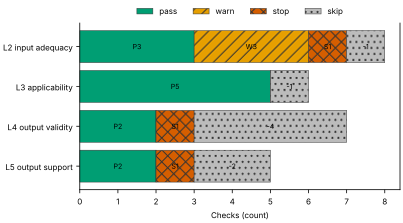
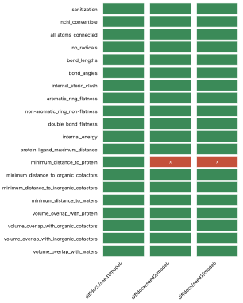
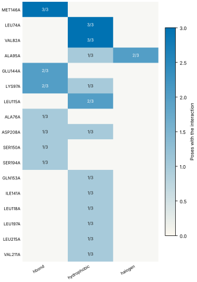

# Run report · Ligand pose in a known pocket

Prediction assurance · run `ligand_pose-c4466b7c4f18` · 2026-10-17 17:04:33 UTC

**Refused** for the claim "Predicted pose of FZC in MEK1 is valid".

Refused over layers 2,3,4,5: 12 pass, 3 warn, 3 stop, 8 skip. Stopped by l2.context.cofactors, l4.posebusters, l5.controls.redocking. Warnings from l2.receptor.protonation, l2.ligand.protonation, l2.docking.box. 7 checks not verified.

Stops: `l2.context.cofactors`, `l4.posebusters`, `l5.controls.redocking`.

Warnings: `l2.receptor.protonation`, `l2.ligand.protonation`, `l2.docking.box`.

Not verified: 7 checks.

| Field | Value |
| --- | --- |
| Task | Ligand pose in a known pocket (`ligand_pose`) |
| Tools | DiffDock-L v1.1.3 (docking), Boltz-2 (co-folding) |
| Target | `protein` |
| Ligand | `Cc1ccnc(n1)Oc2ccc(c(c2)Cl)c3cc4c(c(n[nH]4)C)c(c3)O[C@H]5CCC[C@H](C5)N` |
| Reference | `7XLP` |
| pH | 7.4 |
| Seeds | 3 |
| Layers run | 2, 3, 4, 5 |
| Run | `ligand_pose-c4466b7c4f18` |
| Created | 2026-10-17 17:04:33 UTC |
| Finished | 2026-10-17 17:04:58 UTC |
| pah version | 0.1.0 |
| Report schema | 1 |

## Layers

| Layer | Status | Result | pass | warn | stop | skip | Time |
| --- | --- | --- | --- | --- | --- | --- | --- |
| L0 Provenance | not run | n/a | n/a | n/a | n/a | n/a | n/a |
| L1 Input integrity | not run | n/a | n/a | n/a | n/a | n/a | n/a |
| L2 Input adequacy | done | stop | 3 | 3 | 1 | 1 | 2.9 s |
| L3 Applicability | done | pass | 5 | 0 | 0 | 1 | 386 ms |
| L4 Output validity | done | stop | 2 | 0 | 1 | 4 | 21.7 s |
| L5 Output support | done | stop | 2 | 0 | 1 | 2 | 11 ms |

## Figures

Fig. 1 · Check outcomes per layer for run ligand_pose-c4466b7c4f18. Totals: pass 12, warn 3, stop 3, skip 8.
Files: data [figures/gates_by_layer.csv](figures/gates_by_layer.csv).

## Structures

68 PyMOL renders.

7XLP mmCIF (source_structure), whole structure. Chains A; organic components DMS, FZC. sha256 48ffbc34e5fd126d. PyMOL session: [renders/7XLP.pse](renders/7XLP.pse).

7XLP mmCIF (source_structure), ligand environment within 5 Å. Chains A; organic components DMS, FZC. sha256 48ffbc34e5fd126d. PyMOL session: [renders/7XLP.pse](renders/7XLP.pse).

diffdock/seed1/mode0 (prediction_structure), whole structure. Chains A, L; organic components LIG. sha256 f1200afc793eb1a7. PyMOL session: [renders/diffdock_seed1_mode0.pse](renders/diffdock_seed1_mode0.pse).

diffdock/seed1/mode0 (prediction_structure), ligand environment within 5 Å. Chains A, L; organic components LIG. sha256 f1200afc793eb1a7. PyMOL session: [renders/diffdock_seed1_mode0.pse](renders/diffdock_seed1_mode0.pse).

diffdock/seed1/mode1 (prediction_structure), whole structure. Chains A, L; organic components LIG. sha256 854f6a419e159f5c. PyMOL session: [renders/diffdock_seed1_mode1.pse](renders/diffdock_seed1_mode1.pse).

diffdock/seed1/mode1 (prediction_structure), ligand environment within 5 Å. Chains A, L; organic components LIG. sha256 854f6a419e159f5c. PyMOL session: [renders/diffdock_seed1_mode1.pse](renders/diffdock_seed1_mode1.pse).

diffdock/seed1/mode2 (prediction_structure), whole structure. Chains A, L; organic components LIG. sha256 117b19cc94a16661. PyMOL session: [renders/diffdock_seed1_mode2.pse](renders/diffdock_seed1_mode2.pse).

diffdock/seed1/mode2 (prediction_structure), ligand environment within 5 Å. Chains A, L; organic components LIG. sha256 117b19cc94a16661. PyMOL session: [renders/diffdock_seed1_mode2.pse](renders/diffdock_seed1_mode2.pse).

diffdock/seed1/mode3 (prediction_structure), whole structure. Chains A, L; organic components LIG. sha256 a6aa9b9af3c30741. PyMOL session: [renders/diffdock_seed1_mode3.pse](renders/diffdock_seed1_mode3.pse).

diffdock/seed1/mode3 (prediction_structure), ligand environment within 5 Å. Chains A, L; organic components LIG. sha256 a6aa9b9af3c30741. PyMOL session: [renders/diffdock_seed1_mode3.pse](renders/diffdock_seed1_mode3.pse).

diffdock/seed1/mode4 (prediction_structure), whole structure. Chains A, L; organic components LIG. sha256 a4400ef1d9055a46. PyMOL session: [renders/diffdock_seed1_mode4.pse](renders/diffdock_seed1_mode4.pse).

diffdock/seed1/mode4 (prediction_structure), ligand environment within 5 Å. Chains A, L; organic components LIG. sha256 a4400ef1d9055a46. PyMOL session: [renders/diffdock_seed1_mode4.pse](renders/diffdock_seed1_mode4.pse).

diffdock/seed1/mode5 (prediction_structure), whole structure. Chains A, L; organic components LIG. sha256 bb69a19c01513dc1. PyMOL session: [renders/diffdock_seed1_mode5.pse](renders/diffdock_seed1_mode5.pse).

diffdock/seed1/mode5 (prediction_structure), ligand environment within 5 Å. Chains A, L; organic components LIG. sha256 bb69a19c01513dc1. PyMOL session: [renders/diffdock_seed1_mode5.pse](renders/diffdock_seed1_mode5.pse).

diffdock/seed1/mode6 (prediction_structure), whole structure. Chains A, L; organic components LIG. sha256 8df073d07833955b. PyMOL session: [renders/diffdock_seed1_mode6.pse](renders/diffdock_seed1_mode6.pse).

diffdock/seed1/mode6 (prediction_structure), ligand environment within 5 Å. Chains A, L; organic components LIG. sha256 8df073d07833955b. PyMOL session: [renders/diffdock_seed1_mode6.pse](renders/diffdock_seed1_mode6.pse).

diffdock/seed1/mode7 (prediction_structure), whole structure. Chains A, L; organic components LIG. sha256 8e2b0a41ff0ffca1. PyMOL session: [renders/diffdock_seed1_mode7.pse](renders/diffdock_seed1_mode7.pse).

diffdock/seed1/mode7 (prediction_structure), ligand environment within 5 Å. Chains A, L; organic components LIG. sha256 8e2b0a41ff0ffca1. PyMOL session: [renders/diffdock_seed1_mode7.pse](renders/diffdock_seed1_mode7.pse).

diffdock/seed1/mode8 (prediction_structure), whole structure. Chains A, L; organic components LIG. sha256 6172bd3bc2cb2bfd. PyMOL session: [renders/diffdock_seed1_mode8.pse](renders/diffdock_seed1_mode8.pse).

diffdock/seed1/mode8 (prediction_structure), ligand environment within 5 Å. Chains A, L; organic components LIG. sha256 6172bd3bc2cb2bfd. PyMOL session: [renders/diffdock_seed1_mode8.pse](renders/diffdock_seed1_mode8.pse).

diffdock/seed1/mode9 (prediction_structure), whole structure. Chains A, L; organic components LIG. sha256 e8292b7388ee9247. PyMOL session: [renders/diffdock_seed1_mode9.pse](renders/diffdock_seed1_mode9.pse).

diffdock/seed1/mode9 (prediction_structure), ligand environment within 5 Å. Chains A, L; organic components LIG. sha256 e8292b7388ee9247. PyMOL session: [renders/diffdock_seed1_mode9.pse](renders/diffdock_seed1_mode9.pse).

diffdock/seed2/mode0 (prediction_structure), whole structure. Chains A, L; organic components LIG. sha256 6fd77e57d466f29a. PyMOL session: [renders/diffdock_seed2_mode0.pse](renders/diffdock_seed2_mode0.pse).

diffdock/seed2/mode0 (prediction_structure), ligand environment within 5 Å. Chains A, L; organic components LIG. sha256 6fd77e57d466f29a. PyMOL session: [renders/diffdock_seed2_mode0.pse](renders/diffdock_seed2_mode0.pse).

diffdock/seed2/mode1 (prediction_structure), whole structure. Chains A, L; organic components LIG. sha256 483d9416f47538a4. PyMOL session: [renders/diffdock_seed2_mode1.pse](renders/diffdock_seed2_mode1.pse).

diffdock/seed2/mode1 (prediction_structure), ligand environment within 5 Å. Chains A, L; organic components LIG. sha256 483d9416f47538a4. PyMOL session: [renders/diffdock_seed2_mode1.pse](renders/diffdock_seed2_mode1.pse).

diffdock/seed2/mode2 (prediction_structure), whole structure. Chains A, L; organic components LIG. sha256 7401b21ba8b53083. PyMOL session: [renders/diffdock_seed2_mode2.pse](renders/diffdock_seed2_mode2.pse).

diffdock/seed2/mode2 (prediction_structure), ligand environment within 5 Å. Chains A, L; organic components LIG. sha256 7401b21ba8b53083. PyMOL session: [renders/diffdock_seed2_mode2.pse](renders/diffdock_seed2_mode2.pse).

diffdock/seed2/mode3 (prediction_structure), whole structure. Chains A, L; organic components LIG. sha256 761b8a238d18066a. PyMOL session: [renders/diffdock_seed2_mode3.pse](renders/diffdock_seed2_mode3.pse).

diffdock/seed2/mode3 (prediction_structure), ligand environment within 5 Å. Chains A, L; organic components LIG. sha256 761b8a238d18066a. PyMOL session: [renders/diffdock_seed2_mode3.pse](renders/diffdock_seed2_mode3.pse).

diffdock/seed2/mode4 (prediction_structure), whole structure. Chains A, L; organic components LIG. sha256 5fc9b69884d90e7a. PyMOL session: [renders/diffdock_seed2_mode4.pse](renders/diffdock_seed2_mode4.pse).

diffdock/seed2/mode4 (prediction_structure), ligand environment within 5 Å. Chains A, L; organic components LIG. sha256 5fc9b69884d90e7a. PyMOL session: [renders/diffdock_seed2_mode4.pse](renders/diffdock_seed2_mode4.pse).

diffdock/seed2/mode5 (prediction_structure), whole structure. Chains A, L; organic components LIG. sha256 15757142d66afef6. PyMOL session: [renders/diffdock_seed2_mode5.pse](renders/diffdock_seed2_mode5.pse).

diffdock/seed2/mode5 (prediction_structure), ligand environment within 5 Å. Chains A, L; organic components LIG. sha256 15757142d66afef6. PyMOL session: [renders/diffdock_seed2_mode5.pse](renders/diffdock_seed2_mode5.pse).

diffdock/seed2/mode6 (prediction_structure), whole structure. Chains A, L; organic components LIG. sha256 c4c6bab34d24fdfd. PyMOL session: [renders/diffdock_seed2_mode6.pse](renders/diffdock_seed2_mode6.pse).

diffdock/seed2/mode6 (prediction_structure), ligand environment within 5 Å. Chains A, L; organic components LIG. sha256 c4c6bab34d24fdfd. PyMOL session: [renders/diffdock_seed2_mode6.pse](renders/diffdock_seed2_mode6.pse).

diffdock/seed2/mode7 (prediction_structure), whole structure. Chains A, L; organic components LIG. sha256 cbc40c648deee3d5. PyMOL session: [renders/diffdock_seed2_mode7.pse](renders/diffdock_seed2_mode7.pse).

diffdock/seed2/mode7 (prediction_structure), ligand environment within 5 Å. Chains A, L; organic components LIG. sha256 cbc40c648deee3d5. PyMOL session: [renders/diffdock_seed2_mode7.pse](renders/diffdock_seed2_mode7.pse).

diffdock/seed2/mode8 (prediction_structure), whole structure. Chains A, L; organic components LIG. sha256 4b47be28f2e12b02. PyMOL session: [renders/diffdock_seed2_mode8.pse](renders/diffdock_seed2_mode8.pse).

diffdock/seed2/mode8 (prediction_structure), ligand environment within 5 Å. Chains A, L; organic components LIG. sha256 4b47be28f2e12b02. PyMOL session: [renders/diffdock_seed2_mode8.pse](renders/diffdock_seed2_mode8.pse).

diffdock/seed2/mode9 (prediction_structure), whole structure. Chains A, L; organic components LIG. sha256 3107d7827d1ddea7. PyMOL session: [renders/diffdock_seed2_mode9.pse](renders/diffdock_seed2_mode9.pse).

diffdock/seed2/mode9 (prediction_structure), ligand environment within 5 Å. Chains A, L; organic components LIG. sha256 3107d7827d1ddea7. PyMOL session: [renders/diffdock_seed2_mode9.pse](renders/diffdock_seed2_mode9.pse).

diffdock/seed3/mode0 (prediction_structure), whole structure. Chains A, L; organic components LIG. sha256 885cf27059be4b86. PyMOL session: [renders/diffdock_seed3_mode0.pse](renders/diffdock_seed3_mode0.pse).

diffdock/seed3/mode0 (prediction_structure), ligand environment within 5 Å. Chains A, L; organic components LIG. sha256 885cf27059be4b86. PyMOL session: [renders/diffdock_seed3_mode0.pse](renders/diffdock_seed3_mode0.pse).

diffdock/seed3/mode1 (prediction_structure), whole structure. Chains A, L; organic components LIG. sha256 35867b511592d46c. PyMOL session: [renders/diffdock_seed3_mode1.pse](renders/diffdock_seed3_mode1.pse).

diffdock/seed3/mode1 (prediction_structure), ligand environment within 5 Å. Chains A, L; organic components LIG. sha256 35867b511592d46c. PyMOL session: [renders/diffdock_seed3_mode1.pse](renders/diffdock_seed3_mode1.pse).

diffdock/seed3/mode2 (prediction_structure), whole structure. Chains A, L; organic components LIG. sha256 8a05b25ccc6af016. PyMOL session: [renders/diffdock_seed3_mode2.pse](renders/diffdock_seed3_mode2.pse).

diffdock/seed3/mode2 (prediction_structure), ligand environment within 5 Å. Chains A, L; organic components LIG. sha256 8a05b25ccc6af016. PyMOL session: [renders/diffdock_seed3_mode2.pse](renders/diffdock_seed3_mode2.pse).

diffdock/seed3/mode3 (prediction_structure), whole structure. Chains A, L; organic components LIG. sha256 1ce97a1297ca0c26. PyMOL session: [renders/diffdock_seed3_mode3.pse](renders/diffdock_seed3_mode3.pse).

diffdock/seed3/mode3 (prediction_structure), ligand environment within 5 Å. Chains A, L; organic components LIG. sha256 1ce97a1297ca0c26. PyMOL session: [renders/diffdock_seed3_mode3.pse](renders/diffdock_seed3_mode3.pse).

diffdock/seed3/mode4 (prediction_structure), whole structure. Chains A, L; organic components LIG. sha256 cb8b504ffc06d918. PyMOL session: [renders/diffdock_seed3_mode4.pse](renders/diffdock_seed3_mode4.pse).

diffdock/seed3/mode4 (prediction_structure), ligand environment within 5 Å. Chains A, L; organic components LIG. sha256 cb8b504ffc06d918. PyMOL session: [renders/diffdock_seed3_mode4.pse](renders/diffdock_seed3_mode4.pse).

diffdock/seed3/mode5 (prediction_structure), whole structure. Chains A, L; organic components LIG. sha256 a807aa20759d66c5. PyMOL session: [renders/diffdock_seed3_mode5.pse](renders/diffdock_seed3_mode5.pse).

diffdock/seed3/mode5 (prediction_structure), ligand environment within 5 Å. Chains A, L; organic components LIG. sha256 a807aa20759d66c5. PyMOL session: [renders/diffdock_seed3_mode5.pse](renders/diffdock_seed3_mode5.pse).

diffdock/seed3/mode6 (prediction_structure), whole structure. Chains A, L; organic components LIG. sha256 78b2c8aebca297a2. PyMOL session: [renders/diffdock_seed3_mode6.pse](renders/diffdock_seed3_mode6.pse).

diffdock/seed3/mode6 (prediction_structure), ligand environment within 5 Å. Chains A, L; organic components LIG. sha256 78b2c8aebca297a2. PyMOL session: [renders/diffdock_seed3_mode6.pse](renders/diffdock_seed3_mode6.pse).

diffdock/seed3/mode7 (prediction_structure), whole structure. Chains A, L; organic components LIG. sha256 0fbeb3d1f177cdbf. PyMOL session: [renders/diffdock_seed3_mode7.pse](renders/diffdock_seed3_mode7.pse).

diffdock/seed3/mode7 (prediction_structure), ligand environment within 5 Å. Chains A, L; organic components LIG. sha256 0fbeb3d1f177cdbf. PyMOL session: [renders/diffdock_seed3_mode7.pse](renders/diffdock_seed3_mode7.pse).

diffdock/seed3/mode8 (prediction_structure), whole structure. Chains A, L; organic components LIG. sha256 104a213e03d5b551. PyMOL session: [renders/diffdock_seed3_mode8.pse](renders/diffdock_seed3_mode8.pse).

diffdock/seed3/mode8 (prediction_structure), ligand environment within 5 Å. Chains A, L; organic components LIG. sha256 104a213e03d5b551. PyMOL session: [renders/diffdock_seed3_mode8.pse](renders/diffdock_seed3_mode8.pse).

diffdock/seed3/mode9 (prediction_structure), whole structure. Chains A, L; organic components LIG. sha256 ae8e34ea125b8ba7. PyMOL session: [renders/diffdock_seed3_mode9.pse](renders/diffdock_seed3_mode9.pse).

diffdock/seed3/mode9 (prediction_structure), ligand environment within 5 Å. Chains A, L; organic components LIG. sha256 ae8e34ea125b8ba7. PyMOL session: [renders/diffdock_seed3_mode9.pse](renders/diffdock_seed3_mode9.pse).

boltz2/seed1/sample0 (prediction_structure), whole structure. Chains A, L; organic components LIG1. sha256 5e04882f8848fcda. PyMOL session: [renders/boltz2_seed1_sample0.pse](renders/boltz2_seed1_sample0.pse).

boltz2/seed1/sample0 (prediction_structure), ligand environment within 5 Å. Chains A, L; organic components LIG1. sha256 5e04882f8848fcda. PyMOL session: [renders/boltz2_seed1_sample0.pse](renders/boltz2_seed1_sample0.pse).

boltz2/seed2/sample0 (prediction_structure), whole structure. Chains A, L; organic components LIG1. sha256 a7cd5dc842dcb98f. PyMOL session: [renders/boltz2_seed2_sample0.pse](renders/boltz2_seed2_sample0.pse).

boltz2/seed2/sample0 (prediction_structure), ligand environment within 5 Å. Chains A, L; organic components LIG1. sha256 a7cd5dc842dcb98f. PyMOL session: [renders/boltz2_seed2_sample0.pse](renders/boltz2_seed2_sample0.pse).

boltz2/seed3/sample0 (prediction_structure), whole structure. Chains A, L; organic components LIG1. sha256 5819a056d9999c96. PyMOL session: [renders/boltz2_seed3_sample0.pse](renders/boltz2_seed3_sample0.pse).

boltz2/seed3/sample0 (prediction_structure), ligand environment within 5 Å. Chains A, L; organic components LIG1. sha256 5819a056d9999c96. PyMOL session: [renders/boltz2_seed3_sample0.pse](renders/boltz2_seed3_sample0.pse).

## L0 Provenance

Where did every input come from?

Status: not run.

## L1 Input integrity

Did the run receive exactly what was declared?

Status: not run.

## L2 Input adequacy

Does the input carry enough information?

Status: done. Checks: pass 3 · warn 3 · stop 1 · skip 1. Time: 2.9 s.

#### Key figures

| Figure | Value |
| --- | --- |
| near site | 1 |
| missing | 1 |
| uniprot cofactors | 0 |
| pocket residues | 37 |
| incomplete | 0 |
| sequence gaps | 0 |
| state | holo |
| site ligands | 1 |

#### Docking

| Field | Value |
| --- | --- |
| center | -3.608, 64.879, 34.516 Å |
| size | 19.183 × 21.381 × 13.89 Å |
| origin | derived from FZC (+4 Å) |

#### Checks

| Check | Result | Measured cmp threshold | Evidence | Id · time |
| --- | --- | --- | --- | --- |
| Alignment depth, distinct sequences, Neff and gap fraction | skip | n/a | no MSA declared for a co-folding model · not applicable | `l2.msa.depth` |
| Required cofactors, ions and partners present | stop | `pocket_distance <= 8` | components within 8.0 Å of FZC in 7XLP not supplied: CA · near_site=1, missing=1, uniprot_cofactors=0 | `l2.context.cofactors` · 209 ms |
| Pocket residues resolved, no missing loops lining the pocket | pass | `pocket_distance <= 6` | 37 pocket residues complete in 7XLP.cif · pocket_residues=37, incomplete=0, sequence_gaps=0 | `l2.pocket.resolved` · 14 ms |
| Receptor state apo or holo | pass | n/a | 7XLP.cif holo: FZC in the site · state=holo, site_ligands=1 | `l2.receptor.state` · 15 ms |
| Receptor protonation at the stated pH | warn | `pka_margin > 1` | receptor has no hydrogens (protonation not assigned) · hydrogens_present=False, ph=7.4, pocket_titratable=15 | `l2.receptor.protonation` · 373 ms |
| Ligand protonation and tautomers enumerated at the stated pH | warn | `ph 7.4 == 1` | ligand: 16 states · ph=7.4, max_states=16, declared_not_enumerated=0 | `l2.ligand.protonation` · 97 ms |
| Ligand conformers generated and minimised | pass | `conformers >= 10` | 10 ETKDG conformers per ligand, MMFF minimised · ligands=1, failed=0, min_embedded=10 | `l2.ligand.conformers` · 2.2 s |
| Docking box encloses the pocket with margin | warn | `margin >= 2` | no box declared; derived box encloses 19 contact residues and the FZC ligand with 2.0 Å margin · volume_A3=5697, ligand_atoms_inside_margin=33, ligand_atoms=33 | `l2.docking.box` · 31 ms |

## L3 Applicability

Is the tool inside its validated regime?

Status: done. Checks: pass 5 · warn 0 · stop 0 · skip 1. Time: 386 ms.

#### Key figures

| Figure | Value |
| --- | --- |
| executors | 2 |
| unknown | 0 |
| reference released | 2023-03-01 |
| cutoff | 2019-01-01 |
| systems | 0 |
| analogue components | 1 |
| entries 95 | 35 |
| entries 40 | 46 |

#### Checks

| Check | Result | Measured cmp threshold | Evidence | Id · time |
| --- | --- | --- | --- | --- |
| Model training cutoff recorded | pass | `training_cutoff == recorded` | diffdock 2019-01-01; boltz2 2023-06-01; reference 7XLP released 2023-03-01, before the cutoff of boltz2 · executors=2, unknown=0, reference_released=2023-03-01 | `l3.model.training_cutoff` · 1 ms |
| Pocket similarity to pre-cutoff complexes (SuCOS times pocket coverage) | skip | n/a | OutputUnavailableError: cannot read ligand of diffdock/seed1/mode0: /home/user/harness-hackathon/bench/runs/2026-10-17T1611Z-426bfe9/harness/mek1_wt_diffdock/run/predictions/00_diffdock/diffdock/seed1/mode0/ligand.sdf · error | `l3.exposure.pocket` · 361 ms |
| Ligand analogues in pre-cutoff training systems | pass | `tanimoto > 0.9` | 0 PDB entries released before 2019-01-01 (diffdock cutoff) contain analogues of ligand above Tanimoto 0.9: FZC · cutoff=2019-01-01, systems=0, analogue_components=1 | `l3.exposure.ligand_prevalence` · 8 ms |
| Chain sequence identity to pre-cutoff entries (secondary measure) | pass | `identity < 0.4` | protein: 35 entries at 95 percent identity, 46 at 40 percent, released before 2019-01-01 (reported, not gating) · cutoff=2019-01-01, entries_95=35, entries_40=46 | `l3.exposure.sequence` · 1 ms |
| Modality inside the validated set; token count against the training crop | pass | n/a | modalities protein, protein_ligand inside the validated set; 381 tokens · modalities=2, tokens=381, outside=0 | `l3.regime.modality` · 11 ms |
| Endpoint fits the tool | pass | `endpoint pose in pose` | endpoint pose produced by diffdock, boltz2 · endpoint=pose, executors=2, not_fitting=0 | `l3.metric.endpoint` · 0 ms |

## L4 Output validity

Is the result physically and chemically sensible?

Status: done. Checks: pass 2 · warn 0 · stop 1 · skip 4. Time: 21.7 s.

#### Key figures

| Figure | Value |
| --- | --- |
| poses | 3 |
| passed | 18 |
| total | 20 |
| poses all pass | 0 |
| interactions representative | 13 |
| distinct | 20 |
| hbonds representative | 4 |
| key interactions | 3 |

#### PoseBusters · 18/20 tests pass

| test | result | value |
| --- | --- | --- |
| sanitization | fail | fail |
| inchi_convertible | fail | fail |
| all_atoms_connected | pass | pass |
| no_radicals | pass | pass |
| bond_lengths | pass | 0 long outliers |
| bond_angles | pass | 0 outliers |
| internal_steric_clash | pass | 0 |
| aromatic_ring_flatness | pass | 0.00 Å |
| non-aromatic_ring_non-flatness | pass | pass |
| double_bond_flatness | pass | pass |
| internal_energy | pass | 4.9 times the ensemble mean |
| protein-ligand_maximum_distance | pass | 2.57 Å |
| minimum_distance_to_protein | pass | 2.57 Å |
| minimum_distance_to_organic_cofactors | pass | pass |
| minimum_distance_to_inorganic_cofactors | pass | pass |
| minimum_distance_to_waters | pass | pass |
| volume_overlap_with_protein | pass | 0.015 |
| volume_overlap_with_organic_cofactors | pass | pass |
| volume_overlap_with_inorganic_cofactors | pass | pass |
| volume_overlap_with_waters | pass | pass |

#### Per-pose physical checks

| pose | PoseBusters |
| --- | --- |
| diffdock/seed1/mode0 | 18/20 |
| diffdock/seed2/mode0 | 17/20 |
| diffdock/seed3/mode0 | 17/20 |
| median | 17/20 |

#### Interaction fingerprint · representative pose diffdock/seed1/mode0

| residue | type | distance | poses |
| --- | --- | --- | --- |
| MET146A | hbond | 3.09 Å | 3/3 |
| LEU74A | hydrophobic | 2.54 Å | 3/3 |
| VAL82A | hydrophobic | 2.9 Å | 3/3 |
| ALA95A | halogen | 3.52 Å | 2/3 |
| GLU144A | hbond | 2.94 Å | 2/3 |
| LYS97A | hbond | 3.19 Å | 2/3 |
| LEU115A | hydrophobic | 3.33 Å | 2/3 |
| ALA76A | hbond | 3.84 Å | 1/3 |
| ASP208A | hbond | 4.04 Å | 1/3 |
| SER150A | hbond | 2.03 Å | 1/3 |
| SER194A | hbond | 3.96 Å | 1/3 |
| ALA95A | hydrophobic | 3.66 Å | 1/3 |
| ASP208A | hydrophobic | 3.71 Å | 1/3 |
| GLN153A | hydrophobic | 3.9 Å | 1/3 |
| ILE141A | hydrophobic | 3.83 Å | 1/3 |
| LEU118A | hydrophobic | 3.41 Å | 1/3 |
| LEU197A | hydrophobic | 3.77 Å | 1/3 |
| LEU215A | hydrophobic | 3.76 Å | 1/3 |
| LYS97A | hydrophobic | 3.49 Å | 1/3 |
| VAL211A | hydrophobic | 3.52 Å | 1/3 |

Fig. 2 · PoseBusters tests (20) by pose (3). Failed cells marked x: 8 of 60.
Files: data [figures/posebusters_grid.csv](figures/posebusters_grid.csv).

Fig. 3 · Interactions by residue (17) and type (3); cell label: poses with the interaction over poses assessed.
Files: data [figures/interactions.csv](figures/interactions.csv).

#### Checks

| Check | Result | Measured cmp threshold | Evidence | Id · time |
| --- | --- | --- | --- | --- |
| PoseBusters geometry, stereochemistry, clashes and protein contact | stop | `tests_failed == 0` | representative pose diffdock/seed1/mode0 fails sanitization, inchi_convertible · poses=3, passed=18, total=20 | `l4.posebusters` · 4.8 s |
| Torsional strain of the ligand pose | skip | n/a | OutputUnavailableError: cannot read ligand of diffdock/seed1/mode0: /home/user/harness-hackathon/bench/runs/2026-10-17T1611Z-426bfe9/harness/mek1_wt_diffdock/run/predictions/00_diffdock/diffdock/seed1/mode0/ligand.sdf · error | `l4.torsion_strain` · 1 ms |
| Interaction fingerprint (PLIP) | pass | n/a | 13 interactions in diffdock/seed1/mode0 (halogen, hbond, hydrophobic); 20 distinct across 3 poses (reported) · poses=3, interactions_representative=13, distinct=20 | `l4.interactions.fingerprint` · 998 ms |
| Buried ligand polar atoms without a hydrogen-bond partner | skip | n/a | OutputUnavailableError: cannot read ligand of diffdock/seed1/mode0: /home/user/harness-hackathon/bench/runs/2026-10-17T1611Z-426bfe9/harness/mek1_wt_diffdock/run/predictions/00_diffdock/diffdock/seed1/mode0/ligand.sdf · error | `l4.interactions.unsatisfied_polars` · 2 ms |
| Hydrophobic complementarity of buried ligand surface | skip | n/a | OutputUnavailableError: cannot read ligand of diffdock/seed1/mode0: /home/user/harness-hackathon/bench/runs/2026-10-17T1611Z-426bfe9/harness/mek1_wt_diffdock/run/predictions/00_diffdock/diffdock/seed1/mode0/ligand.sdf · error | `l4.interactions.hydrophobic` · 0 ms |
| Interactions of the crystal ligand reproduced by the pose | pass | `reproduced 2 >= 1` | diffdock/seed1/mode0 reproduces 2 of 3 FZC interactions: halogen ALA95A, hbond MET146A · key_interactions=3, reproduced=2, poses_reproducing_all=1 | `l4.interactions.known_binders` · 592 ms |
| Pose stability under short restrained minimisation (OpenMM, AMBER14 and OpenFF) | skip | n/a | OutputUnavailableError: minimisation failed for every pose:     AddHs(RDKit::ROMol mol, RDKit::MolOps::AddHsParameters params, boost::python::api::object onlyOnAtoms=None);     AddHs(RDKit::ROMol mol, RDKit::MolOps::AddHsParameters params, boost::python::api::object onlyOnAtoms=None);     AddHs(RDKit::ROMol mol, RDKit::MolOps::AddHsParameters params, boost::python::api::object onlyOnAtoms=None) · error | `l4.minimisation_drift` · 15.3 s |

## L5 Output support

Is a valid result corroborated?

Status: done. Checks: pass 2 · warn 0 · stop 1 · skip 2. Time: 11 ms.

#### Key figures

| Figure | Value |
| --- | --- |
| poses | 3 |
| diffdock confidence | 0.35 |
| independent seeds | 3 |
| samples | 30 |
| duplicated outputs | 0 |

#### Checks

| Check | Result | Measured cmp threshold | Evidence | Id · time |
| --- | --- | --- | --- | --- |
| Confidence restricted to the pocket; per-model thresholds | pass | n/a | diffdock/seed1/mode0: diffdock_confidence 0.35; no per-model confidence threshold registered for diffdock (reported) · poses=3, diffdock_confidence=0.35 | `l5.confidence.local` · 1 ms |
| Independent seeds counted separately from samples; duplicates flagged | pass | `seeds_docking >= 3` | 3 independent seeds, 30 poses, no duplicates · independent_seeds=3, samples=30, duplicated_outputs=0 | `l5.sampling.seeds` · 0 ms |
| Medoid of the largest cluster, populations, pairwise spread, site and pose accuracy | skip | n/a | OutputUnavailableError: cannot read ligand of diffdock/seed1/mode0: /home/user/harness-hackathon/bench/runs/2026-10-17T1611Z-426bfe9/harness/mek1_wt_diffdock/run/predictions/00_diffdock/diffdock/seed1/mode0/ligand.sdf · error | `l5.sampling.clusters` · 5 ms |
| Agreement between methods, weighted by independence | skip | n/a | OutputUnavailableError: cannot read ligand of diffdock/seed1/mode0: /home/user/harness-hackathon/bench/runs/2026-10-17T1611Z-426bfe9/harness/mek1_wt_diffdock/run/predictions/00_diffdock/diffdock/seed1/mode0/ligand.sdf · error | `l5.agreement.cross_family` · 1 ms |
| Redocking control reproduces the crystal pose | stop | `rmsd <= 2` | redocking control required by the task and not supplied (controls.redocking) | `l5.controls.redocking` · 0 ms |

## Controls

| control | status | result |
| --- | --- | --- |
| redocking | incomplete | redocking control required by the task and not supplied (controls.redocking) |

## Provenance

7 objects · 7 cached · 0 network.

| Source | Accession | Release | SHA-256 | Retrieved | Bytes | Cache | Used by |
| --- | --- | --- | --- | --- | --- | --- | --- |
| rcsb_files | 7XLP | n/a | `48ffbc34e5fd` | 2026-10-17 17:04:21 UTC | 527387 | hit | l2.context.cofactors, l2.pocket.resolved, l2.receptor.state, l2.docking.box, l3.exposure.pocket, l3.regime.modality, l4.posebusters, l4.interactions.fingerprint, l4.interactions.known_binders, l5.confidence.local, l5.sampling.clusters, l5.agreement.cross_family |
| ccd | FZC | 2023-02-24 | `6ce219c20fef` | 2026-10-17 17:04:21 UTC | 3599 | hit | l2.context.cofactors, l3.exposure.ligand_prevalence |
| rcsb | 7XLP | 1.2 | `66dacec771f9` | 2026-10-17 17:04:23 UTC | 12056 | hit | l3.model.training_cutoff |
| rcsb_search | chem:Cc1ccnc(n1)Oc2ccc(c(c2)Cl)c3cc4c(c(n[nH]4)C)c(c3)O[C@H]5CCC[C@H](C5)N | n/a | `b46bdf444038` | 2026-10-17 17:04:25 UTC | 186 | hit | l3.exposure.ligand_prevalence |
| rcsb_search | comp:FZC:2019-01-01 | n/a | `e3b0c44298fc` | 2026-10-17 17:04:24 UTC | 0 | hit | l3.exposure.ligand_prevalence |
| rcsb_search | seq0.95:2019-01-01:348 | n/a | `1d2d688f2f0a` | 2026-10-17 17:04:34 UTC | 402 | hit | l3.exposure.sequence |
| rcsb_search | seq0.4:2019-01-01:348 | n/a | `baa9d256b8ae` | 2026-10-17 17:04:35 UTC | 393 | hit | l3.exposure.sequence |

Provenance graph: [json](graph.json), [mmd](graph.mmd), [svg](graph.svg).

## Thresholds

| Check | Threshold | Value | Origin | Evidence level |
| --- | --- | --- | --- | --- |
| `l2.context.cofactors` | pocket_distance | <= 8 | Harness rule: a component of the reference entry within 8 Å of the declared ligand is required context; not yet calibrated | uncalibrated |
| `l2.pocket.resolved` | pocket_distance | <= 6 | Harness rule: pocket residues have a heavy atom within 6 Å of the ligand; not yet calibrated | uncalibrated |
| `l2.pocket.resolved` | missing_pocket_residues | == 0 | Specification layer 2: stop when the pocket is incomplete | published |
| `l2.receptor.protonation` | pka_margin | > 1 | Harness rule: a titratable pocket residue with PROPKA pKa within 1 unit of the stated pH has an ambiguous state; not yet calibrated | uncalibrated |
| `l2.ligand.protonation` | ph_window | == 1 | Harness rule: states enumerated by Dimorphite-DL within 1 pH unit of the stated pH; not yet calibrated | uncalibrated |
| `l2.ligand.protonation` | states | == 1 | Specification layer 2: warn when more than one plausible state | published |
| `l2.ligand.conformers` | conformers | >= 10 | Harness default number of ETKDG conformers; not yet calibrated | uncalibrated |
| `l2.docking.box` | margin | >= 2 | Harness rule: every pocket heavy atom lies at least 2 Å inside the box; not yet calibrated | uncalibrated |
| `l2.docking.box` | contact_distance | <= 4 | Harness rule: contact residues (heavy atom within 4 Å of the reference ligand) must have an atom inside the box; not yet calibrated | uncalibrated |
| `l3.model.training_cutoff` | training_cutoff | == recorded | Specification, Layer 3 (applicability): stop when unknown | published |
| `l3.exposure.ligand_prevalence` | tanimoto | > 0.9 | Specification layer 3: analogues above 0.9 Tanimoto (RDKit topological fingerprint) | published |
| `l3.exposure.ligand_prevalence` | systems | <= 100 | Specification layer 3: prevalent when analogues occur in more than 100 training systems | published |
| `l3.exposure.sequence` | identity | < 0.4 | Specification layer 3: conventional 40 percent identity leakage threshold, reported as a secondary measure only | published |
| `l3.metric.endpoint` | endpoint | in pose | Specification, Layer 3 (applicability): no affinity from interface confidence, no protein-protein affinity from Boltz-2 | published |
| `l4.posebusters` | tests_failed | == 0 | Specification, Layer 4 (output validity): stop on failure | published |
| `l4.interactions.known_binders` | reproduced | >= 1 | Specification layer 4: warn when no key interaction is reproduced | published |
| `l5.sampling.seeds` | seeds_docking | >= 3 | Harness default for independent docking seeds; not yet calibrated | uncalibrated |
| `l5.controls.redocking` | rmsd | <= 2 | Specification layer 5: redocking must reproduce the crystal pose (2 Å ligand RMSD) | published |

Tool versions: dimorphite_dl 2.1.0, freesasa 2.2.1, gemmi 0.7.5, numpy 1.26.4, openbabel 3.2.1, plip 3.0.1, posebusters 0.6.5, propka 3.5.1, rdkit 2026.9.1, scipy 1.17.1, spyrmsd 0.9.0.

## Limitations

- This report covers layers 2, 3, 4, 5. Layers not run: 0, 1.
- The harness establishes when a result should not be trusted. Passing checks are not evidence that a prediction is correct.
- Thresholds marked uncalibrated come from the specification or harness defaults and have not been recalibrated on the harness benchmark.

## Files

| Path | Kind | Bytes | SHA-256 |
| --- | --- | --- | --- |
| artifacts/sources/7XLP.cif | source_structure | 527387 | `48ffbc34e5fd` |
| predictions/00_diffdock/diffdock/seed1/mode0/complex.pdb | prediction_structure | 193326 | `f1200afc793e` |
| predictions/00_diffdock/diffdock/seed1/mode0/ligand.sdf | data | 2874 | `1bb54440a19e` |
| predictions/00_diffdock/diffdock/seed1/mode1/complex.pdb | prediction_structure | 193326 | `854f6a419e15` |
| predictions/00_diffdock/diffdock/seed1/mode1/ligand.sdf | data | 2874 | `4da6784deda0` |
| predictions/00_diffdock/diffdock/seed1/mode2/complex.pdb | prediction_structure | 193326 | `117b19cc94a1` |
| predictions/00_diffdock/diffdock/seed1/mode2/ligand.sdf | data | 2874 | `ef8820dd72a1` |
| predictions/00_diffdock/diffdock/seed1/mode3/complex.pdb | prediction_structure | 193326 | `a6aa9b9af3c3` |
| predictions/00_diffdock/diffdock/seed1/mode3/ligand.sdf | data | 2874 | `1a9b1f5b0fc5` |
| predictions/00_diffdock/diffdock/seed1/mode4/complex.pdb | prediction_structure | 193326 | `a4400ef1d905` |
| predictions/00_diffdock/diffdock/seed1/mode4/ligand.sdf | data | 2874 | `cf78ae34ce1c` |
| predictions/00_diffdock/diffdock/seed1/mode5/complex.pdb | prediction_structure | 193326 | `bb69a19c0151` |
| predictions/00_diffdock/diffdock/seed1/mode5/ligand.sdf | data | 2874 | `884a39a897f2` |
| predictions/00_diffdock/diffdock/seed1/mode6/complex.pdb | prediction_structure | 193326 | `8df073d07833` |
| predictions/00_diffdock/diffdock/seed1/mode6/ligand.sdf | data | 2874 | `3f7adad1f2ef` |
| predictions/00_diffdock/diffdock/seed1/mode7/complex.pdb | prediction_structure | 193326 | `8e2b0a41ff0f` |
| predictions/00_diffdock/diffdock/seed1/mode7/ligand.sdf | data | 2874 | `2e40673b00b1` |
| predictions/00_diffdock/diffdock/seed1/mode8/complex.pdb | prediction_structure | 193326 | `6172bd3bc2cb` |
| predictions/00_diffdock/diffdock/seed1/mode8/ligand.sdf | data | 2874 | `108697d2a553` |
| predictions/00_diffdock/diffdock/seed1/mode9/complex.pdb | prediction_structure | 193326 | `e8292b7388ee` |
| predictions/00_diffdock/diffdock/seed1/mode9/ligand.sdf | data | 2874 | `6e78e23e9bcb` |
| predictions/00_diffdock/diffdock/seed2/mode0/complex.pdb | prediction_structure | 193326 | `6fd77e57d466` |
| predictions/00_diffdock/diffdock/seed2/mode0/ligand.sdf | data | 2874 | `9ccac6a8ab20` |
| predictions/00_diffdock/diffdock/seed2/mode1/complex.pdb | prediction_structure | 193326 | `483d9416f475` |
| predictions/00_diffdock/diffdock/seed2/mode1/ligand.sdf | data | 2874 | `53ab15341bac` |
| predictions/00_diffdock/diffdock/seed2/mode2/complex.pdb | prediction_structure | 193326 | `7401b21ba8b5` |
| predictions/00_diffdock/diffdock/seed2/mode2/ligand.sdf | data | 2874 | `9e075fe2bba0` |
| predictions/00_diffdock/diffdock/seed2/mode3/complex.pdb | prediction_structure | 193326 | `761b8a238d18` |
| predictions/00_diffdock/diffdock/seed2/mode3/ligand.sdf | data | 2874 | `d1cb9254ef00` |
| predictions/00_diffdock/diffdock/seed2/mode4/complex.pdb | prediction_structure | 193326 | `5fc9b69884d9` |
| predictions/00_diffdock/diffdock/seed2/mode4/ligand.sdf | data | 2874 | `f592dd9e578e` |
| predictions/00_diffdock/diffdock/seed2/mode5/complex.pdb | prediction_structure | 193326 | `15757142d66a` |
| predictions/00_diffdock/diffdock/seed2/mode5/ligand.sdf | data | 2874 | `a27a7eb84b37` |
| predictions/00_diffdock/diffdock/seed2/mode6/complex.pdb | prediction_structure | 193326 | `c4c6bab34d24` |
| predictions/00_diffdock/diffdock/seed2/mode6/ligand.sdf | data | 2874 | `5a1f0a10d2d2` |
| predictions/00_diffdock/diffdock/seed2/mode7/complex.pdb | prediction_structure | 193326 | `cbc40c648dee` |
| predictions/00_diffdock/diffdock/seed2/mode7/ligand.sdf | data | 2874 | `d04edfd87589` |
| predictions/00_diffdock/diffdock/seed2/mode8/complex.pdb | prediction_structure | 193326 | `4b47be28f2e1` |
| predictions/00_diffdock/diffdock/seed2/mode8/ligand.sdf | data | 2874 | `48781bcd9894` |
| predictions/00_diffdock/diffdock/seed2/mode9/complex.pdb | prediction_structure | 193326 | `3107d7827d1d` |
| predictions/00_diffdock/diffdock/seed2/mode9/ligand.sdf | data | 2874 | `0c1c46c28393` |
| predictions/00_diffdock/diffdock/seed3/mode0/complex.pdb | prediction_structure | 193326 | `885cf27059be` |
| predictions/00_diffdock/diffdock/seed3/mode0/ligand.sdf | data | 2874 | `c9c5847be6a0` |
| predictions/00_diffdock/diffdock/seed3/mode1/complex.pdb | prediction_structure | 193326 | `35867b511592` |
| predictions/00_diffdock/diffdock/seed3/mode1/ligand.sdf | data | 2874 | `89d70e39b513` |
| predictions/00_diffdock/diffdock/seed3/mode2/complex.pdb | prediction_structure | 193326 | `8a05b25ccc6a` |
| predictions/00_diffdock/diffdock/seed3/mode2/ligand.sdf | data | 2874 | `636fa6466a75` |
| predictions/00_diffdock/diffdock/seed3/mode3/complex.pdb | prediction_structure | 193326 | `1ce97a1297ca` |
| predictions/00_diffdock/diffdock/seed3/mode3/ligand.sdf | data | 2874 | `2f4df132dbac` |
| predictions/00_diffdock/diffdock/seed3/mode4/complex.pdb | prediction_structure | 193326 | `cb8b504ffc06` |
| predictions/00_diffdock/diffdock/seed3/mode4/ligand.sdf | data | 2874 | `d2a0d525bc18` |
| predictions/00_diffdock/diffdock/seed3/mode5/complex.pdb | prediction_structure | 193326 | `a807aa20759d` |
| predictions/00_diffdock/diffdock/seed3/mode5/ligand.sdf | data | 2874 | `2d52f9df8bee` |
| predictions/00_diffdock/diffdock/seed3/mode6/complex.pdb | prediction_structure | 193326 | `78b2c8aebca2` |
| predictions/00_diffdock/diffdock/seed3/mode6/ligand.sdf | data | 2874 | `66304a46641d` |
| predictions/00_diffdock/diffdock/seed3/mode7/complex.pdb | prediction_structure | 193326 | `0fbeb3d1f177` |
| predictions/00_diffdock/diffdock/seed3/mode7/ligand.sdf | data | 2874 | `3c4534557de4` |
| predictions/00_diffdock/diffdock/seed3/mode8/complex.pdb | prediction_structure | 193326 | `104a213e03d5` |
| predictions/00_diffdock/diffdock/seed3/mode8/ligand.sdf | data | 2874 | `8ff0502b03fe` |
| predictions/00_diffdock/diffdock/seed3/mode9/complex.pdb | prediction_structure | 193326 | `ae8e34ea125b` |
| predictions/00_diffdock/diffdock/seed3/mode9/ligand.sdf | data | 2874 | `db32068d5290` |
| /home/user/harness-hackathon/bench/runs/2026-10-17T1611Z-426bfe9/predictions/mek1_wt/boltz2/seed_1/boltz_results_mek1_wt/predictions/mek1_wt/mek1_wt_model_0.cif | prediction_structure | 243806 | `5e04882f8848` |
| predictions/01_boltz2/boltz2/seed1/sample0/ligand.sdf | data | 2874 | `ac9639a7fa90` |
| /home/user/harness-hackathon/bench/runs/2026-10-17T1611Z-426bfe9/predictions/mek1_wt/boltz2/seed_2/boltz_results_mek1_wt/predictions/mek1_wt/mek1_wt_model_0.cif | prediction_structure | 243944 | `a7cd5dc842dc` |
| predictions/01_boltz2/boltz2/seed2/sample0/ligand.sdf | data | 2874 | `b3c49c7baa25` |
| /home/user/harness-hackathon/bench/runs/2026-10-17T1611Z-426bfe9/predictions/mek1_wt/boltz2/seed_3/boltz_results_mek1_wt/predictions/mek1_wt/mek1_wt_model_0.cif | prediction_structure | 244117 | `5819a056d999` |
| predictions/01_boltz2/boltz2/seed3/sample0/ligand.sdf | data | 2874 | `3f12de8aee6f` |
| renders/7XLP_overview.png | render | 242097 | `42c1ad451238` |
| renders/7XLP_pocket.png | render | 242052 | `793b8c8a67e7` |
| renders/7XLP.pse | session | 804538 | `aa39cf0ddb90` |
| renders/diffdock_seed1_mode0_overview.png | render | 232139 | `18e1f044cc05` |
| renders/diffdock_seed1_mode0_pocket.png | render | 359947 | `cb518909ac7b` |
| renders/diffdock_seed1_mode0.pse | session | 678206 | `feb9926231a2` |
| renders/diffdock_seed1_mode1_overview.png | render | 232693 | `c2658f873eec` |
| renders/diffdock_seed1_mode1_pocket.png | render | 310517 | `8de8e4929fda` |
| renders/diffdock_seed1_mode1.pse | session | 678268 | `ac562e21db02` |
| renders/diffdock_seed1_mode2_overview.png | render | 232191 | `87e291a36836` |
| renders/diffdock_seed1_mode2_pocket.png | render | 310661 | `71ed7c88adf5` |
| renders/diffdock_seed1_mode2.pse | session | 678240 | `e92402e20684` |
| renders/diffdock_seed1_mode3_overview.png | render | 232738 | `59d7ae65c67b` |
| renders/diffdock_seed1_mode3_pocket.png | render | 382097 | `077447689b4a` |
| renders/diffdock_seed1_mode3.pse | session | 678274 | `ce896a72dd39` |
| renders/diffdock_seed1_mode4_overview.png | render | 233480 | `80d5a34169dc` |
| renders/diffdock_seed1_mode4_pocket.png | render | 310833 | `e625e029cae9` |
| renders/diffdock_seed1_mode4.pse | session | 678300 | `3fa482adc163` |
| renders/diffdock_seed1_mode5_overview.png | render | 232011 | `6f049565b6d2` |
| renders/diffdock_seed1_mode5_pocket.png | render | 309213 | `24b86df80708` |
| renders/diffdock_seed1_mode5.pse | session | 678302 | `9946250f2309` |
| renders/diffdock_seed1_mode6_overview.png | render | 232266 | `6255ff84ccec` |
| renders/diffdock_seed1_mode6_pocket.png | render | 317636 | `e6f5e63444f2` |
| renders/diffdock_seed1_mode6.pse | session | 678271 | `d5266bb7e09f` |
| renders/diffdock_seed1_mode7_overview.png | render | 231403 | `de9b63586021` |
| renders/diffdock_seed1_mode7_pocket.png | render | 317894 | `3948b24633e9` |
| renders/diffdock_seed1_mode7.pse | session | 678569 | `ba14bf745c95` |
| renders/diffdock_seed1_mode8_overview.png | render | 232305 | `7c9f8f3687b2` |
| renders/diffdock_seed1_mode8_pocket.png | render | 375766 | `ab6c798bea78` |
| renders/diffdock_seed1_mode8.pse | session | 678602 | `1fd92cc46fb8` |
| renders/diffdock_seed1_mode9_overview.png | render | 231732 | `70bade350847` |
| renders/diffdock_seed1_mode9_pocket.png | render | 375658 | `c9cc50dbbee7` |
| renders/diffdock_seed1_mode9.pse | session | 678761 | `2fc2f1ca7eeb` |
| renders/diffdock_seed2_mode0_overview.png | render | 233065 | `9f5193b19cc5` |
| renders/diffdock_seed2_mode0_pocket.png | render | 366629 | `305f3e4427cc` |
| renders/diffdock_seed2_mode0.pse | session | 678211 | `d897df267437` |
| renders/diffdock_seed2_mode1_overview.png | render | 232250 | `dbcd836a80ff` |
| renders/diffdock_seed2_mode1_pocket.png | render | 358085 | `9287445d6582` |
| renders/diffdock_seed2_mode1.pse | session | 678264 | `2cb7b894ec29` |
| renders/diffdock_seed2_mode2_overview.png | render | 232251 | `89ef2d01de8d` |
| renders/diffdock_seed2_mode2_pocket.png | render | 352159 | `54b1a77d2307` |
| renders/diffdock_seed2_mode2.pse | session | 678264 | `c50fa7e43024` |
| renders/diffdock_seed2_mode3_overview.png | render | 233467 | `5df498116c07` |
| renders/diffdock_seed2_mode3_pocket.png | render | 311464 | `54694e88ab81` |
| renders/diffdock_seed2_mode3.pse | session | 678264 | `79816bafdcae` |
| renders/diffdock_seed2_mode4_overview.png | render | 232979 | `8cac222f7028` |
| renders/diffdock_seed2_mode4_pocket.png | render | 306799 | `49a0221d491f` |
| renders/diffdock_seed2_mode4.pse | session | 678237 | `e5f68647ec6d` |
| renders/diffdock_seed2_mode5_overview.png | render | 232076 | `bb5bb20b464c` |
| renders/diffdock_seed2_mode5_pocket.png | render | 305123 | `84d7d9b91ffb` |
| renders/diffdock_seed2_mode5.pse | session | 678305 | `48f0a02be5df` |
| renders/diffdock_seed2_mode6_overview.png | render | 234572 | `93db168c5e68` |
| renders/diffdock_seed2_mode6_pocket.png | render | 339761 | `74a02229d6fd` |
| renders/diffdock_seed2_mode6.pse | session | 678284 | `755aacab4652` |
| renders/diffdock_seed2_mode7_overview.png | render | 231318 | `dbade34d16c1` |
| renders/diffdock_seed2_mode7_pocket.png | render | 303457 | `e0aca62b5f85` |
| renders/diffdock_seed2_mode7.pse | session | 678467 | `60ce6726e702` |
| renders/diffdock_seed2_mode8_overview.png | render | 233982 | `c3a89e4f4e51` |
| renders/diffdock_seed2_mode8_pocket.png | render | 347291 | `ef4a171b14b8` |
| renders/diffdock_seed2_mode8.pse | session | 678566 | `aca93aecbb1f` |
| renders/diffdock_seed2_mode9_overview.png | render | 230102 | `2c53aa6d4041` |
| renders/diffdock_seed2_mode9_pocket.png | render | 383763 | `d140c690d19f` |
| renders/diffdock_seed2_mode9.pse | session | 678511 | `fbb56aa182ae` |
| renders/diffdock_seed3_mode0_overview.png | render | 232919 | `ef49b9985a5a` |
| renders/diffdock_seed3_mode0_pocket.png | render | 314111 | `464da80fbe81` |
| renders/diffdock_seed3_mode0.pse | session | 678254 | `c5093d3f36a3` |
| renders/diffdock_seed3_mode1_overview.png | render | 232407 | `82ab7141b3b1` |
| renders/diffdock_seed3_mode1_pocket.png | render | 310187 | `1af6af05aca8` |
| renders/diffdock_seed3_mode1.pse | session | 678301 | `3c811436c850` |
| renders/diffdock_seed3_mode2_overview.png | render | 232261 | `73a4f968c10f` |
| renders/diffdock_seed3_mode2_pocket.png | render | 308884 | `a4edb0eb647b` |
| renders/diffdock_seed3_mode2.pse | session | 678274 | `bf72e203d3bc` |
| renders/diffdock_seed3_mode3_overview.png | render | 233370 | `f6fc8738a4cf` |
| renders/diffdock_seed3_mode3_pocket.png | render | 307688 | `81f21c7c8b85` |
| renders/diffdock_seed3_mode3.pse | session | 678300 | `b6f4e660ea41` |
| renders/diffdock_seed3_mode4_overview.png | render | 233386 | `48aa911f1605` |
| renders/diffdock_seed3_mode4_pocket.png | render | 307575 | `fd0d265b1b2a` |
| renders/diffdock_seed3_mode4.pse | session | 678300 | `ab45311b662b` |
| renders/diffdock_seed3_mode5_overview.png | render | 232689 | `f764ce67be83` |
| renders/diffdock_seed3_mode5_pocket.png | render | 303375 | `a950d23e6e8b` |
| renders/diffdock_seed3_mode5.pse | session | 678382 | `9c748b8885f0` |
| renders/diffdock_seed3_mode6_overview.png | render | 228444 | `28d8206ac436` |
| renders/diffdock_seed3_mode6_pocket.png | render | 387355 | `bad513c3fa36` |
| renders/diffdock_seed3_mode6.pse | session | 678625 | `035110776ac5` |
| renders/diffdock_seed3_mode7_overview.png | render | 232158 | `44fc775f1996` |
| renders/diffdock_seed3_mode7_pocket.png | render | 362763 | `200af62c685c` |
| renders/diffdock_seed3_mode7.pse | session | 678572 | `f051cb4d2b43` |
| renders/diffdock_seed3_mode8_overview.png | render | 231423 | `6955ce0ffcb7` |
| renders/diffdock_seed3_mode8_pocket.png | render | 399539 | `fa334b503b3b` |
| renders/diffdock_seed3_mode8.pse | session | 678521 | `7ac0d954e9db` |
| renders/diffdock_seed3_mode9_overview.png | render | 231221 | `56123a648c28` |
| renders/diffdock_seed3_mode9_pocket.png | render | 386440 | `2bf3448b2260` |
| renders/diffdock_seed3_mode9.pse | session | 678640 | `79886d423ccb` |
| renders/boltz2_seed1_sample0_overview.png | render | 233007 | `e337ee828f94` |
| renders/boltz2_seed1_sample0_pocket.png | render | 418381 | `588f615671eb` |
| renders/boltz2_seed1_sample0.pse | session | 913512 | `c7a022f18db0` |
| renders/boltz2_seed2_sample0_overview.png | render | 236397 | `aca7e1d968a4` |
| renders/boltz2_seed2_sample0_pocket.png | render | 373295 | `eaf3779cc6ac` |
| renders/boltz2_seed2_sample0.pse | session | 913485 | `482ce833d720` |
| renders/boltz2_seed3_sample0_overview.png | render | 240044 | `1a5a7346687d` |
| renders/boltz2_seed3_sample0_pocket.png | render | 423216 | `599ee5cb9e18` |
| renders/boltz2_seed3_sample0.pse | session | 913571 | `6a1f33972f4f` |
| figures/gates_by_layer.svg | figure | 89918 | `60eb77ed0f00` |
| figures/gates_by_layer.csv | data | 135 | `ee4cfdbdb80a` |
| figures/posebusters_grid.svg | figure | 29645 | `faeb01fa3d94` |
| figures/posebusters_grid.csv | data | 888 | `e84e65416a2e` |
| figures/interactions.svg | figure | 26163 | `a7959cca2365` |
| figures/interactions.csv | data | 579 | `121d0880b8cd` |
| graph.json | graph | 35884 | `d11b25f6d460` |
| graph.mmd | graph | 7160 | `857697ad1fb0` |
| graph.svg | graph | 103550 | `69f1f0241cc9` |
