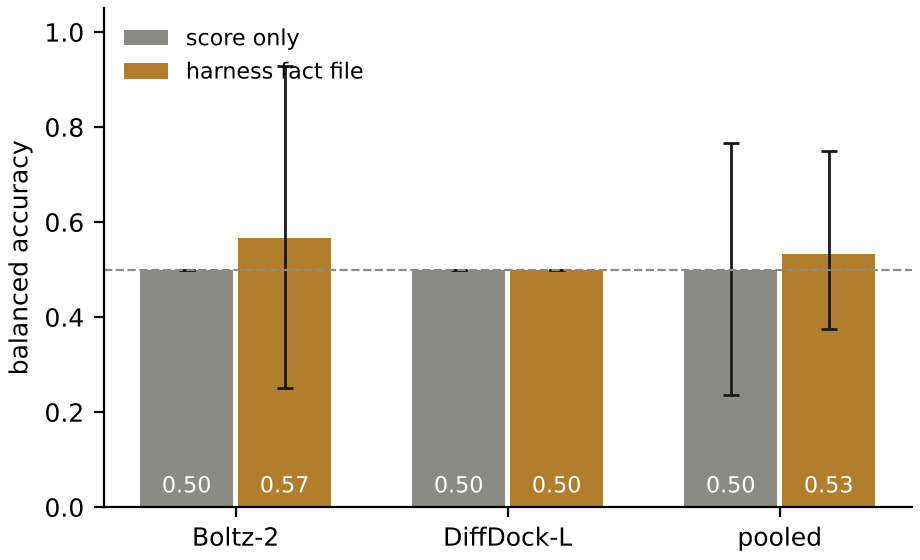
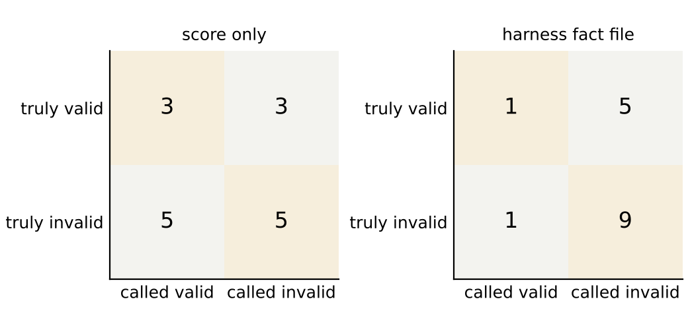
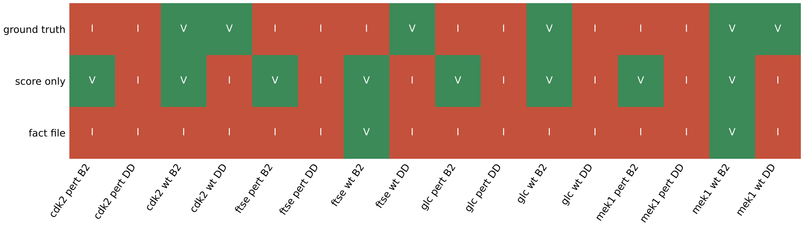

# Perturbation benchmark, run 2026-10-17T1611Z-426bfe9

## Summary

| Scope | Predictions | Score only, balanced accuracy (95% CI) | Fact file, balanced accuracy (95% CI) | McNemar exact p |
| --- | --- | --- | --- | --- |
| pooled | 16 (6 valid, 10 invalid) | 0.5 (0.236 to 0.767) | 0.533 (0.375 to 0.75) | 0.6875 |
| Boltz-2 | 8 (3 valid, 5 invalid) | 0.5 (0.5 to 0.5) | 0.567 (0.25 to 0.929) | 0.6875 |
| DiffDock-L | 8 (3 valid, 5 invalid) | 0.5 (0.5 to 0.5) | 0.5 (0.5 to 0.5) | 1.0 |

Decisions are the majority over 3 repeats at temperature 0 (glm-4.6). Agreement across repeats: score only 0.938, fact file 0.958. Failed agent calls: 0. Predictions without ground truth: 0.

## Design

Ground truth by construction: a perturbed system is invalid; a wild-type system is valid when the representative pose lies within 2.0 Å (symmetry-aware heavy-atom RMSD, spyrmsd) of the deposited ligand. The representative pose is the medoid of the largest cluster at 2.0 Å over the 3 seeds (harness l5.sampling.clusters). The RMSD to the deposited ligand is never part of a fact file.

| System | Entry | Ligand | Perturbation | Mutated positions |
| --- | --- | --- | --- | --- |
| CDK2 | 1B38 chain A | ATP | 13 contacts within 3.5 Å to glycine | ILE10, THR14, VAL18, ALA31, LYS33, GLU81, LEU83, ASP86, LYS129, GLN131, ASN132, LEU134, ASP145 |
| FtsE | 8X61 chain A | ATP | 7 contacts within 3.5 Å to glycine | TYR11, HIS36, ALA39, LYS41, SER42, THR43, GLN86 |
| glucose dehydrogenase (glucose-binding) | 2VWH chain A | BGC | 3 ring hydroxyls methylated (O2, O3, O4) | none (ligand modified) |
| MEK1 | 7XLP chain A | FZC | 11 contacts within 3.5 Å to glycine | ALA76, ALA95, LYS97, ILE141, GLU144, MET146, SER194, ASN195, LEU197, ASP208, PHE209 |

## Results per prediction

| Prediction | RMSD to deposited ligand (Å) | Truth | Score only | Fact file |
| --- | --- | --- | --- | --- |
| cdk2_pert · Boltz-2 | 2.392 | invalid | valid (valid,valid,valid) | invalid (invalid,invalid,invalid) |
| cdk2_pert · DiffDock-L | 0.918 | invalid | invalid (invalid,invalid,invalid) | invalid (invalid,invalid,invalid) |
| cdk2_wt · Boltz-2 | 1.499 | valid | valid (valid,valid,valid) | invalid (invalid,invalid,invalid) |
| cdk2_wt · DiffDock-L | 0.791 | valid | invalid (invalid,valid,invalid) | invalid (invalid,invalid,invalid) |
| ftse_pert · Boltz-2 | 15.415 | invalid | valid (valid,valid,valid) | invalid (invalid,invalid,invalid) |
| ftse_pert · DiffDock-L | 17.74 | invalid | invalid (valid,invalid,invalid) | invalid (invalid,invalid,invalid) |
| ftse_wt · Boltz-2 | 2.82 | invalid | valid (valid,valid,valid) | valid (valid,invalid,valid) |
| ftse_wt · DiffDock-L | 0.934 | valid | invalid (invalid,invalid,invalid) | invalid (invalid,invalid,invalid) |
| glc_pert · Boltz-2 | n/a | invalid | valid (valid,valid,valid) | invalid (invalid,invalid,invalid) |
| glc_pert · DiffDock-L | n/a | invalid | invalid (invalid,invalid,valid) | invalid (invalid,invalid,invalid) |
| glc_wt · Boltz-2 | 0.298 | valid | valid (valid,valid,valid) | invalid (invalid,invalid,invalid) |
| glc_wt · DiffDock-L | 14.116 | invalid | invalid (invalid,invalid,invalid) | invalid (invalid,invalid,invalid) |
| mek1_pert · Boltz-2 | 3.036 | invalid | valid (valid,valid,valid) | invalid (invalid,invalid,invalid) |
| mek1_pert · DiffDock-L | 1.463 | invalid | invalid (invalid,invalid,invalid) | invalid (invalid,invalid,invalid) |
| mek1_wt · Boltz-2 | 0.613 | valid | valid (valid,valid,valid) | valid (valid,invalid,valid) |
| mek1_wt · DiffDock-L | 1.51 | valid | invalid (invalid,invalid,invalid) | invalid (invalid,invalid,invalid) |

## Fact file values

| Prediction | Confidence | PoseBusters | Deposited interactions recovered | Strain (kcal/mol) | Buried unsatisfied polars | Hydrophobic complementarity | Ensemble spread (Å) | Medoid cluster fraction | Cross-executor RMSD (Å) |
| --- | --- | --- | --- | --- | --- | --- | --- | --- | --- |
| cdk2_pert · Boltz-2 | ligand_iptm 0.947, pocket_plddt 85, confidence_score 0.894 | 20/20 | 1/9 | 13.6 | 5 | 0.479 | 0.894 | 1 | 2.66 |
| cdk2_pert · DiffDock-L | diffdock_confidence -2.73 | 19/20 | 0/9 | 26.1 | 0 | 0.433 | 2.14 | 0.667 | 2.66 |
| cdk2_wt · Boltz-2 | ligand_iptm 0.975, pocket_plddt 94.9, confidence_score 0.958 | 19/20 | 5/9 | 12.3 | 5 | 0.639 | 1.16 | 1 | 1.67 |
| cdk2_wt · DiffDock-L | diffdock_confidence -0.34 | 19/20 | 9/9 | 22.9 | 2 | 0.813 | 1.01 | 1 | 1.67 |
| ftse_pert · Boltz-2 | ligand_iptm 0.898, pocket_plddt 85.5, confidence_score 0.893 | 20/20 | 0/16 | 20.4 | 3 | 0.732 | 1.42 | 1 | 4.21 |
| ftse_pert · DiffDock-L | diffdock_confidence -1 | 20/20 | 0/16 | 20.7 | 2 | 0.4 | 0.969 | 1 | 4.21 |
| ftse_wt · Boltz-2 | ligand_iptm 0.962, pocket_plddt 94.8, confidence_score 0.939 | 20/20 | 9/16 | 5.15 | 2 | 0.556 | 0.318 | 1 | 2.56 |
| ftse_wt · DiffDock-L | diffdock_confidence -0.78 | 20/20 | 10/16 | 20.4 | 3 | 0.75 | 0.458 | 1 | 2.56 |
| glc_pert · Boltz-2 | ligand_iptm 0.983, pocket_plddt 97.7, confidence_score 0.965 | 19/20 | 3/6 | 9.58 | 0 | 0.597 | 3.68 | 0.667 | 12.3 |
| glc_pert · DiffDock-L | diffdock_confidence -4.43 | 18/20 | 0/6 | 15.3 | 1 | 0.693 | 16.2 | 0.333 | 12.3 |
| glc_wt · Boltz-2 | ligand_iptm 0.99, pocket_plddt 97.3, confidence_score 0.982 | 20/20 | 4/6 | 4.26 | 0 | 0.535 | 0.091 | 1 | 14.4 |
| glc_wt · DiffDock-L | diffdock_confidence -2.66 | 18/20 | 0/6 | 4.26 | 0 | 0.757 | 8.87 | 0.333 | 14.4 |
| mek1_pert · Boltz-2 | ligand_iptm 0.97, pocket_plddt 90.5, confidence_score 0.92 | 20/20 | 0/3 | 2.15 | 1 | 0.653 | 0.335 | 1 | 2.97 |
| mek1_pert · DiffDock-L | diffdock_confidence -0.15 | 19/20 | 0/3 | 1.86 | 1 | 0.678 | 1.35 | 1 | 2.97 |
| mek1_wt · Boltz-2 | ligand_iptm 0.988, pocket_plddt 96.5, confidence_score 0.94 | 20/20 | 2/3 | 1.59 | 4 | 0.79 | 0.146 | 1 | 1.45 |
| mek1_wt · DiffDock-L | diffdock_confidence 0.35 | 20/20 | 2/3 | 2.06 | 2 | 0.698 | 11.4 | 0.667 | 1.45 |

## Agent reasons for misclassified predictions

Repeat 0 of each arm, quoted from `agent/calls.jsonl`.

| Prediction | Truth | Arm | Verdict | Reason |
| --- | --- | --- | --- | --- |
| cdk2_pert · Boltz-2 | invalid | score only | valid | The high ligand ipTM of 0.947 and high pocket pLDDT of 85 both indicate a highly confident and plausible predicted binding pose. |
| cdk2_wt · Boltz-2 | valid | fact file | invalid | The pose fails the minimum_distance_to_protein check, has unacceptably high torsional strain (12.3 kcal/mol), and leaves 5 buried polar atoms unsatisfied, collectively indicating an implausible binding conformation despite high model confidence. |
| cdk2_wt · DiffDock-L | valid | score only | invalid | The DiffDock-L confidence score of -0.34 is low, indicating the model has poor confidence in the predicted pose. |
| cdk2_wt · DiffDock-L | valid | fact file | invalid | The pose fails the minimum_distance_to_protein check (ligand too far from protein) and has extremely high torsional strain (22.9 kcal/mol), which together undermine binding credibility despite recovering all 9 deposited interactions. |
| ftse_pert · Boltz-2 | invalid | score only | valid | The high ligand ipTM of 0.898 and high pocket pLDDT of 85.5 both indicate a highly confident and well-resolved predicted binding pose. |
| ftse_wt · Boltz-2 | invalid | score only | valid | Both the ligand ipTM (0.962) and pocket pLDDT (94.8) are exceptionally high, indicating a highly confident and structurally sound predicted pose. |
| ftse_wt · Boltz-2 | invalid | fact file | valid | The pose passes all physical validity checks, recovers 9 of 16 known interactions including key contacts (pi_stack TYR11A, salt_bridge LYS41A, multiple backbone H-bonds), and shows excellent within-ensemble convergence, though moderate torsional strain (5.15 kcal/mol), two unsatisfied buried polar atoms, and 2.56 Å cross-executor disagreement temper confidence. |
| ftse_wt · DiffDock-L | valid | score only | invalid | A DiffDock-L confidence score of -0.78 indicates low-to-moderate confidence, which is insufficient to trust the predicted pose as reliable evidence of binding. |
| ftse_wt · DiffDock-L | valid | fact file | invalid | The ligand torsional strain of 20.4 kcal/mol is unacceptably high, and combined with a negative confidence score (-0.78), poor cross-executor agreement (2.56 Å RMSD), and 3 buried polar atoms lacking hydrogen-bond partners, this pose is not credible evidence of binding. |
| glc_pert · Boltz-2 | invalid | score only | valid | The ligand ipTM of 0.983 and pocket pLDDT of 97.7 are both exceptionally high, indicating a highly confident and plausible binding pose. |
| glc_wt · Boltz-2 | valid | fact file | invalid | The extremely poor cross-executor agreement (14.4 Å RMSD) indicates that different computational methods place the ligand in completely different locations, undermining confidence that this specific pose represents the true binding orientation despite its physical validity and partial interaction recovery. |
| mek1_pert · Boltz-2 | invalid | score only | valid | Both the ligand ipTM (0.97) and pocket pLDDT (90.5) are very high, indicating a highly confident and plausible predicted pose. |
| mek1_wt · DiffDock-L | valid | score only | invalid | The DiffDock-L confidence score of 0.35 is too low to reliably trust the predicted binding pose. |
| mek1_wt · DiffDock-L | valid | fact file | invalid | The very high ensemble RMSD spread of 11.4 Å indicates poor convergence across seeds, and combined with the low confidence score (0.35) and only partial recovery of key interactions (2 of 3), this pose lacks sufficient reliability to serve as credible binding evidence. |

## Figures

Balanced accuracy per arm and executor with 95% bootstrap intervals over predictions; dashed line at 0.5. Data: `results/figures/balanced_accuracy.csv`.

Confusion matrices, pooled over 16 predictions. Data: `results/figures/confusion.csv`.

Ground truth and majority decision per prediction. Data: `results/figures/decisions.csv`.

## Run record

- Commit 9fb7aa7 on claude/blissful-johnson-j76s9r.
- GPUs: NVIDIA A100-SXM4-40GB, 610.57.04, 40960 MiB on Modal; images {'boltz2': None, 'diffdock': 'im-x9zfDmm5IJzmQ6ydao7RUw'}.
- Executors: Boltz-2 2.2.1, DiffDock-L v1.1.3 (rbgcsail/diffdock image); seeds [1, 2, 3]; DiffDock samples per run 10. DiffDock has no seed option; its seeds label replicate runs.
- Agent: glm-4.6 through https://api.z.ai/api/paas/v4; every prompt and response in `agent/calls.jsonl`.
- Sources: 8X61.cif sha256 ba2b64fd50fa, 1B38.cif sha256 b851c5e8a986, 7XLP.cif sha256 48ffbc34e5fd, 2VWH.cif sha256 563276ca06d2.
- Harness runs per prediction: `harness/<system>_<executor>/run/` (record, report, renders).

## Limitations

- Eight systems per executor support a demonstration, not a statistical claim; the intervals above are the measure of that.
- Perturbed systems are negatives by construction, which assumes the perturbation abolishes binding; the assumption is inherited from the source studies.
- The arms differ in prompt length as well as content; a length-matched control arm was not run.
- Wild-type ground truth uses the deposited ligand position as the reference pose.
- The runbook names the glucose ligand GLC; entry 2VWH holds BGC, which was used. The 8X61 FtsE chain A has 7 contacts within 3.5 Å that are not already glycine; the runbook cites 12 from the source study.
