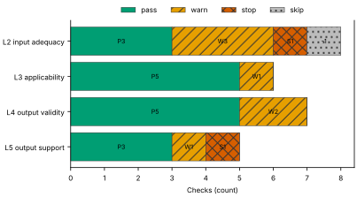
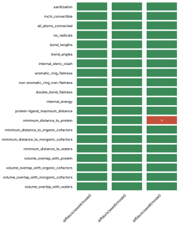
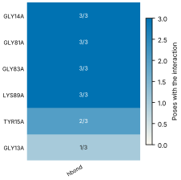
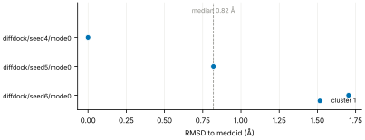
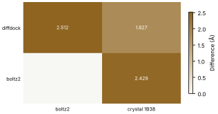

# Run report · Ligand pose in a known pocket

Prediction assurance · run `ligand_pose-077ac8cd70e3` · 2026-10-17 18:06:08 UTC

**Refused** for the claim "Predicted pose of ATP in CDK2 is valid".

Refused over layers 2,3,4,5: 16 pass, 7 warn, 2 stop, 1 skip. Stopped by l2.context.cofactors, l5.controls.redocking. Warnings from l2.receptor.protonation, l2.ligand.protonation, l2.docking.box, l3.exposure.ligand_prevalence, l4.torsion_strain, l4.minimisation_drift, l5.agreement.cross_family.

Stops: `l2.context.cofactors`, `l5.controls.redocking`.

Warnings: `l2.receptor.protonation`, `l2.ligand.protonation`, `l2.docking.box`, `l3.exposure.ligand_prevalence`, `l4.torsion_strain`, `l4.minimisation_drift`, `l5.agreement.cross_family`.

| Field | Value |
| --- | --- |
| Task | Ligand pose in a known pocket (`ligand_pose`) |
| Tools | DiffDock-L v1.1.3 (docking), Boltz-2 (co-folding) |
| Target | `protein` |
| Ligand | `c1nc(c2c(n1)n(cn2)[C@H]3[C@@H]([C@@H]([C@H](O3)CO[P@@](=O)(O)O[P@](=O)(O)OP(=O)(O)O)O)O)N` |
| Reference | `1B38` |
| pH | 7.4 |
| Seeds | 3 |
| Layers run | 2, 3, 4, 5 |
| Run | `ligand_pose-077ac8cd70e3` |
| Created | 2026-10-17 18:06:08 UTC |
| Finished | 2026-10-17 18:07:56 UTC |
| pah version | 0.1.0 |
| Report schema | 1 |

## Layers

| Layer | Status | Result | pass | warn | stop | skip | Time |
| --- | --- | --- | --- | --- | --- | --- | --- |
| L0 Provenance | not run | n/a | n/a | n/a | n/a | n/a | n/a |
| L1 Input integrity | not run | n/a | n/a | n/a | n/a | n/a | n/a |
| L2 Input adequacy | done | stop | 3 | 3 | 1 | 1 | 2.0 s |
| L3 Applicability | done | warn | 5 | 1 | 0 | 0 | 565 ms |
| L4 Output validity | done | warn | 5 | 2 | 0 | 0 | 105.3 s |
| L5 Output support | done | stop | 3 | 1 | 1 | 0 | 315 ms |

## Figures

Fig. 1 · Check outcomes per layer for run ligand_pose-077ac8cd70e3. Totals: pass 16, warn 7, stop 2, skip 1.
Files: data [figures/gates_by_layer.csv](figures/gates_by_layer.csv).

## Structures

76 PyMOL renders.

1B38 mmCIF (source_structure), whole structure. Chains A; organic components ACE, ATP. sha256 b851c5e8a98632f8. PyMOL session: [renders/1B38.pse](renders/1B38.pse).

1B38 mmCIF (source_structure), ligand environment within 5 Å. Chains A; organic components ACE, ATP. sha256 b851c5e8a98632f8. PyMOL session: [renders/1B38.pse](renders/1B38.pse).

diffdock/seed4/mode0 (prediction_structure), whole structure. Chains A, L; organic components LIG. sha256 650f604802b30cf5. PyMOL session: [renders/diffdock_seed4_mode0.pse](renders/diffdock_seed4_mode0.pse).

diffdock/seed4/mode0 (prediction_structure), ligand environment within 5 Å. Chains A, L; organic components LIG. sha256 650f604802b30cf5. PyMOL session: [renders/diffdock_seed4_mode0.pse](renders/diffdock_seed4_mode0.pse).

diffdock/seed4/mode1 (prediction_structure), whole structure. Chains A, L; organic components LIG. sha256 f1d45f4c538c1415. PyMOL session: [renders/diffdock_seed4_mode1.pse](renders/diffdock_seed4_mode1.pse).

diffdock/seed4/mode1 (prediction_structure), ligand environment within 5 Å. Chains A, L; organic components LIG. sha256 f1d45f4c538c1415. PyMOL session: [renders/diffdock_seed4_mode1.pse](renders/diffdock_seed4_mode1.pse).

diffdock/seed4/mode2 (prediction_structure), whole structure. Chains A, L; organic components LIG. sha256 d728e48da20cebc3. PyMOL session: [renders/diffdock_seed4_mode2.pse](renders/diffdock_seed4_mode2.pse).

diffdock/seed4/mode2 (prediction_structure), ligand environment within 5 Å. Chains A, L; organic components LIG. sha256 d728e48da20cebc3. PyMOL session: [renders/diffdock_seed4_mode2.pse](renders/diffdock_seed4_mode2.pse).

diffdock/seed4/mode3 (prediction_structure), whole structure. Chains A, L; organic components LIG. sha256 a4b4e2b0708f1e26. PyMOL session: [renders/diffdock_seed4_mode3.pse](renders/diffdock_seed4_mode3.pse).

diffdock/seed4/mode3 (prediction_structure), ligand environment within 5 Å. Chains A, L; organic components LIG. sha256 a4b4e2b0708f1e26. PyMOL session: [renders/diffdock_seed4_mode3.pse](renders/diffdock_seed4_mode3.pse).

diffdock/seed4/mode4 (prediction_structure), whole structure. Chains A, L; organic components LIG. sha256 0eee31234c6ded35. PyMOL session: [renders/diffdock_seed4_mode4.pse](renders/diffdock_seed4_mode4.pse).

diffdock/seed4/mode4 (prediction_structure), ligand environment within 5 Å. Chains A, L; organic components LIG. sha256 0eee31234c6ded35. PyMOL session: [renders/diffdock_seed4_mode4.pse](renders/diffdock_seed4_mode4.pse).

diffdock/seed4/mode5 (prediction_structure), whole structure. Chains A, L; organic components LIG. sha256 1b6b95a837874f5b. PyMOL session: [renders/diffdock_seed4_mode5.pse](renders/diffdock_seed4_mode5.pse).

diffdock/seed4/mode5 (prediction_structure), ligand environment within 5 Å. Chains A, L; organic components LIG. sha256 1b6b95a837874f5b. PyMOL session: [renders/diffdock_seed4_mode5.pse](renders/diffdock_seed4_mode5.pse).

diffdock/seed4/mode6 (prediction_structure), whole structure. Chains A, L; organic components LIG. sha256 afa4957bf2245365. PyMOL session: [renders/diffdock_seed4_mode6.pse](renders/diffdock_seed4_mode6.pse).

diffdock/seed4/mode6 (prediction_structure), ligand environment within 5 Å. Chains A, L; organic components LIG. sha256 afa4957bf2245365. PyMOL session: [renders/diffdock_seed4_mode6.pse](renders/diffdock_seed4_mode6.pse).

diffdock/seed4/mode7 (prediction_structure), whole structure. Chains A, L; organic components LIG. sha256 6a1fd6bbd09e2bc1. PyMOL session: [renders/diffdock_seed4_mode7.pse](renders/diffdock_seed4_mode7.pse).

diffdock/seed4/mode7 (prediction_structure), ligand environment within 5 Å. Chains A, L; organic components LIG. sha256 6a1fd6bbd09e2bc1. PyMOL session: [renders/diffdock_seed4_mode7.pse](renders/diffdock_seed4_mode7.pse).

diffdock/seed4/mode8 (prediction_structure), whole structure. Chains A, L; organic components LIG. sha256 76f41792d9acd783. PyMOL session: [renders/diffdock_seed4_mode8.pse](renders/diffdock_seed4_mode8.pse).

diffdock/seed4/mode8 (prediction_structure), ligand environment within 5 Å. Chains A, L; organic components LIG. sha256 76f41792d9acd783. PyMOL session: [renders/diffdock_seed4_mode8.pse](renders/diffdock_seed4_mode8.pse).

diffdock/seed4/mode9 (prediction_structure), whole structure. Chains A, L; organic components LIG. sha256 9502241be603e178. PyMOL session: [renders/diffdock_seed4_mode9.pse](renders/diffdock_seed4_mode9.pse).

diffdock/seed4/mode9 (prediction_structure), ligand environment within 5 Å. Chains A, L; organic components LIG. sha256 9502241be603e178. PyMOL session: [renders/diffdock_seed4_mode9.pse](renders/diffdock_seed4_mode9.pse).

diffdock/seed5/mode0 (prediction_structure), whole structure. Chains A, L; organic components LIG. sha256 279d2477aa733ca2. PyMOL session: [renders/diffdock_seed5_mode0.pse](renders/diffdock_seed5_mode0.pse).

diffdock/seed5/mode0 (prediction_structure), ligand environment within 5 Å. Chains A, L; organic components LIG. sha256 279d2477aa733ca2. PyMOL session: [renders/diffdock_seed5_mode0.pse](renders/diffdock_seed5_mode0.pse).

diffdock/seed5/mode1 (prediction_structure), whole structure. Chains A, L; organic components LIG. sha256 767101475f946ea3. PyMOL session: [renders/diffdock_seed5_mode1.pse](renders/diffdock_seed5_mode1.pse).

diffdock/seed5/mode1 (prediction_structure), ligand environment within 5 Å. Chains A, L; organic components LIG. sha256 767101475f946ea3. PyMOL session: [renders/diffdock_seed5_mode1.pse](renders/diffdock_seed5_mode1.pse).

diffdock/seed5/mode2 (prediction_structure), whole structure. Chains A, L; organic components LIG. sha256 8ebdfaf10ef4a59e. PyMOL session: [renders/diffdock_seed5_mode2.pse](renders/diffdock_seed5_mode2.pse).

diffdock/seed5/mode2 (prediction_structure), ligand environment within 5 Å. Chains A, L; organic components LIG. sha256 8ebdfaf10ef4a59e. PyMOL session: [renders/diffdock_seed5_mode2.pse](renders/diffdock_seed5_mode2.pse).

diffdock/seed5/mode3 (prediction_structure), whole structure. Chains A, L; organic components LIG. sha256 713930709b39f2df. PyMOL session: [renders/diffdock_seed5_mode3.pse](renders/diffdock_seed5_mode3.pse).

diffdock/seed5/mode3 (prediction_structure), ligand environment within 5 Å. Chains A, L; organic components LIG. sha256 713930709b39f2df. PyMOL session: [renders/diffdock_seed5_mode3.pse](renders/diffdock_seed5_mode3.pse).

diffdock/seed5/mode4 (prediction_structure), whole structure. Chains A, L; organic components LIG. sha256 f94f5b13f2c5f597. PyMOL session: [renders/diffdock_seed5_mode4.pse](renders/diffdock_seed5_mode4.pse).

diffdock/seed5/mode4 (prediction_structure), ligand environment within 5 Å. Chains A, L; organic components LIG. sha256 f94f5b13f2c5f597. PyMOL session: [renders/diffdock_seed5_mode4.pse](renders/diffdock_seed5_mode4.pse).

diffdock/seed5/mode5 (prediction_structure), whole structure. Chains A, L; organic components LIG. sha256 72ecfb9d5005a9b1. PyMOL session: [renders/diffdock_seed5_mode5.pse](renders/diffdock_seed5_mode5.pse).

diffdock/seed5/mode5 (prediction_structure), ligand environment within 5 Å. Chains A, L; organic components LIG. sha256 72ecfb9d5005a9b1. PyMOL session: [renders/diffdock_seed5_mode5.pse](renders/diffdock_seed5_mode5.pse).

diffdock/seed5/mode6 (prediction_structure), whole structure. Chains A, L; organic components LIG. sha256 45148563f7fde6be. PyMOL session: [renders/diffdock_seed5_mode6.pse](renders/diffdock_seed5_mode6.pse).

diffdock/seed5/mode6 (prediction_structure), ligand environment within 5 Å. Chains A, L; organic components LIG. sha256 45148563f7fde6be. PyMOL session: [renders/diffdock_seed5_mode6.pse](renders/diffdock_seed5_mode6.pse).

diffdock/seed5/mode7 (prediction_structure), whole structure. Chains A, L; organic components LIG. sha256 bce173e7a59fd848. PyMOL session: [renders/diffdock_seed5_mode7.pse](renders/diffdock_seed5_mode7.pse).

diffdock/seed5/mode7 (prediction_structure), ligand environment within 5 Å. Chains A, L; organic components LIG. sha256 bce173e7a59fd848. PyMOL session: [renders/diffdock_seed5_mode7.pse](renders/diffdock_seed5_mode7.pse).

diffdock/seed5/mode8 (prediction_structure), whole structure. Chains A, L; organic components LIG. sha256 6cbf2554e64e561c. PyMOL session: [renders/diffdock_seed5_mode8.pse](renders/diffdock_seed5_mode8.pse).

diffdock/seed5/mode8 (prediction_structure), ligand environment within 5 Å. Chains A, L; organic components LIG. sha256 6cbf2554e64e561c. PyMOL session: [renders/diffdock_seed5_mode8.pse](renders/diffdock_seed5_mode8.pse).

diffdock/seed5/mode9 (prediction_structure), whole structure. Chains A, L; organic components LIG. sha256 29fe47ff702cf416. PyMOL session: [renders/diffdock_seed5_mode9.pse](renders/diffdock_seed5_mode9.pse).

diffdock/seed5/mode9 (prediction_structure), ligand environment within 5 Å. Chains A, L; organic components LIG. sha256 29fe47ff702cf416. PyMOL session: [renders/diffdock_seed5_mode9.pse](renders/diffdock_seed5_mode9.pse).

diffdock/seed6/mode0 (prediction_structure), whole structure. Chains A, L; organic components LIG. sha256 ac7f72d1b1569ee5. PyMOL session: [renders/diffdock_seed6_mode0.pse](renders/diffdock_seed6_mode0.pse).

diffdock/seed6/mode0 (prediction_structure), ligand environment within 5 Å. Chains A, L; organic components LIG. sha256 ac7f72d1b1569ee5. PyMOL session: [renders/diffdock_seed6_mode0.pse](renders/diffdock_seed6_mode0.pse).

diffdock/seed6/mode1 (prediction_structure), whole structure. Chains A, L; organic components LIG. sha256 231ae422f5c53ade. PyMOL session: [renders/diffdock_seed6_mode1.pse](renders/diffdock_seed6_mode1.pse).

diffdock/seed6/mode1 (prediction_structure), ligand environment within 5 Å. Chains A, L; organic components LIG. sha256 231ae422f5c53ade. PyMOL session: [renders/diffdock_seed6_mode1.pse](renders/diffdock_seed6_mode1.pse).

diffdock/seed6/mode2 (prediction_structure), whole structure. Chains A, L; organic components LIG. sha256 9b65425e51764814. PyMOL session: [renders/diffdock_seed6_mode2.pse](renders/diffdock_seed6_mode2.pse).

diffdock/seed6/mode2 (prediction_structure), ligand environment within 5 Å. Chains A, L; organic components LIG. sha256 9b65425e51764814. PyMOL session: [renders/diffdock_seed6_mode2.pse](renders/diffdock_seed6_mode2.pse).

diffdock/seed6/mode3 (prediction_structure), whole structure. Chains A, L; organic components LIG. sha256 96fca53f3ca0aac0. PyMOL session: [renders/diffdock_seed6_mode3.pse](renders/diffdock_seed6_mode3.pse).

diffdock/seed6/mode3 (prediction_structure), ligand environment within 5 Å. Chains A, L; organic components LIG. sha256 96fca53f3ca0aac0. PyMOL session: [renders/diffdock_seed6_mode3.pse](renders/diffdock_seed6_mode3.pse).

diffdock/seed6/mode4 (prediction_structure), whole structure. Chains A, L; organic components LIG. sha256 77d16ba7d3b54d46. PyMOL session: [renders/diffdock_seed6_mode4.pse](renders/diffdock_seed6_mode4.pse).

diffdock/seed6/mode4 (prediction_structure), ligand environment within 5 Å. Chains A, L; organic components LIG. sha256 77d16ba7d3b54d46. PyMOL session: [renders/diffdock_seed6_mode4.pse](renders/diffdock_seed6_mode4.pse).

diffdock/seed6/mode5 (prediction_structure), whole structure. Chains A, L; organic components LIG. sha256 ea558fc49f90afc1. PyMOL session: [renders/diffdock_seed6_mode5.pse](renders/diffdock_seed6_mode5.pse).

diffdock/seed6/mode5 (prediction_structure), ligand environment within 5 Å. Chains A, L; organic components LIG. sha256 ea558fc49f90afc1. PyMOL session: [renders/diffdock_seed6_mode5.pse](renders/diffdock_seed6_mode5.pse).

diffdock/seed6/mode6 (prediction_structure), whole structure. Chains A, L; organic components LIG. sha256 eebe9511091716dd. PyMOL session: [renders/diffdock_seed6_mode6.pse](renders/diffdock_seed6_mode6.pse).

diffdock/seed6/mode6 (prediction_structure), ligand environment within 5 Å. Chains A, L; organic components LIG. sha256 eebe9511091716dd. PyMOL session: [renders/diffdock_seed6_mode6.pse](renders/diffdock_seed6_mode6.pse).

diffdock/seed6/mode7 (prediction_structure), whole structure. Chains A, L; organic components LIG. sha256 6ee309e1ba458dd3. PyMOL session: [renders/diffdock_seed6_mode7.pse](renders/diffdock_seed6_mode7.pse).

diffdock/seed6/mode7 (prediction_structure), ligand environment within 5 Å. Chains A, L; organic components LIG. sha256 6ee309e1ba458dd3. PyMOL session: [renders/diffdock_seed6_mode7.pse](renders/diffdock_seed6_mode7.pse).

diffdock/seed6/mode8 (prediction_structure), whole structure. Chains A, L; organic components LIG. sha256 b296d1c587da4c29. PyMOL session: [renders/diffdock_seed6_mode8.pse](renders/diffdock_seed6_mode8.pse).

diffdock/seed6/mode8 (prediction_structure), ligand environment within 5 Å. Chains A, L; organic components LIG. sha256 b296d1c587da4c29. PyMOL session: [renders/diffdock_seed6_mode8.pse](renders/diffdock_seed6_mode8.pse).

diffdock/seed6/mode9 (prediction_structure), whole structure. Chains A, L; organic components LIG. sha256 f6bb4c07980a307f. PyMOL session: [renders/diffdock_seed6_mode9.pse](renders/diffdock_seed6_mode9.pse).

diffdock/seed6/mode9 (prediction_structure), ligand environment within 5 Å. Chains A, L; organic components LIG. sha256 f6bb4c07980a307f. PyMOL session: [renders/diffdock_seed6_mode9.pse](renders/diffdock_seed6_mode9.pse).

boltz2/seed4/sample0 (prediction_structure), whole structure. Chains A, C1, L; organic components LIG1. sha256 9574f98d2e42accc. PyMOL session: [renders/boltz2_seed4_sample0.pse](renders/boltz2_seed4_sample0.pse).

boltz2/seed4/sample0 (prediction_structure), ligand environment within 5 Å. Chains A, C1, L; organic components LIG1. sha256 9574f98d2e42accc. PyMOL session: [renders/boltz2_seed4_sample0.pse](renders/boltz2_seed4_sample0.pse).

boltz2/seed5/sample0 (prediction_structure), whole structure. Chains A, C1, L; organic components LIG1. sha256 8cb3ae853c4dff04. PyMOL session: [renders/boltz2_seed5_sample0.pse](renders/boltz2_seed5_sample0.pse).

boltz2/seed5/sample0 (prediction_structure), ligand environment within 5 Å. Chains A, C1, L; organic components LIG1. sha256 8cb3ae853c4dff04. PyMOL session: [renders/boltz2_seed5_sample0.pse](renders/boltz2_seed5_sample0.pse).

boltz2/seed6/sample0 (prediction_structure), whole structure. Chains A, C1, L; organic components LIG1. sha256 42603e5ade458842. PyMOL session: [renders/boltz2_seed6_sample0.pse](renders/boltz2_seed6_sample0.pse).

boltz2/seed6/sample0 (prediction_structure), ligand environment within 5 Å. Chains A, C1, L; organic components LIG1. sha256 42603e5ade458842. PyMOL session: [renders/boltz2_seed6_sample0.pse](renders/boltz2_seed6_sample0.pse).

1B39 mmCIF (source_structure), whole structure. Chains A; organic components ACE, ATP. sha256 43b7b7417024c3f4. PyMOL session: [renders/1B39.pse](renders/1B39.pse).

1B39 mmCIF (source_structure), ligand environment within 5 Å. Chains A; organic components ACE, ATP. sha256 43b7b7417024c3f4. PyMOL session: [renders/1B39.pse](renders/1B39.pse).

1FIN mmCIF (source_structure), whole structure. Chains A, B, C, D; organic components ATP. sha256 dfe5da37b2e28d3d. PyMOL session: [renders/1FIN.pse](renders/1FIN.pse).

1FIN mmCIF (source_structure), ligand environment within 5 Å. Chains A, B, C, D; organic components ATP. sha256 dfe5da37b2e28d3d. PyMOL session: [renders/1FIN.pse](renders/1FIN.pse).

1FQ1 mmCIF (source_structure), whole structure. Chains A, B; organic components ATP. sha256 f86aad4d11e29283. PyMOL session: [renders/1FQ1.pse](renders/1FQ1.pse).

1FQ1 mmCIF (source_structure), ligand environment within 5 Å. Chains A, B; organic components ATP. sha256 f86aad4d11e29283. PyMOL session: [renders/1FQ1.pse](renders/1FQ1.pse).

1GY3 mmCIF (source_structure), whole structure. Chains A, B, C, D, E, F; organic components ATP, GOL, TPO. sha256 fb1e8e095ae9fe28. PyMOL session: [renders/1GY3.pse](renders/1GY3.pse).

1GY3 mmCIF (source_structure), ligand environment within 5 Å. Chains A, B, C, D, E, F; organic components ATP, GOL, TPO. sha256 fb1e8e095ae9fe28. PyMOL session: [renders/1GY3.pse](renders/1GY3.pse).

## L0 Provenance

Where did every input come from?

Status: not run.

## L1 Input integrity

Did the run receive exactly what was declared?

Status: not run.

## L2 Input adequacy

Does the input carry enough information?

Status: done. Checks: pass 3 · warn 3 · stop 1 · skip 1. Time: 2.0 s.

#### Key figures

| Figure | Value |
| --- | --- |
| near site | 1 |
| missing | 1 |
| uniprot cofactors | 0 |
| pocket residues | 30 |
| incomplete | 0 |
| sequence gaps | 0 |
| state | holo |
| site ligands | 1 |

#### Docking

| Field | Value |
| --- | --- |
| center | -1.248, 27.587, 11.585 Å |
| size | 15.545 × 17.083 × 18.375 Å |
| origin | derived from ATP (+4 Å) |

#### Checks

| Check | Result | Measured cmp threshold | Evidence | Id · time |
| --- | --- | --- | --- | --- |
| Alignment depth, distinct sequences, Neff and gap fraction | skip | n/a | no MSA declared for a co-folding model · not applicable | `l2.msa.depth` |
| Required cofactors, ions and partners present | stop | `pocket_distance <= 8` | components within 8.0 Å of ATP in 1B38 not supplied: MG · near_site=1, missing=1, uniprot_cofactors=0 | `l2.context.cofactors` · 250 ms |
| Pocket residues resolved, no missing loops lining the pocket | pass | `pocket_distance <= 6` | 30 pocket residues complete in 1B38.cif · pocket_residues=30, incomplete=0, sequence_gaps=0 | `l2.pocket.resolved` · 14 ms |
| Receptor state apo or holo | pass | n/a | 1B38.cif holo: ATP in the site · state=holo, site_ligands=1 | `l2.receptor.state` · 15 ms |
| Receptor protonation at the stated pH | warn | `pka_margin > 1` | receptor has no hydrogens (protonation not assigned) · hydrogens_present=False, ph=7.4, pocket_titratable=14 | `l2.receptor.protonation` · 451 ms |
| Ligand protonation and tautomers enumerated at the stated pH | warn | `ph 7.4 == 1` | ligand: 2 states; ligand: declared form Nc1ncnc2c1ncn2[C@@H]1O[C@H](CO[P@@](=O)(O)O[P@](=O)(O)OP(=O)(O)O)[C@@H](O)[C@H]1O differs from enumerated Nc1ncnc2c1ncn2[C@@H]1O[C@H](CO[P@@](=O)([O-])O[P@](=O)([O-])OP(=O)([O-])O)[C@@H](O)[C@H]1O, Nc1ncnc2c1ncn2[C@@H]1O[C@H](CO[P@@](=O)([O-])O[P@](=O)([O-])OP(=O)([O-])[O-])[C@@H](O)[C@H]1O · ph=7.4, max_states=2, declared_not_enumerated=1 | `l2.ligand.protonation` · 70 ms |
| Ligand conformers generated and minimised | pass | `conformers >= 10` | 10 ETKDG conformers per ligand, MMFF minimised · ligands=1, failed=0, min_embedded=10 | `l2.ligand.conformers` · 1.1 s |
| Docking box encloses the pocket with margin | warn | `margin >= 2` | no box declared; derived box encloses 22 contact residues and the ATP ligand with 2.0 Å margin · volume_A3=4879.6, ligand_atoms_inside_margin=31, ligand_atoms=31 | `l2.docking.box` · 8 ms |

## L3 Applicability

Is the tool inside its validated regime?

Status: done. Checks: pass 5 · warn 1 · stop 0 · skip 0. Time: 565 ms.

#### Key figures

| Figure | Value |
| --- | --- |
| executors | 2 |
| unknown | 0 |
| reference released | 1998-12-23 |
| cutoff | 2019-01-01 |
| entries compared | 5 |
| max similarity | 29.6 |
| pocket residues | 26 |
| systems | 3474 |

#### Checks

| Check | Result | Measured cmp threshold | Evidence | Id · time |
| --- | --- | --- | --- | --- |
| Model training cutoff recorded | pass | `training_cutoff == recorded` | diffdock 2019-01-01; boltz2 2023-06-01; reference 1B38 released 1998-12-23, before the cutoff of diffdock, boltz2 · executors=2, unknown=0, reference_released=1998-12-23 | `l3.model.training_cutoff` · 0 ms |
| Pocket similarity to pre-cutoff complexes (SuCOS times pocket coverage) | pass | `similarity <= 50` | max similarity 29.6 to 1B39 (ATP, SuCOS 0.513, coverage 0.577), released before 2019-01-01 · cutoff=2019-01-01, entries_compared=5, max_similarity=29.6 | `l3.exposure.pocket` · 554 ms |
| Ligand analogues in pre-cutoff training systems | warn | `tanimoto > 0.9` | 3474 PDB entries released before 2019-01-01 (diffdock cutoff) contain analogues of ligand above Tanimoto 0.9: 5FA, ADP, AQP, ATP, HEJ, LA8 · cutoff=2019-01-01, systems=3474, analogue_components=19 | `l3.exposure.ligand_prevalence` · 0 ms |
| Chain sequence identity to pre-cutoff entries (secondary measure) | pass | `identity < 0.4` | protein: 379 entries at 95 percent identity, 453 at 40 percent, released before 2019-01-01 (reported, not gating) · cutoff=2019-01-01, entries_95=379, entries_40=453 | `l3.exposure.sequence` · 1 ms |
| Modality inside the validated set; token count against the training crop | pass | n/a | modalities protein, protein_ligand inside the validated set; 330 tokens · modalities=2, tokens=330, outside=0 | `l3.regime.modality` · 7 ms |
| Endpoint fits the tool | pass | `endpoint pose in pose` | endpoint pose produced by diffdock, boltz2 · endpoint=pose, executors=2, not_fitting=0 | `l3.metric.endpoint` · 0 ms |

## L4 Output validity

Is the result physically and chemically sensible?

Status: done. Checks: pass 5 · warn 2 · stop 0 · skip 0. Time: 105.3 s.

#### Key figures

| Figure | Value |
| --- | --- |
| poses | 3 |
| passed | 20 |
| total | 20 |
| poses all pass | 2 |
| unlikely torsions | 2 |
| torsions | 14 |
| strain kcal | 28.35 |
| poses with unlikely | 2 |

#### PoseBusters · 20/20 tests pass

| test | result | value |
| --- | --- | --- |
| sanitization | pass | pass |
| inchi_convertible | pass | pass |
| all_atoms_connected | pass | pass |
| no_radicals | pass | pass |
| bond_lengths | pass | 0 long outliers |
| bond_angles | pass | 0 outliers |
| internal_steric_clash | pass | 0 |
| aromatic_ring_flatness | pass | 0.00 Å |
| non-aromatic_ring_non-flatness | pass | pass |
| double_bond_flatness | pass | pass |
| internal_energy | pass | 1.8 times the ensemble mean |
| protein-ligand_maximum_distance | pass | 2.61 Å |
| minimum_distance_to_protein | pass | 2.61 Å |
| minimum_distance_to_organic_cofactors | pass | pass |
| minimum_distance_to_inorganic_cofactors | pass | pass |
| minimum_distance_to_waters | pass | pass |
| volume_overlap_with_protein | pass | 0.014 |
| volume_overlap_with_organic_cofactors | pass | pass |
| volume_overlap_with_inorganic_cofactors | pass | pass |
| volume_overlap_with_waters | pass | pass |

#### Per-pose physical checks

| pose | seed | drift Å | converged | unlikely torsions | unsat. polars | buried charged | PoseBusters |
| --- | --- | --- | --- | --- | --- | --- | --- |
| diffdock/seed4/mode0 | 4 | 2.24 | true | 2/14 | 0 | 0 | 20/20 |
| diffdock/seed5/mode0 | 5 | 2.19 | true | 1/14 | 0 | 0 | 20/20 |
| diffdock/seed6/mode0 | 6 | 1.94 | true | 0/14 | 2 | 0 | 19/20 |
| median | n/a | 2.19 | n/a | 1 | 0 | 0 | 20/20 |

#### Interaction fingerprint · representative pose diffdock/seed4/mode0

| residue | type | distance | poses |
| --- | --- | --- | --- |
| GLY14A | hbond | 1.86 Å | 3/3 |
| GLY81A | hbond | 2.54 Å | 3/3 |
| GLY83A | hbond | 2.53 Å | 3/3 |
| LYS89A | hbond | 3.84 Å | 3/3 |
| TYR15A | hbond | 3.72 Å | 2/3 |
| GLY13A | hbond | 3.98 Å | 1/3 |

Fig. 2 · PoseBusters tests (20) by pose (3). Failed cells marked x: 1 of 60.
Files: data [figures/posebusters_grid.csv](figures/posebusters_grid.csv).

Fig. 3 · Interactions by residue (6) and type (1); cell label: poses with the interaction over poses assessed.
Files: data [figures/interactions.csv](figures/interactions.csv).

#### Checks

| Check | Result | Measured cmp threshold | Evidence | Id · time |
| --- | --- | --- | --- | --- |
| PoseBusters geometry, stereochemistry, clashes and protein contact | pass | `tests_failed == 0` | 20 of 20 tests pass for diffdock/seed4/mode0; 2 of 3 poses pass all · poses=3, passed=20, total=20 | `l4.posebusters` · 3.5 s |
| Torsional strain of the ligand pose | warn | `torsion_energy <= 2.5` | 2 of 14 torsions above 2.5 kcal/mol in diffdock/seed4/mode0 · poses=3, unlikely_torsions=2, torsions=14 | `l4.torsion_strain` · 3.8 s |
| Interaction fingerprint (PLIP) | pass | n/a | 6 interactions in diffdock/seed4/mode0 (hbond); 6 distinct across 3 poses (reported) · poses=3, interactions_representative=6, distinct=6 | `l4.interactions.fingerprint` · 929 ms |
| Buried ligand polar atoms without a hydrogen-bond partner | pass | `relative_sasa < 0.1` | 3 buried polar ligand atoms, all with a partner within 3.5 Å in diffdock/seed4/mode0 · poses=3, unsatisfied=0, buried_charged=0 | `l4.interactions.unsatisfied_polars` · 259 ms |
| Hydrophobic complementarity of buried ligand surface | pass | `fraction >= 0.35` | nonpolar fraction of protein contacts around 3 buried nonpolar ligand atoms in diffdock/seed4/mode0: 0.433 · poses=3, complementarity=0.433, buried_nonpolar=3 | `l4.interactions.hydrophobic` · 240 ms |
| Interactions of the crystal ligand reproduced by the pose | pass | `reproduced 1 >= 1` | diffdock/seed4/mode0 reproduces 1 of 9 ATP interactions: hbond TYR15A · key_interactions=9, reproduced=1, poses_reproducing_all=0 | `l4.interactions.known_binders` · 345 ms |
| Pose stability under short restrained minimisation (OpenMM, AMBER14 and OpenFF) | warn | `drift_A 2.24 <= 2` | diffdock/seed4/mode0 moves 2.237 Å under restrained minimisation · poses=3, drift_A=2.237, max_drift_A=2.237 | `l4.minimisation_drift` · 96.3 s |

## L5 Output support

Is a valid result corroborated?

Status: done. Checks: pass 3 · warn 1 · stop 1 · skip 0. Time: 315 ms.

#### Key figures

| Figure | Value |
| --- | --- |
| poses | 3 |
| diffdock confidence | -2.66 |
| independent seeds | 3 |
| samples | 30 |
| duplicated outputs | 0 |
| clusters | 1 |
| largest cluster | 3 |
| pairwise rmsd median A | 1.704 |

#### Sampling

| Field | Value |
| --- | --- |
| site placement | 3 of 3 poses within 4.0 Å of the site (ATP in 1B38) |
| pose accuracy | 3 of 3 poses within 2.0 Å of the medoid |
| pairwise RMSD median | 1.7 Å |
| pairwise RMSD IQR | 1.26 to 1.74 Å |
| pairs | 3 |
| medoid | diffdock/seed4/mode0 |

#### Clusters

| Field | Value |
| --- | --- |
| cluster 1 | 3/3 poses (diffdock/seed4/mode0) |

#### Per-seed statistics

| seed | pose | cluster | RMSD to medoid | confidence |
| --- | --- | --- | --- | --- |
| 4 | diffdock/seed4/mode0 | 1 | 0 Å | -2.66 |
| 5 | diffdock/seed5/mode0 | 1 | 0.82 Å | -2.66 |
| 6 | diffdock/seed6/mode0 | 1 | 1.7 Å | -2.85 |
| median | n/a | n/a | 0.82 Å | -2.66 |

#### Ensemble

| structure | kind | source | RMSD to medoid | cluster | pocket pLDDT | ipTM |
| --- | --- | --- | --- | --- | --- | --- |
| diffdock/seed4/mode0 | medoid | diffdock | 0 Å | 1 | n/a | n/a |
| diffdock/seed5/mode0 | docking | diffdock | 0.82 Å | 1 | n/a | n/a |
| diffdock/seed6/mode0 | docking | diffdock | 1.7 Å | 1 | n/a | n/a |

#### Agreement between methods

| method | boltz2 | crystal 1B38 |
| --- | --- | --- |
| diffdock | 2.51 Å (high) | 1.83 Å (decisive) |
| boltz2 | n/a | 2.43 Å (decisive) |

Fig. 4 · RMSD to the medoid for 3 poses, coloured by cluster (1 clusters). Dashed line: median 0.82 Å; range 0.00 to 1.70 Å.
Files: data [figures/seed_spread.csv](figures/seed_spread.csv).

Fig. 5 · Agreement between 2 methods and 2 comparators; range 1.827 to 2.512 Å.
Files: data [figures/agreement.csv](figures/agreement.csv).

#### Checks

| Check | Result | Measured cmp threshold | Evidence | Id · time |
| --- | --- | --- | --- | --- |
| Confidence restricted to the pocket; per-model thresholds | pass | n/a | diffdock/seed4/mode0: diffdock_confidence -2.66; no per-model confidence threshold registered for diffdock (reported) · poses=3, diffdock_confidence=-2.66 | `l5.confidence.local` · 0 ms |
| Independent seeds counted separately from samples; duplicates flagged | pass | `seeds_docking >= 3` | 3 independent seeds, 30 poses, no duplicates · independent_seeds=3, samples=30, duplicated_outputs=0 | `l5.sampling.seeds` · 0 ms |
| Medoid of the largest cluster, populations, pairwise spread, site and pose accuracy | pass | `cluster_rmsd <= 2` | medoid diffdock/seed4/mode0; 1 clusters, largest 3 of 3; pairwise RMSD median 1.70 Å (IQR 1.26 to 1.74); 3 of 3 poses within 4.0 Å of the site (ATP in 1B38); 3 of 3 poses within 2.0 Å of the medoid · poses=3, clusters=1, largest_cluster=3 | `l5.sampling.clusters` · 225 ms |
| Agreement between methods, weighted by independence | warn | `rmsd_to_crystal_A 1.83 <= 2` | diffdock vs boltz2 2.512 Å (high); diffdock vs crystal 1B38 1.827 Å (decisive); boltz2 vs crystal 1B38 2.429 Å (decisive) · methods=2, comparisons=3, disagreeing=2 | `l5.agreement.cross_family` · 88 ms |
| Redocking control reproduces the crystal pose | stop | `rmsd <= 2` | redocking control required by the task and not supplied (controls.redocking) | `l5.controls.redocking` · 0 ms |

## Controls

| control | status | result |
| --- | --- | --- |
| redocking | incomplete | redocking control required by the task and not supplied (controls.redocking) |

## Provenance

54 objects · 54 cached · 0 network.

| Source | Accession | Release | SHA-256 | Retrieved | Bytes | Cache | Used by |
| --- | --- | --- | --- | --- | --- | --- | --- |
| rcsb_files | 1B38 | n/a | `b851c5e8a986` | 2026-10-17 16:42:54 UTC | 333302 | hit | l2.context.cofactors, l2.pocket.resolved, l2.receptor.state, l2.docking.box, l3.exposure.pocket, l3.regime.modality, l4.interactions.fingerprint, l4.interactions.known_binders, l5.sampling.clusters, l5.agreement.cross_family |
| ccd | ATP | 2011-06-04 | `a7dfd66192d9` | 2026-10-17 16:42:55 UTC | 14836 | hit | l2.context.cofactors, l3.exposure.pocket |
| rcsb | 1B38 | 1.4 | `64dd65fa1b0d` | 2026-10-17 16:42:56 UTC | 16633 | hit | l3.model.training_cutoff |
| rcsb_search | chem:c1nc(c2c(n1)n(cn2)[C@H]3[C@@H]([C@@H]([C@H](O3)CO[P@@](=O)(O)O[P@](=O)(O)OP(=O)(O)O)O)O)N | n/a | `c9ecdf87b8e2` | 2026-10-17 16:42:57 UTC | 1797 | hit | l3.exposure.pocket |
| ccd | 5FA | 2011-06-04 | `141da43b1fd4` | 2026-10-17 16:42:57 UTC | 5208 | hit | l3.exposure.pocket |
| ccd | ADP | 2025-10-10 | `9ebf239d6ded` | 2026-10-17 16:42:57 UTC | 5741 | hit | l3.exposure.pocket |
| ccd | AQP | 2011-06-04 | `d1f31df6170c` | 2026-10-17 16:42:57 UTC | 4700 | hit | l3.exposure.pocket |
| ccd | HEJ | 2021-03-01 | `3793d61303f5` | 2026-10-17 16:42:57 UTC | 4603 | hit | l3.exposure.pocket |
| ccd | LA8 | 2020-06-17 | `3c66f53baf33` | 2026-10-17 16:42:57 UTC | 4178 | hit | l3.exposure.pocket |
| ccd | ZF9 | 2024-03-08 | `b48f6ea5a0a0` | 2026-10-17 16:42:57 UTC | 4686 | hit | l3.exposure.pocket |
| ccd | ZSF | 2024-03-29 | `dde5989ea661` | 2026-10-17 16:42:57 UTC | 4903 | hit | l3.exposure.pocket |
| ccd | 50T | 2026-09-16 | `6be53fbf78af` | 2026-10-17 16:42:57 UTC | 4275 | hit | l3.exposure.pocket |
| ccd | AD9 | 2026-09-16 | `c8798e579e0a` | 2026-10-17 16:42:58 UTC | 4205 | hit | l3.exposure.pocket |
| ccd | AOV | 2026-09-16 | `300b793745cf` | 2026-10-17 16:42:58 UTC | 4330 | hit | l3.exposure.pocket |
| ccd | CX0 | 2022-03-25 | `fbc78ded25cd` | 2026-10-17 16:42:58 UTC | 3595 | hit | l3.exposure.pocket |
| ccd | CXC | 2022-03-25 | `d89a7023bd05` | 2026-10-17 16:42:58 UTC | 3941 | hit | l3.exposure.pocket |
| ccd | 0A | 2015-04-24 | `7f0b456f42e0` | 2026-10-17 16:42:58 UTC | 3972 | hit | l3.exposure.pocket |
| ccd | 3AN | 2011-06-04 | `a3d4d17a4a3e` | 2026-10-17 16:42:58 UTC | 4390 | hit | l3.exposure.pocket |
| ccd | 7DD | 2016-06-10 | `2265ea597be9` | 2026-10-17 16:42:58 UTC | 3425 | hit | l3.exposure.pocket |
| ccd | 7DT | 2016-06-10 | `c346b8a79ec0` | 2026-10-17 16:42:58 UTC | 3725 | hit | l3.exposure.pocket |
| ccd | AAM | 2011-06-04 | `ade365fd93cd` | 2026-10-17 16:42:58 UTC | 4244 | hit | l3.exposure.pocket |
| ccd | PAP | 2011-06-04 | `1a6bb6874f6f` | 2026-10-17 16:42:58 UTC | 4734 | hit | l3.exposure.pocket |
| ccd | XNY | 2021-04-30 | `7cb26ca44908` | 2026-10-17 16:42:58 UTC | 3977 | hit | l3.exposure.pocket |
| ccd | AP5 | 2011-06-04 | `43e554f584b7` | 2026-10-17 16:42:58 UTC | 6473 | hit | l3.exposure.pocket |
| ccd | T99 | 2018-06-01 | `68a3d15f3b6f` | 2026-10-17 16:42:58 UTC | 3399 | hit | l3.exposure.pocket |
| ccd | TAT | 2012-01-25 | `55287be9857e` | 2026-10-17 16:42:58 UTC | 4858 | hit | l3.exposure.pocket |
| ccd | A1L15 | 2025-01-24 | `57864c05fab0` | 2026-10-17 16:42:58 UTC | 5608 | hit | l3.exposure.pocket |
| ccd | AGS | 2020-06-17 | `dcdd428b77e4` | 2026-10-17 16:42:58 UTC | 10128 | hit | l3.exposure.pocket |
| rcsb_search | comp:5FA:2019-01-01 | n/a | `c60bf45b266d` | 2026-10-17 16:42:58 UTC | 282 | hit | l3.exposure.pocket |
| rcsb_search | comp:ADP:2019-01-01 | n/a | `d0ea634975e9` | 2026-10-17 16:42:58 UTC | 52129 | hit | l3.exposure.pocket |
| rcsb_search | comp:AQP:2019-01-01 | n/a | `94a619102faa` | 2026-10-17 16:42:58 UTC | 230 | hit | l3.exposure.pocket |
| rcsb_search | comp:ATP:2019-01-01 | n/a | `88190701e349` | 2026-10-17 16:42:59 UTC | 52129 | hit | l3.exposure.pocket |
| rcsb_search | comp:HEJ:2019-01-01 | n/a | `494129c6512c` | 2026-10-17 16:42:59 UTC | 178 | hit | l3.exposure.pocket |
| rcsb_search | comp:LA8:2019-01-01 | n/a | `185329a63a40` | 2026-10-17 16:42:59 UTC | 230 | hit | l3.exposure.pocket |
| rcsb_search | comp:ZF9:2019-01-01 | n/a | `e3b0c44298fc` | 2026-10-17 16:42:59 UTC | 0 | hit | l3.exposure.pocket |
| rcsb_search | comp:ZSF:2019-01-01 | n/a | `e3b0c44298fc` | 2026-10-17 16:42:59 UTC | 0 | hit | l3.exposure.pocket |
| rcsb_search | comp:50T:2019-01-01 | n/a | `927f39839b9d` | 2026-10-17 16:42:59 UTC | 178 | hit | l3.exposure.pocket |
| rcsb_search | comp:AD9:2019-01-01 | n/a | `ac65056f9aef` | 2026-10-17 16:42:59 UTC | 490 | hit | l3.exposure.pocket |
| rcsb_search | comp:AOV:2019-01-01 | n/a | `d8dd9b5a5778` | 2026-10-17 16:42:59 UTC | 334 | hit | l3.exposure.pocket |
| rcsb_search | comp:CX0:2019-01-01 | n/a | `e3b0c44298fc` | 2026-10-17 16:42:59 UTC | 0 | hit | l3.exposure.pocket |
| rcsb_search | comp:CXC:2019-01-01 | n/a | `e3b0c44298fc` | 2026-10-17 16:42:59 UTC | 0 | hit | l3.exposure.pocket |
| rcsb_search | comp:0A:2019-01-01 | n/a | `e3b0c44298fc` | 2026-10-17 16:42:59 UTC | 0 | hit | l3.exposure.pocket |
| rcsb_search | comp:PAP:2019-01-01 | n/a | `ded69bf4bbb0` | 2026-10-17 16:42:59 UTC | 542 | hit | l3.exposure.pocket |
| rcsb_search | comp:AP5:2019-01-01 | n/a | `ab39d336ec91` | 2026-10-17 16:42:59 UTC | 3247 | hit | l3.exposure.pocket |
| rcsb_search | comp:T99:2019-01-01 | n/a | `690266055a03` | 2026-10-17 16:42:59 UTC | 178 | hit | l3.exposure.pocket |
| rcsb_search | comp:TAT:2019-01-01 | n/a | `84486689d32b` | 2026-10-17 16:42:59 UTC | 438 | hit | l3.exposure.pocket |
| rcsb_search | comp:AGS:2019-01-01 | n/a | `aef54bf1fe1d` | 2026-10-17 16:42:59 UTC | 8188 | hit | l3.exposure.pocket |
| rcsb_search | seq0.9:2019-01-01:299 | n/a | `1c96978d1d1f` | 2026-10-17 16:48:12 UTC | 10528 | hit | l3.exposure.pocket |
| rcsb_files | 1B39 | n/a | `43b7b7417024` | 2026-10-17 16:43:01 UTC | 327760 | hit | l3.exposure.pocket |
| rcsb_files | 1FIN | n/a | `dfe5da37b2e2` | 2026-10-17 16:43:01 UTC | 999052 | hit | l3.exposure.pocket |
| rcsb_files | 1FQ1 | n/a | `f86aad4d11e2` | 2026-10-17 16:43:02 UTC | 464333 | hit | l3.exposure.pocket |
| rcsb_files | 1GY3 | n/a | `fb1e8e095ae9` | 2026-10-17 16:43:02 UTC | 1014441 | hit | l3.exposure.pocket |
| rcsb_search | seq0.95:2019-01-01:299 | n/a | `36c6559fbe50` | 2026-10-17 16:48:13 UTC | 388 | hit | l3.exposure.sequence |
| rcsb_search | seq0.4:2019-01-01:299 | n/a | `15714491660a` | 2026-10-17 16:48:13 UTC | 388 | hit | l3.exposure.sequence |

Provenance graph: [json](graph.json), [mmd](graph.mmd), [svg](graph.svg).

## Thresholds

| Check | Threshold | Value | Origin | Evidence level |
| --- | --- | --- | --- | --- |
| `l2.context.cofactors` | pocket_distance | <= 8 | Harness rule: a component of the reference entry within 8 Å of the declared ligand is required context; not yet calibrated | uncalibrated |
| `l2.pocket.resolved` | pocket_distance | <= 6 | Harness rule: pocket residues have a heavy atom within 6 Å of the ligand; not yet calibrated | uncalibrated |
| `l2.pocket.resolved` | missing_pocket_residues | == 0 | Specification layer 2: stop when the pocket is incomplete | published |
| `l2.receptor.protonation` | pka_margin | > 1 | Harness rule: a titratable pocket residue with PROPKA pKa within 1 unit of the stated pH has an ambiguous state; not yet calibrated | uncalibrated |
| `l2.ligand.protonation` | ph_window | == 1 | Harness rule: states enumerated by Dimorphite-DL within 1 pH unit of the stated pH; not yet calibrated | uncalibrated |
| `l2.ligand.protonation` | states | == 1 | Specification layer 2: warn when more than one plausible state | published |
| `l2.ligand.conformers` | conformers | >= 10 | Harness default number of ETKDG conformers; not yet calibrated | uncalibrated |
| `l2.docking.box` | margin | >= 2 | Harness rule: every pocket heavy atom lies at least 2 Å inside the box; not yet calibrated | uncalibrated |
| `l2.docking.box` | contact_distance | <= 4 | Harness rule: contact residues (heavy atom within 4 Å of the reference ligand) must have an atom inside the box; not yet calibrated | uncalibrated |
| `l3.model.training_cutoff` | training_cutoff | == recorded | Specification, Layer 3 (applicability): stop when unknown | published |
| `l3.exposure.pocket` | similarity | <= 50 | Specification layer 3: warn above a pocket similarity (SuCOS times pocket coverage) of 50 | published |
| `l3.exposure.pocket` | entries | <= 5 | Harness budget: pre-cutoff holo entries compared per run | uncalibrated |
| `l3.exposure.ligand_prevalence` | tanimoto | > 0.9 | Specification layer 3: analogues above 0.9 Tanimoto (RDKit topological fingerprint) | published |
| `l3.exposure.ligand_prevalence` | systems | <= 100 | Specification layer 3: prevalent when analogues occur in more than 100 training systems | published |
| `l3.exposure.sequence` | identity | < 0.4 | Specification layer 3: conventional 40 percent identity leakage threshold, reported as a secondary measure only | published |
| `l3.metric.endpoint` | endpoint | in pose | Specification, Layer 3 (applicability): no affinity from interface confidence, no protein-protein affinity from Boltz-2 | published |
| `l4.posebusters` | tests_failed | == 0 | Specification, Layer 4 (output validity): stop on failure | published |
| `l4.torsion_strain` | torsion_energy | <= 2.5 | Harness rule: a rotatable torsion whose MMFF energy lies more than 2.5 kcal/mol above the minimum of its rigid scan is unlikely; not yet calibrated | uncalibrated |
| `l4.interactions.unsatisfied_polars` | relative_sasa | < 0.1 | Harness rule: a ligand polar atom with relative SASA below 0.1 in the complex is buried; not yet calibrated | uncalibrated |
| `l4.interactions.unsatisfied_polars` | hbond_distance | <= 3.5 | PLIP hydrogen bond distance cut-off (donor-acceptor 4.1 Å; harness uses 3.5 Å heavy-atom distance) | published |
| `l4.interactions.hydrophobic` | fraction | >= 0.35 | Harness default anchored on 3PTB: the crystal benzamidine scores 0.51, Vina and Boltz-2 poses within 0.5 Å of it score 0.45 and 0.49; not calibrated on the benchmark | uncalibrated |
| `l4.interactions.hydrophobic` | relative_sasa | < 0.1 | Harness rule: a ligand polar atom with relative SASA below 0.1 in the complex is buried; not yet calibrated | uncalibrated |
| `l4.interactions.known_binders` | reproduced | >= 1 | Specification layer 4: warn when no key interaction is reproduced | published |
| `l4.minimisation_drift` | drift | <= 2 | Specification layer 4: warn when the pose moves beyond 2 Å under restrained minimisation | published |
| `l5.sampling.seeds` | seeds_docking | >= 3 | Harness default for independent docking seeds; not yet calibrated | uncalibrated |
| `l5.sampling.clusters` | cluster_rmsd | <= 2 | Specification layer 5: 2 Å symmetry-aware ligand RMSD (spyrmsd) separates pose clusters | published |
| `l5.sampling.clusters` | site_distance | <= 4 | Harness rule: a ligand centroid within 4 Å of the reference site centroid is placed in the site; not yet calibrated | uncalibrated |
| `l5.sampling.clusters` | largest_fraction | >= 0.5 | Harness rule: the largest cluster holds at least half of the poses; not yet calibrated | uncalibrated |
| `l5.agreement.cross_family` | rmsd | <= 2 | Specification layer 5: pose agreement by symmetry-aware ligand RMSD at 2 Å | published |
| `l5.controls.redocking` | rmsd | <= 2 | Specification layer 5: redocking must reproduce the crystal pose (2 Å ligand RMSD) | published |

Tool versions: dimorphite_dl 2.1.0, freesasa 2.2.1, gemmi 0.7.5, numpy 1.26.4, openbabel 3.2.1, openmm 8.6.1, plip 3.0.1, posebusters 0.6.5, propka 3.5.1, rdkit 2026.9.1, scipy 1.17.1, spyrmsd 0.9.0.

## Limitations

- This report covers layers 2, 3, 4, 5. Layers not run: 0, 1.
- The harness establishes when a result should not be trusted. Passing checks are not evidence that a prediction is correct.
- Thresholds marked uncalibrated come from the specification or harness defaults and have not been recalibrated on the harness benchmark.

## Files

| Path | Kind | Bytes | SHA-256 |
| --- | --- | --- | --- |
| artifacts/sources/1B38.cif | source_structure | 333302 | `b851c5e8a986` |
| predictions/00_diffdock/diffdock/seed4/mode0/complex.pdb | prediction_structure | 188163 | `650f604802b3` |
| predictions/00_diffdock/diffdock/seed4/mode0/ligand.sdf | data | 2682 | `3ed96627d1b1` |
| predictions/00_diffdock/diffdock/seed4/mode1/complex.pdb | prediction_structure | 188163 | `f1d45f4c538c` |
| predictions/00_diffdock/diffdock/seed4/mode1/ligand.sdf | data | 2682 | `5877c3fb47c0` |
| predictions/00_diffdock/diffdock/seed4/mode2/complex.pdb | prediction_structure | 188163 | `d728e48da20c` |
| predictions/00_diffdock/diffdock/seed4/mode2/ligand.sdf | data | 2682 | `ce1d918b6b6e` |
| predictions/00_diffdock/diffdock/seed4/mode3/complex.pdb | prediction_structure | 188163 | `a4b4e2b0708f` |
| predictions/00_diffdock/diffdock/seed4/mode3/ligand.sdf | data | 2682 | `9312cdee8205` |
| predictions/00_diffdock/diffdock/seed4/mode4/complex.pdb | prediction_structure | 188163 | `0eee31234c6d` |
| predictions/00_diffdock/diffdock/seed4/mode4/ligand.sdf | data | 2682 | `f3ae35d0f59d` |
| predictions/00_diffdock/diffdock/seed4/mode5/complex.pdb | prediction_structure | 188163 | `1b6b95a83787` |
| predictions/00_diffdock/diffdock/seed4/mode5/ligand.sdf | data | 2682 | `2e9daa0d220a` |
| predictions/00_diffdock/diffdock/seed4/mode6/complex.pdb | prediction_structure | 188163 | `afa4957bf224` |
| predictions/00_diffdock/diffdock/seed4/mode6/ligand.sdf | data | 2682 | `b633a189d7a8` |
| predictions/00_diffdock/diffdock/seed4/mode7/complex.pdb | prediction_structure | 188163 | `6a1fd6bbd09e` |
| predictions/00_diffdock/diffdock/seed4/mode7/ligand.sdf | data | 2682 | `ac0c7de0f12d` |
| predictions/00_diffdock/diffdock/seed4/mode8/complex.pdb | prediction_structure | 188163 | `76f41792d9ac` |
| predictions/00_diffdock/diffdock/seed4/mode8/ligand.sdf | data | 2682 | `323872da0954` |
| predictions/00_diffdock/diffdock/seed4/mode9/complex.pdb | prediction_structure | 188163 | `9502241be603` |
| predictions/00_diffdock/diffdock/seed4/mode9/ligand.sdf | data | 2682 | `1ef85080161e` |
| predictions/00_diffdock/diffdock/seed5/mode0/complex.pdb | prediction_structure | 188163 | `279d2477aa73` |
| predictions/00_diffdock/diffdock/seed5/mode0/ligand.sdf | data | 2682 | `fa36401b9cd2` |
| predictions/00_diffdock/diffdock/seed5/mode1/complex.pdb | prediction_structure | 188163 | `767101475f94` |
| predictions/00_diffdock/diffdock/seed5/mode1/ligand.sdf | data | 2682 | `4b4318642bd2` |
| predictions/00_diffdock/diffdock/seed5/mode2/complex.pdb | prediction_structure | 188163 | `8ebdfaf10ef4` |
| predictions/00_diffdock/diffdock/seed5/mode2/ligand.sdf | data | 2682 | `dfff4d4c3bbf` |
| predictions/00_diffdock/diffdock/seed5/mode3/complex.pdb | prediction_structure | 188163 | `713930709b39` |
| predictions/00_diffdock/diffdock/seed5/mode3/ligand.sdf | data | 2682 | `0eb4939fdb5d` |
| predictions/00_diffdock/diffdock/seed5/mode4/complex.pdb | prediction_structure | 188163 | `f94f5b13f2c5` |
| predictions/00_diffdock/diffdock/seed5/mode4/ligand.sdf | data | 2682 | `c94c23958f75` |
| predictions/00_diffdock/diffdock/seed5/mode5/complex.pdb | prediction_structure | 188163 | `72ecfb9d5005` |
| predictions/00_diffdock/diffdock/seed5/mode5/ligand.sdf | data | 2682 | `a3321dc411c3` |
| predictions/00_diffdock/diffdock/seed5/mode6/complex.pdb | prediction_structure | 188163 | `45148563f7fd` |
| predictions/00_diffdock/diffdock/seed5/mode6/ligand.sdf | data | 2682 | `60bc9592970d` |
| predictions/00_diffdock/diffdock/seed5/mode7/complex.pdb | prediction_structure | 188163 | `bce173e7a59f` |
| predictions/00_diffdock/diffdock/seed5/mode7/ligand.sdf | data | 2682 | `af462a525f33` |
| predictions/00_diffdock/diffdock/seed5/mode8/complex.pdb | prediction_structure | 188163 | `6cbf2554e64e` |
| predictions/00_diffdock/diffdock/seed5/mode8/ligand.sdf | data | 2682 | `932c6d771ca0` |
| predictions/00_diffdock/diffdock/seed5/mode9/complex.pdb | prediction_structure | 188163 | `29fe47ff702c` |
| predictions/00_diffdock/diffdock/seed5/mode9/ligand.sdf | data | 2682 | `18a027864a01` |
| predictions/00_diffdock/diffdock/seed6/mode0/complex.pdb | prediction_structure | 188163 | `ac7f72d1b156` |
| predictions/00_diffdock/diffdock/seed6/mode0/ligand.sdf | data | 2682 | `d8fa19b427d0` |
| predictions/00_diffdock/diffdock/seed6/mode1/complex.pdb | prediction_structure | 188163 | `231ae422f5c5` |
| predictions/00_diffdock/diffdock/seed6/mode1/ligand.sdf | data | 2682 | `bde5ae4ac884` |
| predictions/00_diffdock/diffdock/seed6/mode2/complex.pdb | prediction_structure | 188163 | `9b65425e5176` |
| predictions/00_diffdock/diffdock/seed6/mode2/ligand.sdf | data | 2682 | `3d674359ce44` |
| predictions/00_diffdock/diffdock/seed6/mode3/complex.pdb | prediction_structure | 188163 | `96fca53f3ca0` |
| predictions/00_diffdock/diffdock/seed6/mode3/ligand.sdf | data | 2682 | `3d1f3dea353f` |
| predictions/00_diffdock/diffdock/seed6/mode4/complex.pdb | prediction_structure | 188163 | `77d16ba7d3b5` |
| predictions/00_diffdock/diffdock/seed6/mode4/ligand.sdf | data | 2682 | `2687366d0771` |
| predictions/00_diffdock/diffdock/seed6/mode5/complex.pdb | prediction_structure | 188163 | `ea558fc49f90` |
| predictions/00_diffdock/diffdock/seed6/mode5/ligand.sdf | data | 2682 | `20c64b2d33fe` |
| predictions/00_diffdock/diffdock/seed6/mode6/complex.pdb | prediction_structure | 188163 | `eebe95110917` |
| predictions/00_diffdock/diffdock/seed6/mode6/ligand.sdf | data | 2682 | `ccec408d8d15` |
| predictions/00_diffdock/diffdock/seed6/mode7/complex.pdb | prediction_structure | 188163 | `6ee309e1ba45` |
| predictions/00_diffdock/diffdock/seed6/mode7/ligand.sdf | data | 2682 | `061d17cc5f75` |
| predictions/00_diffdock/diffdock/seed6/mode8/complex.pdb | prediction_structure | 188163 | `b296d1c587da` |
| predictions/00_diffdock/diffdock/seed6/mode8/ligand.sdf | data | 2682 | `278f162761fb` |
| predictions/00_diffdock/diffdock/seed6/mode9/complex.pdb | prediction_structure | 188163 | `f6bb4c07980a` |
| predictions/00_diffdock/diffdock/seed6/mode9/ligand.sdf | data | 2682 | `39ad3a33c33f` |
| /home/user/harness-hackathon/bench/runs/2026-10-17T1752Z-2f5a1c7/predictions/cdk2_pert/boltz2/seed_4/boltz_results_cdk2_pert/predictions/cdk2_pert/cdk2_pert_model_0.cif | prediction_structure | 210651 | `9574f98d2e42` |
| predictions/01_boltz2/boltz2/seed4/sample0/ligand.sdf | data | 2682 | `ff133f15a6dd` |
| /home/user/harness-hackathon/bench/runs/2026-10-17T1752Z-2f5a1c7/predictions/cdk2_pert/boltz2/seed_5/boltz_results_cdk2_pert/predictions/cdk2_pert/cdk2_pert_model_0.cif | prediction_structure | 211216 | `8cb3ae853c4d` |
| predictions/01_boltz2/boltz2/seed5/sample0/ligand.sdf | data | 2682 | `16754cf1fd5c` |
| /home/user/harness-hackathon/bench/runs/2026-10-17T1752Z-2f5a1c7/predictions/cdk2_pert/boltz2/seed_6/boltz_results_cdk2_pert/predictions/cdk2_pert/cdk2_pert_model_0.cif | prediction_structure | 210663 | `42603e5ade45` |
| predictions/01_boltz2/boltz2/seed6/sample0/ligand.sdf | data | 2682 | `17e2ce0ed18f` |
| artifacts/sources/1B39.cif | source_structure | 327760 | `43b7b7417024` |
| artifacts/sources/1FIN.cif | source_structure | 999052 | `dfe5da37b2e2` |
| artifacts/sources/1FQ1.cif | source_structure | 464333 | `f86aad4d11e2` |
| artifacts/sources/1GY3.cif | source_structure | 1014441 | `fb1e8e095ae9` |
| renders/1B38_overview.png | render | 205212 | `a979e98511df` |
| renders/1B38_pocket.png | render | 397325 | `8b7756d44501` |
| renders/1B38.pse | session | 789668 | `52c2ab078519` |
| renders/diffdock_seed4_mode0_overview.png | render | 200457 | `b74db1afbe42` |
| renders/diffdock_seed4_mode0_pocket.png | render | 343965 | `1ff31262c38f` |
| renders/diffdock_seed4_mode0.pse | session | 659778 | `996dcee2f76f` |
| renders/diffdock_seed4_mode1_overview.png | render | 200801 | `4ce0fb82a3c6` |
| renders/diffdock_seed4_mode1_pocket.png | render | 360971 | `ba4592c04220` |
| renders/diffdock_seed4_mode1.pse | session | 659791 | `69fcfca7cb2a` |
| renders/diffdock_seed4_mode2_overview.png | render | 200745 | `a50241e9dd47` |
| renders/diffdock_seed4_mode2_pocket.png | render | 348183 | `dda9b61e63f2` |
| renders/diffdock_seed4_mode2.pse | session | 659795 | `e1a1cb0c4784` |
| renders/diffdock_seed4_mode3_overview.png | render | 199993 | `bd7240a9c1ae` |
| renders/diffdock_seed4_mode3_pocket.png | render | 331033 | `9b8bb11227e2` |
| renders/diffdock_seed4_mode3.pse | session | 659788 | `72e59d5239d3` |
| renders/diffdock_seed4_mode4_overview.png | render | 200277 | `491c5aee3a13` |
| renders/diffdock_seed4_mode4_pocket.png | render | 350116 | `f567f3a192b6` |
| renders/diffdock_seed4_mode4.pse | session | 659792 | `1692e6976965` |
| renders/diffdock_seed4_mode5_overview.png | render | 200276 | `c98499bbd39e` |
| renders/diffdock_seed4_mode5_pocket.png | render | 350752 | `7b6516f17e21` |
| renders/diffdock_seed4_mode5.pse | session | 659784 | `6c31e51a5e00` |
| renders/diffdock_seed4_mode6_overview.png | render | 200045 | `08ce77600b13` |
| renders/diffdock_seed4_mode6_pocket.png | render | 351131 | `3edbef40f2d5` |
| renders/diffdock_seed4_mode6.pse | session | 659790 | `f79c0a86f83b` |
| renders/diffdock_seed4_mode7_overview.png | render | 199631 | `4df1bfbbfa40` |
| renders/diffdock_seed4_mode7_pocket.png | render | 344038 | `efac0631f490` |
| renders/diffdock_seed4_mode7.pse | session | 659790 | `af3336cbbb74` |
| renders/diffdock_seed4_mode8_overview.png | render | 200498 | `8ac9017b5ecf` |
| renders/diffdock_seed4_mode8_pocket.png | render | 343800 | `b3333e2c08fe` |
| renders/diffdock_seed4_mode8.pse | session | 659788 | `6289db61da60` |
| renders/diffdock_seed4_mode9_overview.png | render | 200073 | `5bb869a321e9` |
| renders/diffdock_seed4_mode9_pocket.png | render | 349581 | `5ef53be81437` |
| renders/diffdock_seed4_mode9.pse | session | 659790 | `478edca31b43` |
| renders/diffdock_seed5_mode0_overview.png | render | 200930 | `56eae8effa54` |
| renders/diffdock_seed5_mode0_pocket.png | render | 335863 | `612d3d613278` |
| renders/diffdock_seed5_mode0.pse | session | 659789 | `7ea130cf85d1` |
| renders/diffdock_seed5_mode1_overview.png | render | 200630 | `a3418971821b` |
| renders/diffdock_seed5_mode1_pocket.png | render | 330530 | `45ca2ff5b5f1` |
| renders/diffdock_seed5_mode1.pse | session | 659796 | `ca667feb9797` |
| renders/diffdock_seed5_mode2_overview.png | render | 201007 | `1063bd43b38c` |
| renders/diffdock_seed5_mode2_pocket.png | render | 320911 | `674ad5112ae0` |
| renders/diffdock_seed5_mode2.pse | session | 659787 | `0e08c4137036` |
| renders/diffdock_seed5_mode3_overview.png | render | 201451 | `b36b7395952a` |
| renders/diffdock_seed5_mode3_pocket.png | render | 342089 | `ac2bf256195a` |
| renders/diffdock_seed5_mode3.pse | session | 659791 | `0c1c17cca132` |
| renders/diffdock_seed5_mode4_overview.png | render | 201303 | `83af40eb628a` |
| renders/diffdock_seed5_mode4_pocket.png | render | 341644 | `2b92a8f19a53` |
| renders/diffdock_seed5_mode4.pse | session | 659782 | `b8be17753ce9` |
| renders/diffdock_seed5_mode5_overview.png | render | 200927 | `832193ac9bbb` |
| renders/diffdock_seed5_mode5_pocket.png | render | 341395 | `8a264ad592c4` |
| renders/diffdock_seed5_mode5.pse | session | 659793 | `9505da2acd05` |
| renders/diffdock_seed5_mode6_overview.png | render | 200616 | `de796d3b5f25` |
| renders/diffdock_seed5_mode6_pocket.png | render | 342226 | `98f75ed26498` |
| renders/diffdock_seed5_mode6.pse | session | 659792 | `f3d91d282913` |
| renders/diffdock_seed5_mode7_overview.png | render | 201099 | `9fa327a5f09b` |
| renders/diffdock_seed5_mode7_pocket.png | render | 335348 | `5bc2f61c5ddb` |
| renders/diffdock_seed5_mode7.pse | session | 659797 | `52b67a7ae67c` |
| renders/diffdock_seed5_mode8_overview.png | render | 200062 | `9e90c6f027dc` |
| renders/diffdock_seed5_mode8_pocket.png | render | 351366 | `c4e3ca04622f` |
| renders/diffdock_seed5_mode8.pse | session | 659790 | `8ddcf7ab37b1` |
| renders/diffdock_seed5_mode9_overview.png | render | 200874 | `c8f18ae3ad39` |
| renders/diffdock_seed5_mode9_pocket.png | render | 335918 | `bf5612413e91` |
| renders/diffdock_seed5_mode9.pse | session | 659799 | `7575d4a67325` |
| renders/diffdock_seed6_mode0_overview.png | render | 199880 | `1e63dc6ec233` |
| renders/diffdock_seed6_mode0_pocket.png | render | 312837 | `457254765235` |
| renders/diffdock_seed6_mode0.pse | session | 659810 | `55c73de0c225` |
| renders/diffdock_seed6_mode1_overview.png | render | 199947 | `e9d8ba725dc0` |
| renders/diffdock_seed6_mode1_pocket.png | render | 319704 | `bd9670a4e6f3` |
| renders/diffdock_seed6_mode1.pse | session | 659786 | `f2cfd5c4c3db` |
| renders/diffdock_seed6_mode2_overview.png | render | 200310 | `a13de2121b9b` |
| renders/diffdock_seed6_mode2_pocket.png | render | 326887 | `b7c53c2ef95d` |
| renders/diffdock_seed6_mode2.pse | session | 659782 | `79c4f94b798e` |
| renders/diffdock_seed6_mode3_overview.png | render | 200384 | `dd0e883cfb02` |
| renders/diffdock_seed6_mode3_pocket.png | render | 325457 | `83ef25a383e3` |
| renders/diffdock_seed6_mode3.pse | session | 659787 | `b01f5ca95f05` |
| renders/diffdock_seed6_mode4_overview.png | render | 200841 | `927010196193` |
| renders/diffdock_seed6_mode4_pocket.png | render | 332828 | `c984e4fc682f` |
| renders/diffdock_seed6_mode4.pse | session | 659797 | `e12a5d4b878d` |
| renders/diffdock_seed6_mode5_overview.png | render | 201282 | `8c839f38bd31` |
| renders/diffdock_seed6_mode5_pocket.png | render | 341058 | `d7aa32ca1a28` |
| renders/diffdock_seed6_mode5.pse | session | 659795 | `9fe32e19960c` |
| renders/diffdock_seed6_mode6_overview.png | render | 200785 | `25be5777b731` |
| renders/diffdock_seed6_mode6_pocket.png | render | 336523 | `c08463c50039` |
| renders/diffdock_seed6_mode6.pse | session | 659797 | `710fbbf9019c` |
| renders/diffdock_seed6_mode7_overview.png | render | 201217 | `016b59234fe9` |
| renders/diffdock_seed6_mode7_pocket.png | render | 328345 | `ff28304db19a` |
| renders/diffdock_seed6_mode7.pse | session | 659804 | `ff611c5a3af7` |
| renders/diffdock_seed6_mode8_overview.png | render | 200578 | `f34ce2fd71c3` |
| renders/diffdock_seed6_mode8_pocket.png | render | 335386 | `ea22424c3acb` |
| renders/diffdock_seed6_mode8.pse | session | 659797 | `60fc01eff0c5` |
| renders/diffdock_seed6_mode9_overview.png | render | 200595 | `ddea535b6cba` |
| renders/diffdock_seed6_mode9_pocket.png | render | 356568 | `487fc86383e5` |
| renders/diffdock_seed6_mode9.pse | session | 659788 | `2fe0e9274de2` |
| renders/boltz2_seed4_sample0_overview.png | render | 209508 | `fef066aef8eb` |
| renders/boltz2_seed4_sample0_pocket.png | render | 339951 | `7146b09218cd` |
| renders/boltz2_seed4_sample0.pse | session | 788814 | `030195ac958b` |
| renders/boltz2_seed5_sample0_overview.png | render | 220213 | `600448d3124d` |
| renders/boltz2_seed5_sample0_pocket.png | render | 275347 | `2dba42023189` |
| renders/boltz2_seed5_sample0.pse | session | 788798 | `1fee71df038c` |
| renders/boltz2_seed6_sample0_overview.png | render | 213713 | `811ebac886aa` |
| renders/boltz2_seed6_sample0_pocket.png | render | 383528 | `246482f38c01` |
| renders/boltz2_seed6_sample0.pse | session | 788795 | `36fb9910e3f5` |
| renders/1B39_overview.png | render | 204833 | `6a9266526b71` |
| renders/1B39_pocket.png | render | 392694 | `7a5c6b96125c` |
| renders/1B39.pse | session | 789740 | `1abd3362deeb` |
| renders/1FIN_overview.png | render | 336196 | `44e3b62c1c6f` |
| renders/1FIN_pocket.png | render | 582815 | `c3072dd011b1` |
| renders/1FIN.pse | session | 3015799 | `1c43673a9ca9` |
| renders/1FQ1_overview.png | render | 245023 | `4b061886558e` |
| renders/1FQ1_pocket.png | render | 348687 | `dc7724dffd1c` |
| renders/1FQ1.pse | session | 1288915 | `628cebde5142` |
| renders/1GY3_overview.png | render | 316800 | `9d4aa99623e3` |
| renders/1GY3_pocket.png | render | 630699 | `0ea0cbf4378b` |
| renders/1GY3.pse | session | 3039558 | `77e1a984576a` |
| figures/gates_by_layer.svg | figure | 89565 | `02dc18f07c70` |
| figures/gates_by_layer.csv | data | 135 | `1e25c3b7ee23` |
| figures/seed_spread.svg | figure | 12421 | `aee1a80cbb29` |
| figures/seed_spread.csv | data | 158 | `7055bec39791` |
| figures/posebusters_grid.svg | figure | 27096 | `273e6360fd85` |
| figures/posebusters_grid.csv | data | 888 | `564b34ebb7c9` |
| figures/interactions.svg | figure | 13244 | `98a7bcccb756` |
| figures/interactions.csv | data | 172 | `2eef7f06cf2a` |
| figures/agreement.svg | figure | 10407 | `a67dbf2fbdcb` |
| figures/agreement.csv | data | 140 | `ebb467e83368` |
| graph.json | graph | 72610 | `b05083b72c48` |
| graph.mmd | graph | 11328 | `dad9533e356c` |
| graph.svg | graph | 159945 | `d5b200f63026` |
