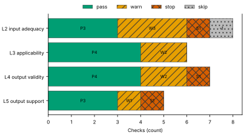
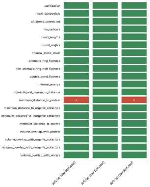
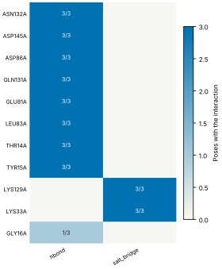
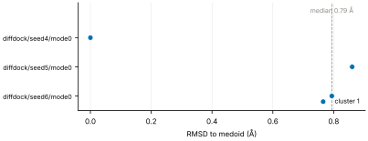
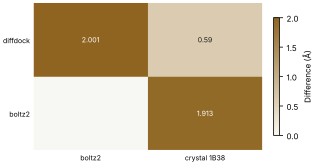

# Run report · Ligand pose in a known pocket

Prediction assurance · run `ligand_pose-f005a7a98372` · 2026-10-17 18:10:13 UTC

**Refused** for the claim "Predicted pose of ATP in CDK2 is valid".

Refused over layers 2,3,4,5: 14 pass, 8 warn, 3 stop, 1 skip. Stopped by l2.context.cofactors, l4.posebusters, l5.controls.redocking. Warnings from l2.receptor.protonation, l2.ligand.protonation, l2.docking.box, l3.exposure.pocket, l3.exposure.ligand_prevalence, l4.torsion_strain, l4.interactions.unsatisfied_polars, l5.agreement.cross_family.

Stops: `l2.context.cofactors`, `l4.posebusters`, `l5.controls.redocking`.

Warnings: `l2.receptor.protonation`, `l2.ligand.protonation`, `l2.docking.box`, `l3.exposure.pocket`, `l3.exposure.ligand_prevalence`, `l4.torsion_strain`, `l4.interactions.unsatisfied_polars`, `l5.agreement.cross_family`.

| Field | Value |
| --- | --- |
| Task | Ligand pose in a known pocket (`ligand_pose`) |
| Tools | DiffDock-L v1.1.3 (docking), Boltz-2 (co-folding) |
| Target | `protein` |
| Ligand | `c1nc(c2c(n1)n(cn2)[C@H]3[C@@H]([C@@H]([C@H](O3)CO[P@@](=O)(O)O[P@](=O)(O)OP(=O)(O)O)O)O)N` |
| Reference | `1B38` |
| pH | 7.4 |
| Seeds | 3 |
| Layers run | 2, 3, 4, 5 |
| Run | `ligand_pose-f005a7a98372` |
| Created | 2026-10-17 18:10:13 UTC |
| Finished | 2026-10-17 18:11:26 UTC |
| pah version | 0.1.0 |
| Report schema | 1 |

## Layers

| Layer | Status | Result | pass | warn | stop | skip | Time |
| --- | --- | --- | --- | --- | --- | --- | --- |
| L0 Provenance | not run | n/a | n/a | n/a | n/a | n/a | n/a |
| L1 Input integrity | not run | n/a | n/a | n/a | n/a | n/a | n/a |
| L2 Input adequacy | done | stop | 3 | 3 | 1 | 1 | 1.9 s |
| L3 Applicability | done | warn | 4 | 2 | 0 | 0 | 619 ms |
| L4 Output validity | done | stop | 4 | 2 | 1 | 0 | 70.6 s |
| L5 Output support | done | stop | 3 | 1 | 1 | 0 | 474 ms |

## Figures

Fig. 1 · Check outcomes per layer for run ligand_pose-f005a7a98372. Totals: pass 14, warn 8, stop 3, skip 1.
Files: data [figures/gates_by_layer.csv](figures/gates_by_layer.csv).

## Structures

76 PyMOL renders.

1B38 mmCIF (source_structure), whole structure. Chains A; organic components ACE, ATP. sha256 b851c5e8a98632f8. PyMOL session: [renders/1B38.pse](renders/1B38.pse).

1B38 mmCIF (source_structure), ligand environment within 5 Å. Chains A; organic components ACE, ATP. sha256 b851c5e8a98632f8. PyMOL session: [renders/1B38.pse](renders/1B38.pse).

diffdock/seed4/mode0 (prediction_structure), whole structure. Chains A, L; organic components LIG. sha256 baa17f6e087b6d61. PyMOL session: [renders/diffdock_seed4_mode0.pse](renders/diffdock_seed4_mode0.pse).

diffdock/seed4/mode0 (prediction_structure), ligand environment within 5 Å. Chains A, L; organic components LIG. sha256 baa17f6e087b6d61. PyMOL session: [renders/diffdock_seed4_mode0.pse](renders/diffdock_seed4_mode0.pse).

diffdock/seed4/mode1 (prediction_structure), whole structure. Chains A, L; organic components LIG. sha256 51b0765499a1c4de. PyMOL session: [renders/diffdock_seed4_mode1.pse](renders/diffdock_seed4_mode1.pse).

diffdock/seed4/mode1 (prediction_structure), ligand environment within 5 Å. Chains A, L; organic components LIG. sha256 51b0765499a1c4de. PyMOL session: [renders/diffdock_seed4_mode1.pse](renders/diffdock_seed4_mode1.pse).

diffdock/seed4/mode2 (prediction_structure), whole structure. Chains A, L; organic components LIG. sha256 feb5053e1ec8bb7f. PyMOL session: [renders/diffdock_seed4_mode2.pse](renders/diffdock_seed4_mode2.pse).

diffdock/seed4/mode2 (prediction_structure), ligand environment within 5 Å. Chains A, L; organic components LIG. sha256 feb5053e1ec8bb7f. PyMOL session: [renders/diffdock_seed4_mode2.pse](renders/diffdock_seed4_mode2.pse).

diffdock/seed4/mode3 (prediction_structure), whole structure. Chains A, L; organic components LIG. sha256 01985646ca89846d. PyMOL session: [renders/diffdock_seed4_mode3.pse](renders/diffdock_seed4_mode3.pse).

diffdock/seed4/mode3 (prediction_structure), ligand environment within 5 Å. Chains A, L; organic components LIG. sha256 01985646ca89846d. PyMOL session: [renders/diffdock_seed4_mode3.pse](renders/diffdock_seed4_mode3.pse).

diffdock/seed4/mode4 (prediction_structure), whole structure. Chains A, L; organic components LIG. sha256 8084aab619c1f3e2. PyMOL session: [renders/diffdock_seed4_mode4.pse](renders/diffdock_seed4_mode4.pse).

diffdock/seed4/mode4 (prediction_structure), ligand environment within 5 Å. Chains A, L; organic components LIG. sha256 8084aab619c1f3e2. PyMOL session: [renders/diffdock_seed4_mode4.pse](renders/diffdock_seed4_mode4.pse).

diffdock/seed4/mode5 (prediction_structure), whole structure. Chains A, L; organic components LIG. sha256 bbe96092a1d1a0a5. PyMOL session: [renders/diffdock_seed4_mode5.pse](renders/diffdock_seed4_mode5.pse).

diffdock/seed4/mode5 (prediction_structure), ligand environment within 5 Å. Chains A, L; organic components LIG. sha256 bbe96092a1d1a0a5. PyMOL session: [renders/diffdock_seed4_mode5.pse](renders/diffdock_seed4_mode5.pse).

diffdock/seed4/mode6 (prediction_structure), whole structure. Chains A, L; organic components LIG. sha256 07ed9eabccb048b2. PyMOL session: [renders/diffdock_seed4_mode6.pse](renders/diffdock_seed4_mode6.pse).

diffdock/seed4/mode6 (prediction_structure), ligand environment within 5 Å. Chains A, L; organic components LIG. sha256 07ed9eabccb048b2. PyMOL session: [renders/diffdock_seed4_mode6.pse](renders/diffdock_seed4_mode6.pse).

diffdock/seed4/mode7 (prediction_structure), whole structure. Chains A, L; organic components LIG. sha256 deef4fa90f556d66. PyMOL session: [renders/diffdock_seed4_mode7.pse](renders/diffdock_seed4_mode7.pse).

diffdock/seed4/mode7 (prediction_structure), ligand environment within 5 Å. Chains A, L; organic components LIG. sha256 deef4fa90f556d66. PyMOL session: [renders/diffdock_seed4_mode7.pse](renders/diffdock_seed4_mode7.pse).

diffdock/seed4/mode8 (prediction_structure), whole structure. Chains A, L; organic components LIG. sha256 9af5ff09d79c5a50. PyMOL session: [renders/diffdock_seed4_mode8.pse](renders/diffdock_seed4_mode8.pse).

diffdock/seed4/mode8 (prediction_structure), ligand environment within 5 Å. Chains A, L; organic components LIG. sha256 9af5ff09d79c5a50. PyMOL session: [renders/diffdock_seed4_mode8.pse](renders/diffdock_seed4_mode8.pse).

diffdock/seed4/mode9 (prediction_structure), whole structure. Chains A, L; organic components LIG. sha256 040b18a47751f469. PyMOL session: [renders/diffdock_seed4_mode9.pse](renders/diffdock_seed4_mode9.pse).

diffdock/seed4/mode9 (prediction_structure), ligand environment within 5 Å. Chains A, L; organic components LIG. sha256 040b18a47751f469. PyMOL session: [renders/diffdock_seed4_mode9.pse](renders/diffdock_seed4_mode9.pse).

diffdock/seed5/mode0 (prediction_structure), whole structure. Chains A, L; organic components LIG. sha256 2e5d9b2e24e00514. PyMOL session: [renders/diffdock_seed5_mode0.pse](renders/diffdock_seed5_mode0.pse).

diffdock/seed5/mode0 (prediction_structure), ligand environment within 5 Å. Chains A, L; organic components LIG. sha256 2e5d9b2e24e00514. PyMOL session: [renders/diffdock_seed5_mode0.pse](renders/diffdock_seed5_mode0.pse).

diffdock/seed5/mode1 (prediction_structure), whole structure. Chains A, L; organic components LIG. sha256 ee7b5ba58136941e. PyMOL session: [renders/diffdock_seed5_mode1.pse](renders/diffdock_seed5_mode1.pse).

diffdock/seed5/mode1 (prediction_structure), ligand environment within 5 Å. Chains A, L; organic components LIG. sha256 ee7b5ba58136941e. PyMOL session: [renders/diffdock_seed5_mode1.pse](renders/diffdock_seed5_mode1.pse).

diffdock/seed5/mode2 (prediction_structure), whole structure. Chains A, L; organic components LIG. sha256 5a3237a9ce68a9bd. PyMOL session: [renders/diffdock_seed5_mode2.pse](renders/diffdock_seed5_mode2.pse).

diffdock/seed5/mode2 (prediction_structure), ligand environment within 5 Å. Chains A, L; organic components LIG. sha256 5a3237a9ce68a9bd. PyMOL session: [renders/diffdock_seed5_mode2.pse](renders/diffdock_seed5_mode2.pse).

diffdock/seed5/mode3 (prediction_structure), whole structure. Chains A, L; organic components LIG. sha256 0f33b1c847499bd5. PyMOL session: [renders/diffdock_seed5_mode3.pse](renders/diffdock_seed5_mode3.pse).

diffdock/seed5/mode3 (prediction_structure), ligand environment within 5 Å. Chains A, L; organic components LIG. sha256 0f33b1c847499bd5. PyMOL session: [renders/diffdock_seed5_mode3.pse](renders/diffdock_seed5_mode3.pse).

diffdock/seed5/mode4 (prediction_structure), whole structure. Chains A, L; organic components LIG. sha256 96eb788a7e3d4a3b. PyMOL session: [renders/diffdock_seed5_mode4.pse](renders/diffdock_seed5_mode4.pse).

diffdock/seed5/mode4 (prediction_structure), ligand environment within 5 Å. Chains A, L; organic components LIG. sha256 96eb788a7e3d4a3b. PyMOL session: [renders/diffdock_seed5_mode4.pse](renders/diffdock_seed5_mode4.pse).

diffdock/seed5/mode5 (prediction_structure), whole structure. Chains A, L; organic components LIG. sha256 96d9d03ab0123a7a. PyMOL session: [renders/diffdock_seed5_mode5.pse](renders/diffdock_seed5_mode5.pse).

diffdock/seed5/mode5 (prediction_structure), ligand environment within 5 Å. Chains A, L; organic components LIG. sha256 96d9d03ab0123a7a. PyMOL session: [renders/diffdock_seed5_mode5.pse](renders/diffdock_seed5_mode5.pse).

diffdock/seed5/mode6 (prediction_structure), whole structure. Chains A, L; organic components LIG. sha256 00bfcb1f4b1ff49c. PyMOL session: [renders/diffdock_seed5_mode6.pse](renders/diffdock_seed5_mode6.pse).

diffdock/seed5/mode6 (prediction_structure), ligand environment within 5 Å. Chains A, L; organic components LIG. sha256 00bfcb1f4b1ff49c. PyMOL session: [renders/diffdock_seed5_mode6.pse](renders/diffdock_seed5_mode6.pse).

diffdock/seed5/mode7 (prediction_structure), whole structure. Chains A, L; organic components LIG. sha256 abd09a2c9fd94e8e. PyMOL session: [renders/diffdock_seed5_mode7.pse](renders/diffdock_seed5_mode7.pse).

diffdock/seed5/mode7 (prediction_structure), ligand environment within 5 Å. Chains A, L; organic components LIG. sha256 abd09a2c9fd94e8e. PyMOL session: [renders/diffdock_seed5_mode7.pse](renders/diffdock_seed5_mode7.pse).

diffdock/seed5/mode8 (prediction_structure), whole structure. Chains A, L; organic components LIG. sha256 653623f9bf70a6cb. PyMOL session: [renders/diffdock_seed5_mode8.pse](renders/diffdock_seed5_mode8.pse).

diffdock/seed5/mode8 (prediction_structure), ligand environment within 5 Å. Chains A, L; organic components LIG. sha256 653623f9bf70a6cb. PyMOL session: [renders/diffdock_seed5_mode8.pse](renders/diffdock_seed5_mode8.pse).

diffdock/seed5/mode9 (prediction_structure), whole structure. Chains A, L; organic components LIG. sha256 7113c5a4238e6698. PyMOL session: [renders/diffdock_seed5_mode9.pse](renders/diffdock_seed5_mode9.pse).

diffdock/seed5/mode9 (prediction_structure), ligand environment within 5 Å. Chains A, L; organic components LIG. sha256 7113c5a4238e6698. PyMOL session: [renders/diffdock_seed5_mode9.pse](renders/diffdock_seed5_mode9.pse).

diffdock/seed6/mode0 (prediction_structure), whole structure. Chains A, L; organic components LIG. sha256 1978f653255e4c72. PyMOL session: [renders/diffdock_seed6_mode0.pse](renders/diffdock_seed6_mode0.pse).

diffdock/seed6/mode0 (prediction_structure), ligand environment within 5 Å. Chains A, L; organic components LIG. sha256 1978f653255e4c72. PyMOL session: [renders/diffdock_seed6_mode0.pse](renders/diffdock_seed6_mode0.pse).

diffdock/seed6/mode1 (prediction_structure), whole structure. Chains A, L; organic components LIG. sha256 649f27abd513ed63. PyMOL session: [renders/diffdock_seed6_mode1.pse](renders/diffdock_seed6_mode1.pse).

diffdock/seed6/mode1 (prediction_structure), ligand environment within 5 Å. Chains A, L; organic components LIG. sha256 649f27abd513ed63. PyMOL session: [renders/diffdock_seed6_mode1.pse](renders/diffdock_seed6_mode1.pse).

diffdock/seed6/mode2 (prediction_structure), whole structure. Chains A, L; organic components LIG. sha256 f0687666cd888a30. PyMOL session: [renders/diffdock_seed6_mode2.pse](renders/diffdock_seed6_mode2.pse).

diffdock/seed6/mode2 (prediction_structure), ligand environment within 5 Å. Chains A, L; organic components LIG. sha256 f0687666cd888a30. PyMOL session: [renders/diffdock_seed6_mode2.pse](renders/diffdock_seed6_mode2.pse).

diffdock/seed6/mode3 (prediction_structure), whole structure. Chains A, L; organic components LIG. sha256 1bca92a4e2ebab88. PyMOL session: [renders/diffdock_seed6_mode3.pse](renders/diffdock_seed6_mode3.pse).

diffdock/seed6/mode3 (prediction_structure), ligand environment within 5 Å. Chains A, L; organic components LIG. sha256 1bca92a4e2ebab88. PyMOL session: [renders/diffdock_seed6_mode3.pse](renders/diffdock_seed6_mode3.pse).

diffdock/seed6/mode4 (prediction_structure), whole structure. Chains A, L; organic components LIG. sha256 efd393de53ac8e11. PyMOL session: [renders/diffdock_seed6_mode4.pse](renders/diffdock_seed6_mode4.pse).

diffdock/seed6/mode4 (prediction_structure), ligand environment within 5 Å. Chains A, L; organic components LIG. sha256 efd393de53ac8e11. PyMOL session: [renders/diffdock_seed6_mode4.pse](renders/diffdock_seed6_mode4.pse).

diffdock/seed6/mode5 (prediction_structure), whole structure. Chains A, L; organic components LIG. sha256 0b2aa693d282e855. PyMOL session: [renders/diffdock_seed6_mode5.pse](renders/diffdock_seed6_mode5.pse).

diffdock/seed6/mode5 (prediction_structure), ligand environment within 5 Å. Chains A, L; organic components LIG. sha256 0b2aa693d282e855. PyMOL session: [renders/diffdock_seed6_mode5.pse](renders/diffdock_seed6_mode5.pse).

diffdock/seed6/mode6 (prediction_structure), whole structure. Chains A, L; organic components LIG. sha256 8138c84f1f87b8e8. PyMOL session: [renders/diffdock_seed6_mode6.pse](renders/diffdock_seed6_mode6.pse).

diffdock/seed6/mode6 (prediction_structure), ligand environment within 5 Å. Chains A, L; organic components LIG. sha256 8138c84f1f87b8e8. PyMOL session: [renders/diffdock_seed6_mode6.pse](renders/diffdock_seed6_mode6.pse).

diffdock/seed6/mode7 (prediction_structure), whole structure. Chains A, L; organic components LIG. sha256 223075988125280e. PyMOL session: [renders/diffdock_seed6_mode7.pse](renders/diffdock_seed6_mode7.pse).

diffdock/seed6/mode7 (prediction_structure), ligand environment within 5 Å. Chains A, L; organic components LIG. sha256 223075988125280e. PyMOL session: [renders/diffdock_seed6_mode7.pse](renders/diffdock_seed6_mode7.pse).

diffdock/seed6/mode8 (prediction_structure), whole structure. Chains A, L; organic components LIG. sha256 a79aa0d73b97723b. PyMOL session: [renders/diffdock_seed6_mode8.pse](renders/diffdock_seed6_mode8.pse).

diffdock/seed6/mode8 (prediction_structure), ligand environment within 5 Å. Chains A, L; organic components LIG. sha256 a79aa0d73b97723b. PyMOL session: [renders/diffdock_seed6_mode8.pse](renders/diffdock_seed6_mode8.pse).

diffdock/seed6/mode9 (prediction_structure), whole structure. Chains A, L; organic components LIG. sha256 0064055b2c2e01f3. PyMOL session: [renders/diffdock_seed6_mode9.pse](renders/diffdock_seed6_mode9.pse).

diffdock/seed6/mode9 (prediction_structure), ligand environment within 5 Å. Chains A, L; organic components LIG. sha256 0064055b2c2e01f3. PyMOL session: [renders/diffdock_seed6_mode9.pse](renders/diffdock_seed6_mode9.pse).

boltz2/seed4/sample0 (prediction_structure), whole structure. Chains A, C1, L; organic components LIG1. sha256 78c3f330022dbad0. PyMOL session: [renders/boltz2_seed4_sample0.pse](renders/boltz2_seed4_sample0.pse).

boltz2/seed4/sample0 (prediction_structure), ligand environment within 5 Å. Chains A, C1, L; organic components LIG1. sha256 78c3f330022dbad0. PyMOL session: [renders/boltz2_seed4_sample0.pse](renders/boltz2_seed4_sample0.pse).

boltz2/seed5/sample0 (prediction_structure), whole structure. Chains A, C1, L; organic components LIG1. sha256 1fdc2e52f2f779b2. PyMOL session: [renders/boltz2_seed5_sample0.pse](renders/boltz2_seed5_sample0.pse).

boltz2/seed5/sample0 (prediction_structure), ligand environment within 5 Å. Chains A, C1, L; organic components LIG1. sha256 1fdc2e52f2f779b2. PyMOL session: [renders/boltz2_seed5_sample0.pse](renders/boltz2_seed5_sample0.pse).

boltz2/seed6/sample0 (prediction_structure), whole structure. Chains A, C1, L; organic components LIG1. sha256 83c28c9e447e3931. PyMOL session: [renders/boltz2_seed6_sample0.pse](renders/boltz2_seed6_sample0.pse).

boltz2/seed6/sample0 (prediction_structure), ligand environment within 5 Å. Chains A, C1, L; organic components LIG1. sha256 83c28c9e447e3931. PyMOL session: [renders/boltz2_seed6_sample0.pse](renders/boltz2_seed6_sample0.pse).

1B39 mmCIF (source_structure), whole structure. Chains A; organic components ACE, ATP. sha256 43b7b7417024c3f4. PyMOL session: [renders/1B39.pse](renders/1B39.pse).

1B39 mmCIF (source_structure), ligand environment within 5 Å. Chains A; organic components ACE, ATP. sha256 43b7b7417024c3f4. PyMOL session: [renders/1B39.pse](renders/1B39.pse).

1FIN mmCIF (source_structure), whole structure. Chains A, B, C, D; organic components ATP. sha256 dfe5da37b2e28d3d. PyMOL session: [renders/1FIN.pse](renders/1FIN.pse).

1FIN mmCIF (source_structure), ligand environment within 5 Å. Chains A, B, C, D; organic components ATP. sha256 dfe5da37b2e28d3d. PyMOL session: [renders/1FIN.pse](renders/1FIN.pse).

1FQ1 mmCIF (source_structure), whole structure. Chains A, B; organic components ATP. sha256 f86aad4d11e29283. PyMOL session: [renders/1FQ1.pse](renders/1FQ1.pse).

1FQ1 mmCIF (source_structure), ligand environment within 5 Å. Chains A, B; organic components ATP. sha256 f86aad4d11e29283. PyMOL session: [renders/1FQ1.pse](renders/1FQ1.pse).

1GY3 mmCIF (source_structure), whole structure. Chains A, B, C, D, E, F; organic components ATP, GOL, TPO. sha256 fb1e8e095ae9fe28. PyMOL session: [renders/1GY3.pse](renders/1GY3.pse).

1GY3 mmCIF (source_structure), ligand environment within 5 Å. Chains A, B, C, D, E, F; organic components ATP, GOL, TPO. sha256 fb1e8e095ae9fe28. PyMOL session: [renders/1GY3.pse](renders/1GY3.pse).

## L0 Provenance

Where did every input come from?

Status: not run.

## L1 Input integrity

Did the run receive exactly what was declared?

Status: not run.

## L2 Input adequacy

Does the input carry enough information?

Status: done. Checks: pass 3 · warn 3 · stop 1 · skip 1. Time: 1.9 s.

#### Key figures

| Figure | Value |
| --- | --- |
| near site | 1 |
| missing | 1 |
| uniprot cofactors | 0 |
| pocket residues | 30 |
| incomplete | 0 |
| sequence gaps | 0 |
| state | holo |
| site ligands | 1 |

#### Docking

| Field | Value |
| --- | --- |
| center | -1.248, 27.587, 11.585 Å |
| size | 15.545 × 17.083 × 18.375 Å |
| origin | derived from ATP (+4 Å) |

#### Checks

| Check | Result | Measured cmp threshold | Evidence | Id · time |
| --- | --- | --- | --- | --- |
| Alignment depth, distinct sequences, Neff and gap fraction | skip | n/a | no MSA declared for a co-folding model · not applicable | `l2.msa.depth` |
| Required cofactors, ions and partners present | stop | `pocket_distance <= 8` | components within 8.0 Å of ATP in 1B38 not supplied: MG · near_site=1, missing=1, uniprot_cofactors=0 | `l2.context.cofactors` · 229 ms |
| Pocket residues resolved, no missing loops lining the pocket | pass | `pocket_distance <= 6` | 30 pocket residues complete in 1B38.cif · pocket_residues=30, incomplete=0, sequence_gaps=0 | `l2.pocket.resolved` · 9 ms |
| Receptor state apo or holo | pass | n/a | 1B38.cif holo: ATP in the site · state=holo, site_ligands=1 | `l2.receptor.state` · 12 ms |
| Receptor protonation at the stated pH | warn | `pka_margin > 1` | receptor has no hydrogens (protonation not assigned) · hydrogens_present=False, ph=7.4, pocket_titratable=19 | `l2.receptor.protonation` · 493 ms |
| Ligand protonation and tautomers enumerated at the stated pH | warn | `ph 7.4 == 1` | ligand: 2 states; ligand: declared form Nc1ncnc2c1ncn2[C@@H]1O[C@H](CO[P@@](=O)(O)O[P@](=O)(O)OP(=O)(O)O)[C@@H](O)[C@H]1O differs from enumerated Nc1ncnc2c1ncn2[C@@H]1O[C@H](CO[P@@](=O)([O-])O[P@](=O)([O-])OP(=O)([O-])O)[C@@H](O)[C@H]1O, Nc1ncnc2c1ncn2[C@@H]1O[C@H](CO[P@@](=O)([O-])O[P@](=O)([O-])OP(=O)([O-])[O-])[C@@H](O)[C@H]1O · ph=7.4, max_states=2, declared_not_enumerated=1 | `l2.ligand.protonation` · 79 ms |
| Ligand conformers generated and minimised | pass | `conformers >= 10` | 10 ETKDG conformers per ligand, MMFF minimised · ligands=1, failed=0, min_embedded=10 | `l2.ligand.conformers` · 1.0 s |
| Docking box encloses the pocket with margin | warn | `margin >= 2` | no box declared; derived box encloses 22 contact residues and the ATP ligand with 2.0 Å margin · volume_A3=4879.6, ligand_atoms_inside_margin=31, ligand_atoms=31 | `l2.docking.box` · 9 ms |

## L3 Applicability

Is the tool inside its validated regime?

Status: done. Checks: pass 4 · warn 2 · stop 0 · skip 0. Time: 619 ms.

#### Key figures

| Figure | Value |
| --- | --- |
| executors | 2 |
| unknown | 0 |
| reference released | 1998-12-23 |
| cutoff | 2019-01-01 |
| entries compared | 5 |
| max similarity | 69.7 |
| pocket residues | 31 |
| systems | 3474 |

#### Checks

| Check | Result | Measured cmp threshold | Evidence | Id · time |
| --- | --- | --- | --- | --- |
| Model training cutoff recorded | pass | `training_cutoff == recorded` | diffdock 2019-01-01; boltz2 2023-06-01; reference 1B38 released 1998-12-23, before the cutoff of diffdock, boltz2 · executors=2, unknown=0, reference_released=1998-12-23 | `l3.model.training_cutoff` · 1 ms |
| Pocket similarity to pre-cutoff complexes (SuCOS times pocket coverage) | warn | `similarity <= 50` | max similarity 69.7 to 1B39 (ATP, SuCOS 0.697, coverage 1.0), released before 2019-01-01 · cutoff=2019-01-01, entries_compared=5, max_similarity=69.7 | `l3.exposure.pocket` · 610 ms |
| Ligand analogues in pre-cutoff training systems | warn | `tanimoto > 0.9` | 3474 PDB entries released before 2019-01-01 (diffdock cutoff) contain analogues of ligand above Tanimoto 0.9: 5FA, ADP, AQP, ATP, HEJ, LA8 · cutoff=2019-01-01, systems=3474, analogue_components=19 | `l3.exposure.ligand_prevalence` · 0 ms |
| Chain sequence identity to pre-cutoff entries (secondary measure) | pass | `identity < 0.4` | protein: 391 entries at 95 percent identity, 456 at 40 percent, released before 2019-01-01 (reported, not gating) · cutoff=2019-01-01, entries_95=391, entries_40=456 | `l3.exposure.sequence` · 1 ms |
| Modality inside the validated set; token count against the training crop | pass | n/a | modalities protein, protein_ligand inside the validated set; 330 tokens · modalities=2, tokens=330, outside=0 | `l3.regime.modality` · 5 ms |
| Endpoint fits the tool | pass | `endpoint pose in pose` | endpoint pose produced by diffdock, boltz2 · endpoint=pose, executors=2, not_fitting=0 | `l3.metric.endpoint` · 0 ms |

## L4 Output validity

Is the result physically and chemically sensible?

Status: done. Checks: pass 4 · warn 2 · stop 1 · skip 0. Time: 70.6 s.

#### Key figures

| Figure | Value |
| --- | --- |
| poses | 3 |
| passed | 19 |
| total | 20 |
| poses all pass | 1 |
| unlikely torsions | 4 |
| torsions | 14 |
| strain kcal | 36.7 |
| poses with unlikely | 3 |

#### PoseBusters · 19/20 tests pass

| test | result | value |
| --- | --- | --- |
| sanitization | pass | pass |
| inchi_convertible | pass | pass |
| all_atoms_connected | pass | pass |
| no_radicals | pass | pass |
| bond_lengths | pass | 0 long outliers |
| bond_angles | pass | 0 outliers |
| internal_steric_clash | pass | 0 |
| aromatic_ring_flatness | pass | 0.00 Å |
| non-aromatic_ring_non-flatness | pass | pass |
| double_bond_flatness | pass | pass |
| internal_energy | pass | 2.6 times the ensemble mean |
| protein-ligand_maximum_distance | pass | 2.24 Å |
| minimum_distance_to_protein | fail | 2.24 Å |
| minimum_distance_to_organic_cofactors | pass | pass |
| minimum_distance_to_inorganic_cofactors | pass | pass |
| minimum_distance_to_waters | pass | pass |
| volume_overlap_with_protein | pass | 0.031 |
| volume_overlap_with_organic_cofactors | pass | pass |
| volume_overlap_with_inorganic_cofactors | pass | pass |
| volume_overlap_with_waters | pass | pass |

#### Per-pose physical checks

| pose | seed | drift Å | converged | unlikely torsions | unsat. polars | buried charged | PoseBusters |
| --- | --- | --- | --- | --- | --- | --- | --- |
| diffdock/seed4/mode0 | 4 | 0.88 | true | 4/14 | 3 | 0 | 19/20 |
| diffdock/seed5/mode0 | 5 | 0.64 | true | 2/14 | 3 | 0 | 20/20 |
| diffdock/seed6/mode0 | 6 | 0.88 | true | 1/14 | 2 | 0 | 19/20 |
| median | n/a | 0.88 | n/a | 2 | 3 | 0 | 19/20 |

#### Interaction fingerprint · representative pose diffdock/seed4/mode0

| residue | type | distance | poses |
| --- | --- | --- | --- |
| ASN132A | hbond | 3.3 Å | 3/3 |
| ASP145A | hbond | 2.8 Å | 3/3 |
| ASP86A | hbond | 3.08 Å | 3/3 |
| GLN131A | hbond | 3.45 Å | 3/3 |
| GLU81A | hbond | 2.47 Å | 3/3 |
| LEU83A | hbond | 2.86 Å | 3/3 |
| THR14A | hbond | 2.79 Å | 3/3 |
| TYR15A | hbond | 3.44 Å | 3/3 |
| LYS129A | salt_bridge | 3.66 Å | 3/3 |
| LYS33A | salt_bridge | 4.18 Å | 3/3 |
| GLY16A | hbond | 3.61 Å | 1/3 |

Fig. 2 · PoseBusters tests (20) by pose (3). Failed cells marked x: 2 of 60.
Files: data [figures/posebusters_grid.csv](figures/posebusters_grid.csv).

Fig. 3 · Interactions by residue (11) and type (2); cell label: poses with the interaction over poses assessed.
Files: data [figures/interactions.csv](figures/interactions.csv).

#### Checks

| Check | Result | Measured cmp threshold | Evidence | Id · time |
| --- | --- | --- | --- | --- |
| PoseBusters geometry, stereochemistry, clashes and protein contact | stop | `tests_failed == 0` | representative pose diffdock/seed4/mode0 fails minimum_distance_to_protein · poses=3, passed=19, total=20 | `l4.posebusters` · 2.3 s |
| Torsional strain of the ligand pose | warn | `torsion_energy <= 2.5` | 4 of 14 torsions above 2.5 kcal/mol in diffdock/seed4/mode0 · poses=3, unlikely_torsions=4, torsions=14 | `l4.torsion_strain` · 4.1 s |
| Interaction fingerprint (PLIP) | pass | n/a | 16 interactions in diffdock/seed4/mode0 (hbond, salt_bridge); 11 distinct across 3 poses (reported) · poses=3, interactions_representative=16, distinct=11 | `l4.interactions.fingerprint` · 909 ms |
| Buried ligand polar atoms without a hydrogen-bond partner | warn | `relative_sasa < 0.1` | 3 of 12 buried polar ligand atoms without a partner in diffdock/seed4/mode0 · poses=3, unsatisfied=3, buried_charged=0 | `l4.interactions.unsatisfied_polars` · 282 ms |
| Hydrophobic complementarity of buried ligand surface | pass | `fraction >= 0.35` | nonpolar fraction of protein contacts around 8 buried nonpolar ligand atoms in diffdock/seed4/mode0: 0.817 · poses=3, complementarity=0.817, buried_nonpolar=8 | `l4.interactions.hydrophobic` · 274 ms |
| Interactions of the crystal ligand reproduced by the pose | pass | `reproduced 9 >= 1` | diffdock/seed4/mode0 reproduces 9 of 9 ATP interactions: hbond ASN132A, hbond ASP145A, hbond GLN131A, hbond GLU81A, hbond LEU83A, hbond THR14A, hbond TYR15A, salt_bridge LYS129A, salt_bridge LYS33A · key_interactions=9, reproduced=9, poses_reproducing_all=3 | `l4.interactions.known_binders` · 386 ms |
| Pose stability under short restrained minimisation (OpenMM, AMBER14 and OpenFF) | pass | `drift_A 0.88 <= 2` | diffdock/seed4/mode0 moves 0.882 Å under restrained minimisation; 0 of 3 poses above 2.0 Å · poses=3, drift_A=0.882, max_drift_A=0.882 | `l4.minimisation_drift` · 62.4 s |

## L5 Output support

Is a valid result corroborated?

Status: done. Checks: pass 3 · warn 1 · stop 1 · skip 0. Time: 474 ms.

#### Key figures

| Figure | Value |
| --- | --- |
| poses | 3 |
| diffdock confidence | -0.29 |
| independent seeds | 3 |
| samples | 30 |
| duplicated outputs | 0 |
| clusters | 1 |
| largest cluster | 3 |
| pairwise rmsd median A | 0.861 |

#### Sampling

| Field | Value |
| --- | --- |
| site placement | 3 of 3 poses within 4.0 Å of the site (ATP in 1B38) |
| pose accuracy | 3 of 3 poses within 2.0 Å of the medoid |
| pairwise RMSD median | 0.86 Å |
| pairwise RMSD IQR | 0.83 to 0.98 Å |
| pairs | 3 |
| medoid | diffdock/seed4/mode0 |

#### Clusters

| Field | Value |
| --- | --- |
| cluster 1 | 3/3 poses (diffdock/seed4/mode0) |

#### Per-seed statistics

| seed | pose | cluster | RMSD to medoid | confidence |
| --- | --- | --- | --- | --- |
| 4 | diffdock/seed4/mode0 | 1 | 0 Å | -0.29 |
| 5 | diffdock/seed5/mode0 | 1 | 0.86 Å | -0.26 |
| 6 | diffdock/seed6/mode0 | 1 | 0.79 Å | -0.2 |
| median | n/a | n/a | 0.79 Å | -0.26 |

#### Ensemble

| structure | kind | source | RMSD to medoid | cluster | pocket pLDDT | ipTM |
| --- | --- | --- | --- | --- | --- | --- |
| diffdock/seed4/mode0 | medoid | diffdock | 0 Å | 1 | n/a | n/a |
| diffdock/seed5/mode0 | docking | diffdock | 0.86 Å | 1 | n/a | n/a |
| diffdock/seed6/mode0 | docking | diffdock | 0.79 Å | 1 | n/a | n/a |

#### Agreement between methods

| method | boltz2 | crystal 1B38 |
| --- | --- | --- |
| diffdock | 2 Å (high) | 0.59 Å (decisive) |
| boltz2 | n/a | 1.91 Å (decisive) |

Fig. 4 · RMSD to the medoid for 3 poses, coloured by cluster (1 clusters). Dashed line: median 0.79 Å; range 0.00 to 0.86 Å.
Files: data [figures/seed_spread.csv](figures/seed_spread.csv).

Fig. 5 · Agreement between 2 methods and 2 comparators; range 0.59 to 2.001 Å.
Files: data [figures/agreement.csv](figures/agreement.csv).

#### Checks

| Check | Result | Measured cmp threshold | Evidence | Id · time |
| --- | --- | --- | --- | --- |
| Confidence restricted to the pocket; per-model thresholds | pass | n/a | diffdock/seed4/mode0: diffdock_confidence -0.29; no per-model confidence threshold registered for diffdock (reported) · poses=3, diffdock_confidence=-0.29 | `l5.confidence.local` · 0 ms |
| Independent seeds counted separately from samples; duplicates flagged | pass | `seeds_docking >= 3` | 3 independent seeds, 30 poses, no duplicates · independent_seeds=3, samples=30, duplicated_outputs=0 | `l5.sampling.seeds` · 0 ms |
| Medoid of the largest cluster, populations, pairwise spread, site and pose accuracy | pass | `cluster_rmsd <= 2` | medoid diffdock/seed4/mode0; 1 clusters, largest 3 of 3; pairwise RMSD median 0.86 Å (IQR 0.83 to 0.98); 3 of 3 poses within 4.0 Å of the site (ATP in 1B38); 3 of 3 poses within 2.0 Å of the medoid · poses=3, clusters=1, largest_cluster=3 | `l5.sampling.clusters` · 336 ms |
| Agreement between methods, weighted by independence | warn | `rmsd_to_crystal_A 0.59 <= 2` | diffdock vs boltz2 2.001 Å (high); diffdock vs crystal 1B38 0.59 Å (decisive); boltz2 vs crystal 1B38 1.913 Å (decisive) · methods=2, comparisons=3, disagreeing=1 | `l5.agreement.cross_family` · 134 ms |
| Redocking control reproduces the crystal pose | stop | `rmsd <= 2` | redocking control required by the task and not supplied (controls.redocking) | `l5.controls.redocking` · 0 ms |

## Controls

| control | status | result |
| --- | --- | --- |
| redocking | incomplete | redocking control required by the task and not supplied (controls.redocking) |

## Provenance

54 objects · 54 cached · 0 network.

| Source | Accession | Release | SHA-256 | Retrieved | Bytes | Cache | Used by |
| --- | --- | --- | --- | --- | --- | --- | --- |
| rcsb_files | 1B38 | n/a | `b851c5e8a986` | 2026-10-17 16:42:54 UTC | 333302 | hit | l2.context.cofactors, l2.pocket.resolved, l2.receptor.state, l2.docking.box, l3.exposure.pocket, l3.regime.modality, l4.interactions.fingerprint, l4.interactions.known_binders, l5.sampling.clusters, l5.agreement.cross_family |
| ccd | ATP | 2011-06-04 | `a7dfd66192d9` | 2026-10-17 16:42:55 UTC | 14836 | hit | l2.context.cofactors, l3.exposure.pocket |
| rcsb | 1B38 | 1.4 | `64dd65fa1b0d` | 2026-10-17 16:42:56 UTC | 16633 | hit | l3.model.training_cutoff |
| rcsb_search | chem:c1nc(c2c(n1)n(cn2)[C@H]3[C@@H]([C@@H]([C@H](O3)CO[P@@](=O)(O)O[P@](=O)(O)OP(=O)(O)O)O)O)N | n/a | `c9ecdf87b8e2` | 2026-10-17 16:42:57 UTC | 1797 | hit | l3.exposure.pocket |
| ccd | 5FA | 2011-06-04 | `141da43b1fd4` | 2026-10-17 16:42:57 UTC | 5208 | hit | l3.exposure.pocket |
| ccd | ADP | 2025-10-10 | `9ebf239d6ded` | 2026-10-17 16:42:57 UTC | 5741 | hit | l3.exposure.pocket |
| ccd | AQP | 2011-06-04 | `d1f31df6170c` | 2026-10-17 16:42:57 UTC | 4700 | hit | l3.exposure.pocket |
| ccd | HEJ | 2021-03-01 | `3793d61303f5` | 2026-10-17 16:42:57 UTC | 4603 | hit | l3.exposure.pocket |
| ccd | LA8 | 2020-06-17 | `3c66f53baf33` | 2026-10-17 16:42:57 UTC | 4178 | hit | l3.exposure.pocket |
| ccd | ZF9 | 2024-03-08 | `b48f6ea5a0a0` | 2026-10-17 16:42:57 UTC | 4686 | hit | l3.exposure.pocket |
| ccd | ZSF | 2024-03-29 | `dde5989ea661` | 2026-10-17 16:42:57 UTC | 4903 | hit | l3.exposure.pocket |
| ccd | 50T | 2026-09-16 | `6be53fbf78af` | 2026-10-17 16:42:57 UTC | 4275 | hit | l3.exposure.pocket |
| ccd | AD9 | 2026-09-16 | `c8798e579e0a` | 2026-10-17 16:42:58 UTC | 4205 | hit | l3.exposure.pocket |
| ccd | AOV | 2026-09-16 | `300b793745cf` | 2026-10-17 16:42:58 UTC | 4330 | hit | l3.exposure.pocket |
| ccd | CX0 | 2022-03-25 | `fbc78ded25cd` | 2026-10-17 16:42:58 UTC | 3595 | hit | l3.exposure.pocket |
| ccd | CXC | 2022-03-25 | `d89a7023bd05` | 2026-10-17 16:42:58 UTC | 3941 | hit | l3.exposure.pocket |
| ccd | 0A | 2015-04-24 | `7f0b456f42e0` | 2026-10-17 16:42:58 UTC | 3972 | hit | l3.exposure.pocket |
| ccd | 3AN | 2011-06-04 | `a3d4d17a4a3e` | 2026-10-17 16:42:58 UTC | 4390 | hit | l3.exposure.pocket |
| ccd | 7DD | 2016-06-10 | `2265ea597be9` | 2026-10-17 16:42:58 UTC | 3425 | hit | l3.exposure.pocket |
| ccd | 7DT | 2016-06-10 | `c346b8a79ec0` | 2026-10-17 16:42:58 UTC | 3725 | hit | l3.exposure.pocket |
| ccd | AAM | 2011-06-04 | `ade365fd93cd` | 2026-10-17 16:42:58 UTC | 4244 | hit | l3.exposure.pocket |
| ccd | PAP | 2011-06-04 | `1a6bb6874f6f` | 2026-10-17 16:42:58 UTC | 4734 | hit | l3.exposure.pocket |
| ccd | XNY | 2021-04-30 | `7cb26ca44908` | 2026-10-17 16:42:58 UTC | 3977 | hit | l3.exposure.pocket |
| ccd | AP5 | 2011-06-04 | `43e554f584b7` | 2026-10-17 16:42:58 UTC | 6473 | hit | l3.exposure.pocket |
| ccd | T99 | 2018-06-01 | `68a3d15f3b6f` | 2026-10-17 16:42:58 UTC | 3399 | hit | l3.exposure.pocket |
| ccd | TAT | 2012-01-25 | `55287be9857e` | 2026-10-17 16:42:58 UTC | 4858 | hit | l3.exposure.pocket |
| ccd | A1L15 | 2025-01-24 | `57864c05fab0` | 2026-10-17 16:42:58 UTC | 5608 | hit | l3.exposure.pocket |
| ccd | AGS | 2020-06-17 | `dcdd428b77e4` | 2026-10-17 16:42:58 UTC | 10128 | hit | l3.exposure.pocket |
| rcsb_search | comp:5FA:2019-01-01 | n/a | `c60bf45b266d` | 2026-10-17 16:42:58 UTC | 282 | hit | l3.exposure.pocket |
| rcsb_search | comp:ADP:2019-01-01 | n/a | `d0ea634975e9` | 2026-10-17 16:42:58 UTC | 52129 | hit | l3.exposure.pocket |
| rcsb_search | comp:AQP:2019-01-01 | n/a | `94a619102faa` | 2026-10-17 16:42:58 UTC | 230 | hit | l3.exposure.pocket |
| rcsb_search | comp:ATP:2019-01-01 | n/a | `88190701e349` | 2026-10-17 16:42:59 UTC | 52129 | hit | l3.exposure.pocket |
| rcsb_search | comp:HEJ:2019-01-01 | n/a | `494129c6512c` | 2026-10-17 16:42:59 UTC | 178 | hit | l3.exposure.pocket |
| rcsb_search | comp:LA8:2019-01-01 | n/a | `185329a63a40` | 2026-10-17 16:42:59 UTC | 230 | hit | l3.exposure.pocket |
| rcsb_search | comp:ZF9:2019-01-01 | n/a | `e3b0c44298fc` | 2026-10-17 16:42:59 UTC | 0 | hit | l3.exposure.pocket |
| rcsb_search | comp:ZSF:2019-01-01 | n/a | `e3b0c44298fc` | 2026-10-17 16:42:59 UTC | 0 | hit | l3.exposure.pocket |
| rcsb_search | comp:50T:2019-01-01 | n/a | `927f39839b9d` | 2026-10-17 16:42:59 UTC | 178 | hit | l3.exposure.pocket |
| rcsb_search | comp:AD9:2019-01-01 | n/a | `ac65056f9aef` | 2026-10-17 16:42:59 UTC | 490 | hit | l3.exposure.pocket |
| rcsb_search | comp:AOV:2019-01-01 | n/a | `d8dd9b5a5778` | 2026-10-17 16:42:59 UTC | 334 | hit | l3.exposure.pocket |
| rcsb_search | comp:CX0:2019-01-01 | n/a | `e3b0c44298fc` | 2026-10-17 16:42:59 UTC | 0 | hit | l3.exposure.pocket |
| rcsb_search | comp:CXC:2019-01-01 | n/a | `e3b0c44298fc` | 2026-10-17 16:42:59 UTC | 0 | hit | l3.exposure.pocket |
| rcsb_search | comp:0A:2019-01-01 | n/a | `e3b0c44298fc` | 2026-10-17 16:42:59 UTC | 0 | hit | l3.exposure.pocket |
| rcsb_search | comp:PAP:2019-01-01 | n/a | `ded69bf4bbb0` | 2026-10-17 16:42:59 UTC | 542 | hit | l3.exposure.pocket |
| rcsb_search | comp:AP5:2019-01-01 | n/a | `ab39d336ec91` | 2026-10-17 16:42:59 UTC | 3247 | hit | l3.exposure.pocket |
| rcsb_search | comp:T99:2019-01-01 | n/a | `690266055a03` | 2026-10-17 16:42:59 UTC | 178 | hit | l3.exposure.pocket |
| rcsb_search | comp:TAT:2019-01-01 | n/a | `84486689d32b` | 2026-10-17 16:42:59 UTC | 438 | hit | l3.exposure.pocket |
| rcsb_search | comp:AGS:2019-01-01 | n/a | `aef54bf1fe1d` | 2026-10-17 16:42:59 UTC | 8188 | hit | l3.exposure.pocket |
| rcsb_search | seq0.9:2019-01-01:299 | n/a | `db535fa6304a` | 2026-10-17 16:43:01 UTC | 10528 | hit | l3.exposure.pocket |
| rcsb_files | 1B39 | n/a | `43b7b7417024` | 2026-10-17 16:43:01 UTC | 327760 | hit | l3.exposure.pocket |
| rcsb_files | 1FIN | n/a | `dfe5da37b2e2` | 2026-10-17 16:43:01 UTC | 999052 | hit | l3.exposure.pocket |
| rcsb_files | 1FQ1 | n/a | `f86aad4d11e2` | 2026-10-17 16:43:02 UTC | 464333 | hit | l3.exposure.pocket |
| rcsb_files | 1GY3 | n/a | `fb1e8e095ae9` | 2026-10-17 16:43:02 UTC | 1014441 | hit | l3.exposure.pocket |
| rcsb_search | seq0.95:2019-01-01:299 | n/a | `0e5b1db1762b` | 2026-10-17 16:43:02 UTC | 388 | hit | l3.exposure.sequence |
| rcsb_search | seq0.4:2019-01-01:299 | n/a | `b856cff26996` | 2026-10-17 16:43:03 UTC | 388 | hit | l3.exposure.sequence |

Provenance graph: [json](graph.json), [mmd](graph.mmd), [svg](graph.svg).

## Thresholds

| Check | Threshold | Value | Origin | Evidence level |
| --- | --- | --- | --- | --- |
| `l2.context.cofactors` | pocket_distance | <= 8 | Harness rule: a component of the reference entry within 8 Å of the declared ligand is required context; not yet calibrated | uncalibrated |
| `l2.pocket.resolved` | pocket_distance | <= 6 | Harness rule: pocket residues have a heavy atom within 6 Å of the ligand; not yet calibrated | uncalibrated |
| `l2.pocket.resolved` | missing_pocket_residues | == 0 | Specification layer 2: stop when the pocket is incomplete | published |
| `l2.receptor.protonation` | pka_margin | > 1 | Harness rule: a titratable pocket residue with PROPKA pKa within 1 unit of the stated pH has an ambiguous state; not yet calibrated | uncalibrated |
| `l2.ligand.protonation` | ph_window | == 1 | Harness rule: states enumerated by Dimorphite-DL within 1 pH unit of the stated pH; not yet calibrated | uncalibrated |
| `l2.ligand.protonation` | states | == 1 | Specification layer 2: warn when more than one plausible state | published |
| `l2.ligand.conformers` | conformers | >= 10 | Harness default number of ETKDG conformers; not yet calibrated | uncalibrated |
| `l2.docking.box` | margin | >= 2 | Harness rule: every pocket heavy atom lies at least 2 Å inside the box; not yet calibrated | uncalibrated |
| `l2.docking.box` | contact_distance | <= 4 | Harness rule: contact residues (heavy atom within 4 Å of the reference ligand) must have an atom inside the box; not yet calibrated | uncalibrated |
| `l3.model.training_cutoff` | training_cutoff | == recorded | Specification, Layer 3 (applicability): stop when unknown | published |
| `l3.exposure.pocket` | similarity | <= 50 | Specification layer 3: warn above a pocket similarity (SuCOS times pocket coverage) of 50 | published |
| `l3.exposure.pocket` | entries | <= 5 | Harness budget: pre-cutoff holo entries compared per run | uncalibrated |
| `l3.exposure.ligand_prevalence` | tanimoto | > 0.9 | Specification layer 3: analogues above 0.9 Tanimoto (RDKit topological fingerprint) | published |
| `l3.exposure.ligand_prevalence` | systems | <= 100 | Specification layer 3: prevalent when analogues occur in more than 100 training systems | published |
| `l3.exposure.sequence` | identity | < 0.4 | Specification layer 3: conventional 40 percent identity leakage threshold, reported as a secondary measure only | published |
| `l3.metric.endpoint` | endpoint | in pose | Specification, Layer 3 (applicability): no affinity from interface confidence, no protein-protein affinity from Boltz-2 | published |
| `l4.posebusters` | tests_failed | == 0 | Specification, Layer 4 (output validity): stop on failure | published |
| `l4.torsion_strain` | torsion_energy | <= 2.5 | Harness rule: a rotatable torsion whose MMFF energy lies more than 2.5 kcal/mol above the minimum of its rigid scan is unlikely; not yet calibrated | uncalibrated |
| `l4.interactions.unsatisfied_polars` | relative_sasa | < 0.1 | Harness rule: a ligand polar atom with relative SASA below 0.1 in the complex is buried; not yet calibrated | uncalibrated |
| `l4.interactions.unsatisfied_polars` | hbond_distance | <= 3.5 | PLIP hydrogen bond distance cut-off (donor-acceptor 4.1 Å; harness uses 3.5 Å heavy-atom distance) | published |
| `l4.interactions.hydrophobic` | fraction | >= 0.35 | Harness default anchored on 3PTB: the crystal benzamidine scores 0.51, Vina and Boltz-2 poses within 0.5 Å of it score 0.45 and 0.49; not calibrated on the benchmark | uncalibrated |
| `l4.interactions.hydrophobic` | relative_sasa | < 0.1 | Harness rule: a ligand polar atom with relative SASA below 0.1 in the complex is buried; not yet calibrated | uncalibrated |
| `l4.interactions.known_binders` | reproduced | >= 1 | Specification layer 4: warn when no key interaction is reproduced | published |
| `l4.minimisation_drift` | drift | <= 2 | Specification layer 4: warn when the pose moves beyond 2 Å under restrained minimisation | published |
| `l5.sampling.seeds` | seeds_docking | >= 3 | Harness default for independent docking seeds; not yet calibrated | uncalibrated |
| `l5.sampling.clusters` | cluster_rmsd | <= 2 | Specification layer 5: 2 Å symmetry-aware ligand RMSD (spyrmsd) separates pose clusters | published |
| `l5.sampling.clusters` | site_distance | <= 4 | Harness rule: a ligand centroid within 4 Å of the reference site centroid is placed in the site; not yet calibrated | uncalibrated |
| `l5.sampling.clusters` | largest_fraction | >= 0.5 | Harness rule: the largest cluster holds at least half of the poses; not yet calibrated | uncalibrated |
| `l5.agreement.cross_family` | rmsd | <= 2 | Specification layer 5: pose agreement by symmetry-aware ligand RMSD at 2 Å | published |
| `l5.controls.redocking` | rmsd | <= 2 | Specification layer 5: redocking must reproduce the crystal pose (2 Å ligand RMSD) | published |

Tool versions: dimorphite_dl 2.1.0, freesasa 2.2.1, gemmi 0.7.5, numpy 1.26.4, openbabel 3.2.1, openmm 8.6.1, plip 3.0.1, posebusters 0.6.5, propka 3.5.1, rdkit 2026.9.1, scipy 1.17.1, spyrmsd 0.9.0.

## Limitations

- This report covers layers 2, 3, 4, 5. Layers not run: 0, 1.
- The harness establishes when a result should not be trusted. Passing checks are not evidence that a prediction is correct.
- Thresholds marked uncalibrated come from the specification or harness defaults and have not been recalibrated on the harness benchmark.

## Files

| Path | Kind | Bytes | SHA-256 |
| --- | --- | --- | --- |
| artifacts/sources/1B38.cif | source_structure | 333302 | `b851c5e8a986` |
| predictions/00_diffdock/diffdock/seed4/mode0/complex.pdb | prediction_structure | 192294 | `baa17f6e087b` |
| predictions/00_diffdock/diffdock/seed4/mode0/ligand.sdf | data | 2682 | `25fb0937ecd8` |
| predictions/00_diffdock/diffdock/seed4/mode1/complex.pdb | prediction_structure | 192294 | `51b0765499a1` |
| predictions/00_diffdock/diffdock/seed4/mode1/ligand.sdf | data | 2682 | `74a50fb87758` |
| predictions/00_diffdock/diffdock/seed4/mode2/complex.pdb | prediction_structure | 192294 | `feb5053e1ec8` |
| predictions/00_diffdock/diffdock/seed4/mode2/ligand.sdf | data | 2682 | `39c2859e1419` |
| predictions/00_diffdock/diffdock/seed4/mode3/complex.pdb | prediction_structure | 192294 | `01985646ca89` |
| predictions/00_diffdock/diffdock/seed4/mode3/ligand.sdf | data | 2682 | `ab9fb0679220` |
| predictions/00_diffdock/diffdock/seed4/mode4/complex.pdb | prediction_structure | 192294 | `8084aab619c1` |
| predictions/00_diffdock/diffdock/seed4/mode4/ligand.sdf | data | 2682 | `37eb42202c56` |
| predictions/00_diffdock/diffdock/seed4/mode5/complex.pdb | prediction_structure | 192294 | `bbe96092a1d1` |
| predictions/00_diffdock/diffdock/seed4/mode5/ligand.sdf | data | 2682 | `0d4cb198f4cc` |
| predictions/00_diffdock/diffdock/seed4/mode6/complex.pdb | prediction_structure | 192294 | `07ed9eabccb0` |
| predictions/00_diffdock/diffdock/seed4/mode6/ligand.sdf | data | 2682 | `0b314034bf62` |
| predictions/00_diffdock/diffdock/seed4/mode7/complex.pdb | prediction_structure | 192294 | `deef4fa90f55` |
| predictions/00_diffdock/diffdock/seed4/mode7/ligand.sdf | data | 2682 | `056545ff4d4a` |
| predictions/00_diffdock/diffdock/seed4/mode8/complex.pdb | prediction_structure | 192294 | `9af5ff09d79c` |
| predictions/00_diffdock/diffdock/seed4/mode8/ligand.sdf | data | 2682 | `bcbb0dd27daa` |
| predictions/00_diffdock/diffdock/seed4/mode9/complex.pdb | prediction_structure | 192294 | `040b18a47751` |
| predictions/00_diffdock/diffdock/seed4/mode9/ligand.sdf | data | 2682 | `255822872b92` |
| predictions/00_diffdock/diffdock/seed5/mode0/complex.pdb | prediction_structure | 192294 | `2e5d9b2e24e0` |
| predictions/00_diffdock/diffdock/seed5/mode0/ligand.sdf | data | 2682 | `44f00d49fa66` |
| predictions/00_diffdock/diffdock/seed5/mode1/complex.pdb | prediction_structure | 192294 | `ee7b5ba58136` |
| predictions/00_diffdock/diffdock/seed5/mode1/ligand.sdf | data | 2682 | `95d9f2f40d45` |
| predictions/00_diffdock/diffdock/seed5/mode2/complex.pdb | prediction_structure | 192294 | `5a3237a9ce68` |
| predictions/00_diffdock/diffdock/seed5/mode2/ligand.sdf | data | 2682 | `c23f2465b8c5` |
| predictions/00_diffdock/diffdock/seed5/mode3/complex.pdb | prediction_structure | 192294 | `0f33b1c84749` |
| predictions/00_diffdock/diffdock/seed5/mode3/ligand.sdf | data | 2682 | `c40b62d8dc36` |
| predictions/00_diffdock/diffdock/seed5/mode4/complex.pdb | prediction_structure | 192294 | `96eb788a7e3d` |
| predictions/00_diffdock/diffdock/seed5/mode4/ligand.sdf | data | 2682 | `61fd191ec485` |
| predictions/00_diffdock/diffdock/seed5/mode5/complex.pdb | prediction_structure | 192294 | `96d9d03ab012` |
| predictions/00_diffdock/diffdock/seed5/mode5/ligand.sdf | data | 2682 | `e72e551e9fae` |
| predictions/00_diffdock/diffdock/seed5/mode6/complex.pdb | prediction_structure | 192294 | `00bfcb1f4b1f` |
| predictions/00_diffdock/diffdock/seed5/mode6/ligand.sdf | data | 2682 | `853d50a7d32a` |
| predictions/00_diffdock/diffdock/seed5/mode7/complex.pdb | prediction_structure | 192294 | `abd09a2c9fd9` |
| predictions/00_diffdock/diffdock/seed5/mode7/ligand.sdf | data | 2682 | `26f24859a1cc` |
| predictions/00_diffdock/diffdock/seed5/mode8/complex.pdb | prediction_structure | 192294 | `653623f9bf70` |
| predictions/00_diffdock/diffdock/seed5/mode8/ligand.sdf | data | 2682 | `8d11ad83f385` |
| predictions/00_diffdock/diffdock/seed5/mode9/complex.pdb | prediction_structure | 192294 | `7113c5a4238e` |
| predictions/00_diffdock/diffdock/seed5/mode9/ligand.sdf | data | 2682 | `982816cf270a` |
| predictions/00_diffdock/diffdock/seed6/mode0/complex.pdb | prediction_structure | 192294 | `1978f653255e` |
| predictions/00_diffdock/diffdock/seed6/mode0/ligand.sdf | data | 2682 | `6cde0bbbea03` |
| predictions/00_diffdock/diffdock/seed6/mode1/complex.pdb | prediction_structure | 192294 | `649f27abd513` |
| predictions/00_diffdock/diffdock/seed6/mode1/ligand.sdf | data | 2682 | `6b8eeb716eaa` |
| predictions/00_diffdock/diffdock/seed6/mode2/complex.pdb | prediction_structure | 192294 | `f0687666cd88` |
| predictions/00_diffdock/diffdock/seed6/mode2/ligand.sdf | data | 2682 | `221d2c97ebbe` |
| predictions/00_diffdock/diffdock/seed6/mode3/complex.pdb | prediction_structure | 192294 | `1bca92a4e2eb` |
| predictions/00_diffdock/diffdock/seed6/mode3/ligand.sdf | data | 2682 | `c729bc9ca4b1` |
| predictions/00_diffdock/diffdock/seed6/mode4/complex.pdb | prediction_structure | 192294 | `efd393de53ac` |
| predictions/00_diffdock/diffdock/seed6/mode4/ligand.sdf | data | 2682 | `f8fe9f93fa63` |
| predictions/00_diffdock/diffdock/seed6/mode5/complex.pdb | prediction_structure | 192294 | `0b2aa693d282` |
| predictions/00_diffdock/diffdock/seed6/mode5/ligand.sdf | data | 2682 | `dc4a170de76b` |
| predictions/00_diffdock/diffdock/seed6/mode6/complex.pdb | prediction_structure | 192294 | `8138c84f1f87` |
| predictions/00_diffdock/diffdock/seed6/mode6/ligand.sdf | data | 2682 | `c746c92f245d` |
| predictions/00_diffdock/diffdock/seed6/mode7/complex.pdb | prediction_structure | 192294 | `223075988125` |
| predictions/00_diffdock/diffdock/seed6/mode7/ligand.sdf | data | 2682 | `9862372c6114` |
| predictions/00_diffdock/diffdock/seed6/mode8/complex.pdb | prediction_structure | 192294 | `a79aa0d73b97` |
| predictions/00_diffdock/diffdock/seed6/mode8/ligand.sdf | data | 2682 | `750b64d151e1` |
| predictions/00_diffdock/diffdock/seed6/mode9/complex.pdb | prediction_structure | 192294 | `0064055b2c2e` |
| predictions/00_diffdock/diffdock/seed6/mode9/ligand.sdf | data | 2682 | `82d3516ea1d2` |
| /home/user/harness-hackathon/bench/runs/2026-10-17T1752Z-2f5a1c7/predictions/cdk2_wt/boltz2/seed_4/boltz_results_cdk2_wt/predictions/cdk2_wt/cdk2_wt_model_0.cif | prediction_structure | 214908 | `78c3f330022d` |
| predictions/01_boltz2/boltz2/seed4/sample0/ligand.sdf | data | 2682 | `fb93cc150df0` |
| /home/user/harness-hackathon/bench/runs/2026-10-17T1752Z-2f5a1c7/predictions/cdk2_wt/boltz2/seed_5/boltz_results_cdk2_wt/predictions/cdk2_wt/cdk2_wt_model_0.cif | prediction_structure | 214822 | `1fdc2e52f2f7` |
| predictions/01_boltz2/boltz2/seed5/sample0/ligand.sdf | data | 2682 | `8ad210b45fa3` |
| /home/user/harness-hackathon/bench/runs/2026-10-17T1752Z-2f5a1c7/predictions/cdk2_wt/boltz2/seed_6/boltz_results_cdk2_wt/predictions/cdk2_wt/cdk2_wt_model_0.cif | prediction_structure | 214959 | `83c28c9e447e` |
| predictions/01_boltz2/boltz2/seed6/sample0/ligand.sdf | data | 2682 | `acf3184daf5b` |
| artifacts/sources/1B39.cif | source_structure | 327760 | `43b7b7417024` |
| artifacts/sources/1FIN.cif | source_structure | 999052 | `dfe5da37b2e2` |
| artifacts/sources/1FQ1.cif | source_structure | 464333 | `f86aad4d11e2` |
| artifacts/sources/1GY3.cif | source_structure | 1014441 | `fb1e8e095ae9` |
| renders/1B38_overview.png | render | 205212 | `a979e98511df` |
| renders/1B38_pocket.png | render | 397325 | `8b7756d44501` |
| renders/1B38.pse | session | 789668 | `52c2ab078519` |
| renders/diffdock_seed4_mode0_overview.png | render | 203367 | `f4db29de238e` |
| renders/diffdock_seed4_mode0_pocket.png | render | 336462 | `5ab001dc9f11` |
| renders/diffdock_seed4_mode0.pse | session | 674341 | `6d678754a21b` |
| renders/diffdock_seed4_mode1_overview.png | render | 202897 | `6086cc5af2c2` |
| renders/diffdock_seed4_mode1_pocket.png | render | 340745 | `6dbadb298d29` |
| renders/diffdock_seed4_mode1.pse | session | 674335 | `93f100401118` |
| renders/diffdock_seed4_mode2_overview.png | render | 202826 | `85e14452f8d3` |
| renders/diffdock_seed4_mode2_pocket.png | render | 337004 | `74244e56507f` |
| renders/diffdock_seed4_mode2.pse | session | 674367 | `8ca7646e90a7` |
| renders/diffdock_seed4_mode3_overview.png | render | 203101 | `8d9972c03b2e` |
| renders/diffdock_seed4_mode3_pocket.png | render | 339906 | `18235a4c4d6b` |
| renders/diffdock_seed4_mode3.pse | session | 674341 | `c3bf49d805c3` |
| renders/diffdock_seed4_mode4_overview.png | render | 203027 | `ecc7eab7b401` |
| renders/diffdock_seed4_mode4_pocket.png | render | 349074 | `6082a8d5b6a1` |
| renders/diffdock_seed4_mode4.pse | session | 674335 | `73a474e7e003` |
| renders/diffdock_seed4_mode5_overview.png | render | 203128 | `e3d45b3acd87` |
| renders/diffdock_seed4_mode5_pocket.png | render | 369549 | `f64adac633b0` |
| renders/diffdock_seed4_mode5.pse | session | 674395 | `1f54171cc5f6` |
| renders/diffdock_seed4_mode6_overview.png | render | 203334 | `0a368b80d38c` |
| renders/diffdock_seed4_mode6_pocket.png | render | 346023 | `93376efe36c7` |
| renders/diffdock_seed4_mode6.pse | session | 674341 | `b8b8c2f0189b` |
| renders/diffdock_seed4_mode7_overview.png | render | 203466 | `e2ee5dabcb9e` |
| renders/diffdock_seed4_mode7_pocket.png | render | 372772 | `16242aba9675` |
| renders/diffdock_seed4_mode7.pse | session | 674392 | `6f64de12d57b` |
| renders/diffdock_seed4_mode8_overview.png | render | 203653 | `a704d5a306f6` |
| renders/diffdock_seed4_mode8_pocket.png | render | 362885 | `364601af658e` |
| renders/diffdock_seed4_mode8.pse | session | 674365 | `f4f1bcf08e7a` |
| renders/diffdock_seed4_mode9_overview.png | render | 200910 | `67a5c1d0fb2d` |
| renders/diffdock_seed4_mode9_pocket.png | render | 299737 | `1528fb467cb4` |
| renders/diffdock_seed4_mode9.pse | session | 674546 | `f15a86248cc8` |
| renders/diffdock_seed5_mode0_overview.png | render | 203313 | `50d0f30f4dcd` |
| renders/diffdock_seed5_mode0_pocket.png | render | 339159 | `d55bb63d8744` |
| renders/diffdock_seed5_mode0.pse | session | 674335 | `36f493307f5b` |
| renders/diffdock_seed5_mode1_overview.png | render | 203474 | `ec73a638ada1` |
| renders/diffdock_seed5_mode1_pocket.png | render | 346202 | `56d222867bb4` |
| renders/diffdock_seed5_mode1.pse | session | 674329 | `becae8f340b5` |
| renders/diffdock_seed5_mode2_overview.png | render | 203105 | `628afc884c05` |
| renders/diffdock_seed5_mode2_pocket.png | render | 334526 | `ba861e202b62` |
| renders/diffdock_seed5_mode2.pse | session | 674341 | `06e30b209a0c` |
| renders/diffdock_seed5_mode3_overview.png | render | 203567 | `7bd2020a727b` |
| renders/diffdock_seed5_mode3_pocket.png | render | 345077 | `6f8af24d268c` |
| renders/diffdock_seed5_mode3.pse | session | 674329 | `49a8c436d0c0` |
| renders/diffdock_seed5_mode4_overview.png | render | 203294 | `0e7564381343` |
| renders/diffdock_seed5_mode4_pocket.png | render | 343520 | `0938b1d51e22` |
| renders/diffdock_seed5_mode4.pse | session | 674393 | `da24eec4b2a0` |
| renders/diffdock_seed5_mode5_overview.png | render | 203727 | `4bb938e539de` |
| renders/diffdock_seed5_mode5_pocket.png | render | 370006 | `08b82f7a30a1` |
| renders/diffdock_seed5_mode5.pse | session | 674329 | `074ef1ea9edc` |
| renders/diffdock_seed5_mode6_overview.png | render | 203078 | `20ca213e7862` |
| renders/diffdock_seed5_mode6_pocket.png | render | 341399 | `a063d8335b8a` |
| renders/diffdock_seed5_mode6.pse | session | 674387 | `9c8d39f528c7` |
| renders/diffdock_seed5_mode7_overview.png | render | 203788 | `99d8ca342f57` |
| renders/diffdock_seed5_mode7_pocket.png | render | 361582 | `f07dfa742607` |
| renders/diffdock_seed5_mode7.pse | session | 674360 | `0b5c3fe196f1` |
| renders/diffdock_seed5_mode8_overview.png | render | 203711 | `daed300f25c8` |
| renders/diffdock_seed5_mode8_pocket.png | render | 367886 | `74ac32f7d183` |
| renders/diffdock_seed5_mode8.pse | session | 674392 | `5ec4d9e4c186` |
| renders/diffdock_seed5_mode9_overview.png | render | 204017 | `e22d1a61aa46` |
| renders/diffdock_seed5_mode9_pocket.png | render | 382832 | `2dee36a86fb6` |
| renders/diffdock_seed5_mode9.pse | session | 674336 | `23b75d52ea6d` |
| renders/diffdock_seed6_mode0_overview.png | render | 202803 | `5a3cce37add6` |
| renders/diffdock_seed6_mode0_pocket.png | render | 341779 | `4be23fee6c6c` |
| renders/diffdock_seed6_mode0.pse | session | 674387 | `55658a84ed61` |
| renders/diffdock_seed6_mode1_overview.png | render | 202684 | `4e26e369cd70` |
| renders/diffdock_seed6_mode1_pocket.png | render | 331432 | `24ca8ae34114` |
| renders/diffdock_seed6_mode1.pse | session | 674361 | `df7e91d9149e` |
| renders/diffdock_seed6_mode2_overview.png | render | 202964 | `d5a733f17473` |
| renders/diffdock_seed6_mode2_pocket.png | render | 331366 | `6c57bedc4ce7` |
| renders/diffdock_seed6_mode2.pse | session | 674335 | `922b341b43fc` |
| renders/diffdock_seed6_mode3_overview.png | render | 203233 | `e8ed369c79ea` |
| renders/diffdock_seed6_mode3_pocket.png | render | 362552 | `0cb7ea72b831` |
| renders/diffdock_seed6_mode3.pse | session | 674338 | `d542991b4771` |
| renders/diffdock_seed6_mode4_overview.png | render | 203404 | `0bc64e087c5e` |
| renders/diffdock_seed6_mode4_pocket.png | render | 362941 | `2594fc0a2676` |
| renders/diffdock_seed6_mode4.pse | session | 674341 | `54904c050464` |
| renders/diffdock_seed6_mode5_overview.png | render | 203318 | `2b8013a8a596` |
| renders/diffdock_seed6_mode5_pocket.png | render | 358607 | `0549d6e97d4c` |
| renders/diffdock_seed6_mode5.pse | session | 674367 | `480c9f196d99` |
| renders/diffdock_seed6_mode6_overview.png | render | 203240 | `5af4ad23cbc8` |
| renders/diffdock_seed6_mode6_pocket.png | render | 349162 | `6e9ed0d3c9f5` |
| renders/diffdock_seed6_mode6.pse | session | 674341 | `caf04181677a` |
| renders/diffdock_seed6_mode7_overview.png | render | 203685 | `43dc63b96196` |
| renders/diffdock_seed6_mode7_pocket.png | render | 353877 | `771a00aa757b` |
| renders/diffdock_seed6_mode7.pse | session | 674358 | `ae819a986aed` |
| renders/diffdock_seed6_mode8_overview.png | render | 203587 | `a697fb057ea1` |
| renders/diffdock_seed6_mode8_pocket.png | render | 328220 | `e715c91ba276` |
| renders/diffdock_seed6_mode8.pse | session | 674361 | `856657eb4193` |
| renders/diffdock_seed6_mode9_overview.png | render | 202648 | `5d53b7ae40fa` |
| renders/diffdock_seed6_mode9_pocket.png | render | 332193 | `960920edb6f3` |
| renders/diffdock_seed6_mode9.pse | session | 674395 | `063a0ef2cf83` |
| renders/boltz2_seed4_sample0_overview.png | render | 219285 | `c34bcd9c9191` |
| renders/boltz2_seed4_sample0_pocket.png | render | 322708 | `fd6535778608` |
| renders/boltz2_seed4_sample0.pse | session | 805751 | `f76786360fad` |
| renders/boltz2_seed5_sample0_overview.png | render | 203185 | `cde0b3bab6ae` |
| renders/boltz2_seed5_sample0_pocket.png | render | 380985 | `ff13059838a5` |
| renders/boltz2_seed5_sample0.pse | session | 805708 | `75e26f97327f` |
| renders/boltz2_seed6_sample0_overview.png | render | 234491 | `e99ab709639c` |
| renders/boltz2_seed6_sample0_pocket.png | render | 315438 | `40ecaf06fe4f` |
| renders/boltz2_seed6_sample0.pse | session | 805763 | `2d5a14cd5988` |
| renders/1B39_overview.png | render | 204833 | `6a9266526b71` |
| renders/1B39_pocket.png | render | 392694 | `7a5c6b96125c` |
| renders/1B39.pse | session | 789740 | `1abd3362deeb` |
| renders/1FIN_overview.png | render | 336196 | `44e3b62c1c6f` |
| renders/1FIN_pocket.png | render | 582815 | `c3072dd011b1` |
| renders/1FIN.pse | session | 3015799 | `1c43673a9ca9` |
| renders/1FQ1_overview.png | render | 245023 | `4b061886558e` |
| renders/1FQ1_pocket.png | render | 348687 | `dc7724dffd1c` |
| renders/1FQ1.pse | session | 1288915 | `628cebde5142` |
| renders/1GY3_overview.png | render | 316800 | `9d4aa99623e3` |
| renders/1GY3_pocket.png | render | 630699 | `0ea0cbf4378b` |
| renders/1GY3.pse | session | 3039558 | `77e1a984576a` |
| figures/gates_by_layer.svg | figure | 89918 | `1296c57e790b` |
| figures/gates_by_layer.csv | data | 135 | `3e23278061d1` |
| figures/seed_spread.svg | figure | 10118 | `6342fbceeb38` |
| figures/seed_spread.csv | data | 158 | `8c4b2b1e7e71` |
| figures/posebusters_grid.svg | figure | 27461 | `8c3ab483b2a1` |
| figures/posebusters_grid.csv | data | 888 | `370cf8eefc9a` |
| figures/interactions.svg | figure | 18411 | `dd51eef904b9` |
| figures/interactions.csv | data | 301 | `e1f6fbc2ffff` |
| figures/agreement.svg | figure | 9855 | `47ddb81a66cf` |
| figures/agreement.csv | data | 139 | `63547da1fa11` |
| graph.json | graph | 72580 | `879ccf2d79f6` |
| graph.mmd | graph | 11322 | `67d86a5b532b` |
| graph.svg | graph | 159960 | `53b1625bd8c0` |
