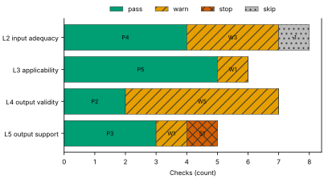
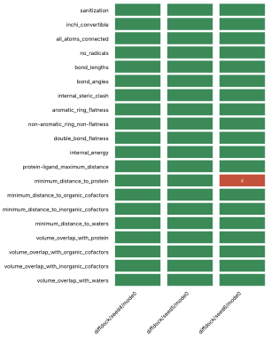
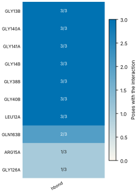
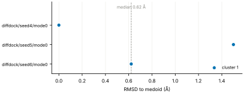
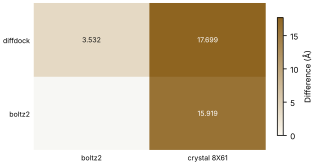

# Run report · Ligand pose in a known pocket

Prediction assurance · run `ligand_pose-0089a6eb3112` · 2026-10-17 18:11:07 UTC

**Refused** for the claim "Predicted pose of ATP in FtsE is valid".

Refused over layers 2,3,4,5: 14 pass, 10 warn, 1 stop, 1 skip. Stopped by l5.controls.redocking. Warnings from l2.receptor.protonation, l2.ligand.protonation, l2.docking.box, l3.exposure.ligand_prevalence, l4.torsion_strain, l4.interactions.unsatisfied_polars, l4.interactions.hydrophobic, l4.interactions.known_binders, l4.minimisation_drift, l5.agreement.cross_family.

Stops: `l5.controls.redocking`.

Warnings: `l2.receptor.protonation`, `l2.ligand.protonation`, `l2.docking.box`, `l3.exposure.ligand_prevalence`, `l4.torsion_strain`, `l4.interactions.unsatisfied_polars`, `l4.interactions.hydrophobic`, `l4.interactions.known_binders`, `l4.minimisation_drift`, `l5.agreement.cross_family`.

| Field | Value |
| --- | --- |
| Task | Ligand pose in a known pocket (`ligand_pose`) |
| Tools | DiffDock-L v1.1.3 (docking), Boltz-2 (co-folding) |
| Target | `protein` |
| Ligand | `c1nc(c2c(n1)n(cn2)[C@H]3[C@@H]([C@@H]([C@H](O3)CO[P@@](=O)(O)O[P@](=O)(O)OP(=O)(O)O)O)O)N` |
| Reference | `8X61` |
| pH | 7.4 |
| Seeds | 3 |
| Layers run | 2, 3, 4, 5 |
| Run | `ligand_pose-0089a6eb3112` |
| Created | 2026-10-17 18:11:07 UTC |
| Finished | 2026-10-17 18:12:07 UTC |
| pah version | 0.1.0 |
| Report schema | 1 |

## Layers

| Layer | Status | Result | pass | warn | stop | skip | Time |
| --- | --- | --- | --- | --- | --- | --- | --- |
| L0 Provenance | not run | n/a | n/a | n/a | n/a | n/a | n/a |
| L1 Input integrity | not run | n/a | n/a | n/a | n/a | n/a | n/a |
| L2 Input adequacy | done | warn | 4 | 3 | 0 | 1 | 1.4 s |
| L3 Applicability | done | warn | 5 | 1 | 0 | 0 | 402 ms |
| L4 Output validity | done | warn | 2 | 5 | 0 | 0 | 56.7 s |
| L5 Output support | done | stop | 3 | 1 | 1 | 0 | 696 ms |

## Figures

Fig. 1 · Check outcomes per layer for run ligand_pose-0089a6eb3112. Totals: pass 14, warn 10, stop 1, skip 1.
Files: data [figures/gates_by_layer.csv](figures/gates_by_layer.csv).

## Structures

68 PyMOL renders.

8X61 mmCIF (source_structure), whole structure. Chains A, B, C, D; organic components ATP. sha256 ba2b64fd50fa3880. PyMOL session: [renders/8X61.pse](renders/8X61.pse).

8X61 mmCIF (source_structure), ligand environment within 5 Å. Chains A, B, C, D; organic components ATP. sha256 ba2b64fd50fa3880. PyMOL session: [renders/8X61.pse](renders/8X61.pse).

diffdock/seed4/mode0 (prediction_structure), whole structure. Chains A, L; organic components LIG. sha256 652f21480ea8017f. PyMOL session: [renders/diffdock_seed4_mode0.pse](renders/diffdock_seed4_mode0.pse).

diffdock/seed4/mode0 (prediction_structure), ligand environment within 5 Å. Chains A, L; organic components LIG. sha256 652f21480ea8017f. PyMOL session: [renders/diffdock_seed4_mode0.pse](renders/diffdock_seed4_mode0.pse).

diffdock/seed4/mode1 (prediction_structure), whole structure. Chains A, L; organic components LIG. sha256 0716c07140f232d5. PyMOL session: [renders/diffdock_seed4_mode1.pse](renders/diffdock_seed4_mode1.pse).

diffdock/seed4/mode1 (prediction_structure), ligand environment within 5 Å. Chains A, L; organic components LIG. sha256 0716c07140f232d5. PyMOL session: [renders/diffdock_seed4_mode1.pse](renders/diffdock_seed4_mode1.pse).

diffdock/seed4/mode2 (prediction_structure), whole structure. Chains A, L; organic components LIG. sha256 5f19be67f3af9d6c. PyMOL session: [renders/diffdock_seed4_mode2.pse](renders/diffdock_seed4_mode2.pse).

diffdock/seed4/mode2 (prediction_structure), ligand environment within 5 Å. Chains A, L; organic components LIG. sha256 5f19be67f3af9d6c. PyMOL session: [renders/diffdock_seed4_mode2.pse](renders/diffdock_seed4_mode2.pse).

diffdock/seed4/mode3 (prediction_structure), whole structure. Chains A, L; organic components LIG. sha256 8a7e6d973bfa940a. PyMOL session: [renders/diffdock_seed4_mode3.pse](renders/diffdock_seed4_mode3.pse).

diffdock/seed4/mode3 (prediction_structure), ligand environment within 5 Å. Chains A, L; organic components LIG. sha256 8a7e6d973bfa940a. PyMOL session: [renders/diffdock_seed4_mode3.pse](renders/diffdock_seed4_mode3.pse).

diffdock/seed4/mode4 (prediction_structure), whole structure. Chains A, L; organic components LIG. sha256 f5d8de5161885629. PyMOL session: [renders/diffdock_seed4_mode4.pse](renders/diffdock_seed4_mode4.pse).

diffdock/seed4/mode4 (prediction_structure), ligand environment within 5 Å. Chains A, L; organic components LIG. sha256 f5d8de5161885629. PyMOL session: [renders/diffdock_seed4_mode4.pse](renders/diffdock_seed4_mode4.pse).

diffdock/seed4/mode5 (prediction_structure), whole structure. Chains A, L; organic components LIG. sha256 4bba95b3611d5207. PyMOL session: [renders/diffdock_seed4_mode5.pse](renders/diffdock_seed4_mode5.pse).

diffdock/seed4/mode5 (prediction_structure), ligand environment within 5 Å. Chains A, L; organic components LIG. sha256 4bba95b3611d5207. PyMOL session: [renders/diffdock_seed4_mode5.pse](renders/diffdock_seed4_mode5.pse).

diffdock/seed4/mode6 (prediction_structure), whole structure. Chains A, L; organic components LIG. sha256 322728291f35dfc6. PyMOL session: [renders/diffdock_seed4_mode6.pse](renders/diffdock_seed4_mode6.pse).

diffdock/seed4/mode6 (prediction_structure), ligand environment within 5 Å. Chains A, L; organic components LIG. sha256 322728291f35dfc6. PyMOL session: [renders/diffdock_seed4_mode6.pse](renders/diffdock_seed4_mode6.pse).

diffdock/seed4/mode7 (prediction_structure), whole structure. Chains A, L; organic components LIG. sha256 1189186c355ab6aa. PyMOL session: [renders/diffdock_seed4_mode7.pse](renders/diffdock_seed4_mode7.pse).

diffdock/seed4/mode7 (prediction_structure), ligand environment within 5 Å. Chains A, L; organic components LIG. sha256 1189186c355ab6aa. PyMOL session: [renders/diffdock_seed4_mode7.pse](renders/diffdock_seed4_mode7.pse).

diffdock/seed4/mode8 (prediction_structure), whole structure. Chains A, L; organic components LIG. sha256 2c5e6d7cce9af5fe. PyMOL session: [renders/diffdock_seed4_mode8.pse](renders/diffdock_seed4_mode8.pse).

diffdock/seed4/mode8 (prediction_structure), ligand environment within 5 Å. Chains A, L; organic components LIG. sha256 2c5e6d7cce9af5fe. PyMOL session: [renders/diffdock_seed4_mode8.pse](renders/diffdock_seed4_mode8.pse).

diffdock/seed4/mode9 (prediction_structure), whole structure. Chains A, L; organic components LIG. sha256 16293a9c621fa42d. PyMOL session: [renders/diffdock_seed4_mode9.pse](renders/diffdock_seed4_mode9.pse).

diffdock/seed4/mode9 (prediction_structure), ligand environment within 5 Å. Chains A, L; organic components LIG. sha256 16293a9c621fa42d. PyMOL session: [renders/diffdock_seed4_mode9.pse](renders/diffdock_seed4_mode9.pse).

diffdock/seed5/mode0 (prediction_structure), whole structure. Chains A, L; organic components LIG. sha256 9a899afdf881333c. PyMOL session: [renders/diffdock_seed5_mode0.pse](renders/diffdock_seed5_mode0.pse).

diffdock/seed5/mode0 (prediction_structure), ligand environment within 5 Å. Chains A, L; organic components LIG. sha256 9a899afdf881333c. PyMOL session: [renders/diffdock_seed5_mode0.pse](renders/diffdock_seed5_mode0.pse).

diffdock/seed5/mode1 (prediction_structure), whole structure. Chains A, L; organic components LIG. sha256 66e66a22eae932a1. PyMOL session: [renders/diffdock_seed5_mode1.pse](renders/diffdock_seed5_mode1.pse).

diffdock/seed5/mode1 (prediction_structure), ligand environment within 5 Å. Chains A, L; organic components LIG. sha256 66e66a22eae932a1. PyMOL session: [renders/diffdock_seed5_mode1.pse](renders/diffdock_seed5_mode1.pse).

diffdock/seed5/mode2 (prediction_structure), whole structure. Chains A, L; organic components LIG. sha256 3144e799d4f16964. PyMOL session: [renders/diffdock_seed5_mode2.pse](renders/diffdock_seed5_mode2.pse).

diffdock/seed5/mode2 (prediction_structure), ligand environment within 5 Å. Chains A, L; organic components LIG. sha256 3144e799d4f16964. PyMOL session: [renders/diffdock_seed5_mode2.pse](renders/diffdock_seed5_mode2.pse).

diffdock/seed5/mode3 (prediction_structure), whole structure. Chains A, L; organic components LIG. sha256 16bf86140c82122a. PyMOL session: [renders/diffdock_seed5_mode3.pse](renders/diffdock_seed5_mode3.pse).

diffdock/seed5/mode3 (prediction_structure), ligand environment within 5 Å. Chains A, L; organic components LIG. sha256 16bf86140c82122a. PyMOL session: [renders/diffdock_seed5_mode3.pse](renders/diffdock_seed5_mode3.pse).

diffdock/seed5/mode4 (prediction_structure), whole structure. Chains A, L; organic components LIG. sha256 85c855fb6d7bc10c. PyMOL session: [renders/diffdock_seed5_mode4.pse](renders/diffdock_seed5_mode4.pse).

diffdock/seed5/mode4 (prediction_structure), ligand environment within 5 Å. Chains A, L; organic components LIG. sha256 85c855fb6d7bc10c. PyMOL session: [renders/diffdock_seed5_mode4.pse](renders/diffdock_seed5_mode4.pse).

diffdock/seed5/mode5 (prediction_structure), whole structure. Chains A, L; organic components LIG. sha256 c26329ac5f0f1560. PyMOL session: [renders/diffdock_seed5_mode5.pse](renders/diffdock_seed5_mode5.pse).

diffdock/seed5/mode5 (prediction_structure), ligand environment within 5 Å. Chains A, L; organic components LIG. sha256 c26329ac5f0f1560. PyMOL session: [renders/diffdock_seed5_mode5.pse](renders/diffdock_seed5_mode5.pse).

diffdock/seed5/mode6 (prediction_structure), whole structure. Chains A, L; organic components LIG. sha256 f0297027585142c5. PyMOL session: [renders/diffdock_seed5_mode6.pse](renders/diffdock_seed5_mode6.pse).

diffdock/seed5/mode6 (prediction_structure), ligand environment within 5 Å. Chains A, L; organic components LIG. sha256 f0297027585142c5. PyMOL session: [renders/diffdock_seed5_mode6.pse](renders/diffdock_seed5_mode6.pse).

diffdock/seed5/mode7 (prediction_structure), whole structure. Chains A, L; organic components LIG. sha256 1d7fc5ec1819420c. PyMOL session: [renders/diffdock_seed5_mode7.pse](renders/diffdock_seed5_mode7.pse).

diffdock/seed5/mode7 (prediction_structure), ligand environment within 5 Å. Chains A, L; organic components LIG. sha256 1d7fc5ec1819420c. PyMOL session: [renders/diffdock_seed5_mode7.pse](renders/diffdock_seed5_mode7.pse).

diffdock/seed5/mode8 (prediction_structure), whole structure. Chains A, L; organic components LIG. sha256 1dfcb8882e4a2eaa. PyMOL session: [renders/diffdock_seed5_mode8.pse](renders/diffdock_seed5_mode8.pse).

diffdock/seed5/mode8 (prediction_structure), ligand environment within 5 Å. Chains A, L; organic components LIG. sha256 1dfcb8882e4a2eaa. PyMOL session: [renders/diffdock_seed5_mode8.pse](renders/diffdock_seed5_mode8.pse).

diffdock/seed5/mode9 (prediction_structure), whole structure. Chains A, L; organic components LIG. sha256 ffa0d008f4f2e12e. PyMOL session: [renders/diffdock_seed5_mode9.pse](renders/diffdock_seed5_mode9.pse).

diffdock/seed5/mode9 (prediction_structure), ligand environment within 5 Å. Chains A, L; organic components LIG. sha256 ffa0d008f4f2e12e. PyMOL session: [renders/diffdock_seed5_mode9.pse](renders/diffdock_seed5_mode9.pse).

diffdock/seed6/mode0 (prediction_structure), whole structure. Chains A, L; organic components LIG. sha256 7bec10abb18a878a. PyMOL session: [renders/diffdock_seed6_mode0.pse](renders/diffdock_seed6_mode0.pse).

diffdock/seed6/mode0 (prediction_structure), ligand environment within 5 Å. Chains A, L; organic components LIG. sha256 7bec10abb18a878a. PyMOL session: [renders/diffdock_seed6_mode0.pse](renders/diffdock_seed6_mode0.pse).

diffdock/seed6/mode1 (prediction_structure), whole structure. Chains A, L; organic components LIG. sha256 ba6638ba0fccf7df. PyMOL session: [renders/diffdock_seed6_mode1.pse](renders/diffdock_seed6_mode1.pse).

diffdock/seed6/mode1 (prediction_structure), ligand environment within 5 Å. Chains A, L; organic components LIG. sha256 ba6638ba0fccf7df. PyMOL session: [renders/diffdock_seed6_mode1.pse](renders/diffdock_seed6_mode1.pse).

diffdock/seed6/mode2 (prediction_structure), whole structure. Chains A, L; organic components LIG. sha256 b7d4fe48f5a18b5b. PyMOL session: [renders/diffdock_seed6_mode2.pse](renders/diffdock_seed6_mode2.pse).

diffdock/seed6/mode2 (prediction_structure), ligand environment within 5 Å. Chains A, L; organic components LIG. sha256 b7d4fe48f5a18b5b. PyMOL session: [renders/diffdock_seed6_mode2.pse](renders/diffdock_seed6_mode2.pse).

diffdock/seed6/mode3 (prediction_structure), whole structure. Chains A, L; organic components LIG. sha256 d68ebf9768246dad. PyMOL session: [renders/diffdock_seed6_mode3.pse](renders/diffdock_seed6_mode3.pse).

diffdock/seed6/mode3 (prediction_structure), ligand environment within 5 Å. Chains A, L; organic components LIG. sha256 d68ebf9768246dad. PyMOL session: [renders/diffdock_seed6_mode3.pse](renders/diffdock_seed6_mode3.pse).

diffdock/seed6/mode4 (prediction_structure), whole structure. Chains A, L; organic components LIG. sha256 a908748b8b0815cb. PyMOL session: [renders/diffdock_seed6_mode4.pse](renders/diffdock_seed6_mode4.pse).

diffdock/seed6/mode4 (prediction_structure), ligand environment within 5 Å. Chains A, L; organic components LIG. sha256 a908748b8b0815cb. PyMOL session: [renders/diffdock_seed6_mode4.pse](renders/diffdock_seed6_mode4.pse).

diffdock/seed6/mode5 (prediction_structure), whole structure. Chains A, L; organic components LIG. sha256 30768380ea74606b. PyMOL session: [renders/diffdock_seed6_mode5.pse](renders/diffdock_seed6_mode5.pse).

diffdock/seed6/mode5 (prediction_structure), ligand environment within 5 Å. Chains A, L; organic components LIG. sha256 30768380ea74606b. PyMOL session: [renders/diffdock_seed6_mode5.pse](renders/diffdock_seed6_mode5.pse).

diffdock/seed6/mode6 (prediction_structure), whole structure. Chains A, L; organic components LIG. sha256 434d15ea2234eacd. PyMOL session: [renders/diffdock_seed6_mode6.pse](renders/diffdock_seed6_mode6.pse).

diffdock/seed6/mode6 (prediction_structure), ligand environment within 5 Å. Chains A, L; organic components LIG. sha256 434d15ea2234eacd. PyMOL session: [renders/diffdock_seed6_mode6.pse](renders/diffdock_seed6_mode6.pse).

diffdock/seed6/mode7 (prediction_structure), whole structure. Chains A, L; organic components LIG. sha256 e998605b2dbf0199. PyMOL session: [renders/diffdock_seed6_mode7.pse](renders/diffdock_seed6_mode7.pse).

diffdock/seed6/mode7 (prediction_structure), ligand environment within 5 Å. Chains A, L; organic components LIG. sha256 e998605b2dbf0199. PyMOL session: [renders/diffdock_seed6_mode7.pse](renders/diffdock_seed6_mode7.pse).

diffdock/seed6/mode8 (prediction_structure), whole structure. Chains A, L; organic components LIG. sha256 52bf78c869040a3a. PyMOL session: [renders/diffdock_seed6_mode8.pse](renders/diffdock_seed6_mode8.pse).

diffdock/seed6/mode8 (prediction_structure), ligand environment within 5 Å. Chains A, L; organic components LIG. sha256 52bf78c869040a3a. PyMOL session: [renders/diffdock_seed6_mode8.pse](renders/diffdock_seed6_mode8.pse).

diffdock/seed6/mode9 (prediction_structure), whole structure. Chains A, L; organic components LIG. sha256 1bde0431411f6234. PyMOL session: [renders/diffdock_seed6_mode9.pse](renders/diffdock_seed6_mode9.pse).

diffdock/seed6/mode9 (prediction_structure), ligand environment within 5 Å. Chains A, L; organic components LIG. sha256 1bde0431411f6234. PyMOL session: [renders/diffdock_seed6_mode9.pse](renders/diffdock_seed6_mode9.pse).

boltz2/seed4/sample0 (prediction_structure), whole structure. Chains A, L; organic components LIG1. sha256 eee2623ca6bde305. PyMOL session: [renders/boltz2_seed4_sample0.pse](renders/boltz2_seed4_sample0.pse).

boltz2/seed4/sample0 (prediction_structure), ligand environment within 5 Å. Chains A, L; organic components LIG1. sha256 eee2623ca6bde305. PyMOL session: [renders/boltz2_seed4_sample0.pse](renders/boltz2_seed4_sample0.pse).

boltz2/seed5/sample0 (prediction_structure), whole structure. Chains A, L; organic components LIG1. sha256 1124a642eeb4f1dd. PyMOL session: [renders/boltz2_seed5_sample0.pse](renders/boltz2_seed5_sample0.pse).

boltz2/seed5/sample0 (prediction_structure), ligand environment within 5 Å. Chains A, L; organic components LIG1. sha256 1124a642eeb4f1dd. PyMOL session: [renders/boltz2_seed5_sample0.pse](renders/boltz2_seed5_sample0.pse).

boltz2/seed6/sample0 (prediction_structure), whole structure. Chains A, L; organic components LIG1. sha256 4eeb13db516e8ccf. PyMOL session: [renders/boltz2_seed6_sample0.pse](renders/boltz2_seed6_sample0.pse).

boltz2/seed6/sample0 (prediction_structure), ligand environment within 5 Å. Chains A, L; organic components LIG1. sha256 4eeb13db516e8ccf. PyMOL session: [renders/boltz2_seed6_sample0.pse](renders/boltz2_seed6_sample0.pse).

## L0 Provenance

Where did every input come from?

Status: not run.

## L1 Input integrity

Did the run receive exactly what was declared?

Status: not run.

## L2 Input adequacy

Does the input carry enough information?

Status: done. Checks: pass 4 · warn 3 · stop 0 · skip 1. Time: 1.4 s.

#### Key figures

| Figure | Value |
| --- | --- |
| near site | 0 |
| missing | 0 |
| uniprot cofactors | 0 |
| pocket residues | 30 |
| incomplete | 0 |
| sequence gaps | 0 |
| state | holo |
| site ligands | 1 |

#### Docking

| Field | Value |
| --- | --- |
| center | 137.651, 149.997, 122.463 Å |
| size | 16.823 × 14.232 × 20.687 Å |
| origin | derived from ATP (+4 Å) |

#### Checks

| Check | Result | Measured cmp threshold | Evidence | Id · time |
| --- | --- | --- | --- | --- |
| Alignment depth, distinct sequences, Neff and gap fraction | skip | n/a | no MSA declared for a co-folding model · not applicable | `l2.msa.depth` |
| Required cofactors, ions and partners present | pass | `pocket_distance <= 8` | components within 8.0 Å of ATP: none · near_site=0, missing=0, uniprot_cofactors=0 | `l2.context.cofactors` · 223 ms |
| Pocket residues resolved, no missing loops lining the pocket | pass | `pocket_distance <= 6` | 30 pocket residues complete in 8X61.cif · pocket_residues=30, incomplete=0, sequence_gaps=0 | `l2.pocket.resolved` · 20 ms |
| Receptor state apo or holo | pass | n/a | 8X61.cif holo: ATP in the site · state=holo, site_ligands=1 | `l2.receptor.state` · 25 ms |
| Receptor protonation at the stated pH | warn | `pka_margin > 1` | receptor has no hydrogens (protonation not assigned); pKa within 1.0 of pH 7.4: HIS195A pKa 6.61 · hydrogens_present=False, ph=7.4, pocket_titratable=7 | `l2.receptor.protonation` · 224 ms |
| Ligand protonation and tautomers enumerated at the stated pH | warn | `ph 7.4 == 1` | ligand: 2 states; ligand: declared form Nc1ncnc2c1ncn2[C@@H]1O[C@H](CO[P@@](=O)(O)O[P@](=O)(O)OP(=O)(O)O)[C@@H](O)[C@H]1O differs from enumerated Nc1ncnc2c1ncn2[C@@H]1O[C@H](CO[P@@](=O)([O-])O[P@](=O)([O-])OP(=O)([O-])O)[C@@H](O)[C@H]1O, Nc1ncnc2c1ncn2[C@@H]1O[C@H](CO[P@@](=O)([O-])O[P@](=O)([O-])OP(=O)([O-])[O-])[C@@H](O)[C@H]1O · ph=7.4, max_states=2, declared_not_enumerated=1 | `l2.ligand.protonation` · 64 ms |
| Ligand conformers generated and minimised | pass | `conformers >= 10` | 10 ETKDG conformers per ligand, MMFF minimised · ligands=1, failed=0, min_embedded=10 | `l2.ligand.conformers` · 854 ms |
| Docking box encloses the pocket with margin | warn | `margin >= 2` | no box declared; derived box encloses 21 contact residues and the ATP ligand with 2.0 Å margin · volume_A3=4953, ligand_atoms_inside_margin=31, ligand_atoms=31 | `l2.docking.box` · 15 ms |

## L3 Applicability

Is the tool inside its validated regime?

Status: done. Checks: pass 5 · warn 1 · stop 0 · skip 0. Time: 402 ms.

#### Key figures

| Figure | Value |
| --- | --- |
| executors | 2 |
| unknown | 0 |
| reference released | 2024-05-08 |
| cutoff | 2019-01-01 |
| entries compared | 0 |
| pocket residues | 22 |
| systems | 3474 |
| analogue components | 19 |

#### Checks

| Check | Result | Measured cmp threshold | Evidence | Id · time |
| --- | --- | --- | --- | --- |
| Model training cutoff recorded | pass | `training_cutoff == recorded` | diffdock 2019-01-01; boltz2 2023-06-01; reference 8X61 released 2024-05-08 · executors=2, unknown=0, reference_released=2024-05-08 | `l3.model.training_cutoff` · 0 ms |
| Pocket similarity to pre-cutoff complexes (SuCOS times pocket coverage) | pass | `similarity <= 50` | no pre-cutoff holo entry with an analogue found (cutoff 2019-01-01) · cutoff=2019-01-01, entries_compared=0, max_similarity=None | `l3.exposure.pocket` · 387 ms |
| Ligand analogues in pre-cutoff training systems | warn | `tanimoto > 0.9` | 3474 PDB entries released before 2019-01-01 (diffdock cutoff) contain analogues of ligand above Tanimoto 0.9: 5FA, ADP, AQP, ATP, HEJ, LA8 · cutoff=2019-01-01, systems=3474, analogue_components=19 | `l3.exposure.ligand_prevalence` · 0 ms |
| Chain sequence identity to pre-cutoff entries (secondary measure) | pass | `identity < 0.4` | protein: 0 entries at 95 percent identity, 0 at 40 percent, released before 2019-01-01 (reported, not gating) · cutoff=2019-01-01, entries_95=0, entries_40=0 | `l3.exposure.sequence` · 0 ms |
| Modality inside the validated set; token count against the training crop | pass | n/a | modalities protein, protein_ligand inside the validated set; 253 tokens · modalities=2, tokens=253, outside=0 | `l3.regime.modality` · 11 ms |
| Endpoint fits the tool | pass | `endpoint pose in pose` | endpoint pose produced by diffdock, boltz2 · endpoint=pose, executors=2, not_fitting=0 | `l3.metric.endpoint` · 0 ms |

## L4 Output validity

Is the result physically and chemically sensible?

Status: done. Checks: pass 2 · warn 5 · stop 0 · skip 0. Time: 56.7 s.

#### Key figures

| Figure | Value |
| --- | --- |
| poses | 3 |
| passed | 20 |
| total | 20 |
| poses all pass | 2 |
| unlikely torsions | 1 |
| torsions | 14 |
| strain kcal | 24.63 |
| poses with unlikely | 3 |

#### PoseBusters · 20/20 tests pass

| test | result | value |
| --- | --- | --- |
| sanitization | pass | pass |
| inchi_convertible | pass | pass |
| all_atoms_connected | pass | pass |
| no_radicals | pass | pass |
| bond_lengths | pass | 0 long outliers |
| bond_angles | pass | 0 outliers |
| internal_steric_clash | pass | 0 |
| aromatic_ring_flatness | pass | 0.00 Å |
| non-aromatic_ring_non-flatness | pass | pass |
| double_bond_flatness | pass | pass |
| internal_energy | pass | 1.6 times the ensemble mean |
| protein-ligand_maximum_distance | pass | 2.63 Å |
| minimum_distance_to_protein | pass | 2.63 Å |
| minimum_distance_to_organic_cofactors | pass | pass |
| minimum_distance_to_inorganic_cofactors | pass | pass |
| minimum_distance_to_waters | pass | pass |
| volume_overlap_with_protein | pass | 0.010 |
| volume_overlap_with_organic_cofactors | pass | pass |
| volume_overlap_with_inorganic_cofactors | pass | pass |
| volume_overlap_with_waters | pass | pass |

#### Per-pose physical checks

| pose | seed | drift Å | converged | unlikely torsions | unsat. polars | buried charged | PoseBusters |
| --- | --- | --- | --- | --- | --- | --- | --- |
| diffdock/seed4/mode0 | 4 | 2.91 | true | 1/14 | 2 | 0 | 20/20 |
| diffdock/seed5/mode0 | 5 | 0.9 | true | 2/14 | 1 | 0 | 20/20 |
| diffdock/seed6/mode0 | 6 | 1.16 | true | 3/14 | 2 | 0 | 19/20 |
| median | n/a | 1.16 | n/a | 2 | 2 | 0 | 20/20 |

#### Interaction fingerprint · representative pose diffdock/seed4/mode0

| residue | type | distance | poses |
| --- | --- | --- | --- |
| GLY13B | hbond | 3.07 Å | 3/3 |
| GLY140A | hbond | 3.37 Å | 3/3 |
| GLY141A | hbond | 3.06 Å | 3/3 |
| GLY14B | hbond | 3.14 Å | 3/3 |
| GLY38B | hbond | 2.77 Å | 3/3 |
| GLY40B | hbond | 2.32 Å | 3/3 |
| LEU12A | hbond | 3.16 Å | 3/3 |
| GLN163B | hbond | 3.89 Å | 2/3 |
| ARG15A | hbond | 2.75 Å | 1/3 |
| GLY126A | hbond | 3.43 Å | 1/3 |

Fig. 2 · PoseBusters tests (20) by pose (3). Failed cells marked x: 1 of 60.
Files: data [figures/posebusters_grid.csv](figures/posebusters_grid.csv).

Fig. 3 · Interactions by residue (10) and type (1); cell label: poses with the interaction over poses assessed.
Files: data [figures/interactions.csv](figures/interactions.csv).

#### Checks

| Check | Result | Measured cmp threshold | Evidence | Id · time |
| --- | --- | --- | --- | --- |
| PoseBusters geometry, stereochemistry, clashes and protein contact | pass | `tests_failed == 0` | 20 of 20 tests pass for diffdock/seed4/mode0; 2 of 3 poses pass all · poses=3, passed=20, total=20 | `l4.posebusters` · 2.1 s |
| Torsional strain of the ligand pose | warn | `torsion_energy <= 2.5` | 1 of 14 torsions above 2.5 kcal/mol in diffdock/seed4/mode0 · poses=3, unlikely_torsions=1, torsions=14 | `l4.torsion_strain` · 4.4 s |
| Interaction fingerprint (PLIP) | pass | n/a | 9 interactions in diffdock/seed4/mode0 (hbond); 10 distinct across 3 poses (reported) · poses=3, interactions_representative=9, distinct=10 | `l4.interactions.fingerprint` · 727 ms |
| Buried ligand polar atoms without a hydrogen-bond partner | warn | `relative_sasa < 0.1` | 2 of 4 buried polar ligand atoms without a partner in diffdock/seed4/mode0 · poses=3, unsatisfied=2, buried_charged=0 | `l4.interactions.unsatisfied_polars` · 218 ms |
| Hydrophobic complementarity of buried ligand surface | warn | `fraction >= 0.35` | nonpolar fraction of protein contacts around 2 buried nonpolar ligand atoms in diffdock/seed4/mode0: 0.333 · poses=3, complementarity=0.333, buried_nonpolar=2 | `l4.interactions.hydrophobic` · 259 ms |
| Interactions of the crystal ligand reproduced by the pose | warn | `reproduced 0 >= 1` | diffdock/seed4/mode0 reproduces none of 16 ATP interactions · key_interactions=16, reproduced=0, poses_reproducing_all=0 | `l4.interactions.known_binders` · 624 ms |
| Pose stability under short restrained minimisation (OpenMM, AMBER14 and OpenFF) | warn | `drift_A 2.91 <= 2` | diffdock/seed4/mode0 moves 2.906 Å under restrained minimisation · poses=3, drift_A=2.906, max_drift_A=2.906 | `l4.minimisation_drift` · 48.4 s |

## L5 Output support

Is a valid result corroborated?

Status: done. Checks: pass 3 · warn 1 · stop 1 · skip 0. Time: 696 ms.

#### Key figures

| Figure | Value |
| --- | --- |
| poses | 3 |
| diffdock confidence | -1.09 |
| independent seeds | 3 |
| samples | 30 |
| duplicated outputs | 0 |
| clusters | 1 |
| largest cluster | 3 |
| pairwise rmsd median A | 1.5 |

#### Sampling

| Field | Value |
| --- | --- |
| site placement | 0 of 3 poses within 4.0 Å of the site (ATP in 8X61) |
| pose accuracy | 3 of 3 poses within 2.0 Å of the medoid |
| pairwise RMSD median | 1.5 Å |
| pairwise RMSD IQR | 1.06 to 1.53 Å |
| pairs | 3 |
| medoid | diffdock/seed4/mode0 |

#### Clusters

| Field | Value |
| --- | --- |
| cluster 1 | 3/3 poses (diffdock/seed4/mode0) |

#### Per-seed statistics

| seed | pose | cluster | RMSD to medoid | confidence |
| --- | --- | --- | --- | --- |
| 4 | diffdock/seed4/mode0 | 1 | 0 Å | -1.09 |
| 5 | diffdock/seed5/mode0 | 1 | 1.5 Å | -0.99 |
| 6 | diffdock/seed6/mode0 | 1 | 0.62 Å | -1.11 |
| median | n/a | n/a | 0.62 Å | -1.09 |

#### Ensemble

| structure | kind | source | RMSD to medoid | cluster | pocket pLDDT | ipTM |
| --- | --- | --- | --- | --- | --- | --- |
| diffdock/seed4/mode0 | medoid | diffdock | 0 Å | 1 | n/a | n/a |
| diffdock/seed5/mode0 | docking | diffdock | 1.5 Å | 1 | n/a | n/a |
| diffdock/seed6/mode0 | docking | diffdock | 0.62 Å | 1 | n/a | n/a |

#### Agreement between methods

| method | boltz2 | crystal 8X61 |
| --- | --- | --- |
| diffdock | 3.53 Å (high) | 17.7 Å (decisive) |
| boltz2 | n/a | 15.9 Å (decisive) |

Fig. 4 · RMSD to the medoid for 3 poses, coloured by cluster (1 clusters). Dashed line: median 0.62 Å; range 0.00 to 1.50 Å.
Files: data [figures/seed_spread.csv](figures/seed_spread.csv).

Fig. 5 · Agreement between 2 methods and 2 comparators; range 3.532 to 17.699 Å.
Files: data [figures/agreement.csv](figures/agreement.csv).

#### Checks

| Check | Result | Measured cmp threshold | Evidence | Id · time |
| --- | --- | --- | --- | --- |
| Confidence restricted to the pocket; per-model thresholds | pass | n/a | diffdock/seed4/mode0: diffdock_confidence -1.09; no per-model confidence threshold registered for diffdock (reported) · poses=3, diffdock_confidence=-1.09 | `l5.confidence.local` · 0 ms |
| Independent seeds counted separately from samples; duplicates flagged | pass | `seeds_docking >= 3` | 3 independent seeds, 30 poses, no duplicates · independent_seeds=3, samples=30, duplicated_outputs=0 | `l5.sampling.seeds` · 0 ms |
| Medoid of the largest cluster, populations, pairwise spread, site and pose accuracy | pass | `cluster_rmsd <= 2` | medoid diffdock/seed4/mode0; 1 clusters, largest 3 of 3; pairwise RMSD median 1.50 Å (IQR 1.06 to 1.53); 0 of 3 poses within 4.0 Å of the site (ATP in 8X61); 3 of 3 poses within 2.0 Å of the medoid · poses=3, clusters=1, largest_cluster=3 | `l5.sampling.clusters` · 499 ms |
| Agreement between methods, weighted by independence | warn | `rmsd_to_crystal_A 17.7 <= 2` | diffdock vs boltz2 3.532 Å (high); diffdock vs crystal 8X61 17.699 Å (decisive); boltz2 vs crystal 8X61 15.919 Å (decisive) · methods=2, comparisons=3, disagreeing=3 | `l5.agreement.cross_family` · 194 ms |
| Redocking control reproduces the crystal pose | stop | `rmsd <= 2` | redocking control required by the task and not supplied (controls.redocking) | `l5.controls.redocking` · 0 ms |

## Controls

| control | status | result |
| --- | --- | --- |
| redocking | incomplete | redocking control required by the task and not supplied (controls.redocking) |

## Provenance

50 objects · 50 cached · 0 network.

| Source | Accession | Release | SHA-256 | Retrieved | Bytes | Cache | Used by |
| --- | --- | --- | --- | --- | --- | --- | --- |
| rcsb_files | 8X61 | n/a | `ba2b64fd50fa` | 2026-10-17 16:56:13 UTC | 669464 | hit | l2.context.cofactors, l2.pocket.resolved, l2.receptor.state, l2.docking.box, l3.exposure.pocket, l3.regime.modality, l4.interactions.fingerprint, l4.interactions.known_binders, l5.sampling.clusters, l5.agreement.cross_family |
| ccd | ATP | 2011-06-04 | `a7dfd66192d9` | 2026-10-17 16:42:55 UTC | 14836 | hit | l2.context.cofactors, l3.exposure.pocket |
| rcsb | 8X61 | 1.2 | `40597bd4cb89` | 2026-10-17 16:56:15 UTC | 12259 | hit | l3.model.training_cutoff |
| rcsb_search | chem:c1nc(c2c(n1)n(cn2)[C@H]3[C@@H]([C@@H]([C@H](O3)CO[P@@](=O)(O)O[P@](=O)(O)OP(=O)(O)O)O)O)N | n/a | `c9ecdf87b8e2` | 2026-10-17 16:42:57 UTC | 1797 | hit | l3.exposure.pocket |
| ccd | 5FA | 2011-06-04 | `141da43b1fd4` | 2026-10-17 16:42:57 UTC | 5208 | hit | l3.exposure.pocket |
| ccd | ADP | 2025-10-10 | `9ebf239d6ded` | 2026-10-17 16:42:57 UTC | 5741 | hit | l3.exposure.pocket |
| ccd | AQP | 2011-06-04 | `d1f31df6170c` | 2026-10-17 16:42:57 UTC | 4700 | hit | l3.exposure.pocket |
| ccd | HEJ | 2021-03-01 | `3793d61303f5` | 2026-10-17 16:42:57 UTC | 4603 | hit | l3.exposure.pocket |
| ccd | LA8 | 2020-06-17 | `3c66f53baf33` | 2026-10-17 16:42:57 UTC | 4178 | hit | l3.exposure.pocket |
| ccd | ZF9 | 2024-03-08 | `b48f6ea5a0a0` | 2026-10-17 16:42:57 UTC | 4686 | hit | l3.exposure.pocket |
| ccd | ZSF | 2024-03-29 | `dde5989ea661` | 2026-10-17 16:42:57 UTC | 4903 | hit | l3.exposure.pocket |
| ccd | 50T | 2026-09-16 | `6be53fbf78af` | 2026-10-17 16:42:57 UTC | 4275 | hit | l3.exposure.pocket |
| ccd | AD9 | 2026-09-16 | `c8798e579e0a` | 2026-10-17 16:42:58 UTC | 4205 | hit | l3.exposure.pocket |
| ccd | AOV | 2026-09-16 | `300b793745cf` | 2026-10-17 16:42:58 UTC | 4330 | hit | l3.exposure.pocket |
| ccd | CX0 | 2022-03-25 | `fbc78ded25cd` | 2026-10-17 16:42:58 UTC | 3595 | hit | l3.exposure.pocket |
| ccd | CXC | 2022-03-25 | `d89a7023bd05` | 2026-10-17 16:42:58 UTC | 3941 | hit | l3.exposure.pocket |
| ccd | 0A | 2015-04-24 | `7f0b456f42e0` | 2026-10-17 16:42:58 UTC | 3972 | hit | l3.exposure.pocket |
| ccd | 3AN | 2011-06-04 | `a3d4d17a4a3e` | 2026-10-17 16:42:58 UTC | 4390 | hit | l3.exposure.pocket |
| ccd | 7DD | 2016-06-10 | `2265ea597be9` | 2026-10-17 16:42:58 UTC | 3425 | hit | l3.exposure.pocket |
| ccd | 7DT | 2016-06-10 | `c346b8a79ec0` | 2026-10-17 16:42:58 UTC | 3725 | hit | l3.exposure.pocket |
| ccd | AAM | 2011-06-04 | `ade365fd93cd` | 2026-10-17 16:42:58 UTC | 4244 | hit | l3.exposure.pocket |
| ccd | PAP | 2011-06-04 | `1a6bb6874f6f` | 2026-10-17 16:42:58 UTC | 4734 | hit | l3.exposure.pocket |
| ccd | XNY | 2021-04-30 | `7cb26ca44908` | 2026-10-17 16:42:58 UTC | 3977 | hit | l3.exposure.pocket |
| ccd | AP5 | 2011-06-04 | `43e554f584b7` | 2026-10-17 16:42:58 UTC | 6473 | hit | l3.exposure.pocket |
| ccd | T99 | 2018-06-01 | `68a3d15f3b6f` | 2026-10-17 16:42:58 UTC | 3399 | hit | l3.exposure.pocket |
| ccd | TAT | 2012-01-25 | `55287be9857e` | 2026-10-17 16:42:58 UTC | 4858 | hit | l3.exposure.pocket |
| ccd | A1L15 | 2025-01-24 | `57864c05fab0` | 2026-10-17 16:42:58 UTC | 5608 | hit | l3.exposure.pocket |
| ccd | AGS | 2020-06-17 | `dcdd428b77e4` | 2026-10-17 16:42:58 UTC | 10128 | hit | l3.exposure.pocket |
| rcsb_search | comp:5FA:2019-01-01 | n/a | `c60bf45b266d` | 2026-10-17 16:42:58 UTC | 282 | hit | l3.exposure.pocket |
| rcsb_search | comp:ADP:2019-01-01 | n/a | `d0ea634975e9` | 2026-10-17 16:42:58 UTC | 52129 | hit | l3.exposure.pocket |
| rcsb_search | comp:AQP:2019-01-01 | n/a | `94a619102faa` | 2026-10-17 16:42:58 UTC | 230 | hit | l3.exposure.pocket |
| rcsb_search | comp:ATP:2019-01-01 | n/a | `88190701e349` | 2026-10-17 16:42:59 UTC | 52129 | hit | l3.exposure.pocket |
| rcsb_search | comp:HEJ:2019-01-01 | n/a | `494129c6512c` | 2026-10-17 16:42:59 UTC | 178 | hit | l3.exposure.pocket |
| rcsb_search | comp:LA8:2019-01-01 | n/a | `185329a63a40` | 2026-10-17 16:42:59 UTC | 230 | hit | l3.exposure.pocket |
| rcsb_search | comp:ZF9:2019-01-01 | n/a | `e3b0c44298fc` | 2026-10-17 16:42:59 UTC | 0 | hit | l3.exposure.sequence |
| rcsb_search | comp:ZSF:2019-01-01 | n/a | `e3b0c44298fc` | 2026-10-17 16:42:59 UTC | 0 | hit | l3.exposure.sequence |
| rcsb_search | comp:50T:2019-01-01 | n/a | `927f39839b9d` | 2026-10-17 16:42:59 UTC | 178 | hit | l3.exposure.pocket |
| rcsb_search | comp:AD9:2019-01-01 | n/a | `ac65056f9aef` | 2026-10-17 16:42:59 UTC | 490 | hit | l3.exposure.pocket |
| rcsb_search | comp:AOV:2019-01-01 | n/a | `d8dd9b5a5778` | 2026-10-17 16:42:59 UTC | 334 | hit | l3.exposure.pocket |
| rcsb_search | comp:CX0:2019-01-01 | n/a | `e3b0c44298fc` | 2026-10-17 16:42:59 UTC | 0 | hit | l3.exposure.sequence |
| rcsb_search | comp:CXC:2019-01-01 | n/a | `e3b0c44298fc` | 2026-10-17 16:42:59 UTC | 0 | hit | l3.exposure.sequence |
| rcsb_search | comp:0A:2019-01-01 | n/a | `e3b0c44298fc` | 2026-10-17 16:42:59 UTC | 0 | hit | l3.exposure.sequence |
| rcsb_search | comp:PAP:2019-01-01 | n/a | `ded69bf4bbb0` | 2026-10-17 16:42:59 UTC | 542 | hit | l3.exposure.pocket |
| rcsb_search | comp:AP5:2019-01-01 | n/a | `ab39d336ec91` | 2026-10-17 16:42:59 UTC | 3247 | hit | l3.exposure.pocket |
| rcsb_search | comp:T99:2019-01-01 | n/a | `690266055a03` | 2026-10-17 16:42:59 UTC | 178 | hit | l3.exposure.pocket |
| rcsb_search | comp:TAT:2019-01-01 | n/a | `84486689d32b` | 2026-10-17 16:42:59 UTC | 438 | hit | l3.exposure.pocket |
| rcsb_search | comp:AGS:2019-01-01 | n/a | `aef54bf1fe1d` | 2026-10-17 16:42:59 UTC | 8188 | hit | l3.exposure.pocket |
| rcsb_search | seq0.9:2019-01-01:222 | n/a | `e3b0c44298fc` | 2026-10-17 16:56:17 UTC | 0 | hit | l3.exposure.sequence |
| rcsb_search | seq0.95:2019-01-01:222 | n/a | `e3b0c44298fc` | 2026-10-17 16:56:18 UTC | 0 | hit | l3.exposure.sequence |
| rcsb_search | seq0.4:2019-01-01:222 | n/a | `e3b0c44298fc` | 2026-10-17 16:56:18 UTC | 0 | hit | l3.exposure.sequence |

Provenance graph: [json](graph.json), [mmd](graph.mmd), [svg](graph.svg).

## Thresholds

| Check | Threshold | Value | Origin | Evidence level |
| --- | --- | --- | --- | --- |
| `l2.context.cofactors` | pocket_distance | <= 8 | Harness rule: a component of the reference entry within 8 Å of the declared ligand is required context; not yet calibrated | uncalibrated |
| `l2.pocket.resolved` | pocket_distance | <= 6 | Harness rule: pocket residues have a heavy atom within 6 Å of the ligand; not yet calibrated | uncalibrated |
| `l2.pocket.resolved` | missing_pocket_residues | == 0 | Specification layer 2: stop when the pocket is incomplete | published |
| `l2.receptor.protonation` | pka_margin | > 1 | Harness rule: a titratable pocket residue with PROPKA pKa within 1 unit of the stated pH has an ambiguous state; not yet calibrated | uncalibrated |
| `l2.ligand.protonation` | ph_window | == 1 | Harness rule: states enumerated by Dimorphite-DL within 1 pH unit of the stated pH; not yet calibrated | uncalibrated |
| `l2.ligand.protonation` | states | == 1 | Specification layer 2: warn when more than one plausible state | published |
| `l2.ligand.conformers` | conformers | >= 10 | Harness default number of ETKDG conformers; not yet calibrated | uncalibrated |
| `l2.docking.box` | margin | >= 2 | Harness rule: every pocket heavy atom lies at least 2 Å inside the box; not yet calibrated | uncalibrated |
| `l2.docking.box` | contact_distance | <= 4 | Harness rule: contact residues (heavy atom within 4 Å of the reference ligand) must have an atom inside the box; not yet calibrated | uncalibrated |
| `l3.model.training_cutoff` | training_cutoff | == recorded | Specification, Layer 3 (applicability): stop when unknown | published |
| `l3.exposure.pocket` | similarity | <= 50 | Specification layer 3: warn above a pocket similarity (SuCOS times pocket coverage) of 50 | published |
| `l3.exposure.pocket` | entries | <= 5 | Harness budget: pre-cutoff holo entries compared per run | uncalibrated |
| `l3.exposure.ligand_prevalence` | tanimoto | > 0.9 | Specification layer 3: analogues above 0.9 Tanimoto (RDKit topological fingerprint) | published |
| `l3.exposure.ligand_prevalence` | systems | <= 100 | Specification layer 3: prevalent when analogues occur in more than 100 training systems | published |
| `l3.exposure.sequence` | identity | < 0.4 | Specification layer 3: conventional 40 percent identity leakage threshold, reported as a secondary measure only | published |
| `l3.metric.endpoint` | endpoint | in pose | Specification, Layer 3 (applicability): no affinity from interface confidence, no protein-protein affinity from Boltz-2 | published |
| `l4.posebusters` | tests_failed | == 0 | Specification, Layer 4 (output validity): stop on failure | published |
| `l4.torsion_strain` | torsion_energy | <= 2.5 | Harness rule: a rotatable torsion whose MMFF energy lies more than 2.5 kcal/mol above the minimum of its rigid scan is unlikely; not yet calibrated | uncalibrated |
| `l4.interactions.unsatisfied_polars` | relative_sasa | < 0.1 | Harness rule: a ligand polar atom with relative SASA below 0.1 in the complex is buried; not yet calibrated | uncalibrated |
| `l4.interactions.unsatisfied_polars` | hbond_distance | <= 3.5 | PLIP hydrogen bond distance cut-off (donor-acceptor 4.1 Å; harness uses 3.5 Å heavy-atom distance) | published |
| `l4.interactions.hydrophobic` | fraction | >= 0.35 | Harness default anchored on 3PTB: the crystal benzamidine scores 0.51, Vina and Boltz-2 poses within 0.5 Å of it score 0.45 and 0.49; not calibrated on the benchmark | uncalibrated |
| `l4.interactions.hydrophobic` | relative_sasa | < 0.1 | Harness rule: a ligand polar atom with relative SASA below 0.1 in the complex is buried; not yet calibrated | uncalibrated |
| `l4.interactions.known_binders` | reproduced | >= 1 | Specification layer 4: warn when no key interaction is reproduced | published |
| `l4.minimisation_drift` | drift | <= 2 | Specification layer 4: warn when the pose moves beyond 2 Å under restrained minimisation | published |
| `l5.sampling.seeds` | seeds_docking | >= 3 | Harness default for independent docking seeds; not yet calibrated | uncalibrated |
| `l5.sampling.clusters` | cluster_rmsd | <= 2 | Specification layer 5: 2 Å symmetry-aware ligand RMSD (spyrmsd) separates pose clusters | published |
| `l5.sampling.clusters` | site_distance | <= 4 | Harness rule: a ligand centroid within 4 Å of the reference site centroid is placed in the site; not yet calibrated | uncalibrated |
| `l5.sampling.clusters` | largest_fraction | >= 0.5 | Harness rule: the largest cluster holds at least half of the poses; not yet calibrated | uncalibrated |
| `l5.agreement.cross_family` | rmsd | <= 2 | Specification layer 5: pose agreement by symmetry-aware ligand RMSD at 2 Å | published |
| `l5.controls.redocking` | rmsd | <= 2 | Specification layer 5: redocking must reproduce the crystal pose (2 Å ligand RMSD) | published |

Tool versions: dimorphite_dl 2.1.0, freesasa 2.2.1, gemmi 0.7.5, numpy 1.26.4, openbabel 3.2.1, openmm 8.6.1, plip 3.0.1, posebusters 0.6.5, propka 3.5.1, rdkit 2026.9.1, scipy 1.17.1, spyrmsd 0.9.0.

## Limitations

- This report covers layers 2, 3, 4, 5. Layers not run: 0, 1.
- The harness establishes when a result should not be trusted. Passing checks are not evidence that a prediction is correct.
- Thresholds marked uncalibrated come from the specification or harness defaults and have not been recalibrated on the harness benchmark.

## Files

| Path | Kind | Bytes | SHA-256 |
| --- | --- | --- | --- |
| artifacts/sources/8X61.cif | source_structure | 669464 | `ba2b64fd50fa` |
| predictions/00_diffdock/diffdock/seed4/mode0/complex.pdb | prediction_structure | 136809 | `652f21480ea8` |
| predictions/00_diffdock/diffdock/seed4/mode0/ligand.sdf | data | 2682 | `d1a719cd40c7` |
| predictions/00_diffdock/diffdock/seed4/mode1/complex.pdb | prediction_structure | 136809 | `0716c07140f2` |
| predictions/00_diffdock/diffdock/seed4/mode1/ligand.sdf | data | 2682 | `904ff7f74415` |
| predictions/00_diffdock/diffdock/seed4/mode2/complex.pdb | prediction_structure | 136809 | `5f19be67f3af` |
| predictions/00_diffdock/diffdock/seed4/mode2/ligand.sdf | data | 2682 | `0aefe17897a7` |
| predictions/00_diffdock/diffdock/seed4/mode3/complex.pdb | prediction_structure | 136809 | `8a7e6d973bfa` |
| predictions/00_diffdock/diffdock/seed4/mode3/ligand.sdf | data | 2682 | `cd828603ec77` |
| predictions/00_diffdock/diffdock/seed4/mode4/complex.pdb | prediction_structure | 136809 | `f5d8de516188` |
| predictions/00_diffdock/diffdock/seed4/mode4/ligand.sdf | data | 2682 | `f8efe3dc54ab` |
| predictions/00_diffdock/diffdock/seed4/mode5/complex.pdb | prediction_structure | 136809 | `4bba95b3611d` |
| predictions/00_diffdock/diffdock/seed4/mode5/ligand.sdf | data | 2682 | `1ebd2d8069d8` |
| predictions/00_diffdock/diffdock/seed4/mode6/complex.pdb | prediction_structure | 136809 | `322728291f35` |
| predictions/00_diffdock/diffdock/seed4/mode6/ligand.sdf | data | 2682 | `d07db8b0a94b` |
| predictions/00_diffdock/diffdock/seed4/mode7/complex.pdb | prediction_structure | 136809 | `1189186c355a` |
| predictions/00_diffdock/diffdock/seed4/mode7/ligand.sdf | data | 2682 | `21cf285bbbf5` |
| predictions/00_diffdock/diffdock/seed4/mode8/complex.pdb | prediction_structure | 136809 | `2c5e6d7cce9a` |
| predictions/00_diffdock/diffdock/seed4/mode8/ligand.sdf | data | 2682 | `c4e87ef3b61f` |
| predictions/00_diffdock/diffdock/seed4/mode9/complex.pdb | prediction_structure | 136809 | `16293a9c621f` |
| predictions/00_diffdock/diffdock/seed4/mode9/ligand.sdf | data | 2682 | `73a0b0b98ca2` |
| predictions/00_diffdock/diffdock/seed5/mode0/complex.pdb | prediction_structure | 136809 | `9a899afdf881` |
| predictions/00_diffdock/diffdock/seed5/mode0/ligand.sdf | data | 2682 | `85380d35ad88` |
| predictions/00_diffdock/diffdock/seed5/mode1/complex.pdb | prediction_structure | 136809 | `66e66a22eae9` |
| predictions/00_diffdock/diffdock/seed5/mode1/ligand.sdf | data | 2682 | `3b287394bb79` |
| predictions/00_diffdock/diffdock/seed5/mode2/complex.pdb | prediction_structure | 136809 | `3144e799d4f1` |
| predictions/00_diffdock/diffdock/seed5/mode2/ligand.sdf | data | 2682 | `ef1b411babf8` |
| predictions/00_diffdock/diffdock/seed5/mode3/complex.pdb | prediction_structure | 136809 | `16bf86140c82` |
| predictions/00_diffdock/diffdock/seed5/mode3/ligand.sdf | data | 2682 | `e60a195b31e9` |
| predictions/00_diffdock/diffdock/seed5/mode4/complex.pdb | prediction_structure | 136809 | `85c855fb6d7b` |
| predictions/00_diffdock/diffdock/seed5/mode4/ligand.sdf | data | 2682 | `1ef7d0884461` |
| predictions/00_diffdock/diffdock/seed5/mode5/complex.pdb | prediction_structure | 136809 | `c26329ac5f0f` |
| predictions/00_diffdock/diffdock/seed5/mode5/ligand.sdf | data | 2682 | `defabe4f5401` |
| predictions/00_diffdock/diffdock/seed5/mode6/complex.pdb | prediction_structure | 136809 | `f02970275851` |
| predictions/00_diffdock/diffdock/seed5/mode6/ligand.sdf | data | 2682 | `f0171f416318` |
| predictions/00_diffdock/diffdock/seed5/mode7/complex.pdb | prediction_structure | 136809 | `1d7fc5ec1819` |
| predictions/00_diffdock/diffdock/seed5/mode7/ligand.sdf | data | 2682 | `e22c4f2449e1` |
| predictions/00_diffdock/diffdock/seed5/mode8/complex.pdb | prediction_structure | 136809 | `1dfcb8882e4a` |
| predictions/00_diffdock/diffdock/seed5/mode8/ligand.sdf | data | 2682 | `21f23be558d9` |
| predictions/00_diffdock/diffdock/seed5/mode9/complex.pdb | prediction_structure | 136809 | `ffa0d008f4f2` |
| predictions/00_diffdock/diffdock/seed5/mode9/ligand.sdf | data | 2682 | `820c78652aa6` |
| predictions/00_diffdock/diffdock/seed6/mode0/complex.pdb | prediction_structure | 136809 | `7bec10abb18a` |
| predictions/00_diffdock/diffdock/seed6/mode0/ligand.sdf | data | 2682 | `d7c8cec4b0ca` |
| predictions/00_diffdock/diffdock/seed6/mode1/complex.pdb | prediction_structure | 136809 | `ba6638ba0fcc` |
| predictions/00_diffdock/diffdock/seed6/mode1/ligand.sdf | data | 2682 | `21a1ecd90b8f` |
| predictions/00_diffdock/diffdock/seed6/mode2/complex.pdb | prediction_structure | 136809 | `b7d4fe48f5a1` |
| predictions/00_diffdock/diffdock/seed6/mode2/ligand.sdf | data | 2682 | `16e1000b24bd` |
| predictions/00_diffdock/diffdock/seed6/mode3/complex.pdb | prediction_structure | 136809 | `d68ebf976824` |
| predictions/00_diffdock/diffdock/seed6/mode3/ligand.sdf | data | 2682 | `e47b03c6e40d` |
| predictions/00_diffdock/diffdock/seed6/mode4/complex.pdb | prediction_structure | 136809 | `a908748b8b08` |
| predictions/00_diffdock/diffdock/seed6/mode4/ligand.sdf | data | 2682 | `3d74ecf1bb98` |
| predictions/00_diffdock/diffdock/seed6/mode5/complex.pdb | prediction_structure | 136809 | `30768380ea74` |
| predictions/00_diffdock/diffdock/seed6/mode5/ligand.sdf | data | 2682 | `db31f0995c75` |
| predictions/00_diffdock/diffdock/seed6/mode6/complex.pdb | prediction_structure | 136809 | `434d15ea2234` |
| predictions/00_diffdock/diffdock/seed6/mode6/ligand.sdf | data | 2682 | `f7f8c42e4f34` |
| predictions/00_diffdock/diffdock/seed6/mode7/complex.pdb | prediction_structure | 136809 | `e998605b2dbf` |
| predictions/00_diffdock/diffdock/seed6/mode7/ligand.sdf | data | 2682 | `ccaba0d1e214` |
| predictions/00_diffdock/diffdock/seed6/mode8/complex.pdb | prediction_structure | 136809 | `52bf78c86904` |
| predictions/00_diffdock/diffdock/seed6/mode8/ligand.sdf | data | 2682 | `822d563f9b3f` |
| predictions/00_diffdock/diffdock/seed6/mode9/complex.pdb | prediction_structure | 136809 | `1bde0431411f` |
| predictions/00_diffdock/diffdock/seed6/mode9/ligand.sdf | data | 2682 | `a698263ead0d` |
| /home/user/harness-hackathon/bench/runs/2026-10-17T1752Z-2f5a1c7/predictions/ftse_pert/boltz2/seed_4/boltz_results_ftse_pert/predictions/ftse_pert/ftse_pert_model_0.cif | prediction_structure | 152342 | `eee2623ca6bd` |
| predictions/01_boltz2/boltz2/seed4/sample0/ligand.sdf | data | 2682 | `5eebbecbc097` |
| /home/user/harness-hackathon/bench/runs/2026-10-17T1752Z-2f5a1c7/predictions/ftse_pert/boltz2/seed_5/boltz_results_ftse_pert/predictions/ftse_pert/ftse_pert_model_0.cif | prediction_structure | 152612 | `1124a642eeb4` |
| predictions/01_boltz2/boltz2/seed5/sample0/ligand.sdf | data | 2682 | `17cb4dfaa34c` |
| /home/user/harness-hackathon/bench/runs/2026-10-17T1752Z-2f5a1c7/predictions/ftse_pert/boltz2/seed_6/boltz_results_ftse_pert/predictions/ftse_pert/ftse_pert_model_0.cif | prediction_structure | 152561 | `4eeb13db516e` |
| predictions/01_boltz2/boltz2/seed6/sample0/ligand.sdf | data | 2682 | `7f3ca39bfb7c` |
| renders/8X61_overview.png | render | 225386 | `5d1a3e17a0a4` |
| renders/8X61_pocket.png | render | 479865 | `08024ea747c8` |
| renders/8X61.pse | session | 2022247 | `e127cc207552` |
| renders/diffdock_seed4_mode0_overview.png | render | 197995 | `85c6db1b872c` |
| renders/diffdock_seed4_mode0_pocket.png | render | 209509 | `a2d8f4942ce2` |
| renders/diffdock_seed4_mode0.pse | session | 477723 | `3498514d43a1` |
| renders/diffdock_seed4_mode1_overview.png | render | 198790 | `760bddae29d7` |
| renders/diffdock_seed4_mode1_pocket.png | render | 212279 | `ad6838cd6f48` |
| renders/diffdock_seed4_mode1.pse | session | 477717 | `8333f7ed9e40` |
| renders/diffdock_seed4_mode2_overview.png | render | 198979 | `47902865820f` |
| renders/diffdock_seed4_mode2_pocket.png | render | 208941 | `f69323ca7563` |
| renders/diffdock_seed4_mode2.pse | session | 477723 | `48b7fe945e40` |
| renders/diffdock_seed4_mode3_overview.png | render | 198319 | `dbe6cba6fbf9` |
| renders/diffdock_seed4_mode3_pocket.png | render | 214276 | `c4c12f8fda4f` |
| renders/diffdock_seed4_mode3.pse | session | 477723 | `dd84839a0a6c` |
| renders/diffdock_seed4_mode4_overview.png | render | 198918 | `4b541fbd234c` |
| renders/diffdock_seed4_mode4_pocket.png | render | 211438 | `c85a60f70849` |
| renders/diffdock_seed4_mode4.pse | session | 477723 | `7013b9625ad0` |
| renders/diffdock_seed4_mode5_overview.png | render | 197712 | `823db0dce221` |
| renders/diffdock_seed4_mode5_pocket.png | render | 202343 | `bfe946ffe5de` |
| renders/diffdock_seed4_mode5.pse | session | 477725 | `406fbfa435a8` |
| renders/diffdock_seed4_mode6_overview.png | render | 198138 | `9430cfa24757` |
| renders/diffdock_seed4_mode6_pocket.png | render | 200878 | `919c17dcfd43` |
| renders/diffdock_seed4_mode6.pse | session | 477725 | `0062f9ca512e` |
| renders/diffdock_seed4_mode7_overview.png | render | 198006 | `51ed3746742e` |
| renders/diffdock_seed4_mode7_pocket.png | render | 212468 | `fc29bb356143` |
| renders/diffdock_seed4_mode7.pse | session | 477742 | `eec63e5759e7` |
| renders/diffdock_seed4_mode8_overview.png | render | 197876 | `35494cb1beba` |
| renders/diffdock_seed4_mode8_pocket.png | render | 208042 | `dbdbd1a7a5a1` |
| renders/diffdock_seed4_mode8.pse | session | 477723 | `2a1e1b5f1a71` |
| renders/diffdock_seed4_mode9_overview.png | render | 197802 | `c085ca6c9d68` |
| renders/diffdock_seed4_mode9_pocket.png | render | 197801 | `12499dcf3dab` |
| renders/diffdock_seed4_mode9.pse | session | 477725 | `6f8c4583c4b7` |
| renders/diffdock_seed5_mode0_overview.png | render | 197971 | `536ebdaba263` |
| renders/diffdock_seed5_mode0_pocket.png | render | 216415 | `f194612fd533` |
| renders/diffdock_seed5_mode0.pse | session | 477713 | `fe90779e058a` |
| renders/diffdock_seed5_mode1_overview.png | render | 198411 | `9425e279a245` |
| renders/diffdock_seed5_mode1_pocket.png | render | 210177 | `67cfc5c397a2` |
| renders/diffdock_seed5_mode1.pse | session | 477719 | `ade8aad7801e` |
| renders/diffdock_seed5_mode2_overview.png | render | 197866 | `a58ce44d9a62` |
| renders/diffdock_seed5_mode2_pocket.png | render | 204396 | `e8566bc716b9` |
| renders/diffdock_seed5_mode2.pse | session | 477719 | `4a8d7a2e8417` |
| renders/diffdock_seed5_mode3_overview.png | render | 197819 | `a1c7e6b2292d` |
| renders/diffdock_seed5_mode3_pocket.png | render | 202858 | `083d7619362a` |
| renders/diffdock_seed5_mode3.pse | session | 477722 | `d2911858cae1` |
| renders/diffdock_seed5_mode4_overview.png | render | 198147 | `38de6d6ab974` |
| renders/diffdock_seed5_mode4_pocket.png | render | 203360 | `b6687a54a0e2` |
| renders/diffdock_seed5_mode4.pse | session | 477719 | `d8deab1fad90` |
| renders/diffdock_seed5_mode5_overview.png | render | 197565 | `0c8af24ec015` |
| renders/diffdock_seed5_mode5_pocket.png | render | 213620 | `743bc55158d9` |
| renders/diffdock_seed5_mode5.pse | session | 477729 | `3b9f85bc3703` |
| renders/diffdock_seed5_mode6_overview.png | render | 198343 | `434cf2dfa5e4` |
| renders/diffdock_seed5_mode6_pocket.png | render | 206139 | `90340a2e1941` |
| renders/diffdock_seed5_mode6.pse | session | 477723 | `d8ac0eb25442` |
| renders/diffdock_seed5_mode7_overview.png | render | 197556 | `3452ad763831` |
| renders/diffdock_seed5_mode7_pocket.png | render | 196284 | `8c6a7436a279` |
| renders/diffdock_seed5_mode7.pse | session | 477725 | `e4efd55d9eb4` |
| renders/diffdock_seed5_mode8_overview.png | render | 197517 | `89475b492079` |
| renders/diffdock_seed5_mode8_pocket.png | render | 195210 | `290689e428df` |
| renders/diffdock_seed5_mode8.pse | session | 477728 | `9335a0b410ac` |
| renders/diffdock_seed5_mode9_overview.png | render | 198291 | `43cac6087e8c` |
| renders/diffdock_seed5_mode9_pocket.png | render | 197519 | `0cfc49b1fd78` |
| renders/diffdock_seed5_mode9.pse | session | 477725 | `53241ddd72d4` |
| renders/diffdock_seed6_mode0_overview.png | render | 198118 | `1972cfd287af` |
| renders/diffdock_seed6_mode0_pocket.png | render | 203931 | `f1cec4bfefa6` |
| renders/diffdock_seed6_mode0.pse | session | 477720 | `0052ef9d5901` |
| renders/diffdock_seed6_mode1_overview.png | render | 198164 | `52ca989a0f17` |
| renders/diffdock_seed6_mode1_pocket.png | render | 207543 | `c61501e4a65b` |
| renders/diffdock_seed6_mode1.pse | session | 477723 | `e5ce0a9e889c` |
| renders/diffdock_seed6_mode2_overview.png | render | 198350 | `3d64bdcd7bb9` |
| renders/diffdock_seed6_mode2_pocket.png | render | 208817 | `213fed2e8d66` |
| renders/diffdock_seed6_mode2.pse | session | 477723 | `dfb4f1014dfb` |
| renders/diffdock_seed6_mode3_overview.png | render | 198924 | `73dba73f634c` |
| renders/diffdock_seed6_mode3_pocket.png | render | 211551 | `62872d284078` |
| renders/diffdock_seed6_mode3.pse | session | 477723 | `ce15fa8b6ad3` |
| renders/diffdock_seed6_mode4_overview.png | render | 198103 | `02b8ecade352` |
| renders/diffdock_seed6_mode4_pocket.png | render | 204232 | `386127bd657d` |
| renders/diffdock_seed6_mode4.pse | session | 477726 | `0533258ed1c7` |
| renders/diffdock_seed6_mode5_overview.png | render | 197793 | `e04a312f21f3` |
| renders/diffdock_seed6_mode5_pocket.png | render | 211645 | `067cffd278e6` |
| renders/diffdock_seed6_mode5.pse | session | 477717 | `ffd9fac05d7a` |
| renders/diffdock_seed6_mode6_overview.png | render | 197440 | `954df9df614d` |
| renders/diffdock_seed6_mode6_pocket.png | render | 209339 | `88f6efb7aaa0` |
| renders/diffdock_seed6_mode6.pse | session | 477729 | `83c302c557bf` |
| renders/diffdock_seed6_mode7_overview.png | render | 197776 | `14e3c5233858` |
| renders/diffdock_seed6_mode7_pocket.png | render | 208707 | `c9127a7b840c` |
| renders/diffdock_seed6_mode7.pse | session | 477723 | `8ce9775b2c9f` |
| renders/diffdock_seed6_mode8_overview.png | render | 198340 | `46c94f33353a` |
| renders/diffdock_seed6_mode8_pocket.png | render | 211817 | `dcf379229e89` |
| renders/diffdock_seed6_mode8.pse | session | 477723 | `1d2f18c3f0c3` |
| renders/diffdock_seed6_mode9_overview.png | render | 197690 | `c407b5a85718` |
| renders/diffdock_seed6_mode9_pocket.png | render | 215297 | `d385e5cb9555` |
| renders/diffdock_seed6_mode9.pse | session | 477723 | `98a92889b809` |
| renders/boltz2_seed4_sample0_overview.png | render | 170317 | `a3eddb9dd03f` |
| renders/boltz2_seed4_sample0_pocket.png | render | 232312 | `87d97305344d` |
| renders/boltz2_seed4_sample0.pse | session | 567675 | `11c9e637959a` |
| renders/boltz2_seed5_sample0_overview.png | render | 202125 | `180a5ec77916` |
| renders/boltz2_seed5_sample0_pocket.png | render | 221168 | `b9485e51e4a0` |
| renders/boltz2_seed5_sample0.pse | session | 567693 | `d937c21f0ac5` |
| renders/boltz2_seed6_sample0_overview.png | render | 193065 | `10f561d55ff9` |
| renders/boltz2_seed6_sample0_pocket.png | render | 223507 | `177dba621370` |
| renders/boltz2_seed6_sample0.pse | session | 567679 | `db48073542fd` |
| figures/gates_by_layer.svg | figure | 89214 | `d1b2a8a11255` |
| figures/gates_by_layer.csv | data | 135 | `a913266ba75d` |
| figures/seed_spread.svg | figure | 12403 | `85046a6ba5fa` |
| figures/seed_spread.csv | data | 157 | `3460a6410bc0` |
| figures/posebusters_grid.svg | figure | 27096 | `7e60671b5c2c` |
| figures/posebusters_grid.csv | data | 888 | `564b34ebb7c9` |
| figures/interactions.svg | figure | 17041 | `cf7ca496aabb` |
| figures/interactions.csv | data | 268 | `a794bbf0487e` |
| figures/agreement.svg | figure | 9293 | `814380755b59` |
| figures/agreement.csv | data | 142 | `2b30acef97c7` |
| graph.json | graph | 69243 | `3d93aaee13bd` |
| graph.mmd | graph | 10764 | `c693823c7312` |
| graph.svg | graph | 151466 | `8277640bb73a` |
