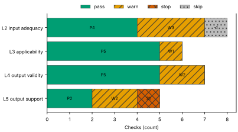
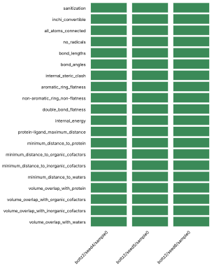
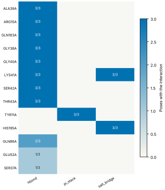
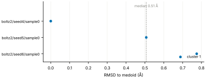
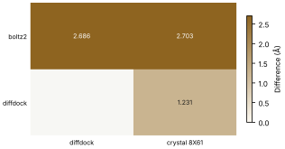
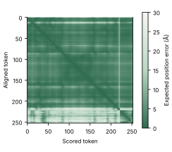

# Run report · Ligand pose in a known pocket

Prediction assurance · run `ligand_pose-d9fa45788d0c` · 2026-10-17 18:13:19 UTC

**Refused** for the claim "Predicted pose of ATP in FtsE is valid".

Refused over layers 2,3,4,5: 16 pass, 8 warn, 1 stop, 1 skip. Stopped by l5.controls.redocking. Warnings from l2.receptor.protonation, l2.ligand.protonation, l2.docking.box, l3.exposure.ligand_prevalence, l4.torsion_strain, l4.interactions.unsatisfied_polars, l5.sampling.seeds, l5.agreement.cross_family.

Stops: `l5.controls.redocking`.

Warnings: `l2.receptor.protonation`, `l2.ligand.protonation`, `l2.docking.box`, `l3.exposure.ligand_prevalence`, `l4.torsion_strain`, `l4.interactions.unsatisfied_polars`, `l5.sampling.seeds`, `l5.agreement.cross_family`.

| Field | Value |
| --- | --- |
| Task | Ligand pose in a known pocket (`ligand_pose`) |
| Tools | Boltz-2 2.2.1 (co-folding), DiffDock-L (docking) |
| Target | `protein` |
| Ligand | `c1nc(c2c(n1)n(cn2)[C@H]3[C@@H]([C@@H]([C@H](O3)CO[P@@](=O)(O)O[P@](=O)(O)OP(=O)(O)O)O)O)N` |
| Reference | `8X61` |
| pH | 7.4 |
| Seeds | 3 |
| Layers run | 2, 3, 4, 5 |
| Run | `ligand_pose-d9fa45788d0c` |
| Created | 2026-10-17 18:13:19 UTC |
| Finished | 2026-10-17 18:14:16 UTC |
| pah version | 0.1.0 |
| Report schema | 1 |

## Layers

| Layer | Status | Result | pass | warn | stop | skip | Time |
| --- | --- | --- | --- | --- | --- | --- | --- |
| L0 Provenance | not run | n/a | n/a | n/a | n/a | n/a | n/a |
| L1 Input integrity | not run | n/a | n/a | n/a | n/a | n/a | n/a |
| L2 Input adequacy | done | warn | 4 | 3 | 0 | 1 | 1.3 s |
| L3 Applicability | done | warn | 5 | 1 | 0 | 0 | 386 ms |
| L4 Output validity | done | warn | 5 | 2 | 0 | 0 | 55.2 s |
| L5 Output support | done | stop | 2 | 2 | 1 | 0 | 233 ms |

## Figures

Fig. 1 · Check outcomes per layer for run ligand_pose-d9fa45788d0c. Totals: pass 16, warn 8, stop 1, skip 1.
Files: data [figures/gates_by_layer.csv](figures/gates_by_layer.csv).

## Structures

68 PyMOL renders.

8X61 mmCIF (source_structure), whole structure. Chains A, B, C, D; organic components ATP. sha256 ba2b64fd50fa3880. PyMOL session: [renders/8X61.pse](renders/8X61.pse).

8X61 mmCIF (source_structure), ligand environment within 5 Å. Chains A, B, C, D; organic components ATP. sha256 ba2b64fd50fa3880. PyMOL session: [renders/8X61.pse](renders/8X61.pse).

boltz2/seed4/sample0 (prediction_structure), whole structure. Chains A, L; organic components LIG1. sha256 58d6eb2943118305. PyMOL session: [renders/boltz2_seed4_sample0.pse](renders/boltz2_seed4_sample0.pse).

boltz2/seed4/sample0 (prediction_structure), ligand environment within 5 Å. Chains A, L; organic components LIG1. sha256 58d6eb2943118305. PyMOL session: [renders/boltz2_seed4_sample0.pse](renders/boltz2_seed4_sample0.pse).

boltz2/seed5/sample0 (prediction_structure), whole structure. Chains A, L; organic components LIG1. sha256 81f72d341645012a. PyMOL session: [renders/boltz2_seed5_sample0.pse](renders/boltz2_seed5_sample0.pse).

boltz2/seed5/sample0 (prediction_structure), ligand environment within 5 Å. Chains A, L; organic components LIG1. sha256 81f72d341645012a. PyMOL session: [renders/boltz2_seed5_sample0.pse](renders/boltz2_seed5_sample0.pse).

boltz2/seed6/sample0 (prediction_structure), whole structure. Chains A, L; organic components LIG1. sha256 e404962997f03ab7. PyMOL session: [renders/boltz2_seed6_sample0.pse](renders/boltz2_seed6_sample0.pse).

boltz2/seed6/sample0 (prediction_structure), ligand environment within 5 Å. Chains A, L; organic components LIG1. sha256 e404962997f03ab7. PyMOL session: [renders/boltz2_seed6_sample0.pse](renders/boltz2_seed6_sample0.pse).

diffdock/seed4/mode0 (prediction_structure), whole structure. Chains A, L; organic components LIG. sha256 2f24ec0bbdf7df79. PyMOL session: [renders/diffdock_seed4_mode0.pse](renders/diffdock_seed4_mode0.pse).

diffdock/seed4/mode0 (prediction_structure), ligand environment within 5 Å. Chains A, L; organic components LIG. sha256 2f24ec0bbdf7df79. PyMOL session: [renders/diffdock_seed4_mode0.pse](renders/diffdock_seed4_mode0.pse).

diffdock/seed4/mode1 (prediction_structure), whole structure. Chains A, L; organic components LIG. sha256 b451aae82a9cb801. PyMOL session: [renders/diffdock_seed4_mode1.pse](renders/diffdock_seed4_mode1.pse).

diffdock/seed4/mode1 (prediction_structure), ligand environment within 5 Å. Chains A, L; organic components LIG. sha256 b451aae82a9cb801. PyMOL session: [renders/diffdock_seed4_mode1.pse](renders/diffdock_seed4_mode1.pse).

diffdock/seed4/mode2 (prediction_structure), whole structure. Chains A, L; organic components LIG. sha256 a3022aab15cb2467. PyMOL session: [renders/diffdock_seed4_mode2.pse](renders/diffdock_seed4_mode2.pse).

diffdock/seed4/mode2 (prediction_structure), ligand environment within 5 Å. Chains A, L; organic components LIG. sha256 a3022aab15cb2467. PyMOL session: [renders/diffdock_seed4_mode2.pse](renders/diffdock_seed4_mode2.pse).

diffdock/seed4/mode3 (prediction_structure), whole structure. Chains A, L; organic components LIG. sha256 9af7a02ce39652b5. PyMOL session: [renders/diffdock_seed4_mode3.pse](renders/diffdock_seed4_mode3.pse).

diffdock/seed4/mode3 (prediction_structure), ligand environment within 5 Å. Chains A, L; organic components LIG. sha256 9af7a02ce39652b5. PyMOL session: [renders/diffdock_seed4_mode3.pse](renders/diffdock_seed4_mode3.pse).

diffdock/seed4/mode4 (prediction_structure), whole structure. Chains A, L; organic components LIG. sha256 9182854bb537811c. PyMOL session: [renders/diffdock_seed4_mode4.pse](renders/diffdock_seed4_mode4.pse).

diffdock/seed4/mode4 (prediction_structure), ligand environment within 5 Å. Chains A, L; organic components LIG. sha256 9182854bb537811c. PyMOL session: [renders/diffdock_seed4_mode4.pse](renders/diffdock_seed4_mode4.pse).

diffdock/seed4/mode5 (prediction_structure), whole structure. Chains A, L; organic components LIG. sha256 5e748933d5a06d35. PyMOL session: [renders/diffdock_seed4_mode5.pse](renders/diffdock_seed4_mode5.pse).

diffdock/seed4/mode5 (prediction_structure), ligand environment within 5 Å. Chains A, L; organic components LIG. sha256 5e748933d5a06d35. PyMOL session: [renders/diffdock_seed4_mode5.pse](renders/diffdock_seed4_mode5.pse).

diffdock/seed4/mode6 (prediction_structure), whole structure. Chains A, L; organic components LIG. sha256 c273da0605a4b038. PyMOL session: [renders/diffdock_seed4_mode6.pse](renders/diffdock_seed4_mode6.pse).

diffdock/seed4/mode6 (prediction_structure), ligand environment within 5 Å. Chains A, L; organic components LIG. sha256 c273da0605a4b038. PyMOL session: [renders/diffdock_seed4_mode6.pse](renders/diffdock_seed4_mode6.pse).

diffdock/seed4/mode7 (prediction_structure), whole structure. Chains A, L; organic components LIG. sha256 40bd191ca8292657. PyMOL session: [renders/diffdock_seed4_mode7.pse](renders/diffdock_seed4_mode7.pse).

diffdock/seed4/mode7 (prediction_structure), ligand environment within 5 Å. Chains A, L; organic components LIG. sha256 40bd191ca8292657. PyMOL session: [renders/diffdock_seed4_mode7.pse](renders/diffdock_seed4_mode7.pse).

diffdock/seed4/mode8 (prediction_structure), whole structure. Chains A, L; organic components LIG. sha256 95acbd821bf0415b. PyMOL session: [renders/diffdock_seed4_mode8.pse](renders/diffdock_seed4_mode8.pse).

diffdock/seed4/mode8 (prediction_structure), ligand environment within 5 Å. Chains A, L; organic components LIG. sha256 95acbd821bf0415b. PyMOL session: [renders/diffdock_seed4_mode8.pse](renders/diffdock_seed4_mode8.pse).

diffdock/seed4/mode9 (prediction_structure), whole structure. Chains A, L; organic components LIG. sha256 1e3259015395bfff. PyMOL session: [renders/diffdock_seed4_mode9.pse](renders/diffdock_seed4_mode9.pse).

diffdock/seed4/mode9 (prediction_structure), ligand environment within 5 Å. Chains A, L; organic components LIG. sha256 1e3259015395bfff. PyMOL session: [renders/diffdock_seed4_mode9.pse](renders/diffdock_seed4_mode9.pse).

diffdock/seed5/mode0 (prediction_structure), whole structure. Chains A, L; organic components LIG. sha256 2036bb7d7635c85d. PyMOL session: [renders/diffdock_seed5_mode0.pse](renders/diffdock_seed5_mode0.pse).

diffdock/seed5/mode0 (prediction_structure), ligand environment within 5 Å. Chains A, L; organic components LIG. sha256 2036bb7d7635c85d. PyMOL session: [renders/diffdock_seed5_mode0.pse](renders/diffdock_seed5_mode0.pse).

diffdock/seed5/mode1 (prediction_structure), whole structure. Chains A, L; organic components LIG. sha256 5e89410c26472699. PyMOL session: [renders/diffdock_seed5_mode1.pse](renders/diffdock_seed5_mode1.pse).

diffdock/seed5/mode1 (prediction_structure), ligand environment within 5 Å. Chains A, L; organic components LIG. sha256 5e89410c26472699. PyMOL session: [renders/diffdock_seed5_mode1.pse](renders/diffdock_seed5_mode1.pse).

diffdock/seed5/mode2 (prediction_structure), whole structure. Chains A, L; organic components LIG. sha256 c10a7d1766557090. PyMOL session: [renders/diffdock_seed5_mode2.pse](renders/diffdock_seed5_mode2.pse).

diffdock/seed5/mode2 (prediction_structure), ligand environment within 5 Å. Chains A, L; organic components LIG. sha256 c10a7d1766557090. PyMOL session: [renders/diffdock_seed5_mode2.pse](renders/diffdock_seed5_mode2.pse).

diffdock/seed5/mode3 (prediction_structure), whole structure. Chains A, L; organic components LIG. sha256 419f69d8b2855126. PyMOL session: [renders/diffdock_seed5_mode3.pse](renders/diffdock_seed5_mode3.pse).

diffdock/seed5/mode3 (prediction_structure), ligand environment within 5 Å. Chains A, L; organic components LIG. sha256 419f69d8b2855126. PyMOL session: [renders/diffdock_seed5_mode3.pse](renders/diffdock_seed5_mode3.pse).

diffdock/seed5/mode4 (prediction_structure), whole structure. Chains A, L; organic components LIG. sha256 16a88826d4707dde. PyMOL session: [renders/diffdock_seed5_mode4.pse](renders/diffdock_seed5_mode4.pse).

diffdock/seed5/mode4 (prediction_structure), ligand environment within 5 Å. Chains A, L; organic components LIG. sha256 16a88826d4707dde. PyMOL session: [renders/diffdock_seed5_mode4.pse](renders/diffdock_seed5_mode4.pse).

diffdock/seed5/mode5 (prediction_structure), whole structure. Chains A, L; organic components LIG. sha256 c165f0f67fb27dc2. PyMOL session: [renders/diffdock_seed5_mode5.pse](renders/diffdock_seed5_mode5.pse).

diffdock/seed5/mode5 (prediction_structure), ligand environment within 5 Å. Chains A, L; organic components LIG. sha256 c165f0f67fb27dc2. PyMOL session: [renders/diffdock_seed5_mode5.pse](renders/diffdock_seed5_mode5.pse).

diffdock/seed5/mode6 (prediction_structure), whole structure. Chains A, L; organic components LIG. sha256 8e0a08c4310918e5. PyMOL session: [renders/diffdock_seed5_mode6.pse](renders/diffdock_seed5_mode6.pse).

diffdock/seed5/mode6 (prediction_structure), ligand environment within 5 Å. Chains A, L; organic components LIG. sha256 8e0a08c4310918e5. PyMOL session: [renders/diffdock_seed5_mode6.pse](renders/diffdock_seed5_mode6.pse).

diffdock/seed5/mode7 (prediction_structure), whole structure. Chains A, L; organic components LIG. sha256 ed5f75de0c6741a5. PyMOL session: [renders/diffdock_seed5_mode7.pse](renders/diffdock_seed5_mode7.pse).

diffdock/seed5/mode7 (prediction_structure), ligand environment within 5 Å. Chains A, L; organic components LIG. sha256 ed5f75de0c6741a5. PyMOL session: [renders/diffdock_seed5_mode7.pse](renders/diffdock_seed5_mode7.pse).

diffdock/seed5/mode8 (prediction_structure), whole structure. Chains A, L; organic components LIG. sha256 8fb670f8deb02599. PyMOL session: [renders/diffdock_seed5_mode8.pse](renders/diffdock_seed5_mode8.pse).

diffdock/seed5/mode8 (prediction_structure), ligand environment within 5 Å. Chains A, L; organic components LIG. sha256 8fb670f8deb02599. PyMOL session: [renders/diffdock_seed5_mode8.pse](renders/diffdock_seed5_mode8.pse).

diffdock/seed5/mode9 (prediction_structure), whole structure. Chains A, L; organic components LIG. sha256 e2ae436fdcbbd38f. PyMOL session: [renders/diffdock_seed5_mode9.pse](renders/diffdock_seed5_mode9.pse).

diffdock/seed5/mode9 (prediction_structure), ligand environment within 5 Å. Chains A, L; organic components LIG. sha256 e2ae436fdcbbd38f. PyMOL session: [renders/diffdock_seed5_mode9.pse](renders/diffdock_seed5_mode9.pse).

diffdock/seed6/mode0 (prediction_structure), whole structure. Chains A, L; organic components LIG. sha256 93a31e54882086ea. PyMOL session: [renders/diffdock_seed6_mode0.pse](renders/diffdock_seed6_mode0.pse).

diffdock/seed6/mode0 (prediction_structure), ligand environment within 5 Å. Chains A, L; organic components LIG. sha256 93a31e54882086ea. PyMOL session: [renders/diffdock_seed6_mode0.pse](renders/diffdock_seed6_mode0.pse).

diffdock/seed6/mode1 (prediction_structure), whole structure. Chains A, L; organic components LIG. sha256 c50608727723f866. PyMOL session: [renders/diffdock_seed6_mode1.pse](renders/diffdock_seed6_mode1.pse).

diffdock/seed6/mode1 (prediction_structure), ligand environment within 5 Å. Chains A, L; organic components LIG. sha256 c50608727723f866. PyMOL session: [renders/diffdock_seed6_mode1.pse](renders/diffdock_seed6_mode1.pse).

diffdock/seed6/mode2 (prediction_structure), whole structure. Chains A, L; organic components LIG. sha256 5f0cd027e8abda80. PyMOL session: [renders/diffdock_seed6_mode2.pse](renders/diffdock_seed6_mode2.pse).

diffdock/seed6/mode2 (prediction_structure), ligand environment within 5 Å. Chains A, L; organic components LIG. sha256 5f0cd027e8abda80. PyMOL session: [renders/diffdock_seed6_mode2.pse](renders/diffdock_seed6_mode2.pse).

diffdock/seed6/mode3 (prediction_structure), whole structure. Chains A, L; organic components LIG. sha256 25945089278e32fa. PyMOL session: [renders/diffdock_seed6_mode3.pse](renders/diffdock_seed6_mode3.pse).

diffdock/seed6/mode3 (prediction_structure), ligand environment within 5 Å. Chains A, L; organic components LIG. sha256 25945089278e32fa. PyMOL session: [renders/diffdock_seed6_mode3.pse](renders/diffdock_seed6_mode3.pse).

diffdock/seed6/mode4 (prediction_structure), whole structure. Chains A, L; organic components LIG. sha256 6403d732385ca23c. PyMOL session: [renders/diffdock_seed6_mode4.pse](renders/diffdock_seed6_mode4.pse).

diffdock/seed6/mode4 (prediction_structure), ligand environment within 5 Å. Chains A, L; organic components LIG. sha256 6403d732385ca23c. PyMOL session: [renders/diffdock_seed6_mode4.pse](renders/diffdock_seed6_mode4.pse).

diffdock/seed6/mode5 (prediction_structure), whole structure. Chains A, L; organic components LIG. sha256 4ce3d69896b30769. PyMOL session: [renders/diffdock_seed6_mode5.pse](renders/diffdock_seed6_mode5.pse).

diffdock/seed6/mode5 (prediction_structure), ligand environment within 5 Å. Chains A, L; organic components LIG. sha256 4ce3d69896b30769. PyMOL session: [renders/diffdock_seed6_mode5.pse](renders/diffdock_seed6_mode5.pse).

diffdock/seed6/mode6 (prediction_structure), whole structure. Chains A, L; organic components LIG. sha256 b2afad62404480e8. PyMOL session: [renders/diffdock_seed6_mode6.pse](renders/diffdock_seed6_mode6.pse).

diffdock/seed6/mode6 (prediction_structure), ligand environment within 5 Å. Chains A, L; organic components LIG. sha256 b2afad62404480e8. PyMOL session: [renders/diffdock_seed6_mode6.pse](renders/diffdock_seed6_mode6.pse).

diffdock/seed6/mode7 (prediction_structure), whole structure. Chains A, L; organic components LIG. sha256 6557dcf32832f390. PyMOL session: [renders/diffdock_seed6_mode7.pse](renders/diffdock_seed6_mode7.pse).

diffdock/seed6/mode7 (prediction_structure), ligand environment within 5 Å. Chains A, L; organic components LIG. sha256 6557dcf32832f390. PyMOL session: [renders/diffdock_seed6_mode7.pse](renders/diffdock_seed6_mode7.pse).

diffdock/seed6/mode8 (prediction_structure), whole structure. Chains A, L; organic components LIG. sha256 f36830d7ae01892a. PyMOL session: [renders/diffdock_seed6_mode8.pse](renders/diffdock_seed6_mode8.pse).

diffdock/seed6/mode8 (prediction_structure), ligand environment within 5 Å. Chains A, L; organic components LIG. sha256 f36830d7ae01892a. PyMOL session: [renders/diffdock_seed6_mode8.pse](renders/diffdock_seed6_mode8.pse).

diffdock/seed6/mode9 (prediction_structure), whole structure. Chains A, L; organic components LIG. sha256 069796dff749e28d. PyMOL session: [renders/diffdock_seed6_mode9.pse](renders/diffdock_seed6_mode9.pse).

diffdock/seed6/mode9 (prediction_structure), ligand environment within 5 Å. Chains A, L; organic components LIG. sha256 069796dff749e28d. PyMOL session: [renders/diffdock_seed6_mode9.pse](renders/diffdock_seed6_mode9.pse).

## L0 Provenance

Where did every input come from?

Status: not run.

## L1 Input integrity

Did the run receive exactly what was declared?

Status: not run.

## L2 Input adequacy

Does the input carry enough information?

Status: done. Checks: pass 4 · warn 3 · stop 0 · skip 1. Time: 1.3 s.

#### Key figures

| Figure | Value |
| --- | --- |
| near site | 0 |
| missing | 0 |
| uniprot cofactors | 0 |
| pocket residues | 30 |
| incomplete | 0 |
| sequence gaps | 0 |
| state | holo |
| site ligands | 1 |

#### Docking

| Field | Value |
| --- | --- |
| center | 137.651, 149.997, 122.463 Å |
| size | 16.823 × 14.232 × 20.687 Å |
| origin | derived from ATP (+4 Å) |

#### Checks

| Check | Result | Measured cmp threshold | Evidence | Id · time |
| --- | --- | --- | --- | --- |
| Alignment depth, distinct sequences, Neff and gap fraction | skip | n/a | no MSA declared for a co-folding model · not applicable | `l2.msa.depth` |
| Required cofactors, ions and partners present | pass | `pocket_distance <= 8` | components within 8.0 Å of ATP: none · near_site=0, missing=0, uniprot_cofactors=0 | `l2.context.cofactors` · 187 ms |
| Pocket residues resolved, no missing loops lining the pocket | pass | `pocket_distance <= 6` | 30 pocket residues complete in 8X61.cif · pocket_residues=30, incomplete=0, sequence_gaps=0 | `l2.pocket.resolved` · 12 ms |
| Receptor state apo or holo | pass | n/a | 8X61.cif holo: ATP in the site · state=holo, site_ligands=1 | `l2.receptor.state` · 14 ms |
| Receptor protonation at the stated pH | warn | `pka_margin > 1` | receptor has no hydrogens (protonation not assigned); pKa within 1.0 of pH 7.4: HIS36A pKa 6.97 · hydrogens_present=False, ph=7.4, pocket_titratable=10 | `l2.receptor.protonation` · 214 ms |
| Ligand protonation and tautomers enumerated at the stated pH | warn | `ph 7.4 == 1` | ligand: 2 states; ligand: declared form Nc1ncnc2c1ncn2[C@@H]1O[C@H](CO[P@@](=O)(O)O[P@](=O)(O)OP(=O)(O)O)[C@@H](O)[C@H]1O differs from enumerated Nc1ncnc2c1ncn2[C@@H]1O[C@H](CO[P@@](=O)([O-])O[P@](=O)([O-])OP(=O)([O-])O)[C@@H](O)[C@H]1O, Nc1ncnc2c1ncn2[C@@H]1O[C@H](CO[P@@](=O)([O-])O[P@](=O)([O-])OP(=O)([O-])[O-])[C@@H](O)[C@H]1O · ph=7.4, max_states=2, declared_not_enumerated=1 | `l2.ligand.protonation` · 59 ms |
| Ligand conformers generated and minimised | pass | `conformers >= 10` | 10 ETKDG conformers per ligand, MMFF minimised · ligands=1, failed=0, min_embedded=10 | `l2.ligand.conformers` · 793 ms |
| Docking box encloses the pocket with margin | warn | `margin >= 2` | no box declared; derived box encloses 21 contact residues and the ATP ligand with 2.0 Å margin · volume_A3=4953, ligand_atoms_inside_margin=31, ligand_atoms=31 | `l2.docking.box` · 16 ms |

## L3 Applicability

Is the tool inside its validated regime?

Status: done. Checks: pass 5 · warn 1 · stop 0 · skip 0. Time: 386 ms.

#### Key figures

| Figure | Value |
| --- | --- |
| executors | 2 |
| unknown | 0 |
| reference released | 2024-05-08 |
| cutoff | 2019-01-01 |
| entries compared | 0 |
| pocket residues | 21 |
| systems | 3474 |
| analogue components | 19 |

#### Checks

| Check | Result | Measured cmp threshold | Evidence | Id · time |
| --- | --- | --- | --- | --- |
| Model training cutoff recorded | pass | `training_cutoff == recorded` | boltz2 2023-06-01; diffdock 2019-01-01; reference 8X61 released 2024-05-08 · executors=2, unknown=0, reference_released=2024-05-08 | `l3.model.training_cutoff` · 0 ms |
| Pocket similarity to pre-cutoff complexes (SuCOS times pocket coverage) | pass | `similarity <= 50` | no pre-cutoff holo entry with an analogue found (cutoff 2019-01-01) · cutoff=2019-01-01, entries_compared=0, max_similarity=None | `l3.exposure.pocket` · 370 ms |
| Ligand analogues in pre-cutoff training systems | warn | `tanimoto > 0.9` | 3474 PDB entries released before 2019-01-01 (diffdock cutoff) contain analogues of ligand above Tanimoto 0.9: 5FA, ADP, AQP, ATP, HEJ, LA8 · cutoff=2019-01-01, systems=3474, analogue_components=19 | `l3.exposure.ligand_prevalence` · 0 ms |
| Chain sequence identity to pre-cutoff entries (secondary measure) | pass | `identity < 0.4` | protein: 0 entries at 95 percent identity, 6 at 40 percent, released before 2019-01-01 (reported, not gating) · cutoff=2019-01-01, entries_95=0, entries_40=6 | `l3.exposure.sequence` · 1 ms |
| Modality inside the validated set; token count against the training crop | pass | n/a | modalities protein, protein_ligand inside the validated set; 253 tokens · modalities=2, tokens=253, outside=0 | `l3.regime.modality` · 12 ms |
| Endpoint fits the tool | pass | `endpoint pose in pose` | endpoint pose produced by boltz2, diffdock · endpoint=pose, executors=2, not_fitting=0 | `l3.metric.endpoint` · 0 ms |

## L4 Output validity

Is the result physically and chemically sensible?

Status: done. Checks: pass 5 · warn 2 · stop 0 · skip 0. Time: 55.2 s.

#### Key figures

| Figure | Value |
| --- | --- |
| poses | 3 |
| passed | 20 |
| total | 20 |
| poses all pass | 3 |
| unlikely torsions | 2 |
| torsions | 14 |
| strain kcal | 13.89 |
| poses with unlikely | 3 |

#### PoseBusters · 20/20 tests pass

| test | result | value |
| --- | --- | --- |
| sanitization | pass | pass |
| inchi_convertible | pass | pass |
| all_atoms_connected | pass | pass |
| no_radicals | pass | pass |
| bond_lengths | pass | 0 long outliers |
| bond_angles | pass | 0 outliers |
| internal_steric_clash | pass | 0 |
| aromatic_ring_flatness | pass | 0.00 Å |
| non-aromatic_ring_non-flatness | pass | pass |
| double_bond_flatness | pass | pass |
| internal_energy | pass | 3.2 times the ensemble mean |
| protein-ligand_maximum_distance | pass | 2.51 Å |
| minimum_distance_to_protein | pass | 2.51 Å |
| minimum_distance_to_organic_cofactors | pass | pass |
| minimum_distance_to_inorganic_cofactors | pass | pass |
| minimum_distance_to_waters | pass | pass |
| volume_overlap_with_protein | pass | 0.019 |
| volume_overlap_with_organic_cofactors | pass | pass |
| volume_overlap_with_inorganic_cofactors | pass | pass |
| volume_overlap_with_waters | pass | pass |

#### Per-pose physical checks

| pose | seed | drift Å | converged | unlikely torsions | unsat. polars | buried charged | PoseBusters |
| --- | --- | --- | --- | --- | --- | --- | --- |
| boltz2/seed4/sample0 | 4 | 1.73 | true | 2/14 | 2 | 0 | 20/20 |
| boltz2/seed5/sample0 | 5 | 1.66 | true | 1/14 | 2 | 0 | 20/20 |
| boltz2/seed6/sample0 | 6 | 1.84 | true | 2/14 | 3 | 0 | 20/20 |
| median | n/a | 1.73 | n/a | 2 | 2 | 0 | 20/20 |

#### Interaction fingerprint · representative pose boltz2/seed4/sample0

| residue | type | distance | poses |
| --- | --- | --- | --- |
| ALA39A | hbond | 3.17 Å | 3/3 |
| ARG15A | hbond | 2.63 Å | 3/3 |
| GLN163A | hbond | 2.84 Å | 3/3 |
| GLY38A | hbond | 2.87 Å | 3/3 |
| GLY40A | hbond | 3.11 Å | 3/3 |
| LYS41A | hbond | 3.08 Å | 3/3 |
| SER42A | hbond | 2.86 Å | 3/3 |
| THR43A | hbond | 2.61 Å | 3/3 |
| TYR11A | pi_stack | 3.55 Å | 3/3 |
| HIS195A | salt_bridge | 5.27 Å | 3/3 |
| LYS41A | salt_bridge | 3.99 Å | 3/3 |
| GLN86A | hbond | 3.58 Å | 2/3 |
| GLU52A | hbond | 4.1 Å | 1/3 |
| SER37A | hbond | 3.9 Å | 1/3 |

Fig. 2 · PoseBusters tests (20) by pose (3). Failed cells marked x: 0 of 60.
Files: data [figures/posebusters_grid.csv](figures/posebusters_grid.csv).

Fig. 3 · Interactions by residue (13) and type (3); cell label: poses with the interaction over poses assessed.
Files: data [figures/interactions.csv](figures/interactions.csv).

#### Checks

| Check | Result | Measured cmp threshold | Evidence | Id · time |
| --- | --- | --- | --- | --- |
| PoseBusters geometry, stereochemistry, clashes and protein contact | pass | `tests_failed == 0` | 20 of 20 tests pass for boltz2/seed4/sample0; 3 of 3 poses pass all · poses=3, passed=20, total=20 | `l4.posebusters` · 1.9 s |
| Torsional strain of the ligand pose | warn | `torsion_energy <= 2.5` | 2 of 14 torsions above 2.5 kcal/mol in boltz2/seed4/sample0 · poses=3, unlikely_torsions=2, torsions=14 | `l4.torsion_strain` · 4.1 s |
| Interaction fingerprint (PLIP) | pass | n/a | 16 interactions in boltz2/seed4/sample0 (hbond, pi_stack, salt_bridge); 14 distinct across 3 poses (reported) · poses=3, interactions_representative=16, distinct=14 | `l4.interactions.fingerprint` · 834 ms |
| Buried ligand polar atoms without a hydrogen-bond partner | warn | `relative_sasa < 0.1` | 2 of 7 buried polar ligand atoms without a partner in boltz2/seed4/sample0 · poses=3, unsatisfied=2, buried_charged=0 | `l4.interactions.unsatisfied_polars` · 195 ms |
| Hydrophobic complementarity of buried ligand surface | pass | `fraction >= 0.35` | nonpolar fraction of protein contacts around 3 buried nonpolar ligand atoms in boltz2/seed4/sample0: 0.556 · poses=3, complementarity=0.556, buried_nonpolar=3 | `l4.interactions.hydrophobic` · 179 ms |
| Interactions of the crystal ligand reproduced by the pose | pass | `reproduced 10 >= 1` | boltz2/seed4/sample0 reproduces 10 of 16 ATP interactions: hbond ALA39A, hbond ARG15A, hbond GLN163A, hbond GLY38A, hbond GLY40A, hbond LYS41A, hbond SER42A, hbond THR43A, pi_stack TYR11A, salt_bridge LYS41A · key_interactions=16, reproduced=10, poses_reproducing_all=0 | `l4.interactions.known_binders` · 612 ms |
| Pose stability under short restrained minimisation (OpenMM, AMBER14 and OpenFF) | pass | `drift_A 1.73 <= 2` | boltz2/seed4/sample0 moves 1.726 Å under restrained minimisation; 0 of 3 poses above 2.0 Å · poses=3, drift_A=1.726, max_drift_A=1.844 | `l4.minimisation_drift` · 47.4 s |

## L5 Output support

Is a valid result corroborated?

Status: done. Checks: pass 2 · warn 2 · stop 1 · skip 0. Time: 233 ms.

#### Key figures

| Figure | Value |
| --- | --- |
| poses | 3 |
| pocket plddt | 94.8 |
| global plddt | 94 |
| iptm | 0.961 |
| ptm | 0.94 |
| confidence score | 0.94 |
| independent seeds | 3 |
| samples | 3 |

#### Sampling

| Field | Value |
| --- | --- |
| site placement | 3 of 3 poses within 4.0 Å of the site (ATP in 8X61) |
| pose accuracy | 3 of 3 poses within 2.0 Å of the medoid |
| pairwise RMSD median | 0.78 Å |
| pairwise RMSD IQR | 0.64 to 0.81 Å |
| pairs | 3 |
| medoid | boltz2/seed4/sample0 |

#### Clusters

| Field | Value |
| --- | --- |
| cluster 1 | 3/3 poses (boltz2/seed4/sample0) |

#### Per-seed statistics

| seed | pose | cluster | RMSD to medoid | confidence |
| --- | --- | --- | --- | --- |
| 4 | boltz2/seed4/sample0 | 1 | 0 Å | 0.94 |
| 5 | boltz2/seed5/sample0 | 1 | 0.51 Å | 0.94 |
| 6 | boltz2/seed6/sample0 | 1 | 0.78 Å | 0.94 |
| median | n/a | n/a | 0.51 Å | 0.94 |

#### Ensemble

| structure | kind | source | RMSD to medoid | cluster | pocket pLDDT | ipTM |
| --- | --- | --- | --- | --- | --- | --- |
| boltz2/seed4/sample0 | medoid | boltz2 | 0 Å | 1 | 94.8 | 0.96 |
| boltz2/seed5/sample0 | seed | boltz2 | 0.51 Å | 1 | 94.5 | 0.96 |
| boltz2/seed6/sample0 | seed | boltz2 | 0.78 Å | 1 | 94.6 | 0.97 |

#### Agreement between methods

| method | diffdock | crystal 8X61 |
| --- | --- | --- |
| boltz2 | 2.69 Å (high) | 2.7 Å (decisive) |
| diffdock | n/a | 1.23 Å (decisive) |

#### Confidence metrics

| metric | value | read as | tool |
| --- | --- | --- | --- |
| affinity_pred_value | 0.17776818573474884 | ranking within a series, never pose quality | boltz2 |
| affinity_probability_binary | 0.438189834356308 | ranking within a series, never pose quality | boltz2 |
| affinity_pred_value | 0.19572094082832336 | ranking within a series, never pose quality | boltz2 |
| affinity_probability_binary | 0.44760388135910034 | ranking within a series, never pose quality | boltz2 |
| affinity_pred_value | 0.16913442313671112 | ranking within a series, never pose quality | boltz2 |
| affinity_probability_binary | 0.40686243772506714 | ranking within a series, never pose quality | boltz2 |

Fig. 4 · RMSD to the medoid for 3 poses, coloured by cluster (1 clusters). Dashed line: median 0.51 Å; range 0.00 to 0.78 Å.
Files: data [figures/seed_spread.csv](figures/seed_spread.csv).

Fig. 5 · Agreement between 2 methods and 2 comparators; range 1.231 to 2.703 Å.
Files: data [figures/agreement.csv](figures/agreement.csv).

Fig. 6 · Predicted aligned error for pose boltz2/seed4/sample0, 253 by 253 tokens; values 0.2 to 28.7 Å, mean 4.7 Å.
Files: data [figures/pae.csv](figures/pae.csv).

#### Checks

| Check | Result | Measured cmp threshold | Evidence | Id · time |
| --- | --- | --- | --- | --- |
| Confidence restricted to the pocket; per-model thresholds | pass | `boltz2.pocket_plddt >= 70` | boltz2/seed4/sample0: pocket_plddt 94.8 · poses=3, pocket_plddt=94.8, global_plddt=94 | `l5.confidence.local` · 23 ms |
| Independent seeds counted separately from samples; duplicates flagged | warn | `seeds_cofolding >= 5` | 3 independent seeds (3 poses); task default 5 · independent_seeds=3, samples=3, duplicated_outputs=0 | `l5.sampling.seeds` · 0 ms |
| Medoid of the largest cluster, populations, pairwise spread, site and pose accuracy | pass | `cluster_rmsd <= 2` | medoid boltz2/seed4/sample0; 1 clusters, largest 3 of 3; pairwise RMSD median 0.77 Å (IQR 0.64 to 0.81); 3 of 3 poses within 4.0 Å of the site (ATP in 8X61); 3 of 3 poses within 2.0 Å of the medoid · poses=3, clusters=1, largest_cluster=3 | `l5.sampling.clusters` · 49 ms |
| Agreement between methods, weighted by independence | warn | `rmsd_to_crystal_A 2.7 <= 2` | boltz2 vs diffdock 2.686 Å (high); boltz2 vs crystal 8X61 2.703 Å (decisive); diffdock vs crystal 8X61 1.231 Å (decisive) · methods=2, comparisons=3, disagreeing=2 | `l5.agreement.cross_family` · 157 ms |
| Redocking control reproduces the crystal pose | stop | `rmsd <= 2` | redocking control required by the task and not supplied (controls.redocking) | `l5.controls.redocking` · 0 ms |

## Controls

| control | status | result |
| --- | --- | --- |
| redocking | incomplete | redocking control required by the task and not supplied (controls.redocking) |

## Provenance

50 objects · 50 cached · 0 network.

| Source | Accession | Release | SHA-256 | Retrieved | Bytes | Cache | Used by |
| --- | --- | --- | --- | --- | --- | --- | --- |
| rcsb_files | 8X61 | n/a | `ba2b64fd50fa` | 2026-10-17 16:56:13 UTC | 669464 | hit | l2.context.cofactors, l2.pocket.resolved, l2.receptor.state, l2.docking.box, l3.exposure.pocket, l3.regime.modality, l4.interactions.fingerprint, l4.interactions.known_binders, l5.sampling.clusters, l5.agreement.cross_family |
| ccd | ATP | 2011-06-04 | `a7dfd66192d9` | 2026-10-17 16:42:55 UTC | 14836 | hit | l2.context.cofactors, l3.exposure.pocket |
| rcsb | 8X61 | 1.2 | `40597bd4cb89` | 2026-10-17 16:56:15 UTC | 12259 | hit | l3.model.training_cutoff |
| rcsb_search | chem:c1nc(c2c(n1)n(cn2)[C@H]3[C@@H]([C@@H]([C@H](O3)CO[P@@](=O)(O)O[P@](=O)(O)OP(=O)(O)O)O)O)N | n/a | `c9ecdf87b8e2` | 2026-10-17 16:42:57 UTC | 1797 | hit | l3.exposure.pocket |
| ccd | 5FA | 2011-06-04 | `141da43b1fd4` | 2026-10-17 16:42:57 UTC | 5208 | hit | l3.exposure.pocket |
| ccd | ADP | 2025-10-10 | `9ebf239d6ded` | 2026-10-17 16:42:57 UTC | 5741 | hit | l3.exposure.pocket |
| ccd | AQP | 2011-06-04 | `d1f31df6170c` | 2026-10-17 16:42:57 UTC | 4700 | hit | l3.exposure.pocket |
| ccd | HEJ | 2021-03-01 | `3793d61303f5` | 2026-10-17 16:42:57 UTC | 4603 | hit | l3.exposure.pocket |
| ccd | LA8 | 2020-06-17 | `3c66f53baf33` | 2026-10-17 16:42:57 UTC | 4178 | hit | l3.exposure.pocket |
| ccd | ZF9 | 2024-03-08 | `b48f6ea5a0a0` | 2026-10-17 16:42:57 UTC | 4686 | hit | l3.exposure.pocket |
| ccd | ZSF | 2024-03-29 | `dde5989ea661` | 2026-10-17 16:42:57 UTC | 4903 | hit | l3.exposure.pocket |
| ccd | 50T | 2026-09-16 | `6be53fbf78af` | 2026-10-17 16:42:57 UTC | 4275 | hit | l3.exposure.pocket |
| ccd | AD9 | 2026-09-16 | `c8798e579e0a` | 2026-10-17 16:42:58 UTC | 4205 | hit | l3.exposure.pocket |
| ccd | AOV | 2026-09-16 | `300b793745cf` | 2026-10-17 16:42:58 UTC | 4330 | hit | l3.exposure.pocket |
| ccd | CX0 | 2022-03-25 | `fbc78ded25cd` | 2026-10-17 16:42:58 UTC | 3595 | hit | l3.exposure.pocket |
| ccd | CXC | 2022-03-25 | `d89a7023bd05` | 2026-10-17 16:42:58 UTC | 3941 | hit | l3.exposure.pocket |
| ccd | 0A | 2015-04-24 | `7f0b456f42e0` | 2026-10-17 16:42:58 UTC | 3972 | hit | l3.exposure.pocket |
| ccd | 3AN | 2011-06-04 | `a3d4d17a4a3e` | 2026-10-17 16:42:58 UTC | 4390 | hit | l3.exposure.pocket |
| ccd | 7DD | 2016-06-10 | `2265ea597be9` | 2026-10-17 16:42:58 UTC | 3425 | hit | l3.exposure.pocket |
| ccd | 7DT | 2016-06-10 | `c346b8a79ec0` | 2026-10-17 16:42:58 UTC | 3725 | hit | l3.exposure.pocket |
| ccd | AAM | 2011-06-04 | `ade365fd93cd` | 2026-10-17 16:42:58 UTC | 4244 | hit | l3.exposure.pocket |
| ccd | PAP | 2011-06-04 | `1a6bb6874f6f` | 2026-10-17 16:42:58 UTC | 4734 | hit | l3.exposure.pocket |
| ccd | XNY | 2021-04-30 | `7cb26ca44908` | 2026-10-17 16:42:58 UTC | 3977 | hit | l3.exposure.pocket |
| ccd | AP5 | 2011-06-04 | `43e554f584b7` | 2026-10-17 16:42:58 UTC | 6473 | hit | l3.exposure.pocket |
| ccd | T99 | 2018-06-01 | `68a3d15f3b6f` | 2026-10-17 16:42:58 UTC | 3399 | hit | l3.exposure.pocket |
| ccd | TAT | 2012-01-25 | `55287be9857e` | 2026-10-17 16:42:58 UTC | 4858 | hit | l3.exposure.pocket |
| ccd | A1L15 | 2025-01-24 | `57864c05fab0` | 2026-10-17 16:42:58 UTC | 5608 | hit | l3.exposure.pocket |
| ccd | AGS | 2020-06-17 | `dcdd428b77e4` | 2026-10-17 16:42:58 UTC | 10128 | hit | l3.exposure.pocket |
| rcsb_search | comp:5FA:2019-01-01 | n/a | `c60bf45b266d` | 2026-10-17 16:42:58 UTC | 282 | hit | l3.exposure.pocket |
| rcsb_search | comp:ADP:2019-01-01 | n/a | `d0ea634975e9` | 2026-10-17 16:42:58 UTC | 52129 | hit | l3.exposure.pocket |
| rcsb_search | comp:AQP:2019-01-01 | n/a | `94a619102faa` | 2026-10-17 16:42:58 UTC | 230 | hit | l3.exposure.pocket |
| rcsb_search | comp:ATP:2019-01-01 | n/a | `88190701e349` | 2026-10-17 16:42:59 UTC | 52129 | hit | l3.exposure.pocket |
| rcsb_search | comp:HEJ:2019-01-01 | n/a | `494129c6512c` | 2026-10-17 16:42:59 UTC | 178 | hit | l3.exposure.pocket |
| rcsb_search | comp:LA8:2019-01-01 | n/a | `185329a63a40` | 2026-10-17 16:42:59 UTC | 230 | hit | l3.exposure.pocket |
| rcsb_search | comp:ZF9:2019-01-01 | n/a | `e3b0c44298fc` | 2026-10-17 16:42:59 UTC | 0 | hit | l3.exposure.sequence |
| rcsb_search | comp:ZSF:2019-01-01 | n/a | `e3b0c44298fc` | 2026-10-17 16:42:59 UTC | 0 | hit | l3.exposure.sequence |
| rcsb_search | comp:50T:2019-01-01 | n/a | `927f39839b9d` | 2026-10-17 16:42:59 UTC | 178 | hit | l3.exposure.pocket |
| rcsb_search | comp:AD9:2019-01-01 | n/a | `ac65056f9aef` | 2026-10-17 16:42:59 UTC | 490 | hit | l3.exposure.pocket |
| rcsb_search | comp:AOV:2019-01-01 | n/a | `d8dd9b5a5778` | 2026-10-17 16:42:59 UTC | 334 | hit | l3.exposure.pocket |
| rcsb_search | comp:CX0:2019-01-01 | n/a | `e3b0c44298fc` | 2026-10-17 16:42:59 UTC | 0 | hit | l3.exposure.sequence |
| rcsb_search | comp:CXC:2019-01-01 | n/a | `e3b0c44298fc` | 2026-10-17 16:42:59 UTC | 0 | hit | l3.exposure.sequence |
| rcsb_search | comp:0A:2019-01-01 | n/a | `e3b0c44298fc` | 2026-10-17 16:42:59 UTC | 0 | hit | l3.exposure.sequence |
| rcsb_search | comp:PAP:2019-01-01 | n/a | `ded69bf4bbb0` | 2026-10-17 16:42:59 UTC | 542 | hit | l3.exposure.pocket |
| rcsb_search | comp:AP5:2019-01-01 | n/a | `ab39d336ec91` | 2026-10-17 16:42:59 UTC | 3247 | hit | l3.exposure.pocket |
| rcsb_search | comp:T99:2019-01-01 | n/a | `690266055a03` | 2026-10-17 16:42:59 UTC | 178 | hit | l3.exposure.pocket |
| rcsb_search | comp:TAT:2019-01-01 | n/a | `84486689d32b` | 2026-10-17 16:42:59 UTC | 438 | hit | l3.exposure.pocket |
| rcsb_search | comp:AGS:2019-01-01 | n/a | `aef54bf1fe1d` | 2026-10-17 16:42:59 UTC | 8188 | hit | l3.exposure.pocket |
| rcsb_search | seq0.9:2019-01-01:222 | n/a | `e3b0c44298fc` | 2026-10-17 16:56:17 UTC | 0 | hit | l3.exposure.sequence |
| rcsb_search | seq0.95:2019-01-01:222 | n/a | `e3b0c44298fc` | 2026-10-17 16:56:18 UTC | 0 | hit | l3.exposure.sequence |
| rcsb_search | seq0.4:2019-01-01:222 | n/a | `06f7c6a17aff` | 2026-10-17 16:56:19 UTC | 457 | hit | l3.exposure.sequence |

Provenance graph: [json](graph.json), [mmd](graph.mmd), [svg](graph.svg).

## Thresholds

| Check | Threshold | Value | Origin | Evidence level |
| --- | --- | --- | --- | --- |
| `l2.context.cofactors` | pocket_distance | <= 8 | Harness rule: a component of the reference entry within 8 Å of the declared ligand is required context; not yet calibrated | uncalibrated |
| `l2.pocket.resolved` | pocket_distance | <= 6 | Harness rule: pocket residues have a heavy atom within 6 Å of the ligand; not yet calibrated | uncalibrated |
| `l2.pocket.resolved` | missing_pocket_residues | == 0 | Specification layer 2: stop when the pocket is incomplete | published |
| `l2.receptor.protonation` | pka_margin | > 1 | Harness rule: a titratable pocket residue with PROPKA pKa within 1 unit of the stated pH has an ambiguous state; not yet calibrated | uncalibrated |
| `l2.ligand.protonation` | ph_window | == 1 | Harness rule: states enumerated by Dimorphite-DL within 1 pH unit of the stated pH; not yet calibrated | uncalibrated |
| `l2.ligand.protonation` | states | == 1 | Specification layer 2: warn when more than one plausible state | published |
| `l2.ligand.conformers` | conformers | >= 10 | Harness default number of ETKDG conformers; not yet calibrated | uncalibrated |
| `l2.docking.box` | margin | >= 2 | Harness rule: every pocket heavy atom lies at least 2 Å inside the box; not yet calibrated | uncalibrated |
| `l2.docking.box` | contact_distance | <= 4 | Harness rule: contact residues (heavy atom within 4 Å of the reference ligand) must have an atom inside the box; not yet calibrated | uncalibrated |
| `l3.model.training_cutoff` | training_cutoff | == recorded | Specification, Layer 3 (applicability): stop when unknown | published |
| `l3.exposure.pocket` | similarity | <= 50 | Specification layer 3: warn above a pocket similarity (SuCOS times pocket coverage) of 50 | published |
| `l3.exposure.pocket` | entries | <= 5 | Harness budget: pre-cutoff holo entries compared per run | uncalibrated |
| `l3.exposure.ligand_prevalence` | tanimoto | > 0.9 | Specification layer 3: analogues above 0.9 Tanimoto (RDKit topological fingerprint) | published |
| `l3.exposure.ligand_prevalence` | systems | <= 100 | Specification layer 3: prevalent when analogues occur in more than 100 training systems | published |
| `l3.exposure.sequence` | identity | < 0.4 | Specification layer 3: conventional 40 percent identity leakage threshold, reported as a secondary measure only | published |
| `l3.metric.endpoint` | endpoint | in pose | Specification, Layer 3 (applicability): no affinity from interface confidence, no protein-protein affinity from Boltz-2 | published |
| `l4.posebusters` | tests_failed | == 0 | Specification, Layer 4 (output validity): stop on failure | published |
| `l4.torsion_strain` | torsion_energy | <= 2.5 | Harness rule: a rotatable torsion whose MMFF energy lies more than 2.5 kcal/mol above the minimum of its rigid scan is unlikely; not yet calibrated | uncalibrated |
| `l4.interactions.unsatisfied_polars` | relative_sasa | < 0.1 | Harness rule: a ligand polar atom with relative SASA below 0.1 in the complex is buried; not yet calibrated | uncalibrated |
| `l4.interactions.unsatisfied_polars` | hbond_distance | <= 3.5 | PLIP hydrogen bond distance cut-off (donor-acceptor 4.1 Å; harness uses 3.5 Å heavy-atom distance) | published |
| `l4.interactions.hydrophobic` | fraction | >= 0.35 | Harness default anchored on 3PTB: the crystal benzamidine scores 0.51, Vina and Boltz-2 poses within 0.5 Å of it score 0.45 and 0.49; not calibrated on the benchmark | uncalibrated |
| `l4.interactions.hydrophobic` | relative_sasa | < 0.1 | Harness rule: a ligand polar atom with relative SASA below 0.1 in the complex is buried; not yet calibrated | uncalibrated |
| `l4.interactions.known_binders` | reproduced | >= 1 | Specification layer 4: warn when no key interaction is reproduced | published |
| `l4.minimisation_drift` | drift | <= 2 | Specification layer 4: warn when the pose moves beyond 2 Å under restrained minimisation | published |
| `l5.confidence.local` | boltz2.pocket_plddt | >= 70 | AlphaFold DB pLDDT bands (70 and above: confident backbone), applied to pocket residues; not calibrated for ligand pose | published |
| `l5.sampling.seeds` | seeds_cofolding | >= 5 | Specification layer 5: default of five seeds per co-folding prediction | published |
| `l5.sampling.clusters` | cluster_rmsd | <= 2 | Specification layer 5: 2 Å symmetry-aware ligand RMSD (spyrmsd) separates pose clusters | published |
| `l5.sampling.clusters` | site_distance | <= 4 | Harness rule: a ligand centroid within 4 Å of the reference site centroid is placed in the site; not yet calibrated | uncalibrated |
| `l5.sampling.clusters` | largest_fraction | >= 0.5 | Harness rule: the largest cluster holds at least half of the poses; not yet calibrated | uncalibrated |
| `l5.agreement.cross_family` | rmsd | <= 2 | Specification layer 5: pose agreement by symmetry-aware ligand RMSD at 2 Å | published |
| `l5.controls.redocking` | rmsd | <= 2 | Specification layer 5: redocking must reproduce the crystal pose (2 Å ligand RMSD) | published |

Tool versions: dimorphite_dl 2.1.0, freesasa 2.2.1, gemmi 0.7.5, numpy 1.26.4, openbabel 3.2.1, openmm 8.6.1, plip 3.0.1, posebusters 0.6.5, propka 3.5.1, rdkit 2026.9.1, scipy 1.17.1, spyrmsd 0.9.0.

## Limitations

- This report covers layers 2, 3, 4, 5. Layers not run: 0, 1.
- The harness establishes when a result should not be trusted. Passing checks are not evidence that a prediction is correct.
- Thresholds marked uncalibrated come from the specification or harness defaults and have not been recalibrated on the harness benchmark.

## Files

| Path | Kind | Bytes | SHA-256 |
| --- | --- | --- | --- |
| artifacts/sources/8X61.cif | source_structure | 669464 | `ba2b64fd50fa` |
| /home/user/harness-hackathon/bench/runs/2026-10-17T1752Z-2f5a1c7/predictions/ftse_wt/boltz2/seed_4/boltz_results_ftse_wt/predictions/ftse_wt/ftse_wt_model_0.cif | prediction_structure | 154738 | `58d6eb294311` |
| predictions/00_boltz2/boltz2/seed4/sample0/ligand.sdf | data | 2682 | `ee892fe54094` |
| /home/user/harness-hackathon/bench/runs/2026-10-17T1752Z-2f5a1c7/predictions/ftse_wt/boltz2/seed_5/boltz_results_ftse_wt/predictions/ftse_wt/ftse_wt_model_0.cif | prediction_structure | 154867 | `81f72d341645` |
| predictions/00_boltz2/boltz2/seed5/sample0/ligand.sdf | data | 2682 | `5116e45f2a41` |
| /home/user/harness-hackathon/bench/runs/2026-10-17T1752Z-2f5a1c7/predictions/ftse_wt/boltz2/seed_6/boltz_results_ftse_wt/predictions/ftse_wt/ftse_wt_model_0.cif | prediction_structure | 154737 | `e404962997f0` |
| predictions/00_boltz2/boltz2/seed6/sample0/ligand.sdf | data | 2682 | `959a869441fc` |
| predictions/01_diffdock/diffdock/seed4/mode0/complex.pdb | prediction_structure | 139239 | `2f24ec0bbdf7` |
| predictions/01_diffdock/diffdock/seed4/mode0/ligand.sdf | data | 2682 | `08dffc490e4f` |
| predictions/01_diffdock/diffdock/seed4/mode1/complex.pdb | prediction_structure | 139239 | `b451aae82a9c` |
| predictions/01_diffdock/diffdock/seed4/mode1/ligand.sdf | data | 2682 | `bf0e54235a18` |
| predictions/01_diffdock/diffdock/seed4/mode2/complex.pdb | prediction_structure | 139239 | `a3022aab15cb` |
| predictions/01_diffdock/diffdock/seed4/mode2/ligand.sdf | data | 2682 | `9e5dd2295956` |
| predictions/01_diffdock/diffdock/seed4/mode3/complex.pdb | prediction_structure | 139239 | `9af7a02ce396` |
| predictions/01_diffdock/diffdock/seed4/mode3/ligand.sdf | data | 2682 | `2e2fac07bf12` |
| predictions/01_diffdock/diffdock/seed4/mode4/complex.pdb | prediction_structure | 139239 | `9182854bb537` |
| predictions/01_diffdock/diffdock/seed4/mode4/ligand.sdf | data | 2682 | `70b04465f825` |
| predictions/01_diffdock/diffdock/seed4/mode5/complex.pdb | prediction_structure | 139239 | `5e748933d5a0` |
| predictions/01_diffdock/diffdock/seed4/mode5/ligand.sdf | data | 2682 | `dc5ee57635cc` |
| predictions/01_diffdock/diffdock/seed4/mode6/complex.pdb | prediction_structure | 139239 | `c273da0605a4` |
| predictions/01_diffdock/diffdock/seed4/mode6/ligand.sdf | data | 2682 | `7c53d3185173` |
| predictions/01_diffdock/diffdock/seed4/mode7/complex.pdb | prediction_structure | 139239 | `40bd191ca829` |
| predictions/01_diffdock/diffdock/seed4/mode7/ligand.sdf | data | 2682 | `e9df968cb5b4` |
| predictions/01_diffdock/diffdock/seed4/mode8/complex.pdb | prediction_structure | 139239 | `95acbd821bf0` |
| predictions/01_diffdock/diffdock/seed4/mode8/ligand.sdf | data | 2682 | `271e7b3db4da` |
| predictions/01_diffdock/diffdock/seed4/mode9/complex.pdb | prediction_structure | 139239 | `1e3259015395` |
| predictions/01_diffdock/diffdock/seed4/mode9/ligand.sdf | data | 2682 | `25d041deea1a` |
| predictions/01_diffdock/diffdock/seed5/mode0/complex.pdb | prediction_structure | 139239 | `2036bb7d7635` |
| predictions/01_diffdock/diffdock/seed5/mode0/ligand.sdf | data | 2682 | `7323ae789055` |
| predictions/01_diffdock/diffdock/seed5/mode1/complex.pdb | prediction_structure | 139239 | `5e89410c2647` |
| predictions/01_diffdock/diffdock/seed5/mode1/ligand.sdf | data | 2682 | `b5e42a9750a3` |
| predictions/01_diffdock/diffdock/seed5/mode2/complex.pdb | prediction_structure | 139239 | `c10a7d176655` |
| predictions/01_diffdock/diffdock/seed5/mode2/ligand.sdf | data | 2682 | `2abf5ae6f85b` |
| predictions/01_diffdock/diffdock/seed5/mode3/complex.pdb | prediction_structure | 139239 | `419f69d8b285` |
| predictions/01_diffdock/diffdock/seed5/mode3/ligand.sdf | data | 2682 | `f81bbd6cb428` |
| predictions/01_diffdock/diffdock/seed5/mode4/complex.pdb | prediction_structure | 139239 | `16a88826d470` |
| predictions/01_diffdock/diffdock/seed5/mode4/ligand.sdf | data | 2682 | `6113fc2c71e0` |
| predictions/01_diffdock/diffdock/seed5/mode5/complex.pdb | prediction_structure | 139239 | `c165f0f67fb2` |
| predictions/01_diffdock/diffdock/seed5/mode5/ligand.sdf | data | 2682 | `f63beb446127` |
| predictions/01_diffdock/diffdock/seed5/mode6/complex.pdb | prediction_structure | 139239 | `8e0a08c43109` |
| predictions/01_diffdock/diffdock/seed5/mode6/ligand.sdf | data | 2682 | `a1c8c63b57b5` |
| predictions/01_diffdock/diffdock/seed5/mode7/complex.pdb | prediction_structure | 139239 | `ed5f75de0c67` |
| predictions/01_diffdock/diffdock/seed5/mode7/ligand.sdf | data | 2682 | `994d0b11ef53` |
| predictions/01_diffdock/diffdock/seed5/mode8/complex.pdb | prediction_structure | 139239 | `8fb670f8deb0` |
| predictions/01_diffdock/diffdock/seed5/mode8/ligand.sdf | data | 2682 | `a2a68ea1206d` |
| predictions/01_diffdock/diffdock/seed5/mode9/complex.pdb | prediction_structure | 139239 | `e2ae436fdcbb` |
| predictions/01_diffdock/diffdock/seed5/mode9/ligand.sdf | data | 2682 | `b9e973abb085` |
| predictions/01_diffdock/diffdock/seed6/mode0/complex.pdb | prediction_structure | 139239 | `93a31e548820` |
| predictions/01_diffdock/diffdock/seed6/mode0/ligand.sdf | data | 2682 | `6641d606b8bc` |
| predictions/01_diffdock/diffdock/seed6/mode1/complex.pdb | prediction_structure | 139239 | `c50608727723` |
| predictions/01_diffdock/diffdock/seed6/mode1/ligand.sdf | data | 2682 | `afb5f2925b22` |
| predictions/01_diffdock/diffdock/seed6/mode2/complex.pdb | prediction_structure | 139239 | `5f0cd027e8ab` |
| predictions/01_diffdock/diffdock/seed6/mode2/ligand.sdf | data | 2682 | `36f6250c599e` |
| predictions/01_diffdock/diffdock/seed6/mode3/complex.pdb | prediction_structure | 139239 | `25945089278e` |
| predictions/01_diffdock/diffdock/seed6/mode3/ligand.sdf | data | 2682 | `94a19c24175b` |
| predictions/01_diffdock/diffdock/seed6/mode4/complex.pdb | prediction_structure | 139239 | `6403d732385c` |
| predictions/01_diffdock/diffdock/seed6/mode4/ligand.sdf | data | 2682 | `72f3b3cba1d3` |
| predictions/01_diffdock/diffdock/seed6/mode5/complex.pdb | prediction_structure | 139239 | `4ce3d69896b3` |
| predictions/01_diffdock/diffdock/seed6/mode5/ligand.sdf | data | 2682 | `a147d365e991` |
| predictions/01_diffdock/diffdock/seed6/mode6/complex.pdb | prediction_structure | 139239 | `b2afad624044` |
| predictions/01_diffdock/diffdock/seed6/mode6/ligand.sdf | data | 2682 | `fcc6c95b21c9` |
| predictions/01_diffdock/diffdock/seed6/mode7/complex.pdb | prediction_structure | 139239 | `6557dcf32832` |
| predictions/01_diffdock/diffdock/seed6/mode7/ligand.sdf | data | 2682 | `978b805113c2` |
| predictions/01_diffdock/diffdock/seed6/mode8/complex.pdb | prediction_structure | 139239 | `f36830d7ae01` |
| predictions/01_diffdock/diffdock/seed6/mode8/ligand.sdf | data | 2682 | `65832600c35b` |
| predictions/01_diffdock/diffdock/seed6/mode9/complex.pdb | prediction_structure | 139239 | `069796dff749` |
| predictions/01_diffdock/diffdock/seed6/mode9/ligand.sdf | data | 2682 | `bf9ff6c15cdf` |
| renders/8X61_overview.png | render | 225386 | `5d1a3e17a0a4` |
| renders/8X61_pocket.png | render | 479865 | `08024ea747c8` |
| renders/8X61.pse | session | 2022247 | `e127cc207552` |
| renders/boltz2_seed4_sample0_overview.png | render | 176014 | `2103789b8c09` |
| renders/boltz2_seed4_sample0_pocket.png | render | 205961 | `c43940526392` |
| renders/boltz2_seed4_sample0.pse | session | 577660 | `bc7952cbb969` |
| renders/boltz2_seed5_sample0_overview.png | render | 169655 | `718d20a2b4e5` |
| renders/boltz2_seed5_sample0_pocket.png | render | 254675 | `60277490c164` |
| renders/boltz2_seed5_sample0.pse | session | 577666 | `bbfedcf1e0a1` |
| renders/boltz2_seed6_sample0_overview.png | render | 194625 | `9525182f1410` |
| renders/boltz2_seed6_sample0_pocket.png | render | 216236 | `f033298104ed` |
| renders/boltz2_seed6_sample0.pse | session | 577666 | `7a1a8251cb85` |
| renders/diffdock_seed4_mode0_overview.png | render | 196335 | `68970a1981a6` |
| renders/diffdock_seed4_mode0_pocket.png | render | 221784 | `30ea070faf7a` |
| renders/diffdock_seed4_mode0.pse | session | 486307 | `73e6724d57c6` |
| renders/diffdock_seed4_mode1_overview.png | render | 196883 | `0e595e0f8166` |
| renders/diffdock_seed4_mode1_pocket.png | render | 207784 | `52a6f057b84b` |
| renders/diffdock_seed4_mode1.pse | session | 486313 | `91e7a31977b5` |
| renders/diffdock_seed4_mode2_overview.png | render | 196075 | `174c33a7eb8d` |
| renders/diffdock_seed4_mode2_pocket.png | render | 215492 | `5f94d9002a5b` |
| renders/diffdock_seed4_mode2.pse | session | 486313 | `003be89d75bf` |
| renders/diffdock_seed4_mode3_overview.png | render | 196564 | `b5a77693ed60` |
| renders/diffdock_seed4_mode3_pocket.png | render | 217527 | `e049e5ab5c5e` |
| renders/diffdock_seed4_mode3.pse | session | 486309 | `0d23c84fa1f2` |
| renders/diffdock_seed4_mode4_overview.png | render | 196394 | `73f9c3b46adf` |
| renders/diffdock_seed4_mode4_pocket.png | render | 213758 | `00747e9f83cc` |
| renders/diffdock_seed4_mode4.pse | session | 486313 | `749a1b06e936` |
| renders/diffdock_seed4_mode5_overview.png | render | 196084 | `575fda31b10c` |
| renders/diffdock_seed4_mode5_pocket.png | render | 220715 | `c2f93def82a3` |
| renders/diffdock_seed4_mode5.pse | session | 486313 | `773ebb9b1e08` |
| renders/diffdock_seed4_mode6_overview.png | render | 196928 | `d649e738617e` |
| renders/diffdock_seed4_mode6_pocket.png | render | 210731 | `c39d057e0196` |
| renders/diffdock_seed4_mode6.pse | session | 486313 | `105d9ccbf7be` |
| renders/diffdock_seed4_mode7_overview.png | render | 196456 | `fa04309cf5f7` |
| renders/diffdock_seed4_mode7_pocket.png | render | 220322 | `903487689a34` |
| renders/diffdock_seed4_mode7.pse | session | 486319 | `99cc42e8aeb3` |
| renders/diffdock_seed4_mode8_overview.png | render | 195787 | `934551b9c995` |
| renders/diffdock_seed4_mode8_pocket.png | render | 203836 | `e7520be167f9` |
| renders/diffdock_seed4_mode8.pse | session | 486313 | `65892ede895a` |
| renders/diffdock_seed4_mode9_overview.png | render | 196942 | `c0dac389e49b` |
| renders/diffdock_seed4_mode9_pocket.png | render | 208437 | `2b3e85b7ebf2` |
| renders/diffdock_seed4_mode9.pse | session | 486313 | `9d40a696cca3` |
| renders/diffdock_seed5_mode0_overview.png | render | 196030 | `db85f9785fab` |
| renders/diffdock_seed5_mode0_pocket.png | render | 205028 | `2e2b54a49a8a` |
| renders/diffdock_seed5_mode0.pse | session | 486313 | `6c4c0cf19d04` |
| renders/diffdock_seed5_mode1_overview.png | render | 196125 | `ce6c71b7d780` |
| renders/diffdock_seed5_mode1_pocket.png | render | 203851 | `d76fe0c312a8` |
| renders/diffdock_seed5_mode1.pse | session | 486313 | `5be3c6360f1e` |
| renders/diffdock_seed5_mode2_overview.png | render | 196204 | `5e089bade5cf` |
| renders/diffdock_seed5_mode2_pocket.png | render | 226984 | `de5b02dac0d9` |
| renders/diffdock_seed5_mode2.pse | session | 486318 | `999463e57f2d` |
| renders/diffdock_seed5_mode3_overview.png | render | 195811 | `06dafc7e646c` |
| renders/diffdock_seed5_mode3_pocket.png | render | 223342 | `726bf15eb6e7` |
| renders/diffdock_seed5_mode3.pse | session | 486319 | `8fd240aff41e` |
| renders/diffdock_seed5_mode4_overview.png | render | 197098 | `dc1d7f6f5fca` |
| renders/diffdock_seed5_mode4_pocket.png | render | 207202 | `280e7232c18d` |
| renders/diffdock_seed5_mode4.pse | session | 486313 | `7443e056bb9a` |
| renders/diffdock_seed5_mode5_overview.png | render | 197318 | `b5ce2a17b297` |
| renders/diffdock_seed5_mode5_pocket.png | render | 208185 | `210bc116d8ae` |
| renders/diffdock_seed5_mode5.pse | session | 486319 | `c11a3538e2dc` |
| renders/diffdock_seed5_mode6_overview.png | render | 195873 | `8bb78343d392` |
| renders/diffdock_seed5_mode6_pocket.png | render | 216918 | `bde1c1cc22eb` |
| renders/diffdock_seed5_mode6.pse | session | 486313 | `37cf4edcfd3c` |
| renders/diffdock_seed5_mode7_overview.png | render | 196001 | `ac390716fbab` |
| renders/diffdock_seed5_mode7_pocket.png | render | 215123 | `55846147d14b` |
| renders/diffdock_seed5_mode7.pse | session | 486319 | `4d59890a29fc` |
| renders/diffdock_seed5_mode8_overview.png | render | 197195 | `343e57505c93` |
| renders/diffdock_seed5_mode8_pocket.png | render | 212536 | `6ce9930423e9` |
| renders/diffdock_seed5_mode8.pse | session | 486313 | `6edf8b656426` |
| renders/diffdock_seed5_mode9_overview.png | render | 196716 | `f09a0ca9451a` |
| renders/diffdock_seed5_mode9_pocket.png | render | 220433 | `620045bce537` |
| renders/diffdock_seed5_mode9.pse | session | 486307 | `f887bf340d03` |
| renders/diffdock_seed6_mode0_overview.png | render | 196097 | `c630c75f8f5a` |
| renders/diffdock_seed6_mode0_pocket.png | render | 211594 | `c40c1896ace7` |
| renders/diffdock_seed6_mode0.pse | session | 486309 | `b32d8b2a7193` |
| renders/diffdock_seed6_mode1_overview.png | render | 196470 | `80157f83e4ed` |
| renders/diffdock_seed6_mode1_pocket.png | render | 216109 | `56eee0021542` |
| renders/diffdock_seed6_mode1.pse | session | 486309 | `24d84af6e430` |
| renders/diffdock_seed6_mode2_overview.png | render | 195913 | `a8391360f4a8` |
| renders/diffdock_seed6_mode2_pocket.png | render | 217908 | `734b8527a001` |
| renders/diffdock_seed6_mode2.pse | session | 486309 | `d8118d31c2b2` |
| renders/diffdock_seed6_mode3_overview.png | render | 196199 | `593e4827acd1` |
| renders/diffdock_seed6_mode3_pocket.png | render | 219535 | `442b9805f034` |
| renders/diffdock_seed6_mode3.pse | session | 486319 | `037c7884db83` |
| renders/diffdock_seed6_mode4_overview.png | render | 196915 | `720542151b28` |
| renders/diffdock_seed6_mode4_pocket.png | render | 218796 | `ff068babc514` |
| renders/diffdock_seed6_mode4.pse | session | 486309 | `3edc4f257b56` |
| renders/diffdock_seed6_mode5_overview.png | render | 196227 | `312901f337cb` |
| renders/diffdock_seed6_mode5_pocket.png | render | 219725 | `7c7408643727` |
| renders/diffdock_seed6_mode5.pse | session | 486313 | `aec97dd4b45d` |
| renders/diffdock_seed6_mode6_overview.png | render | 196582 | `ea8683d01759` |
| renders/diffdock_seed6_mode6_pocket.png | render | 218764 | `e33085d59ca1` |
| renders/diffdock_seed6_mode6.pse | session | 486313 | `3141596c02ff` |
| renders/diffdock_seed6_mode7_overview.png | render | 197064 | `c3f5e847ac02` |
| renders/diffdock_seed6_mode7_pocket.png | render | 209811 | `380a973dab42` |
| renders/diffdock_seed6_mode7.pse | session | 486307 | `f845841ef5f3` |
| renders/diffdock_seed6_mode8_overview.png | render | 197179 | `2fb0fda487ed` |
| renders/diffdock_seed6_mode8_pocket.png | render | 217144 | `e95b09fd5e8d` |
| renders/diffdock_seed6_mode8.pse | session | 486313 | `f4161999c3c6` |
| renders/diffdock_seed6_mode9_overview.png | render | 195980 | `b7ee4e1dcfc3` |
| renders/diffdock_seed6_mode9_pocket.png | render | 219683 | `55b9f51b632e` |
| renders/diffdock_seed6_mode9.pse | session | 486315 | `53f00eef0347` |
| figures/gates_by_layer.svg | figure | 89214 | `4720e239456c` |
| figures/gates_by_layer.csv | data | 135 | `04a3f358a97f` |
| figures/seed_spread.svg | figure | 13181 | `37f6743e9122` |
| figures/seed_spread.csv | data | 158 | `4c8a55a12dcd` |
| figures/posebusters_grid.svg | figure | 26717 | `b3740d431945` |
| figures/posebusters_grid.csv | data | 888 | `355a8b1dd370` |
| figures/interactions.svg | figure | 21409 | `afb77da54d87` |
| figures/interactions.csv | data | 371 | `9524b09d1b9c` |
| figures/agreement.svg | figure | 10400 | `b2dc830eca4d` |
| figures/agreement.csv | data | 140 | `16115afe4700` |
| figures/pae.svg | figure | 87921 | `9f612ae54379` |
| figures/pae.csv | data | 391979 | `2112093cc969` |
| graph.json | graph | 69213 | `bb0768b00a06` |
| graph.mmd | graph | 10758 | `8f93aa88f34a` |
| graph.svg | graph | 151466 | `2e63da00903a` |
