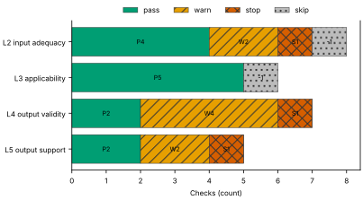
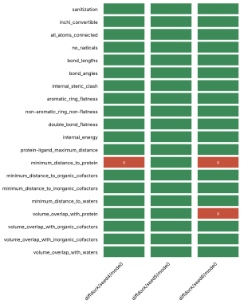
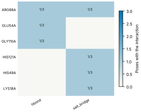
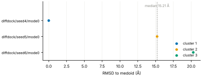
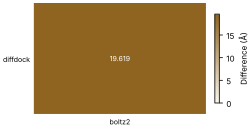

# Run report · Ligand pose in a known pocket

Prediction assurance · run `ligand_pose-e0a5be57fe52` · 2026-10-17 18:16:12 UTC

**Refused** for the claim "Predicted pose of BGC in glucose dehydrogenase (glucose-binding) is valid".

Refused over layers 2,3,4,5: 13 pass, 8 warn, 3 stop, 2 skip. Stopped by l2.context.cofactors, l4.posebusters, l5.controls.redocking. Warnings from l2.receptor.protonation, l2.docking.box, l4.interactions.unsatisfied_polars, l4.interactions.hydrophobic, l4.interactions.known_binders, l4.minimisation_drift, l5.sampling.clusters, l5.agreement.cross_family. 1 checks not verified.

Stops: `l2.context.cofactors`, `l4.posebusters`, `l5.controls.redocking`.

Warnings: `l2.receptor.protonation`, `l2.docking.box`, `l4.interactions.unsatisfied_polars`, `l4.interactions.hydrophobic`, `l4.interactions.known_binders`, `l4.minimisation_drift`, `l5.sampling.clusters`, `l5.agreement.cross_family`.

Not verified: 1 checks.

| Field | Value |
| --- | --- |
| Task | Ligand pose in a known pocket (`ligand_pose`) |
| Tools | DiffDock-L v1.1.3 (docking), Boltz-2 (co-folding) |
| Target | `protein` |
| Ligand | `CO[C@@H]1[C@@H](OC)[C@H](O)O[C@H](CO)[C@H]1OC` |
| Reference | `2VWH` |
| pH | 7.4 |
| Seeds | 3 |
| Layers run | 2, 3, 4, 5 |
| Run | `ligand_pose-e0a5be57fe52` |
| Created | 2026-10-17 18:16:12 UTC |
| Finished | 2026-10-17 18:17:43 UTC |
| pah version | 0.1.0 |
| Report schema | 1 |

## Layers

| Layer | Status | Result | pass | warn | stop | skip | Time |
| --- | --- | --- | --- | --- | --- | --- | --- |
| L0 Provenance | not run | n/a | n/a | n/a | n/a | n/a | n/a |
| L1 Input integrity | not run | n/a | n/a | n/a | n/a | n/a | n/a |
| L2 Input adequacy | done | stop | 4 | 2 | 1 | 1 | 1.5 s |
| L3 Applicability | done | pass | 5 | 0 | 0 | 1 | 309 ms |
| L4 Output validity | done | stop | 2 | 4 | 1 | 0 | 89.2 s |
| L5 Output support | done | stop | 2 | 2 | 1 | 0 | 330 ms |

## Figures

Fig. 1 · Check outcomes per layer for run ligand_pose-e0a5be57fe52. Totals: pass 13, warn 8, stop 3, skip 2.
Files: data [figures/gates_by_layer.csv](figures/gates_by_layer.csv).

## Structures

68 PyMOL renders.

2VWH mmCIF (source_structure), whole structure. Chains A; organic components BGC, NAP. sha256 563276ca06d2a22a. PyMOL session: [renders/2VWH.pse](renders/2VWH.pse).

2VWH mmCIF (source_structure), ligand environment within 5 Å. Chains A; organic components BGC, NAP. sha256 563276ca06d2a22a. PyMOL session: [renders/2VWH.pse](renders/2VWH.pse).

diffdock/seed4/mode0 (prediction_structure), whole structure. Chains A, L; organic components LIG. sha256 1c5877a68b5e918f. PyMOL session: [renders/diffdock_seed4_mode0.pse](renders/diffdock_seed4_mode0.pse).

diffdock/seed4/mode0 (prediction_structure), ligand environment within 5 Å. Chains A, L; organic components LIG. sha256 1c5877a68b5e918f. PyMOL session: [renders/diffdock_seed4_mode0.pse](renders/diffdock_seed4_mode0.pse).

diffdock/seed4/mode1 (prediction_structure), whole structure. Chains A, L; organic components LIG. sha256 ffd29a2b2d9e6b3a. PyMOL session: [renders/diffdock_seed4_mode1.pse](renders/diffdock_seed4_mode1.pse).

diffdock/seed4/mode1 (prediction_structure), ligand environment within 5 Å. Chains A, L; organic components LIG. sha256 ffd29a2b2d9e6b3a. PyMOL session: [renders/diffdock_seed4_mode1.pse](renders/diffdock_seed4_mode1.pse).

diffdock/seed4/mode2 (prediction_structure), whole structure. Chains A, L; organic components LIG. sha256 6cef783a4e7525e9. PyMOL session: [renders/diffdock_seed4_mode2.pse](renders/diffdock_seed4_mode2.pse).

diffdock/seed4/mode2 (prediction_structure), ligand environment within 5 Å. Chains A, L; organic components LIG. sha256 6cef783a4e7525e9. PyMOL session: [renders/diffdock_seed4_mode2.pse](renders/diffdock_seed4_mode2.pse).

diffdock/seed4/mode3 (prediction_structure), whole structure. Chains A, L; organic components LIG. sha256 3beb066d0f9af491. PyMOL session: [renders/diffdock_seed4_mode3.pse](renders/diffdock_seed4_mode3.pse).

diffdock/seed4/mode3 (prediction_structure), ligand environment within 5 Å. Chains A, L; organic components LIG. sha256 3beb066d0f9af491. PyMOL session: [renders/diffdock_seed4_mode3.pse](renders/diffdock_seed4_mode3.pse).

diffdock/seed4/mode4 (prediction_structure), whole structure. Chains A, L; organic components LIG. sha256 2affb20fb15aa977. PyMOL session: [renders/diffdock_seed4_mode4.pse](renders/diffdock_seed4_mode4.pse).

diffdock/seed4/mode4 (prediction_structure), ligand environment within 5 Å. Chains A, L; organic components LIG. sha256 2affb20fb15aa977. PyMOL session: [renders/diffdock_seed4_mode4.pse](renders/diffdock_seed4_mode4.pse).

diffdock/seed4/mode5 (prediction_structure), whole structure. Chains A, L; organic components LIG. sha256 55214dc15df94721. PyMOL session: [renders/diffdock_seed4_mode5.pse](renders/diffdock_seed4_mode5.pse).

diffdock/seed4/mode5 (prediction_structure), ligand environment within 5 Å. Chains A, L; organic components LIG. sha256 55214dc15df94721. PyMOL session: [renders/diffdock_seed4_mode5.pse](renders/diffdock_seed4_mode5.pse).

diffdock/seed4/mode6 (prediction_structure), whole structure. Chains A, L; organic components LIG. sha256 d54c588eda2040e4. PyMOL session: [renders/diffdock_seed4_mode6.pse](renders/diffdock_seed4_mode6.pse).

diffdock/seed4/mode6 (prediction_structure), ligand environment within 5 Å. Chains A, L; organic components LIG. sha256 d54c588eda2040e4. PyMOL session: [renders/diffdock_seed4_mode6.pse](renders/diffdock_seed4_mode6.pse).

diffdock/seed4/mode7 (prediction_structure), whole structure. Chains A, L; organic components LIG. sha256 1a2783607e28e83f. PyMOL session: [renders/diffdock_seed4_mode7.pse](renders/diffdock_seed4_mode7.pse).

diffdock/seed4/mode7 (prediction_structure), ligand environment within 5 Å. Chains A, L; organic components LIG. sha256 1a2783607e28e83f. PyMOL session: [renders/diffdock_seed4_mode7.pse](renders/diffdock_seed4_mode7.pse).

diffdock/seed4/mode8 (prediction_structure), whole structure. Chains A, L; organic components LIG. sha256 983effc5c5fc4d04. PyMOL session: [renders/diffdock_seed4_mode8.pse](renders/diffdock_seed4_mode8.pse).

diffdock/seed4/mode8 (prediction_structure), ligand environment within 5 Å. Chains A, L; organic components LIG. sha256 983effc5c5fc4d04. PyMOL session: [renders/diffdock_seed4_mode8.pse](renders/diffdock_seed4_mode8.pse).

diffdock/seed4/mode9 (prediction_structure), whole structure. Chains A, L; organic components LIG. sha256 a2e9b31f671d70fa. PyMOL session: [renders/diffdock_seed4_mode9.pse](renders/diffdock_seed4_mode9.pse).

diffdock/seed4/mode9 (prediction_structure), ligand environment within 5 Å. Chains A, L; organic components LIG. sha256 a2e9b31f671d70fa. PyMOL session: [renders/diffdock_seed4_mode9.pse](renders/diffdock_seed4_mode9.pse).

diffdock/seed5/mode0 (prediction_structure), whole structure. Chains A, L; organic components LIG. sha256 6b95e3fb39f3c6d5. PyMOL session: [renders/diffdock_seed5_mode0.pse](renders/diffdock_seed5_mode0.pse).

diffdock/seed5/mode0 (prediction_structure), ligand environment within 5 Å. Chains A, L; organic components LIG. sha256 6b95e3fb39f3c6d5. PyMOL session: [renders/diffdock_seed5_mode0.pse](renders/diffdock_seed5_mode0.pse).

diffdock/seed5/mode1 (prediction_structure), whole structure. Chains A, L; organic components LIG. sha256 a4646c6de864ccf0. PyMOL session: [renders/diffdock_seed5_mode1.pse](renders/diffdock_seed5_mode1.pse).

diffdock/seed5/mode1 (prediction_structure), ligand environment within 5 Å. Chains A, L; organic components LIG. sha256 a4646c6de864ccf0. PyMOL session: [renders/diffdock_seed5_mode1.pse](renders/diffdock_seed5_mode1.pse).

diffdock/seed5/mode2 (prediction_structure), whole structure. Chains A, L; organic components LIG. sha256 e271e01e8cd6943b. PyMOL session: [renders/diffdock_seed5_mode2.pse](renders/diffdock_seed5_mode2.pse).

diffdock/seed5/mode2 (prediction_structure), ligand environment within 5 Å. Chains A, L; organic components LIG. sha256 e271e01e8cd6943b. PyMOL session: [renders/diffdock_seed5_mode2.pse](renders/diffdock_seed5_mode2.pse).

diffdock/seed5/mode3 (prediction_structure), whole structure. Chains A, L; organic components LIG. sha256 809b32630dcaec14. PyMOL session: [renders/diffdock_seed5_mode3.pse](renders/diffdock_seed5_mode3.pse).

diffdock/seed5/mode3 (prediction_structure), ligand environment within 5 Å. Chains A, L; organic components LIG. sha256 809b32630dcaec14. PyMOL session: [renders/diffdock_seed5_mode3.pse](renders/diffdock_seed5_mode3.pse).

diffdock/seed5/mode4 (prediction_structure), whole structure. Chains A, L; organic components LIG. sha256 05b262a4cc6a67f0. PyMOL session: [renders/diffdock_seed5_mode4.pse](renders/diffdock_seed5_mode4.pse).

diffdock/seed5/mode4 (prediction_structure), ligand environment within 5 Å. Chains A, L; organic components LIG. sha256 05b262a4cc6a67f0. PyMOL session: [renders/diffdock_seed5_mode4.pse](renders/diffdock_seed5_mode4.pse).

diffdock/seed5/mode5 (prediction_structure), whole structure. Chains A, L; organic components LIG. sha256 138c3a77ebcb94ff. PyMOL session: [renders/diffdock_seed5_mode5.pse](renders/diffdock_seed5_mode5.pse).

diffdock/seed5/mode5 (prediction_structure), ligand environment within 5 Å. Chains A, L; organic components LIG. sha256 138c3a77ebcb94ff. PyMOL session: [renders/diffdock_seed5_mode5.pse](renders/diffdock_seed5_mode5.pse).

diffdock/seed5/mode6 (prediction_structure), whole structure. Chains A, L; organic components LIG. sha256 414307038633676f. PyMOL session: [renders/diffdock_seed5_mode6.pse](renders/diffdock_seed5_mode6.pse).

diffdock/seed5/mode6 (prediction_structure), ligand environment within 5 Å. Chains A, L; organic components LIG. sha256 414307038633676f. PyMOL session: [renders/diffdock_seed5_mode6.pse](renders/diffdock_seed5_mode6.pse).

diffdock/seed5/mode7 (prediction_structure), whole structure. Chains A, L; organic components LIG. sha256 97c4d3fcc47bd034. PyMOL session: [renders/diffdock_seed5_mode7.pse](renders/diffdock_seed5_mode7.pse).

diffdock/seed5/mode7 (prediction_structure), ligand environment within 5 Å. Chains A, L; organic components LIG. sha256 97c4d3fcc47bd034. PyMOL session: [renders/diffdock_seed5_mode7.pse](renders/diffdock_seed5_mode7.pse).

diffdock/seed5/mode8 (prediction_structure), whole structure. Chains A, L; organic components LIG. sha256 7f9a2a8acb734b5c. PyMOL session: [renders/diffdock_seed5_mode8.pse](renders/diffdock_seed5_mode8.pse).

diffdock/seed5/mode8 (prediction_structure), ligand environment within 5 Å. Chains A, L; organic components LIG. sha256 7f9a2a8acb734b5c. PyMOL session: [renders/diffdock_seed5_mode8.pse](renders/diffdock_seed5_mode8.pse).

diffdock/seed5/mode9 (prediction_structure), whole structure. Chains A, L; organic components LIG. sha256 0da3a0804fb256c2. PyMOL session: [renders/diffdock_seed5_mode9.pse](renders/diffdock_seed5_mode9.pse).

diffdock/seed5/mode9 (prediction_structure), ligand environment within 5 Å. Chains A, L; organic components LIG. sha256 0da3a0804fb256c2. PyMOL session: [renders/diffdock_seed5_mode9.pse](renders/diffdock_seed5_mode9.pse).

diffdock/seed6/mode0 (prediction_structure), whole structure. Chains A, L; organic components LIG. sha256 3b8e7b64f55a9bfa. PyMOL session: [renders/diffdock_seed6_mode0.pse](renders/diffdock_seed6_mode0.pse).

diffdock/seed6/mode0 (prediction_structure), ligand environment within 5 Å. Chains A, L; organic components LIG. sha256 3b8e7b64f55a9bfa. PyMOL session: [renders/diffdock_seed6_mode0.pse](renders/diffdock_seed6_mode0.pse).

diffdock/seed6/mode1 (prediction_structure), whole structure. Chains A, L; organic components LIG. sha256 fbc388c54b6f7d48. PyMOL session: [renders/diffdock_seed6_mode1.pse](renders/diffdock_seed6_mode1.pse).

diffdock/seed6/mode1 (prediction_structure), ligand environment within 5 Å. Chains A, L; organic components LIG. sha256 fbc388c54b6f7d48. PyMOL session: [renders/diffdock_seed6_mode1.pse](renders/diffdock_seed6_mode1.pse).

diffdock/seed6/mode2 (prediction_structure), whole structure. Chains A, L; organic components LIG. sha256 e863424b1f07c67e. PyMOL session: [renders/diffdock_seed6_mode2.pse](renders/diffdock_seed6_mode2.pse).

diffdock/seed6/mode2 (prediction_structure), ligand environment within 5 Å. Chains A, L; organic components LIG. sha256 e863424b1f07c67e. PyMOL session: [renders/diffdock_seed6_mode2.pse](renders/diffdock_seed6_mode2.pse).

diffdock/seed6/mode3 (prediction_structure), whole structure. Chains A, L; organic components LIG. sha256 0990564fc4798ad6. PyMOL session: [renders/diffdock_seed6_mode3.pse](renders/diffdock_seed6_mode3.pse).

diffdock/seed6/mode3 (prediction_structure), ligand environment within 5 Å. Chains A, L; organic components LIG. sha256 0990564fc4798ad6. PyMOL session: [renders/diffdock_seed6_mode3.pse](renders/diffdock_seed6_mode3.pse).

diffdock/seed6/mode4 (prediction_structure), whole structure. Chains A, L; organic components LIG. sha256 03c523fdde09f442. PyMOL session: [renders/diffdock_seed6_mode4.pse](renders/diffdock_seed6_mode4.pse).

diffdock/seed6/mode4 (prediction_structure), ligand environment within 5 Å. Chains A, L; organic components LIG. sha256 03c523fdde09f442. PyMOL session: [renders/diffdock_seed6_mode4.pse](renders/diffdock_seed6_mode4.pse).

diffdock/seed6/mode5 (prediction_structure), whole structure. Chains A, L; organic components LIG. sha256 c57b0bca8b1eef8c. PyMOL session: [renders/diffdock_seed6_mode5.pse](renders/diffdock_seed6_mode5.pse).

diffdock/seed6/mode5 (prediction_structure), ligand environment within 5 Å. Chains A, L; organic components LIG. sha256 c57b0bca8b1eef8c. PyMOL session: [renders/diffdock_seed6_mode5.pse](renders/diffdock_seed6_mode5.pse).

diffdock/seed6/mode6 (prediction_structure), whole structure. Chains A, L; organic components LIG. sha256 875077e61de7c70e. PyMOL session: [renders/diffdock_seed6_mode6.pse](renders/diffdock_seed6_mode6.pse).

diffdock/seed6/mode6 (prediction_structure), ligand environment within 5 Å. Chains A, L; organic components LIG. sha256 875077e61de7c70e. PyMOL session: [renders/diffdock_seed6_mode6.pse](renders/diffdock_seed6_mode6.pse).

diffdock/seed6/mode7 (prediction_structure), whole structure. Chains A, L; organic components LIG. sha256 dc645e28ef503914. PyMOL session: [renders/diffdock_seed6_mode7.pse](renders/diffdock_seed6_mode7.pse).

diffdock/seed6/mode7 (prediction_structure), ligand environment within 5 Å. Chains A, L; organic components LIG. sha256 dc645e28ef503914. PyMOL session: [renders/diffdock_seed6_mode7.pse](renders/diffdock_seed6_mode7.pse).

diffdock/seed6/mode8 (prediction_structure), whole structure. Chains A, L; organic components LIG. sha256 48a177e55e58506c. PyMOL session: [renders/diffdock_seed6_mode8.pse](renders/diffdock_seed6_mode8.pse).

diffdock/seed6/mode8 (prediction_structure), ligand environment within 5 Å. Chains A, L; organic components LIG. sha256 48a177e55e58506c. PyMOL session: [renders/diffdock_seed6_mode8.pse](renders/diffdock_seed6_mode8.pse).

diffdock/seed6/mode9 (prediction_structure), whole structure. Chains A, L; organic components LIG. sha256 6aafedae5c483af3. PyMOL session: [renders/diffdock_seed6_mode9.pse](renders/diffdock_seed6_mode9.pse).

diffdock/seed6/mode9 (prediction_structure), ligand environment within 5 Å. Chains A, L; organic components LIG. sha256 6aafedae5c483af3. PyMOL session: [renders/diffdock_seed6_mode9.pse](renders/diffdock_seed6_mode9.pse).

boltz2/seed4/sample0 (prediction_structure), whole structure. Chains A, C1, C2, L; organic components LIG1, NAP. sha256 950a787e78b17c03. PyMOL session: [renders/boltz2_seed4_sample0.pse](renders/boltz2_seed4_sample0.pse).

boltz2/seed4/sample0 (prediction_structure), ligand environment within 5 Å. Chains A, C1, C2, L; organic components LIG1, NAP. sha256 950a787e78b17c03. PyMOL session: [renders/boltz2_seed4_sample0.pse](renders/boltz2_seed4_sample0.pse).

boltz2/seed5/sample0 (prediction_structure), whole structure. Chains A, C1, C2, L; organic components LIG1, NAP. sha256 cc2a30177191dd86. PyMOL session: [renders/boltz2_seed5_sample0.pse](renders/boltz2_seed5_sample0.pse).

boltz2/seed5/sample0 (prediction_structure), ligand environment within 5 Å. Chains A, C1, C2, L; organic components LIG1, NAP. sha256 cc2a30177191dd86. PyMOL session: [renders/boltz2_seed5_sample0.pse](renders/boltz2_seed5_sample0.pse).

boltz2/seed6/sample0 (prediction_structure), whole structure. Chains A, C1, C2, L; organic components LIG1, NAP. sha256 d80ee28d712ff7d3. PyMOL session: [renders/boltz2_seed6_sample0.pse](renders/boltz2_seed6_sample0.pse).

boltz2/seed6/sample0 (prediction_structure), ligand environment within 5 Å. Chains A, C1, C2, L; organic components LIG1, NAP. sha256 d80ee28d712ff7d3. PyMOL session: [renders/boltz2_seed6_sample0.pse](renders/boltz2_seed6_sample0.pse).

## L0 Provenance

Where did every input come from?

Status: not run.

## L1 Input integrity

Did the run receive exactly what was declared?

Status: not run.

## L2 Input adequacy

Does the input carry enough information?

Status: done. Checks: pass 4 · warn 2 · stop 1 · skip 1. Time: 1.5 s.

#### Key figures

| Figure | Value |
| --- | --- |
| near site | 2 |
| missing | 2 |
| uniprot cofactors | 0 |
| pocket residues | 19 |
| incomplete | 0 |
| sequence gaps | 0 |
| state | holo |
| site ligands | 2 |

#### Docking

| Field | Value |
| --- | --- |
| center | 9.319, 36.788, 18.307 Å |
| size | 11.671 × 12.814 × 12.093 Å |
| origin | derived from BGC (+4 Å) |

#### Checks

| Check | Result | Measured cmp threshold | Evidence | Id · time |
| --- | --- | --- | --- | --- |
| Alignment depth, distinct sequences, Neff and gap fraction | skip | n/a | no MSA declared for a co-folding model · not applicable | `l2.msa.depth` |
| Required cofactors, ions and partners present | stop | `pocket_distance <= 8` | components within 8.0 Å of BGC in 2VWH not supplied: NAP, ZN · near_site=2, missing=2, uniprot_cofactors=0 | `l2.context.cofactors` · 174 ms |
| Pocket residues resolved, no missing loops lining the pocket | pass | `pocket_distance <= 6` | 19 pocket residues complete in 2VWH.cif · pocket_residues=19, incomplete=0, sequence_gaps=0 | `l2.pocket.resolved` · 8 ms |
| Receptor state apo or holo | pass | n/a | 2VWH.cif holo: BGC, NAP in the site · state=holo, site_ligands=2 | `l2.receptor.state` · 7 ms |
| Receptor protonation at the stated pH | warn | `pka_margin > 1` | receptor has no hydrogens (protonation not assigned); pKa within 1.0 of pH 7.4: GLU64A pKa 6.96, GLU150A pKa 8.39 · hydrogens_present=False, ph=7.4, pocket_titratable=13 | `l2.receptor.protonation` · 661 ms |
| Ligand protonation and tautomers enumerated at the stated pH | pass | `ph 7.4 == 1` | one state at pH 7.4 for every ligand · ph=7.4, max_states=1, declared_not_enumerated=0 | `l2.ligand.protonation` · 44 ms |
| Ligand conformers generated and minimised | pass | `conformers >= 10` | 10 ETKDG conformers per ligand, MMFF minimised · ligands=1, failed=0, min_embedded=10 | `l2.ligand.conformers` · 554 ms |
| Docking box encloses the pocket with margin | warn | `margin >= 2` | no box declared; derived box encloses 11 contact residues and the BGC ligand with 2.0 Å margin · volume_A3=1808.5, ligand_atoms_inside_margin=12, ligand_atoms=12 | `l2.docking.box` · 9 ms |

## L3 Applicability

Is the tool inside its validated regime?

Status: done. Checks: pass 5 · warn 0 · stop 0 · skip 1. Time: 309 ms.

#### Key figures

| Figure | Value |
| --- | --- |
| executors | 2 |
| unknown | 0 |
| reference released | 2009-01-13 |
| cutoff | 2019-01-01 |
| systems | 1 |
| analogue components | 6 |
| entries 95 | 6 |
| entries 40 | 6 |

#### Checks

| Check | Result | Measured cmp threshold | Evidence | Id · time |
| --- | --- | --- | --- | --- |
| Model training cutoff recorded | pass | `training_cutoff == recorded` | diffdock 2019-01-01; boltz2 2023-06-01; reference 2VWH released 2009-01-13, before the cutoff of diffdock, boltz2 · executors=2, unknown=0, reference_released=2009-01-13 | `l3.model.training_cutoff` · 1 ms |
| Pocket similarity to pre-cutoff complexes (SuCOS times pocket coverage) | skip | n/a | KeyError: 'sucos' · error | `l3.exposure.pocket` · 301 ms |
| Ligand analogues in pre-cutoff training systems | pass | `tanimoto > 0.9` | 1 PDB entries released before 2019-01-01 (diffdock cutoff) contain analogues of ligand above Tanimoto 0.9: B8D, ZB0, 2GS, ZB2, GU8, GU9 · cutoff=2019-01-01, systems=1, analogue_components=6 | `l3.exposure.ligand_prevalence` · 0 ms |
| Chain sequence identity to pre-cutoff entries (secondary measure) | pass | `identity < 0.4` | protein: 6 entries at 95 percent identity, 6 at 40 percent, released before 2019-01-01 (reported, not gating) · cutoff=2019-01-01, entries_95=6, entries_40=6 | `l3.exposure.sequence` · 1 ms |
| Modality inside the validated set; token count against the training crop | pass | n/a | modalities protein, protein_ligand inside the validated set; 372 tokens · modalities=2, tokens=372, outside=0 | `l3.regime.modality` · 5 ms |
| Endpoint fits the tool | pass | `endpoint pose in pose` | endpoint pose produced by diffdock, boltz2 · endpoint=pose, executors=2, not_fitting=0 | `l3.metric.endpoint` · 0 ms |

## L4 Output validity

Is the result physically and chemically sensible?

Status: done. Checks: pass 2 · warn 4 · stop 1 · skip 0. Time: 89.2 s.

#### Key figures

| Figure | Value |
| --- | --- |
| poses | 3 |
| passed | 19 |
| total | 20 |
| poses all pass | 1 |
| unlikely torsions | 0 |
| torsions | 9 |
| strain kcal | 16.33 |
| poses with unlikely | 0 |

#### PoseBusters · 19/20 tests pass

| test | result | value |
| --- | --- | --- |
| sanitization | pass | pass |
| inchi_convertible | pass | pass |
| all_atoms_connected | pass | pass |
| no_radicals | pass | pass |
| bond_lengths | pass | 0 long outliers |
| bond_angles | pass | 0 outliers |
| internal_steric_clash | pass | 0 |
| aromatic_ring_flatness | pass | pass |
| non-aromatic_ring_non-flatness | pass | pass |
| double_bond_flatness | pass | pass |
| internal_energy | pass | 1.7 times the ensemble mean |
| protein-ligand_maximum_distance | pass | 2.18 Å |
| minimum_distance_to_protein | fail | 2.18 Å |
| minimum_distance_to_organic_cofactors | pass | pass |
| minimum_distance_to_inorganic_cofactors | pass | pass |
| minimum_distance_to_waters | pass | pass |
| volume_overlap_with_protein | pass | 0.030 |
| volume_overlap_with_organic_cofactors | pass | pass |
| volume_overlap_with_inorganic_cofactors | pass | pass |
| volume_overlap_with_waters | pass | pass |

#### Per-pose physical checks

| pose | seed | drift Å | converged | unlikely torsions | unsat. polars | buried charged | PoseBusters |
| --- | --- | --- | --- | --- | --- | --- | --- |
| diffdock/seed4/mode0 | 4 | 2.14 | true | 0/9 | 1 | 0 | 19/20 |
| diffdock/seed5/mode0 | 5 | 1.33 | true | 0/9 | 1 | 0 | 20/20 |
| diffdock/seed6/mode0 | 6 | 2.4 | true | 0/9 | 1 | 0 | 18/20 |
| median | n/a | 2.14 | n/a | 0 | 1 | 0 | 19/20 |

#### Interaction fingerprint · representative pose diffdock/seed4/mode0

| residue | type | distance | poses |
| --- | --- | --- | --- |
| ARG88A | hbond | 3.91 Å | 1/3 |
| GLU54A | hbond | 4.01 Å | 1/3 |
| GLY110A | hbond | 3.78 Å | 1/3 |
| ARG88A | salt_bridge | 4.75 Å | 1/3 |
| HIS121A | salt_bridge | 4.64 Å | 1/3 |
| HIS49A | salt_bridge | 5.27 Å | 1/3 |
| LYS18A | salt_bridge | 3.86 Å | 1/3 |

Fig. 2 · PoseBusters tests (20) by pose (3). Failed cells marked x: 3 of 60.
Files: data [figures/posebusters_grid.csv](figures/posebusters_grid.csv).

Fig. 3 · Interactions by residue (6) and type (2); cell label: poses with the interaction over poses assessed.
Files: data [figures/interactions.csv](figures/interactions.csv).

#### Checks

| Check | Result | Measured cmp threshold | Evidence | Id · time |
| --- | --- | --- | --- | --- |
| PoseBusters geometry, stereochemistry, clashes and protein contact | stop | `tests_failed == 0` | representative pose diffdock/seed4/mode0 fails minimum_distance_to_protein · poses=3, passed=19, total=20 | `l4.posebusters` · 1.2 s |
| Torsional strain of the ligand pose | pass | `torsion_energy <= 2.5` | 0 of 9 torsions above 2.5 kcal/mol in diffdock/seed4/mode0; strain 16.33 kcal/mol · poses=3, unlikely_torsions=0, torsions=9 | `l4.torsion_strain` · 1.1 s |
| Interaction fingerprint (PLIP) | pass | n/a | 2 interactions in diffdock/seed4/mode0 (salt_bridge); 7 distinct across 3 poses (reported) · poses=3, interactions_representative=2, distinct=7 | `l4.interactions.fingerprint` · 692 ms |
| Buried ligand polar atoms without a hydrogen-bond partner | warn | `relative_sasa < 0.1` | 1 of 2 buried polar ligand atoms without a partner in diffdock/seed4/mode0 · poses=3, unsatisfied=1, buried_charged=0 | `l4.interactions.unsatisfied_polars` · 319 ms |
| Hydrophobic complementarity of buried ligand surface | warn | `fraction >= 0.35` | nonpolar fraction of protein contacts around 1 buried nonpolar ligand atoms in diffdock/seed4/mode0: 0.333 · poses=3, complementarity=0.333, buried_nonpolar=1 | `l4.interactions.hydrophobic` · 301 ms |
| Interactions of the crystal ligand reproduced by the pose | warn | `reproduced 0 >= 1` | diffdock/seed4/mode0 reproduces none of 6 BGC interactions · key_interactions=6, reproduced=0, poses_reproducing_all=0 | `l4.interactions.known_binders` · 287 ms |
| Pose stability under short restrained minimisation (OpenMM, AMBER14 and OpenFF) | warn | `drift_A 2.14 <= 2` | diffdock/seed4/mode0 moves 2.139 Å under restrained minimisation · poses=3, drift_A=2.139, max_drift_A=2.399 | `l4.minimisation_drift` · 85.3 s |

## L5 Output support

Is a valid result corroborated?

Status: done. Checks: pass 2 · warn 2 · stop 1 · skip 0. Time: 330 ms.

#### Key figures

| Figure | Value |
| --- | --- |
| poses | 3 |
| diffdock confidence | -3.65 |
| independent seeds | 3 |
| samples | 30 |
| duplicated outputs | 0 |
| clusters | 3 |
| largest cluster | 1 |
| pairwise rmsd median A | 15.214 |

#### Sampling

| Field | Value |
| --- | --- |
| site placement | 0 of 3 poses within 4.0 Å of the site (BGC in 2VWH) |
| pose accuracy | 1 of 3 poses within 2.0 Å of the medoid |
| pairwise RMSD median | 15.2 Å |
| pairwise RMSD IQR | 12.7 to 17.8 Å |
| pairs | 3 |
| medoid | diffdock/seed4/mode0 |

#### Clusters

| Field | Value |
| --- | --- |
| cluster 1 | 1/3 poses (diffdock/seed4/mode0) |
| cluster 2 | 1/3 poses (diffdock/seed5/mode0) |
| cluster 3 | 1/3 poses (diffdock/seed6/mode0) |

#### Per-seed statistics

| seed | pose | cluster | RMSD to medoid | confidence |
| --- | --- | --- | --- | --- |
| 4 | diffdock/seed4/mode0 | 1 | 0 Å | -3.65 |
| 5 | diffdock/seed5/mode0 | 2 | 15.2 Å | -4.23 |
| 6 | diffdock/seed6/mode0 | 3 | 20.3 Å | -4.42 |
| median | n/a | n/a | 15.2 Å | -4.23 |

#### Ensemble

| structure | kind | source | RMSD to medoid | cluster | pocket pLDDT | ipTM |
| --- | --- | --- | --- | --- | --- | --- |
| diffdock/seed4/mode0 | medoid | diffdock | 0 Å | 1 | n/a | n/a |
| diffdock/seed5/mode0 | docking | diffdock | 15.2 Å | 2 | n/a | n/a |
| diffdock/seed6/mode0 | docking | diffdock | 20.3 Å | 3 | n/a | n/a |

#### Agreement between methods

| method | boltz2 |
| --- | --- |
| diffdock | 19.6 Å (high) |

Fig. 4 · RMSD to the medoid for 3 poses, coloured by cluster (3 clusters). Dashed line: median 15.21 Å; range 0.00 to 20.29 Å.
Files: data [figures/seed_spread.csv](figures/seed_spread.csv).

Fig. 5 · Agreement between 1 methods and 1 comparators; range 19.619 to 19.619 Å.
Files: data [figures/agreement.csv](figures/agreement.csv).

#### Checks

| Check | Result | Measured cmp threshold | Evidence | Id · time |
| --- | --- | --- | --- | --- |
| Confidence restricted to the pocket; per-model thresholds | pass | n/a | diffdock/seed4/mode0: diffdock_confidence -3.65; no per-model confidence threshold registered for diffdock (reported) · poses=3, diffdock_confidence=-3.65 | `l5.confidence.local` · 0 ms |
| Independent seeds counted separately from samples; duplicates flagged | pass | `seeds_docking >= 3` | 3 independent seeds, 30 poses, no duplicates · independent_seeds=3, samples=30, duplicated_outputs=0 | `l5.sampling.seeds` · 0 ms |
| Medoid of the largest cluster, populations, pairwise spread, site and pose accuracy | warn | `cluster_rmsd <= 2` | medoid diffdock/seed4/mode0; 3 clusters, largest 1 of 3; pairwise RMSD median 15.21 Å (IQR 12.66 to 17.75); 0 of 3 poses within 4.0 Å of the site (BGC in 2VWH); 1 of 3 poses within 2.0 Å of the medoid · poses=3, clusters=3, largest_cluster=1 | `l5.sampling.clusters` · 223 ms |
| Agreement between methods, weighted by independence | warn | `rmsd_to_crystal_A None <= 2` | diffdock vs boltz2 19.619 Å (high) · methods=2, comparisons=1, disagreeing=1 | `l5.agreement.cross_family` · 104 ms |
| Redocking control reproduces the crystal pose | stop | `rmsd <= 2` | redocking control required by the task and not supplied (controls.redocking) | `l5.controls.redocking` · 0 ms |

## Controls

| control | status | result |
| --- | --- | --- |
| redocking | incomplete | redocking control required by the task and not supplied (controls.redocking) |

## Provenance

34 objects · 34 cached · 0 network.

| Source | Accession | Release | SHA-256 | Retrieved | Bytes | Cache | Used by |
| --- | --- | --- | --- | --- | --- | --- | --- |
| rcsb_files | 2VWH | n/a | `563276ca06d2` | 2026-10-17 16:59:50 UTC | 364136 | hit | l2.context.cofactors, l2.pocket.resolved, l2.receptor.state, l2.docking.box, l3.exposure.pocket, l3.regime.modality, l4.interactions.fingerprint, l4.interactions.known_binders, l5.sampling.clusters, l5.agreement.cross_family |
| ccd | BGC | 2026-01-27 | `faaa9f919f4c` | 2026-10-17 16:59:50 UTC | 30741 | hit | l2.context.cofactors |
| rcsb | 2VWH | 1.5 | `5a990581b1c2` | 2026-10-17 16:59:51 UTC | 22370 | hit | l3.model.training_cutoff |
| rcsb_search | chem:CO[C@@H]1[C@@H](OC)[C@H](O)O[C@H](CO)[C@H]1OC | n/a | `abf2f0f21729` | 2026-10-17 16:59:52 UTC | 1583 | hit | l3.exposure.pocket |
| ccd | B8D | 2020-07-17 | `e5e54aeb141a` | 2026-10-17 16:59:52 UTC | 5891 | hit | l3.exposure.pocket |
| ccd | ZB0 | 2020-07-17 | `04a273063ebb` | 2026-10-17 16:59:52 UTC | 4670 | hit | l3.exposure.pocket |
| ccd | 2GS | 2020-07-17 | `f4c84b4386b2` | 2026-10-17 16:59:52 UTC | 6028 | hit | l3.exposure.pocket |
| ccd | ZB2 | 2020-07-17 | `ef6fe76c4398` | 2026-10-17 16:59:52 UTC | 4631 | hit | l3.exposure.pocket |
| ccd | 3MG | 2020-07-17 | `8459c0fa74f7` | 2026-10-17 16:59:52 UTC | 5661 | hit | l3.exposure.pocket |
| ccd | U90 | 2022-09-16 | `e5c8aa7c4958` | 2026-10-17 16:59:52 UTC | 3318 | hit | l3.exposure.pocket |
| ccd | ZB1 | 2020-07-17 | `27d026ba7397` | 2026-10-17 16:59:52 UTC | 4910 | hit | l3.exposure.pocket |
| ccd | X6N | 2024-10-04 | `d6183b2ee5d1` | 2026-10-17 16:59:52 UTC | 3255 | hit | l3.exposure.pocket |
| ccd | GU8 | 2020-07-17 | `8e0ab7528c76` | 2026-10-17 16:59:52 UTC | 6191 | hit | l3.exposure.pocket |
| ccd | GU9 | 2020-07-17 | `e66a84318f2b` | 2026-10-17 16:59:52 UTC | 6196 | hit | l3.exposure.pocket |
| ccd | 5TK | 2020-07-17 | `bc65062b9f8e` | 2026-10-17 16:59:53 UTC | 5226 | hit | l3.exposure.pocket |
| ccd | TWA | 2020-07-17 | `61fd3fb2d26e` | 2026-10-17 16:59:53 UTC | 4762 | hit | l3.exposure.pocket |
| ccd | PRD_900001 | n/a | `3d3cd6b11abe` | 2026-10-17 16:59:53 UTC | 5035 | hit | l3.exposure.pocket |
| ccd | PRD_900004 | n/a | `171b04f8d1a9` | 2026-10-17 16:59:53 UTC | 5785 | hit | l3.exposure.pocket |
| ccd | PRD_900005 | n/a | `c3d489ef5eea` | 2026-10-17 16:59:53 UTC | 6356 | hit | l3.exposure.pocket |
| ccd | PRD_900008 | n/a | `60144a234fc1` | 2026-10-17 16:59:53 UTC | 6742 | hit | l3.exposure.pocket |
| ccd | PRD_900016 | n/a | `4143a065d062` | 2026-10-17 16:59:53 UTC | 7667 | hit | l3.exposure.pocket |
| ccd | PRD_900018 | n/a | `19a0c6ba9772` | 2026-10-17 16:59:53 UTC | 5409 | hit | l3.exposure.pocket |
| ccd | PRD_900020 | n/a | `8dbf9d540311` | 2026-10-17 16:59:53 UTC | 8403 | hit | l3.exposure.pocket |
| ccd | PRD_900021 | n/a | `1e743d35bb91` | 2026-10-17 16:59:53 UTC | 5696 | hit | l3.exposure.pocket |
| ccd | PRD_900023 | n/a | `a736cb72100f` | 2026-10-17 16:59:53 UTC | 5423 | hit | l3.exposure.pocket |
| rcsb_search | comp:B8D:2019-01-01 | n/a | `e3b0c44298fc` | 2026-10-17 16:59:53 UTC | 0 | hit | l3.exposure.pocket |
| rcsb_search | comp:ZB0:2019-01-01 | n/a | `e3b0c44298fc` | 2026-10-17 16:59:53 UTC | 0 | hit | l3.exposure.pocket |
| rcsb_search | comp:2GS:2019-01-01 | n/a | `2ad8fb542fa9` | 2026-10-17 16:59:53 UTC | 178 | hit | l3.exposure.pocket |
| rcsb_search | comp:ZB2:2019-01-01 | n/a | `e3b0c44298fc` | 2026-10-17 16:59:53 UTC | 0 | hit | l3.exposure.pocket |
| rcsb_search | comp:GU8:2019-01-01 | n/a | `e3b0c44298fc` | 2026-10-17 16:59:53 UTC | 0 | hit | l3.exposure.pocket |
| rcsb_search | comp:GU9:2019-01-01 | n/a | `e3b0c44298fc` | 2026-10-17 16:59:53 UTC | 0 | hit | l3.exposure.pocket |
| rcsb_search | seq0.9:2019-01-01:357 | n/a | `5cf9c6d3e615` | 2026-10-17 16:59:54 UTC | 438 | hit | l3.exposure.pocket |
| rcsb_search | seq0.95:2019-01-01:357 | n/a | `2ded139e03ea` | 2026-10-17 16:59:55 UTC | 386 | hit | l3.exposure.sequence |
| rcsb_search | seq0.4:2019-01-01:357 | n/a | `d1c1f4adb44b` | 2026-10-17 16:59:55 UTC | 386 | hit | l3.exposure.sequence |

Provenance graph: [json](graph.json), [mmd](graph.mmd), [svg](graph.svg).

## Thresholds

| Check | Threshold | Value | Origin | Evidence level |
| --- | --- | --- | --- | --- |
| `l2.context.cofactors` | pocket_distance | <= 8 | Harness rule: a component of the reference entry within 8 Å of the declared ligand is required context; not yet calibrated | uncalibrated |
| `l2.pocket.resolved` | pocket_distance | <= 6 | Harness rule: pocket residues have a heavy atom within 6 Å of the ligand; not yet calibrated | uncalibrated |
| `l2.pocket.resolved` | missing_pocket_residues | == 0 | Specification layer 2: stop when the pocket is incomplete | published |
| `l2.receptor.protonation` | pka_margin | > 1 | Harness rule: a titratable pocket residue with PROPKA pKa within 1 unit of the stated pH has an ambiguous state; not yet calibrated | uncalibrated |
| `l2.ligand.protonation` | ph_window | == 1 | Harness rule: states enumerated by Dimorphite-DL within 1 pH unit of the stated pH; not yet calibrated | uncalibrated |
| `l2.ligand.protonation` | states | == 1 | Specification layer 2: warn when more than one plausible state | published |
| `l2.ligand.conformers` | conformers | >= 10 | Harness default number of ETKDG conformers; not yet calibrated | uncalibrated |
| `l2.docking.box` | margin | >= 2 | Harness rule: every pocket heavy atom lies at least 2 Å inside the box; not yet calibrated | uncalibrated |
| `l2.docking.box` | contact_distance | <= 4 | Harness rule: contact residues (heavy atom within 4 Å of the reference ligand) must have an atom inside the box; not yet calibrated | uncalibrated |
| `l3.model.training_cutoff` | training_cutoff | == recorded | Specification, Layer 3 (applicability): stop when unknown | published |
| `l3.exposure.ligand_prevalence` | tanimoto | > 0.9 | Specification layer 3: analogues above 0.9 Tanimoto (RDKit topological fingerprint) | published |
| `l3.exposure.ligand_prevalence` | systems | <= 100 | Specification layer 3: prevalent when analogues occur in more than 100 training systems | published |
| `l3.exposure.sequence` | identity | < 0.4 | Specification layer 3: conventional 40 percent identity leakage threshold, reported as a secondary measure only | published |
| `l3.metric.endpoint` | endpoint | in pose | Specification, Layer 3 (applicability): no affinity from interface confidence, no protein-protein affinity from Boltz-2 | published |
| `l4.posebusters` | tests_failed | == 0 | Specification, Layer 4 (output validity): stop on failure | published |
| `l4.torsion_strain` | torsion_energy | <= 2.5 | Harness rule: a rotatable torsion whose MMFF energy lies more than 2.5 kcal/mol above the minimum of its rigid scan is unlikely; not yet calibrated | uncalibrated |
| `l4.interactions.unsatisfied_polars` | relative_sasa | < 0.1 | Harness rule: a ligand polar atom with relative SASA below 0.1 in the complex is buried; not yet calibrated | uncalibrated |
| `l4.interactions.unsatisfied_polars` | hbond_distance | <= 3.5 | PLIP hydrogen bond distance cut-off (donor-acceptor 4.1 Å; harness uses 3.5 Å heavy-atom distance) | published |
| `l4.interactions.hydrophobic` | fraction | >= 0.35 | Harness default anchored on 3PTB: the crystal benzamidine scores 0.51, Vina and Boltz-2 poses within 0.5 Å of it score 0.45 and 0.49; not calibrated on the benchmark | uncalibrated |
| `l4.interactions.hydrophobic` | relative_sasa | < 0.1 | Harness rule: a ligand polar atom with relative SASA below 0.1 in the complex is buried; not yet calibrated | uncalibrated |
| `l4.interactions.known_binders` | reproduced | >= 1 | Specification layer 4: warn when no key interaction is reproduced | published |
| `l4.minimisation_drift` | drift | <= 2 | Specification layer 4: warn when the pose moves beyond 2 Å under restrained minimisation | published |
| `l5.sampling.seeds` | seeds_docking | >= 3 | Harness default for independent docking seeds; not yet calibrated | uncalibrated |
| `l5.sampling.clusters` | cluster_rmsd | <= 2 | Specification layer 5: 2 Å symmetry-aware ligand RMSD (spyrmsd) separates pose clusters | published |
| `l5.sampling.clusters` | site_distance | <= 4 | Harness rule: a ligand centroid within 4 Å of the reference site centroid is placed in the site; not yet calibrated | uncalibrated |
| `l5.sampling.clusters` | largest_fraction | >= 0.5 | Harness rule: the largest cluster holds at least half of the poses; not yet calibrated | uncalibrated |
| `l5.agreement.cross_family` | rmsd | <= 2 | Specification layer 5: pose agreement by symmetry-aware ligand RMSD at 2 Å | published |
| `l5.controls.redocking` | rmsd | <= 2 | Specification layer 5: redocking must reproduce the crystal pose (2 Å ligand RMSD) | published |

Tool versions: dimorphite_dl 2.1.0, freesasa 2.2.1, gemmi 0.7.5, numpy 1.26.4, openbabel 3.2.1, openmm 8.6.1, plip 3.0.1, posebusters 0.6.5, propka 3.5.1, rdkit 2026.9.1, scipy 1.17.1, spyrmsd 0.9.0.

## Limitations

- This report covers layers 2, 3, 4, 5. Layers not run: 0, 1.
- The harness establishes when a result should not be trusted. Passing checks are not evidence that a prediction is correct.
- Thresholds marked uncalibrated come from the specification or harness defaults and have not been recalibrated on the harness benchmark.

## Files

| Path | Kind | Bytes | SHA-256 |
| --- | --- | --- | --- |
| artifacts/sources/2VWH.cif | source_structure | 364136 | `563276ca06d2` |
| predictions/00_diffdock/diffdock/seed4/mode0/complex.pdb | prediction_structure | 225893 | `1c5877a68b5e` |
| predictions/00_diffdock/diffdock/seed4/mode0/ligand.sdf | data | 1328 | `4f034d0091a0` |
| predictions/00_diffdock/diffdock/seed4/mode1/complex.pdb | prediction_structure | 225893 | `ffd29a2b2d9e` |
| predictions/00_diffdock/diffdock/seed4/mode1/ligand.sdf | data | 1328 | `b33d859c26c1` |
| predictions/00_diffdock/diffdock/seed4/mode2/complex.pdb | prediction_structure | 225893 | `6cef783a4e75` |
| predictions/00_diffdock/diffdock/seed4/mode2/ligand.sdf | data | 1328 | `a8b036cef04d` |
| predictions/00_diffdock/diffdock/seed4/mode3/complex.pdb | prediction_structure | 225893 | `3beb066d0f9a` |
| predictions/00_diffdock/diffdock/seed4/mode3/ligand.sdf | data | 1328 | `5ba14c2f8952` |
| predictions/00_diffdock/diffdock/seed4/mode4/complex.pdb | prediction_structure | 225893 | `2affb20fb15a` |
| predictions/00_diffdock/diffdock/seed4/mode4/ligand.sdf | data | 1328 | `138b4ad7fcb3` |
| predictions/00_diffdock/diffdock/seed4/mode5/complex.pdb | prediction_structure | 225893 | `55214dc15df9` |
| predictions/00_diffdock/diffdock/seed4/mode5/ligand.sdf | data | 1328 | `f15d965fc30b` |
| predictions/00_diffdock/diffdock/seed4/mode6/complex.pdb | prediction_structure | 225893 | `d54c588eda20` |
| predictions/00_diffdock/diffdock/seed4/mode6/ligand.sdf | data | 1328 | `4cc39218b664` |
| predictions/00_diffdock/diffdock/seed4/mode7/complex.pdb | prediction_structure | 225893 | `1a2783607e28` |
| predictions/00_diffdock/diffdock/seed4/mode7/ligand.sdf | data | 1328 | `98f731c37f9d` |
| predictions/00_diffdock/diffdock/seed4/mode8/complex.pdb | prediction_structure | 225893 | `983effc5c5fc` |
| predictions/00_diffdock/diffdock/seed4/mode8/ligand.sdf | data | 1328 | `acf53c424f16` |
| predictions/00_diffdock/diffdock/seed4/mode9/complex.pdb | prediction_structure | 225893 | `a2e9b31f671d` |
| predictions/00_diffdock/diffdock/seed4/mode9/ligand.sdf | data | 1328 | `daf82269ea04` |
| predictions/00_diffdock/diffdock/seed5/mode0/complex.pdb | prediction_structure | 225893 | `6b95e3fb39f3` |
| predictions/00_diffdock/diffdock/seed5/mode0/ligand.sdf | data | 1328 | `68d9d56be664` |
| predictions/00_diffdock/diffdock/seed5/mode1/complex.pdb | prediction_structure | 225893 | `a4646c6de864` |
| predictions/00_diffdock/diffdock/seed5/mode1/ligand.sdf | data | 1328 | `5fde4970f32b` |
| predictions/00_diffdock/diffdock/seed5/mode2/complex.pdb | prediction_structure | 225893 | `e271e01e8cd6` |
| predictions/00_diffdock/diffdock/seed5/mode2/ligand.sdf | data | 1328 | `388d5334583d` |
| predictions/00_diffdock/diffdock/seed5/mode3/complex.pdb | prediction_structure | 225893 | `809b32630dca` |
| predictions/00_diffdock/diffdock/seed5/mode3/ligand.sdf | data | 1328 | `f13bec0b3ace` |
| predictions/00_diffdock/diffdock/seed5/mode4/complex.pdb | prediction_structure | 225893 | `05b262a4cc6a` |
| predictions/00_diffdock/diffdock/seed5/mode4/ligand.sdf | data | 1328 | `af4d9702beae` |
| predictions/00_diffdock/diffdock/seed5/mode5/complex.pdb | prediction_structure | 225893 | `138c3a77ebcb` |
| predictions/00_diffdock/diffdock/seed5/mode5/ligand.sdf | data | 1328 | `d66451d90ec1` |
| predictions/00_diffdock/diffdock/seed5/mode6/complex.pdb | prediction_structure | 225893 | `414307038633` |
| predictions/00_diffdock/diffdock/seed5/mode6/ligand.sdf | data | 1328 | `8e4e5e57ac0b` |
| predictions/00_diffdock/diffdock/seed5/mode7/complex.pdb | prediction_structure | 225893 | `97c4d3fcc47b` |
| predictions/00_diffdock/diffdock/seed5/mode7/ligand.sdf | data | 1328 | `d14f0ddbc9fb` |
| predictions/00_diffdock/diffdock/seed5/mode8/complex.pdb | prediction_structure | 225893 | `7f9a2a8acb73` |
| predictions/00_diffdock/diffdock/seed5/mode8/ligand.sdf | data | 1328 | `89adb1fd5c75` |
| predictions/00_diffdock/diffdock/seed5/mode9/complex.pdb | prediction_structure | 225893 | `0da3a0804fb2` |
| predictions/00_diffdock/diffdock/seed5/mode9/ligand.sdf | data | 1328 | `d1bff3ed079c` |
| predictions/00_diffdock/diffdock/seed6/mode0/complex.pdb | prediction_structure | 225893 | `3b8e7b64f55a` |
| predictions/00_diffdock/diffdock/seed6/mode0/ligand.sdf | data | 1328 | `37733c3b858a` |
| predictions/00_diffdock/diffdock/seed6/mode1/complex.pdb | prediction_structure | 225893 | `fbc388c54b6f` |
| predictions/00_diffdock/diffdock/seed6/mode1/ligand.sdf | data | 1328 | `5ec0f7863d5d` |
| predictions/00_diffdock/diffdock/seed6/mode2/complex.pdb | prediction_structure | 225893 | `e863424b1f07` |
| predictions/00_diffdock/diffdock/seed6/mode2/ligand.sdf | data | 1328 | `5785d71deac3` |
| predictions/00_diffdock/diffdock/seed6/mode3/complex.pdb | prediction_structure | 225893 | `0990564fc479` |
| predictions/00_diffdock/diffdock/seed6/mode3/ligand.sdf | data | 1328 | `ce37117ff5c2` |
| predictions/00_diffdock/diffdock/seed6/mode4/complex.pdb | prediction_structure | 225893 | `03c523fdde09` |
| predictions/00_diffdock/diffdock/seed6/mode4/ligand.sdf | data | 1328 | `8f452a9cba53` |
| predictions/00_diffdock/diffdock/seed6/mode5/complex.pdb | prediction_structure | 225893 | `c57b0bca8b1e` |
| predictions/00_diffdock/diffdock/seed6/mode5/ligand.sdf | data | 1328 | `d9b15eca4ea4` |
| predictions/00_diffdock/diffdock/seed6/mode6/complex.pdb | prediction_structure | 225893 | `875077e61de7` |
| predictions/00_diffdock/diffdock/seed6/mode6/ligand.sdf | data | 1328 | `8cdee4bffa5d` |
| predictions/00_diffdock/diffdock/seed6/mode7/complex.pdb | prediction_structure | 225893 | `dc645e28ef50` |
| predictions/00_diffdock/diffdock/seed6/mode7/ligand.sdf | data | 1328 | `d8b5df09ef80` |
| predictions/00_diffdock/diffdock/seed6/mode8/complex.pdb | prediction_structure | 225893 | `48a177e55e58` |
| predictions/00_diffdock/diffdock/seed6/mode8/ligand.sdf | data | 1328 | `c5343d47ad87` |
| predictions/00_diffdock/diffdock/seed6/mode9/complex.pdb | prediction_structure | 225893 | `6aafedae5c48` |
| predictions/00_diffdock/diffdock/seed6/mode9/ligand.sdf | data | 1328 | `bc7debc0f55e` |
| /home/user/harness-hackathon/bench/runs/2026-10-17T1752Z-2f5a1c7/predictions/glc_pert/boltz2/seed_4/boltz_results_glc_pert/predictions/glc_pert/glc_pert_model_0.cif | prediction_structure | 251075 | `950a787e78b1` |
| predictions/01_boltz2/boltz2/seed4/sample0/ligand.sdf | data | 1328 | `f6ffc2095750` |
| /home/user/harness-hackathon/bench/runs/2026-10-17T1752Z-2f5a1c7/predictions/glc_pert/boltz2/seed_5/boltz_results_glc_pert/predictions/glc_pert/glc_pert_model_0.cif | prediction_structure | 251012 | `cc2a30177191` |
| predictions/01_boltz2/boltz2/seed5/sample0/ligand.sdf | data | 1328 | `4602731cb38b` |
| /home/user/harness-hackathon/bench/runs/2026-10-17T1752Z-2f5a1c7/predictions/glc_pert/boltz2/seed_6/boltz_results_glc_pert/predictions/glc_pert/glc_pert_model_0.cif | prediction_structure | 251113 | `d80ee28d712f` |
| predictions/01_boltz2/boltz2/seed6/sample0/ligand.sdf | data | 1328 | `a8cc8db3f011` |
| renders/2VWH_overview.png | render | 234730 | `b20baba3b461` |
| renders/2VWH_pocket.png | render | 448203 | `12a718262bbe` |
| renders/2VWH.pse | session | 942280 | `47120f14e331` |
| renders/diffdock_seed4_mode0_overview.png | render | 224800 | `921c88105615` |
| renders/diffdock_seed4_mode0_pocket.png | render | 194683 | `80c3771f7d17` |
| renders/diffdock_seed4_mode0.pse | session | 794548 | `5719b73f0c4f` |
| renders/diffdock_seed4_mode1_overview.png | render | 225567 | `d3fdb7b94d88` |
| renders/diffdock_seed4_mode1_pocket.png | render | 289337 | `c32c2a2d5ab0` |
| renders/diffdock_seed4_mode1.pse | session | 794667 | `9244ed6f2126` |
| renders/diffdock_seed4_mode2_overview.png | render | 225788 | `53ee2abcdac2` |
| renders/diffdock_seed4_mode2_pocket.png | render | 283924 | `d4b47868c7ed` |
| renders/diffdock_seed4_mode2.pse | session | 794728 | `a06cdc3c79c3` |
| renders/diffdock_seed4_mode3_overview.png | render | 226740 | `cac7ef4cc768` |
| renders/diffdock_seed4_mode3_pocket.png | render | 221603 | `0a0864ef0e7e` |
| renders/diffdock_seed4_mode3.pse | session | 794593 | `519741fb6985` |
| renders/diffdock_seed4_mode4_overview.png | render | 224411 | `df4e064947eb` |
| renders/diffdock_seed4_mode4_pocket.png | render | 290307 | `f983818220a4` |
| renders/diffdock_seed4_mode4.pse | session | 794572 | `0f92af4522e9` |
| renders/diffdock_seed4_mode5_overview.png | render | 224608 | `1fc8b2a1c7fd` |
| renders/diffdock_seed4_mode5_pocket.png | render | 286094 | `ae08c7173d07` |
| renders/diffdock_seed4_mode5.pse | session | 794631 | `36ff53b5537f` |
| renders/diffdock_seed4_mode6_overview.png | render | 225457 | `1f0ca1ee7702` |
| renders/diffdock_seed4_mode6_pocket.png | render | 266521 | `50967df5d4a5` |
| renders/diffdock_seed4_mode6.pse | session | 794577 | `00a3d34e4eed` |
| renders/diffdock_seed4_mode7_overview.png | render | 226555 | `9a25417d7331` |
| renders/diffdock_seed4_mode7_pocket.png | render | 245295 | `e218b1c23dd4` |
| renders/diffdock_seed4_mode7.pse | session | 794875 | `6cc6c1d73f48` |
| renders/diffdock_seed4_mode8_overview.png | render | 225920 | `346bdec1f0ac` |
| renders/diffdock_seed4_mode8_pocket.png | render | 299233 | `f7fdb2f0ba29` |
| renders/diffdock_seed4_mode8.pse | session | 794575 | `49fa01ebc47a` |
| renders/diffdock_seed4_mode9_overview.png | render | 225158 | `2fbac04b769c` |
| renders/diffdock_seed4_mode9_pocket.png | render | 276752 | `e7e11ac2c1c6` |
| renders/diffdock_seed4_mode9.pse | session | 794658 | `f31ed33074c7` |
| renders/diffdock_seed5_mode0_overview.png | render | 225855 | `1e5a9e8e4996` |
| renders/diffdock_seed5_mode0_pocket.png | render | 200817 | `bf7d8d153852` |
| renders/diffdock_seed5_mode0.pse | session | 794539 | `5164ce0604b2` |
| renders/diffdock_seed5_mode1_overview.png | render | 225256 | `d6a8b00fdd16` |
| renders/diffdock_seed5_mode1_pocket.png | render | 279210 | `ae3648f8a796` |
| renders/diffdock_seed5_mode1.pse | session | 794802 | `1c809a222466` |
| renders/diffdock_seed5_mode2_overview.png | render | 225507 | `8c387b99fe4f` |
| renders/diffdock_seed5_mode2_pocket.png | render | 244066 | `b4d1e4e63e78` |
| renders/diffdock_seed5_mode2.pse | session | 794609 | `458cb539162c` |
| renders/diffdock_seed5_mode3_overview.png | render | 226580 | `3e9adf455062` |
| renders/diffdock_seed5_mode3_pocket.png | render | 277775 | `f6b96bde81f2` |
| renders/diffdock_seed5_mode3.pse | session | 794873 | `8a11404bf2a3` |
| renders/diffdock_seed5_mode4_overview.png | render | 224715 | `6fb8c446134a` |
| renders/diffdock_seed5_mode4_pocket.png | render | 299549 | `161816531d9c` |
| renders/diffdock_seed5_mode4.pse | session | 794704 | `c5dd7e952ad4` |
| renders/diffdock_seed5_mode5_overview.png | render | 226006 | `38a1eb294b91` |
| renders/diffdock_seed5_mode5_pocket.png | render | 287929 | `f60a8d1d7fbc` |
| renders/diffdock_seed5_mode5.pse | session | 794835 | `94dfd75307fe` |
| renders/diffdock_seed5_mode6_overview.png | render | 225242 | `6dcf5a143bdc` |
| renders/diffdock_seed5_mode6_pocket.png | render | 293059 | `7f529a4abc2d` |
| renders/diffdock_seed5_mode6.pse | session | 794713 | `a8f881b6378f` |
| renders/diffdock_seed5_mode7_overview.png | render | 225434 | `69b92f6225ab` |
| renders/diffdock_seed5_mode7_pocket.png | render | 285045 | `a790a4f29f45` |
| renders/diffdock_seed5_mode7.pse | session | 794930 | `6f07b2193b6f` |
| renders/diffdock_seed5_mode8_overview.png | render | 225615 | `28668a8d1de4` |
| renders/diffdock_seed5_mode8_pocket.png | render | 295438 | `624e81978b5b` |
| renders/diffdock_seed5_mode8.pse | session | 794631 | `a498b621037a` |
| renders/diffdock_seed5_mode9_overview.png | render | 225902 | `43116cbd3a2a` |
| renders/diffdock_seed5_mode9_pocket.png | render | 249970 | `b8c77f74284a` |
| renders/diffdock_seed5_mode9.pse | session | 794822 | `ae6d6777fa7b` |
| renders/diffdock_seed6_mode0_overview.png | render | 225506 | `c7116514a076` |
| renders/diffdock_seed6_mode0_pocket.png | render | 282071 | `1007ec75631b` |
| renders/diffdock_seed6_mode0.pse | session | 794771 | `f7b6a9e569c0` |
| renders/diffdock_seed6_mode1_overview.png | render | 226875 | `eaa7b2d898ab` |
| renders/diffdock_seed6_mode1_pocket.png | render | 220049 | `8e15ca31f272` |
| renders/diffdock_seed6_mode1.pse | session | 794537 | `3d09b269338d` |
| renders/diffdock_seed6_mode2_overview.png | render | 226005 | `167de0c244a3` |
| renders/diffdock_seed6_mode2_pocket.png | render | 235028 | `494cb2ffd120` |
| renders/diffdock_seed6_mode2.pse | session | 794566 | `24b5d9eab442` |
| renders/diffdock_seed6_mode3_overview.png | render | 224785 | `96dffcab9789` |
| renders/diffdock_seed6_mode3_pocket.png | render | 275218 | `60016368939b` |
| renders/diffdock_seed6_mode3.pse | session | 794683 | `ea9017f6696b` |
| renders/diffdock_seed6_mode4_overview.png | render | 225354 | `0b90a847bb9f` |
| renders/diffdock_seed6_mode4_pocket.png | render | 303174 | `8e96918e6e11` |
| renders/diffdock_seed6_mode4.pse | session | 794690 | `36fac1fe39da` |
| renders/diffdock_seed6_mode5_overview.png | render | 224726 | `de999f3e5e78` |
| renders/diffdock_seed6_mode5_pocket.png | render | 274594 | `810bcbe7bf8a` |
| renders/diffdock_seed6_mode5.pse | session | 794685 | `19d44d3bbb96` |
| renders/diffdock_seed6_mode6_overview.png | render | 225060 | `ee1ce0a98884` |
| renders/diffdock_seed6_mode6_pocket.png | render | 255210 | `0c254880e28f` |
| renders/diffdock_seed6_mode6.pse | session | 794604 | `36588f6e8bc4` |
| renders/diffdock_seed6_mode7_overview.png | render | 226176 | `270a19494a5a` |
| renders/diffdock_seed6_mode7_pocket.png | render | 293379 | `025ac73232fc` |
| renders/diffdock_seed6_mode7.pse | session | 794774 | `405e24c9b51e` |
| renders/diffdock_seed6_mode8_overview.png | render | 225153 | `3a71217ebe5a` |
| renders/diffdock_seed6_mode8_pocket.png | render | 313350 | `48513ee5d263` |
| renders/diffdock_seed6_mode8.pse | session | 794690 | `5a1514ea2fbd` |
| renders/diffdock_seed6_mode9_overview.png | render | 224751 | `e84bc97eac91` |
| renders/diffdock_seed6_mode9_pocket.png | render | 261683 | `bab0a27c4ac9` |
| renders/diffdock_seed6_mode9.pse | session | 794659 | `48938c89a02f` |
| renders/boltz2_seed4_sample0_overview.png | render | 236446 | `fc3fd3872e8c` |
| renders/boltz2_seed4_sample0_pocket.png | render | 459695 | `52322f9f557c` |
| renders/boltz2_seed4_sample0.pse | session | 938975 | `ef854171b9f6` |
| renders/boltz2_seed5_sample0_overview.png | render | 227314 | `da2e4937605e` |
| renders/boltz2_seed5_sample0_pocket.png | render | 462270 | `78d49e3e8fe5` |
| renders/boltz2_seed5_sample0.pse | session | 938939 | `bb655ab87b5b` |
| renders/boltz2_seed6_sample0_overview.png | render | 226495 | `534a2bae2a3e` |
| renders/boltz2_seed6_sample0_pocket.png | render | 462766 | `a34bcfbb9c42` |
| renders/boltz2_seed6_sample0.pse | session | 938945 | `eb583aa35dbf` |
| figures/gates_by_layer.svg | figure | 89918 | `ec14c8fff4f6` |
| figures/gates_by_layer.csv | data | 135 | `08aeac0a0d7a` |
| figures/seed_spread.svg | figure | 15365 | `a71a3f0e0322` |
| figures/seed_spread.csv | data | 161 | `ea5968233cad` |
| figures/posebusters_grid.svg | figure | 27828 | `b3208be49fc7` |
| figures/posebusters_grid.csv | data | 888 | `cc753b303987` |
| figures/interactions.svg | figure | 14226 | `01b981d3e1db` |
| figures/interactions.csv | data | 221 | `2e3076d17696` |
| figures/agreement.svg | figure | 7306 | `82e245e0cbb7` |
| figures/agreement.csv | data | 61 | `3c81929777ac` |
| graph.json | graph | 52768 | `50aaa821c0e1` |
| graph.mmd | graph | 9406 | `9d9b046b6053` |
| graph.svg | graph | 134890 | `07cf2c88e19e` |
