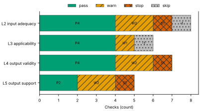
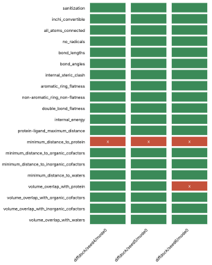
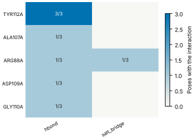
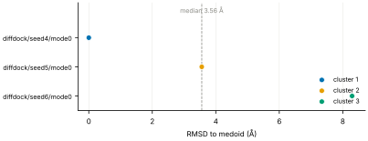
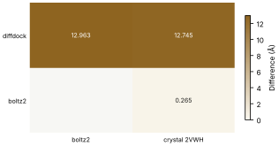

# Run report · Ligand pose in a known pocket

Prediction assurance · run `ligand_pose-6e55bdbc91bf` · 2026-10-17 18:18:39 UTC

**Refused** for the claim "Predicted pose of BGC in glucose dehydrogenase (glucose-binding) is valid".

Refused over layers 2,3,4,5: 14 pass, 7 warn, 3 stop, 2 skip. Stopped by l2.context.cofactors, l4.posebusters, l5.controls.redocking. Warnings from l2.receptor.protonation, l2.docking.box, l3.exposure.ligand_prevalence, l4.torsion_strain, l4.interactions.known_binders, l5.sampling.clusters, l5.agreement.cross_family. 1 checks not verified.

Stops: `l2.context.cofactors`, `l4.posebusters`, `l5.controls.redocking`.

Warnings: `l2.receptor.protonation`, `l2.docking.box`, `l3.exposure.ligand_prevalence`, `l4.torsion_strain`, `l4.interactions.known_binders`, `l5.sampling.clusters`, `l5.agreement.cross_family`.

Not verified: 1 checks.

| Field | Value |
| --- | --- |
| Task | Ligand pose in a known pocket (`ligand_pose`) |
| Tools | DiffDock-L v1.1.3 (docking), Boltz-2 (co-folding) |
| Target | `protein` |
| Ligand | `C([C@@H]1[C@H]([C@@H]([C@H]([C@@H](O1)O)O)O)O)O` |
| Reference | `2VWH` |
| pH | 7.4 |
| Seeds | 3 |
| Layers run | 2, 3, 4, 5 |
| Run | `ligand_pose-6e55bdbc91bf` |
| Created | 2026-10-17 18:18:39 UTC |
| Finished | 2026-10-17 18:19:59 UTC |
| pah version | 0.1.0 |
| Report schema | 1 |

## Layers

| Layer | Status | Result | pass | warn | stop | skip | Time |
| --- | --- | --- | --- | --- | --- | --- | --- |
| L0 Provenance | not run | n/a | n/a | n/a | n/a | n/a | n/a |
| L1 Input integrity | not run | n/a | n/a | n/a | n/a | n/a | n/a |
| L2 Input adequacy | done | stop | 4 | 2 | 1 | 1 | 1.2 s |
| L3 Applicability | done | warn | 4 | 1 | 0 | 1 | 339 ms |
| L4 Output validity | done | stop | 4 | 2 | 1 | 0 | 78.3 s |
| L5 Output support | done | stop | 2 | 2 | 1 | 0 | 303 ms |

## Figures

Fig. 1 · Check outcomes per layer for run ligand_pose-6e55bdbc91bf. Totals: pass 14, warn 7, stop 3, skip 2.
Files: data [figures/gates_by_layer.csv](figures/gates_by_layer.csv).

## Structures

68 PyMOL renders.

2VWH mmCIF (source_structure), whole structure. Chains A; organic components BGC, NAP. sha256 563276ca06d2a22a. PyMOL session: [renders/2VWH.pse](renders/2VWH.pse).

2VWH mmCIF (source_structure), ligand environment within 5 Å. Chains A; organic components BGC, NAP. sha256 563276ca06d2a22a. PyMOL session: [renders/2VWH.pse](renders/2VWH.pse).

diffdock/seed4/mode0 (prediction_structure), whole structure. Chains A, L; organic components LIG. sha256 31a5d026e5df4697. PyMOL session: [renders/diffdock_seed4_mode0.pse](renders/diffdock_seed4_mode0.pse).

diffdock/seed4/mode0 (prediction_structure), ligand environment within 5 Å. Chains A, L; organic components LIG. sha256 31a5d026e5df4697. PyMOL session: [renders/diffdock_seed4_mode0.pse](renders/diffdock_seed4_mode0.pse).

diffdock/seed4/mode1 (prediction_structure), whole structure. Chains A, L; organic components LIG. sha256 bbee6972fbeba927. PyMOL session: [renders/diffdock_seed4_mode1.pse](renders/diffdock_seed4_mode1.pse).

diffdock/seed4/mode1 (prediction_structure), ligand environment within 5 Å. Chains A, L; organic components LIG. sha256 bbee6972fbeba927. PyMOL session: [renders/diffdock_seed4_mode1.pse](renders/diffdock_seed4_mode1.pse).

diffdock/seed4/mode2 (prediction_structure), whole structure. Chains A, L; organic components LIG. sha256 65419493db593c53. PyMOL session: [renders/diffdock_seed4_mode2.pse](renders/diffdock_seed4_mode2.pse).

diffdock/seed4/mode2 (prediction_structure), ligand environment within 5 Å. Chains A, L; organic components LIG. sha256 65419493db593c53. PyMOL session: [renders/diffdock_seed4_mode2.pse](renders/diffdock_seed4_mode2.pse).

diffdock/seed4/mode3 (prediction_structure), whole structure. Chains A, L; organic components LIG. sha256 cf72d7ce5be38cca. PyMOL session: [renders/diffdock_seed4_mode3.pse](renders/diffdock_seed4_mode3.pse).

diffdock/seed4/mode3 (prediction_structure), ligand environment within 5 Å. Chains A, L; organic components LIG. sha256 cf72d7ce5be38cca. PyMOL session: [renders/diffdock_seed4_mode3.pse](renders/diffdock_seed4_mode3.pse).

diffdock/seed4/mode4 (prediction_structure), whole structure. Chains A, L; organic components LIG. sha256 f07b95fc8500e96a. PyMOL session: [renders/diffdock_seed4_mode4.pse](renders/diffdock_seed4_mode4.pse).

diffdock/seed4/mode4 (prediction_structure), ligand environment within 5 Å. Chains A, L; organic components LIG. sha256 f07b95fc8500e96a. PyMOL session: [renders/diffdock_seed4_mode4.pse](renders/diffdock_seed4_mode4.pse).

diffdock/seed4/mode5 (prediction_structure), whole structure. Chains A, L; organic components LIG. sha256 d44b164188ebcf1c. PyMOL session: [renders/diffdock_seed4_mode5.pse](renders/diffdock_seed4_mode5.pse).

diffdock/seed4/mode5 (prediction_structure), ligand environment within 5 Å. Chains A, L; organic components LIG. sha256 d44b164188ebcf1c. PyMOL session: [renders/diffdock_seed4_mode5.pse](renders/diffdock_seed4_mode5.pse).

diffdock/seed4/mode6 (prediction_structure), whole structure. Chains A, L; organic components LIG. sha256 c88b1b4e7cac70b0. PyMOL session: [renders/diffdock_seed4_mode6.pse](renders/diffdock_seed4_mode6.pse).

diffdock/seed4/mode6 (prediction_structure), ligand environment within 5 Å. Chains A, L; organic components LIG. sha256 c88b1b4e7cac70b0. PyMOL session: [renders/diffdock_seed4_mode6.pse](renders/diffdock_seed4_mode6.pse).

diffdock/seed4/mode7 (prediction_structure), whole structure. Chains A, L; organic components LIG. sha256 fa0c4c3610b53951. PyMOL session: [renders/diffdock_seed4_mode7.pse](renders/diffdock_seed4_mode7.pse).

diffdock/seed4/mode7 (prediction_structure), ligand environment within 5 Å. Chains A, L; organic components LIG. sha256 fa0c4c3610b53951. PyMOL session: [renders/diffdock_seed4_mode7.pse](renders/diffdock_seed4_mode7.pse).

diffdock/seed4/mode8 (prediction_structure), whole structure. Chains A, L; organic components LIG. sha256 b3e2c3f98c333790. PyMOL session: [renders/diffdock_seed4_mode8.pse](renders/diffdock_seed4_mode8.pse).

diffdock/seed4/mode8 (prediction_structure), ligand environment within 5 Å. Chains A, L; organic components LIG. sha256 b3e2c3f98c333790. PyMOL session: [renders/diffdock_seed4_mode8.pse](renders/diffdock_seed4_mode8.pse).

diffdock/seed4/mode9 (prediction_structure), whole structure. Chains A, L; organic components LIG. sha256 5625469e33fc9033. PyMOL session: [renders/diffdock_seed4_mode9.pse](renders/diffdock_seed4_mode9.pse).

diffdock/seed4/mode9 (prediction_structure), ligand environment within 5 Å. Chains A, L; organic components LIG. sha256 5625469e33fc9033. PyMOL session: [renders/diffdock_seed4_mode9.pse](renders/diffdock_seed4_mode9.pse).

diffdock/seed5/mode0 (prediction_structure), whole structure. Chains A, L; organic components LIG. sha256 c8d9f8f1fb1322c3. PyMOL session: [renders/diffdock_seed5_mode0.pse](renders/diffdock_seed5_mode0.pse).

diffdock/seed5/mode0 (prediction_structure), ligand environment within 5 Å. Chains A, L; organic components LIG. sha256 c8d9f8f1fb1322c3. PyMOL session: [renders/diffdock_seed5_mode0.pse](renders/diffdock_seed5_mode0.pse).

diffdock/seed5/mode1 (prediction_structure), whole structure. Chains A, L; organic components LIG. sha256 1bb6df4cbdd3c9d8. PyMOL session: [renders/diffdock_seed5_mode1.pse](renders/diffdock_seed5_mode1.pse).

diffdock/seed5/mode1 (prediction_structure), ligand environment within 5 Å. Chains A, L; organic components LIG. sha256 1bb6df4cbdd3c9d8. PyMOL session: [renders/diffdock_seed5_mode1.pse](renders/diffdock_seed5_mode1.pse).

diffdock/seed5/mode2 (prediction_structure), whole structure. Chains A, L; organic components LIG. sha256 b376739dc5cf0c0d. PyMOL session: [renders/diffdock_seed5_mode2.pse](renders/diffdock_seed5_mode2.pse).

diffdock/seed5/mode2 (prediction_structure), ligand environment within 5 Å. Chains A, L; organic components LIG. sha256 b376739dc5cf0c0d. PyMOL session: [renders/diffdock_seed5_mode2.pse](renders/diffdock_seed5_mode2.pse).

diffdock/seed5/mode3 (prediction_structure), whole structure. Chains A, L; organic components LIG. sha256 e482cd18a204b0f0. PyMOL session: [renders/diffdock_seed5_mode3.pse](renders/diffdock_seed5_mode3.pse).

diffdock/seed5/mode3 (prediction_structure), ligand environment within 5 Å. Chains A, L; organic components LIG. sha256 e482cd18a204b0f0. PyMOL session: [renders/diffdock_seed5_mode3.pse](renders/diffdock_seed5_mode3.pse).

diffdock/seed5/mode4 (prediction_structure), whole structure. Chains A, L; organic components LIG. sha256 6d70c5618531d43a. PyMOL session: [renders/diffdock_seed5_mode4.pse](renders/diffdock_seed5_mode4.pse).

diffdock/seed5/mode4 (prediction_structure), ligand environment within 5 Å. Chains A, L; organic components LIG. sha256 6d70c5618531d43a. PyMOL session: [renders/diffdock_seed5_mode4.pse](renders/diffdock_seed5_mode4.pse).

diffdock/seed5/mode5 (prediction_structure), whole structure. Chains A, L; organic components LIG. sha256 7a40dcbeee7f36dc. PyMOL session: [renders/diffdock_seed5_mode5.pse](renders/diffdock_seed5_mode5.pse).

diffdock/seed5/mode5 (prediction_structure), ligand environment within 5 Å. Chains A, L; organic components LIG. sha256 7a40dcbeee7f36dc. PyMOL session: [renders/diffdock_seed5_mode5.pse](renders/diffdock_seed5_mode5.pse).

diffdock/seed5/mode6 (prediction_structure), whole structure. Chains A, L; organic components LIG. sha256 e479bb82a13355b0. PyMOL session: [renders/diffdock_seed5_mode6.pse](renders/diffdock_seed5_mode6.pse).

diffdock/seed5/mode6 (prediction_structure), ligand environment within 5 Å. Chains A, L; organic components LIG. sha256 e479bb82a13355b0. PyMOL session: [renders/diffdock_seed5_mode6.pse](renders/diffdock_seed5_mode6.pse).

diffdock/seed5/mode7 (prediction_structure), whole structure. Chains A, L; organic components LIG. sha256 d4bc8406c0c411a7. PyMOL session: [renders/diffdock_seed5_mode7.pse](renders/diffdock_seed5_mode7.pse).

diffdock/seed5/mode7 (prediction_structure), ligand environment within 5 Å. Chains A, L; organic components LIG. sha256 d4bc8406c0c411a7. PyMOL session: [renders/diffdock_seed5_mode7.pse](renders/diffdock_seed5_mode7.pse).

diffdock/seed5/mode8 (prediction_structure), whole structure. Chains A, L; organic components LIG. sha256 c910147cca5b4b68. PyMOL session: [renders/diffdock_seed5_mode8.pse](renders/diffdock_seed5_mode8.pse).

diffdock/seed5/mode8 (prediction_structure), ligand environment within 5 Å. Chains A, L; organic components LIG. sha256 c910147cca5b4b68. PyMOL session: [renders/diffdock_seed5_mode8.pse](renders/diffdock_seed5_mode8.pse).

diffdock/seed5/mode9 (prediction_structure), whole structure. Chains A, L; organic components LIG. sha256 566c1e2265793b9b. PyMOL session: [renders/diffdock_seed5_mode9.pse](renders/diffdock_seed5_mode9.pse).

diffdock/seed5/mode9 (prediction_structure), ligand environment within 5 Å. Chains A, L; organic components LIG. sha256 566c1e2265793b9b. PyMOL session: [renders/diffdock_seed5_mode9.pse](renders/diffdock_seed5_mode9.pse).

diffdock/seed6/mode0 (prediction_structure), whole structure. Chains A, L; organic components LIG. sha256 535f6c633a149c56. PyMOL session: [renders/diffdock_seed6_mode0.pse](renders/diffdock_seed6_mode0.pse).

diffdock/seed6/mode0 (prediction_structure), ligand environment within 5 Å. Chains A, L; organic components LIG. sha256 535f6c633a149c56. PyMOL session: [renders/diffdock_seed6_mode0.pse](renders/diffdock_seed6_mode0.pse).

diffdock/seed6/mode1 (prediction_structure), whole structure. Chains A, L; organic components LIG. sha256 a97e590c98e57fdb. PyMOL session: [renders/diffdock_seed6_mode1.pse](renders/diffdock_seed6_mode1.pse).

diffdock/seed6/mode1 (prediction_structure), ligand environment within 5 Å. Chains A, L; organic components LIG. sha256 a97e590c98e57fdb. PyMOL session: [renders/diffdock_seed6_mode1.pse](renders/diffdock_seed6_mode1.pse).

diffdock/seed6/mode2 (prediction_structure), whole structure. Chains A, L; organic components LIG. sha256 a2d684c92893b733. PyMOL session: [renders/diffdock_seed6_mode2.pse](renders/diffdock_seed6_mode2.pse).

diffdock/seed6/mode2 (prediction_structure), ligand environment within 5 Å. Chains A, L; organic components LIG. sha256 a2d684c92893b733. PyMOL session: [renders/diffdock_seed6_mode2.pse](renders/diffdock_seed6_mode2.pse).

diffdock/seed6/mode3 (prediction_structure), whole structure. Chains A, L; organic components LIG. sha256 239df016f24bfdb6. PyMOL session: [renders/diffdock_seed6_mode3.pse](renders/diffdock_seed6_mode3.pse).

diffdock/seed6/mode3 (prediction_structure), ligand environment within 5 Å. Chains A, L; organic components LIG. sha256 239df016f24bfdb6. PyMOL session: [renders/diffdock_seed6_mode3.pse](renders/diffdock_seed6_mode3.pse).

diffdock/seed6/mode4 (prediction_structure), whole structure. Chains A, L; organic components LIG. sha256 eacdfabf555f740a. PyMOL session: [renders/diffdock_seed6_mode4.pse](renders/diffdock_seed6_mode4.pse).

diffdock/seed6/mode4 (prediction_structure), ligand environment within 5 Å. Chains A, L; organic components LIG. sha256 eacdfabf555f740a. PyMOL session: [renders/diffdock_seed6_mode4.pse](renders/diffdock_seed6_mode4.pse).

diffdock/seed6/mode5 (prediction_structure), whole structure. Chains A, L; organic components LIG. sha256 252b50723ac9162c. PyMOL session: [renders/diffdock_seed6_mode5.pse](renders/diffdock_seed6_mode5.pse).

diffdock/seed6/mode5 (prediction_structure), ligand environment within 5 Å. Chains A, L; organic components LIG. sha256 252b50723ac9162c. PyMOL session: [renders/diffdock_seed6_mode5.pse](renders/diffdock_seed6_mode5.pse).

diffdock/seed6/mode6 (prediction_structure), whole structure. Chains A, L; organic components LIG. sha256 98876edbb9a3286b. PyMOL session: [renders/diffdock_seed6_mode6.pse](renders/diffdock_seed6_mode6.pse).

diffdock/seed6/mode6 (prediction_structure), ligand environment within 5 Å. Chains A, L; organic components LIG. sha256 98876edbb9a3286b. PyMOL session: [renders/diffdock_seed6_mode6.pse](renders/diffdock_seed6_mode6.pse).

diffdock/seed6/mode7 (prediction_structure), whole structure. Chains A, L; organic components LIG. sha256 65184f483ad9861f. PyMOL session: [renders/diffdock_seed6_mode7.pse](renders/diffdock_seed6_mode7.pse).

diffdock/seed6/mode7 (prediction_structure), ligand environment within 5 Å. Chains A, L; organic components LIG. sha256 65184f483ad9861f. PyMOL session: [renders/diffdock_seed6_mode7.pse](renders/diffdock_seed6_mode7.pse).

diffdock/seed6/mode8 (prediction_structure), whole structure. Chains A, L; organic components LIG. sha256 17afe8644aba1819. PyMOL session: [renders/diffdock_seed6_mode8.pse](renders/diffdock_seed6_mode8.pse).

diffdock/seed6/mode8 (prediction_structure), ligand environment within 5 Å. Chains A, L; organic components LIG. sha256 17afe8644aba1819. PyMOL session: [renders/diffdock_seed6_mode8.pse](renders/diffdock_seed6_mode8.pse).

diffdock/seed6/mode9 (prediction_structure), whole structure. Chains A, L; organic components LIG. sha256 de35d0c2fb921f7c. PyMOL session: [renders/diffdock_seed6_mode9.pse](renders/diffdock_seed6_mode9.pse).

diffdock/seed6/mode9 (prediction_structure), ligand environment within 5 Å. Chains A, L; organic components LIG. sha256 de35d0c2fb921f7c. PyMOL session: [renders/diffdock_seed6_mode9.pse](renders/diffdock_seed6_mode9.pse).

boltz2/seed4/sample0 (prediction_structure), whole structure. Chains A, C1, C2, L; organic components LIG1, NAP. sha256 b0ae118a1e4875ea. PyMOL session: [renders/boltz2_seed4_sample0.pse](renders/boltz2_seed4_sample0.pse).

boltz2/seed4/sample0 (prediction_structure), ligand environment within 5 Å. Chains A, C1, C2, L; organic components LIG1, NAP. sha256 b0ae118a1e4875ea. PyMOL session: [renders/boltz2_seed4_sample0.pse](renders/boltz2_seed4_sample0.pse).

boltz2/seed5/sample0 (prediction_structure), whole structure. Chains A, C1, C2, L; organic components LIG1, NAP. sha256 f2af55174f5aa36c. PyMOL session: [renders/boltz2_seed5_sample0.pse](renders/boltz2_seed5_sample0.pse).

boltz2/seed5/sample0 (prediction_structure), ligand environment within 5 Å. Chains A, C1, C2, L; organic components LIG1, NAP. sha256 f2af55174f5aa36c. PyMOL session: [renders/boltz2_seed5_sample0.pse](renders/boltz2_seed5_sample0.pse).

boltz2/seed6/sample0 (prediction_structure), whole structure. Chains A, C1, C2, L; organic components LIG1, NAP. sha256 e5d0cdaa02de6617. PyMOL session: [renders/boltz2_seed6_sample0.pse](renders/boltz2_seed6_sample0.pse).

boltz2/seed6/sample0 (prediction_structure), ligand environment within 5 Å. Chains A, C1, C2, L; organic components LIG1, NAP. sha256 e5d0cdaa02de6617. PyMOL session: [renders/boltz2_seed6_sample0.pse](renders/boltz2_seed6_sample0.pse).

## L0 Provenance

Where did every input come from?

Status: not run.

## L1 Input integrity

Did the run receive exactly what was declared?

Status: not run.

## L2 Input adequacy

Does the input carry enough information?

Status: done. Checks: pass 4 · warn 2 · stop 1 · skip 1. Time: 1.2 s.

#### Key figures

| Figure | Value |
| --- | --- |
| near site | 2 |
| missing | 2 |
| uniprot cofactors | 0 |
| pocket residues | 19 |
| incomplete | 0 |
| sequence gaps | 0 |
| state | holo |
| site ligands | 2 |

#### Docking

| Field | Value |
| --- | --- |
| center | 9.319, 36.788, 18.307 Å |
| size | 11.671 × 12.814 × 12.093 Å |
| origin | derived from BGC (+4 Å) |

#### Checks

| Check | Result | Measured cmp threshold | Evidence | Id · time |
| --- | --- | --- | --- | --- |
| Alignment depth, distinct sequences, Neff and gap fraction | skip | n/a | no MSA declared for a co-folding model · not applicable | `l2.msa.depth` |
| Required cofactors, ions and partners present | stop | `pocket_distance <= 8` | components within 8.0 Å of BGC in 2VWH not supplied: NAP, ZN · near_site=2, missing=2, uniprot_cofactors=0 | `l2.context.cofactors` · 174 ms |
| Pocket residues resolved, no missing loops lining the pocket | pass | `pocket_distance <= 6` | 19 pocket residues complete in 2VWH.cif · pocket_residues=19, incomplete=0, sequence_gaps=0 | `l2.pocket.resolved` · 8 ms |
| Receptor state apo or holo | pass | n/a | 2VWH.cif holo: BGC, NAP in the site · state=holo, site_ligands=2 | `l2.receptor.state` · 7 ms |
| Receptor protonation at the stated pH | warn | `pka_margin > 1` | receptor has no hydrogens (protonation not assigned); pKa within 1.0 of pH 7.4: GLU64A pKa 6.96, GLU150A pKa 8.39 · hydrogens_present=False, ph=7.4, pocket_titratable=13 | `l2.receptor.protonation` · 505 ms |
| Ligand protonation and tautomers enumerated at the stated pH | pass | `ph 7.4 == 1` | one state at pH 7.4 for every ligand · ph=7.4, max_states=1, declared_not_enumerated=0 | `l2.ligand.protonation` · 39 ms |
| Ligand conformers generated and minimised | pass | `conformers >= 10` | 10 ETKDG conformers per ligand, MMFF minimised · ligands=1, failed=0, min_embedded=10 | `l2.ligand.conformers` · 410 ms |
| Docking box encloses the pocket with margin | warn | `margin >= 2` | no box declared; derived box encloses 11 contact residues and the BGC ligand with 2.0 Å margin · volume_A3=1808.5, ligand_atoms_inside_margin=12, ligand_atoms=12 | `l2.docking.box` · 11 ms |

## L3 Applicability

Is the tool inside its validated regime?

Status: done. Checks: pass 4 · warn 1 · stop 0 · skip 1. Time: 339 ms.

#### Key figures

| Figure | Value |
| --- | --- |
| executors | 2 |
| unknown | 0 |
| reference released | 2009-01-13 |
| cutoff | 2019-01-01 |
| systems | 1079 |
| analogue components | 25 |
| entries 95 | 6 |
| entries 40 | 6 |

#### Checks

| Check | Result | Measured cmp threshold | Evidence | Id · time |
| --- | --- | --- | --- | --- |
| Model training cutoff recorded | pass | `training_cutoff == recorded` | diffdock 2019-01-01; boltz2 2023-06-01; reference 2VWH released 2009-01-13, before the cutoff of diffdock, boltz2 · executors=2, unknown=0, reference_released=2009-01-13 | `l3.model.training_cutoff` · 1 ms |
| Pocket similarity to pre-cutoff complexes (SuCOS times pocket coverage) | skip | n/a | KeyError: 'sucos' · error | `l3.exposure.pocket` · 329 ms |
| Ligand analogues in pre-cutoff training systems | warn | `tanimoto > 0.9` | 1079 PDB entries released before 2019-01-01 (diffdock cutoff) contain analogues of ligand above Tanimoto 0.9: 3MK, 4GL, 4N2, A1EKO, AFD, ALL · cutoff=2019-01-01, systems=1079, analogue_components=25 | `l3.exposure.ligand_prevalence` · 0 ms |
| Chain sequence identity to pre-cutoff entries (secondary measure) | pass | `identity < 0.4` | protein: 6 entries at 95 percent identity, 6 at 40 percent, released before 2019-01-01 (reported, not gating) · cutoff=2019-01-01, entries_95=6, entries_40=6 | `l3.exposure.sequence` · 1 ms |
| Modality inside the validated set; token count against the training crop | pass | n/a | modalities protein, protein_ligand inside the validated set; 369 tokens · modalities=2, tokens=369, outside=0 | `l3.regime.modality` · 6 ms |
| Endpoint fits the tool | pass | `endpoint pose in pose` | endpoint pose produced by diffdock, boltz2 · endpoint=pose, executors=2, not_fitting=0 | `l3.metric.endpoint` · 0 ms |

## L4 Output validity

Is the result physically and chemically sensible?

Status: done. Checks: pass 4 · warn 2 · stop 1 · skip 0. Time: 78.3 s.

#### Key figures

| Figure | Value |
| --- | --- |
| poses | 3 |
| passed | 19 |
| total | 20 |
| poses all pass | 0 |
| unlikely torsions | 1 |
| torsions | 6 |
| strain kcal | 12.38 |
| poses with unlikely | 1 |

#### PoseBusters · 19/20 tests pass

| test | result | value |
| --- | --- | --- |
| sanitization | pass | pass |
| inchi_convertible | pass | pass |
| all_atoms_connected | pass | pass |
| no_radicals | pass | pass |
| bond_lengths | pass | 0 long outliers |
| bond_angles | pass | 0 outliers |
| internal_steric_clash | pass | 0 |
| aromatic_ring_flatness | pass | pass |
| non-aromatic_ring_non-flatness | pass | pass |
| double_bond_flatness | pass | pass |
| internal_energy | pass | 1.4 times the ensemble mean |
| protein-ligand_maximum_distance | pass | 2.12 Å |
| minimum_distance_to_protein | fail | 2.12 Å |
| minimum_distance_to_organic_cofactors | pass | pass |
| minimum_distance_to_inorganic_cofactors | pass | pass |
| minimum_distance_to_waters | pass | pass |
| volume_overlap_with_protein | pass | 0.040 |
| volume_overlap_with_organic_cofactors | pass | pass |
| volume_overlap_with_inorganic_cofactors | pass | pass |
| volume_overlap_with_waters | pass | pass |

#### Per-pose physical checks

| pose | seed | drift Å | converged | unlikely torsions | unsat. polars | buried charged | PoseBusters |
| --- | --- | --- | --- | --- | --- | --- | --- |
| diffdock/seed4/mode0 | 4 | 1.95 | true | 1/6 | 0 | 0 | 19/20 |
| diffdock/seed5/mode0 | 5 | 1.77 | true | 0/6 | 0 | 0 | 19/20 |
| diffdock/seed6/mode0 | 6 | 4.1 | true | 0/6 | 0 | 0 | 18/20 |
| median | n/a | 1.95 | n/a | 0 | 0 | 0 | 19/20 |

#### Interaction fingerprint · representative pose diffdock/seed4/mode0

| residue | type | distance | poses |
| --- | --- | --- | --- |
| TYR112A | hbond | 2.26 Å | 3/3 |
| ALA107A | hbond | 3.7 Å | 1/3 |
| ARG88A | hbond | 2.75 Å | 1/3 |
| ASP109A | hbond | 3.24 Å | 1/3 |
| GLY110A | hbond | 3.85 Å | 1/3 |
| ARG88A | salt_bridge | 2.56 Å | 1/3 |

Fig. 2 · PoseBusters tests (20) by pose (3). Failed cells marked x: 4 of 60.
Files: data [figures/posebusters_grid.csv](figures/posebusters_grid.csv).

Fig. 3 · Interactions by residue (5) and type (2); cell label: poses with the interaction over poses assessed.
Files: data [figures/interactions.csv](figures/interactions.csv).

#### Checks

| Check | Result | Measured cmp threshold | Evidence | Id · time |
| --- | --- | --- | --- | --- |
| PoseBusters geometry, stereochemistry, clashes and protein contact | stop | `tests_failed == 0` | representative pose diffdock/seed4/mode0 fails minimum_distance_to_protein · poses=3, passed=19, total=20 | `l4.posebusters` · 920 ms |
| Torsional strain of the ligand pose | warn | `torsion_energy <= 2.5` | 1 of 6 torsions above 2.5 kcal/mol in diffdock/seed4/mode0 · poses=3, unlikely_torsions=1, torsions=6 | `l4.torsion_strain` · 490 ms |
| Interaction fingerprint (PLIP) | pass | n/a | 5 interactions in diffdock/seed4/mode0 (hbond); 6 distinct across 3 poses (reported) · poses=3, interactions_representative=5, distinct=6 | `l4.interactions.fingerprint` · 733 ms |
| Buried ligand polar atoms without a hydrogen-bond partner | pass | `relative_sasa < 0.1` | 2 buried polar ligand atoms, all with a partner within 3.5 Å in diffdock/seed4/mode0 · poses=3, unsatisfied=0, buried_charged=0 | `l4.interactions.unsatisfied_polars` · 285 ms |
| Hydrophobic complementarity of buried ligand surface | pass | `fraction >= 0.35` | nonpolar fraction of protein contacts around 5 buried nonpolar ligand atoms in diffdock/seed4/mode0: 0.578 · poses=3, complementarity=0.578, buried_nonpolar=5 | `l4.interactions.hydrophobic` · 293 ms |
| Interactions of the crystal ligand reproduced by the pose | warn | `reproduced 0 >= 1` | diffdock/seed4/mode0 reproduces none of 6 BGC interactions · key_interactions=6, reproduced=0, poses_reproducing_all=0 | `l4.interactions.known_binders` · 284 ms |
| Pose stability under short restrained minimisation (OpenMM, AMBER14 and OpenFF) | pass | `drift_A 1.95 <= 2` | diffdock/seed4/mode0 moves 1.954 Å under restrained minimisation; 1 of 3 poses above 2.0 Å · poses=3, drift_A=1.954, max_drift_A=4.104 | `l4.minimisation_drift` · 75.3 s |

## L5 Output support

Is a valid result corroborated?

Status: done. Checks: pass 2 · warn 2 · stop 1 · skip 0. Time: 303 ms.

#### Key figures

| Figure | Value |
| --- | --- |
| poses | 3 |
| diffdock confidence | -1.59 |
| independent seeds | 3 |
| samples | 30 |
| duplicated outputs | 0 |
| clusters | 3 |
| largest cluster | 1 |
| pairwise rmsd median A | 8.294 |

#### Sampling

| Field | Value |
| --- | --- |
| site placement | 0 of 3 poses within 4.0 Å of the site (BGC in 2VWH) |
| pose accuracy | 1 of 3 poses within 2.0 Å of the medoid |
| pairwise RMSD median | 8.29 Å |
| pairwise RMSD IQR | 5.93 to 8.68 Å |
| pairs | 3 |
| medoid | diffdock/seed4/mode0 |

#### Clusters

| Field | Value |
| --- | --- |
| cluster 1 | 1/3 poses (diffdock/seed4/mode0) |
| cluster 2 | 1/3 poses (diffdock/seed5/mode0) |
| cluster 3 | 1/3 poses (diffdock/seed6/mode0) |

#### Per-seed statistics

| seed | pose | cluster | RMSD to medoid | confidence |
| --- | --- | --- | --- | --- |
| 4 | diffdock/seed4/mode0 | 1 | 0 Å | -1.59 |
| 5 | diffdock/seed5/mode0 | 2 | 3.56 Å | -2.77 |
| 6 | diffdock/seed6/mode0 | 3 | 8.29 Å | -4.49 |
| median | n/a | n/a | 3.56 Å | -2.77 |

#### Ensemble

| structure | kind | source | RMSD to medoid | cluster | pocket pLDDT | ipTM |
| --- | --- | --- | --- | --- | --- | --- |
| diffdock/seed4/mode0 | medoid | diffdock | 0 Å | 1 | n/a | n/a |
| diffdock/seed5/mode0 | docking | diffdock | 3.56 Å | 2 | n/a | n/a |
| diffdock/seed6/mode0 | docking | diffdock | 8.29 Å | 3 | n/a | n/a |

#### Agreement between methods

| method | boltz2 | crystal 2VWH |
| --- | --- | --- |
| diffdock | 13 Å (high) | 12.7 Å (decisive) |
| boltz2 | n/a | 0.27 Å (decisive) |

Fig. 4 · RMSD to the medoid for 3 poses, coloured by cluster (3 clusters). Dashed line: median 3.56 Å; range 0.00 to 8.29 Å.
Files: data [figures/seed_spread.csv](figures/seed_spread.csv).

Fig. 5 · Agreement between 2 methods and 2 comparators; range 0.265 to 12.963 Å.
Files: data [figures/agreement.csv](figures/agreement.csv).

#### Checks

| Check | Result | Measured cmp threshold | Evidence | Id · time |
| --- | --- | --- | --- | --- |
| Confidence restricted to the pocket; per-model thresholds | pass | n/a | diffdock/seed4/mode0: diffdock_confidence -1.59; no per-model confidence threshold registered for diffdock (reported) · poses=3, diffdock_confidence=-1.59 | `l5.confidence.local` · 0 ms |
| Independent seeds counted separately from samples; duplicates flagged | pass | `seeds_docking >= 3` | 3 independent seeds, 30 poses, no duplicates · independent_seeds=3, samples=30, duplicated_outputs=0 | `l5.sampling.seeds` · 0 ms |
| Medoid of the largest cluster, populations, pairwise spread, site and pose accuracy | warn | `cluster_rmsd <= 2` | medoid diffdock/seed4/mode0; 3 clusters, largest 1 of 3; pairwise RMSD median 8.29 Å (IQR 5.93 to 8.68); 0 of 3 poses within 4.0 Å of the site (BGC in 2VWH); 1 of 3 poses within 2.0 Å of the medoid · poses=3, clusters=3, largest_cluster=1 | `l5.sampling.clusters` · 213 ms |
| Agreement between methods, weighted by independence | warn | `rmsd_to_crystal_A 12.7 <= 2` | diffdock vs boltz2 12.963 Å (high); diffdock vs crystal 2VWH 12.745 Å (decisive); boltz2 vs crystal 2VWH 0.265 Å (decisive) · methods=2, comparisons=3, disagreeing=2 | `l5.agreement.cross_family` · 87 ms |
| Redocking control reproduces the crystal pose | stop | `rmsd <= 2` | redocking control required by the task and not supplied (controls.redocking) | `l5.controls.redocking` · 0 ms |

## Controls

| control | status | result |
| --- | --- | --- |
| redocking | incomplete | redocking control required by the task and not supplied (controls.redocking) |

## Provenance

56 objects · 56 cached · 0 network.

| Source | Accession | Release | SHA-256 | Retrieved | Bytes | Cache | Used by |
| --- | --- | --- | --- | --- | --- | --- | --- |
| rcsb_files | 2VWH | n/a | `563276ca06d2` | 2026-10-17 16:59:50 UTC | 364136 | hit | l2.context.cofactors, l2.pocket.resolved, l2.receptor.state, l2.docking.box, l3.exposure.pocket, l3.regime.modality, l4.interactions.fingerprint, l4.interactions.known_binders, l5.sampling.clusters, l5.agreement.cross_family |
| ccd | BGC | 2026-01-27 | `faaa9f919f4c` | 2026-10-17 16:59:50 UTC | 30741 | hit | l2.context.cofactors, l3.exposure.pocket |
| rcsb | 2VWH | 1.5 | `5a990581b1c2` | 2026-10-17 16:59:51 UTC | 22370 | hit | l3.model.training_cutoff |
| rcsb_search | chem:C([C@@H]1[C@H]([C@@H]([C@H]([C@@H](O1)O)O)O)O)O | n/a | `0d5756d1e58b` | 2026-10-17 16:59:54 UTC | 1413 | hit | l3.exposure.pocket |
| ccd | 3MK | 2020-07-17 | `d97d4b552654` | 2026-10-17 16:59:54 UTC | 6432 | hit | l3.exposure.pocket |
| ccd | 4GL | 2020-07-17 | `54e556dfe7fd` | 2026-10-17 16:59:54 UTC | 6325 | hit | l3.exposure.pocket |
| ccd | 4N2 | 2024-09-27 | `f79b18096323` | 2026-10-17 16:59:54 UTC | 6840 | hit | l3.exposure.pocket |
| ccd | A1EKO | 2025-05-23 | `ad979697d06a` | 2026-10-17 16:59:54 UTC | 3352 | hit | l3.exposure.pocket |
| ccd | AFD | 2020-07-17 | `187112f21ade` | 2026-10-17 16:59:54 UTC | 6206 | hit | l3.exposure.pocket |
| ccd | ALL | 2020-07-17 | `598282a36137` | 2026-10-17 16:59:54 UTC | 7344 | hit | l3.exposure.pocket |
| ccd | BMA | 2024-09-27 | `7e30cba9c3f2` | 2026-10-17 16:59:55 UTC | 10486 | hit | l3.exposure.pocket |
| ccd | GIV | 2020-07-17 | `4569744b581c` | 2026-10-17 16:59:55 UTC | 6584 | hit | l3.exposure.pocket |
| ccd | GL0 | 2020-07-17 | `bbebd0ca21bb` | 2026-10-17 16:59:55 UTC | 6595 | hit | l3.exposure.pocket |
| ccd | GLA | 2024-09-27 | `7a00d8420d56` | 2026-10-17 16:59:55 UTC | 7618 | hit | l3.exposure.pocket |
| ccd | GLC | 2024-09-27 | `254da3afcadc` | 2026-10-17 16:59:55 UTC | 13396 | hit | l3.exposure.pocket |
| ccd | GUP | 2020-07-17 | `f89db705d642` | 2026-10-17 16:59:55 UTC | 6234 | hit | l3.exposure.pocket |
| ccd | GXL | 2020-07-17 | `b767fcdfce95` | 2026-10-17 16:59:55 UTC | 6457 | hit | l3.exposure.pocket |
| ccd | MAN | 2024-09-27 | `7152473b81ed` | 2026-10-17 16:59:55 UTC | 12288 | hit | l3.exposure.pocket |
| ccd | SDY | 2020-07-17 | `5d1e5b6ff718` | 2026-10-17 16:59:55 UTC | 5813 | hit | l3.exposure.pocket |
| ccd | SHD | 2020-07-17 | `f6d17409069d` | 2026-10-17 16:59:55 UTC | 6081 | hit | l3.exposure.pocket |
| ccd | WOO | 2020-07-17 | `9a8678927d94` | 2026-10-17 16:59:55 UTC | 6363 | hit | l3.exposure.pocket |
| ccd | Z0F | 2020-07-17 | `c55706645922` | 2026-10-17 16:59:55 UTC | 6421 | hit | l3.exposure.pocket |
| ccd | Z2D | 2020-07-17 | `689a6bb06802` | 2026-10-17 16:59:55 UTC | 6434 | hit | l3.exposure.pocket |
| ccd | Z6H | 2020-07-17 | `5a83d4f3e767` | 2026-10-17 16:59:55 UTC | 5982 | hit | l3.exposure.pocket |
| ccd | Z8H | 2020-07-17 | `2610342cf9e7` | 2026-10-17 16:59:55 UTC | 6321 | hit | l3.exposure.pocket |
| ccd | Z8T | 2020-07-17 | `379bdd554936` | 2026-10-17 16:59:55 UTC | 6328 | hit | l3.exposure.pocket |
| ccd | ZCD | 2020-07-17 | `0db91c424e63` | 2026-10-17 16:59:55 UTC | 6421 | hit | l3.exposure.pocket |
| ccd | ZEE | 2020-07-17 | `68a25c060a01` | 2026-10-17 16:59:55 UTC | 6839 | hit | l3.exposure.pocket |
| rcsb_search | comp:3MK:2019-01-01 | n/a | `e3b0c44298fc` | 2026-10-17 16:59:55 UTC | 0 | hit | l3.exposure.pocket |
| rcsb_search | comp:4GL:2019-01-01 | n/a | `e3b0c44298fc` | 2026-10-17 16:59:56 UTC | 0 | hit | l3.exposure.pocket |
| rcsb_search | comp:4N2:2019-01-01 | n/a | `1a398c0b2118` | 2026-10-17 16:59:56 UTC | 178 | hit | l3.exposure.pocket |
| rcsb_search | comp:A1EKO:2019-01-01 | n/a | `e3b0c44298fc` | 2026-10-17 16:59:56 UTC | 0 | hit | l3.exposure.pocket |
| rcsb_search | comp:AFD:2019-01-01 | n/a | `1b753220c03e` | 2026-10-17 16:59:56 UTC | 178 | hit | l3.exposure.pocket |
| rcsb_search | comp:ALL:2019-01-01 | n/a | `aa7eed16d698` | 2026-10-17 16:59:56 UTC | 282 | hit | l3.exposure.pocket |
| rcsb_search | comp:BGC:2019-01-01 | n/a | `39279015c780` | 2026-10-17 16:59:56 UTC | 16456 | hit | l3.exposure.pocket |
| rcsb_search | comp:BMA:2019-01-01 | n/a | `8abdb19b69b6` | 2026-10-17 16:59:56 UTC | 5223 | hit | l3.exposure.pocket |
| rcsb_search | comp:GIV:2019-01-01 | n/a | `180958654842` | 2026-10-17 16:59:56 UTC | 230 | hit | l3.exposure.pocket |
| rcsb_search | comp:GL0:2019-01-01 | n/a | `9b62fec3623e` | 2026-10-17 16:59:56 UTC | 230 | hit | l3.exposure.pocket |
| rcsb_search | comp:GLA:2019-01-01 | n/a | `02cfe2e610ae` | 2026-10-17 16:59:56 UTC | 3039 | hit | l3.exposure.pocket |
| rcsb_search | comp:GLC:2019-01-01 | n/a | `5e0520a8a72a` | 2026-10-17 16:59:56 UTC | 14064 | hit | l3.exposure.pocket |
| rcsb_search | comp:GUP:2019-01-01 | n/a | `e3b0c44298fc` | 2026-10-17 16:59:56 UTC | 0 | hit | l3.exposure.pocket |
| rcsb_search | comp:GXL:2019-01-01 | n/a | `76ee6d0d9de4` | 2026-10-17 16:59:56 UTC | 230 | hit | l3.exposure.pocket |
| rcsb_search | comp:MAN:2019-01-01 | n/a | `03c4da7e978a` | 2026-10-17 16:59:56 UTC | 17340 | hit | l3.exposure.pocket |
| rcsb_search | comp:SDY:2019-01-01 | n/a | `e3b0c44298fc` | 2026-10-17 16:59:56 UTC | 0 | hit | l3.exposure.pocket |
| rcsb_search | comp:SHD:2019-01-01 | n/a | `e3b0c44298fc` | 2026-10-17 16:59:56 UTC | 0 | hit | l3.exposure.pocket |
| rcsb_search | comp:WOO:2019-01-01 | n/a | `c2bb176d61ff` | 2026-10-17 16:59:56 UTC | 178 | hit | l3.exposure.pocket |
| rcsb_search | comp:Z0F:2019-01-01 | n/a | `e3b0c44298fc` | 2026-10-17 16:59:56 UTC | 0 | hit | l3.exposure.pocket |
| rcsb_search | comp:Z2D:2019-01-01 | n/a | `e3b0c44298fc` | 2026-10-17 16:59:56 UTC | 0 | hit | l3.exposure.pocket |
| rcsb_search | comp:Z6H:2019-01-01 | n/a | `e3b0c44298fc` | 2026-10-17 16:59:57 UTC | 0 | hit | l3.exposure.pocket |
| rcsb_search | comp:Z8H:2019-01-01 | n/a | `e3b0c44298fc` | 2026-10-17 16:59:57 UTC | 0 | hit | l3.exposure.pocket |
| rcsb_search | comp:Z8T:2019-01-01 | n/a | `e3b0c44298fc` | 2026-10-17 16:59:57 UTC | 0 | hit | l3.exposure.pocket |
| rcsb_search | comp:ZCD:2019-01-01 | n/a | `e3b0c44298fc` | 2026-10-17 16:59:57 UTC | 0 | hit | l3.exposure.pocket |
| rcsb_search | comp:ZEE:2019-01-01 | n/a | `e3b0c44298fc` | 2026-10-17 16:59:57 UTC | 0 | hit | l3.exposure.pocket |
| rcsb_search | seq0.9:2019-01-01:357 | n/a | `5cf9c6d3e615` | 2026-10-17 16:59:54 UTC | 438 | hit | l3.exposure.pocket |
| rcsb_search | seq0.95:2019-01-01:357 | n/a | `2ded139e03ea` | 2026-10-17 16:59:55 UTC | 386 | hit | l3.exposure.sequence |
| rcsb_search | seq0.4:2019-01-01:357 | n/a | `d1c1f4adb44b` | 2026-10-17 16:59:55 UTC | 386 | hit | l3.exposure.sequence |

Provenance graph: [json](graph.json), [mmd](graph.mmd), [svg](graph.svg).

## Thresholds

| Check | Threshold | Value | Origin | Evidence level |
| --- | --- | --- | --- | --- |
| `l2.context.cofactors` | pocket_distance | <= 8 | Harness rule: a component of the reference entry within 8 Å of the declared ligand is required context; not yet calibrated | uncalibrated |
| `l2.pocket.resolved` | pocket_distance | <= 6 | Harness rule: pocket residues have a heavy atom within 6 Å of the ligand; not yet calibrated | uncalibrated |
| `l2.pocket.resolved` | missing_pocket_residues | == 0 | Specification layer 2: stop when the pocket is incomplete | published |
| `l2.receptor.protonation` | pka_margin | > 1 | Harness rule: a titratable pocket residue with PROPKA pKa within 1 unit of the stated pH has an ambiguous state; not yet calibrated | uncalibrated |
| `l2.ligand.protonation` | ph_window | == 1 | Harness rule: states enumerated by Dimorphite-DL within 1 pH unit of the stated pH; not yet calibrated | uncalibrated |
| `l2.ligand.protonation` | states | == 1 | Specification layer 2: warn when more than one plausible state | published |
| `l2.ligand.conformers` | conformers | >= 10 | Harness default number of ETKDG conformers; not yet calibrated | uncalibrated |
| `l2.docking.box` | margin | >= 2 | Harness rule: every pocket heavy atom lies at least 2 Å inside the box; not yet calibrated | uncalibrated |
| `l2.docking.box` | contact_distance | <= 4 | Harness rule: contact residues (heavy atom within 4 Å of the reference ligand) must have an atom inside the box; not yet calibrated | uncalibrated |
| `l3.model.training_cutoff` | training_cutoff | == recorded | Specification, Layer 3 (applicability): stop when unknown | published |
| `l3.exposure.ligand_prevalence` | tanimoto | > 0.9 | Specification layer 3: analogues above 0.9 Tanimoto (RDKit topological fingerprint) | published |
| `l3.exposure.ligand_prevalence` | systems | <= 100 | Specification layer 3: prevalent when analogues occur in more than 100 training systems | published |
| `l3.exposure.sequence` | identity | < 0.4 | Specification layer 3: conventional 40 percent identity leakage threshold, reported as a secondary measure only | published |
| `l3.metric.endpoint` | endpoint | in pose | Specification, Layer 3 (applicability): no affinity from interface confidence, no protein-protein affinity from Boltz-2 | published |
| `l4.posebusters` | tests_failed | == 0 | Specification, Layer 4 (output validity): stop on failure | published |
| `l4.torsion_strain` | torsion_energy | <= 2.5 | Harness rule: a rotatable torsion whose MMFF energy lies more than 2.5 kcal/mol above the minimum of its rigid scan is unlikely; not yet calibrated | uncalibrated |
| `l4.interactions.unsatisfied_polars` | relative_sasa | < 0.1 | Harness rule: a ligand polar atom with relative SASA below 0.1 in the complex is buried; not yet calibrated | uncalibrated |
| `l4.interactions.unsatisfied_polars` | hbond_distance | <= 3.5 | PLIP hydrogen bond distance cut-off (donor-acceptor 4.1 Å; harness uses 3.5 Å heavy-atom distance) | published |
| `l4.interactions.hydrophobic` | fraction | >= 0.35 | Harness default anchored on 3PTB: the crystal benzamidine scores 0.51, Vina and Boltz-2 poses within 0.5 Å of it score 0.45 and 0.49; not calibrated on the benchmark | uncalibrated |
| `l4.interactions.hydrophobic` | relative_sasa | < 0.1 | Harness rule: a ligand polar atom with relative SASA below 0.1 in the complex is buried; not yet calibrated | uncalibrated |
| `l4.interactions.known_binders` | reproduced | >= 1 | Specification layer 4: warn when no key interaction is reproduced | published |
| `l4.minimisation_drift` | drift | <= 2 | Specification layer 4: warn when the pose moves beyond 2 Å under restrained minimisation | published |
| `l5.sampling.seeds` | seeds_docking | >= 3 | Harness default for independent docking seeds; not yet calibrated | uncalibrated |
| `l5.sampling.clusters` | cluster_rmsd | <= 2 | Specification layer 5: 2 Å symmetry-aware ligand RMSD (spyrmsd) separates pose clusters | published |
| `l5.sampling.clusters` | site_distance | <= 4 | Harness rule: a ligand centroid within 4 Å of the reference site centroid is placed in the site; not yet calibrated | uncalibrated |
| `l5.sampling.clusters` | largest_fraction | >= 0.5 | Harness rule: the largest cluster holds at least half of the poses; not yet calibrated | uncalibrated |
| `l5.agreement.cross_family` | rmsd | <= 2 | Specification layer 5: pose agreement by symmetry-aware ligand RMSD at 2 Å | published |
| `l5.controls.redocking` | rmsd | <= 2 | Specification layer 5: redocking must reproduce the crystal pose (2 Å ligand RMSD) | published |

Tool versions: dimorphite_dl 2.1.0, freesasa 2.2.1, gemmi 0.7.5, numpy 1.26.4, openbabel 3.2.1, openmm 8.6.1, plip 3.0.1, posebusters 0.6.5, propka 3.5.1, rdkit 2026.9.1, scipy 1.17.1, spyrmsd 0.9.0.

## Limitations

- This report covers layers 2, 3, 4, 5. Layers not run: 0, 1.
- The harness establishes when a result should not be trusted. Passing checks are not evidence that a prediction is correct.
- Thresholds marked uncalibrated come from the specification or harness defaults and have not been recalibrated on the harness benchmark.

## Files

| Path | Kind | Bytes | SHA-256 |
| --- | --- | --- | --- |
| artifacts/sources/2VWH.cif | source_structure | 364136 | `563276ca06d2` |
| predictions/00_diffdock/diffdock/seed4/mode0/complex.pdb | prediction_structure | 225590 | `31a5d026e5df` |
| predictions/00_diffdock/diffdock/seed4/mode0/ligand.sdf | data | 1079 | `a49268d46a58` |
| predictions/00_diffdock/diffdock/seed4/mode1/complex.pdb | prediction_structure | 225590 | `bbee6972fbeb` |
| predictions/00_diffdock/diffdock/seed4/mode1/ligand.sdf | data | 1079 | `67a2396a5e01` |
| predictions/00_diffdock/diffdock/seed4/mode2/complex.pdb | prediction_structure | 225590 | `65419493db59` |
| predictions/00_diffdock/diffdock/seed4/mode2/ligand.sdf | data | 1079 | `c47794e1fd84` |
| predictions/00_diffdock/diffdock/seed4/mode3/complex.pdb | prediction_structure | 225590 | `cf72d7ce5be3` |
| predictions/00_diffdock/diffdock/seed4/mode3/ligand.sdf | data | 1079 | `96730d0404fa` |
| predictions/00_diffdock/diffdock/seed4/mode4/complex.pdb | prediction_structure | 225590 | `f07b95fc8500` |
| predictions/00_diffdock/diffdock/seed4/mode4/ligand.sdf | data | 1079 | `b97624f0b0fe` |
| predictions/00_diffdock/diffdock/seed4/mode5/complex.pdb | prediction_structure | 225590 | `d44b164188eb` |
| predictions/00_diffdock/diffdock/seed4/mode5/ligand.sdf | data | 1079 | `980da2104d1e` |
| predictions/00_diffdock/diffdock/seed4/mode6/complex.pdb | prediction_structure | 225590 | `c88b1b4e7cac` |
| predictions/00_diffdock/diffdock/seed4/mode6/ligand.sdf | data | 1079 | `561ad2962603` |
| predictions/00_diffdock/diffdock/seed4/mode7/complex.pdb | prediction_structure | 225590 | `fa0c4c3610b5` |
| predictions/00_diffdock/diffdock/seed4/mode7/ligand.sdf | data | 1079 | `ff2895cd26eb` |
| predictions/00_diffdock/diffdock/seed4/mode8/complex.pdb | prediction_structure | 225590 | `b3e2c3f98c33` |
| predictions/00_diffdock/diffdock/seed4/mode8/ligand.sdf | data | 1079 | `356cc24cf237` |
| predictions/00_diffdock/diffdock/seed4/mode9/complex.pdb | prediction_structure | 225590 | `5625469e33fc` |
| predictions/00_diffdock/diffdock/seed4/mode9/ligand.sdf | data | 1079 | `e0a21bfbd77f` |
| predictions/00_diffdock/diffdock/seed5/mode0/complex.pdb | prediction_structure | 225590 | `c8d9f8f1fb13` |
| predictions/00_diffdock/diffdock/seed5/mode0/ligand.sdf | data | 1079 | `0acee68c1a81` |
| predictions/00_diffdock/diffdock/seed5/mode1/complex.pdb | prediction_structure | 225590 | `1bb6df4cbdd3` |
| predictions/00_diffdock/diffdock/seed5/mode1/ligand.sdf | data | 1079 | `d8a89e33b43c` |
| predictions/00_diffdock/diffdock/seed5/mode2/complex.pdb | prediction_structure | 225590 | `b376739dc5cf` |
| predictions/00_diffdock/diffdock/seed5/mode2/ligand.sdf | data | 1079 | `2938193d0649` |
| predictions/00_diffdock/diffdock/seed5/mode3/complex.pdb | prediction_structure | 225590 | `e482cd18a204` |
| predictions/00_diffdock/diffdock/seed5/mode3/ligand.sdf | data | 1079 | `c5f4043ffab5` |
| predictions/00_diffdock/diffdock/seed5/mode4/complex.pdb | prediction_structure | 225590 | `6d70c5618531` |
| predictions/00_diffdock/diffdock/seed5/mode4/ligand.sdf | data | 1079 | `2f3a9107b526` |
| predictions/00_diffdock/diffdock/seed5/mode5/complex.pdb | prediction_structure | 225590 | `7a40dcbeee7f` |
| predictions/00_diffdock/diffdock/seed5/mode5/ligand.sdf | data | 1079 | `47e50a6ac14a` |
| predictions/00_diffdock/diffdock/seed5/mode6/complex.pdb | prediction_structure | 225590 | `e479bb82a133` |
| predictions/00_diffdock/diffdock/seed5/mode6/ligand.sdf | data | 1079 | `9068670c58af` |
| predictions/00_diffdock/diffdock/seed5/mode7/complex.pdb | prediction_structure | 225590 | `d4bc8406c0c4` |
| predictions/00_diffdock/diffdock/seed5/mode7/ligand.sdf | data | 1079 | `e6f0c7cb3732` |
| predictions/00_diffdock/diffdock/seed5/mode8/complex.pdb | prediction_structure | 225590 | `c910147cca5b` |
| predictions/00_diffdock/diffdock/seed5/mode8/ligand.sdf | data | 1079 | `c65e8988a3fa` |
| predictions/00_diffdock/diffdock/seed5/mode9/complex.pdb | prediction_structure | 225590 | `566c1e226579` |
| predictions/00_diffdock/diffdock/seed5/mode9/ligand.sdf | data | 1079 | `46bafcdc231c` |
| predictions/00_diffdock/diffdock/seed6/mode0/complex.pdb | prediction_structure | 225590 | `535f6c633a14` |
| predictions/00_diffdock/diffdock/seed6/mode0/ligand.sdf | data | 1079 | `a6ee40ee303e` |
| predictions/00_diffdock/diffdock/seed6/mode1/complex.pdb | prediction_structure | 225590 | `a97e590c98e5` |
| predictions/00_diffdock/diffdock/seed6/mode1/ligand.sdf | data | 1079 | `9a58d37f0cd4` |
| predictions/00_diffdock/diffdock/seed6/mode2/complex.pdb | prediction_structure | 225590 | `a2d684c92893` |
| predictions/00_diffdock/diffdock/seed6/mode2/ligand.sdf | data | 1079 | `c1bac3baceed` |
| predictions/00_diffdock/diffdock/seed6/mode3/complex.pdb | prediction_structure | 225590 | `239df016f24b` |
| predictions/00_diffdock/diffdock/seed6/mode3/ligand.sdf | data | 1079 | `f27f78232da0` |
| predictions/00_diffdock/diffdock/seed6/mode4/complex.pdb | prediction_structure | 225590 | `eacdfabf555f` |
| predictions/00_diffdock/diffdock/seed6/mode4/ligand.sdf | data | 1079 | `855a70e6d417` |
| predictions/00_diffdock/diffdock/seed6/mode5/complex.pdb | prediction_structure | 225590 | `252b50723ac9` |
| predictions/00_diffdock/diffdock/seed6/mode5/ligand.sdf | data | 1079 | `2045f2b201ee` |
| predictions/00_diffdock/diffdock/seed6/mode6/complex.pdb | prediction_structure | 225590 | `98876edbb9a3` |
| predictions/00_diffdock/diffdock/seed6/mode6/ligand.sdf | data | 1079 | `7ad86a2a0452` |
| predictions/00_diffdock/diffdock/seed6/mode7/complex.pdb | prediction_structure | 225590 | `65184f483ad9` |
| predictions/00_diffdock/diffdock/seed6/mode7/ligand.sdf | data | 1079 | `36c0a966603f` |
| predictions/00_diffdock/diffdock/seed6/mode8/complex.pdb | prediction_structure | 225590 | `17afe8644aba` |
| predictions/00_diffdock/diffdock/seed6/mode8/ligand.sdf | data | 1079 | `5c9249e85460` |
| predictions/00_diffdock/diffdock/seed6/mode9/complex.pdb | prediction_structure | 225590 | `de35d0c2fb92` |
| predictions/00_diffdock/diffdock/seed6/mode9/ligand.sdf | data | 1079 | `70840e8c7be1` |
| /home/user/harness-hackathon/bench/runs/2026-10-17T1752Z-2f5a1c7/predictions/glc_wt/boltz2/seed_4/boltz_results_glc_wt/predictions/glc_wt/glc_wt_model_0.cif | prediction_structure | 250850 | `b0ae118a1e48` |
| predictions/01_boltz2/boltz2/seed4/sample0/ligand.sdf | data | 1079 | `9ce46fa37786` |
| /home/user/harness-hackathon/bench/runs/2026-10-17T1752Z-2f5a1c7/predictions/glc_wt/boltz2/seed_5/boltz_results_glc_wt/predictions/glc_wt/glc_wt_model_0.cif | prediction_structure | 250689 | `f2af55174f5a` |
| predictions/01_boltz2/boltz2/seed5/sample0/ligand.sdf | data | 1079 | `7ad64ddd9a1e` |
| /home/user/harness-hackathon/bench/runs/2026-10-17T1752Z-2f5a1c7/predictions/glc_wt/boltz2/seed_6/boltz_results_glc_wt/predictions/glc_wt/glc_wt_model_0.cif | prediction_structure | 250829 | `e5d0cdaa02de` |
| predictions/01_boltz2/boltz2/seed6/sample0/ligand.sdf | data | 1079 | `287b90d84dc0` |
| renders/2VWH_overview.png | render | 234730 | `b20baba3b461` |
| renders/2VWH_pocket.png | render | 448203 | `12a718262bbe` |
| renders/2VWH.pse | session | 942280 | `47120f14e331` |
| renders/diffdock_seed4_mode0_overview.png | render | 226150 | `9038563e5440` |
| renders/diffdock_seed4_mode0_pocket.png | render | 212767 | `e77141c34afb` |
| renders/diffdock_seed4_mode0.pse | session | 793707 | `0e7a1f729da0` |
| renders/diffdock_seed4_mode1_overview.png | render | 225777 | `aa04de853d9d` |
| renders/diffdock_seed4_mode1_pocket.png | render | 188203 | `30bf88b8992a` |
| renders/diffdock_seed4_mode1.pse | session | 793731 | `52d05e0d6756` |
| renders/diffdock_seed4_mode2_overview.png | render | 226002 | `0f553f90a3ea` |
| renders/diffdock_seed4_mode2_pocket.png | render | 257060 | `163ee922e4ca` |
| renders/diffdock_seed4_mode2.pse | session | 793936 | `bf2728aad3d3` |
| renders/diffdock_seed4_mode3_overview.png | render | 225818 | `2c96b975a8c3` |
| renders/diffdock_seed4_mode3_pocket.png | render | 252086 | `8afe9b4b2e42` |
| renders/diffdock_seed4_mode3.pse | session | 794030 | `68301c0f6293` |
| renders/diffdock_seed4_mode4_overview.png | render | 225650 | `4a63f231c7e7` |
| renders/diffdock_seed4_mode4_pocket.png | render | 240168 | `e131f5766645` |
| renders/diffdock_seed4_mode4.pse | session | 793981 | `fa12d6435968` |
| renders/diffdock_seed4_mode5_overview.png | render | 226212 | `ab0156f4d50b` |
| renders/diffdock_seed4_mode5_pocket.png | render | 254429 | `40cdb3fcf2bc` |
| renders/diffdock_seed4_mode5.pse | session | 793749 | `dba91681375c` |
| renders/diffdock_seed4_mode6_overview.png | render | 225651 | `0a4055790fd5` |
| renders/diffdock_seed4_mode6_pocket.png | render | 262988 | `bcc780e07bc5` |
| renders/diffdock_seed4_mode6.pse | session | 794036 | `834b8b604a57` |
| renders/diffdock_seed4_mode7_overview.png | render | 225713 | `20a713d01d8e` |
| renders/diffdock_seed4_mode7_pocket.png | render | 232908 | `55e68e9c0473` |
| renders/diffdock_seed4_mode7.pse | session | 793839 | `be62248826c9` |
| renders/diffdock_seed4_mode8_overview.png | render | 223334 | `17dbb863eb10` |
| renders/diffdock_seed4_mode8_pocket.png | render | 344826 | `c72047d37d41` |
| renders/diffdock_seed4_mode8.pse | session | 794003 | `f28db03c954f` |
| renders/diffdock_seed4_mode9_overview.png | render | 225746 | `12ede48dfe25` |
| renders/diffdock_seed4_mode9_pocket.png | render | 258565 | `80c8cba2ea2f` |
| renders/diffdock_seed4_mode9.pse | session | 793851 | `77377423c0a8` |
| renders/diffdock_seed5_mode0_overview.png | render | 225924 | `5f02942916a0` |
| renders/diffdock_seed5_mode0_pocket.png | render | 184959 | `c76db732472b` |
| renders/diffdock_seed5_mode0.pse | session | 793734 | `7f30e502b4a0` |
| renders/diffdock_seed5_mode1_overview.png | render | 226116 | `51c4197e2792` |
| renders/diffdock_seed5_mode1_pocket.png | render | 175046 | `09fe76a462a8` |
| renders/diffdock_seed5_mode1.pse | session | 793747 | `2994d8396e68` |
| renders/diffdock_seed5_mode2_overview.png | render | 226286 | `e9d06c4e47cc` |
| renders/diffdock_seed5_mode2_pocket.png | render | 241725 | `886ab2a8896b` |
| renders/diffdock_seed5_mode2.pse | session | 793725 | `e859ca44187d` |
| renders/diffdock_seed5_mode3_overview.png | render | 225576 | `8e8c90936372` |
| renders/diffdock_seed5_mode3_pocket.png | render | 233507 | `f6f7bab87201` |
| renders/diffdock_seed5_mode3.pse | session | 793720 | `1f7587ea5869` |
| renders/diffdock_seed5_mode4_overview.png | render | 226207 | `acd5e280e786` |
| renders/diffdock_seed5_mode4_pocket.png | render | 253330 | `00e55bb003f8` |
| renders/diffdock_seed5_mode4.pse | session | 793991 | `5b7b92677fdd` |
| renders/diffdock_seed5_mode5_overview.png | render | 225915 | `a48a68e13427` |
| renders/diffdock_seed5_mode5_pocket.png | render | 245263 | `0cffa1a23c3b` |
| renders/diffdock_seed5_mode5.pse | session | 793964 | `ae3909a5cace` |
| renders/diffdock_seed5_mode6_overview.png | render | 226636 | `7cf04c4f71d1` |
| renders/diffdock_seed5_mode6_pocket.png | render | 250653 | `82c9ab17ad80` |
| renders/diffdock_seed5_mode6.pse | session | 794042 | `3620dcd01ff7` |
| renders/diffdock_seed5_mode7_overview.png | render | 226418 | `46242a77e72f` |
| renders/diffdock_seed5_mode7_pocket.png | render | 225289 | `ac7915da30fc` |
| renders/diffdock_seed5_mode7.pse | session | 793909 | `7c7acac473de` |
| renders/diffdock_seed5_mode8_overview.png | render | 225990 | `bec159866478` |
| renders/diffdock_seed5_mode8_pocket.png | render | 247509 | `066f91886f11` |
| renders/diffdock_seed5_mode8.pse | session | 793959 | `3aca0bb29f83` |
| renders/diffdock_seed5_mode9_overview.png | render | 225297 | `30e3ef54a225` |
| renders/diffdock_seed5_mode9_pocket.png | render | 242802 | `262f8f9f0dd2` |
| renders/diffdock_seed5_mode9.pse | session | 794062 | `ba75404233f3` |
| renders/diffdock_seed6_mode0_overview.png | render | 224804 | `5b1419ffff75` |
| renders/diffdock_seed6_mode0_pocket.png | render | 252287 | `93c14bb999c2` |
| renders/diffdock_seed6_mode0.pse | session | 794121 | `d9b596439399` |
| renders/diffdock_seed6_mode1_overview.png | render | 224832 | `76502d980d60` |
| renders/diffdock_seed6_mode1_pocket.png | render | 252170 | `9ee295ea77e7` |
| renders/diffdock_seed6_mode1.pse | session | 794090 | `740e8ddaeb4e` |
| renders/diffdock_seed6_mode2_overview.png | render | 225269 | `466db15e44e6` |
| renders/diffdock_seed6_mode2_pocket.png | render | 192665 | `25f130041b77` |
| renders/diffdock_seed6_mode2.pse | session | 793831 | `ca42f97c2219` |
| renders/diffdock_seed6_mode3_overview.png | render | 225906 | `5503f23d7a0b` |
| renders/diffdock_seed6_mode3_pocket.png | render | 254365 | `11d290a4a5d2` |
| renders/diffdock_seed6_mode3.pse | session | 793877 | `d059a5df1fad` |
| renders/diffdock_seed6_mode4_overview.png | render | 225491 | `75f6e8c458b5` |
| renders/diffdock_seed6_mode4_pocket.png | render | 263827 | `f0bab29d3ca7` |
| renders/diffdock_seed6_mode4.pse | session | 794007 | `356221491934` |
| renders/diffdock_seed6_mode5_overview.png | render | 225952 | `1215b5d4cd76` |
| renders/diffdock_seed6_mode5_pocket.png | render | 234164 | `5dd00e0c2d8c` |
| renders/diffdock_seed6_mode5.pse | session | 793982 | `b573edda9cf7` |
| renders/diffdock_seed6_mode6_overview.png | render | 226480 | `2f506645bc31` |
| renders/diffdock_seed6_mode6_pocket.png | render | 238420 | `9fb5cb5c0022` |
| renders/diffdock_seed6_mode6.pse | session | 793959 | `7293b0593275` |
| renders/diffdock_seed6_mode7_overview.png | render | 226186 | `19ed01be9cf7` |
| renders/diffdock_seed6_mode7_pocket.png | render | 234771 | `3120a2785c33` |
| renders/diffdock_seed6_mode7.pse | session | 793991 | `7802896e491a` |
| renders/diffdock_seed6_mode8_overview.png | render | 225724 | `bd6506b9eb58` |
| renders/diffdock_seed6_mode8_pocket.png | render | 250613 | `b5cb1ab9ca2f` |
| renders/diffdock_seed6_mode8.pse | session | 793883 | `2b00299e263c` |
| renders/diffdock_seed6_mode9_overview.png | render | 223372 | `d406993afb7c` |
| renders/diffdock_seed6_mode9_pocket.png | render | 311079 | `31da174a8cf1` |
| renders/diffdock_seed6_mode9.pse | session | 793945 | `97b02fabd272` |
| renders/boltz2_seed4_sample0_overview.png | render | 237461 | `24b1ff1cd123` |
| renders/boltz2_seed4_sample0_pocket.png | render | 460044 | `bb7daeab7428` |
| renders/boltz2_seed4_sample0.pse | session | 937970 | `f198c008dcc9` |
| renders/boltz2_seed5_sample0_overview.png | render | 217114 | `ea5d551ce2c1` |
| renders/boltz2_seed5_sample0_pocket.png | render | 455579 | `64ea0ddc2833` |
| renders/boltz2_seed5_sample0.pse | session | 937959 | `4a0c92a045fd` |
| renders/boltz2_seed6_sample0_overview.png | render | 232536 | `ce757e1b60c5` |
| renders/boltz2_seed6_sample0_pocket.png | render | 451827 | `b1c1dae012cc` |
| renders/boltz2_seed6_sample0.pse | session | 937970 | `a517820e2297` |
| figures/gates_by_layer.svg | figure | 90267 | `ea9f36aa5524` |
| figures/gates_by_layer.csv | data | 135 | `dde2083283ee` |
| figures/seed_spread.svg | figure | 12281 | `df6860fb929e` |
| figures/seed_spread.csv | data | 159 | `d66ab80a9ee3` |
| figures/posebusters_grid.svg | figure | 28195 | `c37917060c51` |
| figures/posebusters_grid.csv | data | 888 | `8d246c067ae4` |
| figures/interactions.svg | figure | 13224 | `84239913ca93` |
| figures/interactions.csv | data | 181 | `0ef6a41b4a82` |
| figures/agreement.svg | figure | 10948 | `6d1570c56557` |
| figures/agreement.csv | data | 142 | `2f0deaf94d71` |
| graph.json | graph | 76616 | `c6d4faed5099` |
| graph.mmd | graph | 11251 | `c3cee6aca671` |
| graph.svg | graph | 157697 | `d9275d874914` |
