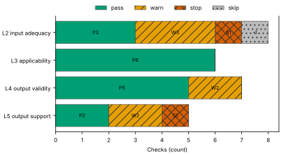
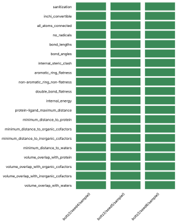
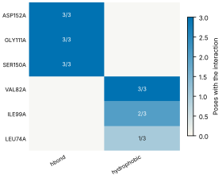
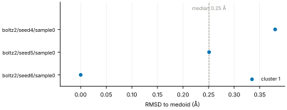
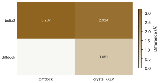
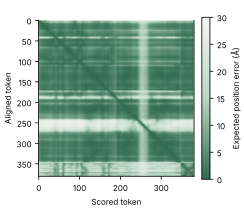

# Run report · Ligand pose in a known pocket

Prediction assurance · run `ligand_pose-c20bb32e8991` · 2026-10-17 18:20:09 UTC

**Refused** for the claim "Predicted pose of FZC in MEK1 is valid".

Refused over layers 2,3,4,5: 16 pass, 7 warn, 2 stop, 1 skip. Stopped by l2.context.cofactors, l5.controls.redocking. Warnings from l2.receptor.protonation, l2.ligand.protonation, l2.docking.box, l4.interactions.unsatisfied_polars, l4.interactions.known_binders, l5.sampling.seeds, l5.agreement.cross_family.

Stops: `l2.context.cofactors`, `l5.controls.redocking`.

Warnings: `l2.receptor.protonation`, `l2.ligand.protonation`, `l2.docking.box`, `l4.interactions.unsatisfied_polars`, `l4.interactions.known_binders`, `l5.sampling.seeds`, `l5.agreement.cross_family`.

| Field | Value |
| --- | --- |
| Task | Ligand pose in a known pocket (`ligand_pose`) |
| Tools | Boltz-2 2.2.1 (co-folding), DiffDock-L (docking) |
| Target | `protein` |
| Ligand | `Cc1ccnc(n1)Oc2ccc(c(c2)Cl)c3cc4c(c(n[nH]4)C)c(c3)O[C@H]5CCC[C@H](C5)N` |
| Reference | `7XLP` |
| pH | 7.4 |
| Seeds | 3 |
| Layers run | 2, 3, 4, 5 |
| Run | `ligand_pose-c20bb32e8991` |
| Created | 2026-10-17 18:20:09 UTC |
| Finished | 2026-10-17 18:21:44 UTC |
| pah version | 0.1.0 |
| Report schema | 1 |

## Layers

| Layer | Status | Result | pass | warn | stop | skip | Time |
| --- | --- | --- | --- | --- | --- | --- | --- |
| L0 Provenance | not run | n/a | n/a | n/a | n/a | n/a | n/a |
| L1 Input integrity | not run | n/a | n/a | n/a | n/a | n/a | n/a |
| L2 Input adequacy | done | stop | 3 | 3 | 1 | 1 | 2.0 s |
| L3 Applicability | done | pass | 6 | 0 | 0 | 0 | 465 ms |
| L4 Output validity | done | warn | 5 | 2 | 0 | 0 | 92.5 s |
| L5 Output support | done | stop | 2 | 2 | 1 | 0 | 201 ms |

## Figures

Fig. 1 · Check outcomes per layer for run ligand_pose-c20bb32e8991. Totals: pass 16, warn 7, stop 2, skip 1.
Files: data [figures/gates_by_layer.csv](figures/gates_by_layer.csv).

## Structures

78 PyMOL renders.

7XLP mmCIF (source_structure), whole structure. Chains A; organic components DMS, FZC. sha256 48ffbc34e5fd126d. PyMOL session: [renders/7XLP.pse](renders/7XLP.pse).

7XLP mmCIF (source_structure), ligand environment within 5 Å. Chains A; organic components DMS, FZC. sha256 48ffbc34e5fd126d. PyMOL session: [renders/7XLP.pse](renders/7XLP.pse).

boltz2/seed4/sample0 (prediction_structure), whole structure. Chains A, L; organic components LIG1. sha256 64cd29bf39031145. PyMOL session: [renders/boltz2_seed4_sample0.pse](renders/boltz2_seed4_sample0.pse).

boltz2/seed4/sample0 (prediction_structure), ligand environment within 5 Å. Chains A, L; organic components LIG1. sha256 64cd29bf39031145. PyMOL session: [renders/boltz2_seed4_sample0.pse](renders/boltz2_seed4_sample0.pse).

boltz2/seed5/sample0 (prediction_structure), whole structure. Chains A, L; organic components LIG1. sha256 476e40903c0aacf2. PyMOL session: [renders/boltz2_seed5_sample0.pse](renders/boltz2_seed5_sample0.pse).

boltz2/seed5/sample0 (prediction_structure), ligand environment within 5 Å. Chains A, L; organic components LIG1. sha256 476e40903c0aacf2. PyMOL session: [renders/boltz2_seed5_sample0.pse](renders/boltz2_seed5_sample0.pse).

boltz2/seed6/sample0 (prediction_structure), whole structure. Chains A, L; organic components LIG1. sha256 e26539e336908141. PyMOL session: [renders/boltz2_seed6_sample0.pse](renders/boltz2_seed6_sample0.pse).

boltz2/seed6/sample0 (prediction_structure), ligand environment within 5 Å. Chains A, L; organic components LIG1. sha256 e26539e336908141. PyMOL session: [renders/boltz2_seed6_sample0.pse](renders/boltz2_seed6_sample0.pse).

diffdock/seed4/mode0 (prediction_structure), whole structure. Chains A, L; organic components LIG. sha256 2bd5ea46e201785b. PyMOL session: [renders/diffdock_seed4_mode0.pse](renders/diffdock_seed4_mode0.pse).

diffdock/seed4/mode0 (prediction_structure), ligand environment within 5 Å. Chains A, L; organic components LIG. sha256 2bd5ea46e201785b. PyMOL session: [renders/diffdock_seed4_mode0.pse](renders/diffdock_seed4_mode0.pse).

diffdock/seed4/mode1 (prediction_structure), whole structure. Chains A, L; organic components LIG. sha256 5e6bff00262f2ca9. PyMOL session: [renders/diffdock_seed4_mode1.pse](renders/diffdock_seed4_mode1.pse).

diffdock/seed4/mode1 (prediction_structure), ligand environment within 5 Å. Chains A, L; organic components LIG. sha256 5e6bff00262f2ca9. PyMOL session: [renders/diffdock_seed4_mode1.pse](renders/diffdock_seed4_mode1.pse).

diffdock/seed4/mode2 (prediction_structure), whole structure. Chains A, L; organic components LIG. sha256 d237ca077aa4ce7f. PyMOL session: [renders/diffdock_seed4_mode2.pse](renders/diffdock_seed4_mode2.pse).

diffdock/seed4/mode2 (prediction_structure), ligand environment within 5 Å. Chains A, L; organic components LIG. sha256 d237ca077aa4ce7f. PyMOL session: [renders/diffdock_seed4_mode2.pse](renders/diffdock_seed4_mode2.pse).

diffdock/seed4/mode3 (prediction_structure), whole structure. Chains A, L; organic components LIG. sha256 7b2e99d59f1f9a51. PyMOL session: [renders/diffdock_seed4_mode3.pse](renders/diffdock_seed4_mode3.pse).

diffdock/seed4/mode3 (prediction_structure), ligand environment within 5 Å. Chains A, L; organic components LIG. sha256 7b2e99d59f1f9a51. PyMOL session: [renders/diffdock_seed4_mode3.pse](renders/diffdock_seed4_mode3.pse).

diffdock/seed4/mode4 (prediction_structure), whole structure. Chains A, L; organic components LIG. sha256 bceefd6424a0c22d. PyMOL session: [renders/diffdock_seed4_mode4.pse](renders/diffdock_seed4_mode4.pse).

diffdock/seed4/mode4 (prediction_structure), ligand environment within 5 Å. Chains A, L; organic components LIG. sha256 bceefd6424a0c22d. PyMOL session: [renders/diffdock_seed4_mode4.pse](renders/diffdock_seed4_mode4.pse).

diffdock/seed4/mode5 (prediction_structure), whole structure. Chains A, L; organic components LIG. sha256 e60897e5faa26b41. PyMOL session: [renders/diffdock_seed4_mode5.pse](renders/diffdock_seed4_mode5.pse).

diffdock/seed4/mode5 (prediction_structure), ligand environment within 5 Å. Chains A, L; organic components LIG. sha256 e60897e5faa26b41. PyMOL session: [renders/diffdock_seed4_mode5.pse](renders/diffdock_seed4_mode5.pse).

diffdock/seed4/mode6 (prediction_structure), whole structure. Chains A, L; organic components LIG. sha256 666212ab7ab160cb. PyMOL session: [renders/diffdock_seed4_mode6.pse](renders/diffdock_seed4_mode6.pse).

diffdock/seed4/mode6 (prediction_structure), ligand environment within 5 Å. Chains A, L; organic components LIG. sha256 666212ab7ab160cb. PyMOL session: [renders/diffdock_seed4_mode6.pse](renders/diffdock_seed4_mode6.pse).

diffdock/seed4/mode7 (prediction_structure), whole structure. Chains A, L; organic components LIG. sha256 928c71c8ae9a5a98. PyMOL session: [renders/diffdock_seed4_mode7.pse](renders/diffdock_seed4_mode7.pse).

diffdock/seed4/mode7 (prediction_structure), ligand environment within 5 Å. Chains A, L; organic components LIG. sha256 928c71c8ae9a5a98. PyMOL session: [renders/diffdock_seed4_mode7.pse](renders/diffdock_seed4_mode7.pse).

diffdock/seed4/mode8 (prediction_structure), whole structure. Chains A, L; organic components LIG. sha256 c956f5a8a1f91389. PyMOL session: [renders/diffdock_seed4_mode8.pse](renders/diffdock_seed4_mode8.pse).

diffdock/seed4/mode8 (prediction_structure), ligand environment within 5 Å. Chains A, L; organic components LIG. sha256 c956f5a8a1f91389. PyMOL session: [renders/diffdock_seed4_mode8.pse](renders/diffdock_seed4_mode8.pse).

diffdock/seed4/mode9 (prediction_structure), whole structure. Chains A, L; organic components LIG. sha256 52b68ec88ae301e2. PyMOL session: [renders/diffdock_seed4_mode9.pse](renders/diffdock_seed4_mode9.pse).

diffdock/seed4/mode9 (prediction_structure), ligand environment within 5 Å. Chains A, L; organic components LIG. sha256 52b68ec88ae301e2. PyMOL session: [renders/diffdock_seed4_mode9.pse](renders/diffdock_seed4_mode9.pse).

diffdock/seed5/mode0 (prediction_structure), whole structure. Chains A, L; organic components LIG. sha256 501cb0c0bf5ba983. PyMOL session: [renders/diffdock_seed5_mode0.pse](renders/diffdock_seed5_mode0.pse).

diffdock/seed5/mode0 (prediction_structure), ligand environment within 5 Å. Chains A, L; organic components LIG. sha256 501cb0c0bf5ba983. PyMOL session: [renders/diffdock_seed5_mode0.pse](renders/diffdock_seed5_mode0.pse).

diffdock/seed5/mode1 (prediction_structure), whole structure. Chains A, L; organic components LIG. sha256 e45374193b8316ee. PyMOL session: [renders/diffdock_seed5_mode1.pse](renders/diffdock_seed5_mode1.pse).

diffdock/seed5/mode1 (prediction_structure), ligand environment within 5 Å. Chains A, L; organic components LIG. sha256 e45374193b8316ee. PyMOL session: [renders/diffdock_seed5_mode1.pse](renders/diffdock_seed5_mode1.pse).

diffdock/seed5/mode2 (prediction_structure), whole structure. Chains A, L; organic components LIG. sha256 6f5b44e0c877bb45. PyMOL session: [renders/diffdock_seed5_mode2.pse](renders/diffdock_seed5_mode2.pse).

diffdock/seed5/mode2 (prediction_structure), ligand environment within 5 Å. Chains A, L; organic components LIG. sha256 6f5b44e0c877bb45. PyMOL session: [renders/diffdock_seed5_mode2.pse](renders/diffdock_seed5_mode2.pse).

diffdock/seed5/mode3 (prediction_structure), whole structure. Chains A, L; organic components LIG. sha256 c6a5126ac068a634. PyMOL session: [renders/diffdock_seed5_mode3.pse](renders/diffdock_seed5_mode3.pse).

diffdock/seed5/mode3 (prediction_structure), ligand environment within 5 Å. Chains A, L; organic components LIG. sha256 c6a5126ac068a634. PyMOL session: [renders/diffdock_seed5_mode3.pse](renders/diffdock_seed5_mode3.pse).

diffdock/seed5/mode4 (prediction_structure), whole structure. Chains A, L; organic components LIG. sha256 a90624e5d4b02092. PyMOL session: [renders/diffdock_seed5_mode4.pse](renders/diffdock_seed5_mode4.pse).

diffdock/seed5/mode4 (prediction_structure), ligand environment within 5 Å. Chains A, L; organic components LIG. sha256 a90624e5d4b02092. PyMOL session: [renders/diffdock_seed5_mode4.pse](renders/diffdock_seed5_mode4.pse).

diffdock/seed5/mode5 (prediction_structure), whole structure. Chains A, L; organic components LIG. sha256 3798bfaa4ce384a2. PyMOL session: [renders/diffdock_seed5_mode5.pse](renders/diffdock_seed5_mode5.pse).

diffdock/seed5/mode5 (prediction_structure), ligand environment within 5 Å. Chains A, L; organic components LIG. sha256 3798bfaa4ce384a2. PyMOL session: [renders/diffdock_seed5_mode5.pse](renders/diffdock_seed5_mode5.pse).

diffdock/seed5/mode6 (prediction_structure), whole structure. Chains A, L; organic components LIG. sha256 f48a281c1c6fb364. PyMOL session: [renders/diffdock_seed5_mode6.pse](renders/diffdock_seed5_mode6.pse).

diffdock/seed5/mode6 (prediction_structure), ligand environment within 5 Å. Chains A, L; organic components LIG. sha256 f48a281c1c6fb364. PyMOL session: [renders/diffdock_seed5_mode6.pse](renders/diffdock_seed5_mode6.pse).

diffdock/seed5/mode7 (prediction_structure), whole structure. Chains A, L; organic components LIG. sha256 620d2e8cbbd72c6f. PyMOL session: [renders/diffdock_seed5_mode7.pse](renders/diffdock_seed5_mode7.pse).

diffdock/seed5/mode7 (prediction_structure), ligand environment within 5 Å. Chains A, L; organic components LIG. sha256 620d2e8cbbd72c6f. PyMOL session: [renders/diffdock_seed5_mode7.pse](renders/diffdock_seed5_mode7.pse).

diffdock/seed5/mode8 (prediction_structure), whole structure. Chains A, L; organic components LIG. sha256 397799adde46c4b8. PyMOL session: [renders/diffdock_seed5_mode8.pse](renders/diffdock_seed5_mode8.pse).

diffdock/seed5/mode8 (prediction_structure), ligand environment within 5 Å. Chains A, L; organic components LIG. sha256 397799adde46c4b8. PyMOL session: [renders/diffdock_seed5_mode8.pse](renders/diffdock_seed5_mode8.pse).

diffdock/seed5/mode9 (prediction_structure), whole structure. Chains A, L; organic components LIG. sha256 dc43f3e5663441ea. PyMOL session: [renders/diffdock_seed5_mode9.pse](renders/diffdock_seed5_mode9.pse).

diffdock/seed5/mode9 (prediction_structure), ligand environment within 5 Å. Chains A, L; organic components LIG. sha256 dc43f3e5663441ea. PyMOL session: [renders/diffdock_seed5_mode9.pse](renders/diffdock_seed5_mode9.pse).

diffdock/seed6/mode0 (prediction_structure), whole structure. Chains A, L; organic components LIG. sha256 481450ac283f106a. PyMOL session: [renders/diffdock_seed6_mode0.pse](renders/diffdock_seed6_mode0.pse).

diffdock/seed6/mode0 (prediction_structure), ligand environment within 5 Å. Chains A, L; organic components LIG. sha256 481450ac283f106a. PyMOL session: [renders/diffdock_seed6_mode0.pse](renders/diffdock_seed6_mode0.pse).

diffdock/seed6/mode1 (prediction_structure), whole structure. Chains A, L; organic components LIG. sha256 4388804b6d4fd613. PyMOL session: [renders/diffdock_seed6_mode1.pse](renders/diffdock_seed6_mode1.pse).

diffdock/seed6/mode1 (prediction_structure), ligand environment within 5 Å. Chains A, L; organic components LIG. sha256 4388804b6d4fd613. PyMOL session: [renders/diffdock_seed6_mode1.pse](renders/diffdock_seed6_mode1.pse).

diffdock/seed6/mode2 (prediction_structure), whole structure. Chains A, L; organic components LIG. sha256 aea7873ef2e6d7c1. PyMOL session: [renders/diffdock_seed6_mode2.pse](renders/diffdock_seed6_mode2.pse).

diffdock/seed6/mode2 (prediction_structure), ligand environment within 5 Å. Chains A, L; organic components LIG. sha256 aea7873ef2e6d7c1. PyMOL session: [renders/diffdock_seed6_mode2.pse](renders/diffdock_seed6_mode2.pse).

diffdock/seed6/mode3 (prediction_structure), whole structure. Chains A, L; organic components LIG. sha256 e25dbafae06116ab. PyMOL session: [renders/diffdock_seed6_mode3.pse](renders/diffdock_seed6_mode3.pse).

diffdock/seed6/mode3 (prediction_structure), ligand environment within 5 Å. Chains A, L; organic components LIG. sha256 e25dbafae06116ab. PyMOL session: [renders/diffdock_seed6_mode3.pse](renders/diffdock_seed6_mode3.pse).

diffdock/seed6/mode4 (prediction_structure), whole structure. Chains A, L; organic components LIG. sha256 6955face418273b4. PyMOL session: [renders/diffdock_seed6_mode4.pse](renders/diffdock_seed6_mode4.pse).

diffdock/seed6/mode4 (prediction_structure), ligand environment within 5 Å. Chains A, L; organic components LIG. sha256 6955face418273b4. PyMOL session: [renders/diffdock_seed6_mode4.pse](renders/diffdock_seed6_mode4.pse).

diffdock/seed6/mode5 (prediction_structure), whole structure. Chains A, L; organic components LIG. sha256 31f3fd252d0faa6d. PyMOL session: [renders/diffdock_seed6_mode5.pse](renders/diffdock_seed6_mode5.pse).

diffdock/seed6/mode5 (prediction_structure), ligand environment within 5 Å. Chains A, L; organic components LIG. sha256 31f3fd252d0faa6d. PyMOL session: [renders/diffdock_seed6_mode5.pse](renders/diffdock_seed6_mode5.pse).

diffdock/seed6/mode6 (prediction_structure), whole structure. Chains A, L; organic components LIG. sha256 54cfce1f9399f3c1. PyMOL session: [renders/diffdock_seed6_mode6.pse](renders/diffdock_seed6_mode6.pse).

diffdock/seed6/mode6 (prediction_structure), ligand environment within 5 Å. Chains A, L; organic components LIG. sha256 54cfce1f9399f3c1. PyMOL session: [renders/diffdock_seed6_mode6.pse](renders/diffdock_seed6_mode6.pse).

diffdock/seed6/mode7 (prediction_structure), whole structure. Chains A, L; organic components LIG. sha256 aa130baf112fa6ce. PyMOL session: [renders/diffdock_seed6_mode7.pse](renders/diffdock_seed6_mode7.pse).

diffdock/seed6/mode7 (prediction_structure), ligand environment within 5 Å. Chains A, L; organic components LIG. sha256 aa130baf112fa6ce. PyMOL session: [renders/diffdock_seed6_mode7.pse](renders/diffdock_seed6_mode7.pse).

diffdock/seed6/mode8 (prediction_structure), whole structure. Chains A, L; organic components LIG. sha256 9bed54c85ff75c68. PyMOL session: [renders/diffdock_seed6_mode8.pse](renders/diffdock_seed6_mode8.pse).

diffdock/seed6/mode8 (prediction_structure), ligand environment within 5 Å. Chains A, L; organic components LIG. sha256 9bed54c85ff75c68. PyMOL session: [renders/diffdock_seed6_mode8.pse](renders/diffdock_seed6_mode8.pse).

diffdock/seed6/mode9 (prediction_structure), whole structure. Chains A, L; organic components LIG. sha256 4ccd00df0268c227. PyMOL session: [renders/diffdock_seed6_mode9.pse](renders/diffdock_seed6_mode9.pse).

diffdock/seed6/mode9 (prediction_structure), ligand environment within 5 Å. Chains A, L; organic components LIG. sha256 4ccd00df0268c227. PyMOL session: [renders/diffdock_seed6_mode9.pse](renders/diffdock_seed6_mode9.pse).

3ZLS mmCIF (source_structure), whole structure. Chains A; organic components 92P. sha256 ae30cf1ed7b4035f. PyMOL session: [renders/3ZLS.pse](renders/3ZLS.pse).

3ZLS mmCIF (source_structure), ligand environment within 5 Å. Chains A; organic components 92P. sha256 ae30cf1ed7b4035f. PyMOL session: [renders/3ZLS.pse](renders/3ZLS.pse).

3ZLX mmCIF (source_structure), whole structure. Chains A; organic components 5EZ. sha256 1334dfc31103f3e6. PyMOL session: [renders/3ZLX.pse](renders/3ZLX.pse).

3ZLX mmCIF (source_structure), ligand environment within 5 Å. Chains A; organic components 5EZ. sha256 1334dfc31103f3e6. PyMOL session: [renders/3ZLX.pse](renders/3ZLX.pse).

3ZM4 mmCIF (source_structure), whole structure. Chains A; organic components 22T. sha256 eccb79a35cb7a9f2. PyMOL session: [renders/3ZM4.pse](renders/3ZM4.pse).

3ZM4 mmCIF (source_structure), ligand environment within 5 Å. Chains A; organic components 22T. sha256 eccb79a35cb7a9f2. PyMOL session: [renders/3ZM4.pse](renders/3ZM4.pse).

5BX0 mmCIF (source_structure), whole structure. Chains A; organic components 4W5. sha256 7ef25dd3b72e153e. PyMOL session: [renders/5BX0.pse](renders/5BX0.pse).

5BX0 mmCIF (source_structure), ligand environment within 5 Å. Chains A; organic components 4W5. sha256 7ef25dd3b72e153e. PyMOL session: [renders/5BX0.pse](renders/5BX0.pse).

3ZLY mmCIF (source_structure), whole structure. Chains A; organic components YSO. sha256 e858c796adc5339d. PyMOL session: [renders/3ZLY.pse](renders/3ZLY.pse).

3ZLY mmCIF (source_structure), ligand environment within 5 Å. Chains A; organic components YSO. sha256 e858c796adc5339d. PyMOL session: [renders/3ZLY.pse](renders/3ZLY.pse).

## L0 Provenance

Where did every input come from?

Status: not run.

## L1 Input integrity

Did the run receive exactly what was declared?

Status: not run.

## L2 Input adequacy

Does the input carry enough information?

Status: done. Checks: pass 3 · warn 3 · stop 1 · skip 1. Time: 2.0 s.

#### Key figures

| Figure | Value |
| --- | --- |
| near site | 1 |
| missing | 1 |
| uniprot cofactors | 0 |
| pocket residues | 37 |
| incomplete | 0 |
| sequence gaps | 0 |
| state | holo |
| site ligands | 1 |

#### Docking

| Field | Value |
| --- | --- |
| center | -3.608, 64.879, 34.516 Å |
| size | 19.183 × 21.381 × 13.89 Å |
| origin | derived from FZC (+4 Å) |

#### Checks

| Check | Result | Measured cmp threshold | Evidence | Id · time |
| --- | --- | --- | --- | --- |
| Alignment depth, distinct sequences, Neff and gap fraction | skip | n/a | no MSA declared for a co-folding model · not applicable | `l2.msa.depth` |
| Required cofactors, ions and partners present | stop | `pocket_distance <= 8` | components within 8.0 Å of FZC in 7XLP not supplied: CA · near_site=1, missing=1, uniprot_cofactors=0 | `l2.context.cofactors` · 195 ms |
| Pocket residues resolved, no missing loops lining the pocket | pass | `pocket_distance <= 6` | 37 pocket residues complete in 7XLP.cif · pocket_residues=37, incomplete=0, sequence_gaps=0 | `l2.pocket.resolved` · 15 ms |
| Receptor state apo or holo | pass | n/a | 7XLP.cif holo: FZC in the site · state=holo, site_ligands=1 | `l2.receptor.state` · 16 ms |
| Receptor protonation at the stated pH | warn | `pka_margin > 1` | receptor has no hydrogens (protonation not assigned) · hydrogens_present=False, ph=7.4, pocket_titratable=12 | `l2.receptor.protonation` · 360 ms |
| Ligand protonation and tautomers enumerated at the stated pH | warn | `ph 7.4 == 1` | ligand: 16 states · ph=7.4, max_states=16, declared_not_enumerated=0 | `l2.ligand.protonation` · 97 ms |
| Ligand conformers generated and minimised | pass | `conformers >= 10` | 10 ETKDG conformers per ligand, MMFF minimised · ligands=1, failed=0, min_embedded=10 | `l2.ligand.conformers` · 1.3 s |
| Docking box encloses the pocket with margin | warn | `margin >= 2` | no box declared; derived box encloses 19 contact residues and the FZC ligand with 2.0 Å margin · volume_A3=5697, ligand_atoms_inside_margin=33, ligand_atoms=33 | `l2.docking.box` · 14 ms |

## L3 Applicability

Is the tool inside its validated regime?

Status: done. Checks: pass 6 · warn 0 · stop 0 · skip 0. Time: 465 ms.

#### Key figures

| Figure | Value |
| --- | --- |
| executors | 2 |
| unknown | 0 |
| reference released | 2023-03-01 |
| cutoff | 2019-01-01 |
| entries compared | 5 |
| max similarity | 16 |
| pocket residues | 40 |
| systems | 0 |

#### Checks

| Check | Result | Measured cmp threshold | Evidence | Id · time |
| --- | --- | --- | --- | --- |
| Model training cutoff recorded | pass | `training_cutoff == recorded` | boltz2 2023-06-01; diffdock 2019-01-01; reference 7XLP released 2023-03-01, before the cutoff of boltz2 · executors=2, unknown=0, reference_released=2023-03-01 | `l3.model.training_cutoff` · 1 ms |
| Pocket similarity to pre-cutoff complexes (SuCOS times pocket coverage) | pass | `similarity <= 50` | max similarity 16.0 to 3ZLY (YSO, SuCOS 0.583, coverage 0.275), released before 2019-01-01 · cutoff=2019-01-01, entries_compared=5, max_similarity=16 | `l3.exposure.pocket` · 451 ms |
| Ligand analogues in pre-cutoff training systems | pass | `tanimoto > 0.9` | 0 PDB entries released before 2019-01-01 (diffdock cutoff) contain analogues of ligand above Tanimoto 0.9: FZC · cutoff=2019-01-01, systems=0, analogue_components=1 | `l3.exposure.ligand_prevalence` · 0 ms |
| Chain sequence identity to pre-cutoff entries (secondary measure) | pass | `identity < 0.4` | protein: 35 entries at 95 percent identity, 44 at 40 percent, released before 2019-01-01 (reported, not gating) · cutoff=2019-01-01, entries_95=35, entries_40=44 | `l3.exposure.sequence` · 1 ms |
| Modality inside the validated set; token count against the training crop | pass | n/a | modalities protein, protein_ligand inside the validated set; 381 tokens · modalities=2, tokens=381, outside=0 | `l3.regime.modality` · 9 ms |
| Endpoint fits the tool | pass | `endpoint pose in pose` | endpoint pose produced by boltz2, diffdock · endpoint=pose, executors=2, not_fitting=0 | `l3.metric.endpoint` · 0 ms |

## L4 Output validity

Is the result physically and chemically sensible?

Status: done. Checks: pass 5 · warn 2 · stop 0 · skip 0. Time: 92.5 s.

#### Key figures

| Figure | Value |
| --- | --- |
| poses | 3 |
| passed | 20 |
| total | 20 |
| poses all pass | 3 |
| unlikely torsions | 0 |
| torsions | 7 |
| strain kcal | 1.11 |
| poses with unlikely | 0 |

#### PoseBusters · 20/20 tests pass

| test | result | value |
| --- | --- | --- |
| sanitization | pass | pass |
| inchi_convertible | pass | pass |
| all_atoms_connected | pass | pass |
| no_radicals | pass | pass |
| bond_lengths | pass | 0 long outliers |
| bond_angles | pass | 0 outliers |
| internal_steric_clash | pass | 0 |
| aromatic_ring_flatness | pass | 0.01 Å |
| non-aromatic_ring_non-flatness | pass | pass |
| double_bond_flatness | pass | pass |
| internal_energy | pass | 1.1 times the ensemble mean |
| protein-ligand_maximum_distance | pass | 2.61 Å |
| minimum_distance_to_protein | pass | 2.61 Å |
| minimum_distance_to_organic_cofactors | pass | pass |
| minimum_distance_to_inorganic_cofactors | pass | pass |
| minimum_distance_to_waters | pass | pass |
| volume_overlap_with_protein | pass | 0.008 |
| volume_overlap_with_organic_cofactors | pass | pass |
| volume_overlap_with_inorganic_cofactors | pass | pass |
| volume_overlap_with_waters | pass | pass |

#### Per-pose physical checks

| pose | seed | drift Å | converged | unlikely torsions | unsat. polars | buried charged | PoseBusters |
| --- | --- | --- | --- | --- | --- | --- | --- |
| boltz2/seed4/sample0 | 4 | 0.61 | true | 0/7 | 2 | 0 | 20/20 |
| boltz2/seed5/sample0 | 5 | 0.53 | true | 0/7 | 1 | 0 | 20/20 |
| boltz2/seed6/sample0 | 6 | 0.64 | true | 0/7 | 1 | 0 | 20/20 |
| median | n/a | 0.61 | n/a | 0 | 1 | 0 | 20/20 |

#### Interaction fingerprint · representative pose boltz2/seed6/sample0

| residue | type | distance | poses |
| --- | --- | --- | --- |
| ASP152A | hbond | 2.91 Å | 3/3 |
| GLY111A | hbond | 3.06 Å | 3/3 |
| SER150A | hbond | 3.07 Å | 3/3 |
| VAL82A | hydrophobic | 3.46 Å | 3/3 |
| ILE99A | hydrophobic | 3.1 Å | 2/3 |
| LEU74A | hydrophobic | 3.99 Å | 1/3 |

Fig. 2 · PoseBusters tests (20) by pose (3). Failed cells marked x: 0 of 60.
Files: data [figures/posebusters_grid.csv](figures/posebusters_grid.csv).

Fig. 3 · Interactions by residue (6) and type (2); cell label: poses with the interaction over poses assessed.
Files: data [figures/interactions.csv](figures/interactions.csv).

#### Checks

| Check | Result | Measured cmp threshold | Evidence | Id · time |
| --- | --- | --- | --- | --- |
| PoseBusters geometry, stereochemistry, clashes and protein contact | pass | `tests_failed == 0` | 20 of 20 tests pass for boltz2/seed6/sample0; 3 of 3 poses pass all · poses=3, passed=20, total=20 | `l4.posebusters` · 3.0 s |
| Torsional strain of the ligand pose | pass | `torsion_energy <= 2.5` | 0 of 7 torsions above 2.5 kcal/mol in boltz2/seed6/sample0; strain 1.11 kcal/mol · poses=3, unlikely_torsions=0, torsions=7 | `l4.torsion_strain` · 6.7 s |
| Interaction fingerprint (PLIP) | pass | n/a | 6 interactions in boltz2/seed6/sample0 (hbond, hydrophobic); 6 distinct across 3 poses (reported) · poses=3, interactions_representative=6, distinct=6 | `l4.interactions.fingerprint` · 1.2 s |
| Buried ligand polar atoms without a hydrogen-bond partner | warn | `relative_sasa < 0.1` | 1 of 3 buried polar ligand atoms without a partner in boltz2/seed6/sample0 · poses=3, unsatisfied=1, buried_charged=0 | `l4.interactions.unsatisfied_polars` · 300 ms |
| Hydrophobic complementarity of buried ligand surface | pass | `fraction >= 0.35` | nonpolar fraction of protein contacts around 18 buried nonpolar ligand atoms in boltz2/seed6/sample0: 0.656 · poses=3, complementarity=0.656, buried_nonpolar=18 | `l4.interactions.hydrophobic` · 352 ms |
| Interactions of the crystal ligand reproduced by the pose | warn | `reproduced 0 >= 1` | boltz2/seed6/sample0 reproduces none of 3 FZC interactions · key_interactions=3, reproduced=0, poses_reproducing_all=0 | `l4.interactions.known_binders` · 341 ms |
| Pose stability under short restrained minimisation (OpenMM, AMBER14 and OpenFF) | pass | `drift_A 0.64 <= 2` | boltz2/seed6/sample0 moves 0.637 Å under restrained minimisation; 0 of 3 poses above 2.0 Å · poses=3, drift_A=0.637, max_drift_A=0.637 | `l4.minimisation_drift` · 80.6 s |

## L5 Output support

Is a valid result corroborated?

Status: done. Checks: pass 2 · warn 2 · stop 1 · skip 0. Time: 201 ms.

#### Key figures

| Figure | Value |
| --- | --- |
| poses | 3 |
| pocket plddt | 90 |
| global plddt | 90.9 |
| iptm | 0.971 |
| ptm | 0.913 |
| confidence score | 0.915 |
| independent seeds | 3 |
| samples | 3 |

#### Sampling

| Field | Value |
| --- | --- |
| site placement | 3 of 3 poses within 4.0 Å of the site (FZC in 7XLP) |
| pose accuracy | 3 of 3 poses within 2.0 Å of the medoid |
| pairwise RMSD median | 0.38 Å |
| pairwise RMSD IQR | 0.32 to 0.44 Å |
| pairs | 3 |
| medoid | boltz2/seed6/sample0 |

#### Clusters

| Field | Value |
| --- | --- |
| cluster 1 | 3/3 poses (boltz2/seed6/sample0) |

#### Per-seed statistics

| seed | pose | cluster | RMSD to medoid | confidence |
| --- | --- | --- | --- | --- |
| 4 | boltz2/seed4/sample0 | 1 | 0.38 Å | 0.92 |
| 5 | boltz2/seed5/sample0 | 1 | 0.25 Å | 0.92 |
| 6 | boltz2/seed6/sample0 | 1 | 0 Å | 0.92 |
| median | n/a | n/a | 0.25 Å | 0.92 |

#### Ensemble

| structure | kind | source | RMSD to medoid | cluster | pocket pLDDT | ipTM |
| --- | --- | --- | --- | --- | --- | --- |
| boltz2/seed4/sample0 | seed | boltz2 | 0.38 Å | 1 | 91.1 | 0.97 |
| boltz2/seed5/sample0 | seed | boltz2 | 0.25 Å | 1 | 91 | 0.97 |
| boltz2/seed6/sample0 | medoid | boltz2 | 0 Å | 1 | 90 | 0.97 |

#### Agreement between methods

| method | diffdock | crystal 7XLP |
| --- | --- | --- |
| boltz2 | 3.21 Å (high) | 2.92 Å (decisive) |
| diffdock | n/a | 1.05 Å (decisive) |

#### Confidence metrics

| metric | value | read as | tool |
| --- | --- | --- | --- |
| affinity_pred_value | -0.24343355000019073 | ranking within a series, never pose quality | boltz2 |
| affinity_probability_binary | 0.11098575592041016 | ranking within a series, never pose quality | boltz2 |
| affinity_pred_value | -0.29098182916641235 | ranking within a series, never pose quality | boltz2 |
| affinity_probability_binary | 0.10403522849082947 | ranking within a series, never pose quality | boltz2 |
| affinity_pred_value | -0.19271889328956604 | ranking within a series, never pose quality | boltz2 |
| affinity_probability_binary | 0.10480795055627823 | ranking within a series, never pose quality | boltz2 |

Fig. 4 · RMSD to the medoid for 3 poses, coloured by cluster (1 clusters). Dashed line: median 0.25 Å; range 0.00 to 0.38 Å.
Files: data [figures/seed_spread.csv](figures/seed_spread.csv).

Fig. 5 · Agreement between 2 methods and 2 comparators; range 1.051 to 3.207 Å.
Files: data [figures/agreement.csv](figures/agreement.csv).

Fig. 6 · Predicted aligned error for pose boltz2/seed4/sample0, 381 by 381 tokens; values 0.2 to 28.5 Å, mean 6.5 Å.
Files: data [figures/pae.csv](figures/pae.csv).

#### Checks

| Check | Result | Measured cmp threshold | Evidence | Id · time |
| --- | --- | --- | --- | --- |
| Confidence restricted to the pocket; per-model thresholds | pass | `boltz2.pocket_plddt >= 70` | boltz2/seed6/sample0: pocket_plddt 90.0 · poses=3, pocket_plddt=90, global_plddt=90.9 | `l5.confidence.local` · 22 ms |
| Independent seeds counted separately from samples; duplicates flagged | warn | `seeds_cofolding >= 5` | 3 independent seeds (3 poses); task default 5 · independent_seeds=3, samples=3, duplicated_outputs=0 | `l5.sampling.seeds` · 0 ms |
| Medoid of the largest cluster, populations, pairwise spread, site and pose accuracy | pass | `cluster_rmsd <= 2` | medoid boltz2/seed6/sample0; 1 clusters, largest 3 of 3; pairwise RMSD median 0.38 Å (IQR 0.32 to 0.44); 3 of 3 poses within 4.0 Å of the site (FZC in 7XLP); 3 of 3 poses within 2.0 Å of the medoid · poses=3, clusters=1, largest_cluster=3 | `l5.sampling.clusters` · 44 ms |
| Agreement between methods, weighted by independence | warn | `rmsd_to_crystal_A 2.92 <= 2` | boltz2 vs diffdock 3.207 Å (high); boltz2 vs crystal 7XLP 2.924 Å (decisive); diffdock vs crystal 7XLP 1.051 Å (decisive) · methods=2, comparisons=3, disagreeing=2 | `l5.agreement.cross_family` · 131 ms |
| Redocking control reproduces the crystal pose | stop | `rmsd <= 2` | redocking control required by the task and not supplied (controls.redocking) | `l5.controls.redocking` · 0 ms |

## Controls

| control | status | result |
| --- | --- | --- |
| redocking | incomplete | redocking control required by the task and not supplied (controls.redocking) |

## Provenance

13 objects · 13 cached · 0 network.

| Source | Accession | Release | SHA-256 | Retrieved | Bytes | Cache | Used by |
| --- | --- | --- | --- | --- | --- | --- | --- |
| rcsb_files | 7XLP | n/a | `48ffbc34e5fd` | 2026-10-17 17:04:21 UTC | 527387 | hit | l2.context.cofactors, l2.pocket.resolved, l2.receptor.state, l2.docking.box, l3.exposure.pocket, l3.regime.modality, l4.interactions.fingerprint, l4.interactions.known_binders, l5.sampling.clusters, l5.agreement.cross_family |
| ccd | FZC | 2023-02-24 | `6ce219c20fef` | 2026-10-17 17:04:21 UTC | 3599 | hit | l2.context.cofactors, l3.exposure.pocket |
| rcsb | 7XLP | 1.2 | `66dacec771f9` | 2026-10-17 17:04:23 UTC | 12056 | hit | l3.model.training_cutoff |
| rcsb_search | chem:Cc1ccnc(n1)Oc2ccc(c(c2)Cl)c3cc4c(c(n[nH]4)C)c(c3)O[C@H]5CCC[C@H](C5)N | n/a | `b46bdf444038` | 2026-10-17 17:04:25 UTC | 186 | hit | l3.exposure.pocket |
| rcsb_search | comp:FZC:2019-01-01 | n/a | `e3b0c44298fc` | 2026-10-17 17:04:24 UTC | 0 | hit | l3.exposure.pocket |
| rcsb_search | seq0.9:2019-01-01:348 | n/a | `940237010733` | 2026-10-17 17:10:16 UTC | 2411 | hit | l3.exposure.pocket |
| rcsb_files | 3ZLS | n/a | `ae30cf1ed7b4` | 2026-10-17 17:10:16 UTC | 315218 | hit | l3.exposure.pocket |
| rcsb_files | 3ZLX | n/a | `1334dfc31103` | 2026-10-17 17:10:17 UTC | 313366 | hit | l3.exposure.pocket |
| rcsb_files | 3ZM4 | n/a | `eccb79a35cb7` | 2026-10-17 17:10:17 UTC | 321513 | hit | l3.exposure.pocket |
| rcsb_files | 5BX0 | n/a | `7ef25dd3b72e` | 2026-10-17 17:10:17 UTC | 312068 | hit | l3.exposure.pocket |
| rcsb_files | 3ZLY | n/a | `e858c796adc5` | 2026-10-17 17:10:17 UTC | 310846 | hit | l3.exposure.pocket |
| rcsb_search | seq0.95:2019-01-01:348 | n/a | `137b5572110a` | 2026-10-17 17:04:26 UTC | 402 | hit | l3.exposure.sequence |
| rcsb_search | seq0.4:2019-01-01:348 | n/a | `d6df9b9b71ba` | 2026-10-17 17:04:27 UTC | 402 | hit | l3.exposure.sequence |

Provenance graph: [json](graph.json), [mmd](graph.mmd), [svg](graph.svg).

## Thresholds

| Check | Threshold | Value | Origin | Evidence level |
| --- | --- | --- | --- | --- |
| `l2.context.cofactors` | pocket_distance | <= 8 | Harness rule: a component of the reference entry within 8 Å of the declared ligand is required context; not yet calibrated | uncalibrated |
| `l2.pocket.resolved` | pocket_distance | <= 6 | Harness rule: pocket residues have a heavy atom within 6 Å of the ligand; not yet calibrated | uncalibrated |
| `l2.pocket.resolved` | missing_pocket_residues | == 0 | Specification layer 2: stop when the pocket is incomplete | published |
| `l2.receptor.protonation` | pka_margin | > 1 | Harness rule: a titratable pocket residue with PROPKA pKa within 1 unit of the stated pH has an ambiguous state; not yet calibrated | uncalibrated |
| `l2.ligand.protonation` | ph_window | == 1 | Harness rule: states enumerated by Dimorphite-DL within 1 pH unit of the stated pH; not yet calibrated | uncalibrated |
| `l2.ligand.protonation` | states | == 1 | Specification layer 2: warn when more than one plausible state | published |
| `l2.ligand.conformers` | conformers | >= 10 | Harness default number of ETKDG conformers; not yet calibrated | uncalibrated |
| `l2.docking.box` | margin | >= 2 | Harness rule: every pocket heavy atom lies at least 2 Å inside the box; not yet calibrated | uncalibrated |
| `l2.docking.box` | contact_distance | <= 4 | Harness rule: contact residues (heavy atom within 4 Å of the reference ligand) must have an atom inside the box; not yet calibrated | uncalibrated |
| `l3.model.training_cutoff` | training_cutoff | == recorded | Specification, Layer 3 (applicability): stop when unknown | published |
| `l3.exposure.pocket` | similarity | <= 50 | Specification layer 3: warn above a pocket similarity (SuCOS times pocket coverage) of 50 | published |
| `l3.exposure.pocket` | entries | <= 5 | Harness budget: pre-cutoff holo entries compared per run | uncalibrated |
| `l3.exposure.ligand_prevalence` | tanimoto | > 0.9 | Specification layer 3: analogues above 0.9 Tanimoto (RDKit topological fingerprint) | published |
| `l3.exposure.ligand_prevalence` | systems | <= 100 | Specification layer 3: prevalent when analogues occur in more than 100 training systems | published |
| `l3.exposure.sequence` | identity | < 0.4 | Specification layer 3: conventional 40 percent identity leakage threshold, reported as a secondary measure only | published |
| `l3.metric.endpoint` | endpoint | in pose | Specification, Layer 3 (applicability): no affinity from interface confidence, no protein-protein affinity from Boltz-2 | published |
| `l4.posebusters` | tests_failed | == 0 | Specification, Layer 4 (output validity): stop on failure | published |
| `l4.torsion_strain` | torsion_energy | <= 2.5 | Harness rule: a rotatable torsion whose MMFF energy lies more than 2.5 kcal/mol above the minimum of its rigid scan is unlikely; not yet calibrated | uncalibrated |
| `l4.interactions.unsatisfied_polars` | relative_sasa | < 0.1 | Harness rule: a ligand polar atom with relative SASA below 0.1 in the complex is buried; not yet calibrated | uncalibrated |
| `l4.interactions.unsatisfied_polars` | hbond_distance | <= 3.5 | PLIP hydrogen bond distance cut-off (donor-acceptor 4.1 Å; harness uses 3.5 Å heavy-atom distance) | published |
| `l4.interactions.hydrophobic` | fraction | >= 0.35 | Harness default anchored on 3PTB: the crystal benzamidine scores 0.51, Vina and Boltz-2 poses within 0.5 Å of it score 0.45 and 0.49; not calibrated on the benchmark | uncalibrated |
| `l4.interactions.hydrophobic` | relative_sasa | < 0.1 | Harness rule: a ligand polar atom with relative SASA below 0.1 in the complex is buried; not yet calibrated | uncalibrated |
| `l4.interactions.known_binders` | reproduced | >= 1 | Specification layer 4: warn when no key interaction is reproduced | published |
| `l4.minimisation_drift` | drift | <= 2 | Specification layer 4: warn when the pose moves beyond 2 Å under restrained minimisation | published |
| `l5.confidence.local` | boltz2.pocket_plddt | >= 70 | AlphaFold DB pLDDT bands (70 and above: confident backbone), applied to pocket residues; not calibrated for ligand pose | published |
| `l5.sampling.seeds` | seeds_cofolding | >= 5 | Specification layer 5: default of five seeds per co-folding prediction | published |
| `l5.sampling.clusters` | cluster_rmsd | <= 2 | Specification layer 5: 2 Å symmetry-aware ligand RMSD (spyrmsd) separates pose clusters | published |
| `l5.sampling.clusters` | site_distance | <= 4 | Harness rule: a ligand centroid within 4 Å of the reference site centroid is placed in the site; not yet calibrated | uncalibrated |
| `l5.sampling.clusters` | largest_fraction | >= 0.5 | Harness rule: the largest cluster holds at least half of the poses; not yet calibrated | uncalibrated |
| `l5.agreement.cross_family` | rmsd | <= 2 | Specification layer 5: pose agreement by symmetry-aware ligand RMSD at 2 Å | published |
| `l5.controls.redocking` | rmsd | <= 2 | Specification layer 5: redocking must reproduce the crystal pose (2 Å ligand RMSD) | published |

Tool versions: dimorphite_dl 2.1.0, freesasa 2.2.1, gemmi 0.7.5, numpy 1.26.4, openbabel 3.2.1, openmm 8.6.1, plip 3.0.1, posebusters 0.6.5, propka 3.5.1, rdkit 2026.9.1, scipy 1.17.1, spyrmsd 0.9.0.

## Limitations

- This report covers layers 2, 3, 4, 5. Layers not run: 0, 1.
- The harness establishes when a result should not be trusted. Passing checks are not evidence that a prediction is correct.
- Thresholds marked uncalibrated come from the specification or harness defaults and have not been recalibrated on the harness benchmark.

## Files

| Path | Kind | Bytes | SHA-256 |
| --- | --- | --- | --- |
| artifacts/sources/7XLP.cif | source_structure | 527387 | `48ffbc34e5fd` |
| /home/user/harness-hackathon/bench/runs/2026-10-17T1752Z-2f5a1c7/predictions/mek1_pert/boltz2/seed_4/boltz_results_mek1_pert/predictions/mek1_pert/mek1_pert_model_0.cif | prediction_structure | 240732 | `64cd29bf3903` |
| predictions/00_boltz2/boltz2/seed4/sample0/ligand.sdf | data | 2874 | `12e671671302` |
| /home/user/harness-hackathon/bench/runs/2026-10-17T1752Z-2f5a1c7/predictions/mek1_pert/boltz2/seed_5/boltz_results_mek1_pert/predictions/mek1_pert/mek1_pert_model_0.cif | prediction_structure | 240965 | `476e40903c0a` |
| predictions/00_boltz2/boltz2/seed5/sample0/ligand.sdf | data | 2874 | `b63f82db049d` |
| /home/user/harness-hackathon/bench/runs/2026-10-17T1752Z-2f5a1c7/predictions/mek1_pert/boltz2/seed_6/boltz_results_mek1_pert/predictions/mek1_pert/mek1_pert_model_0.cif | prediction_structure | 240776 | `e26539e33690` |
| predictions/00_boltz2/boltz2/seed6/sample0/ligand.sdf | data | 2874 | `a2ed8d883a6a` |
| predictions/01_diffdock/diffdock/seed4/mode0/complex.pdb | prediction_structure | 190005 | `2bd5ea46e201` |
| predictions/01_diffdock/diffdock/seed4/mode0/ligand.sdf | data | 2874 | `55204e44a660` |
| predictions/01_diffdock/diffdock/seed4/mode1/complex.pdb | prediction_structure | 190005 | `5e6bff00262f` |
| predictions/01_diffdock/diffdock/seed4/mode1/ligand.sdf | data | 2874 | `5604906063ff` |
| predictions/01_diffdock/diffdock/seed4/mode2/complex.pdb | prediction_structure | 190005 | `d237ca077aa4` |
| predictions/01_diffdock/diffdock/seed4/mode2/ligand.sdf | data | 2874 | `9a5b09581a05` |
| predictions/01_diffdock/diffdock/seed4/mode3/complex.pdb | prediction_structure | 190005 | `7b2e99d59f1f` |
| predictions/01_diffdock/diffdock/seed4/mode3/ligand.sdf | data | 2874 | `de9062c46881` |
| predictions/01_diffdock/diffdock/seed4/mode4/complex.pdb | prediction_structure | 190005 | `bceefd6424a0` |
| predictions/01_diffdock/diffdock/seed4/mode4/ligand.sdf | data | 2874 | `929620858695` |
| predictions/01_diffdock/diffdock/seed4/mode5/complex.pdb | prediction_structure | 190005 | `e60897e5faa2` |
| predictions/01_diffdock/diffdock/seed4/mode5/ligand.sdf | data | 2874 | `1fc114940c68` |
| predictions/01_diffdock/diffdock/seed4/mode6/complex.pdb | prediction_structure | 190005 | `666212ab7ab1` |
| predictions/01_diffdock/diffdock/seed4/mode6/ligand.sdf | data | 2874 | `08f8206c790e` |
| predictions/01_diffdock/diffdock/seed4/mode7/complex.pdb | prediction_structure | 190005 | `928c71c8ae9a` |
| predictions/01_diffdock/diffdock/seed4/mode7/ligand.sdf | data | 2874 | `fb2b377af469` |
| predictions/01_diffdock/diffdock/seed4/mode8/complex.pdb | prediction_structure | 190005 | `c956f5a8a1f9` |
| predictions/01_diffdock/diffdock/seed4/mode8/ligand.sdf | data | 2874 | `491a53a0108d` |
| predictions/01_diffdock/diffdock/seed4/mode9/complex.pdb | prediction_structure | 190005 | `52b68ec88ae3` |
| predictions/01_diffdock/diffdock/seed4/mode9/ligand.sdf | data | 2874 | `0aacffa300c0` |
| predictions/01_diffdock/diffdock/seed5/mode0/complex.pdb | prediction_structure | 190005 | `501cb0c0bf5b` |
| predictions/01_diffdock/diffdock/seed5/mode0/ligand.sdf | data | 2874 | `7f8a4e6268be` |
| predictions/01_diffdock/diffdock/seed5/mode1/complex.pdb | prediction_structure | 190005 | `e45374193b83` |
| predictions/01_diffdock/diffdock/seed5/mode1/ligand.sdf | data | 2874 | `fe1b706df0c3` |
| predictions/01_diffdock/diffdock/seed5/mode2/complex.pdb | prediction_structure | 190005 | `6f5b44e0c877` |
| predictions/01_diffdock/diffdock/seed5/mode2/ligand.sdf | data | 2874 | `5f78cb7721cc` |
| predictions/01_diffdock/diffdock/seed5/mode3/complex.pdb | prediction_structure | 190005 | `c6a5126ac068` |
| predictions/01_diffdock/diffdock/seed5/mode3/ligand.sdf | data | 2874 | `99200f9592d4` |
| predictions/01_diffdock/diffdock/seed5/mode4/complex.pdb | prediction_structure | 190005 | `a90624e5d4b0` |
| predictions/01_diffdock/diffdock/seed5/mode4/ligand.sdf | data | 2874 | `19274bd93f5b` |
| predictions/01_diffdock/diffdock/seed5/mode5/complex.pdb | prediction_structure | 190005 | `3798bfaa4ce3` |
| predictions/01_diffdock/diffdock/seed5/mode5/ligand.sdf | data | 2874 | `89be7f6ed65f` |
| predictions/01_diffdock/diffdock/seed5/mode6/complex.pdb | prediction_structure | 190005 | `f48a281c1c6f` |
| predictions/01_diffdock/diffdock/seed5/mode6/ligand.sdf | data | 2874 | `7197aeaa18f6` |
| predictions/01_diffdock/diffdock/seed5/mode7/complex.pdb | prediction_structure | 190005 | `620d2e8cbbd7` |
| predictions/01_diffdock/diffdock/seed5/mode7/ligand.sdf | data | 2874 | `e37cbe3d9318` |
| predictions/01_diffdock/diffdock/seed5/mode8/complex.pdb | prediction_structure | 190005 | `397799adde46` |
| predictions/01_diffdock/diffdock/seed5/mode8/ligand.sdf | data | 2874 | `cdba128550cc` |
| predictions/01_diffdock/diffdock/seed5/mode9/complex.pdb | prediction_structure | 190005 | `dc43f3e56634` |
| predictions/01_diffdock/diffdock/seed5/mode9/ligand.sdf | data | 2874 | `586f7c657086` |
| predictions/01_diffdock/diffdock/seed6/mode0/complex.pdb | prediction_structure | 190005 | `481450ac283f` |
| predictions/01_diffdock/diffdock/seed6/mode0/ligand.sdf | data | 2874 | `f62e3ebc5c30` |
| predictions/01_diffdock/diffdock/seed6/mode1/complex.pdb | prediction_structure | 190005 | `4388804b6d4f` |
| predictions/01_diffdock/diffdock/seed6/mode1/ligand.sdf | data | 2874 | `37392f844928` |
| predictions/01_diffdock/diffdock/seed6/mode2/complex.pdb | prediction_structure | 190005 | `aea7873ef2e6` |
| predictions/01_diffdock/diffdock/seed6/mode2/ligand.sdf | data | 2874 | `f822524b3a6d` |
| predictions/01_diffdock/diffdock/seed6/mode3/complex.pdb | prediction_structure | 190005 | `e25dbafae061` |
| predictions/01_diffdock/diffdock/seed6/mode3/ligand.sdf | data | 2874 | `7f04278a013d` |
| predictions/01_diffdock/diffdock/seed6/mode4/complex.pdb | prediction_structure | 190005 | `6955face4182` |
| predictions/01_diffdock/diffdock/seed6/mode4/ligand.sdf | data | 2874 | `2200c3184615` |
| predictions/01_diffdock/diffdock/seed6/mode5/complex.pdb | prediction_structure | 190005 | `31f3fd252d0f` |
| predictions/01_diffdock/diffdock/seed6/mode5/ligand.sdf | data | 2874 | `c16240afbaa6` |
| predictions/01_diffdock/diffdock/seed6/mode6/complex.pdb | prediction_structure | 190005 | `54cfce1f9399` |
| predictions/01_diffdock/diffdock/seed6/mode6/ligand.sdf | data | 2874 | `22b31df39401` |
| predictions/01_diffdock/diffdock/seed6/mode7/complex.pdb | prediction_structure | 190005 | `aa130baf112f` |
| predictions/01_diffdock/diffdock/seed6/mode7/ligand.sdf | data | 2874 | `b4f5945b0679` |
| predictions/01_diffdock/diffdock/seed6/mode8/complex.pdb | prediction_structure | 190005 | `9bed54c85ff7` |
| predictions/01_diffdock/diffdock/seed6/mode8/ligand.sdf | data | 2874 | `71238e54aa77` |
| predictions/01_diffdock/diffdock/seed6/mode9/complex.pdb | prediction_structure | 190005 | `4ccd00df0268` |
| predictions/01_diffdock/diffdock/seed6/mode9/ligand.sdf | data | 2874 | `f363930ba400` |
| artifacts/sources/3ZLS.cif | source_structure | 315218 | `ae30cf1ed7b4` |
| artifacts/sources/3ZLX.cif | source_structure | 313366 | `1334dfc31103` |
| artifacts/sources/3ZM4.cif | source_structure | 321513 | `eccb79a35cb7` |
| artifacts/sources/5BX0.cif | source_structure | 312068 | `7ef25dd3b72e` |
| artifacts/sources/3ZLY.cif | source_structure | 310846 | `e858c796adc5` |
| renders/7XLP_overview.png | render | 242097 | `42c1ad451238` |
| renders/7XLP_pocket.png | render | 242052 | `793b8c8a67e7` |
| renders/7XLP.pse | session | 804538 | `aa39cf0ddb90` |
| renders/boltz2_seed4_sample0_overview.png | render | 227248 | `2b2e7acc5239` |
| renders/boltz2_seed4_sample0_pocket.png | render | 435685 | `9af62a0f74f5` |
| renders/boltz2_seed4_sample0.pse | session | 899933 | `d9429e173fd6` |
| renders/boltz2_seed5_sample0_overview.png | render | 254105 | `9c24fa38797b` |
| renders/boltz2_seed5_sample0_pocket.png | render | 431652 | `b26b77e3fca6` |
| renders/boltz2_seed5_sample0.pse | session | 899852 | `6426fe7a27e0` |
| renders/boltz2_seed6_sample0_overview.png | render | 244610 | `e1c6ff8e7ca0` |
| renders/boltz2_seed6_sample0_pocket.png | render | 429811 | `00d568e0d758` |
| renders/boltz2_seed6_sample0.pse | session | 899854 | `31304a32f0aa` |
| renders/diffdock_seed4_mode0_overview.png | render | 231708 | `833d15024f2d` |
| renders/diffdock_seed4_mode0_pocket.png | render | 363638 | `f0ed22830946` |
| renders/diffdock_seed4_mode0.pse | session | 666481 | `33a2817ec638` |
| renders/diffdock_seed4_mode1_overview.png | render | 229489 | `c2344d232b12` |
| renders/diffdock_seed4_mode1_pocket.png | render | 360766 | `c5c6072161fe` |
| renders/diffdock_seed4_mode1.pse | session | 666583 | `75b6f47cc7f1` |
| renders/diffdock_seed4_mode2_overview.png | render | 232124 | `4e697d481d3e` |
| renders/diffdock_seed4_mode2_pocket.png | render | 357626 | `aef5351ade5c` |
| renders/diffdock_seed4_mode2.pse | session | 666544 | `cdb168a78fb9` |
| renders/diffdock_seed4_mode3_overview.png | render | 230878 | `47a86fc0edf4` |
| renders/diffdock_seed4_mode3_pocket.png | render | 360142 | `0e9bd0de4f63` |
| renders/diffdock_seed4_mode3.pse | session | 666505 | `95ca885bedc4` |
| renders/diffdock_seed4_mode4_overview.png | render | 229487 | `4a3c26b44db2` |
| renders/diffdock_seed4_mode4_pocket.png | render | 364136 | `365b3468a154` |
| renders/diffdock_seed4_mode4.pse | session | 666610 | `54c7ff25adf2` |
| renders/diffdock_seed4_mode5_overview.png | render | 229270 | `80232dda6ae4` |
| renders/diffdock_seed4_mode5_pocket.png | render | 365796 | `38af0692b7a4` |
| renders/diffdock_seed4_mode5.pse | session | 666587 | `e0249b6d3234` |
| renders/diffdock_seed4_mode6_overview.png | render | 229077 | `79d8dd283e56` |
| renders/diffdock_seed4_mode6_pocket.png | render | 359451 | `b58d18eb1164` |
| renders/diffdock_seed4_mode6.pse | session | 666504 | `ed055d5c5ebb` |
| renders/diffdock_seed4_mode7_overview.png | render | 229782 | `0f8eb5d7bb40` |
| renders/diffdock_seed4_mode7_pocket.png | render | 359530 | `ab9e0a66802d` |
| renders/diffdock_seed4_mode7.pse | session | 666497 | `fa11883efa0f` |
| renders/diffdock_seed4_mode8_overview.png | render | 229788 | `82c5c9c1ce94` |
| renders/diffdock_seed4_mode8_pocket.png | render | 360028 | `cd40a8d17d35` |
| renders/diffdock_seed4_mode8.pse | session | 666472 | `16c34c5dcb96` |
| renders/diffdock_seed4_mode9_overview.png | render | 231140 | `10fb65a66e43` |
| renders/diffdock_seed4_mode9_pocket.png | render | 368113 | `a6b3832b0dee` |
| renders/diffdock_seed4_mode9.pse | session | 666484 | `e62b5dfa00d6` |
| renders/diffdock_seed5_mode0_overview.png | render | 230607 | `6ffdea2b036a` |
| renders/diffdock_seed5_mode0_pocket.png | render | 354449 | `0ba17b175f2f` |
| renders/diffdock_seed5_mode0.pse | session | 666473 | `ad2d8aa7c6c6` |
| renders/diffdock_seed5_mode1_overview.png | render | 231522 | `db21af23c102` |
| renders/diffdock_seed5_mode1_pocket.png | render | 359145 | `b3acf6574d3a` |
| renders/diffdock_seed5_mode1.pse | session | 666472 | `6b8d00dd807a` |
| renders/diffdock_seed5_mode2_overview.png | render | 230197 | `29a90c492093` |
| renders/diffdock_seed5_mode2_pocket.png | render | 345360 | `11560b60ee13` |
| renders/diffdock_seed5_mode2.pse | session | 666482 | `6212a2bc6652` |
| renders/diffdock_seed5_mode3_overview.png | render | 231983 | `7a209d6f92f3` |
| renders/diffdock_seed5_mode3_pocket.png | render | 367802 | `4a8b2e3e3191` |
| renders/diffdock_seed5_mode3.pse | session | 666475 | `46a6d124f35d` |
| renders/diffdock_seed5_mode4_overview.png | render | 231991 | `993350822f75` |
| renders/diffdock_seed5_mode4_pocket.png | render | 362127 | `d8b37395cd1b` |
| renders/diffdock_seed5_mode4.pse | session | 666472 | `234249714b72` |
| renders/diffdock_seed5_mode5_overview.png | render | 231048 | `c35e69259e05` |
| renders/diffdock_seed5_mode5_pocket.png | render | 354951 | `0cb3cc45febf` |
| renders/diffdock_seed5_mode5.pse | session | 666478 | `19e6e758ed3f` |
| renders/diffdock_seed5_mode6_overview.png | render | 229636 | `5461a8899d44` |
| renders/diffdock_seed5_mode6_pocket.png | render | 364775 | `1513a9b264d9` |
| renders/diffdock_seed5_mode6.pse | session | 666610 | `dbe70a256b5f` |
| renders/diffdock_seed5_mode7_overview.png | render | 229036 | `0c9af415dc98` |
| renders/diffdock_seed5_mode7_pocket.png | render | 369892 | `b62b7196a203` |
| renders/diffdock_seed5_mode7.pse | session | 666504 | `11c017b93a46` |
| renders/diffdock_seed5_mode8_overview.png | render | 229929 | `733b1aea1cda` |
| renders/diffdock_seed5_mode8_pocket.png | render | 375346 | `c69fe18603ad` |
| renders/diffdock_seed5_mode8.pse | session | 666514 | `459a4884ccea` |
| renders/diffdock_seed5_mode9_overview.png | render | 230651 | `bdf00b9a4118` |
| renders/diffdock_seed5_mode9_pocket.png | render | 310940 | `7a55f1e667cb` |
| renders/diffdock_seed5_mode9.pse | session | 666499 | `c812c9d05c93` |
| renders/diffdock_seed6_mode0_overview.png | render | 230914 | `c04b60a2db38` |
| renders/diffdock_seed6_mode0_pocket.png | render | 347433 | `811df027d0c5` |
| renders/diffdock_seed6_mode0.pse | session | 666476 | `fc569904f63b` |
| renders/diffdock_seed6_mode1_overview.png | render | 231676 | `94fbe2188c9c` |
| renders/diffdock_seed6_mode1_pocket.png | render | 362466 | `3f936d0beb79` |
| renders/diffdock_seed6_mode1.pse | session | 666472 | `2f5d1c33d4a2` |
| renders/diffdock_seed6_mode2_overview.png | render | 232437 | `5bec123c483f` |
| renders/diffdock_seed6_mode2_pocket.png | render | 354487 | `8521aadac208` |
| renders/diffdock_seed6_mode2.pse | session | 666478 | `7eb5c113b605` |
| renders/diffdock_seed6_mode3_overview.png | render | 231085 | `ea4ad88db364` |
| renders/diffdock_seed6_mode3_pocket.png | render | 364467 | `517df3bd405d` |
| renders/diffdock_seed6_mode3.pse | session | 666478 | `d5e7b321cb62` |
| renders/diffdock_seed6_mode4_overview.png | render | 231257 | `17a329498c48` |
| renders/diffdock_seed6_mode4_pocket.png | render | 368848 | `0819640cc3d4` |
| renders/diffdock_seed6_mode4.pse | session | 666478 | `19e0838bd6b7` |
| renders/diffdock_seed6_mode5_overview.png | render | 228760 | `843cec7afc4e` |
| renders/diffdock_seed6_mode5_pocket.png | render | 364102 | `d5da1fe92db0` |
| renders/diffdock_seed6_mode5.pse | session | 666527 | `a3560db5e7d1` |
| renders/diffdock_seed6_mode6_overview.png | render | 229345 | `6881ff166708` |
| renders/diffdock_seed6_mode6_pocket.png | render | 365930 | `3e70147ddad7` |
| renders/diffdock_seed6_mode6.pse | session | 666610 | `cda6d73a8663` |
| renders/diffdock_seed6_mode7_overview.png | render | 230853 | `2a48b0ad42ad` |
| renders/diffdock_seed6_mode7_pocket.png | render | 362245 | `fa50e1c49624` |
| renders/diffdock_seed6_mode7.pse | session | 666480 | `66a8522a65cc` |
| renders/diffdock_seed6_mode8_overview.png | render | 229288 | `ec66f60c9cbc` |
| renders/diffdock_seed6_mode8_pocket.png | render | 363072 | `4ba24a742f2e` |
| renders/diffdock_seed6_mode8.pse | session | 666496 | `3dd2416decbe` |
| renders/diffdock_seed6_mode9_overview.png | render | 230512 | `495a3ee37d24` |
| renders/diffdock_seed6_mode9_pocket.png | render | 297080 | `730592356928` |
| renders/diffdock_seed6_mode9.pse | session | 666589 | `6650423b170f` |
| renders/3ZLS_overview.png | render | 233512 | `a782d06ae9a5` |
| renders/3ZLS_pocket.png | render | 298397 | `20833fb9de54` |
| renders/3ZLS.pse | session | 835492 | `0d9c9ce9ecdc` |
| renders/3ZLX_overview.png | render | 240762 | `1c58b309a897` |
| renders/3ZLX_pocket.png | render | 279354 | `2db88aaa54a0` |
| renders/3ZLX.pse | session | 828753 | `e61eba4ec136` |
| renders/3ZM4_overview.png | render | 239209 | `1cf4ea12da51` |
| renders/3ZM4_pocket.png | render | 255583 | `ef506ce0128c` |
| renders/3ZM4.pse | session | 821169 | `73087a05075e` |
| renders/5BX0_overview.png | render | 236172 | `047d521d360b` |
| renders/5BX0_pocket.png | render | 270947 | `50da71002d4d` |
| renders/5BX0.pse | session | 832059 | `6e7fc62059db` |
| renders/3ZLY_overview.png | render | 241239 | `a623f621bd35` |
| renders/3ZLY_pocket.png | render | 242331 | `7d736153f811` |
| renders/3ZLY.pse | session | 821599 | `82e874ba7192` |
| figures/gates_by_layer.svg | figure | 89216 | `a4e4cae8f292` |
| figures/gates_by_layer.csv | data | 135 | `1ffb22f0c17c` |
| figures/seed_spread.svg | figure | 12403 | `6914ba2493e0` |
| figures/seed_spread.csv | data | 157 | `5bd6d0389f4e` |
| figures/posebusters_grid.svg | figure | 26717 | `e46b097f21ab` |
| figures/posebusters_grid.csv | data | 888 | `355a8b1dd370` |
| figures/interactions.svg | figure | 13838 | `d718ea8a1014` |
| figures/interactions.csv | data | 192 | `d20f0d349426` |
| figures/agreement.svg | figure | 10961 | `037beca798c6` |
| figures/agreement.csv | data | 140 | `9821788e8992` |
| figures/pae.svg | figure | 96520 | `a9dd7b78c67c` |
| figures/pae.csv | data | 904787 | `d7fa3dca1293` |
| graph.json | graph | 42323 | `661750275aa4` |
| graph.mmd | graph | 8245 | `e2debff57acb` |
| graph.svg | graph | 119055 | `d28a160caa4d` |
