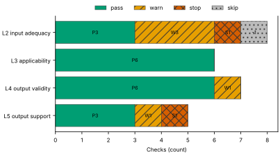
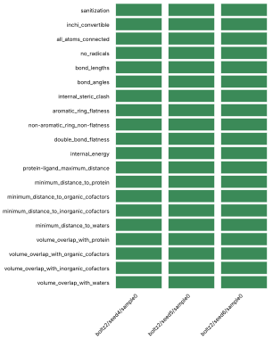
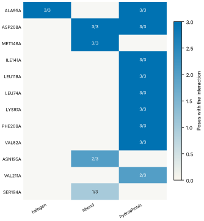
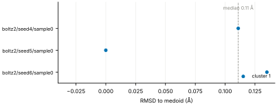
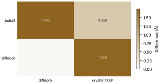
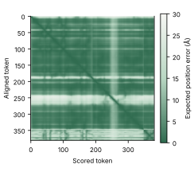

# Run report · Ligand pose in a known pocket

Prediction assurance · run `ligand_pose-bcbda68d529a` · 2026-10-17 18:22:23 UTC

**Refused** for the claim "Predicted pose of FZC in MEK1 is valid".

Refused over layers 2,3,4,5: 18 pass, 5 warn, 2 stop, 1 skip. Stopped by l2.context.cofactors, l5.controls.redocking. Warnings from l2.receptor.protonation, l2.ligand.protonation, l2.docking.box, l4.interactions.unsatisfied_polars, l5.sampling.seeds.

Stops: `l2.context.cofactors`, `l5.controls.redocking`.

Warnings: `l2.receptor.protonation`, `l2.ligand.protonation`, `l2.docking.box`, `l4.interactions.unsatisfied_polars`, `l5.sampling.seeds`.

| Field | Value |
| --- | --- |
| Task | Ligand pose in a known pocket (`ligand_pose`) |
| Tools | Boltz-2 2.2.1 (co-folding), DiffDock-L (docking) |
| Target | `protein` |
| Ligand | `Cc1ccnc(n1)Oc2ccc(c(c2)Cl)c3cc4c(c(n[nH]4)C)c(c3)O[C@H]5CCC[C@H](C5)N` |
| Reference | `7XLP` |
| pH | 7.4 |
| Seeds | 3 |
| Layers run | 2, 3, 4, 5 |
| Run | `ligand_pose-bcbda68d529a` |
| Created | 2026-10-17 18:22:23 UTC |
| Finished | 2026-10-17 18:23:46 UTC |
| pah version | 0.1.0 |
| Report schema | 1 |

## Layers

| Layer | Status | Result | pass | warn | stop | skip | Time |
| --- | --- | --- | --- | --- | --- | --- | --- |
| L0 Provenance | not run | n/a | n/a | n/a | n/a | n/a | n/a |
| L1 Input integrity | not run | n/a | n/a | n/a | n/a | n/a | n/a |
| L2 Input adequacy | done | stop | 3 | 3 | 1 | 1 | 2.3 s |
| L3 Applicability | done | pass | 6 | 0 | 0 | 0 | 508 ms |
| L4 Output validity | done | warn | 6 | 1 | 0 | 0 | 79.6 s |
| L5 Output support | done | stop | 3 | 1 | 1 | 0 | 184 ms |

## Figures

Fig. 1 · Check outcomes per layer for run ligand_pose-bcbda68d529a. Totals: pass 18, warn 5, stop 2, skip 1.
Files: data [figures/gates_by_layer.csv](figures/gates_by_layer.csv).

## Structures

78 PyMOL renders.

7XLP mmCIF (source_structure), whole structure. Chains A; organic components DMS, FZC. sha256 48ffbc34e5fd126d. PyMOL session: [renders/7XLP.pse](renders/7XLP.pse).

7XLP mmCIF (source_structure), ligand environment within 5 Å. Chains A; organic components DMS, FZC. sha256 48ffbc34e5fd126d. PyMOL session: [renders/7XLP.pse](renders/7XLP.pse).

boltz2/seed4/sample0 (prediction_structure), whole structure. Chains A, L; organic components LIG1. sha256 0ce020109a01f694. PyMOL session: [renders/boltz2_seed4_sample0.pse](renders/boltz2_seed4_sample0.pse).

boltz2/seed4/sample0 (prediction_structure), ligand environment within 5 Å. Chains A, L; organic components LIG1. sha256 0ce020109a01f694. PyMOL session: [renders/boltz2_seed4_sample0.pse](renders/boltz2_seed4_sample0.pse).

boltz2/seed5/sample0 (prediction_structure), whole structure. Chains A, L; organic components LIG1. sha256 488984b1722dcab4. PyMOL session: [renders/boltz2_seed5_sample0.pse](renders/boltz2_seed5_sample0.pse).

boltz2/seed5/sample0 (prediction_structure), ligand environment within 5 Å. Chains A, L; organic components LIG1. sha256 488984b1722dcab4. PyMOL session: [renders/boltz2_seed5_sample0.pse](renders/boltz2_seed5_sample0.pse).

boltz2/seed6/sample0 (prediction_structure), whole structure. Chains A, L; organic components LIG1. sha256 c26c4ca7f6a9a3d2. PyMOL session: [renders/boltz2_seed6_sample0.pse](renders/boltz2_seed6_sample0.pse).

boltz2/seed6/sample0 (prediction_structure), ligand environment within 5 Å. Chains A, L; organic components LIG1. sha256 c26c4ca7f6a9a3d2. PyMOL session: [renders/boltz2_seed6_sample0.pse](renders/boltz2_seed6_sample0.pse).

diffdock/seed4/mode0 (prediction_structure), whole structure. Chains A, L; organic components LIG. sha256 cbb678097b220db7. PyMOL session: [renders/diffdock_seed4_mode0.pse](renders/diffdock_seed4_mode0.pse).

diffdock/seed4/mode0 (prediction_structure), ligand environment within 5 Å. Chains A, L; organic components LIG. sha256 cbb678097b220db7. PyMOL session: [renders/diffdock_seed4_mode0.pse](renders/diffdock_seed4_mode0.pse).

diffdock/seed4/mode1 (prediction_structure), whole structure. Chains A, L; organic components LIG. sha256 929ae142e991913d. PyMOL session: [renders/diffdock_seed4_mode1.pse](renders/diffdock_seed4_mode1.pse).

diffdock/seed4/mode1 (prediction_structure), ligand environment within 5 Å. Chains A, L; organic components LIG. sha256 929ae142e991913d. PyMOL session: [renders/diffdock_seed4_mode1.pse](renders/diffdock_seed4_mode1.pse).

diffdock/seed4/mode2 (prediction_structure), whole structure. Chains A, L; organic components LIG. sha256 046706c0b16ba120. PyMOL session: [renders/diffdock_seed4_mode2.pse](renders/diffdock_seed4_mode2.pse).

diffdock/seed4/mode2 (prediction_structure), ligand environment within 5 Å. Chains A, L; organic components LIG. sha256 046706c0b16ba120. PyMOL session: [renders/diffdock_seed4_mode2.pse](renders/diffdock_seed4_mode2.pse).

diffdock/seed4/mode3 (prediction_structure), whole structure. Chains A, L; organic components LIG. sha256 11d6f04f9b87d139. PyMOL session: [renders/diffdock_seed4_mode3.pse](renders/diffdock_seed4_mode3.pse).

diffdock/seed4/mode3 (prediction_structure), ligand environment within 5 Å. Chains A, L; organic components LIG. sha256 11d6f04f9b87d139. PyMOL session: [renders/diffdock_seed4_mode3.pse](renders/diffdock_seed4_mode3.pse).

diffdock/seed4/mode4 (prediction_structure), whole structure. Chains A, L; organic components LIG. sha256 54ce901c8e093bcc. PyMOL session: [renders/diffdock_seed4_mode4.pse](renders/diffdock_seed4_mode4.pse).

diffdock/seed4/mode4 (prediction_structure), ligand environment within 5 Å. Chains A, L; organic components LIG. sha256 54ce901c8e093bcc. PyMOL session: [renders/diffdock_seed4_mode4.pse](renders/diffdock_seed4_mode4.pse).

diffdock/seed4/mode5 (prediction_structure), whole structure. Chains A, L; organic components LIG. sha256 bd368399cca14e85. PyMOL session: [renders/diffdock_seed4_mode5.pse](renders/diffdock_seed4_mode5.pse).

diffdock/seed4/mode5 (prediction_structure), ligand environment within 5 Å. Chains A, L; organic components LIG. sha256 bd368399cca14e85. PyMOL session: [renders/diffdock_seed4_mode5.pse](renders/diffdock_seed4_mode5.pse).

diffdock/seed4/mode6 (prediction_structure), whole structure. Chains A, L; organic components LIG. sha256 b2969ddc86c17451. PyMOL session: [renders/diffdock_seed4_mode6.pse](renders/diffdock_seed4_mode6.pse).

diffdock/seed4/mode6 (prediction_structure), ligand environment within 5 Å. Chains A, L; organic components LIG. sha256 b2969ddc86c17451. PyMOL session: [renders/diffdock_seed4_mode6.pse](renders/diffdock_seed4_mode6.pse).

diffdock/seed4/mode7 (prediction_structure), whole structure. Chains A, L; organic components LIG. sha256 922c5366d9b8c95a. PyMOL session: [renders/diffdock_seed4_mode7.pse](renders/diffdock_seed4_mode7.pse).

diffdock/seed4/mode7 (prediction_structure), ligand environment within 5 Å. Chains A, L; organic components LIG. sha256 922c5366d9b8c95a. PyMOL session: [renders/diffdock_seed4_mode7.pse](renders/diffdock_seed4_mode7.pse).

diffdock/seed4/mode8 (prediction_structure), whole structure. Chains A, L; organic components LIG. sha256 35fd5afe1b49c32f. PyMOL session: [renders/diffdock_seed4_mode8.pse](renders/diffdock_seed4_mode8.pse).

diffdock/seed4/mode8 (prediction_structure), ligand environment within 5 Å. Chains A, L; organic components LIG. sha256 35fd5afe1b49c32f. PyMOL session: [renders/diffdock_seed4_mode8.pse](renders/diffdock_seed4_mode8.pse).

diffdock/seed4/mode9 (prediction_structure), whole structure. Chains A, L; organic components LIG. sha256 0fdd18840bebe9c6. PyMOL session: [renders/diffdock_seed4_mode9.pse](renders/diffdock_seed4_mode9.pse).

diffdock/seed4/mode9 (prediction_structure), ligand environment within 5 Å. Chains A, L; organic components LIG. sha256 0fdd18840bebe9c6. PyMOL session: [renders/diffdock_seed4_mode9.pse](renders/diffdock_seed4_mode9.pse).

diffdock/seed5/mode0 (prediction_structure), whole structure. Chains A, L; organic components LIG. sha256 442f4f91a6eba931. PyMOL session: [renders/diffdock_seed5_mode0.pse](renders/diffdock_seed5_mode0.pse).

diffdock/seed5/mode0 (prediction_structure), ligand environment within 5 Å. Chains A, L; organic components LIG. sha256 442f4f91a6eba931. PyMOL session: [renders/diffdock_seed5_mode0.pse](renders/diffdock_seed5_mode0.pse).

diffdock/seed5/mode1 (prediction_structure), whole structure. Chains A, L; organic components LIG. sha256 3447210ae8d65cde. PyMOL session: [renders/diffdock_seed5_mode1.pse](renders/diffdock_seed5_mode1.pse).

diffdock/seed5/mode1 (prediction_structure), ligand environment within 5 Å. Chains A, L; organic components LIG. sha256 3447210ae8d65cde. PyMOL session: [renders/diffdock_seed5_mode1.pse](renders/diffdock_seed5_mode1.pse).

diffdock/seed5/mode2 (prediction_structure), whole structure. Chains A, L; organic components LIG. sha256 231201c7b5780aca. PyMOL session: [renders/diffdock_seed5_mode2.pse](renders/diffdock_seed5_mode2.pse).

diffdock/seed5/mode2 (prediction_structure), ligand environment within 5 Å. Chains A, L; organic components LIG. sha256 231201c7b5780aca. PyMOL session: [renders/diffdock_seed5_mode2.pse](renders/diffdock_seed5_mode2.pse).

diffdock/seed5/mode3 (prediction_structure), whole structure. Chains A, L; organic components LIG. sha256 b8a0b5e93fad99ba. PyMOL session: [renders/diffdock_seed5_mode3.pse](renders/diffdock_seed5_mode3.pse).

diffdock/seed5/mode3 (prediction_structure), ligand environment within 5 Å. Chains A, L; organic components LIG. sha256 b8a0b5e93fad99ba. PyMOL session: [renders/diffdock_seed5_mode3.pse](renders/diffdock_seed5_mode3.pse).

diffdock/seed5/mode4 (prediction_structure), whole structure. Chains A, L; organic components LIG. sha256 4728340b5af4fff9. PyMOL session: [renders/diffdock_seed5_mode4.pse](renders/diffdock_seed5_mode4.pse).

diffdock/seed5/mode4 (prediction_structure), ligand environment within 5 Å. Chains A, L; organic components LIG. sha256 4728340b5af4fff9. PyMOL session: [renders/diffdock_seed5_mode4.pse](renders/diffdock_seed5_mode4.pse).

diffdock/seed5/mode5 (prediction_structure), whole structure. Chains A, L; organic components LIG. sha256 c19e73060b3433c9. PyMOL session: [renders/diffdock_seed5_mode5.pse](renders/diffdock_seed5_mode5.pse).

diffdock/seed5/mode5 (prediction_structure), ligand environment within 5 Å. Chains A, L; organic components LIG. sha256 c19e73060b3433c9. PyMOL session: [renders/diffdock_seed5_mode5.pse](renders/diffdock_seed5_mode5.pse).

diffdock/seed5/mode6 (prediction_structure), whole structure. Chains A, L; organic components LIG. sha256 6bf95124e12c6b2a. PyMOL session: [renders/diffdock_seed5_mode6.pse](renders/diffdock_seed5_mode6.pse).

diffdock/seed5/mode6 (prediction_structure), ligand environment within 5 Å. Chains A, L; organic components LIG. sha256 6bf95124e12c6b2a. PyMOL session: [renders/diffdock_seed5_mode6.pse](renders/diffdock_seed5_mode6.pse).

diffdock/seed5/mode7 (prediction_structure), whole structure. Chains A, L; organic components LIG. sha256 16e7f84ecee5f47f. PyMOL session: [renders/diffdock_seed5_mode7.pse](renders/diffdock_seed5_mode7.pse).

diffdock/seed5/mode7 (prediction_structure), ligand environment within 5 Å. Chains A, L; organic components LIG. sha256 16e7f84ecee5f47f. PyMOL session: [renders/diffdock_seed5_mode7.pse](renders/diffdock_seed5_mode7.pse).

diffdock/seed5/mode8 (prediction_structure), whole structure. Chains A, L; organic components LIG. sha256 35bbe66f96aadf3c. PyMOL session: [renders/diffdock_seed5_mode8.pse](renders/diffdock_seed5_mode8.pse).

diffdock/seed5/mode8 (prediction_structure), ligand environment within 5 Å. Chains A, L; organic components LIG. sha256 35bbe66f96aadf3c. PyMOL session: [renders/diffdock_seed5_mode8.pse](renders/diffdock_seed5_mode8.pse).

diffdock/seed5/mode9 (prediction_structure), whole structure. Chains A, L; organic components LIG. sha256 0350f92596ff9653. PyMOL session: [renders/diffdock_seed5_mode9.pse](renders/diffdock_seed5_mode9.pse).

diffdock/seed5/mode9 (prediction_structure), ligand environment within 5 Å. Chains A, L; organic components LIG. sha256 0350f92596ff9653. PyMOL session: [renders/diffdock_seed5_mode9.pse](renders/diffdock_seed5_mode9.pse).

diffdock/seed6/mode0 (prediction_structure), whole structure. Chains A, L; organic components LIG. sha256 dd41ad9410b0cea1. PyMOL session: [renders/diffdock_seed6_mode0.pse](renders/diffdock_seed6_mode0.pse).

diffdock/seed6/mode0 (prediction_structure), ligand environment within 5 Å. Chains A, L; organic components LIG. sha256 dd41ad9410b0cea1. PyMOL session: [renders/diffdock_seed6_mode0.pse](renders/diffdock_seed6_mode0.pse).

diffdock/seed6/mode1 (prediction_structure), whole structure. Chains A, L; organic components LIG. sha256 5b67d0f98910a968. PyMOL session: [renders/diffdock_seed6_mode1.pse](renders/diffdock_seed6_mode1.pse).

diffdock/seed6/mode1 (prediction_structure), ligand environment within 5 Å. Chains A, L; organic components LIG. sha256 5b67d0f98910a968. PyMOL session: [renders/diffdock_seed6_mode1.pse](renders/diffdock_seed6_mode1.pse).

diffdock/seed6/mode2 (prediction_structure), whole structure. Chains A, L; organic components LIG. sha256 92b32abeffcc9fc4. PyMOL session: [renders/diffdock_seed6_mode2.pse](renders/diffdock_seed6_mode2.pse).

diffdock/seed6/mode2 (prediction_structure), ligand environment within 5 Å. Chains A, L; organic components LIG. sha256 92b32abeffcc9fc4. PyMOL session: [renders/diffdock_seed6_mode2.pse](renders/diffdock_seed6_mode2.pse).

diffdock/seed6/mode3 (prediction_structure), whole structure. Chains A, L; organic components LIG. sha256 4b47fc5894d022af. PyMOL session: [renders/diffdock_seed6_mode3.pse](renders/diffdock_seed6_mode3.pse).

diffdock/seed6/mode3 (prediction_structure), ligand environment within 5 Å. Chains A, L; organic components LIG. sha256 4b47fc5894d022af. PyMOL session: [renders/diffdock_seed6_mode3.pse](renders/diffdock_seed6_mode3.pse).

diffdock/seed6/mode4 (prediction_structure), whole structure. Chains A, L; organic components LIG. sha256 cc033274a213daab. PyMOL session: [renders/diffdock_seed6_mode4.pse](renders/diffdock_seed6_mode4.pse).

diffdock/seed6/mode4 (prediction_structure), ligand environment within 5 Å. Chains A, L; organic components LIG. sha256 cc033274a213daab. PyMOL session: [renders/diffdock_seed6_mode4.pse](renders/diffdock_seed6_mode4.pse).

diffdock/seed6/mode5 (prediction_structure), whole structure. Chains A, L; organic components LIG. sha256 70324b6d55569ef6. PyMOL session: [renders/diffdock_seed6_mode5.pse](renders/diffdock_seed6_mode5.pse).

diffdock/seed6/mode5 (prediction_structure), ligand environment within 5 Å. Chains A, L; organic components LIG. sha256 70324b6d55569ef6. PyMOL session: [renders/diffdock_seed6_mode5.pse](renders/diffdock_seed6_mode5.pse).

diffdock/seed6/mode6 (prediction_structure), whole structure. Chains A, L; organic components LIG. sha256 612e19386cb2aa60. PyMOL session: [renders/diffdock_seed6_mode6.pse](renders/diffdock_seed6_mode6.pse).

diffdock/seed6/mode6 (prediction_structure), ligand environment within 5 Å. Chains A, L; organic components LIG. sha256 612e19386cb2aa60. PyMOL session: [renders/diffdock_seed6_mode6.pse](renders/diffdock_seed6_mode6.pse).

diffdock/seed6/mode7 (prediction_structure), whole structure. Chains A, L; organic components LIG. sha256 cbaa39a1b4344772. PyMOL session: [renders/diffdock_seed6_mode7.pse](renders/diffdock_seed6_mode7.pse).

diffdock/seed6/mode7 (prediction_structure), ligand environment within 5 Å. Chains A, L; organic components LIG. sha256 cbaa39a1b4344772. PyMOL session: [renders/diffdock_seed6_mode7.pse](renders/diffdock_seed6_mode7.pse).

diffdock/seed6/mode8 (prediction_structure), whole structure. Chains A, L; organic components LIG. sha256 6895315a56037ac6. PyMOL session: [renders/diffdock_seed6_mode8.pse](renders/diffdock_seed6_mode8.pse).

diffdock/seed6/mode8 (prediction_structure), ligand environment within 5 Å. Chains A, L; organic components LIG. sha256 6895315a56037ac6. PyMOL session: [renders/diffdock_seed6_mode8.pse](renders/diffdock_seed6_mode8.pse).

diffdock/seed6/mode9 (prediction_structure), whole structure. Chains A, L; organic components LIG. sha256 fab7f3b1e5000d27. PyMOL session: [renders/diffdock_seed6_mode9.pse](renders/diffdock_seed6_mode9.pse).

diffdock/seed6/mode9 (prediction_structure), ligand environment within 5 Å. Chains A, L; organic components LIG. sha256 fab7f3b1e5000d27. PyMOL session: [renders/diffdock_seed6_mode9.pse](renders/diffdock_seed6_mode9.pse).

3ZLS mmCIF (source_structure), whole structure. Chains A; organic components 92P. sha256 ae30cf1ed7b4035f. PyMOL session: [renders/3ZLS.pse](renders/3ZLS.pse).

3ZLS mmCIF (source_structure), ligand environment within 5 Å. Chains A; organic components 92P. sha256 ae30cf1ed7b4035f. PyMOL session: [renders/3ZLS.pse](renders/3ZLS.pse).

3ZLX mmCIF (source_structure), whole structure. Chains A; organic components 5EZ. sha256 1334dfc31103f3e6. PyMOL session: [renders/3ZLX.pse](renders/3ZLX.pse).

3ZLX mmCIF (source_structure), ligand environment within 5 Å. Chains A; organic components 5EZ. sha256 1334dfc31103f3e6. PyMOL session: [renders/3ZLX.pse](renders/3ZLX.pse).

3ZM4 mmCIF (source_structure), whole structure. Chains A; organic components 22T. sha256 eccb79a35cb7a9f2. PyMOL session: [renders/3ZM4.pse](renders/3ZM4.pse).

3ZM4 mmCIF (source_structure), ligand environment within 5 Å. Chains A; organic components 22T. sha256 eccb79a35cb7a9f2. PyMOL session: [renders/3ZM4.pse](renders/3ZM4.pse).

5BX0 mmCIF (source_structure), whole structure. Chains A; organic components 4W5. sha256 7ef25dd3b72e153e. PyMOL session: [renders/5BX0.pse](renders/5BX0.pse).

5BX0 mmCIF (source_structure), ligand environment within 5 Å. Chains A; organic components 4W5. sha256 7ef25dd3b72e153e. PyMOL session: [renders/5BX0.pse](renders/5BX0.pse).

3ZLY mmCIF (source_structure), whole structure. Chains A; organic components YSO. sha256 e858c796adc5339d. PyMOL session: [renders/3ZLY.pse](renders/3ZLY.pse).

3ZLY mmCIF (source_structure), ligand environment within 5 Å. Chains A; organic components YSO. sha256 e858c796adc5339d. PyMOL session: [renders/3ZLY.pse](renders/3ZLY.pse).

## L0 Provenance

Where did every input come from?

Status: not run.

## L1 Input integrity

Did the run receive exactly what was declared?

Status: not run.

## L2 Input adequacy

Does the input carry enough information?

Status: done. Checks: pass 3 · warn 3 · stop 1 · skip 1. Time: 2.3 s.

#### Key figures

| Figure | Value |
| --- | --- |
| near site | 1 |
| missing | 1 |
| uniprot cofactors | 0 |
| pocket residues | 37 |
| incomplete | 0 |
| sequence gaps | 0 |
| state | holo |
| site ligands | 1 |

#### Docking

| Field | Value |
| --- | --- |
| center | -3.608, 64.879, 34.516 Å |
| size | 19.183 × 21.381 × 13.89 Å |
| origin | derived from FZC (+4 Å) |

#### Checks

| Check | Result | Measured cmp threshold | Evidence | Id · time |
| --- | --- | --- | --- | --- |
| Alignment depth, distinct sequences, Neff and gap fraction | skip | n/a | no MSA declared for a co-folding model · not applicable | `l2.msa.depth` |
| Required cofactors, ions and partners present | stop | `pocket_distance <= 8` | components within 8.0 Å of FZC in 7XLP not supplied: CA · near_site=1, missing=1, uniprot_cofactors=0 | `l2.context.cofactors` · 265 ms |
| Pocket residues resolved, no missing loops lining the pocket | pass | `pocket_distance <= 6` | 37 pocket residues complete in 7XLP.cif · pocket_residues=37, incomplete=0, sequence_gaps=0 | `l2.pocket.resolved` · 15 ms |
| Receptor state apo or holo | pass | n/a | 7XLP.cif holo: FZC in the site · state=holo, site_ligands=1 | `l2.receptor.state` · 17 ms |
| Receptor protonation at the stated pH | warn | `pka_margin > 1` | receptor has no hydrogens (protonation not assigned) · hydrogens_present=False, ph=7.4, pocket_titratable=15 | `l2.receptor.protonation` · 351 ms |
| Ligand protonation and tautomers enumerated at the stated pH | warn | `ph 7.4 == 1` | ligand: 16 states · ph=7.4, max_states=16, declared_not_enumerated=0 | `l2.ligand.protonation` · 123 ms |
| Ligand conformers generated and minimised | pass | `conformers >= 10` | 10 ETKDG conformers per ligand, MMFF minimised · ligands=1, failed=0, min_embedded=10 | `l2.ligand.conformers` · 1.5 s |
| Docking box encloses the pocket with margin | warn | `margin >= 2` | no box declared; derived box encloses 19 contact residues and the FZC ligand with 2.0 Å margin · volume_A3=5697, ligand_atoms_inside_margin=33, ligand_atoms=33 | `l2.docking.box` · 15 ms |

## L3 Applicability

Is the tool inside its validated regime?

Status: done. Checks: pass 6 · warn 0 · stop 0 · skip 0. Time: 508 ms.

#### Key figures

| Figure | Value |
| --- | --- |
| executors | 2 |
| unknown | 0 |
| reference released | 2023-03-01 |
| cutoff | 2019-01-01 |
| entries compared | 5 |
| max similarity | 37.6 |
| pocket residues | 38 |
| systems | 0 |

#### Checks

| Check | Result | Measured cmp threshold | Evidence | Id · time |
| --- | --- | --- | --- | --- |
| Model training cutoff recorded | pass | `training_cutoff == recorded` | boltz2 2023-06-01; diffdock 2019-01-01; reference 7XLP released 2023-03-01, before the cutoff of boltz2 · executors=2, unknown=0, reference_released=2023-03-01 | `l3.model.training_cutoff` · 1 ms |
| Pocket similarity to pre-cutoff complexes (SuCOS times pocket coverage) | pass | `similarity <= 50` | max similarity 37.6 to 3ZM4 (22T, SuCOS 0.595, coverage 0.632), released before 2019-01-01 · cutoff=2019-01-01, entries_compared=5, max_similarity=37.6 | `l3.exposure.pocket` · 495 ms |
| Ligand analogues in pre-cutoff training systems | pass | `tanimoto > 0.9` | 0 PDB entries released before 2019-01-01 (diffdock cutoff) contain analogues of ligand above Tanimoto 0.9: FZC · cutoff=2019-01-01, systems=0, analogue_components=1 | `l3.exposure.ligand_prevalence` · 0 ms |
| Chain sequence identity to pre-cutoff entries (secondary measure) | pass | `identity < 0.4` | protein: 35 entries at 95 percent identity, 46 at 40 percent, released before 2019-01-01 (reported, not gating) · cutoff=2019-01-01, entries_95=35, entries_40=46 | `l3.exposure.sequence` · 1 ms |
| Modality inside the validated set; token count against the training crop | pass | n/a | modalities protein, protein_ligand inside the validated set; 381 tokens · modalities=2, tokens=381, outside=0 | `l3.regime.modality` · 8 ms |
| Endpoint fits the tool | pass | `endpoint pose in pose` | endpoint pose produced by boltz2, diffdock · endpoint=pose, executors=2, not_fitting=0 | `l3.metric.endpoint` · 0 ms |

## L4 Output validity

Is the result physically and chemically sensible?

Status: done. Checks: pass 6 · warn 1 · stop 0 · skip 0. Time: 79.6 s.

#### Key figures

| Figure | Value |
| --- | --- |
| poses | 3 |
| passed | 20 |
| total | 20 |
| poses all pass | 3 |
| unlikely torsions | 0 |
| torsions | 7 |
| strain kcal | 1.49 |
| poses with unlikely | 0 |

#### PoseBusters · 20/20 tests pass

| test | result | value |
| --- | --- | --- |
| sanitization | pass | pass |
| inchi_convertible | pass | pass |
| all_atoms_connected | pass | pass |
| no_radicals | pass | pass |
| bond_lengths | pass | 0 long outliers |
| bond_angles | pass | 0 outliers |
| internal_steric_clash | pass | 0 |
| aromatic_ring_flatness | pass | 0.01 Å |
| non-aromatic_ring_non-flatness | pass | pass |
| double_bond_flatness | pass | pass |
| internal_energy | pass | 1.1 times the ensemble mean |
| protein-ligand_maximum_distance | pass | 2.53 Å |
| minimum_distance_to_protein | pass | 2.53 Å |
| minimum_distance_to_organic_cofactors | pass | pass |
| minimum_distance_to_inorganic_cofactors | pass | pass |
| minimum_distance_to_waters | pass | pass |
| volume_overlap_with_protein | pass | 0.008 |
| volume_overlap_with_organic_cofactors | pass | pass |
| volume_overlap_with_inorganic_cofactors | pass | pass |
| volume_overlap_with_waters | pass | pass |

#### Per-pose physical checks

| pose | seed | drift Å | converged | unlikely torsions | unsat. polars | buried charged | PoseBusters |
| --- | --- | --- | --- | --- | --- | --- | --- |
| boltz2/seed4/sample0 | 4 | 0.19 | true | 0/7 | 4 | 0 | 20/20 |
| boltz2/seed5/sample0 | 5 | 0.2 | true | 0/7 | 4 | 0 | 20/20 |
| boltz2/seed6/sample0 | 6 | 0.24 | true | 0/7 | 4 | 0 | 20/20 |
| median | n/a | 0.2 | n/a | 0 | 4 | 0 | 20/20 |

#### Interaction fingerprint · representative pose boltz2/seed5/sample0

| residue | type | distance | poses |
| --- | --- | --- | --- |
| ALA95A | halogen | 3.26 Å | 3/3 |
| ASP208A | hbond | 3.57 Å | 3/3 |
| MET146A | hbond | 2.95 Å | 3/3 |
| ALA95A | hydrophobic | 3.71 Å | 3/3 |
| ASP208A | hydrophobic | 3.85 Å | 3/3 |
| ILE141A | hydrophobic | 3.85 Å | 3/3 |
| LEU118A | hydrophobic | 3.89 Å | 3/3 |
| LEU74A | hydrophobic | 3.91 Å | 3/3 |
| LYS97A | hydrophobic | 3.46 Å | 3/3 |
| PHE209A | hydrophobic | 3.53 Å | 3/3 |
| VAL82A | hydrophobic | 3.76 Å | 3/3 |
| ASN195A | hbond | 3.39 Å | 2/3 |
| VAL211A | hydrophobic | 3.95 Å | 2/3 |
| SER194A | hbond | 2.51 Å | 1/3 |

Fig. 2 · PoseBusters tests (20) by pose (3). Failed cells marked x: 0 of 60.
Files: data [figures/posebusters_grid.csv](figures/posebusters_grid.csv).

Fig. 3 · Interactions by residue (12) and type (3); cell label: poses with the interaction over poses assessed.
Files: data [figures/interactions.csv](figures/interactions.csv).

#### Checks

| Check | Result | Measured cmp threshold | Evidence | Id · time |
| --- | --- | --- | --- | --- |
| PoseBusters geometry, stereochemistry, clashes and protein contact | pass | `tests_failed == 0` | 20 of 20 tests pass for boltz2/seed5/sample0; 3 of 3 poses pass all · poses=3, passed=20, total=20 | `l4.posebusters` · 3.6 s |
| Torsional strain of the ligand pose | pass | `torsion_energy <= 2.5` | 0 of 7 torsions above 2.5 kcal/mol in boltz2/seed5/sample0; strain 1.49 kcal/mol · poses=3, unlikely_torsions=0, torsions=7 | `l4.torsion_strain` · 7.4 s |
| Interaction fingerprint (PLIP) | pass | n/a | 15 interactions in boltz2/seed5/sample0 (halogen, hbond, hydrophobic); 14 distinct across 3 poses (reported) · poses=3, interactions_representative=15, distinct=14 | `l4.interactions.fingerprint` · 1.3 s |
| Buried ligand polar atoms without a hydrogen-bond partner | warn | `relative_sasa < 0.1` | 4 of 7 buried polar ligand atoms without a partner in boltz2/seed5/sample0 · poses=3, unsatisfied=4, buried_charged=0 | `l4.interactions.unsatisfied_polars` · 331 ms |
| Hydrophobic complementarity of buried ligand surface | pass | `fraction >= 0.35` | nonpolar fraction of protein contacts around 22 buried nonpolar ligand atoms in boltz2/seed5/sample0: 0.769 · poses=3, complementarity=0.769, buried_nonpolar=22 | `l4.interactions.hydrophobic` · 313 ms |
| Interactions of the crystal ligand reproduced by the pose | pass | `reproduced 2 >= 1` | boltz2/seed5/sample0 reproduces 2 of 3 FZC interactions: halogen ALA95A, hbond MET146A · key_interactions=3, reproduced=2, poses_reproducing_all=1 | `l4.interactions.known_binders` · 273 ms |
| Pose stability under short restrained minimisation (OpenMM, AMBER14 and OpenFF) | pass | `drift_A 0.2 <= 2` | boltz2/seed5/sample0 moves 0.203 Å under restrained minimisation; 0 of 3 poses above 2.0 Å · poses=3, drift_A=0.203, max_drift_A=0.245 | `l4.minimisation_drift` · 66.5 s |

## L5 Output support

Is a valid result corroborated?

Status: done. Checks: pass 3 · warn 1 · stop 1 · skip 0. Time: 184 ms.

#### Key figures

| Figure | Value |
| --- | --- |
| poses | 3 |
| pocket plddt | 96.4 |
| global plddt | 92.2 |
| iptm | 0.989 |
| ptm | 0.944 |
| confidence score | 0.938 |
| independent seeds | 3 |
| samples | 3 |

#### Sampling

| Field | Value |
| --- | --- |
| site placement | 3 of 3 poses within 4.0 Å of the site (FZC in 7XLP) |
| pose accuracy | 3 of 3 poses within 2.0 Å of the medoid |
| pairwise RMSD median | 0.14 Å |
| pairwise RMSD IQR | 0.12 to 0.16 Å |
| pairs | 3 |
| medoid | boltz2/seed5/sample0 |

#### Clusters

| Field | Value |
| --- | --- |
| cluster 1 | 3/3 poses (boltz2/seed5/sample0) |

#### Per-seed statistics

| seed | pose | cluster | RMSD to medoid | confidence |
| --- | --- | --- | --- | --- |
| 4 | boltz2/seed4/sample0 | 1 | 0.11 Å | 0.94 |
| 5 | boltz2/seed5/sample0 | 1 | 0 Å | 0.94 |
| 6 | boltz2/seed6/sample0 | 1 | 0.14 Å | 0.94 |
| median | n/a | n/a | 0.11 Å | 0.94 |

#### Ensemble

| structure | kind | source | RMSD to medoid | cluster | pocket pLDDT | ipTM |
| --- | --- | --- | --- | --- | --- | --- |
| boltz2/seed4/sample0 | seed | boltz2 | 0.11 Å | 1 | 96.5 | 0.99 |
| boltz2/seed5/sample0 | medoid | boltz2 | 0 Å | 1 | 96.4 | 0.99 |
| boltz2/seed6/sample0 | seed | boltz2 | 0.14 Å | 1 | 96.4 | 0.99 |

#### Agreement between methods

| method | diffdock | crystal 7XLP |
| --- | --- | --- |
| boltz2 | 1.74 Å (high) | 0.56 Å (decisive) |
| diffdock | n/a | 1.72 Å (decisive) |

#### Confidence metrics

| metric | value | read as | tool |
| --- | --- | --- | --- |
| affinity_pred_value | -2.227076530456543 | ranking within a series, never pose quality | boltz2 |
| affinity_probability_binary | 0.8685023784637451 | ranking within a series, never pose quality | boltz2 |
| affinity_pred_value | -2.3167295455932617 | ranking within a series, never pose quality | boltz2 |
| affinity_probability_binary | 0.8758020401000977 | ranking within a series, never pose quality | boltz2 |
| affinity_pred_value | -2.217571496963501 | ranking within a series, never pose quality | boltz2 |
| affinity_probability_binary | 0.8696610331535339 | ranking within a series, never pose quality | boltz2 |

Fig. 4 · RMSD to the medoid for 3 poses, coloured by cluster (1 clusters). Dashed line: median 0.11 Å; range 0.00 to 0.14 Å.
Files: data [figures/seed_spread.csv](figures/seed_spread.csv).

Fig. 5 · Agreement between 2 methods and 2 comparators; range 0.558 to 1.743 Å.
Files: data [figures/agreement.csv](figures/agreement.csv).

Fig. 6 · Predicted aligned error for pose boltz2/seed4/sample0, 381 by 381 tokens; values 0.2 to 28.7 Å, mean 5.6 Å.
Files: data [figures/pae.csv](figures/pae.csv).

#### Checks

| Check | Result | Measured cmp threshold | Evidence | Id · time |
| --- | --- | --- | --- | --- |
| Confidence restricted to the pocket; per-model thresholds | pass | `boltz2.pocket_plddt >= 70` | boltz2/seed5/sample0: pocket_plddt 96.4 · poses=3, pocket_plddt=96.4, global_plddt=92.2 | `l5.confidence.local` · 22 ms |
| Independent seeds counted separately from samples; duplicates flagged | warn | `seeds_cofolding >= 5` | 3 independent seeds (3 poses); task default 5 · independent_seeds=3, samples=3, duplicated_outputs=0 | `l5.sampling.seeds` · 0 ms |
| Medoid of the largest cluster, populations, pairwise spread, site and pose accuracy | pass | `cluster_rmsd <= 2` | medoid boltz2/seed5/sample0; 1 clusters, largest 3 of 3; pairwise RMSD median 0.14 Å (IQR 0.12 to 0.16); 3 of 3 poses within 4.0 Å of the site (FZC in 7XLP); 3 of 3 poses within 2.0 Å of the medoid · poses=3, clusters=1, largest_cluster=3 | `l5.sampling.clusters` · 39 ms |
| Agreement between methods, weighted by independence | pass | `rmsd_to_crystal_A 0.56 <= 2` | boltz2 vs diffdock 1.743 Å (high); boltz2 vs crystal 7XLP 0.558 Å (decisive); diffdock vs crystal 7XLP 1.722 Å (decisive) · methods=2, comparisons=3, disagreeing=0 | `l5.agreement.cross_family` · 121 ms |
| Redocking control reproduces the crystal pose | stop | `rmsd <= 2` | redocking control required by the task and not supplied (controls.redocking) | `l5.controls.redocking` · 0 ms |

## Controls

| control | status | result |
| --- | --- | --- |
| redocking | incomplete | redocking control required by the task and not supplied (controls.redocking) |

## Provenance

13 objects · 13 cached · 0 network.

| Source | Accession | Release | SHA-256 | Retrieved | Bytes | Cache | Used by |
| --- | --- | --- | --- | --- | --- | --- | --- |
| rcsb_files | 7XLP | n/a | `48ffbc34e5fd` | 2026-10-17 17:04:21 UTC | 527387 | hit | l2.context.cofactors, l2.pocket.resolved, l2.receptor.state, l2.docking.box, l3.exposure.pocket, l3.regime.modality, l4.interactions.fingerprint, l4.interactions.known_binders, l5.sampling.clusters, l5.agreement.cross_family |
| ccd | FZC | 2023-02-24 | `6ce219c20fef` | 2026-10-17 17:04:21 UTC | 3599 | hit | l2.context.cofactors, l3.exposure.pocket |
| rcsb | 7XLP | 1.2 | `66dacec771f9` | 2026-10-17 17:04:23 UTC | 12056 | hit | l3.model.training_cutoff |
| rcsb_search | chem:Cc1ccnc(n1)Oc2ccc(c(c2)Cl)c3cc4c(c(n[nH]4)C)c(c3)O[C@H]5CCC[C@H](C5)N | n/a | `b46bdf444038` | 2026-10-17 17:04:25 UTC | 186 | hit | l3.exposure.pocket |
| rcsb_search | comp:FZC:2019-01-01 | n/a | `e3b0c44298fc` | 2026-10-17 17:04:24 UTC | 0 | hit | l3.exposure.pocket |
| rcsb_search | seq0.9:2019-01-01:348 | n/a | `e51f7972830a` | 2026-10-17 17:10:16 UTC | 2568 | hit | l3.exposure.pocket |
| rcsb_files | 3ZLS | n/a | `ae30cf1ed7b4` | 2026-10-17 17:10:16 UTC | 315218 | hit | l3.exposure.pocket |
| rcsb_files | 3ZLX | n/a | `1334dfc31103` | 2026-10-17 17:10:17 UTC | 313366 | hit | l3.exposure.pocket |
| rcsb_files | 3ZM4 | n/a | `eccb79a35cb7` | 2026-10-17 17:10:17 UTC | 321513 | hit | l3.exposure.pocket |
| rcsb_files | 5BX0 | n/a | `7ef25dd3b72e` | 2026-10-17 17:10:17 UTC | 312068 | hit | l3.exposure.pocket |
| rcsb_files | 3ZLY | n/a | `e858c796adc5` | 2026-10-17 17:10:17 UTC | 310846 | hit | l3.exposure.pocket |
| rcsb_search | seq0.95:2019-01-01:348 | n/a | `1d2d688f2f0a` | 2026-10-17 17:04:34 UTC | 402 | hit | l3.exposure.sequence |
| rcsb_search | seq0.4:2019-01-01:348 | n/a | `baa9d256b8ae` | 2026-10-17 17:04:35 UTC | 393 | hit | l3.exposure.sequence |

Provenance graph: [json](graph.json), [mmd](graph.mmd), [svg](graph.svg).

## Thresholds

| Check | Threshold | Value | Origin | Evidence level |
| --- | --- | --- | --- | --- |
| `l2.context.cofactors` | pocket_distance | <= 8 | Harness rule: a component of the reference entry within 8 Å of the declared ligand is required context; not yet calibrated | uncalibrated |
| `l2.pocket.resolved` | pocket_distance | <= 6 | Harness rule: pocket residues have a heavy atom within 6 Å of the ligand; not yet calibrated | uncalibrated |
| `l2.pocket.resolved` | missing_pocket_residues | == 0 | Specification layer 2: stop when the pocket is incomplete | published |
| `l2.receptor.protonation` | pka_margin | > 1 | Harness rule: a titratable pocket residue with PROPKA pKa within 1 unit of the stated pH has an ambiguous state; not yet calibrated | uncalibrated |
| `l2.ligand.protonation` | ph_window | == 1 | Harness rule: states enumerated by Dimorphite-DL within 1 pH unit of the stated pH; not yet calibrated | uncalibrated |
| `l2.ligand.protonation` | states | == 1 | Specification layer 2: warn when more than one plausible state | published |
| `l2.ligand.conformers` | conformers | >= 10 | Harness default number of ETKDG conformers; not yet calibrated | uncalibrated |
| `l2.docking.box` | margin | >= 2 | Harness rule: every pocket heavy atom lies at least 2 Å inside the box; not yet calibrated | uncalibrated |
| `l2.docking.box` | contact_distance | <= 4 | Harness rule: contact residues (heavy atom within 4 Å of the reference ligand) must have an atom inside the box; not yet calibrated | uncalibrated |
| `l3.model.training_cutoff` | training_cutoff | == recorded | Specification, Layer 3 (applicability): stop when unknown | published |
| `l3.exposure.pocket` | similarity | <= 50 | Specification layer 3: warn above a pocket similarity (SuCOS times pocket coverage) of 50 | published |
| `l3.exposure.pocket` | entries | <= 5 | Harness budget: pre-cutoff holo entries compared per run | uncalibrated |
| `l3.exposure.ligand_prevalence` | tanimoto | > 0.9 | Specification layer 3: analogues above 0.9 Tanimoto (RDKit topological fingerprint) | published |
| `l3.exposure.ligand_prevalence` | systems | <= 100 | Specification layer 3: prevalent when analogues occur in more than 100 training systems | published |
| `l3.exposure.sequence` | identity | < 0.4 | Specification layer 3: conventional 40 percent identity leakage threshold, reported as a secondary measure only | published |
| `l3.metric.endpoint` | endpoint | in pose | Specification, Layer 3 (applicability): no affinity from interface confidence, no protein-protein affinity from Boltz-2 | published |
| `l4.posebusters` | tests_failed | == 0 | Specification, Layer 4 (output validity): stop on failure | published |
| `l4.torsion_strain` | torsion_energy | <= 2.5 | Harness rule: a rotatable torsion whose MMFF energy lies more than 2.5 kcal/mol above the minimum of its rigid scan is unlikely; not yet calibrated | uncalibrated |
| `l4.interactions.unsatisfied_polars` | relative_sasa | < 0.1 | Harness rule: a ligand polar atom with relative SASA below 0.1 in the complex is buried; not yet calibrated | uncalibrated |
| `l4.interactions.unsatisfied_polars` | hbond_distance | <= 3.5 | PLIP hydrogen bond distance cut-off (donor-acceptor 4.1 Å; harness uses 3.5 Å heavy-atom distance) | published |
| `l4.interactions.hydrophobic` | fraction | >= 0.35 | Harness default anchored on 3PTB: the crystal benzamidine scores 0.51, Vina and Boltz-2 poses within 0.5 Å of it score 0.45 and 0.49; not calibrated on the benchmark | uncalibrated |
| `l4.interactions.hydrophobic` | relative_sasa | < 0.1 | Harness rule: a ligand polar atom with relative SASA below 0.1 in the complex is buried; not yet calibrated | uncalibrated |
| `l4.interactions.known_binders` | reproduced | >= 1 | Specification layer 4: warn when no key interaction is reproduced | published |
| `l4.minimisation_drift` | drift | <= 2 | Specification layer 4: warn when the pose moves beyond 2 Å under restrained minimisation | published |
| `l5.confidence.local` | boltz2.pocket_plddt | >= 70 | AlphaFold DB pLDDT bands (70 and above: confident backbone), applied to pocket residues; not calibrated for ligand pose | published |
| `l5.sampling.seeds` | seeds_cofolding | >= 5 | Specification layer 5: default of five seeds per co-folding prediction | published |
| `l5.sampling.clusters` | cluster_rmsd | <= 2 | Specification layer 5: 2 Å symmetry-aware ligand RMSD (spyrmsd) separates pose clusters | published |
| `l5.sampling.clusters` | site_distance | <= 4 | Harness rule: a ligand centroid within 4 Å of the reference site centroid is placed in the site; not yet calibrated | uncalibrated |
| `l5.sampling.clusters` | largest_fraction | >= 0.5 | Harness rule: the largest cluster holds at least half of the poses; not yet calibrated | uncalibrated |
| `l5.agreement.cross_family` | rmsd | <= 2 | Specification layer 5: pose agreement by symmetry-aware ligand RMSD at 2 Å | published |
| `l5.controls.redocking` | rmsd | <= 2 | Specification layer 5: redocking must reproduce the crystal pose (2 Å ligand RMSD) | published |

Tool versions: dimorphite_dl 2.1.0, freesasa 2.2.1, gemmi 0.7.5, numpy 1.26.4, openbabel 3.2.1, openmm 8.6.1, plip 3.0.1, posebusters 0.6.5, propka 3.5.1, rdkit 2026.9.1, scipy 1.17.1, spyrmsd 0.9.0.

## Limitations

- This report covers layers 2, 3, 4, 5. Layers not run: 0, 1.
- The harness establishes when a result should not be trusted. Passing checks are not evidence that a prediction is correct.
- Thresholds marked uncalibrated come from the specification or harness defaults and have not been recalibrated on the harness benchmark.

## Files

| Path | Kind | Bytes | SHA-256 |
| --- | --- | --- | --- |
| artifacts/sources/7XLP.cif | source_structure | 527387 | `48ffbc34e5fd` |
| /home/user/harness-hackathon/bench/runs/2026-10-17T1752Z-2f5a1c7/predictions/mek1_wt/boltz2/seed_4/boltz_results_mek1_wt/predictions/mek1_wt/mek1_wt_model_0.cif | prediction_structure | 243748 | `0ce020109a01` |
| predictions/00_boltz2/boltz2/seed4/sample0/ligand.sdf | data | 2874 | `d344bf70e921` |
| /home/user/harness-hackathon/bench/runs/2026-10-17T1752Z-2f5a1c7/predictions/mek1_wt/boltz2/seed_5/boltz_results_mek1_wt/predictions/mek1_wt/mek1_wt_model_0.cif | prediction_structure | 244059 | `488984b1722d` |
| predictions/00_boltz2/boltz2/seed5/sample0/ligand.sdf | data | 2874 | `35837fadc28b` |
| /home/user/harness-hackathon/bench/runs/2026-10-17T1752Z-2f5a1c7/predictions/mek1_wt/boltz2/seed_6/boltz_results_mek1_wt/predictions/mek1_wt/mek1_wt_model_0.cif | prediction_structure | 244046 | `c26c4ca7f6a9` |
| predictions/00_boltz2/boltz2/seed6/sample0/ligand.sdf | data | 2874 | `c4d446050285` |
| predictions/01_diffdock/diffdock/seed4/mode0/complex.pdb | prediction_structure | 193326 | `cbb678097b22` |
| predictions/01_diffdock/diffdock/seed4/mode0/ligand.sdf | data | 2874 | `be9395e08b4f` |
| predictions/01_diffdock/diffdock/seed4/mode1/complex.pdb | prediction_structure | 193326 | `929ae142e991` |
| predictions/01_diffdock/diffdock/seed4/mode1/ligand.sdf | data | 2874 | `0f64f343a82b` |
| predictions/01_diffdock/diffdock/seed4/mode2/complex.pdb | prediction_structure | 193326 | `046706c0b16b` |
| predictions/01_diffdock/diffdock/seed4/mode2/ligand.sdf | data | 2874 | `222c26ad134e` |
| predictions/01_diffdock/diffdock/seed4/mode3/complex.pdb | prediction_structure | 193326 | `11d6f04f9b87` |
| predictions/01_diffdock/diffdock/seed4/mode3/ligand.sdf | data | 2874 | `303924bcf406` |
| predictions/01_diffdock/diffdock/seed4/mode4/complex.pdb | prediction_structure | 193326 | `54ce901c8e09` |
| predictions/01_diffdock/diffdock/seed4/mode4/ligand.sdf | data | 2874 | `4cf2decd671e` |
| predictions/01_diffdock/diffdock/seed4/mode5/complex.pdb | prediction_structure | 193326 | `bd368399cca1` |
| predictions/01_diffdock/diffdock/seed4/mode5/ligand.sdf | data | 2874 | `eb9a76a42220` |
| predictions/01_diffdock/diffdock/seed4/mode6/complex.pdb | prediction_structure | 193326 | `b2969ddc86c1` |
| predictions/01_diffdock/diffdock/seed4/mode6/ligand.sdf | data | 2874 | `33e3e4452017` |
| predictions/01_diffdock/diffdock/seed4/mode7/complex.pdb | prediction_structure | 193326 | `922c5366d9b8` |
| predictions/01_diffdock/diffdock/seed4/mode7/ligand.sdf | data | 2874 | `e6ed9aaa2a59` |
| predictions/01_diffdock/diffdock/seed4/mode8/complex.pdb | prediction_structure | 193326 | `35fd5afe1b49` |
| predictions/01_diffdock/diffdock/seed4/mode8/ligand.sdf | data | 2874 | `b7e9e5023eb8` |
| predictions/01_diffdock/diffdock/seed4/mode9/complex.pdb | prediction_structure | 193326 | `0fdd18840beb` |
| predictions/01_diffdock/diffdock/seed4/mode9/ligand.sdf | data | 2874 | `a4d285b33db2` |
| predictions/01_diffdock/diffdock/seed5/mode0/complex.pdb | prediction_structure | 193326 | `442f4f91a6eb` |
| predictions/01_diffdock/diffdock/seed5/mode0/ligand.sdf | data | 2874 | `ddefc4c17749` |
| predictions/01_diffdock/diffdock/seed5/mode1/complex.pdb | prediction_structure | 193326 | `3447210ae8d6` |
| predictions/01_diffdock/diffdock/seed5/mode1/ligand.sdf | data | 2874 | `213053ed78e8` |
| predictions/01_diffdock/diffdock/seed5/mode2/complex.pdb | prediction_structure | 193326 | `231201c7b578` |
| predictions/01_diffdock/diffdock/seed5/mode2/ligand.sdf | data | 2874 | `5e0e2d9cfb5b` |
| predictions/01_diffdock/diffdock/seed5/mode3/complex.pdb | prediction_structure | 193326 | `b8a0b5e93fad` |
| predictions/01_diffdock/diffdock/seed5/mode3/ligand.sdf | data | 2874 | `10a8cedcb561` |
| predictions/01_diffdock/diffdock/seed5/mode4/complex.pdb | prediction_structure | 193326 | `4728340b5af4` |
| predictions/01_diffdock/diffdock/seed5/mode4/ligand.sdf | data | 2874 | `8e577c7f1f68` |
| predictions/01_diffdock/diffdock/seed5/mode5/complex.pdb | prediction_structure | 193326 | `c19e73060b34` |
| predictions/01_diffdock/diffdock/seed5/mode5/ligand.sdf | data | 2874 | `8de725ae0acd` |
| predictions/01_diffdock/diffdock/seed5/mode6/complex.pdb | prediction_structure | 193326 | `6bf95124e12c` |
| predictions/01_diffdock/diffdock/seed5/mode6/ligand.sdf | data | 2874 | `faa7bec00cbd` |
| predictions/01_diffdock/diffdock/seed5/mode7/complex.pdb | prediction_structure | 193326 | `16e7f84ecee5` |
| predictions/01_diffdock/diffdock/seed5/mode7/ligand.sdf | data | 2874 | `69d309c5b947` |
| predictions/01_diffdock/diffdock/seed5/mode8/complex.pdb | prediction_structure | 193326 | `35bbe66f96aa` |
| predictions/01_diffdock/diffdock/seed5/mode8/ligand.sdf | data | 2874 | `19ecf396f3e1` |
| predictions/01_diffdock/diffdock/seed5/mode9/complex.pdb | prediction_structure | 193326 | `0350f92596ff` |
| predictions/01_diffdock/diffdock/seed5/mode9/ligand.sdf | data | 2874 | `0376a3f28217` |
| predictions/01_diffdock/diffdock/seed6/mode0/complex.pdb | prediction_structure | 193326 | `dd41ad9410b0` |
| predictions/01_diffdock/diffdock/seed6/mode0/ligand.sdf | data | 2874 | `42ea642061a7` |
| predictions/01_diffdock/diffdock/seed6/mode1/complex.pdb | prediction_structure | 193326 | `5b67d0f98910` |
| predictions/01_diffdock/diffdock/seed6/mode1/ligand.sdf | data | 2874 | `1e64af8f321c` |
| predictions/01_diffdock/diffdock/seed6/mode2/complex.pdb | prediction_structure | 193326 | `92b32abeffcc` |
| predictions/01_diffdock/diffdock/seed6/mode2/ligand.sdf | data | 2874 | `bec3551ee77a` |
| predictions/01_diffdock/diffdock/seed6/mode3/complex.pdb | prediction_structure | 193326 | `4b47fc5894d0` |
| predictions/01_diffdock/diffdock/seed6/mode3/ligand.sdf | data | 2874 | `5e031c3df486` |
| predictions/01_diffdock/diffdock/seed6/mode4/complex.pdb | prediction_structure | 193326 | `cc033274a213` |
| predictions/01_diffdock/diffdock/seed6/mode4/ligand.sdf | data | 2874 | `e11d5723a8b4` |
| predictions/01_diffdock/diffdock/seed6/mode5/complex.pdb | prediction_structure | 193326 | `70324b6d5556` |
| predictions/01_diffdock/diffdock/seed6/mode5/ligand.sdf | data | 2874 | `4146d7bef220` |
| predictions/01_diffdock/diffdock/seed6/mode6/complex.pdb | prediction_structure | 193326 | `612e19386cb2` |
| predictions/01_diffdock/diffdock/seed6/mode6/ligand.sdf | data | 2874 | `061b32de8258` |
| predictions/01_diffdock/diffdock/seed6/mode7/complex.pdb | prediction_structure | 193326 | `cbaa39a1b434` |
| predictions/01_diffdock/diffdock/seed6/mode7/ligand.sdf | data | 2874 | `812eedae3161` |
| predictions/01_diffdock/diffdock/seed6/mode8/complex.pdb | prediction_structure | 193326 | `6895315a5603` |
| predictions/01_diffdock/diffdock/seed6/mode8/ligand.sdf | data | 2874 | `cd3140a66363` |
| predictions/01_diffdock/diffdock/seed6/mode9/complex.pdb | prediction_structure | 193326 | `fab7f3b1e500` |
| predictions/01_diffdock/diffdock/seed6/mode9/ligand.sdf | data | 2874 | `3bf34246b37d` |
| artifacts/sources/3ZLS.cif | source_structure | 315218 | `ae30cf1ed7b4` |
| artifacts/sources/3ZLX.cif | source_structure | 313366 | `1334dfc31103` |
| artifacts/sources/3ZM4.cif | source_structure | 321513 | `eccb79a35cb7` |
| artifacts/sources/5BX0.cif | source_structure | 312068 | `7ef25dd3b72e` |
| artifacts/sources/3ZLY.cif | source_structure | 310846 | `e858c796adc5` |
| renders/7XLP_overview.png | render | 242097 | `42c1ad451238` |
| renders/7XLP_pocket.png | render | 242052 | `793b8c8a67e7` |
| renders/7XLP.pse | session | 804538 | `aa39cf0ddb90` |
| renders/boltz2_seed4_sample0_overview.png | render | 244481 | `0225b281bf97` |
| renders/boltz2_seed4_sample0_pocket.png | render | 423864 | `fd2d29c0184f` |
| renders/boltz2_seed4_sample0.pse | session | 913517 | `6989593e81c0` |
| renders/boltz2_seed5_sample0_overview.png | render | 242529 | `21d199c2d2c8` |
| renders/boltz2_seed5_sample0_pocket.png | render | 415320 | `b32aea7920cc` |
| renders/boltz2_seed5_sample0.pse | session | 913458 | `8bfa4bafbc74` |
| renders/boltz2_seed6_sample0_overview.png | render | 247287 | `074ef525ffee` |
| renders/boltz2_seed6_sample0_pocket.png | render | 423942 | `8865b2ea4b28` |
| renders/boltz2_seed6_sample0.pse | session | 913458 | `2bb956cbb96e` |
| renders/diffdock_seed4_mode0_overview.png | render | 231991 | `154695a1044c` |
| renders/diffdock_seed4_mode0_pocket.png | render | 366891 | `01c43ca00e6d` |
| renders/diffdock_seed4_mode0.pse | session | 678200 | `58f549f32d16` |
| renders/diffdock_seed4_mode1_overview.png | render | 232445 | `d95ea4893083` |
| renders/diffdock_seed4_mode1_pocket.png | render | 353349 | `aba429483dba` |
| renders/diffdock_seed4_mode1.pse | session | 678264 | `8d6fc9a71c0f` |
| renders/diffdock_seed4_mode2_overview.png | render | 232854 | `a3841c5fc3db` |
| renders/diffdock_seed4_mode2_pocket.png | render | 380809 | `59b13ed1e119` |
| renders/diffdock_seed4_mode2.pse | session | 678242 | `04c8a41b7de2` |
| renders/diffdock_seed4_mode3_overview.png | render | 232232 | `53920e10b279` |
| renders/diffdock_seed4_mode3_pocket.png | render | 297825 | `a8717268eb5f` |
| renders/diffdock_seed4_mode3.pse | session | 678280 | `937b051737ec` |
| renders/diffdock_seed4_mode4_overview.png | render | 231472 | `6ef6234b12f2` |
| renders/diffdock_seed4_mode4_pocket.png | render | 308582 | `23c04b1fca91` |
| renders/diffdock_seed4_mode4.pse | session | 678301 | `aa7c83b7f900` |
| renders/diffdock_seed4_mode5_overview.png | render | 233134 | `204bc13c5ff5` |
| renders/diffdock_seed4_mode5_pocket.png | render | 310254 | `e17c90c6f375` |
| renders/diffdock_seed4_mode5.pse | session | 678300 | `797cdce20c19` |
| renders/diffdock_seed4_mode6_overview.png | render | 231655 | `ee6fa23b8b81` |
| renders/diffdock_seed4_mode6_pocket.png | render | 301336 | `8688c5b299f2` |
| renders/diffdock_seed4_mode6.pse | session | 678355 | `2f2487aed7f9` |
| renders/diffdock_seed4_mode7_overview.png | render | 231258 | `cacb8ce6ba4e` |
| renders/diffdock_seed4_mode7_pocket.png | render | 305109 | `7bf68dfb9c4a` |
| renders/diffdock_seed4_mode7.pse | session | 678409 | `a4c603d3a40f` |
| renders/diffdock_seed4_mode8_overview.png | render | 234273 | `1e1b7c8b80ce` |
| renders/diffdock_seed4_mode8_pocket.png | render | 337001 | `abc4308b9f4f` |
| renders/diffdock_seed4_mode8.pse | session | 678299 | `b1ff38af48cf` |
| renders/diffdock_seed4_mode9_overview.png | render | 233238 | `f5be12adf59c` |
| renders/diffdock_seed4_mode9_pocket.png | render | 341081 | `fb0a51c102c9` |
| renders/diffdock_seed4_mode9.pse | session | 678584 | `d0af10b96d00` |
| renders/diffdock_seed5_mode0_overview.png | render | 233232 | `4096fbed26ef` |
| renders/diffdock_seed5_mode0_pocket.png | render | 298327 | `5df1f8a5e6a8` |
| renders/diffdock_seed5_mode0.pse | session | 678243 | `b78f0598c678` |
| renders/diffdock_seed5_mode1_overview.png | render | 231930 | `7b8ab3412de0` |
| renders/diffdock_seed5_mode1_pocket.png | render | 310414 | `ba9fbed31abf` |
| renders/diffdock_seed5_mode1.pse | session | 678301 | `0c5ca8b2f9a5` |
| renders/diffdock_seed5_mode2_overview.png | render | 231837 | `d16d7148ef5f` |
| renders/diffdock_seed5_mode2_pocket.png | render | 311452 | `08eb196adc3d` |
| renders/diffdock_seed5_mode2.pse | session | 678301 | `dbf872c34d57` |
| renders/diffdock_seed5_mode3_overview.png | render | 232076 | `cf8f12010ee2` |
| renders/diffdock_seed5_mode3_pocket.png | render | 303253 | `d9f4a42ecab5` |
| renders/diffdock_seed5_mode3.pse | session | 678305 | `6ca8a3b8bc56` |
| renders/diffdock_seed5_mode4_overview.png | render | 233029 | `f4094ea37e31` |
| renders/diffdock_seed5_mode4_pocket.png | render | 388133 | `5f2b29e6e75a` |
| renders/diffdock_seed5_mode4.pse | session | 678272 | `d81bc9847078` |
| renders/diffdock_seed5_mode5_overview.png | render | 232142 | `2050f00ec3a9` |
| renders/diffdock_seed5_mode5_pocket.png | render | 319992 | `c1e54f5deef9` |
| renders/diffdock_seed5_mode5.pse | session | 678263 | `2e8f0dc15bc9` |
| renders/diffdock_seed5_mode6_overview.png | render | 232496 | `d537bbd38cca` |
| renders/diffdock_seed5_mode6_pocket.png | render | 307520 | `9977dbd99f0f` |
| renders/diffdock_seed5_mode6.pse | session | 678328 | `98ab2ce12ba0` |
| renders/diffdock_seed5_mode7_overview.png | render | 233288 | `5229d9c6bb75` |
| renders/diffdock_seed5_mode7_pocket.png | render | 310369 | `b36dfca67be5` |
| renders/diffdock_seed5_mode7.pse | session | 678300 | `45e03cb0ee3a` |
| renders/diffdock_seed5_mode8_overview.png | render | 232174 | `f2ec91145f0f` |
| renders/diffdock_seed5_mode8_pocket.png | render | 301958 | `a6e58bf35b02` |
| renders/diffdock_seed5_mode8.pse | session | 678301 | `0dc6549617d8` |
| renders/diffdock_seed5_mode9_overview.png | render | 232157 | `5f60d0307afb` |
| renders/diffdock_seed5_mode9_pocket.png | render | 312708 | `31e7499798e2` |
| renders/diffdock_seed5_mode9.pse | session | 678325 | `82473b1c50a6` |
| renders/diffdock_seed6_mode0_overview.png | render | 231673 | `63f18892e991` |
| renders/diffdock_seed6_mode0_pocket.png | render | 363979 | `24e3adecfeca` |
| renders/diffdock_seed6_mode0.pse | session | 678210 | `6e275a3ad154` |
| renders/diffdock_seed6_mode1_overview.png | render | 233148 | `a6cc026b8582` |
| renders/diffdock_seed6_mode1_pocket.png | render | 306852 | `223d2244d810` |
| renders/diffdock_seed6_mode1.pse | session | 678269 | `b321340d1f4a` |
| renders/diffdock_seed6_mode2_overview.png | render | 233607 | `f2ce0274db6b` |
| renders/diffdock_seed6_mode2_pocket.png | render | 305433 | `18ccbfdf255c` |
| renders/diffdock_seed6_mode2.pse | session | 678252 | `1fe4862798e9` |
| renders/diffdock_seed6_mode3_overview.png | render | 233429 | `c78f5526b889` |
| renders/diffdock_seed6_mode3_pocket.png | render | 302884 | `eb2ceab9416e` |
| renders/diffdock_seed6_mode3.pse | session | 678275 | `ff8e1be73088` |
| renders/diffdock_seed6_mode4_overview.png | render | 231728 | `e6d0644d3fab` |
| renders/diffdock_seed6_mode4_pocket.png | render | 309963 | `5b06d0034a77` |
| renders/diffdock_seed6_mode4.pse | session | 678298 | `d2e421a3341f` |
| renders/diffdock_seed6_mode5_overview.png | render | 232027 | `b94b67aeed94` |
| renders/diffdock_seed6_mode5_pocket.png | render | 305760 | `313ca7d7a657` |
| renders/diffdock_seed6_mode5.pse | session | 678301 | `96df8f0dfbd0` |
| renders/diffdock_seed6_mode6_overview.png | render | 231500 | `283db1347958` |
| renders/diffdock_seed6_mode6_pocket.png | render | 309258 | `28e065f1b5c6` |
| renders/diffdock_seed6_mode6.pse | session | 678301 | `892bd60a0456` |
| renders/diffdock_seed6_mode7_overview.png | render | 230961 | `26e8b473d68d` |
| renders/diffdock_seed6_mode7_pocket.png | render | 381217 | `8e0bee917ca0` |
| renders/diffdock_seed6_mode7.pse | session | 678591 | `ddd985c90334` |
| renders/diffdock_seed6_mode8_overview.png | render | 231476 | `b1fb1619849e` |
| renders/diffdock_seed6_mode8_pocket.png | render | 380937 | `3e6d1fb1fe37` |
| renders/diffdock_seed6_mode8.pse | session | 678577 | `985773015324` |
| renders/diffdock_seed6_mode9_overview.png | render | 231938 | `cae2c6d24218` |
| renders/diffdock_seed6_mode9_pocket.png | render | 372471 | `049c5c47916c` |
| renders/diffdock_seed6_mode9.pse | session | 678682 | `097109404130` |
| renders/3ZLS_overview.png | render | 233512 | `a782d06ae9a5` |
| renders/3ZLS_pocket.png | render | 298397 | `20833fb9de54` |
| renders/3ZLS.pse | session | 835492 | `0d9c9ce9ecdc` |
| renders/3ZLX_overview.png | render | 240762 | `1c58b309a897` |
| renders/3ZLX_pocket.png | render | 279354 | `2db88aaa54a0` |
| renders/3ZLX.pse | session | 828753 | `e61eba4ec136` |
| renders/3ZM4_overview.png | render | 239209 | `1cf4ea12da51` |
| renders/3ZM4_pocket.png | render | 255583 | `ef506ce0128c` |
| renders/3ZM4.pse | session | 821169 | `73087a05075e` |
| renders/5BX0_overview.png | render | 236172 | `047d521d360b` |
| renders/5BX0_pocket.png | render | 270947 | `50da71002d4d` |
| renders/5BX0.pse | session | 832059 | `6e7fc62059db` |
| renders/3ZLY_overview.png | render | 241239 | `a623f621bd35` |
| renders/3ZLY_pocket.png | render | 242331 | `7d736153f811` |
| renders/3ZLY.pse | session | 821599 | `82e874ba7192` |
| figures/gates_by_layer.svg | figure | 89216 | `3c165871d07d` |
| figures/gates_by_layer.csv | data | 135 | `79d9563eaab1` |
| figures/seed_spread.svg | figure | 11670 | `8fe3c6248162` |
| figures/seed_spread.csv | data | 158 | `2b80fb75b760` |
| figures/posebusters_grid.svg | figure | 26717 | `8765c0455899` |
| figures/posebusters_grid.csv | data | 888 | `355a8b1dd370` |
| figures/interactions.svg | figure | 20888 | `66e1c6221f9b` |
| figures/interactions.csv | data | 421 | `3ee546911729` |
| figures/agreement.svg | figure | 10980 | `506fbd32d3bb` |
| figures/agreement.csv | data | 140 | `6f804214caad` |
| figures/pae.svg | figure | 94212 | `f2a11d5bc2a2` |
| figures/pae.csv | data | 898517 | `5abaf6d929cb` |
| graph.json | graph | 42293 | `6423d4b55e4e` |
| graph.mmd | graph | 8239 | `c05512311f89` |
| graph.svg | graph | 119039 | `8148cb40fff1` |
