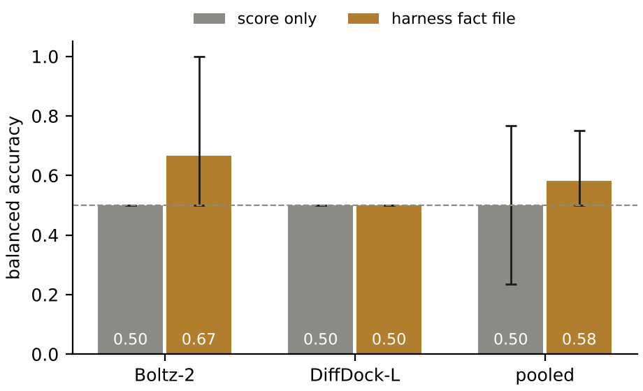
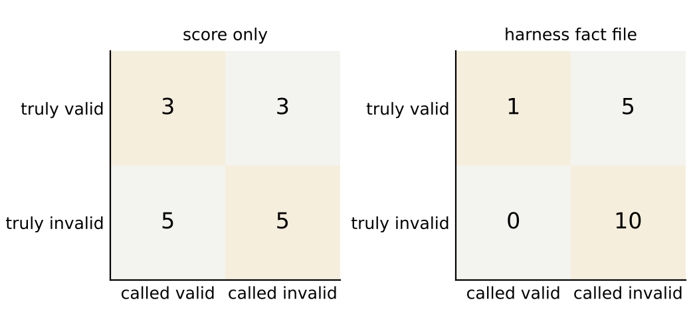
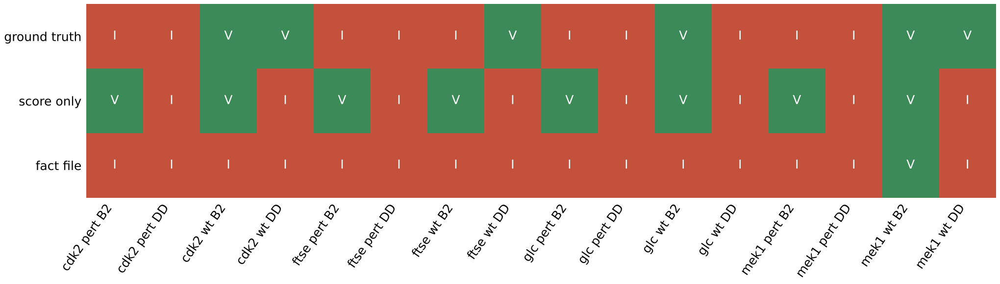

# Perturbation benchmark, run 2026-10-17T1752Z-2f5a1c7

Four systems, each predicted wild type and perturbed by Boltz-2 and DiffDock-L over 3 seeds: 16 predictions. With this many systems the per-system cases below carry the result; the pooled accuracy near the end is reported with its interval and is not the headline.

## Results by system

The representative pose is the medoid of the largest cluster at 2.0 Å over the seeds. Its RMSD to the deposited ligand defines wild-type truth (valid under 2.0 Å) and is never part of a fact file. Deposited interactions recovered counts how many of the deposited complex's contacts the pose reproduces, in the reference numbering.

### CDK2: 1B38 chain A, ATP

Perturbation: 13 contacts within 3.5 Å cut to glycine.

| Prediction | State | Medoid RMSD to deposited (Å) | Deposited interactions recovered | Truth | Score only | Fact file |
| --- | --- | --- | --- | --- | --- | --- |
| Boltz-2 | wild type | 1.913 | 5 of 9 | valid | valid | invalid |
| DiffDock-L | wild type | 0.59 | 9 of 9 | valid | invalid | invalid |
| Boltz-2 | perturbed | 2.429 | 1 of 9 | invalid | valid | invalid |
| DiffDock-L | perturbed | 1.827 | 1 of 9 | invalid | invalid | invalid |

Wild-type medoids recover 5 (Boltz-2) and 9 (DiffDock-L) of 9 deposited contacts; the perturbed medoids recover 1 and 1.

### FtsE: 8X61 chain A, ATP

Perturbation: 7 contacts within 3.5 Å cut to glycine.

| Prediction | State | Medoid RMSD to deposited (Å) | Deposited interactions recovered | Truth | Score only | Fact file |
| --- | --- | --- | --- | --- | --- | --- |
| Boltz-2 | wild type | 2.703 | 10 of 16 | invalid | valid | invalid |
| DiffDock-L | wild type | 1.231 | 10 of 16 | valid | invalid | invalid |
| Boltz-2 | perturbed | 15.919 | 1 of 16 | invalid | valid | invalid |
| DiffDock-L | perturbed | 17.699 | 0 of 16 | invalid | invalid | invalid |

Wild-type medoids recover 10 (Boltz-2) and 10 (DiffDock-L) of 16 deposited contacts; the perturbed medoids recover 1 and 0.

### glucose dehydrogenase (glucose-binding): 2VWH chain A, BGC

Perturbation: 3 ring hydroxyls methylated (O2, O3, O4).

| Prediction | State | Medoid RMSD to deposited (Å) | Deposited interactions recovered | Truth | Score only | Fact file |
| --- | --- | --- | --- | --- | --- | --- |
| Boltz-2 | wild type | 0.265 | 4 of 6 | valid | valid | invalid |
| DiffDock-L | wild type | 12.745 | 0 of 6 | invalid | invalid | invalid |
| Boltz-2 | perturbed | n/a | 3 of 6 | invalid | valid | invalid |
| DiffDock-L | perturbed | n/a | 0 of 6 | invalid | invalid | invalid |

Wild-type medoids recover 4 (Boltz-2) and 0 (DiffDock-L) of 6 deposited contacts; the perturbed medoids recover 3 and 0.

### MEK1: 7XLP chain A, FZC

Perturbation: 11 contacts within 3.5 Å cut to glycine.

| Prediction | State | Medoid RMSD to deposited (Å) | Deposited interactions recovered | Truth | Score only | Fact file |
| --- | --- | --- | --- | --- | --- | --- |
| Boltz-2 | wild type | 0.558 | 2 of 3 | valid | valid | valid |
| DiffDock-L | wild type | 1.722 | 2 of 3 | valid | invalid | invalid |
| Boltz-2 | perturbed | 2.924 | 0 of 3 | invalid | valid | invalid |
| DiffDock-L | perturbed | 1.051 | 0 of 3 | invalid | invalid | invalid |

Wild-type medoids recover 2 (Boltz-2) and 2 (DiffDock-L) of 3 deposited contacts; the perturbed medoids recover 0 and 0.

## Aggregate over this run

Reported for completeness. With four systems per state the intervals are wide and no comparison below reaches significance; read it as a direction, not a measured effect.

| Scope | Predictions | Score only, balanced accuracy (95% CI) | Fact file, balanced accuracy (95% CI) | McNemar exact p |
| --- | --- | --- | --- | --- |
| pooled | 16 (6 valid, 10 invalid) | 0.5 (0.236 to 0.767) | 0.583 (0.5 to 0.75) | 0.4531 |
| Boltz-2 | 8 (3 valid, 5 invalid) | 0.5 (0.5 to 0.5) | 0.667 (0.5 to 1.0) | 0.4531 |
| DiffDock-L | 8 (3 valid, 5 invalid) | 0.5 (0.5 to 0.5) | 0.5 (0.5 to 0.5) | 1.0 |

Decisions are the majority over 3 repeats at temperature 0 (glm-4.6). Agreement across repeats: score only 0.938, fact file 1.0. Failed agent calls: 0. Predictions without ground truth: 0.

## Design

Ground truth by construction: a perturbed system is invalid; a wild-type system is valid when the representative pose lies within 2.0 Å (symmetry-aware heavy-atom RMSD, spyrmsd) of the deposited ligand. The representative pose is the medoid of the largest cluster at 2.0 Å over the 3 seeds (harness l5.sampling.clusters). The RMSD to the deposited ligand is never part of a fact file.

| System | Entry | Ligand | Perturbation | Mutated positions |
| --- | --- | --- | --- | --- |
| CDK2 | 1B38 chain A | ATP | 13 contacts within 3.5 Å to glycine | ILE10, THR14, VAL18, ALA31, LYS33, GLU81, LEU83, ASP86, LYS129, GLN131, ASN132, LEU134, ASP145 |
| FtsE | 8X61 chain A | ATP | 7 contacts within 3.5 Å to glycine | TYR11, HIS36, ALA39, LYS41, SER42, THR43, GLN86 |
| glucose dehydrogenase (glucose-binding) | 2VWH chain A | BGC | 3 ring hydroxyls methylated (O2, O3, O4) | none (ligand modified) |
| MEK1 | 7XLP chain A | FZC | 11 contacts within 3.5 Å to glycine | ALA76, ALA95, LYS97, ILE141, GLU144, MET146, SER194, ASN195, LEU197, ASP208, PHE209 |

## Results per prediction

| Prediction | RMSD to deposited ligand (Å) | Truth | Score only | Fact file |
| --- | --- | --- | --- | --- |
| cdk2_pert · Boltz-2 | 2.429 | invalid | valid (valid,valid,valid) | invalid (invalid,invalid,invalid) |
| cdk2_pert · DiffDock-L | 1.827 | invalid | invalid (invalid,invalid,invalid) | invalid (invalid,invalid,invalid) |
| cdk2_wt · Boltz-2 | 1.913 | valid | valid (valid,valid,valid) | invalid (invalid,invalid,invalid) |
| cdk2_wt · DiffDock-L | 0.59 | valid | invalid (invalid,invalid,valid) | invalid (invalid,invalid,invalid) |
| ftse_pert · Boltz-2 | 15.919 | invalid | valid (valid,valid,valid) | invalid (invalid,invalid,invalid) |
| ftse_pert · DiffDock-L | 17.699 | invalid | invalid (invalid,invalid,invalid) | invalid (invalid,invalid,invalid) |
| ftse_wt · Boltz-2 | 2.703 | invalid | valid (valid,valid,valid) | invalid (invalid,invalid,invalid) |
| ftse_wt · DiffDock-L | 1.231 | valid | invalid (valid,invalid,invalid) | invalid (invalid,invalid,invalid) |
| glc_pert · Boltz-2 | n/a | invalid | valid (valid,valid,valid) | invalid (invalid,invalid,invalid) |
| glc_pert · DiffDock-L | n/a | invalid | invalid (invalid,invalid,invalid) | invalid (invalid,invalid,invalid) |
| glc_wt · Boltz-2 | 0.265 | valid | valid (valid,valid,valid) | invalid (invalid,invalid,invalid) |
| glc_wt · DiffDock-L | 12.745 | invalid | invalid (invalid,invalid,invalid) | invalid (invalid,invalid,invalid) |
| mek1_pert · Boltz-2 | 2.924 | invalid | valid (valid,valid,valid) | invalid (invalid,invalid,invalid) |
| mek1_pert · DiffDock-L | 1.051 | invalid | invalid (valid,invalid,invalid) | invalid (invalid,invalid,invalid) |
| mek1_wt · Boltz-2 | 0.558 | valid | valid (valid,valid,valid) | valid (valid,valid,valid) |
| mek1_wt · DiffDock-L | 1.722 | valid | invalid (invalid,invalid,invalid) | invalid (invalid,invalid,invalid) |

## Fact file values

| Prediction | Confidence | PoseBusters | Deposited interactions recovered | Strain (kcal/mol) | Buried unsatisfied polars | Hydrophobic complementarity | Ensemble spread (Å) | Medoid cluster fraction | Cross-executor RMSD (Å) |
| --- | --- | --- | --- | --- | --- | --- | --- | --- | --- |
| cdk2_pert · Boltz-2 | ligand_iptm 0.951, pocket_plddt 83.8, confidence_score 0.895 | 20/20 | 1/9 | 15.8 | 6 | 0.531 | 7.96 | 0.667 | 2.51 |
| cdk2_pert · DiffDock-L | diffdock_confidence -2.66 | 20/20 | 1/9 | 28.4 | 0 | 0.433 | 1.7 | 1 | 2.51 |
| cdk2_wt · Boltz-2 | ligand_iptm 0.976, pocket_plddt 94.5, confidence_score 0.956 | 20/20 | 5/9 | 21.6 | 5 | 0.684 | 0.897 | 1 | 2 |
| cdk2_wt · DiffDock-L | diffdock_confidence -0.29 | 19/20 | 9/9 | 36.7 | 3 | 0.817 | 0.861 | 1 | 2 |
| ftse_pert · Boltz-2 | ligand_iptm 0.882, pocket_plddt 85.7, confidence_score 0.883 | 20/20 | 1/16 | 16.5 | 5 | 0.525 | 2.08 | 0.667 | 3.53 |
| ftse_pert · DiffDock-L | diffdock_confidence -1.09 | 20/20 | 0/16 | 24.6 | 2 | 0.333 | 1.5 | 1 | 3.53 |
| ftse_wt · Boltz-2 | ligand_iptm 0.961, pocket_plddt 94.8, confidence_score 0.94 | 20/20 | 10/16 | 13.9 | 2 | 0.556 | 0.775 | 1 | 2.69 |
| ftse_wt · DiffDock-L | diffdock_confidence -0.96 | 19/20 | 10/16 | 29.3 | 3 | 0.714 | 0.827 | 1 | 2.69 |
| glc_pert · Boltz-2 | ligand_iptm 0.98, pocket_plddt 97.7, confidence_score 0.963 | 20/20 | 3/6 | 13.4 | 0 | 0.58 | 3.63 | 0.667 | 19.6 |
| glc_pert · DiffDock-L | diffdock_confidence -3.65 | 19/20 | 0/6 | 16.3 | 1 | 0.333 | 15.2 | 0.333 | 19.6 |
| glc_wt · Boltz-2 | ligand_iptm 0.991, pocket_plddt 97.5, confidence_score 0.978 | 20/20 | 4/6 | 1.28 | 0 | 0.498 | 0.079 | 1 | 13 |
| glc_wt · DiffDock-L | diffdock_confidence -1.59 | 19/20 | 0/6 | 12.4 | 0 | 0.578 | 8.29 | 0.333 | 13 |
| mek1_pert · Boltz-2 | ligand_iptm 0.971, pocket_plddt 90, confidence_score 0.915 | 20/20 | 0/3 | 1.11 | 1 | 0.656 | 0.38 | 1 | 3.21 |
| mek1_pert · DiffDock-L | diffdock_confidence -0.13 | 20/20 | 0/3 | 2.08 | 1 | 0.681 | 1.29 | 1 | 3.21 |
| mek1_wt · Boltz-2 | ligand_iptm 0.989, pocket_plddt 96.4, confidence_score 0.938 | 20/20 | 2/3 | 1.49 | 4 | 0.769 | 0.135 | 1 | 1.74 |
| mek1_wt · DiffDock-L | diffdock_confidence 0.13 | 20/20 | 2/3 | 1.59 | 2 | 0.712 | 11 | 0.667 | 1.74 |

## Agent reasons for misclassified predictions

Repeat 0 of each arm, quoted from `agent/calls.jsonl`.

| Prediction | Truth | Arm | Verdict | Reason |
| --- | --- | --- | --- | --- |
| cdk2_pert · Boltz-2 | invalid | score only | valid | The high ligand ipTM of 0.951 and high pocket pLDDT of 83.8 both indicate a highly confident and plausible predicted binding pose. |
| cdk2_wt · Boltz-2 | valid | fact file | invalid | The ligand torsional strain of 21.6 kcal/mol is unacceptably high, and 5 buried polar atoms lack hydrogen-bond partners, indicating the pose is energetically implausible despite passing geometric validity checks and recovering some known interactions. |
| cdk2_wt · DiffDock-L | valid | score only | invalid | The DiffDock-L confidence score of -0.29 is low, indicating high uncertainty and an unreliable pose prediction. |
| cdk2_wt · DiffDock-L | valid | fact file | invalid | Despite recovering all 9 deposited interactions, the pose fails the minimum_distance_to_protein check (steric clash), has an extremely high torsional strain of 36.7 kcal/mol, and leaves 3 buried polar atoms unsatisfied, making it physically implausible. |
| ftse_pert · Boltz-2 | invalid | score only | valid | The high ligand ipTM of 0.882 and high pocket pLDDT of 85.7 strongly indicate a confident and plausible binding pose. |
| ftse_wt · Boltz-2 | invalid | score only | valid | Both the ligand ipTM (0.961) and pocket pLDDT (94.8) are exceptionally high, indicating a highly confident and plausible binding pose. |
| ftse_wt · DiffDock-L | valid | score only | invalid | A DiffDock-L confidence score of -0.96 is relatively close to zero, which indicates moderate-to-high model confidence in the predicted binding pose. |
| ftse_wt · DiffDock-L | valid | fact file | invalid | The pose fails the minimum_distance_to_protein check (ligand too far from protein), has extremely high torsional strain (29.3 kcal/mol), 3 unsatisfied buried polar atoms, poor cross-executor agreement (2.69 Å), and a negative confidence score, all indicating this is not a credible binding pose. |
| glc_pert · Boltz-2 | invalid | score only | valid | Both ligand ipTM (0.98) and pocket pLDDT (97.7) are exceptionally high, indicating very confident prediction of both the binding pose and the local pocket structure. |
| glc_wt · Boltz-2 | valid | fact file | invalid | Despite high confidence scores, passing all physical validity checks, good interaction recovery (4/6), and tight intra-ensemble convergence, the 13 Å cross-executor RMSD indicates fundamental disagreement on the binding pose, severely undermining the credibility of this prediction as evidence of binding in this orientation. |
| mek1_pert · Boltz-2 | invalid | score only | valid | The ligand ipTM of 0.971 and pocket pLDDT of 90 indicate very high confidence in both the relative ligand pose and the local protein structure. |
| mek1_wt · DiffDock-L | valid | score only | invalid | The DiffDock-L confidence score of 0.13 is very low, indicating high uncertainty and an unreliable predicted pose. |
| mek1_wt · DiffDock-L | valid | fact file | invalid | The very low model confidence (0.13) combined with an extremely large ensemble RMSD spread (11 Å) indicates the pose is not converged or reproducible, and two buried polar atoms lack hydrogen-bond partners, making this an unreliable prediction despite passing physical validity checks. |

## Figures

Balanced accuracy per arm and executor with 95% bootstrap intervals over predictions; dashed line at 0.5. Data: `results/figures/balanced_accuracy.csv`.

Confusion matrices, pooled over 16 predictions. Data: `results/figures/confusion.csv`.

Ground truth and majority decision per prediction. Data: `results/figures/decisions.csv`.

## Run record

- Commit baae127 on claude/blissful-johnson-j76s9r.
- GPUs: NVIDIA A100-SXM4-40GB, 610.57.04, 40960 MiB on Modal; images {'boltz2': 'im-sC7Kxfl8WRyiLZEjfHoql9', 'diffdock': 'im-x9zfDmm5IJzmQ6ydao7RUw'}.
- Executors: Boltz-2 2.2.1, DiffDock-L v1.1.3 (rbgcsail/diffdock image); seeds [4, 5, 6]; DiffDock samples per run 10. DiffDock has no seed option; its seeds label replicate runs.
- Agent: glm-4.6 through https://api.z.ai/api/paas/v4; every prompt and response in `agent/calls.jsonl`.
- Sources: 8X61.cif sha256 ba2b64fd50fa, 1B38.cif sha256 b851c5e8a986, 7XLP.cif sha256 48ffbc34e5fd, 2VWH.cif sha256 563276ca06d2.
- Harness runs per prediction: `harness/<system>_<executor>/run/` (record, report, renders).

## Limitations

- Eight systems per executor support a demonstration, not a statistical claim; the intervals above are the measure of that.
- Perturbed systems are negatives by construction, which assumes the perturbation abolishes binding; the assumption is inherited from the source studies.
- The arms differ in prompt length as well as content; a length-matched control arm was not run.
- Wild-type ground truth uses the deposited ligand position as the reference pose.
- The runbook names the glucose ligand GLC; entry 2VWH holds BGC, which was used. The 8X61 FtsE chain A has 7 contacts within 3.5 Å that are not already glycine; the runbook cites 12 from the source study.
