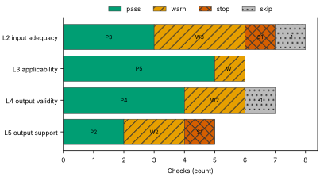
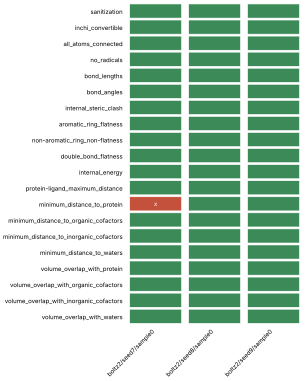
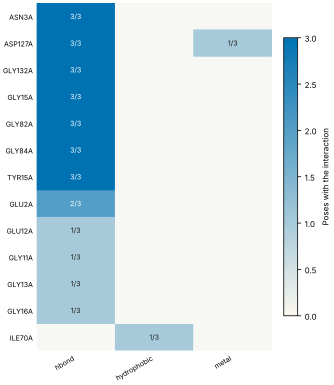
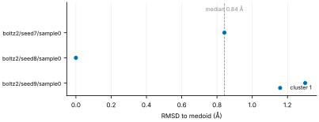
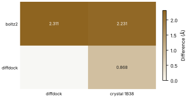
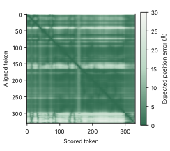

# Run report · Ligand pose in a known pocket

Prediction assurance · run `ligand_pose-723c95574755` · 2026-10-17 19:15:08 UTC

**Refused** for the claim "Predicted pose of ATP in CDK2 is valid".

Refused over layers 2,3,4,5: 14 pass, 8 warn, 2 stop, 2 skip. Stopped by l2.context.cofactors, l5.controls.redocking. Warnings from l2.receptor.protonation, l2.ligand.protonation, l2.docking.box, l3.exposure.ligand_prevalence, l4.torsion_strain, l4.interactions.unsatisfied_polars, l5.sampling.seeds, l5.agreement.cross_family. 1 checks not verified.

Stops: `l2.context.cofactors`, `l5.controls.redocking`.

Warnings: `l2.receptor.protonation`, `l2.ligand.protonation`, `l2.docking.box`, `l3.exposure.ligand_prevalence`, `l4.torsion_strain`, `l4.interactions.unsatisfied_polars`, `l5.sampling.seeds`, `l5.agreement.cross_family`.

Not verified: 1 checks.

| Field | Value |
| --- | --- |
| Task | Ligand pose in a known pocket (`ligand_pose`) |
| Tools | Boltz-2 2.2.1 (co-folding), DiffDock-L (docking) |
| Target | `protein` |
| Ligand | `c1nc(c2c(n1)n(cn2)[C@H]3[C@@H]([C@@H]([C@H](O3)CO[P@@](=O)(O)O[P@](=O)(O)OP(=O)(O)O)O)O)N` |
| Reference | `1B38` |
| pH | 7.4 |
| Seeds | 3 |
| Layers run | 2, 3, 4, 5 |
| Run | `ligand_pose-723c95574755` |
| Created | 2026-10-17 19:15:08 UTC |
| Finished | 2026-10-17 19:15:49 UTC |
| pah version | 0.1.0 |
| Report schema | 1 |

## Layers

| Layer | Status | Result | pass | warn | stop | skip | Time |
| --- | --- | --- | --- | --- | --- | --- | --- |
| L0 Provenance | not run | n/a | n/a | n/a | n/a | n/a | n/a |
| L1 Input integrity | not run | n/a | n/a | n/a | n/a | n/a | n/a |
| L2 Input adequacy | done | stop | 3 | 3 | 1 | 1 | 1.7 s |
| L3 Applicability | done | warn | 5 | 1 | 0 | 0 | 695 ms |
| L4 Output validity | done | warn | 4 | 2 | 0 | 1 | 38.0 s |
| L5 Output support | done | stop | 2 | 2 | 1 | 0 | 239 ms |

## Figures

Fig. 1 · Check outcomes per layer for run ligand_pose-723c95574755. Totals: pass 14, warn 8, stop 2, skip 2.
Files: data [figures/gates_by_layer.csv](figures/gates_by_layer.csv).

## Structures

76 PyMOL renders.

1B38 mmCIF (source_structure), whole structure. Chains A; organic components ACE, ATP. sha256 b851c5e8a98632f8. PyMOL session: [renders/1B38.pse](renders/1B38.pse).

1B38 mmCIF (source_structure), ligand environment within 5 Å. Chains A; organic components ACE, ATP. sha256 b851c5e8a98632f8. PyMOL session: [renders/1B38.pse](renders/1B38.pse).

boltz2/seed7/sample0 (prediction_structure), whole structure. Chains A, C1, L; organic components LIG1. sha256 a0c91cd2d1745a2d. PyMOL session: [renders/boltz2_seed7_sample0.pse](renders/boltz2_seed7_sample0.pse).

boltz2/seed7/sample0 (prediction_structure), ligand environment within 5 Å. Chains A, C1, L; organic components LIG1. sha256 a0c91cd2d1745a2d. PyMOL session: [renders/boltz2_seed7_sample0.pse](renders/boltz2_seed7_sample0.pse).

boltz2/seed8/sample0 (prediction_structure), whole structure. Chains A, C1, L; organic components LIG1. sha256 c917bf5e0ff545e2. PyMOL session: [renders/boltz2_seed8_sample0.pse](renders/boltz2_seed8_sample0.pse).

boltz2/seed8/sample0 (prediction_structure), ligand environment within 5 Å. Chains A, C1, L; organic components LIG1. sha256 c917bf5e0ff545e2. PyMOL session: [renders/boltz2_seed8_sample0.pse](renders/boltz2_seed8_sample0.pse).

boltz2/seed9/sample0 (prediction_structure), whole structure. Chains A, C1, L; organic components LIG1. sha256 56ef70404f4ff3eb. PyMOL session: [renders/boltz2_seed9_sample0.pse](renders/boltz2_seed9_sample0.pse).

boltz2/seed9/sample0 (prediction_structure), ligand environment within 5 Å. Chains A, C1, L; organic components LIG1. sha256 56ef70404f4ff3eb. PyMOL session: [renders/boltz2_seed9_sample0.pse](renders/boltz2_seed9_sample0.pse).

diffdock/seed7/mode0 (prediction_structure), whole structure. Chains A, L; organic components LIG. sha256 18070ed017dfb35a. PyMOL session: [renders/diffdock_seed7_mode0.pse](renders/diffdock_seed7_mode0.pse).

diffdock/seed7/mode0 (prediction_structure), ligand environment within 5 Å. Chains A, L; organic components LIG. sha256 18070ed017dfb35a. PyMOL session: [renders/diffdock_seed7_mode0.pse](renders/diffdock_seed7_mode0.pse).

diffdock/seed7/mode1 (prediction_structure), whole structure. Chains A, L; organic components LIG. sha256 dee65e5df1c13a4f. PyMOL session: [renders/diffdock_seed7_mode1.pse](renders/diffdock_seed7_mode1.pse).

diffdock/seed7/mode1 (prediction_structure), ligand environment within 5 Å. Chains A, L; organic components LIG. sha256 dee65e5df1c13a4f. PyMOL session: [renders/diffdock_seed7_mode1.pse](renders/diffdock_seed7_mode1.pse).

diffdock/seed7/mode2 (prediction_structure), whole structure. Chains A, L; organic components LIG. sha256 bdbd81f247d55917. PyMOL session: [renders/diffdock_seed7_mode2.pse](renders/diffdock_seed7_mode2.pse).

diffdock/seed7/mode2 (prediction_structure), ligand environment within 5 Å. Chains A, L; organic components LIG. sha256 bdbd81f247d55917. PyMOL session: [renders/diffdock_seed7_mode2.pse](renders/diffdock_seed7_mode2.pse).

diffdock/seed7/mode3 (prediction_structure), whole structure. Chains A, L; organic components LIG. sha256 ebb87b5885ccb9c8. PyMOL session: [renders/diffdock_seed7_mode3.pse](renders/diffdock_seed7_mode3.pse).

diffdock/seed7/mode3 (prediction_structure), ligand environment within 5 Å. Chains A, L; organic components LIG. sha256 ebb87b5885ccb9c8. PyMOL session: [renders/diffdock_seed7_mode3.pse](renders/diffdock_seed7_mode3.pse).

diffdock/seed7/mode4 (prediction_structure), whole structure. Chains A, L; organic components LIG. sha256 1ce4c39d6893b89b. PyMOL session: [renders/diffdock_seed7_mode4.pse](renders/diffdock_seed7_mode4.pse).

diffdock/seed7/mode4 (prediction_structure), ligand environment within 5 Å. Chains A, L; organic components LIG. sha256 1ce4c39d6893b89b. PyMOL session: [renders/diffdock_seed7_mode4.pse](renders/diffdock_seed7_mode4.pse).

diffdock/seed7/mode5 (prediction_structure), whole structure. Chains A, L; organic components LIG. sha256 c0688465b2f26b88. PyMOL session: [renders/diffdock_seed7_mode5.pse](renders/diffdock_seed7_mode5.pse).

diffdock/seed7/mode5 (prediction_structure), ligand environment within 5 Å. Chains A, L; organic components LIG. sha256 c0688465b2f26b88. PyMOL session: [renders/diffdock_seed7_mode5.pse](renders/diffdock_seed7_mode5.pse).

diffdock/seed7/mode6 (prediction_structure), whole structure. Chains A, L; organic components LIG. sha256 8f3fc3d77dc6c942. PyMOL session: [renders/diffdock_seed7_mode6.pse](renders/diffdock_seed7_mode6.pse).

diffdock/seed7/mode6 (prediction_structure), ligand environment within 5 Å. Chains A, L; organic components LIG. sha256 8f3fc3d77dc6c942. PyMOL session: [renders/diffdock_seed7_mode6.pse](renders/diffdock_seed7_mode6.pse).

diffdock/seed7/mode7 (prediction_structure), whole structure. Chains A, L; organic components LIG. sha256 f639708928c3c0f5. PyMOL session: [renders/diffdock_seed7_mode7.pse](renders/diffdock_seed7_mode7.pse).

diffdock/seed7/mode7 (prediction_structure), ligand environment within 5 Å. Chains A, L; organic components LIG. sha256 f639708928c3c0f5. PyMOL session: [renders/diffdock_seed7_mode7.pse](renders/diffdock_seed7_mode7.pse).

diffdock/seed7/mode8 (prediction_structure), whole structure. Chains A, L; organic components LIG. sha256 66e2926c1a0b610b. PyMOL session: [renders/diffdock_seed7_mode8.pse](renders/diffdock_seed7_mode8.pse).

diffdock/seed7/mode8 (prediction_structure), ligand environment within 5 Å. Chains A, L; organic components LIG. sha256 66e2926c1a0b610b. PyMOL session: [renders/diffdock_seed7_mode8.pse](renders/diffdock_seed7_mode8.pse).

diffdock/seed7/mode9 (prediction_structure), whole structure. Chains A, L; organic components LIG. sha256 1e886d6963ee74ba. PyMOL session: [renders/diffdock_seed7_mode9.pse](renders/diffdock_seed7_mode9.pse).

diffdock/seed7/mode9 (prediction_structure), ligand environment within 5 Å. Chains A, L; organic components LIG. sha256 1e886d6963ee74ba. PyMOL session: [renders/diffdock_seed7_mode9.pse](renders/diffdock_seed7_mode9.pse).

diffdock/seed8/mode0 (prediction_structure), whole structure. Chains A, L; organic components LIG. sha256 b64f3262bf4d4ca9. PyMOL session: [renders/diffdock_seed8_mode0.pse](renders/diffdock_seed8_mode0.pse).

diffdock/seed8/mode0 (prediction_structure), ligand environment within 5 Å. Chains A, L; organic components LIG. sha256 b64f3262bf4d4ca9. PyMOL session: [renders/diffdock_seed8_mode0.pse](renders/diffdock_seed8_mode0.pse).

diffdock/seed8/mode1 (prediction_structure), whole structure. Chains A, L; organic components LIG. sha256 49ef96076a0dfbc1. PyMOL session: [renders/diffdock_seed8_mode1.pse](renders/diffdock_seed8_mode1.pse).

diffdock/seed8/mode1 (prediction_structure), ligand environment within 5 Å. Chains A, L; organic components LIG. sha256 49ef96076a0dfbc1. PyMOL session: [renders/diffdock_seed8_mode1.pse](renders/diffdock_seed8_mode1.pse).

diffdock/seed8/mode2 (prediction_structure), whole structure. Chains A, L; organic components LIG. sha256 8a6933a20a03e987. PyMOL session: [renders/diffdock_seed8_mode2.pse](renders/diffdock_seed8_mode2.pse).

diffdock/seed8/mode2 (prediction_structure), ligand environment within 5 Å. Chains A, L; organic components LIG. sha256 8a6933a20a03e987. PyMOL session: [renders/diffdock_seed8_mode2.pse](renders/diffdock_seed8_mode2.pse).

diffdock/seed8/mode3 (prediction_structure), whole structure. Chains A, L; organic components LIG. sha256 064f31fdda490b45. PyMOL session: [renders/diffdock_seed8_mode3.pse](renders/diffdock_seed8_mode3.pse).

diffdock/seed8/mode3 (prediction_structure), ligand environment within 5 Å. Chains A, L; organic components LIG. sha256 064f31fdda490b45. PyMOL session: [renders/diffdock_seed8_mode3.pse](renders/diffdock_seed8_mode3.pse).

diffdock/seed8/mode4 (prediction_structure), whole structure. Chains A, L; organic components LIG. sha256 779674775eae5867. PyMOL session: [renders/diffdock_seed8_mode4.pse](renders/diffdock_seed8_mode4.pse).

diffdock/seed8/mode4 (prediction_structure), ligand environment within 5 Å. Chains A, L; organic components LIG. sha256 779674775eae5867. PyMOL session: [renders/diffdock_seed8_mode4.pse](renders/diffdock_seed8_mode4.pse).

diffdock/seed8/mode5 (prediction_structure), whole structure. Chains A, L; organic components LIG. sha256 6e2076f5fbc1b632. PyMOL session: [renders/diffdock_seed8_mode5.pse](renders/diffdock_seed8_mode5.pse).

diffdock/seed8/mode5 (prediction_structure), ligand environment within 5 Å. Chains A, L; organic components LIG. sha256 6e2076f5fbc1b632. PyMOL session: [renders/diffdock_seed8_mode5.pse](renders/diffdock_seed8_mode5.pse).

diffdock/seed8/mode6 (prediction_structure), whole structure. Chains A, L; organic components LIG. sha256 35654e76847df863. PyMOL session: [renders/diffdock_seed8_mode6.pse](renders/diffdock_seed8_mode6.pse).

diffdock/seed8/mode6 (prediction_structure), ligand environment within 5 Å. Chains A, L; organic components LIG. sha256 35654e76847df863. PyMOL session: [renders/diffdock_seed8_mode6.pse](renders/diffdock_seed8_mode6.pse).

diffdock/seed8/mode7 (prediction_structure), whole structure. Chains A, L; organic components LIG. sha256 9fe5f1dd593b0318. PyMOL session: [renders/diffdock_seed8_mode7.pse](renders/diffdock_seed8_mode7.pse).

diffdock/seed8/mode7 (prediction_structure), ligand environment within 5 Å. Chains A, L; organic components LIG. sha256 9fe5f1dd593b0318. PyMOL session: [renders/diffdock_seed8_mode7.pse](renders/diffdock_seed8_mode7.pse).

diffdock/seed8/mode8 (prediction_structure), whole structure. Chains A, L; organic components LIG. sha256 d28eb5d82cd6f967. PyMOL session: [renders/diffdock_seed8_mode8.pse](renders/diffdock_seed8_mode8.pse).

diffdock/seed8/mode8 (prediction_structure), ligand environment within 5 Å. Chains A, L; organic components LIG. sha256 d28eb5d82cd6f967. PyMOL session: [renders/diffdock_seed8_mode8.pse](renders/diffdock_seed8_mode8.pse).

diffdock/seed8/mode9 (prediction_structure), whole structure. Chains A, L; organic components LIG. sha256 92a2c919a1edd6de. PyMOL session: [renders/diffdock_seed8_mode9.pse](renders/diffdock_seed8_mode9.pse).

diffdock/seed8/mode9 (prediction_structure), ligand environment within 5 Å. Chains A, L; organic components LIG. sha256 92a2c919a1edd6de. PyMOL session: [renders/diffdock_seed8_mode9.pse](renders/diffdock_seed8_mode9.pse).

diffdock/seed9/mode0 (prediction_structure), whole structure. Chains A, L; organic components LIG. sha256 bb3b8e31eacfd59e. PyMOL session: [renders/diffdock_seed9_mode0.pse](renders/diffdock_seed9_mode0.pse).

diffdock/seed9/mode0 (prediction_structure), ligand environment within 5 Å. Chains A, L; organic components LIG. sha256 bb3b8e31eacfd59e. PyMOL session: [renders/diffdock_seed9_mode0.pse](renders/diffdock_seed9_mode0.pse).

diffdock/seed9/mode1 (prediction_structure), whole structure. Chains A, L; organic components LIG. sha256 047faa577c1f8dd5. PyMOL session: [renders/diffdock_seed9_mode1.pse](renders/diffdock_seed9_mode1.pse).

diffdock/seed9/mode1 (prediction_structure), ligand environment within 5 Å. Chains A, L; organic components LIG. sha256 047faa577c1f8dd5. PyMOL session: [renders/diffdock_seed9_mode1.pse](renders/diffdock_seed9_mode1.pse).

diffdock/seed9/mode2 (prediction_structure), whole structure. Chains A, L; organic components LIG. sha256 9cc63a3690b93f06. PyMOL session: [renders/diffdock_seed9_mode2.pse](renders/diffdock_seed9_mode2.pse).

diffdock/seed9/mode2 (prediction_structure), ligand environment within 5 Å. Chains A, L; organic components LIG. sha256 9cc63a3690b93f06. PyMOL session: [renders/diffdock_seed9_mode2.pse](renders/diffdock_seed9_mode2.pse).

diffdock/seed9/mode3 (prediction_structure), whole structure. Chains A, L; organic components LIG. sha256 35b407b0cf4d5e0b. PyMOL session: [renders/diffdock_seed9_mode3.pse](renders/diffdock_seed9_mode3.pse).

diffdock/seed9/mode3 (prediction_structure), ligand environment within 5 Å. Chains A, L; organic components LIG. sha256 35b407b0cf4d5e0b. PyMOL session: [renders/diffdock_seed9_mode3.pse](renders/diffdock_seed9_mode3.pse).

diffdock/seed9/mode4 (prediction_structure), whole structure. Chains A, L; organic components LIG. sha256 65c3efedfbdaaf7d. PyMOL session: [renders/diffdock_seed9_mode4.pse](renders/diffdock_seed9_mode4.pse).

diffdock/seed9/mode4 (prediction_structure), ligand environment within 5 Å. Chains A, L; organic components LIG. sha256 65c3efedfbdaaf7d. PyMOL session: [renders/diffdock_seed9_mode4.pse](renders/diffdock_seed9_mode4.pse).

diffdock/seed9/mode5 (prediction_structure), whole structure. Chains A, L; organic components LIG. sha256 0c4ef27375a7499a. PyMOL session: [renders/diffdock_seed9_mode5.pse](renders/diffdock_seed9_mode5.pse).

diffdock/seed9/mode5 (prediction_structure), ligand environment within 5 Å. Chains A, L; organic components LIG. sha256 0c4ef27375a7499a. PyMOL session: [renders/diffdock_seed9_mode5.pse](renders/diffdock_seed9_mode5.pse).

diffdock/seed9/mode6 (prediction_structure), whole structure. Chains A, L; organic components LIG. sha256 c6139e29b8f0ad0b. PyMOL session: [renders/diffdock_seed9_mode6.pse](renders/diffdock_seed9_mode6.pse).

diffdock/seed9/mode6 (prediction_structure), ligand environment within 5 Å. Chains A, L; organic components LIG. sha256 c6139e29b8f0ad0b. PyMOL session: [renders/diffdock_seed9_mode6.pse](renders/diffdock_seed9_mode6.pse).

diffdock/seed9/mode7 (prediction_structure), whole structure. Chains A, L; organic components LIG. sha256 00e465988f0ef07a. PyMOL session: [renders/diffdock_seed9_mode7.pse](renders/diffdock_seed9_mode7.pse).

diffdock/seed9/mode7 (prediction_structure), ligand environment within 5 Å. Chains A, L; organic components LIG. sha256 00e465988f0ef07a. PyMOL session: [renders/diffdock_seed9_mode7.pse](renders/diffdock_seed9_mode7.pse).

diffdock/seed9/mode8 (prediction_structure), whole structure. Chains A, L; organic components LIG. sha256 05bfedcb83e3fe28. PyMOL session: [renders/diffdock_seed9_mode8.pse](renders/diffdock_seed9_mode8.pse).

diffdock/seed9/mode8 (prediction_structure), ligand environment within 5 Å. Chains A, L; organic components LIG. sha256 05bfedcb83e3fe28. PyMOL session: [renders/diffdock_seed9_mode8.pse](renders/diffdock_seed9_mode8.pse).

diffdock/seed9/mode9 (prediction_structure), whole structure. Chains A, L; organic components LIG. sha256 fbf75b97d8d52b0e. PyMOL session: [renders/diffdock_seed9_mode9.pse](renders/diffdock_seed9_mode9.pse).

diffdock/seed9/mode9 (prediction_structure), ligand environment within 5 Å. Chains A, L; organic components LIG. sha256 fbf75b97d8d52b0e. PyMOL session: [renders/diffdock_seed9_mode9.pse](renders/diffdock_seed9_mode9.pse).

1B39 mmCIF (source_structure), whole structure. Chains A; organic components ACE, ATP. sha256 43b7b7417024c3f4. PyMOL session: [renders/1B39.pse](renders/1B39.pse).

1B39 mmCIF (source_structure), ligand environment within 5 Å. Chains A; organic components ACE, ATP. sha256 43b7b7417024c3f4. PyMOL session: [renders/1B39.pse](renders/1B39.pse).

1FIN mmCIF (source_structure), whole structure. Chains A, B, C, D; organic components ATP. sha256 dfe5da37b2e28d3d. PyMOL session: [renders/1FIN.pse](renders/1FIN.pse).

1FIN mmCIF (source_structure), ligand environment within 5 Å. Chains A, B, C, D; organic components ATP. sha256 dfe5da37b2e28d3d. PyMOL session: [renders/1FIN.pse](renders/1FIN.pse).

1FQ1 mmCIF (source_structure), whole structure. Chains A, B; organic components ATP. sha256 f86aad4d11e29283. PyMOL session: [renders/1FQ1.pse](renders/1FQ1.pse).

1FQ1 mmCIF (source_structure), ligand environment within 5 Å. Chains A, B; organic components ATP. sha256 f86aad4d11e29283. PyMOL session: [renders/1FQ1.pse](renders/1FQ1.pse).

1GY3 mmCIF (source_structure), whole structure. Chains A, B, C, D, E, F; organic components ATP, GOL, TPO. sha256 fb1e8e095ae9fe28. PyMOL session: [renders/1GY3.pse](renders/1GY3.pse).

1GY3 mmCIF (source_structure), ligand environment within 5 Å. Chains A, B, C, D, E, F; organic components ATP, GOL, TPO. sha256 fb1e8e095ae9fe28. PyMOL session: [renders/1GY3.pse](renders/1GY3.pse).

## L0 Provenance

Where did every input come from?

Status: not run.

## L1 Input integrity

Did the run receive exactly what was declared?

Status: not run.

## L2 Input adequacy

Does the input carry enough information?

Status: done. Checks: pass 3 · warn 3 · stop 1 · skip 1. Time: 1.7 s.

#### Key figures

| Figure | Value |
| --- | --- |
| near site | 1 |
| missing | 1 |
| uniprot cofactors | 0 |
| pocket residues | 30 |
| incomplete | 0 |
| sequence gaps | 0 |
| state | holo |
| site ligands | 1 |

#### Docking

| Field | Value |
| --- | --- |
| center | -1.248, 27.587, 11.585 Å |
| size | 15.545 × 17.083 × 18.375 Å |
| origin | derived from ATP (+4 Å) |

#### Checks

| Check | Result | Measured cmp threshold | Evidence | Id · time |
| --- | --- | --- | --- | --- |
| Alignment depth, distinct sequences, Neff and gap fraction | skip | n/a | no MSA declared for a co-folding model · not applicable | `l2.msa.depth` |
| Required cofactors, ions and partners present | stop | `pocket_distance <= 8` | components within 8.0 Å of ATP in 1B38 not supplied: MG · near_site=1, missing=1, uniprot_cofactors=0 | `l2.context.cofactors` · 188 ms |
| Pocket residues resolved, no missing loops lining the pocket | pass | `pocket_distance <= 6` | 30 pocket residues complete in 1B38.cif · pocket_residues=30, incomplete=0, sequence_gaps=0 | `l2.pocket.resolved` · 9 ms |
| Receptor state apo or holo | pass | n/a | 1B38.cif holo: ATP in the site · state=holo, site_ligands=1 | `l2.receptor.state` · 12 ms |
| Receptor protonation at the stated pH | warn | `pka_margin > 1` | receptor has no hydrogens (protonation not assigned) · hydrogens_present=False, ph=7.4, pocket_titratable=14 | `l2.receptor.protonation` · 431 ms |
| Ligand protonation and tautomers enumerated at the stated pH | warn | `ph 7.4 == 1` | ligand: 2 states; ligand: declared form Nc1ncnc2c1ncn2[C@@H]1O[C@H](CO[P@@](=O)(O)O[P@](=O)(O)OP(=O)(O)O)[C@@H](O)[C@H]1O differs from enumerated Nc1ncnc2c1ncn2[C@@H]1O[C@H](CO[P@@](=O)([O-])O[P@](=O)([O-])OP(=O)([O-])O)[C@@H](O)[C@H]1O, Nc1ncnc2c1ncn2[C@@H]1O[C@H](CO[P@@](=O)([O-])O[P@](=O)([O-])OP(=O)([O-])[O-])[C@@H](O)[C@H]1O · ph=7.4, max_states=2, declared_not_enumerated=1 | `l2.ligand.protonation` · 58 ms |
| Ligand conformers generated and minimised | pass | `conformers >= 10` | 10 ETKDG conformers per ligand, MMFF minimised · ligands=1, failed=0, min_embedded=10 | `l2.ligand.conformers` · 936 ms |
| Docking box encloses the pocket with margin | warn | `margin >= 2` | no box declared; derived box encloses 22 contact residues and the ATP ligand with 2.0 Å margin · volume_A3=4879.6, ligand_atoms_inside_margin=31, ligand_atoms=31 | `l2.docking.box` · 8 ms |

## L3 Applicability

Is the tool inside its validated regime?

Status: done. Checks: pass 5 · warn 1 · stop 0 · skip 0. Time: 695 ms.

#### Key figures

| Figure | Value |
| --- | --- |
| executors | 2 |
| unknown | 0 |
| reference released | 1998-12-23 |
| cutoff | 2019-01-01 |
| entries compared | 5 |
| max similarity | 14.9 |
| pocket residues | 39 |
| systems | 3474 |

#### Checks

| Check | Result | Measured cmp threshold | Evidence | Id · time |
| --- | --- | --- | --- | --- |
| Model training cutoff recorded | pass | `training_cutoff == recorded` | boltz2 2023-06-01; diffdock 2019-01-01; reference 1B38 released 1998-12-23, before the cutoff of boltz2, diffdock · executors=2, unknown=0, reference_released=1998-12-23 | `l3.model.training_cutoff` · 0 ms |
| Pocket similarity to pre-cutoff complexes (SuCOS times pocket coverage) | pass | `similarity <= 50` | max similarity 14.9 to 1B39 (ATP, SuCOS 0.363, coverage 0.41), released before 2019-01-01 · cutoff=2019-01-01, entries_compared=5, max_similarity=14.9 | `l3.exposure.pocket` · 686 ms |
| Ligand analogues in pre-cutoff training systems | warn | `tanimoto > 0.9` | 3474 PDB entries released before 2019-01-01 (diffdock cutoff) contain analogues of ligand above Tanimoto 0.9: 5FA, ADP, AQP, ATP, HEJ, LA8 · cutoff=2019-01-01, systems=3474, analogue_components=19 | `l3.exposure.ligand_prevalence` · 0 ms |
| Chain sequence identity to pre-cutoff entries (secondary measure) | pass | `identity < 0.4` | protein: 379 entries at 95 percent identity, 453 at 40 percent, released before 2019-01-01 (reported, not gating) · cutoff=2019-01-01, entries_95=379, entries_40=453 | `l3.exposure.sequence` · 1 ms |
| Modality inside the validated set; token count against the training crop | pass | n/a | modalities protein, protein_ligand inside the validated set; 330 tokens · modalities=2, tokens=330, outside=0 | `l3.regime.modality` · 5 ms |
| Endpoint fits the tool | pass | `endpoint pose in pose` | endpoint pose produced by boltz2, diffdock · endpoint=pose, executors=2, not_fitting=0 | `l3.metric.endpoint` · 0 ms |

## L4 Output validity

Is the result physically and chemically sensible?

Status: done. Checks: pass 4 · warn 2 · stop 0 · skip 1. Time: 38.0 s.

#### Key figures

| Figure | Value |
| --- | --- |
| poses | 3 |
| passed | 20 |
| total | 20 |
| poses all pass | 2 |
| unlikely torsions | 1 |
| torsions | 14 |
| strain kcal | 7.55 |
| poses with unlikely | 3 |

#### PoseBusters · 20/20 tests pass

| test | result | value |
| --- | --- | --- |
| sanitization | pass | pass |
| inchi_convertible | pass | pass |
| all_atoms_connected | pass | pass |
| no_radicals | pass | pass |
| bond_lengths | pass | 0 long outliers |
| bond_angles | pass | 0 outliers |
| internal_steric_clash | pass | 0 |
| aromatic_ring_flatness | pass | 0.00 Å |
| non-aromatic_ring_non-flatness | pass | pass |
| double_bond_flatness | pass | pass |
| internal_energy | pass | 2.9 times the ensemble mean |
| protein-ligand_maximum_distance | pass | 2.55 Å |
| minimum_distance_to_protein | pass | 2.55 Å |
| minimum_distance_to_organic_cofactors | pass | pass |
| minimum_distance_to_inorganic_cofactors | pass | pass |
| minimum_distance_to_waters | pass | pass |
| volume_overlap_with_protein | pass | 0.013 |
| volume_overlap_with_organic_cofactors | pass | pass |
| volume_overlap_with_inorganic_cofactors | pass | pass |
| volume_overlap_with_waters | pass | pass |

#### Per-pose physical checks

| pose | seed | unlikely torsions | unsat. polars | buried charged | PoseBusters |
| --- | --- | --- | --- | --- | --- |
| boltz2/seed7/sample0 | 7 | 1/14 | 5 | 0 | 19/20 |
| boltz2/seed8/sample0 | 8 | 1/14 | 4 | 0 | 20/20 |
| boltz2/seed9/sample0 | 9 | 3/14 | 4 | 0 | 20/20 |
| median | n/a | 1 | 4 | 0 | 20/20 |

#### Interaction fingerprint · representative pose boltz2/seed8/sample0

| residue | type | distance | poses |
| --- | --- | --- | --- |
| ASN3A | hbond | 3.04 Å | 3/3 |
| ASP127A | hbond | 3.7 Å | 3/3 |
| GLY132A | hbond | 2.61 Å | 3/3 |
| GLY15A | hbond | 2.55 Å | 3/3 |
| GLY82A | hbond | 2.82 Å | 3/3 |
| GLY84A | hbond | 2.84 Å | 3/3 |
| TYR15A | hbond | 2.67 Å | 3/3 |
| GLU2A | hbond | 3.48 Å | 2/3 |
| GLU12A | hbond | 3.32 Å | 1/3 |
| GLY11A | hbond | 3.1 Å | 1/3 |
| GLY13A | hbond | 4 Å | 1/3 |
| GLY16A | hbond | 3.42 Å | 1/3 |
| ILE70A | hydrophobic | 3.53 Å | 1/3 |
| ASP127A | metal | 2.91 Å | 1/3 |

Fig. 2 · PoseBusters tests (20) by pose (3). Failed cells marked x: 1 of 60.
Files: data [figures/posebusters_grid.csv](figures/posebusters_grid.csv).

Fig. 3 · Interactions by residue (13) and type (3); cell label: poses with the interaction over poses assessed.
Files: data [figures/interactions.csv](figures/interactions.csv).

#### Checks

| Check | Result | Measured cmp threshold | Evidence | Id · time |
| --- | --- | --- | --- | --- |
| PoseBusters geometry, stereochemistry, clashes and protein contact | pass | `tests_failed == 0` | 20 of 20 tests pass for boltz2/seed8/sample0; 2 of 3 poses pass all · poses=3, passed=20, total=20 | `l4.posebusters` · 2.5 s |
| Torsional strain of the ligand pose | warn | `torsion_energy <= 2.5` | 1 of 14 torsions above 2.5 kcal/mol in boltz2/seed8/sample0 · poses=3, unlikely_torsions=1, torsions=14 | `l4.torsion_strain` · 3.9 s |
| Interaction fingerprint (PLIP) | pass | n/a | 12 interactions in boltz2/seed8/sample0 (hbond); 14 distinct across 3 poses (reported) · poses=3, interactions_representative=12, distinct=14 | `l4.interactions.fingerprint` · 1.3 s |
| Buried ligand polar atoms without a hydrogen-bond partner | warn | `relative_sasa < 0.1` | 4 of 9 buried polar ligand atoms without a partner in boltz2/seed8/sample0 · poses=3, unsatisfied=4, buried_charged=0 | `l4.interactions.unsatisfied_polars` · 239 ms |
| Hydrophobic complementarity of buried ligand surface | pass | `fraction >= 0.35` | nonpolar fraction of protein contacts around 5 buried nonpolar ligand atoms in boltz2/seed8/sample0: 0.587 · poses=3, complementarity=0.587, buried_nonpolar=5 | `l4.interactions.hydrophobic` · 238 ms |
| Interactions of the crystal ligand reproduced by the pose | pass | `reproduced 1 >= 1` | boltz2/seed8/sample0 reproduces 1 of 9 ATP interactions: hbond TYR15A · key_interactions=9, reproduced=1, poses_reproducing_all=0 | `l4.interactions.known_binders` · 230 ms |
| Pose stability under short restrained minimisation (OpenMM, AMBER14 and OpenFF) | skip | n/a | OutputUnavailableError: minimisation failed for every pose: ValueError: No template found for residue 0 (UNK).  The set of heavy atoms matches NALA, but the residue is missing 1 H atom.  You may be able to add it with Modeller.addHydrogens().  For more information, see https://github.com/openmm/openmm/wiki/Frequently-Asked-Questions#template; ValueError: No template found for residue 0 (UNK).  The set of heavy atoms matches NALA, but the residue is missing 1 H atom.  You may be able to add it with Modeller.addHydrogens().  For more information, see https://github.com/openmm/openmm/wiki/Frequently-Asked-Questions#template; ValueError: No template found for residue 0 (UNK).  The set of heavy atoms matches NALA, but the residue is missing 1 H atom.  You may be able to add it with Modeller.addHydrogens().  For more information, see https://github.com/openmm/openmm/wiki/Frequently-Asked-Questions#template · error | `l4.minimisation_drift` · 29.7 s |

## L5 Output support

Is a valid result corroborated?

Status: done. Checks: pass 2 · warn 2 · stop 1 · skip 0. Time: 239 ms.

#### Key figures

| Figure | Value |
| --- | --- |
| poses | 3 |
| pocket plddt | 82.3 |
| global plddt | 89.6 |
| iptm | 0.925 |
| ptm | 0.932 |
| confidence score | 0.877 |
| independent seeds | 3 |
| samples | 3 |

#### Sampling

| Field | Value |
| --- | --- |
| site placement | 3 of 3 poses within 4.0 Å of the site (ATP in 1B38) |
| pose accuracy | 3 of 3 poses within 2.0 Å of the medoid |
| pairwise RMSD median | 1.3 Å |
| pairwise RMSD IQR | 1.07 to 1.35 Å |
| pairs | 3 |
| medoid | boltz2/seed8/sample0 |

#### Clusters

| Field | Value |
| --- | --- |
| cluster 1 | 3/3 poses (boltz2/seed8/sample0) |

#### Per-seed statistics

| seed | pose | cluster | RMSD to medoid | confidence |
| --- | --- | --- | --- | --- |
| 7 | boltz2/seed7/sample0 | 1 | 0.84 Å | 0.89 |
| 8 | boltz2/seed8/sample0 | 1 | 0 Å | 0.88 |
| 9 | boltz2/seed9/sample0 | 1 | 1.3 Å | 0.88 |
| median | n/a | n/a | 0.84 Å | 0.88 |

#### Ensemble

| structure | kind | source | RMSD to medoid | cluster | pocket pLDDT | ipTM |
| --- | --- | --- | --- | --- | --- | --- |
| boltz2/seed7/sample0 | seed | boltz2 | 0.84 Å | 1 | 83.8 | 0.93 |
| boltz2/seed8/sample0 | medoid | boltz2 | 0 Å | 1 | 82.3 | 0.93 |
| boltz2/seed9/sample0 | seed | boltz2 | 1.3 Å | 1 | 82.3 | 0.93 |

#### Agreement between methods

| method | diffdock | crystal 1B38 |
| --- | --- | --- |
| boltz2 | 2.31 Å (high) | 2.23 Å (decisive) |
| diffdock | n/a | 0.87 Å (decisive) |

#### Confidence metrics

| metric | value | read as | tool |
| --- | --- | --- | --- |
| affinity_pred_value | 0.8177649974822998 | ranking within a series, never pose quality | boltz2 |
| affinity_probability_binary | 0.2468084692955017 | ranking within a series, never pose quality | boltz2 |
| affinity_pred_value | 0.7233418226242065 | ranking within a series, never pose quality | boltz2 |
| affinity_probability_binary | 0.24909165501594543 | ranking within a series, never pose quality | boltz2 |
| affinity_pred_value | 0.7988653182983398 | ranking within a series, never pose quality | boltz2 |
| affinity_probability_binary | 0.25450098514556885 | ranking within a series, never pose quality | boltz2 |

Fig. 4 · RMSD to the medoid for 3 poses, coloured by cluster (1 clusters). Dashed line: median 0.84 Å; range 0.00 to 1.30 Å.
Files: data [figures/seed_spread.csv](figures/seed_spread.csv).

Fig. 5 · Agreement between 2 methods and 2 comparators; range 0.868 to 2.311 Å.
Files: data [figures/agreement.csv](figures/agreement.csv).

Fig. 6 · Predicted aligned error for pose boltz2/seed7/sample0, 331 by 331 tokens; values 0.2 to 28.0 Å, mean 5.0 Å.
Files: data [figures/pae.csv](figures/pae.csv).

#### Checks

| Check | Result | Measured cmp threshold | Evidence | Id · time |
| --- | --- | --- | --- | --- |
| Confidence restricted to the pocket; per-model thresholds | pass | `boltz2.pocket_plddt >= 70` | boltz2/seed8/sample0: pocket_plddt 82.3 · poses=3, pocket_plddt=82.3, global_plddt=89.6 | `l5.confidence.local` · 20 ms |
| Independent seeds counted separately from samples; duplicates flagged | warn | `seeds_cofolding >= 5` | 3 independent seeds (3 poses); task default 5 · independent_seeds=3, samples=3, duplicated_outputs=0 | `l5.sampling.seeds` · 0 ms |
| Medoid of the largest cluster, populations, pairwise spread, site and pose accuracy | pass | `cluster_rmsd <= 2` | medoid boltz2/seed8/sample0; 1 clusters, largest 3 of 3; pairwise RMSD median 1.30 Å (IQR 1.07 to 1.35); 3 of 3 poses within 4.0 Å of the site (ATP in 1B38); 3 of 3 poses within 2.0 Å of the medoid · poses=3, clusters=1, largest_cluster=3 | `l5.sampling.clusters` · 73 ms |
| Agreement between methods, weighted by independence | warn | `rmsd_to_crystal_A 2.23 <= 2` | boltz2 vs diffdock 2.311 Å (high); boltz2 vs crystal 1B38 2.231 Å (decisive); diffdock vs crystal 1B38 0.868 Å (decisive) · methods=2, comparisons=3, disagreeing=2 | `l5.agreement.cross_family` · 142 ms |
| Redocking control reproduces the crystal pose | stop | `rmsd <= 2` | redocking control required by the task and not supplied (controls.redocking) | `l5.controls.redocking` · 1 ms |

## Controls

| control | status | result |
| --- | --- | --- |
| redocking | incomplete | redocking control required by the task and not supplied (controls.redocking) |

## Provenance

54 objects · 54 cached · 0 network.

| Source | Accession | Release | SHA-256 | Retrieved | Bytes | Cache | Used by |
| --- | --- | --- | --- | --- | --- | --- | --- |
| rcsb_files | 1B38 | n/a | `b851c5e8a986` | 2026-10-17 16:42:54 UTC | 333302 | hit | l2.context.cofactors, l2.pocket.resolved, l2.receptor.state, l2.docking.box, l3.exposure.pocket, l3.regime.modality, l4.interactions.fingerprint, l4.interactions.known_binders, l5.sampling.clusters, l5.agreement.cross_family |
| ccd | ATP | 2011-06-04 | `a7dfd66192d9` | 2026-10-17 16:42:55 UTC | 14836 | hit | l2.context.cofactors, l3.exposure.pocket |
| rcsb | 1B38 | 1.4 | `64dd65fa1b0d` | 2026-10-17 16:42:56 UTC | 16633 | hit | l3.model.training_cutoff |
| rcsb_search | chem:c1nc(c2c(n1)n(cn2)[C@H]3[C@@H]([C@@H]([C@H](O3)CO[P@@](=O)(O)O[P@](=O)(O)OP(=O)(O)O)O)O)N | n/a | `c9ecdf87b8e2` | 2026-10-17 16:42:57 UTC | 1797 | hit | l3.exposure.pocket |
| ccd | 5FA | 2011-06-04 | `141da43b1fd4` | 2026-10-17 16:42:57 UTC | 5208 | hit | l3.exposure.pocket |
| ccd | ADP | 2025-10-10 | `9ebf239d6ded` | 2026-10-17 16:42:57 UTC | 5741 | hit | l3.exposure.pocket |
| ccd | AQP | 2011-06-04 | `d1f31df6170c` | 2026-10-17 16:42:57 UTC | 4700 | hit | l3.exposure.pocket |
| ccd | HEJ | 2021-03-01 | `3793d61303f5` | 2026-10-17 16:42:57 UTC | 4603 | hit | l3.exposure.pocket |
| ccd | LA8 | 2020-06-17 | `3c66f53baf33` | 2026-10-17 16:42:57 UTC | 4178 | hit | l3.exposure.pocket |
| ccd | ZF9 | 2024-03-08 | `b48f6ea5a0a0` | 2026-10-17 16:42:57 UTC | 4686 | hit | l3.exposure.pocket |
| ccd | ZSF | 2024-03-29 | `dde5989ea661` | 2026-10-17 16:42:57 UTC | 4903 | hit | l3.exposure.pocket |
| ccd | 50T | 2026-09-16 | `6be53fbf78af` | 2026-10-17 16:42:57 UTC | 4275 | hit | l3.exposure.pocket |
| ccd | AD9 | 2026-09-16 | `c8798e579e0a` | 2026-10-17 16:42:58 UTC | 4205 | hit | l3.exposure.pocket |
| ccd | AOV | 2026-09-16 | `300b793745cf` | 2026-10-17 16:42:58 UTC | 4330 | hit | l3.exposure.pocket |
| ccd | CX0 | 2022-03-25 | `fbc78ded25cd` | 2026-10-17 16:42:58 UTC | 3595 | hit | l3.exposure.pocket |
| ccd | CXC | 2022-03-25 | `d89a7023bd05` | 2026-10-17 16:42:58 UTC | 3941 | hit | l3.exposure.pocket |
| ccd | 0A | 2015-04-24 | `7f0b456f42e0` | 2026-10-17 16:42:58 UTC | 3972 | hit | l3.exposure.pocket |
| ccd | 3AN | 2011-06-04 | `a3d4d17a4a3e` | 2026-10-17 16:42:58 UTC | 4390 | hit | l3.exposure.pocket |
| ccd | 7DD | 2016-06-10 | `2265ea597be9` | 2026-10-17 16:42:58 UTC | 3425 | hit | l3.exposure.pocket |
| ccd | 7DT | 2016-06-10 | `c346b8a79ec0` | 2026-10-17 16:42:58 UTC | 3725 | hit | l3.exposure.pocket |
| ccd | AAM | 2011-06-04 | `ade365fd93cd` | 2026-10-17 16:42:58 UTC | 4244 | hit | l3.exposure.pocket |
| ccd | PAP | 2011-06-04 | `1a6bb6874f6f` | 2026-10-17 16:42:58 UTC | 4734 | hit | l3.exposure.pocket |
| ccd | XNY | 2021-04-30 | `7cb26ca44908` | 2026-10-17 16:42:58 UTC | 3977 | hit | l3.exposure.pocket |
| ccd | AP5 | 2011-06-04 | `43e554f584b7` | 2026-10-17 16:42:58 UTC | 6473 | hit | l3.exposure.pocket |
| ccd | T99 | 2018-06-01 | `68a3d15f3b6f` | 2026-10-17 16:42:58 UTC | 3399 | hit | l3.exposure.pocket |
| ccd | TAT | 2012-01-25 | `55287be9857e` | 2026-10-17 16:42:58 UTC | 4858 | hit | l3.exposure.pocket |
| ccd | A1L15 | 2025-01-24 | `57864c05fab0` | 2026-10-17 16:42:58 UTC | 5608 | hit | l3.exposure.pocket |
| ccd | AGS | 2020-06-17 | `dcdd428b77e4` | 2026-10-17 16:42:58 UTC | 10128 | hit | l3.exposure.pocket |
| rcsb_search | comp:5FA:2019-01-01 | n/a | `c60bf45b266d` | 2026-10-17 16:42:58 UTC | 282 | hit | l3.exposure.pocket |
| rcsb_search | comp:ADP:2019-01-01 | n/a | `d0ea634975e9` | 2026-10-17 16:42:58 UTC | 52129 | hit | l3.exposure.pocket |
| rcsb_search | comp:AQP:2019-01-01 | n/a | `94a619102faa` | 2026-10-17 16:42:58 UTC | 230 | hit | l3.exposure.pocket |
| rcsb_search | comp:ATP:2019-01-01 | n/a | `88190701e349` | 2026-10-17 16:42:59 UTC | 52129 | hit | l3.exposure.pocket |
| rcsb_search | comp:HEJ:2019-01-01 | n/a | `494129c6512c` | 2026-10-17 16:42:59 UTC | 178 | hit | l3.exposure.pocket |
| rcsb_search | comp:LA8:2019-01-01 | n/a | `185329a63a40` | 2026-10-17 16:42:59 UTC | 230 | hit | l3.exposure.pocket |
| rcsb_search | comp:ZF9:2019-01-01 | n/a | `e3b0c44298fc` | 2026-10-17 16:42:59 UTC | 0 | hit | l3.exposure.pocket |
| rcsb_search | comp:ZSF:2019-01-01 | n/a | `e3b0c44298fc` | 2026-10-17 16:42:59 UTC | 0 | hit | l3.exposure.pocket |
| rcsb_search | comp:50T:2019-01-01 | n/a | `927f39839b9d` | 2026-10-17 16:42:59 UTC | 178 | hit | l3.exposure.pocket |
| rcsb_search | comp:AD9:2019-01-01 | n/a | `ac65056f9aef` | 2026-10-17 16:42:59 UTC | 490 | hit | l3.exposure.pocket |
| rcsb_search | comp:AOV:2019-01-01 | n/a | `d8dd9b5a5778` | 2026-10-17 16:42:59 UTC | 334 | hit | l3.exposure.pocket |
| rcsb_search | comp:CX0:2019-01-01 | n/a | `e3b0c44298fc` | 2026-10-17 16:42:59 UTC | 0 | hit | l3.exposure.pocket |
| rcsb_search | comp:CXC:2019-01-01 | n/a | `e3b0c44298fc` | 2026-10-17 16:42:59 UTC | 0 | hit | l3.exposure.pocket |
| rcsb_search | comp:0A:2019-01-01 | n/a | `e3b0c44298fc` | 2026-10-17 16:42:59 UTC | 0 | hit | l3.exposure.pocket |
| rcsb_search | comp:PAP:2019-01-01 | n/a | `ded69bf4bbb0` | 2026-10-17 16:42:59 UTC | 542 | hit | l3.exposure.pocket |
| rcsb_search | comp:AP5:2019-01-01 | n/a | `ab39d336ec91` | 2026-10-17 16:42:59 UTC | 3247 | hit | l3.exposure.pocket |
| rcsb_search | comp:T99:2019-01-01 | n/a | `690266055a03` | 2026-10-17 16:42:59 UTC | 178 | hit | l3.exposure.pocket |
| rcsb_search | comp:TAT:2019-01-01 | n/a | `84486689d32b` | 2026-10-17 16:42:59 UTC | 438 | hit | l3.exposure.pocket |
| rcsb_search | comp:AGS:2019-01-01 | n/a | `aef54bf1fe1d` | 2026-10-17 16:42:59 UTC | 8188 | hit | l3.exposure.pocket |
| rcsb_search | seq0.9:2019-01-01:299 | n/a | `1c96978d1d1f` | 2026-10-17 16:48:12 UTC | 10528 | hit | l3.exposure.pocket |
| rcsb_files | 1B39 | n/a | `43b7b7417024` | 2026-10-17 16:43:01 UTC | 327760 | hit | l3.exposure.pocket |
| rcsb_files | 1FIN | n/a | `dfe5da37b2e2` | 2026-10-17 16:43:01 UTC | 999052 | hit | l3.exposure.pocket |
| rcsb_files | 1FQ1 | n/a | `f86aad4d11e2` | 2026-10-17 16:43:02 UTC | 464333 | hit | l3.exposure.pocket |
| rcsb_files | 1GY3 | n/a | `fb1e8e095ae9` | 2026-10-17 16:43:02 UTC | 1014441 | hit | l3.exposure.pocket |
| rcsb_search | seq0.95:2019-01-01:299 | n/a | `36c6559fbe50` | 2026-10-17 16:48:13 UTC | 388 | hit | l3.exposure.sequence |
| rcsb_search | seq0.4:2019-01-01:299 | n/a | `15714491660a` | 2026-10-17 16:48:13 UTC | 388 | hit | l3.exposure.sequence |

Provenance graph: [json](graph.json), [mmd](graph.mmd), [svg](graph.svg).

## Thresholds

| Check | Threshold | Value | Origin | Evidence level |
| --- | --- | --- | --- | --- |
| `l2.context.cofactors` | pocket_distance | <= 8 | Harness rule: a component of the reference entry within 8 Å of the declared ligand is required context; not yet calibrated | uncalibrated |
| `l2.pocket.resolved` | pocket_distance | <= 6 | Harness rule: pocket residues have a heavy atom within 6 Å of the ligand; not yet calibrated | uncalibrated |
| `l2.pocket.resolved` | missing_pocket_residues | == 0 | Specification layer 2: stop when the pocket is incomplete | published |
| `l2.receptor.protonation` | pka_margin | > 1 | Harness rule: a titratable pocket residue with PROPKA pKa within 1 unit of the stated pH has an ambiguous state; not yet calibrated | uncalibrated |
| `l2.ligand.protonation` | ph_window | == 1 | Harness rule: states enumerated by Dimorphite-DL within 1 pH unit of the stated pH; not yet calibrated | uncalibrated |
| `l2.ligand.protonation` | states | == 1 | Specification layer 2: warn when more than one plausible state | published |
| `l2.ligand.conformers` | conformers | >= 10 | Harness default number of ETKDG conformers; not yet calibrated | uncalibrated |
| `l2.docking.box` | margin | >= 2 | Harness rule: every pocket heavy atom lies at least 2 Å inside the box; not yet calibrated | uncalibrated |
| `l2.docking.box` | contact_distance | <= 4 | Harness rule: contact residues (heavy atom within 4 Å of the reference ligand) must have an atom inside the box; not yet calibrated | uncalibrated |
| `l3.model.training_cutoff` | training_cutoff | == recorded | Specification, Layer 3 (applicability): stop when unknown | published |
| `l3.exposure.pocket` | similarity | <= 50 | Specification layer 3: warn above a pocket similarity (SuCOS times pocket coverage) of 50 | published |
| `l3.exposure.pocket` | entries | <= 5 | Harness budget: pre-cutoff holo entries compared per run | uncalibrated |
| `l3.exposure.ligand_prevalence` | tanimoto | > 0.9 | Specification layer 3: analogues above 0.9 Tanimoto (RDKit topological fingerprint) | published |
| `l3.exposure.ligand_prevalence` | systems | <= 100 | Specification layer 3: prevalent when analogues occur in more than 100 training systems | published |
| `l3.exposure.sequence` | identity | < 0.4 | Specification layer 3: conventional 40 percent identity leakage threshold, reported as a secondary measure only | published |
| `l3.metric.endpoint` | endpoint | in pose | Specification, Layer 3 (applicability): no affinity from interface confidence, no protein-protein affinity from Boltz-2 | published |
| `l4.posebusters` | tests_failed | == 0 | Specification, Layer 4 (output validity): stop on failure | published |
| `l4.torsion_strain` | torsion_energy | <= 2.5 | Harness rule: a rotatable torsion whose MMFF energy lies more than 2.5 kcal/mol above the minimum of its rigid scan is unlikely; not yet calibrated | uncalibrated |
| `l4.interactions.unsatisfied_polars` | relative_sasa | < 0.1 | Harness rule: a ligand polar atom with relative SASA below 0.1 in the complex is buried; not yet calibrated | uncalibrated |
| `l4.interactions.unsatisfied_polars` | hbond_distance | <= 3.5 | PLIP hydrogen bond distance cut-off (donor-acceptor 4.1 Å; harness uses 3.5 Å heavy-atom distance) | published |
| `l4.interactions.hydrophobic` | fraction | >= 0.35 | Harness default anchored on 3PTB: the crystal benzamidine scores 0.51, Vina and Boltz-2 poses within 0.5 Å of it score 0.45 and 0.49; not calibrated on the benchmark | uncalibrated |
| `l4.interactions.hydrophobic` | relative_sasa | < 0.1 | Harness rule: a ligand polar atom with relative SASA below 0.1 in the complex is buried; not yet calibrated | uncalibrated |
| `l4.interactions.known_binders` | reproduced | >= 1 | Specification layer 4: warn when no key interaction is reproduced | published |
| `l5.confidence.local` | boltz2.pocket_plddt | >= 70 | AlphaFold DB pLDDT bands (70 and above: confident backbone), applied to pocket residues; not calibrated for ligand pose | published |
| `l5.sampling.seeds` | seeds_cofolding | >= 5 | Specification layer 5: default of five seeds per co-folding prediction | published |
| `l5.sampling.clusters` | cluster_rmsd | <= 2 | Specification layer 5: 2 Å symmetry-aware ligand RMSD (spyrmsd) separates pose clusters | published |
| `l5.sampling.clusters` | site_distance | <= 4 | Harness rule: a ligand centroid within 4 Å of the reference site centroid is placed in the site; not yet calibrated | uncalibrated |
| `l5.sampling.clusters` | largest_fraction | >= 0.5 | Harness rule: the largest cluster holds at least half of the poses; not yet calibrated | uncalibrated |
| `l5.agreement.cross_family` | rmsd | <= 2 | Specification layer 5: pose agreement by symmetry-aware ligand RMSD at 2 Å | published |
| `l5.controls.redocking` | rmsd | <= 2 | Specification layer 5: redocking must reproduce the crystal pose (2 Å ligand RMSD) | published |

Tool versions: dimorphite_dl 2.1.0, freesasa 2.2.1, gemmi 0.7.5, numpy 1.26.4, openbabel 3.2.1, plip 3.0.1, posebusters 0.6.5, propka 3.5.1, rdkit 2026.9.1, scipy 1.17.1, spyrmsd 0.9.0.

## Limitations

- This report covers layers 2, 3, 4, 5. Layers not run: 0, 1.
- The harness establishes when a result should not be trusted. Passing checks are not evidence that a prediction is correct.
- Thresholds marked uncalibrated come from the specification or harness defaults and have not been recalibrated on the harness benchmark.

## Files

| Path | Kind | Bytes | SHA-256 |
| --- | --- | --- | --- |
| artifacts/sources/1B38.cif | source_structure | 333302 | `b851c5e8a986` |
| /home/user/harness-hackathon/bench/runs/2026-10-17T1859Z-849c856/predictions/cdk2_pert/boltz2/seed_7/boltz_results_cdk2_pert/predictions/cdk2_pert/cdk2_pert_model_0.cif | prediction_structure | 211041 | `a0c91cd2d174` |
| predictions/00_boltz2/boltz2/seed7/sample0/ligand.sdf | data | 2682 | `58ec8cb6999d` |
| /home/user/harness-hackathon/bench/runs/2026-10-17T1859Z-849c856/predictions/cdk2_pert/boltz2/seed_8/boltz_results_cdk2_pert/predictions/cdk2_pert/cdk2_pert_model_0.cif | prediction_structure | 211101 | `c917bf5e0ff5` |
| predictions/00_boltz2/boltz2/seed8/sample0/ligand.sdf | data | 2682 | `bf18095720ad` |
| /home/user/harness-hackathon/bench/runs/2026-10-17T1859Z-849c856/predictions/cdk2_pert/boltz2/seed_9/boltz_results_cdk2_pert/predictions/cdk2_pert/cdk2_pert_model_0.cif | prediction_structure | 210839 | `56ef70404f4f` |
| predictions/00_boltz2/boltz2/seed9/sample0/ligand.sdf | data | 2682 | `1ce5494cb800` |
| predictions/01_diffdock/diffdock/seed7/mode0/complex.pdb | prediction_structure | 188163 | `18070ed017df` |
| predictions/01_diffdock/diffdock/seed7/mode0/ligand.sdf | data | 2682 | `0dcee0f4e627` |
| predictions/01_diffdock/diffdock/seed7/mode1/complex.pdb | prediction_structure | 188163 | `dee65e5df1c1` |
| predictions/01_diffdock/diffdock/seed7/mode1/ligand.sdf | data | 2682 | `3efd8288454b` |
| predictions/01_diffdock/diffdock/seed7/mode2/complex.pdb | prediction_structure | 188163 | `bdbd81f247d5` |
| predictions/01_diffdock/diffdock/seed7/mode2/ligand.sdf | data | 2682 | `7f3de5a8e47a` |
| predictions/01_diffdock/diffdock/seed7/mode3/complex.pdb | prediction_structure | 188163 | `ebb87b5885cc` |
| predictions/01_diffdock/diffdock/seed7/mode3/ligand.sdf | data | 2682 | `9e9ecf7d315a` |
| predictions/01_diffdock/diffdock/seed7/mode4/complex.pdb | prediction_structure | 188163 | `1ce4c39d6893` |
| predictions/01_diffdock/diffdock/seed7/mode4/ligand.sdf | data | 2682 | `f6a096e0fa5f` |
| predictions/01_diffdock/diffdock/seed7/mode5/complex.pdb | prediction_structure | 188163 | `c0688465b2f2` |
| predictions/01_diffdock/diffdock/seed7/mode5/ligand.sdf | data | 2682 | `eab1df81a12d` |
| predictions/01_diffdock/diffdock/seed7/mode6/complex.pdb | prediction_structure | 188163 | `8f3fc3d77dc6` |
| predictions/01_diffdock/diffdock/seed7/mode6/ligand.sdf | data | 2682 | `50cd1d01763c` |
| predictions/01_diffdock/diffdock/seed7/mode7/complex.pdb | prediction_structure | 188163 | `f639708928c3` |
| predictions/01_diffdock/diffdock/seed7/mode7/ligand.sdf | data | 2682 | `212bf81550ff` |
| predictions/01_diffdock/diffdock/seed7/mode8/complex.pdb | prediction_structure | 188163 | `66e2926c1a0b` |
| predictions/01_diffdock/diffdock/seed7/mode8/ligand.sdf | data | 2682 | `9c03cc4ee60f` |
| predictions/01_diffdock/diffdock/seed7/mode9/complex.pdb | prediction_structure | 188163 | `1e886d6963ee` |
| predictions/01_diffdock/diffdock/seed7/mode9/ligand.sdf | data | 2682 | `8b96a6d7af7d` |
| predictions/01_diffdock/diffdock/seed8/mode0/complex.pdb | prediction_structure | 188163 | `b64f3262bf4d` |
| predictions/01_diffdock/diffdock/seed8/mode0/ligand.sdf | data | 2682 | `da29412ca56d` |
| predictions/01_diffdock/diffdock/seed8/mode1/complex.pdb | prediction_structure | 188163 | `49ef96076a0d` |
| predictions/01_diffdock/diffdock/seed8/mode1/ligand.sdf | data | 2682 | `e9120fa6e973` |
| predictions/01_diffdock/diffdock/seed8/mode2/complex.pdb | prediction_structure | 188163 | `8a6933a20a03` |
| predictions/01_diffdock/diffdock/seed8/mode2/ligand.sdf | data | 2682 | `6cdcd6afd9a9` |
| predictions/01_diffdock/diffdock/seed8/mode3/complex.pdb | prediction_structure | 188163 | `064f31fdda49` |
| predictions/01_diffdock/diffdock/seed8/mode3/ligand.sdf | data | 2682 | `c3840e70a6fd` |
| predictions/01_diffdock/diffdock/seed8/mode4/complex.pdb | prediction_structure | 188163 | `779674775eae` |
| predictions/01_diffdock/diffdock/seed8/mode4/ligand.sdf | data | 2682 | `32b95c2164ac` |
| predictions/01_diffdock/diffdock/seed8/mode5/complex.pdb | prediction_structure | 188163 | `6e2076f5fbc1` |
| predictions/01_diffdock/diffdock/seed8/mode5/ligand.sdf | data | 2682 | `113078c858a8` |
| predictions/01_diffdock/diffdock/seed8/mode6/complex.pdb | prediction_structure | 188163 | `35654e76847d` |
| predictions/01_diffdock/diffdock/seed8/mode6/ligand.sdf | data | 2682 | `394d1b8e6398` |
| predictions/01_diffdock/diffdock/seed8/mode7/complex.pdb | prediction_structure | 188163 | `9fe5f1dd593b` |
| predictions/01_diffdock/diffdock/seed8/mode7/ligand.sdf | data | 2682 | `2b1612647318` |
| predictions/01_diffdock/diffdock/seed8/mode8/complex.pdb | prediction_structure | 188163 | `d28eb5d82cd6` |
| predictions/01_diffdock/diffdock/seed8/mode8/ligand.sdf | data | 2682 | `442da777d45d` |
| predictions/01_diffdock/diffdock/seed8/mode9/complex.pdb | prediction_structure | 188163 | `92a2c919a1ed` |
| predictions/01_diffdock/diffdock/seed8/mode9/ligand.sdf | data | 2682 | `d3a673050357` |
| predictions/01_diffdock/diffdock/seed9/mode0/complex.pdb | prediction_structure | 188163 | `bb3b8e31eacf` |
| predictions/01_diffdock/diffdock/seed9/mode0/ligand.sdf | data | 2682 | `b174a074f916` |
| predictions/01_diffdock/diffdock/seed9/mode1/complex.pdb | prediction_structure | 188163 | `047faa577c1f` |
| predictions/01_diffdock/diffdock/seed9/mode1/ligand.sdf | data | 2682 | `91177471e4d6` |
| predictions/01_diffdock/diffdock/seed9/mode2/complex.pdb | prediction_structure | 188163 | `9cc63a3690b9` |
| predictions/01_diffdock/diffdock/seed9/mode2/ligand.sdf | data | 2682 | `1af16404dc10` |
| predictions/01_diffdock/diffdock/seed9/mode3/complex.pdb | prediction_structure | 188163 | `35b407b0cf4d` |
| predictions/01_diffdock/diffdock/seed9/mode3/ligand.sdf | data | 2682 | `05b2335d3358` |
| predictions/01_diffdock/diffdock/seed9/mode4/complex.pdb | prediction_structure | 188163 | `65c3efedfbda` |
| predictions/01_diffdock/diffdock/seed9/mode4/ligand.sdf | data | 2682 | `7d2c82d5bce3` |
| predictions/01_diffdock/diffdock/seed9/mode5/complex.pdb | prediction_structure | 188163 | `0c4ef27375a7` |
| predictions/01_diffdock/diffdock/seed9/mode5/ligand.sdf | data | 2682 | `9b5a379b71f0` |
| predictions/01_diffdock/diffdock/seed9/mode6/complex.pdb | prediction_structure | 188163 | `c6139e29b8f0` |
| predictions/01_diffdock/diffdock/seed9/mode6/ligand.sdf | data | 2682 | `566fad4e5ef1` |
| predictions/01_diffdock/diffdock/seed9/mode7/complex.pdb | prediction_structure | 188163 | `00e465988f0e` |
| predictions/01_diffdock/diffdock/seed9/mode7/ligand.sdf | data | 2682 | `f733a0f05ca5` |
| predictions/01_diffdock/diffdock/seed9/mode8/complex.pdb | prediction_structure | 188163 | `05bfedcb83e3` |
| predictions/01_diffdock/diffdock/seed9/mode8/ligand.sdf | data | 2682 | `d166f359d989` |
| predictions/01_diffdock/diffdock/seed9/mode9/complex.pdb | prediction_structure | 188163 | `fbf75b97d8d5` |
| predictions/01_diffdock/diffdock/seed9/mode9/ligand.sdf | data | 2682 | `8a2aa18d6497` |
| artifacts/sources/1B39.cif | source_structure | 327760 | `43b7b7417024` |
| artifacts/sources/1FIN.cif | source_structure | 999052 | `dfe5da37b2e2` |
| artifacts/sources/1FQ1.cif | source_structure | 464333 | `f86aad4d11e2` |
| artifacts/sources/1GY3.cif | source_structure | 1014441 | `fb1e8e095ae9` |
| renders/1B38_overview.png | render | 205212 | `a979e98511df` |
| renders/1B38_pocket.png | render | 397325 | `8b7756d44501` |
| renders/1B38.pse | session | 789668 | `52c2ab078519` |
| renders/boltz2_seed7_sample0_overview.png | render | 238990 | `d819bb2bcfc1` |
| renders/boltz2_seed7_sample0_pocket.png | render | 396137 | `313a981e3dba` |
| renders/boltz2_seed7_sample0.pse | session | 788845 | `6efa6ee385c2` |
| renders/boltz2_seed8_sample0_overview.png | render | 240981 | `1f28ba56a97b` |
| renders/boltz2_seed8_sample0_pocket.png | render | 343630 | `b21d5d31018c` |
| renders/boltz2_seed8_sample0.pse | session | 788797 | `77190c7637df` |
| renders/boltz2_seed9_sample0_overview.png | render | 216038 | `0c8df5c149fd` |
| renders/boltz2_seed9_sample0_pocket.png | render | 347006 | `d2eaa829c173` |
| renders/boltz2_seed9_sample0.pse | session | 788823 | `aeda99b1d22b` |
| renders/diffdock_seed7_mode0_overview.png | render | 200928 | `80a77d554a4b` |
| renders/diffdock_seed7_mode0_pocket.png | render | 326363 | `c2c588533125` |
| renders/diffdock_seed7_mode0.pse | session | 659780 | `b29561ac1127` |
| renders/diffdock_seed7_mode1_overview.png | render | 200168 | `47aad9a864fa` |
| renders/diffdock_seed7_mode1_pocket.png | render | 343558 | `fb1d2708f55d` |
| renders/diffdock_seed7_mode1.pse | session | 659792 | `42dc1de463a3` |
| renders/diffdock_seed7_mode2_overview.png | render | 200562 | `178f9c627ec3` |
| renders/diffdock_seed7_mode2_pocket.png | render | 330912 | `f783213cc48b` |
| renders/diffdock_seed7_mode2.pse | session | 659799 | `93b152dc7d65` |
| renders/diffdock_seed7_mode3_overview.png | render | 200875 | `df732993bb1d` |
| renders/diffdock_seed7_mode3_pocket.png | render | 333119 | `1ce7ebdd2267` |
| renders/diffdock_seed7_mode3.pse | session | 659806 | `5e0099b82937` |
| renders/diffdock_seed7_mode4_overview.png | render | 201249 | `6079ad8ded96` |
| renders/diffdock_seed7_mode4_pocket.png | render | 334384 | `af0efe5adea9` |
| renders/diffdock_seed7_mode4.pse | session | 659801 | `72ca6637e939` |
| renders/diffdock_seed7_mode5_overview.png | render | 200893 | `96b5c48ed99b` |
| renders/diffdock_seed7_mode5_pocket.png | render | 319986 | `cc6271b5efb9` |
| renders/diffdock_seed7_mode5.pse | session | 659798 | `4f3dc1e23838` |
| renders/diffdock_seed7_mode6_overview.png | render | 200582 | `a387007eb51a` |
| renders/diffdock_seed7_mode6_pocket.png | render | 338073 | `7139d004a00b` |
| renders/diffdock_seed7_mode6.pse | session | 659797 | `83b2ddb4403e` |
| renders/diffdock_seed7_mode7_overview.png | render | 200483 | `6758fdb19077` |
| renders/diffdock_seed7_mode7_pocket.png | render | 345665 | `604ca011630f` |
| renders/diffdock_seed7_mode7.pse | session | 659786 | `3d754ee527cf` |
| renders/diffdock_seed7_mode8_overview.png | render | 199506 | `eeb5f4abf4ab` |
| renders/diffdock_seed7_mode8_pocket.png | render | 349172 | `4f51a11a1572` |
| renders/diffdock_seed7_mode8.pse | session | 659797 | `d6f4256f1240` |
| renders/diffdock_seed7_mode9_overview.png | render | 200542 | `698ef8c3fe83` |
| renders/diffdock_seed7_mode9_pocket.png | render | 338509 | `4fec2dae395a` |
| renders/diffdock_seed7_mode9.pse | session | 659803 | `a224ca2646bf` |
| renders/diffdock_seed8_mode0_overview.png | render | 200947 | `789190a99302` |
| renders/diffdock_seed8_mode0_pocket.png | render | 338568 | `9c43429064de` |
| renders/diffdock_seed8_mode0.pse | session | 659782 | `7908c5826490` |
| renders/diffdock_seed8_mode1_overview.png | render | 200919 | `f6166300d5a0` |
| renders/diffdock_seed8_mode1_pocket.png | render | 339686 | `bde1660e4099` |
| renders/diffdock_seed8_mode1.pse | session | 659789 | `8ac6be69f300` |
| renders/diffdock_seed8_mode2_overview.png | render | 200275 | `64b571e49cc2` |
| renders/diffdock_seed8_mode2_pocket.png | render | 321914 | `e5ed89afcb19` |
| renders/diffdock_seed8_mode2.pse | session | 659785 | `05c75915b82e` |
| renders/diffdock_seed8_mode3_overview.png | render | 200441 | `445f7f4dfcdc` |
| renders/diffdock_seed8_mode3_pocket.png | render | 320165 | `930fa791a3c7` |
| renders/diffdock_seed8_mode3.pse | session | 659778 | `b34a6f843bc0` |
| renders/diffdock_seed8_mode4_overview.png | render | 200507 | `ca10f2b90493` |
| renders/diffdock_seed8_mode4_pocket.png | render | 324662 | `14184d143ed7` |
| renders/diffdock_seed8_mode4.pse | session | 659793 | `08070f5e6ef6` |
| renders/diffdock_seed8_mode5_overview.png | render | 199660 | `b63c1e2c4db7` |
| renders/diffdock_seed8_mode5_pocket.png | render | 370786 | `90859469c15d` |
| renders/diffdock_seed8_mode5.pse | session | 659783 | `d67643fee4b1` |
| renders/diffdock_seed8_mode6_overview.png | render | 201124 | `7afc5e49fd54` |
| renders/diffdock_seed8_mode6_pocket.png | render | 322023 | `4691aaedf9bc` |
| renders/diffdock_seed8_mode6.pse | session | 659789 | `e16cdacbd102` |
| renders/diffdock_seed8_mode7_overview.png | render | 199812 | `4fa9ff03b7be` |
| renders/diffdock_seed8_mode7_pocket.png | render | 337852 | `02ca6f94b1ba` |
| renders/diffdock_seed8_mode7.pse | session | 659799 | `96fc82e1a3f0` |
| renders/diffdock_seed8_mode8_overview.png | render | 201165 | `06816884c813` |
| renders/diffdock_seed8_mode8_pocket.png | render | 336777 | `20aa63aed818` |
| renders/diffdock_seed8_mode8.pse | session | 659800 | `917607c9e01d` |
| renders/diffdock_seed8_mode9_overview.png | render | 200469 | `c1577ad50ed8` |
| renders/diffdock_seed8_mode9_pocket.png | render | 342034 | `f04210c06003` |
| renders/diffdock_seed8_mode9.pse | session | 659792 | `505a85fa8998` |
| renders/diffdock_seed9_mode0_overview.png | render | 200561 | `4efc5b74fbcd` |
| renders/diffdock_seed9_mode0_pocket.png | render | 325123 | `f6af4e0fecd0` |
| renders/diffdock_seed9_mode0.pse | session | 659801 | `05b4703166bc` |
| renders/diffdock_seed9_mode1_overview.png | render | 201365 | `5ac26cd1e05f` |
| renders/diffdock_seed9_mode1_pocket.png | render | 337044 | `2b096c12969e` |
| renders/diffdock_seed9_mode1.pse | session | 659785 | `5293a6426719` |
| renders/diffdock_seed9_mode2_overview.png | render | 200435 | `3776208b11e2` |
| renders/diffdock_seed9_mode2_pocket.png | render | 321417 | `97c4b02e8f02` |
| renders/diffdock_seed9_mode2.pse | session | 659786 | `11cf7a69f641` |
| renders/diffdock_seed9_mode3_overview.png | render | 199760 | `d5d5b28f73a2` |
| renders/diffdock_seed9_mode3_pocket.png | render | 345554 | `83a685b5347c` |
| renders/diffdock_seed9_mode3.pse | session | 659790 | `46689c4832b6` |
| renders/diffdock_seed9_mode4_overview.png | render | 199983 | `1bd4e2e728ca` |
| renders/diffdock_seed9_mode4_pocket.png | render | 347045 | `2b2200b147ee` |
| renders/diffdock_seed9_mode4.pse | session | 659794 | `9ef4133ebada` |
| renders/diffdock_seed9_mode5_overview.png | render | 201102 | `2e3a68a06448` |
| renders/diffdock_seed9_mode5_pocket.png | render | 337111 | `ceba119ec08c` |
| renders/diffdock_seed9_mode5.pse | session | 659801 | `210585e21c32` |
| renders/diffdock_seed9_mode6_overview.png | render | 200350 | `037e9cf34ea7` |
| renders/diffdock_seed9_mode6_pocket.png | render | 337700 | `4cbe45cb3b64` |
| renders/diffdock_seed9_mode6.pse | session | 659791 | `14e68a42494a` |
| renders/diffdock_seed9_mode7_overview.png | render | 200445 | `dda1c0adcfc7` |
| renders/diffdock_seed9_mode7_pocket.png | render | 350651 | `967d323c1603` |
| renders/diffdock_seed9_mode7.pse | session | 659792 | `927aa074505f` |
| renders/diffdock_seed9_mode8_overview.png | render | 200084 | `67bb202d7313` |
| renders/diffdock_seed9_mode8_pocket.png | render | 342075 | `9a5fd82427ec` |
| renders/diffdock_seed9_mode8.pse | session | 659795 | `6f28137a471b` |
| renders/diffdock_seed9_mode9_overview.png | render | 199961 | `6bee08b4fba0` |
| renders/diffdock_seed9_mode9_pocket.png | render | 345220 | `ed53fecdc5fb` |
| renders/diffdock_seed9_mode9.pse | session | 659794 | `90e3a4de47cc` |
| renders/1B39_overview.png | render | 204833 | `6a9266526b71` |
| renders/1B39_pocket.png | render | 392694 | `7a5c6b96125c` |
| renders/1B39.pse | session | 789740 | `1abd3362deeb` |
| renders/1FIN_overview.png | render | 336196 | `44e3b62c1c6f` |
| renders/1FIN_pocket.png | render | 582815 | `c3072dd011b1` |
| renders/1FIN.pse | session | 3015799 | `1c43673a9ca9` |
| renders/1FQ1_overview.png | render | 245023 | `4b061886558e` |
| renders/1FQ1_pocket.png | render | 348687 | `dc7724dffd1c` |
| renders/1FQ1.pse | session | 1288915 | `628cebde5142` |
| renders/1GY3_overview.png | render | 316800 | `9d4aa99623e3` |
| renders/1GY3_pocket.png | render | 630699 | `0ea0cbf4378b` |
| renders/1GY3.pse | session | 3039558 | `77e1a984576a` |
| figures/gates_by_layer.svg | figure | 89918 | `a5665fcda8e2` |
| figures/gates_by_layer.csv | data | 135 | `2cdbbfdb6ea1` |
| figures/seed_spread.svg | figure | 11631 | `74665032c65b` |
| figures/seed_spread.csv | data | 157 | `1b16429fddbf` |
| figures/posebusters_grid.svg | figure | 27096 | `5d9d493b963e` |
| figures/posebusters_grid.csv | data | 888 | `958268851493` |
| figures/interactions.svg | figure | 21331 | `4bc0feeb1190` |
| figures/interactions.csv | data | 360 | `19a877f00841` |
| figures/agreement.svg | figure | 9858 | `569ec55afea6` |
| figures/agreement.csv | data | 140 | `987006f0cb0a` |
| figures/pae.svg | figure | 92973 | `a7161dd0f41d` |
| figures/pae.csv | data | 672427 | `5c8dc8578638` |
| graph.json | graph | 72377 | `a04a33d99f40` |
| graph.mmd | graph | 11260 | `7764bd1e0e35` |
| graph.svg | graph | 158937 | `79d08b678584` |
