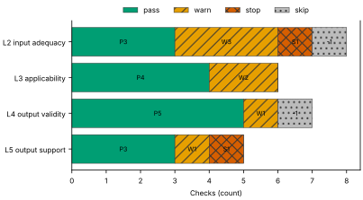
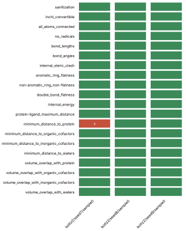
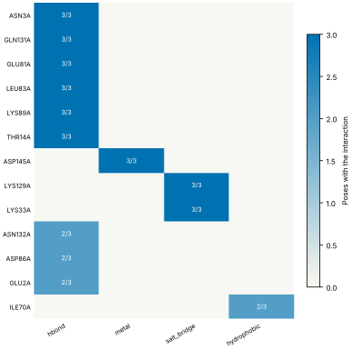
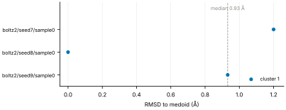
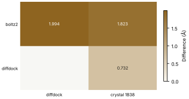
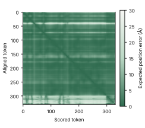

# Run report · Ligand pose in a known pocket

Prediction assurance · run `ligand_pose-1a2c62340cc3` · 2026-10-17 23:32:45 UTC

**Refused** for the claim "Predicted pose of ATP in CDK2 is valid".

Refused over layers 2,3,4,5: 15 pass, 7 warn, 2 stop, 2 skip. Stopped by l2.context.cofactors, l5.controls.redocking. Warnings from l2.receptor.protonation, l2.ligand.protonation, l2.docking.box, l3.exposure.pocket, l3.exposure.ligand_prevalence, l4.interactions.unsatisfied_polars, l5.sampling.seeds. 1 checks not verified.

Stops: `l2.context.cofactors`, `l5.controls.redocking`.

Warnings: `l2.receptor.protonation`, `l2.ligand.protonation`, `l2.docking.box`, `l3.exposure.pocket`, `l3.exposure.ligand_prevalence`, `l4.interactions.unsatisfied_polars`, `l5.sampling.seeds`.

Not verified: 1 checks.

| Field | Value |
| --- | --- |
| Task | Ligand pose in a known pocket (`ligand_pose`) |
| Tools | Boltz-2 2.2.1 (co-folding), DiffDock-L (docking) |
| Target | `protein` |
| Ligand | `c1nc(c2c(n1)n(cn2)[C@H]3[C@@H]([C@@H]([C@H](O3)CO[P@@](=O)(O)O[P@](=O)(O)OP(=O)(O)O)O)O)N` |
| Reference | `1B38` |
| pH | 7.4 |
| Seeds | 3 |
| Layers run | 2, 3, 4, 5 |
| Run | `ligand_pose-1a2c62340cc3` |
| Created | 2026-10-17 23:32:45 UTC |
| Finished | 2026-10-17 23:34:14 UTC |
| pah version | 0.1.0 |
| Report schema | 1 |

## Layers

| Layer | Status | Result | pass | warn | stop | skip | Time |
| --- | --- | --- | --- | --- | --- | --- | --- |
| L0 Provenance | not run | n/a | n/a | n/a | n/a | n/a | n/a |
| L1 Input integrity | not run | n/a | n/a | n/a | n/a | n/a | n/a |
| L2 Input adequacy | done | stop | 3 | 3 | 1 | 1 | 19.9 s |
| L3 Applicability | done | warn | 4 | 2 | 0 | 0 | 3.4 s |
| L4 Output validity | done | warn | 5 | 1 | 0 | 1 | 64.8 s |
| L5 Output support | done | stop | 3 | 1 | 1 | 0 | 316 ms |

## Figures

Fig. 1 · Check outcomes per layer for run ligand_pose-1a2c62340cc3. Totals: pass 15, warn 7, stop 2, skip 2.
Files: data [figures/gates_by_layer.csv](figures/gates_by_layer.csv).

## Structures

76 PyMOL renders.

1B38 mmCIF (source_structure), whole structure. Chains A; organic components ACE, ATP. sha256 b851c5e8a98632f8. PyMOL session: [renders/1B38.pse](renders/1B38.pse).

1B38 mmCIF (source_structure), ligand environment within 5 Å. Chains A; organic components ACE, ATP. sha256 b851c5e8a98632f8. PyMOL session: [renders/1B38.pse](renders/1B38.pse).

boltz2/seed7/sample0 (prediction_structure), whole structure. Chains A, C1, L; organic components LIG1. sha256 2bbae01a004a60b3. PyMOL session: [renders/boltz2_seed7_sample0.pse](renders/boltz2_seed7_sample0.pse).

boltz2/seed7/sample0 (prediction_structure), ligand environment within 5 Å. Chains A, C1, L; organic components LIG1. sha256 2bbae01a004a60b3. PyMOL session: [renders/boltz2_seed7_sample0.pse](renders/boltz2_seed7_sample0.pse).

boltz2/seed8/sample0 (prediction_structure), whole structure. Chains A, C1, L; organic components LIG1. sha256 832b67dedd1b220e. PyMOL session: [renders/boltz2_seed8_sample0.pse](renders/boltz2_seed8_sample0.pse).

boltz2/seed8/sample0 (prediction_structure), ligand environment within 5 Å. Chains A, C1, L; organic components LIG1. sha256 832b67dedd1b220e. PyMOL session: [renders/boltz2_seed8_sample0.pse](renders/boltz2_seed8_sample0.pse).

boltz2/seed9/sample0 (prediction_structure), whole structure. Chains A, C1, L; organic components LIG1. sha256 2e9ecab8122550c8. PyMOL session: [renders/boltz2_seed9_sample0.pse](renders/boltz2_seed9_sample0.pse).

boltz2/seed9/sample0 (prediction_structure), ligand environment within 5 Å. Chains A, C1, L; organic components LIG1. sha256 2e9ecab8122550c8. PyMOL session: [renders/boltz2_seed9_sample0.pse](renders/boltz2_seed9_sample0.pse).

diffdock/seed7/mode0 (prediction_structure), whole structure. Chains A, L; organic components LIG. sha256 57c42fec4ab3da5b. PyMOL session: [renders/diffdock_seed7_mode0.pse](renders/diffdock_seed7_mode0.pse).

diffdock/seed7/mode0 (prediction_structure), ligand environment within 5 Å. Chains A, L; organic components LIG. sha256 57c42fec4ab3da5b. PyMOL session: [renders/diffdock_seed7_mode0.pse](renders/diffdock_seed7_mode0.pse).

diffdock/seed7/mode1 (prediction_structure), whole structure. Chains A, L; organic components LIG. sha256 88dd4e2656a141d6. PyMOL session: [renders/diffdock_seed7_mode1.pse](renders/diffdock_seed7_mode1.pse).

diffdock/seed7/mode1 (prediction_structure), ligand environment within 5 Å. Chains A, L; organic components LIG. sha256 88dd4e2656a141d6. PyMOL session: [renders/diffdock_seed7_mode1.pse](renders/diffdock_seed7_mode1.pse).

diffdock/seed7/mode2 (prediction_structure), whole structure. Chains A, L; organic components LIG. sha256 3fc2f2cc61b65f34. PyMOL session: [renders/diffdock_seed7_mode2.pse](renders/diffdock_seed7_mode2.pse).

diffdock/seed7/mode2 (prediction_structure), ligand environment within 5 Å. Chains A, L; organic components LIG. sha256 3fc2f2cc61b65f34. PyMOL session: [renders/diffdock_seed7_mode2.pse](renders/diffdock_seed7_mode2.pse).

diffdock/seed7/mode3 (prediction_structure), whole structure. Chains A, L; organic components LIG. sha256 58ad7d3dca4a99a9. PyMOL session: [renders/diffdock_seed7_mode3.pse](renders/diffdock_seed7_mode3.pse).

diffdock/seed7/mode3 (prediction_structure), ligand environment within 5 Å. Chains A, L; organic components LIG. sha256 58ad7d3dca4a99a9. PyMOL session: [renders/diffdock_seed7_mode3.pse](renders/diffdock_seed7_mode3.pse).

diffdock/seed7/mode4 (prediction_structure), whole structure. Chains A, L; organic components LIG. sha256 6c117010d2d305d2. PyMOL session: [renders/diffdock_seed7_mode4.pse](renders/diffdock_seed7_mode4.pse).

diffdock/seed7/mode4 (prediction_structure), ligand environment within 5 Å. Chains A, L; organic components LIG. sha256 6c117010d2d305d2. PyMOL session: [renders/diffdock_seed7_mode4.pse](renders/diffdock_seed7_mode4.pse).

diffdock/seed7/mode5 (prediction_structure), whole structure. Chains A, L; organic components LIG. sha256 2132af09c9047919. PyMOL session: [renders/diffdock_seed7_mode5.pse](renders/diffdock_seed7_mode5.pse).

diffdock/seed7/mode5 (prediction_structure), ligand environment within 5 Å. Chains A, L; organic components LIG. sha256 2132af09c9047919. PyMOL session: [renders/diffdock_seed7_mode5.pse](renders/diffdock_seed7_mode5.pse).

diffdock/seed7/mode6 (prediction_structure), whole structure. Chains A, L; organic components LIG. sha256 aabe2daad657bc3d. PyMOL session: [renders/diffdock_seed7_mode6.pse](renders/diffdock_seed7_mode6.pse).

diffdock/seed7/mode6 (prediction_structure), ligand environment within 5 Å. Chains A, L; organic components LIG. sha256 aabe2daad657bc3d. PyMOL session: [renders/diffdock_seed7_mode6.pse](renders/diffdock_seed7_mode6.pse).

diffdock/seed7/mode7 (prediction_structure), whole structure. Chains A, L; organic components LIG. sha256 8f2afd128ff82983. PyMOL session: [renders/diffdock_seed7_mode7.pse](renders/diffdock_seed7_mode7.pse).

diffdock/seed7/mode7 (prediction_structure), ligand environment within 5 Å. Chains A, L; organic components LIG. sha256 8f2afd128ff82983. PyMOL session: [renders/diffdock_seed7_mode7.pse](renders/diffdock_seed7_mode7.pse).

diffdock/seed7/mode8 (prediction_structure), whole structure. Chains A, L; organic components LIG. sha256 6a9b7d39db4f0d34. PyMOL session: [renders/diffdock_seed7_mode8.pse](renders/diffdock_seed7_mode8.pse).

diffdock/seed7/mode8 (prediction_structure), ligand environment within 5 Å. Chains A, L; organic components LIG. sha256 6a9b7d39db4f0d34. PyMOL session: [renders/diffdock_seed7_mode8.pse](renders/diffdock_seed7_mode8.pse).

diffdock/seed7/mode9 (prediction_structure), whole structure. Chains A, L; organic components LIG. sha256 6f6f83277a338751. PyMOL session: [renders/diffdock_seed7_mode9.pse](renders/diffdock_seed7_mode9.pse).

diffdock/seed7/mode9 (prediction_structure), ligand environment within 5 Å. Chains A, L; organic components LIG. sha256 6f6f83277a338751. PyMOL session: [renders/diffdock_seed7_mode9.pse](renders/diffdock_seed7_mode9.pse).

diffdock/seed8/mode0 (prediction_structure), whole structure. Chains A, L; organic components LIG. sha256 4081d5cb3a1ddf8d. PyMOL session: [renders/diffdock_seed8_mode0.pse](renders/diffdock_seed8_mode0.pse).

diffdock/seed8/mode0 (prediction_structure), ligand environment within 5 Å. Chains A, L; organic components LIG. sha256 4081d5cb3a1ddf8d. PyMOL session: [renders/diffdock_seed8_mode0.pse](renders/diffdock_seed8_mode0.pse).

diffdock/seed8/mode1 (prediction_structure), whole structure. Chains A, L; organic components LIG. sha256 99f580a53cd895fc. PyMOL session: [renders/diffdock_seed8_mode1.pse](renders/diffdock_seed8_mode1.pse).

diffdock/seed8/mode1 (prediction_structure), ligand environment within 5 Å. Chains A, L; organic components LIG. sha256 99f580a53cd895fc. PyMOL session: [renders/diffdock_seed8_mode1.pse](renders/diffdock_seed8_mode1.pse).

diffdock/seed8/mode2 (prediction_structure), whole structure. Chains A, L; organic components LIG. sha256 590333f86a9356a5. PyMOL session: [renders/diffdock_seed8_mode2.pse](renders/diffdock_seed8_mode2.pse).

diffdock/seed8/mode2 (prediction_structure), ligand environment within 5 Å. Chains A, L; organic components LIG. sha256 590333f86a9356a5. PyMOL session: [renders/diffdock_seed8_mode2.pse](renders/diffdock_seed8_mode2.pse).

diffdock/seed8/mode3 (prediction_structure), whole structure. Chains A, L; organic components LIG. sha256 7b3042c71a8ab434. PyMOL session: [renders/diffdock_seed8_mode3.pse](renders/diffdock_seed8_mode3.pse).

diffdock/seed8/mode3 (prediction_structure), ligand environment within 5 Å. Chains A, L; organic components LIG. sha256 7b3042c71a8ab434. PyMOL session: [renders/diffdock_seed8_mode3.pse](renders/diffdock_seed8_mode3.pse).

diffdock/seed8/mode4 (prediction_structure), whole structure. Chains A, L; organic components LIG. sha256 478c104b61865fd2. PyMOL session: [renders/diffdock_seed8_mode4.pse](renders/diffdock_seed8_mode4.pse).

diffdock/seed8/mode4 (prediction_structure), ligand environment within 5 Å. Chains A, L; organic components LIG. sha256 478c104b61865fd2. PyMOL session: [renders/diffdock_seed8_mode4.pse](renders/diffdock_seed8_mode4.pse).

diffdock/seed8/mode5 (prediction_structure), whole structure. Chains A, L; organic components LIG. sha256 663caa5d620bccdd. PyMOL session: [renders/diffdock_seed8_mode5.pse](renders/diffdock_seed8_mode5.pse).

diffdock/seed8/mode5 (prediction_structure), ligand environment within 5 Å. Chains A, L; organic components LIG. sha256 663caa5d620bccdd. PyMOL session: [renders/diffdock_seed8_mode5.pse](renders/diffdock_seed8_mode5.pse).

diffdock/seed8/mode6 (prediction_structure), whole structure. Chains A, L; organic components LIG. sha256 2d2c84d3cb0616cc. PyMOL session: [renders/diffdock_seed8_mode6.pse](renders/diffdock_seed8_mode6.pse).

diffdock/seed8/mode6 (prediction_structure), ligand environment within 5 Å. Chains A, L; organic components LIG. sha256 2d2c84d3cb0616cc. PyMOL session: [renders/diffdock_seed8_mode6.pse](renders/diffdock_seed8_mode6.pse).

diffdock/seed8/mode7 (prediction_structure), whole structure. Chains A, L; organic components LIG. sha256 951b733c92bfd5ee. PyMOL session: [renders/diffdock_seed8_mode7.pse](renders/diffdock_seed8_mode7.pse).

diffdock/seed8/mode7 (prediction_structure), ligand environment within 5 Å. Chains A, L; organic components LIG. sha256 951b733c92bfd5ee. PyMOL session: [renders/diffdock_seed8_mode7.pse](renders/diffdock_seed8_mode7.pse).

diffdock/seed8/mode8 (prediction_structure), whole structure. Chains A, L; organic components LIG. sha256 6a80e09136fb95da. PyMOL session: [renders/diffdock_seed8_mode8.pse](renders/diffdock_seed8_mode8.pse).

diffdock/seed8/mode8 (prediction_structure), ligand environment within 5 Å. Chains A, L; organic components LIG. sha256 6a80e09136fb95da. PyMOL session: [renders/diffdock_seed8_mode8.pse](renders/diffdock_seed8_mode8.pse).

diffdock/seed8/mode9 (prediction_structure), whole structure. Chains A, L; organic components LIG. sha256 ddf4ef65cc96b96d. PyMOL session: [renders/diffdock_seed8_mode9.pse](renders/diffdock_seed8_mode9.pse).

diffdock/seed8/mode9 (prediction_structure), ligand environment within 5 Å. Chains A, L; organic components LIG. sha256 ddf4ef65cc96b96d. PyMOL session: [renders/diffdock_seed8_mode9.pse](renders/diffdock_seed8_mode9.pse).

diffdock/seed9/mode0 (prediction_structure), whole structure. Chains A, L; organic components LIG. sha256 0ee95128eeac3a8e. PyMOL session: [renders/diffdock_seed9_mode0.pse](renders/diffdock_seed9_mode0.pse).

diffdock/seed9/mode0 (prediction_structure), ligand environment within 5 Å. Chains A, L; organic components LIG. sha256 0ee95128eeac3a8e. PyMOL session: [renders/diffdock_seed9_mode0.pse](renders/diffdock_seed9_mode0.pse).

diffdock/seed9/mode1 (prediction_structure), whole structure. Chains A, L; organic components LIG. sha256 629abbc1b8c6f2aa. PyMOL session: [renders/diffdock_seed9_mode1.pse](renders/diffdock_seed9_mode1.pse).

diffdock/seed9/mode1 (prediction_structure), ligand environment within 5 Å. Chains A, L; organic components LIG. sha256 629abbc1b8c6f2aa. PyMOL session: [renders/diffdock_seed9_mode1.pse](renders/diffdock_seed9_mode1.pse).

diffdock/seed9/mode2 (prediction_structure), whole structure. Chains A, L; organic components LIG. sha256 1ee33f71a01c60df. PyMOL session: [renders/diffdock_seed9_mode2.pse](renders/diffdock_seed9_mode2.pse).

diffdock/seed9/mode2 (prediction_structure), ligand environment within 5 Å. Chains A, L; organic components LIG. sha256 1ee33f71a01c60df. PyMOL session: [renders/diffdock_seed9_mode2.pse](renders/diffdock_seed9_mode2.pse).

diffdock/seed9/mode3 (prediction_structure), whole structure. Chains A, L; organic components LIG. sha256 93959aa27993d337. PyMOL session: [renders/diffdock_seed9_mode3.pse](renders/diffdock_seed9_mode3.pse).

diffdock/seed9/mode3 (prediction_structure), ligand environment within 5 Å. Chains A, L; organic components LIG. sha256 93959aa27993d337. PyMOL session: [renders/diffdock_seed9_mode3.pse](renders/diffdock_seed9_mode3.pse).

diffdock/seed9/mode4 (prediction_structure), whole structure. Chains A, L; organic components LIG. sha256 1c5d34aa4a764a49. PyMOL session: [renders/diffdock_seed9_mode4.pse](renders/diffdock_seed9_mode4.pse).

diffdock/seed9/mode4 (prediction_structure), ligand environment within 5 Å. Chains A, L; organic components LIG. sha256 1c5d34aa4a764a49. PyMOL session: [renders/diffdock_seed9_mode4.pse](renders/diffdock_seed9_mode4.pse).

diffdock/seed9/mode5 (prediction_structure), whole structure. Chains A, L; organic components LIG. sha256 ad349771863f3bbf. PyMOL session: [renders/diffdock_seed9_mode5.pse](renders/diffdock_seed9_mode5.pse).

diffdock/seed9/mode5 (prediction_structure), ligand environment within 5 Å. Chains A, L; organic components LIG. sha256 ad349771863f3bbf. PyMOL session: [renders/diffdock_seed9_mode5.pse](renders/diffdock_seed9_mode5.pse).

diffdock/seed9/mode6 (prediction_structure), whole structure. Chains A, L; organic components LIG. sha256 bd099020f2539cc8. PyMOL session: [renders/diffdock_seed9_mode6.pse](renders/diffdock_seed9_mode6.pse).

diffdock/seed9/mode6 (prediction_structure), ligand environment within 5 Å. Chains A, L; organic components LIG. sha256 bd099020f2539cc8. PyMOL session: [renders/diffdock_seed9_mode6.pse](renders/diffdock_seed9_mode6.pse).

diffdock/seed9/mode7 (prediction_structure), whole structure. Chains A, L; organic components LIG. sha256 7d0305a91e5bc5bf. PyMOL session: [renders/diffdock_seed9_mode7.pse](renders/diffdock_seed9_mode7.pse).

diffdock/seed9/mode7 (prediction_structure), ligand environment within 5 Å. Chains A, L; organic components LIG. sha256 7d0305a91e5bc5bf. PyMOL session: [renders/diffdock_seed9_mode7.pse](renders/diffdock_seed9_mode7.pse).

diffdock/seed9/mode8 (prediction_structure), whole structure. Chains A, L; organic components LIG. sha256 9271615bb4d5d0ee. PyMOL session: [renders/diffdock_seed9_mode8.pse](renders/diffdock_seed9_mode8.pse).

diffdock/seed9/mode8 (prediction_structure), ligand environment within 5 Å. Chains A, L; organic components LIG. sha256 9271615bb4d5d0ee. PyMOL session: [renders/diffdock_seed9_mode8.pse](renders/diffdock_seed9_mode8.pse).

diffdock/seed9/mode9 (prediction_structure), whole structure. Chains A, L; organic components LIG. sha256 7c44b6fee8932b96. PyMOL session: [renders/diffdock_seed9_mode9.pse](renders/diffdock_seed9_mode9.pse).

diffdock/seed9/mode9 (prediction_structure), ligand environment within 5 Å. Chains A, L; organic components LIG. sha256 7c44b6fee8932b96. PyMOL session: [renders/diffdock_seed9_mode9.pse](renders/diffdock_seed9_mode9.pse).

1B39 mmCIF (source_structure), whole structure. Chains A; organic components ACE, ATP. sha256 43b7b7417024c3f4. PyMOL session: [renders/1B39.pse](renders/1B39.pse).

1B39 mmCIF (source_structure), ligand environment within 5 Å. Chains A; organic components ACE, ATP. sha256 43b7b7417024c3f4. PyMOL session: [renders/1B39.pse](renders/1B39.pse).

1FIN mmCIF (source_structure), whole structure. Chains A, B, C, D; organic components ATP. sha256 dfe5da37b2e28d3d. PyMOL session: [renders/1FIN.pse](renders/1FIN.pse).

1FIN mmCIF (source_structure), ligand environment within 5 Å. Chains A, B, C, D; organic components ATP. sha256 dfe5da37b2e28d3d. PyMOL session: [renders/1FIN.pse](renders/1FIN.pse).

1FQ1 mmCIF (source_structure), whole structure. Chains A, B; organic components ATP. sha256 f86aad4d11e29283. PyMOL session: [renders/1FQ1.pse](renders/1FQ1.pse).

1FQ1 mmCIF (source_structure), ligand environment within 5 Å. Chains A, B; organic components ATP. sha256 f86aad4d11e29283. PyMOL session: [renders/1FQ1.pse](renders/1FQ1.pse).

1GY3 mmCIF (source_structure), whole structure. Chains A, B, C, D, E, F; organic components ATP, GOL, TPO. sha256 fb1e8e095ae9fe28. PyMOL session: [renders/1GY3.pse](renders/1GY3.pse).

1GY3 mmCIF (source_structure), ligand environment within 5 Å. Chains A, B, C, D, E, F; organic components ATP, GOL, TPO. sha256 fb1e8e095ae9fe28. PyMOL session: [renders/1GY3.pse](renders/1GY3.pse).

## L0 Provenance

Where did every input come from?

Status: not run.

## L1 Input integrity

Did the run receive exactly what was declared?

Status: not run.

## L2 Input adequacy

Does the input carry enough information?

Status: done. Checks: pass 3 · warn 3 · stop 1 · skip 1. Time: 19.9 s.

#### Key figures

| Figure | Value |
| --- | --- |
| near site | 1 |
| missing | 1 |
| uniprot cofactors | 0 |
| pocket residues | 30 |
| incomplete | 0 |
| sequence gaps | 0 |
| state | holo |
| site ligands | 1 |

#### Docking

| Field | Value |
| --- | --- |
| center | -1.248, 27.587, 11.585 Å |
| size | 15.545 × 17.083 × 18.375 Å |
| origin | derived from ATP (+4 Å) |

#### Checks

| Check | Result | Measured cmp threshold | Evidence | Id · time |
| --- | --- | --- | --- | --- |
| Alignment depth, distinct sequences, Neff and gap fraction | skip | n/a | no MSA declared for a co-folding model · not applicable | `l2.msa.depth` |
| Required cofactors, ions and partners present | stop | `pocket_distance <= 8` | components within 8.0 Å of ATP in 1B38 not supplied: MG · near_site=1, missing=1, uniprot_cofactors=0 | `l2.context.cofactors` · 10.0 s |
| Pocket residues resolved, no missing loops lining the pocket | pass | `pocket_distance <= 6` | 30 pocket residues complete in 1B38.cif · pocket_residues=30, incomplete=0, sequence_gaps=0 | `l2.pocket.resolved` · 8 ms |
| Receptor state apo or holo | pass | n/a | 1B38.cif holo: ATP in the site · state=holo, site_ligands=1 | `l2.receptor.state` · 11 ms |
| Receptor protonation at the stated pH | warn | `pka_margin > 1` | receptor has no hydrogens (protonation not assigned) · hydrogens_present=False, ph=7.4, pocket_titratable=19 | `l2.receptor.protonation` · 578 ms |
| Ligand protonation and tautomers enumerated at the stated pH | warn | `ph 7.4 == 1` | ligand: 2 states; ligand: declared form Nc1ncnc2c1ncn2[C@@H]1O[C@H](CO[P@@](=O)(O)O[P@](=O)(O)OP(=O)(O)O)[C@@H](O)[C@H]1O differs from enumerated Nc1ncnc2c1ncn2[C@@H]1O[C@H](CO[P@@](=O)([O-])O[P@](=O)([O-])OP(=O)([O-])O)[C@@H](O)[C@H]1O, Nc1ncnc2c1ncn2[C@@H]1O[C@H](CO[P@@](=O)([O-])O[P@](=O)([O-])OP(=O)([O-])[O-])[C@@H](O)[C@H]1O · ph=7.4, max_states=2, declared_not_enumerated=1 | `l2.ligand.protonation` · 982 ms |
| Ligand conformers generated and minimised | pass | `conformers >= 10` | 10 ETKDG conformers per ligand, MMFF minimised · ligands=1, failed=0, min_embedded=10 | `l2.ligand.conformers` · 8.2 s |
| Docking box encloses the pocket with margin | warn | `margin >= 2` | no box declared; derived box encloses 22 contact residues and the ATP ligand with 2.0 Å margin · volume_A3=4879.6, ligand_atoms_inside_margin=31, ligand_atoms=31 | `l2.docking.box` · 37 ms |

## L3 Applicability

Is the tool inside its validated regime?

Status: done. Checks: pass 4 · warn 2 · stop 0 · skip 0. Time: 3.4 s.

#### Key figures

| Figure | Value |
| --- | --- |
| executors | 2 |
| unknown | 0 |
| reference released | 1998-12-23 |
| cutoff | 2019-01-01 |
| entries compared | 5 |
| max similarity | 52 |
| pocket residues | 32 |
| systems | 3474 |

#### Checks

| Check | Result | Measured cmp threshold | Evidence | Id · time |
| --- | --- | --- | --- | --- |
| Model training cutoff recorded | pass | `training_cutoff == recorded` | boltz2 2023-06-01; diffdock 2019-01-01; reference 1B38 released 1998-12-23, before the cutoff of boltz2, diffdock · executors=2, unknown=0, reference_released=1998-12-23 | `l3.model.training_cutoff` · 1 ms |
| Pocket similarity to pre-cutoff complexes (SuCOS times pocket coverage) | warn | `similarity <= 50` | max similarity 52.0 to 1B39 (ATP, SuCOS 0.555, coverage 0.938), released before 2019-01-01 · cutoff=2019-01-01, entries_compared=5, max_similarity=52 | `l3.exposure.pocket` · 3.3 s |
| Ligand analogues in pre-cutoff training systems | warn | `tanimoto > 0.9` | 3474 PDB entries released before 2019-01-01 (diffdock cutoff) contain analogues of ligand above Tanimoto 0.9: 5FA, ADP, AQP, ATP, HEJ, LA8 · cutoff=2019-01-01, systems=3474, analogue_components=19 | `l3.exposure.ligand_prevalence` · 0 ms |
| Chain sequence identity to pre-cutoff entries (secondary measure) | pass | `identity < 0.4` | protein: 391 entries at 95 percent identity, 456 at 40 percent, released before 2019-01-01 (reported, not gating) · cutoff=2019-01-01, entries_95=391, entries_40=456 | `l3.exposure.sequence` · 2 ms |
| Modality inside the validated set; token count against the training crop | pass | n/a | modalities protein, protein_ligand inside the validated set; 330 tokens · modalities=2, tokens=330, outside=0 | `l3.regime.modality` · 4 ms |
| Endpoint fits the tool | pass | `endpoint pose in pose` | endpoint pose produced by boltz2, diffdock · endpoint=pose, executors=2, not_fitting=0 | `l3.metric.endpoint` · 0 ms |

## L4 Output validity

Is the result physically and chemically sensible?

Status: done. Checks: pass 5 · warn 1 · stop 0 · skip 1. Time: 64.8 s.

#### Key figures

| Figure | Value |
| --- | --- |
| poses | 3 |
| passed | 20 |
| total | 20 |
| poses all pass | 2 |
| unlikely torsions | 0 |
| torsions | 14 |
| strain kcal | 14.28 |
| poses with unlikely | 0 |

#### PoseBusters · 20/20 tests pass

| test | result | value |
| --- | --- | --- |
| sanitization | pass | pass |
| inchi_convertible | pass | pass |
| all_atoms_connected | pass | pass |
| no_radicals | pass | pass |
| bond_lengths | pass | 0 long outliers |
| bond_angles | pass | 0 outliers |
| internal_steric_clash | pass | 0 |
| aromatic_ring_flatness | pass | 0.00 Å |
| non-aromatic_ring_non-flatness | pass | pass |
| double_bond_flatness | pass | pass |
| internal_energy | pass | 2.9 times the ensemble mean |
| protein-ligand_maximum_distance | pass | 2.46 Å |
| minimum_distance_to_protein | pass | 2.46 Å |
| minimum_distance_to_organic_cofactors | pass | pass |
| minimum_distance_to_inorganic_cofactors | pass | pass |
| minimum_distance_to_waters | pass | pass |
| volume_overlap_with_protein | pass | 0.017 |
| volume_overlap_with_organic_cofactors | pass | pass |
| volume_overlap_with_inorganic_cofactors | pass | pass |
| volume_overlap_with_waters | pass | pass |

#### Per-pose physical checks

| pose | seed | unlikely torsions | unsat. polars | buried charged | PoseBusters |
| --- | --- | --- | --- | --- | --- |
| boltz2/seed7/sample0 | 7 | 0/14 | 5 | 0 | 19/20 |
| boltz2/seed8/sample0 | 8 | 0/14 | 6 | 0 | 20/20 |
| boltz2/seed9/sample0 | 9 | 0/14 | 6 | 0 | 20/20 |
| median | n/a | 0 | 6 | 0 | 20/20 |

#### Interaction fingerprint · representative pose boltz2/seed8/sample0

| residue | type | distance | poses |
| --- | --- | --- | --- |
| ASN3A | hbond | 2.81 Å | 3/3 |
| GLN131A | hbond | 3.11 Å | 3/3 |
| GLU81A | hbond | 2.89 Å | 3/3 |
| LEU83A | hbond | 3.15 Å | 3/3 |
| LYS89A | hbond | 3.08 Å | 3/3 |
| THR14A | hbond | 2.27 Å | 3/3 |
| ASP145A | metal | 1.91 Å | 3/3 |
| LYS129A | salt_bridge | 3.68 Å | 3/3 |
| LYS33A | salt_bridge | 3.23 Å | 3/3 |
| ASN132A | hbond | 4.01 Å | 2/3 |
| ASP86A | hbond | 2.54 Å | 2/3 |
| GLU2A | hbond | 2.58 Å | 2/3 |
| ILE70A | hydrophobic | 3.72 Å | 2/3 |

Fig. 2 · PoseBusters tests (20) by pose (3). Failed cells marked x: 1 of 60.
Files: data [figures/posebusters_grid.csv](figures/posebusters_grid.csv).

Fig. 3 · Interactions by residue (13) and type (4); cell label: poses with the interaction over poses assessed.
Files: data [figures/interactions.csv](figures/interactions.csv).

#### Checks

| Check | Result | Measured cmp threshold | Evidence | Id · time |
| --- | --- | --- | --- | --- |
| PoseBusters geometry, stereochemistry, clashes and protein contact | pass | `tests_failed == 0` | 20 of 20 tests pass for boltz2/seed8/sample0; 2 of 3 poses pass all · poses=3, passed=20, total=20 | `l4.posebusters` · 2.9 s |
| Torsional strain of the ligand pose | pass | `torsion_energy <= 2.5` | 0 of 14 torsions above 2.5 kcal/mol in boltz2/seed8/sample0; strain 14.28 kcal/mol · poses=3, unlikely_torsions=0, torsions=14 | `l4.torsion_strain` · 4.0 s |
| Interaction fingerprint (PLIP) | pass | n/a | 13 interactions in boltz2/seed8/sample0 (hbond, metal, salt_bridge); 13 distinct across 3 poses (reported) · poses=3, interactions_representative=13, distinct=13 | `l4.interactions.fingerprint` · 3.9 s |
| Buried ligand polar atoms without a hydrogen-bond partner | warn | `relative_sasa < 0.1` | 6 of 11 buried polar ligand atoms without a partner in boltz2/seed8/sample0 · poses=3, unsatisfied=6, buried_charged=0 | `l4.interactions.unsatisfied_polars` · 277 ms |
| Hydrophobic complementarity of buried ligand surface | pass | `fraction >= 0.35` | nonpolar fraction of protein contacts around 8 buried nonpolar ligand atoms in boltz2/seed8/sample0: 0.667 · poses=3, complementarity=0.667, buried_nonpolar=8 | `l4.interactions.hydrophobic` · 269 ms |
| Interactions of the crystal ligand reproduced by the pose | pass | `reproduced 6 >= 1` | boltz2/seed8/sample0 reproduces 6 of 9 ATP interactions: hbond GLN131A, hbond GLU81A, hbond LEU83A, hbond THR14A, salt_bridge LYS129A, salt_bridge LYS33A · key_interactions=9, reproduced=6, poses_reproducing_all=0 | `l4.interactions.known_binders` · 250 ms |
| Pose stability under short restrained minimisation (OpenMM, AMBER14 and OpenFF) | skip | n/a | OutputUnavailableError: minimisation failed for every pose: ValueError: No template found for residue 0 (UNK).  The set of heavy atoms matches NALA, but the residue is missing 1 H atom.  You may be able to add it with Modeller.addHydrogens().  For more information, see https://github.com/openmm/openmm/wiki/Frequently-Asked-Questions#template; ValueError: No template found for residue 0 (UNK).  The set of heavy atoms matches NALA, but the residue is missing 1 H atom.  You may be able to add it with Modeller.addHydrogens().  For more information, see https://github.com/openmm/openmm/wiki/Frequently-Asked-Questions#template; ValueError: No template found for residue 0 (UNK).  The set of heavy atoms matches NALA, but the residue is missing 1 H atom.  You may be able to add it with Modeller.addHydrogens().  For more information, see https://github.com/openmm/openmm/wiki/Frequently-Asked-Questions#template · error | `l4.minimisation_drift` · 53.1 s |

## L5 Output support

Is a valid result corroborated?

Status: done. Checks: pass 3 · warn 1 · stop 1 · skip 0. Time: 316 ms.

#### Key figures

| Figure | Value |
| --- | --- |
| poses | 3 |
| pocket plddt | 95.1 |
| global plddt | 95.8 |
| iptm | 0.978 |
| ptm | 0.972 |
| confidence score | 0.958 |
| independent seeds | 3 |
| samples | 3 |

#### Sampling

| Field | Value |
| --- | --- |
| site placement | 3 of 3 poses within 4.0 Å of the site (ATP in 1B38) |
| pose accuracy | 3 of 3 poses within 2.0 Å of the medoid |
| pairwise RMSD median | 1.2 Å |
| pairwise RMSD IQR | 1.07 to 1.47 Å |
| pairs | 3 |
| medoid | boltz2/seed8/sample0 |

#### Clusters

| Field | Value |
| --- | --- |
| cluster 1 | 3/3 poses (boltz2/seed8/sample0) |

#### Per-seed statistics

| seed | pose | cluster | RMSD to medoid | confidence |
| --- | --- | --- | --- | --- |
| 7 | boltz2/seed7/sample0 | 1 | 1.2 Å | 0.96 |
| 8 | boltz2/seed8/sample0 | 1 | 0 Å | 0.96 |
| 9 | boltz2/seed9/sample0 | 1 | 0.93 Å | 0.96 |
| median | n/a | n/a | 0.93 Å | 0.96 |

#### Ensemble

| structure | kind | source | RMSD to medoid | cluster | pocket pLDDT | ipTM |
| --- | --- | --- | --- | --- | --- | --- |
| boltz2/seed7/sample0 | seed | boltz2 | 1.2 Å | 1 | 95.1 | 0.98 |
| boltz2/seed8/sample0 | medoid | boltz2 | 0 Å | 1 | 95.1 | 0.98 |
| boltz2/seed9/sample0 | seed | boltz2 | 0.93 Å | 1 | 95.1 | 0.97 |

#### Agreement between methods

| method | diffdock | crystal 1B38 |
| --- | --- | --- |
| boltz2 | 1.99 Å (high) | 1.82 Å (decisive) |
| diffdock | n/a | 0.73 Å (decisive) |

#### Confidence metrics

| metric | value | read as | tool |
| --- | --- | --- | --- |
| affinity_pred_value | -0.15088871121406555 | ranking within a series, never pose quality | boltz2 |
| affinity_probability_binary | 0.5224307775497437 | ranking within a series, never pose quality | boltz2 |
| affinity_pred_value | -0.13845452666282654 | ranking within a series, never pose quality | boltz2 |
| affinity_probability_binary | 0.5326341390609741 | ranking within a series, never pose quality | boltz2 |
| affinity_pred_value | 5.899369716644287e-05 | ranking within a series, never pose quality | boltz2 |
| affinity_probability_binary | 0.5148793458938599 | ranking within a series, never pose quality | boltz2 |

Fig. 4 · RMSD to the medoid for 3 poses, coloured by cluster (1 clusters). Dashed line: median 0.93 Å; range 0.00 to 1.20 Å.
Files: data [figures/seed_spread.csv](figures/seed_spread.csv).

Fig. 5 · Agreement between 2 methods and 2 comparators; range 0.732 to 1.994 Å.
Files: data [figures/agreement.csv](figures/agreement.csv).

Fig. 6 · Predicted aligned error for pose boltz2/seed7/sample0, 331 by 331 tokens; values 0.2 to 28.1 Å, mean 3.7 Å.
Files: data [figures/pae.csv](figures/pae.csv).

#### Checks

| Check | Result | Measured cmp threshold | Evidence | Id · time |
| --- | --- | --- | --- | --- |
| Confidence restricted to the pocket; per-model thresholds | pass | `boltz2.pocket_plddt >= 70` | boltz2/seed8/sample0: pocket_plddt 95.1 · poses=3, pocket_plddt=95.1, global_plddt=95.8 | `l5.confidence.local` · 26 ms |
| Independent seeds counted separately from samples; duplicates flagged | warn | `seeds_cofolding >= 5` | 3 independent seeds (3 poses); task default 5 · independent_seeds=3, samples=3, duplicated_outputs=0 | `l5.sampling.seeds` · 0 ms |
| Medoid of the largest cluster, populations, pairwise spread, site and pose accuracy | pass | `cluster_rmsd <= 2` | medoid boltz2/seed8/sample0; 1 clusters, largest 3 of 3; pairwise RMSD median 1.20 Å (IQR 1.07 to 1.47); 3 of 3 poses within 4.0 Å of the site (ATP in 1B38); 3 of 3 poses within 2.0 Å of the medoid · poses=3, clusters=1, largest_cluster=3 | `l5.sampling.clusters` · 31 ms |
| Agreement between methods, weighted by independence | pass | `rmsd_to_crystal_A 1.82 <= 2` | boltz2 vs diffdock 1.994 Å (high); boltz2 vs crystal 1B38 1.823 Å (decisive); diffdock vs crystal 1B38 0.732 Å (decisive) · methods=2, comparisons=3, disagreeing=0 | `l5.agreement.cross_family` · 87 ms |
| Redocking control reproduces the crystal pose | stop | `rmsd <= 2` | redocking control required by the task and not supplied (controls.redocking) | `l5.controls.redocking` · 0 ms |

## Controls

| control | status | result |
| --- | --- | --- |
| redocking | incomplete | redocking control required by the task and not supplied (controls.redocking) |

## Provenance

54 objects · 54 cached · 0 network.

| Source | Accession | Release | SHA-256 | Retrieved | Bytes | Cache | Used by |
| --- | --- | --- | --- | --- | --- | --- | --- |
| rcsb_files | 1B38 | n/a | `b851c5e8a986` | 2026-10-17 16:42:54 UTC | 333302 | hit | l2.context.cofactors, l2.pocket.resolved, l2.receptor.state, l2.docking.box, l3.exposure.pocket, l3.regime.modality, l4.interactions.fingerprint, l4.interactions.known_binders, l5.sampling.clusters, l5.agreement.cross_family |
| ccd | ATP | 2011-06-04 | `a7dfd66192d9` | 2026-10-17 16:42:55 UTC | 14836 | hit | l2.context.cofactors, l3.exposure.pocket |
| rcsb | 1B38 | 1.4 | `64dd65fa1b0d` | 2026-10-17 16:42:56 UTC | 16633 | hit | l3.model.training_cutoff |
| rcsb_search | chem:c1nc(c2c(n1)n(cn2)[C@H]3[C@@H]([C@@H]([C@H](O3)CO[P@@](=O)(O)O[P@](=O)(O)OP(=O)(O)O)O)O)N | n/a | `c9ecdf87b8e2` | 2026-10-17 16:42:57 UTC | 1797 | hit | l3.exposure.pocket |
| ccd | 5FA | 2011-06-04 | `141da43b1fd4` | 2026-10-17 16:42:57 UTC | 5208 | hit | l3.exposure.pocket |
| ccd | ADP | 2025-10-10 | `9ebf239d6ded` | 2026-10-17 16:42:57 UTC | 5741 | hit | l3.exposure.pocket |
| ccd | AQP | 2011-06-04 | `d1f31df6170c` | 2026-10-17 16:42:57 UTC | 4700 | hit | l3.exposure.pocket |
| ccd | HEJ | 2021-03-01 | `3793d61303f5` | 2026-10-17 16:42:57 UTC | 4603 | hit | l3.exposure.pocket |
| ccd | LA8 | 2020-06-17 | `3c66f53baf33` | 2026-10-17 16:42:57 UTC | 4178 | hit | l3.exposure.pocket |
| ccd | ZF9 | 2024-03-08 | `b48f6ea5a0a0` | 2026-10-17 16:42:57 UTC | 4686 | hit | l3.exposure.pocket |
| ccd | ZSF | 2024-03-29 | `dde5989ea661` | 2026-10-17 16:42:57 UTC | 4903 | hit | l3.exposure.pocket |
| ccd | 50T | 2026-09-16 | `6be53fbf78af` | 2026-10-17 16:42:57 UTC | 4275 | hit | l3.exposure.pocket |
| ccd | AD9 | 2026-09-16 | `c8798e579e0a` | 2026-10-17 16:42:58 UTC | 4205 | hit | l3.exposure.pocket |
| ccd | AOV | 2026-09-16 | `300b793745cf` | 2026-10-17 16:42:58 UTC | 4330 | hit | l3.exposure.pocket |
| ccd | CX0 | 2022-03-25 | `fbc78ded25cd` | 2026-10-17 16:42:58 UTC | 3595 | hit | l3.exposure.pocket |
| ccd | CXC | 2022-03-25 | `d89a7023bd05` | 2026-10-17 16:42:58 UTC | 3941 | hit | l3.exposure.pocket |
| ccd | 0A | 2015-04-24 | `7f0b456f42e0` | 2026-10-17 16:42:58 UTC | 3972 | hit | l3.exposure.pocket |
| ccd | 3AN | 2011-06-04 | `a3d4d17a4a3e` | 2026-10-17 16:42:58 UTC | 4390 | hit | l3.exposure.pocket |
| ccd | 7DD | 2016-06-10 | `2265ea597be9` | 2026-10-17 16:42:58 UTC | 3425 | hit | l3.exposure.pocket |
| ccd | 7DT | 2016-06-10 | `c346b8a79ec0` | 2026-10-17 16:42:58 UTC | 3725 | hit | l3.exposure.pocket |
| ccd | AAM | 2011-06-04 | `ade365fd93cd` | 2026-10-17 16:42:58 UTC | 4244 | hit | l3.exposure.pocket |
| ccd | PAP | 2011-06-04 | `1a6bb6874f6f` | 2026-10-17 16:42:58 UTC | 4734 | hit | l3.exposure.pocket |
| ccd | XNY | 2021-04-30 | `7cb26ca44908` | 2026-10-17 16:42:58 UTC | 3977 | hit | l3.exposure.pocket |
| ccd | AP5 | 2011-06-04 | `43e554f584b7` | 2026-10-17 16:42:58 UTC | 6473 | hit | l3.exposure.pocket |
| ccd | T99 | 2018-06-01 | `68a3d15f3b6f` | 2026-10-17 16:42:58 UTC | 3399 | hit | l3.exposure.pocket |
| ccd | TAT | 2012-01-25 | `55287be9857e` | 2026-10-17 16:42:58 UTC | 4858 | hit | l3.exposure.pocket |
| ccd | A1L15 | 2025-01-24 | `57864c05fab0` | 2026-10-17 16:42:58 UTC | 5608 | hit | l3.exposure.pocket |
| ccd | AGS | 2020-06-17 | `dcdd428b77e4` | 2026-10-17 16:42:58 UTC | 10128 | hit | l3.exposure.pocket |
| rcsb_search | comp:5FA:2019-01-01 | n/a | `c60bf45b266d` | 2026-10-17 16:42:58 UTC | 282 | hit | l3.exposure.pocket |
| rcsb_search | comp:ADP:2019-01-01 | n/a | `d0ea634975e9` | 2026-10-17 16:42:58 UTC | 52129 | hit | l3.exposure.pocket |
| rcsb_search | comp:AQP:2019-01-01 | n/a | `94a619102faa` | 2026-10-17 16:42:58 UTC | 230 | hit | l3.exposure.pocket |
| rcsb_search | comp:ATP:2019-01-01 | n/a | `88190701e349` | 2026-10-17 16:42:59 UTC | 52129 | hit | l3.exposure.pocket |
| rcsb_search | comp:HEJ:2019-01-01 | n/a | `494129c6512c` | 2026-10-17 16:42:59 UTC | 178 | hit | l3.exposure.pocket |
| rcsb_search | comp:LA8:2019-01-01 | n/a | `185329a63a40` | 2026-10-17 16:42:59 UTC | 230 | hit | l3.exposure.pocket |
| rcsb_search | comp:ZF9:2019-01-01 | n/a | `e3b0c44298fc` | 2026-10-17 16:42:59 UTC | 0 | hit | l3.exposure.pocket |
| rcsb_search | comp:ZSF:2019-01-01 | n/a | `e3b0c44298fc` | 2026-10-17 16:42:59 UTC | 0 | hit | l3.exposure.pocket |
| rcsb_search | comp:50T:2019-01-01 | n/a | `927f39839b9d` | 2026-10-17 16:42:59 UTC | 178 | hit | l3.exposure.pocket |
| rcsb_search | comp:AD9:2019-01-01 | n/a | `ac65056f9aef` | 2026-10-17 16:42:59 UTC | 490 | hit | l3.exposure.pocket |
| rcsb_search | comp:AOV:2019-01-01 | n/a | `d8dd9b5a5778` | 2026-10-17 16:42:59 UTC | 334 | hit | l3.exposure.pocket |
| rcsb_search | comp:CX0:2019-01-01 | n/a | `e3b0c44298fc` | 2026-10-17 16:42:59 UTC | 0 | hit | l3.exposure.pocket |
| rcsb_search | comp:CXC:2019-01-01 | n/a | `e3b0c44298fc` | 2026-10-17 16:42:59 UTC | 0 | hit | l3.exposure.pocket |
| rcsb_search | comp:0A:2019-01-01 | n/a | `e3b0c44298fc` | 2026-10-17 16:42:59 UTC | 0 | hit | l3.exposure.pocket |
| rcsb_search | comp:PAP:2019-01-01 | n/a | `ded69bf4bbb0` | 2026-10-17 16:42:59 UTC | 542 | hit | l3.exposure.pocket |
| rcsb_search | comp:AP5:2019-01-01 | n/a | `ab39d336ec91` | 2026-10-17 16:42:59 UTC | 3247 | hit | l3.exposure.pocket |
| rcsb_search | comp:T99:2019-01-01 | n/a | `690266055a03` | 2026-10-17 16:42:59 UTC | 178 | hit | l3.exposure.pocket |
| rcsb_search | comp:TAT:2019-01-01 | n/a | `84486689d32b` | 2026-10-17 16:42:59 UTC | 438 | hit | l3.exposure.pocket |
| rcsb_search | comp:AGS:2019-01-01 | n/a | `aef54bf1fe1d` | 2026-10-17 16:42:59 UTC | 8188 | hit | l3.exposure.pocket |
| rcsb_search | seq0.9:2019-01-01:299 | n/a | `db535fa6304a` | 2026-10-17 16:43:01 UTC | 10528 | hit | l3.exposure.pocket |
| rcsb_files | 1B39 | n/a | `43b7b7417024` | 2026-10-17 16:43:01 UTC | 327760 | hit | l3.exposure.pocket |
| rcsb_files | 1FIN | n/a | `dfe5da37b2e2` | 2026-10-17 16:43:01 UTC | 999052 | hit | l3.exposure.pocket |
| rcsb_files | 1FQ1 | n/a | `f86aad4d11e2` | 2026-10-17 16:43:02 UTC | 464333 | hit | l3.exposure.pocket |
| rcsb_files | 1GY3 | n/a | `fb1e8e095ae9` | 2026-10-17 16:43:02 UTC | 1014441 | hit | l3.exposure.pocket |
| rcsb_search | seq0.95:2019-01-01:299 | n/a | `0e5b1db1762b` | 2026-10-17 16:43:02 UTC | 388 | hit | l3.exposure.sequence |
| rcsb_search | seq0.4:2019-01-01:299 | n/a | `b856cff26996` | 2026-10-17 16:43:03 UTC | 388 | hit | l3.exposure.sequence |

Provenance graph: [json](graph.json), [mmd](graph.mmd), [svg](graph.svg).

## Thresholds

| Check | Threshold | Value | Origin | Evidence level |
| --- | --- | --- | --- | --- |
| `l2.context.cofactors` | pocket_distance | <= 8 | Harness rule: a component of the reference entry within 8 Å of the declared ligand is required context; not yet calibrated | uncalibrated |
| `l2.pocket.resolved` | pocket_distance | <= 6 | Harness rule: pocket residues have a heavy atom within 6 Å of the ligand; not yet calibrated | uncalibrated |
| `l2.pocket.resolved` | missing_pocket_residues | == 0 | Specification layer 2: stop when the pocket is incomplete | published |
| `l2.receptor.protonation` | pka_margin | > 1 | Harness rule: a titratable pocket residue with PROPKA pKa within 1 unit of the stated pH has an ambiguous state; not yet calibrated | uncalibrated |
| `l2.ligand.protonation` | ph_window | == 1 | Harness rule: states enumerated by Dimorphite-DL within 1 pH unit of the stated pH; not yet calibrated | uncalibrated |
| `l2.ligand.protonation` | states | == 1 | Specification layer 2: warn when more than one plausible state | published |
| `l2.ligand.conformers` | conformers | >= 10 | Harness default number of ETKDG conformers; not yet calibrated | uncalibrated |
| `l2.docking.box` | margin | >= 2 | Harness rule: every pocket heavy atom lies at least 2 Å inside the box; not yet calibrated | uncalibrated |
| `l2.docking.box` | contact_distance | <= 4 | Harness rule: contact residues (heavy atom within 4 Å of the reference ligand) must have an atom inside the box; not yet calibrated | uncalibrated |
| `l3.model.training_cutoff` | training_cutoff | == recorded | Specification, Layer 3 (applicability): stop when unknown | published |
| `l3.exposure.pocket` | similarity | <= 50 | Specification layer 3: warn above a pocket similarity (SuCOS times pocket coverage) of 50 | published |
| `l3.exposure.pocket` | entries | <= 5 | Harness budget: pre-cutoff holo entries compared per run | uncalibrated |
| `l3.exposure.ligand_prevalence` | tanimoto | > 0.9 | Specification layer 3: analogues above 0.9 Tanimoto (RDKit topological fingerprint) | published |
| `l3.exposure.ligand_prevalence` | systems | <= 100 | Specification layer 3: prevalent when analogues occur in more than 100 training systems | published |
| `l3.exposure.sequence` | identity | < 0.4 | Specification layer 3: conventional 40 percent identity leakage threshold, reported as a secondary measure only | published |
| `l3.metric.endpoint` | endpoint | in pose | Specification, Layer 3 (applicability): no affinity from interface confidence, no protein-protein affinity from Boltz-2 | published |
| `l4.posebusters` | tests_failed | == 0 | Specification, Layer 4 (output validity): stop on failure | published |
| `l4.torsion_strain` | torsion_energy | <= 2.5 | Harness rule: a rotatable torsion whose MMFF energy lies more than 2.5 kcal/mol above the minimum of its rigid scan is unlikely; not yet calibrated | uncalibrated |
| `l4.interactions.unsatisfied_polars` | relative_sasa | < 0.1 | Harness rule: a ligand polar atom with relative SASA below 0.1 in the complex is buried; not yet calibrated | uncalibrated |
| `l4.interactions.unsatisfied_polars` | hbond_distance | <= 3.5 | PLIP hydrogen bond distance cut-off (donor-acceptor 4.1 Å; harness uses 3.5 Å heavy-atom distance) | published |
| `l4.interactions.hydrophobic` | fraction | >= 0.35 | Harness default anchored on 3PTB: the crystal benzamidine scores 0.51, Vina and Boltz-2 poses within 0.5 Å of it score 0.45 and 0.49; not calibrated on the benchmark | uncalibrated |
| `l4.interactions.hydrophobic` | relative_sasa | < 0.1 | Harness rule: a ligand polar atom with relative SASA below 0.1 in the complex is buried; not yet calibrated | uncalibrated |
| `l4.interactions.known_binders` | reproduced | >= 1 | Specification layer 4: warn when no key interaction is reproduced | published |
| `l5.confidence.local` | boltz2.pocket_plddt | >= 70 | AlphaFold DB pLDDT bands (70 and above: confident backbone), applied to pocket residues; not calibrated for ligand pose | published |
| `l5.sampling.seeds` | seeds_cofolding | >= 5 | Specification layer 5: default of five seeds per co-folding prediction | published |
| `l5.sampling.clusters` | cluster_rmsd | <= 2 | Specification layer 5: 2 Å symmetry-aware ligand RMSD (spyrmsd) separates pose clusters | published |
| `l5.sampling.clusters` | site_distance | <= 4 | Harness rule: a ligand centroid within 4 Å of the reference site centroid is placed in the site; not yet calibrated | uncalibrated |
| `l5.sampling.clusters` | largest_fraction | >= 0.5 | Harness rule: the largest cluster holds at least half of the poses; not yet calibrated | uncalibrated |
| `l5.agreement.cross_family` | rmsd | <= 2 | Specification layer 5: pose agreement by symmetry-aware ligand RMSD at 2 Å | published |
| `l5.controls.redocking` | rmsd | <= 2 | Specification layer 5: redocking must reproduce the crystal pose (2 Å ligand RMSD) | published |

Tool versions: dimorphite_dl 2.1.0, freesasa 2.2.1, gemmi 0.7.5, numpy 1.26.4, openbabel 3.2.1, plip 3.0.1, posebusters 0.6.5, propka 3.5.1, rdkit 2026.9.1, scipy 1.17.1, spyrmsd 0.9.0.

## Limitations

- This report covers layers 2, 3, 4, 5. Layers not run: 0, 1.
- The harness establishes when a result should not be trusted. Passing checks are not evidence that a prediction is correct.
- Thresholds marked uncalibrated come from the specification or harness defaults and have not been recalibrated on the harness benchmark.

## Files

| Path | Kind | Bytes | SHA-256 |
| --- | --- | --- | --- |
| artifacts/sources/1B38.cif | source_structure | 333302 | `b851c5e8a986` |
| /home/user/harness-hackathon/bench/runs/2026-10-17T1859Z-849c856/predictions/cdk2_wt/boltz2/seed_7/boltz_results_cdk2_wt/predictions/cdk2_wt/cdk2_wt_model_0.cif | prediction_structure | 214750 | `2bbae01a004a` |
| predictions/00_boltz2/boltz2/seed7/sample0/ligand.sdf | data | 2682 | `970c276a3fb5` |
| /home/user/harness-hackathon/bench/runs/2026-10-17T1859Z-849c856/predictions/cdk2_wt/boltz2/seed_8/boltz_results_cdk2_wt/predictions/cdk2_wt/cdk2_wt_model_0.cif | prediction_structure | 214716 | `832b67dedd1b` |
| predictions/00_boltz2/boltz2/seed8/sample0/ligand.sdf | data | 2682 | `130efbfd60e4` |
| /home/user/harness-hackathon/bench/runs/2026-10-17T1859Z-849c856/predictions/cdk2_wt/boltz2/seed_9/boltz_results_cdk2_wt/predictions/cdk2_wt/cdk2_wt_model_0.cif | prediction_structure | 215011 | `2e9ecab81225` |
| predictions/00_boltz2/boltz2/seed9/sample0/ligand.sdf | data | 2682 | `ceba9328c958` |
| predictions/01_diffdock/diffdock/seed7/mode0/complex.pdb | prediction_structure | 192294 | `57c42fec4ab3` |
| predictions/01_diffdock/diffdock/seed7/mode0/ligand.sdf | data | 2682 | `98940d22c7ce` |
| predictions/01_diffdock/diffdock/seed7/mode1/complex.pdb | prediction_structure | 192294 | `88dd4e2656a1` |
| predictions/01_diffdock/diffdock/seed7/mode1/ligand.sdf | data | 2682 | `bde481040ff4` |
| predictions/01_diffdock/diffdock/seed7/mode2/complex.pdb | prediction_structure | 192294 | `3fc2f2cc61b6` |
| predictions/01_diffdock/diffdock/seed7/mode2/ligand.sdf | data | 2682 | `ac6f33e1f786` |
| predictions/01_diffdock/diffdock/seed7/mode3/complex.pdb | prediction_structure | 192294 | `58ad7d3dca4a` |
| predictions/01_diffdock/diffdock/seed7/mode3/ligand.sdf | data | 2682 | `bd65aa7589c8` |
| predictions/01_diffdock/diffdock/seed7/mode4/complex.pdb | prediction_structure | 192294 | `6c117010d2d3` |
| predictions/01_diffdock/diffdock/seed7/mode4/ligand.sdf | data | 2682 | `3e2aad0676ae` |
| predictions/01_diffdock/diffdock/seed7/mode5/complex.pdb | prediction_structure | 192294 | `2132af09c904` |
| predictions/01_diffdock/diffdock/seed7/mode5/ligand.sdf | data | 2682 | `367141dc1df3` |
| predictions/01_diffdock/diffdock/seed7/mode6/complex.pdb | prediction_structure | 192294 | `aabe2daad657` |
| predictions/01_diffdock/diffdock/seed7/mode6/ligand.sdf | data | 2682 | `8ec494d40de0` |
| predictions/01_diffdock/diffdock/seed7/mode7/complex.pdb | prediction_structure | 192294 | `8f2afd128ff8` |
| predictions/01_diffdock/diffdock/seed7/mode7/ligand.sdf | data | 2682 | `74074212560c` |
| predictions/01_diffdock/diffdock/seed7/mode8/complex.pdb | prediction_structure | 192294 | `6a9b7d39db4f` |
| predictions/01_diffdock/diffdock/seed7/mode8/ligand.sdf | data | 2682 | `e87042675736` |
| predictions/01_diffdock/diffdock/seed7/mode9/complex.pdb | prediction_structure | 192294 | `6f6f83277a33` |
| predictions/01_diffdock/diffdock/seed7/mode9/ligand.sdf | data | 2682 | `39740e34005d` |
| predictions/01_diffdock/diffdock/seed8/mode0/complex.pdb | prediction_structure | 192294 | `4081d5cb3a1d` |
| predictions/01_diffdock/diffdock/seed8/mode0/ligand.sdf | data | 2682 | `4d12479062fa` |
| predictions/01_diffdock/diffdock/seed8/mode1/complex.pdb | prediction_structure | 192294 | `99f580a53cd8` |
| predictions/01_diffdock/diffdock/seed8/mode1/ligand.sdf | data | 2682 | `b3dd2d5fe095` |
| predictions/01_diffdock/diffdock/seed8/mode2/complex.pdb | prediction_structure | 192294 | `590333f86a93` |
| predictions/01_diffdock/diffdock/seed8/mode2/ligand.sdf | data | 2682 | `4211980af9ae` |
| predictions/01_diffdock/diffdock/seed8/mode3/complex.pdb | prediction_structure | 192294 | `7b3042c71a8a` |
| predictions/01_diffdock/diffdock/seed8/mode3/ligand.sdf | data | 2682 | `c6ea7afcdffe` |
| predictions/01_diffdock/diffdock/seed8/mode4/complex.pdb | prediction_structure | 192294 | `478c104b6186` |
| predictions/01_diffdock/diffdock/seed8/mode4/ligand.sdf | data | 2682 | `ef05b8b3ae87` |
| predictions/01_diffdock/diffdock/seed8/mode5/complex.pdb | prediction_structure | 192294 | `663caa5d620b` |
| predictions/01_diffdock/diffdock/seed8/mode5/ligand.sdf | data | 2682 | `9a4add496ce5` |
| predictions/01_diffdock/diffdock/seed8/mode6/complex.pdb | prediction_structure | 192294 | `2d2c84d3cb06` |
| predictions/01_diffdock/diffdock/seed8/mode6/ligand.sdf | data | 2682 | `8a264105f74b` |
| predictions/01_diffdock/diffdock/seed8/mode7/complex.pdb | prediction_structure | 192294 | `951b733c92bf` |
| predictions/01_diffdock/diffdock/seed8/mode7/ligand.sdf | data | 2682 | `7de8eae97819` |
| predictions/01_diffdock/diffdock/seed8/mode8/complex.pdb | prediction_structure | 192294 | `6a80e09136fb` |
| predictions/01_diffdock/diffdock/seed8/mode8/ligand.sdf | data | 2682 | `f0af82706ded` |
| predictions/01_diffdock/diffdock/seed8/mode9/complex.pdb | prediction_structure | 192294 | `ddf4ef65cc96` |
| predictions/01_diffdock/diffdock/seed8/mode9/ligand.sdf | data | 2682 | `e655b93e4250` |
| predictions/01_diffdock/diffdock/seed9/mode0/complex.pdb | prediction_structure | 192294 | `0ee95128eeac` |
| predictions/01_diffdock/diffdock/seed9/mode0/ligand.sdf | data | 2682 | `99a9d0c87af1` |
| predictions/01_diffdock/diffdock/seed9/mode1/complex.pdb | prediction_structure | 192294 | `629abbc1b8c6` |
| predictions/01_diffdock/diffdock/seed9/mode1/ligand.sdf | data | 2682 | `94b7fe57c254` |
| predictions/01_diffdock/diffdock/seed9/mode2/complex.pdb | prediction_structure | 192294 | `1ee33f71a01c` |
| predictions/01_diffdock/diffdock/seed9/mode2/ligand.sdf | data | 2682 | `85c8995c021d` |
| predictions/01_diffdock/diffdock/seed9/mode3/complex.pdb | prediction_structure | 192294 | `93959aa27993` |
| predictions/01_diffdock/diffdock/seed9/mode3/ligand.sdf | data | 2682 | `2cc9cf20cf7e` |
| predictions/01_diffdock/diffdock/seed9/mode4/complex.pdb | prediction_structure | 192294 | `1c5d34aa4a76` |
| predictions/01_diffdock/diffdock/seed9/mode4/ligand.sdf | data | 2682 | `dd921353a841` |
| predictions/01_diffdock/diffdock/seed9/mode5/complex.pdb | prediction_structure | 192294 | `ad349771863f` |
| predictions/01_diffdock/diffdock/seed9/mode5/ligand.sdf | data | 2682 | `f23e954b8a21` |
| predictions/01_diffdock/diffdock/seed9/mode6/complex.pdb | prediction_structure | 192294 | `bd099020f253` |
| predictions/01_diffdock/diffdock/seed9/mode6/ligand.sdf | data | 2682 | `057efa6b2782` |
| predictions/01_diffdock/diffdock/seed9/mode7/complex.pdb | prediction_structure | 192294 | `7d0305a91e5b` |
| predictions/01_diffdock/diffdock/seed9/mode7/ligand.sdf | data | 2682 | `6676d14f0bf4` |
| predictions/01_diffdock/diffdock/seed9/mode8/complex.pdb | prediction_structure | 192294 | `9271615bb4d5` |
| predictions/01_diffdock/diffdock/seed9/mode8/ligand.sdf | data | 2682 | `3e12281ff958` |
| predictions/01_diffdock/diffdock/seed9/mode9/complex.pdb | prediction_structure | 192294 | `7c44b6fee893` |
| predictions/01_diffdock/diffdock/seed9/mode9/ligand.sdf | data | 2682 | `31c3791ec3b6` |
| artifacts/sources/1B39.cif | source_structure | 327760 | `43b7b7417024` |
| artifacts/sources/1FIN.cif | source_structure | 999052 | `dfe5da37b2e2` |
| artifacts/sources/1FQ1.cif | source_structure | 464333 | `f86aad4d11e2` |
| artifacts/sources/1GY3.cif | source_structure | 1014441 | `fb1e8e095ae9` |
| renders/1B38_overview.png | render | 205212 | `a979e98511df` |
| renders/1B38_pocket.png | render | 397325 | `8b7756d44501` |
| renders/1B38.pse | session | 789668 | `52c2ab078519` |
| renders/boltz2_seed7_sample0_overview.png | render | 212625 | `8f20c3f88005` |
| renders/boltz2_seed7_sample0_pocket.png | render | 387761 | `b092daff56b8` |
| renders/boltz2_seed7_sample0.pse | session | 805706 | `d897c38fc520` |
| renders/boltz2_seed8_sample0_overview.png | render | 199320 | `d25a01172e4a` |
| renders/boltz2_seed8_sample0_pocket.png | render | 329467 | `f5da266b9432` |
| renders/boltz2_seed8_sample0.pse | session | 805715 | `c526324f78ef` |
| renders/boltz2_seed9_sample0_overview.png | render | 204800 | `167bce5b1a50` |
| renders/boltz2_seed9_sample0_pocket.png | render | 313987 | `460c918e7ae2` |
| renders/boltz2_seed9_sample0.pse | session | 805717 | `f0574a54aa6c` |
| renders/diffdock_seed7_mode0_overview.png | render | 202746 | `2dbd24374d2e` |
| renders/diffdock_seed7_mode0_pocket.png | render | 330189 | `db2be2712c72` |
| renders/diffdock_seed7_mode0.pse | session | 674335 | `5eeb02f5ead2` |
| renders/diffdock_seed7_mode1_overview.png | render | 203475 | `fcadebd6c42c` |
| renders/diffdock_seed7_mode1_pocket.png | render | 330444 | `975364e045cd` |
| renders/diffdock_seed7_mode1.pse | session | 674341 | `54e120ae4c47` |
| renders/diffdock_seed7_mode2_overview.png | render | 203367 | `78e8362c5a3e` |
| renders/diffdock_seed7_mode2_pocket.png | render | 345572 | `b7eccd15ace4` |
| renders/diffdock_seed7_mode2.pse | session | 674367 | `82a4fe42ce07` |
| renders/diffdock_seed7_mode3_overview.png | render | 203397 | `ab9e5ccffce5` |
| renders/diffdock_seed7_mode3_pocket.png | render | 342760 | `82e602310fd2` |
| renders/diffdock_seed7_mode3.pse | session | 674368 | `8f275fce255a` |
| renders/diffdock_seed7_mode4_overview.png | render | 203470 | `ef099913b0db` |
| renders/diffdock_seed7_mode4_pocket.png | render | 352960 | `e652ae865268` |
| renders/diffdock_seed7_mode4.pse | session | 674367 | `7e6cc6f8c1d3` |
| renders/diffdock_seed7_mode5_overview.png | render | 203715 | `26a7f52cf25b` |
| renders/diffdock_seed7_mode5_pocket.png | render | 369328 | `66988cee80f9` |
| renders/diffdock_seed7_mode5.pse | session | 674361 | `3f9203439bde` |
| renders/diffdock_seed7_mode6_overview.png | render | 203576 | `3ffa09b392db` |
| renders/diffdock_seed7_mode6_pocket.png | render | 331749 | `7f2f4e63bb85` |
| renders/diffdock_seed7_mode6.pse | session | 674359 | `38d1350de83c` |
| renders/diffdock_seed7_mode7_overview.png | render | 202653 | `fa9cdce187f4` |
| renders/diffdock_seed7_mode7_pocket.png | render | 358104 | `4fea919b7ea0` |
| renders/diffdock_seed7_mode7.pse | session | 674341 | `e8f60ac106d6` |
| renders/diffdock_seed7_mode8_overview.png | render | 202664 | `e58b579836be` |
| renders/diffdock_seed7_mode8_pocket.png | render | 327013 | `5015bcf24122` |
| renders/diffdock_seed7_mode8.pse | session | 674362 | `9e28bb1c0d58` |
| renders/diffdock_seed7_mode9_overview.png | render | 203078 | `ead2b7dc3258` |
| renders/diffdock_seed7_mode9_pocket.png | render | 348570 | `09bf12ad54ca` |
| renders/diffdock_seed7_mode9.pse | session | 674339 | `89d396ba4a38` |
| renders/diffdock_seed8_mode0_overview.png | render | 202370 | `dc186dd9b25d` |
| renders/diffdock_seed8_mode0_pocket.png | render | 337550 | `00348d124dca` |
| renders/diffdock_seed8_mode0.pse | session | 674335 | `5a060ebb8f16` |
| renders/diffdock_seed8_mode1_overview.png | render | 202868 | `1c1e0ae25a7a` |
| renders/diffdock_seed8_mode1_pocket.png | render | 339759 | `f425603f4961` |
| renders/diffdock_seed8_mode1.pse | session | 674329 | `85348926a70b` |
| renders/diffdock_seed8_mode2_overview.png | render | 203355 | `9a459a885461` |
| renders/diffdock_seed8_mode2_pocket.png | render | 333109 | `f44b76bb356b` |
| renders/diffdock_seed8_mode2.pse | session | 674367 | `502179888901` |
| renders/diffdock_seed8_mode3_overview.png | render | 203002 | `500d2a7a5ca2` |
| renders/diffdock_seed8_mode3_pocket.png | render | 326002 | `662dcc59e24b` |
| renders/diffdock_seed8_mode3.pse | session | 674341 | `eedda4ab6333` |
| renders/diffdock_seed8_mode4_overview.png | render | 203353 | `ebe0996e3fa8` |
| renders/diffdock_seed8_mode4_pocket.png | render | 338895 | `b2233435e069` |
| renders/diffdock_seed8_mode4.pse | session | 674341 | `20e849fb7cca` |
| renders/diffdock_seed8_mode5_overview.png | render | 203836 | `57f7920b223c` |
| renders/diffdock_seed8_mode5_pocket.png | render | 360288 | `771906314be6` |
| renders/diffdock_seed8_mode5.pse | session | 674361 | `77eec33ea219` |
| renders/diffdock_seed8_mode6_overview.png | render | 203477 | `be1d799e5fc8` |
| renders/diffdock_seed8_mode6_pocket.png | render | 368633 | `aec900b0c041` |
| renders/diffdock_seed8_mode6.pse | session | 674341 | `1aa633e04489` |
| renders/diffdock_seed8_mode7_overview.png | render | 203517 | `12fdcc158fce` |
| renders/diffdock_seed8_mode7_pocket.png | render | 371829 | `8a7a4b3605a3` |
| renders/diffdock_seed8_mode7.pse | session | 674369 | `65807f7d1f27` |
| renders/diffdock_seed8_mode8_overview.png | render | 202905 | `2fc180c780c3` |
| renders/diffdock_seed8_mode8_pocket.png | render | 345752 | `69ddd83504eb` |
| renders/diffdock_seed8_mode8.pse | session | 674379 | `951280603ef1` |
| renders/diffdock_seed8_mode9_overview.png | render | 203791 | `d538606fe8ee` |
| renders/diffdock_seed8_mode9_pocket.png | render | 372300 | `99fb51089f70` |
| renders/diffdock_seed8_mode9.pse | session | 674364 | `79ddb734a874` |
| renders/diffdock_seed9_mode0_overview.png | render | 202860 | `68a8ea68dd20` |
| renders/diffdock_seed9_mode0_pocket.png | render | 336545 | `9444c2d142b3` |
| renders/diffdock_seed9_mode0.pse | session | 674330 | `90730f0af027` |
| renders/diffdock_seed9_mode1_overview.png | render | 203646 | `9ecde0408f90` |
| renders/diffdock_seed9_mode1_pocket.png | render | 335794 | `ddaf7a48a4b4` |
| renders/diffdock_seed9_mode1.pse | session | 674387 | `c9e806880dcf` |
| renders/diffdock_seed9_mode2_overview.png | render | 203593 | `8c70c0ab9891` |
| renders/diffdock_seed9_mode2_pocket.png | render | 344408 | `c06c870cbea2` |
| renders/diffdock_seed9_mode2.pse | session | 674341 | `4180c7b6824d` |
| renders/diffdock_seed9_mode3_overview.png | render | 202675 | `ebc8e8b72942` |
| renders/diffdock_seed9_mode3_pocket.png | render | 356727 | `5b647f528984` |
| renders/diffdock_seed9_mode3.pse | session | 674355 | `88be10e779a8` |
| renders/diffdock_seed9_mode4_overview.png | render | 203299 | `06e0e10e480d` |
| renders/diffdock_seed9_mode4_pocket.png | render | 338294 | `cdd065a85bea` |
| renders/diffdock_seed9_mode4.pse | session | 674335 | `7cb2df1a1d2a` |
| renders/diffdock_seed9_mode5_overview.png | render | 203478 | `b82eadf71731` |
| renders/diffdock_seed9_mode5_pocket.png | render | 349394 | `5d47fcc16f96` |
| renders/diffdock_seed9_mode5.pse | session | 674335 | `56a6365867cc` |
| renders/diffdock_seed9_mode6_overview.png | render | 203791 | `7575fb7f8c1b` |
| renders/diffdock_seed9_mode6_pocket.png | render | 363555 | `e4d86b237037` |
| renders/diffdock_seed9_mode6.pse | session | 674367 | `2ee6843503a4` |
| renders/diffdock_seed9_mode7_overview.png | render | 203235 | `8bb4cd36ace8` |
| renders/diffdock_seed9_mode7_pocket.png | render | 363642 | `4425c2c6f303` |
| renders/diffdock_seed9_mode7.pse | session | 674376 | `0ef96e903e3a` |
| renders/diffdock_seed9_mode8_overview.png | render | 203620 | `bf2ad7c0bf00` |
| renders/diffdock_seed9_mode8_pocket.png | render | 373442 | `1f1cf2b2ec68` |
| renders/diffdock_seed9_mode8.pse | session | 674387 | `a071182e3d32` |
| renders/diffdock_seed9_mode9_overview.png | render | 203358 | `f34432117c2d` |
| renders/diffdock_seed9_mode9_pocket.png | render | 361084 | `5ee7ffeb1b2e` |
| renders/diffdock_seed9_mode9.pse | session | 674407 | `7a739ea2c075` |
| renders/1B39_overview.png | render | 204833 | `6a9266526b71` |
| renders/1B39_pocket.png | render | 392694 | `7a5c6b96125c` |
| renders/1B39.pse | session | 789740 | `1abd3362deeb` |
| renders/1FIN_overview.png | render | 336196 | `44e3b62c1c6f` |
| renders/1FIN_pocket.png | render | 582815 | `c3072dd011b1` |
| renders/1FIN.pse | session | 3015799 | `1c43673a9ca9` |
| renders/1FQ1_overview.png | render | 245023 | `4b061886558e` |
| renders/1FQ1_pocket.png | render | 348687 | `dc7724dffd1c` |
| renders/1FQ1.pse | session | 1288915 | `628cebde5142` |
| renders/1GY3_overview.png | render | 316800 | `9d4aa99623e3` |
| renders/1GY3_pocket.png | render | 630699 | `0ea0cbf4378b` |
| renders/1GY3.pse | session | 3039558 | `77e1a984576a` |
| figures/gates_by_layer.svg | figure | 89918 | `d934d992e7b3` |
| figures/gates_by_layer.csv | data | 135 | `60774c49be8e` |
| figures/seed_spread.svg | figure | 11631 | `488243526eaa` |
| figures/seed_spread.csv | data | 157 | `a6c5c4f4af37` |
| figures/posebusters_grid.svg | figure | 27096 | `1e829b5244f6` |
| figures/posebusters_grid.csv | data | 888 | `958268851493` |
| figures/interactions.svg | figure | 21608 | `4f21c5a18d5a` |
| figures/interactions.csv | data | 353 | `43856316b9fa` |
| figures/agreement.svg | figure | 9283 | `1adb298018b1` |
| figures/agreement.csv | data | 140 | `dd77a58b7dfb` |
| figures/pae.svg | figure | 88105 | `01aa2c87f688` |
| figures/pae.csv | data | 666965 | `6877f4d9a3f9` |
| graph.json | graph | 72347 | `a7fd7c1d503a` |
| graph.mmd | graph | 11254 | `acf9bc73edbb` |
| graph.svg | graph | 158939 | `bc684136ec31` |
