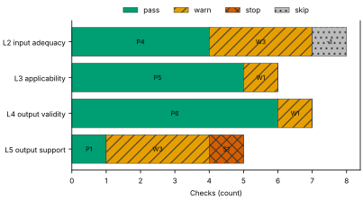
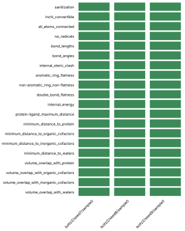
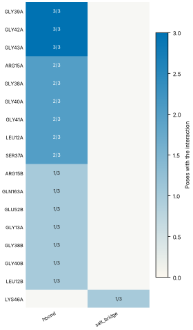
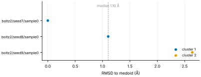
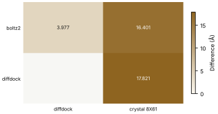
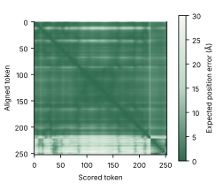

# Run report · Ligand pose in a known pocket

Prediction assurance · run `ligand_pose-791b70c39f7a` · 2026-10-17 19:19:04 UTC

**Refused** for the claim "Predicted pose of ATP in FtsE is valid".

Refused over layers 2,3,4,5: 17 pass, 7 warn, 1 stop, 1 skip. Stopped by l5.controls.redocking. Warnings from l2.receptor.protonation, l2.ligand.protonation, l2.docking.box, l3.exposure.ligand_prevalence, l4.interactions.unsatisfied_polars, l5.sampling.seeds, l5.agreement.cross_family.

Stops: `l5.controls.redocking`.

Warnings: `l2.receptor.protonation`, `l2.ligand.protonation`, `l2.docking.box`, `l3.exposure.ligand_prevalence`, `l4.interactions.unsatisfied_polars`, `l5.sampling.seeds`, `l5.agreement.cross_family`.

| Field | Value |
| --- | --- |
| Task | Ligand pose in a known pocket (`ligand_pose`) |
| Tools | Boltz-2 2.2.1 (co-folding), DiffDock-L (docking) |
| Target | `protein` |
| Ligand | `c1nc(c2c(n1)n(cn2)[C@H]3[C@@H]([C@@H]([C@H](O3)CO[P@@](=O)(O)O[P@](=O)(O)OP(=O)(O)O)O)O)N` |
| Reference | `8X61` |
| pH | 7.4 |
| Seeds | 3 |
| Layers run | 2, 3, 4, 5 |
| Run | `ligand_pose-791b70c39f7a` |
| Created | 2026-10-17 19:19:04 UTC |
| Finished | 2026-10-17 19:20:15 UTC |
| pah version | 0.1.0 |
| Report schema | 1 |

## Layers

| Layer | Status | Result | pass | warn | stop | skip | Time |
| --- | --- | --- | --- | --- | --- | --- | --- |
| L0 Provenance | not run | n/a | n/a | n/a | n/a | n/a | n/a |
| L1 Input integrity | not run | n/a | n/a | n/a | n/a | n/a | n/a |
| L2 Input adequacy | done | warn | 4 | 3 | 0 | 1 | 1.3 s |
| L3 Applicability | done | warn | 5 | 1 | 0 | 0 | 397 ms |
| L4 Output validity | done | warn | 6 | 1 | 0 | 0 | 69.1 s |
| L5 Output support | done | stop | 2 | 2 | 1 | 0 | 247 ms |

## Figures

Fig. 1 · Check outcomes per layer for run ligand_pose-791b70c39f7a. Totals: pass 17, warn 7, stop 1, skip 1.
Files: data [figures/gates_by_layer.csv](figures/gates_by_layer.csv).

## Structures

68 PyMOL renders.

8X61 mmCIF (source_structure), whole structure. Chains A, B, C, D; organic components ATP. sha256 ba2b64fd50fa3880. PyMOL session: [renders/8X61.pse](renders/8X61.pse).

8X61 mmCIF (source_structure), ligand environment within 5 Å. Chains A, B, C, D; organic components ATP. sha256 ba2b64fd50fa3880. PyMOL session: [renders/8X61.pse](renders/8X61.pse).

boltz2/seed7/sample0 (prediction_structure), whole structure. Chains A, L; organic components LIG1. sha256 679ca1d6f7ea4247. PyMOL session: [renders/boltz2_seed7_sample0.pse](renders/boltz2_seed7_sample0.pse).

boltz2/seed7/sample0 (prediction_structure), ligand environment within 5 Å. Chains A, L; organic components LIG1. sha256 679ca1d6f7ea4247. PyMOL session: [renders/boltz2_seed7_sample0.pse](renders/boltz2_seed7_sample0.pse).

boltz2/seed8/sample0 (prediction_structure), whole structure. Chains A, L; organic components LIG1. sha256 528f28b617641bfd. PyMOL session: [renders/boltz2_seed8_sample0.pse](renders/boltz2_seed8_sample0.pse).

boltz2/seed8/sample0 (prediction_structure), ligand environment within 5 Å. Chains A, L; organic components LIG1. sha256 528f28b617641bfd. PyMOL session: [renders/boltz2_seed8_sample0.pse](renders/boltz2_seed8_sample0.pse).

boltz2/seed9/sample0 (prediction_structure), whole structure. Chains A, L; organic components LIG1. sha256 fce0597608e16ff1. PyMOL session: [renders/boltz2_seed9_sample0.pse](renders/boltz2_seed9_sample0.pse).

boltz2/seed9/sample0 (prediction_structure), ligand environment within 5 Å. Chains A, L; organic components LIG1. sha256 fce0597608e16ff1. PyMOL session: [renders/boltz2_seed9_sample0.pse](renders/boltz2_seed9_sample0.pse).

diffdock/seed7/mode0 (prediction_structure), whole structure. Chains A, L; organic components LIG. sha256 23d6b5af304fbade. PyMOL session: [renders/diffdock_seed7_mode0.pse](renders/diffdock_seed7_mode0.pse).

diffdock/seed7/mode0 (prediction_structure), ligand environment within 5 Å. Chains A, L; organic components LIG. sha256 23d6b5af304fbade. PyMOL session: [renders/diffdock_seed7_mode0.pse](renders/diffdock_seed7_mode0.pse).

diffdock/seed7/mode1 (prediction_structure), whole structure. Chains A, L; organic components LIG. sha256 168a2c6c43a7c828. PyMOL session: [renders/diffdock_seed7_mode1.pse](renders/diffdock_seed7_mode1.pse).

diffdock/seed7/mode1 (prediction_structure), ligand environment within 5 Å. Chains A, L; organic components LIG. sha256 168a2c6c43a7c828. PyMOL session: [renders/diffdock_seed7_mode1.pse](renders/diffdock_seed7_mode1.pse).

diffdock/seed7/mode2 (prediction_structure), whole structure. Chains A, L; organic components LIG. sha256 854a6ecb7e1098f1. PyMOL session: [renders/diffdock_seed7_mode2.pse](renders/diffdock_seed7_mode2.pse).

diffdock/seed7/mode2 (prediction_structure), ligand environment within 5 Å. Chains A, L; organic components LIG. sha256 854a6ecb7e1098f1. PyMOL session: [renders/diffdock_seed7_mode2.pse](renders/diffdock_seed7_mode2.pse).

diffdock/seed7/mode3 (prediction_structure), whole structure. Chains A, L; organic components LIG. sha256 9c4b218bff93a6a8. PyMOL session: [renders/diffdock_seed7_mode3.pse](renders/diffdock_seed7_mode3.pse).

diffdock/seed7/mode3 (prediction_structure), ligand environment within 5 Å. Chains A, L; organic components LIG. sha256 9c4b218bff93a6a8. PyMOL session: [renders/diffdock_seed7_mode3.pse](renders/diffdock_seed7_mode3.pse).

diffdock/seed7/mode4 (prediction_structure), whole structure. Chains A, L; organic components LIG. sha256 84fa2addc772ac31. PyMOL session: [renders/diffdock_seed7_mode4.pse](renders/diffdock_seed7_mode4.pse).

diffdock/seed7/mode4 (prediction_structure), ligand environment within 5 Å. Chains A, L; organic components LIG. sha256 84fa2addc772ac31. PyMOL session: [renders/diffdock_seed7_mode4.pse](renders/diffdock_seed7_mode4.pse).

diffdock/seed7/mode5 (prediction_structure), whole structure. Chains A, L; organic components LIG. sha256 38792372bcb2f9e7. PyMOL session: [renders/diffdock_seed7_mode5.pse](renders/diffdock_seed7_mode5.pse).

diffdock/seed7/mode5 (prediction_structure), ligand environment within 5 Å. Chains A, L; organic components LIG. sha256 38792372bcb2f9e7. PyMOL session: [renders/diffdock_seed7_mode5.pse](renders/diffdock_seed7_mode5.pse).

diffdock/seed7/mode6 (prediction_structure), whole structure. Chains A, L; organic components LIG. sha256 a2c0c26e3efb3ce4. PyMOL session: [renders/diffdock_seed7_mode6.pse](renders/diffdock_seed7_mode6.pse).

diffdock/seed7/mode6 (prediction_structure), ligand environment within 5 Å. Chains A, L; organic components LIG. sha256 a2c0c26e3efb3ce4. PyMOL session: [renders/diffdock_seed7_mode6.pse](renders/diffdock_seed7_mode6.pse).

diffdock/seed7/mode7 (prediction_structure), whole structure. Chains A, L; organic components LIG. sha256 eb3f15ed52ecc853. PyMOL session: [renders/diffdock_seed7_mode7.pse](renders/diffdock_seed7_mode7.pse).

diffdock/seed7/mode7 (prediction_structure), ligand environment within 5 Å. Chains A, L; organic components LIG. sha256 eb3f15ed52ecc853. PyMOL session: [renders/diffdock_seed7_mode7.pse](renders/diffdock_seed7_mode7.pse).

diffdock/seed7/mode8 (prediction_structure), whole structure. Chains A, L; organic components LIG. sha256 de06aea55e96ba33. PyMOL session: [renders/diffdock_seed7_mode8.pse](renders/diffdock_seed7_mode8.pse).

diffdock/seed7/mode8 (prediction_structure), ligand environment within 5 Å. Chains A, L; organic components LIG. sha256 de06aea55e96ba33. PyMOL session: [renders/diffdock_seed7_mode8.pse](renders/diffdock_seed7_mode8.pse).

diffdock/seed7/mode9 (prediction_structure), whole structure. Chains A, L; organic components LIG. sha256 3de007b5d000d4d5. PyMOL session: [renders/diffdock_seed7_mode9.pse](renders/diffdock_seed7_mode9.pse).

diffdock/seed7/mode9 (prediction_structure), ligand environment within 5 Å. Chains A, L; organic components LIG. sha256 3de007b5d000d4d5. PyMOL session: [renders/diffdock_seed7_mode9.pse](renders/diffdock_seed7_mode9.pse).

diffdock/seed8/mode0 (prediction_structure), whole structure. Chains A, L; organic components LIG. sha256 23d95c1e9e15b2e7. PyMOL session: [renders/diffdock_seed8_mode0.pse](renders/diffdock_seed8_mode0.pse).

diffdock/seed8/mode0 (prediction_structure), ligand environment within 5 Å. Chains A, L; organic components LIG. sha256 23d95c1e9e15b2e7. PyMOL session: [renders/diffdock_seed8_mode0.pse](renders/diffdock_seed8_mode0.pse).

diffdock/seed8/mode1 (prediction_structure), whole structure. Chains A, L; organic components LIG. sha256 52d28de5945c7b93. PyMOL session: [renders/diffdock_seed8_mode1.pse](renders/diffdock_seed8_mode1.pse).

diffdock/seed8/mode1 (prediction_structure), ligand environment within 5 Å. Chains A, L; organic components LIG. sha256 52d28de5945c7b93. PyMOL session: [renders/diffdock_seed8_mode1.pse](renders/diffdock_seed8_mode1.pse).

diffdock/seed8/mode2 (prediction_structure), whole structure. Chains A, L; organic components LIG. sha256 7632795ad995ac3a. PyMOL session: [renders/diffdock_seed8_mode2.pse](renders/diffdock_seed8_mode2.pse).

diffdock/seed8/mode2 (prediction_structure), ligand environment within 5 Å. Chains A, L; organic components LIG. sha256 7632795ad995ac3a. PyMOL session: [renders/diffdock_seed8_mode2.pse](renders/diffdock_seed8_mode2.pse).

diffdock/seed8/mode3 (prediction_structure), whole structure. Chains A, L; organic components LIG. sha256 02a7ff6058079d70. PyMOL session: [renders/diffdock_seed8_mode3.pse](renders/diffdock_seed8_mode3.pse).

diffdock/seed8/mode3 (prediction_structure), ligand environment within 5 Å. Chains A, L; organic components LIG. sha256 02a7ff6058079d70. PyMOL session: [renders/diffdock_seed8_mode3.pse](renders/diffdock_seed8_mode3.pse).

diffdock/seed8/mode4 (prediction_structure), whole structure. Chains A, L; organic components LIG. sha256 c02f24d1adaf866b. PyMOL session: [renders/diffdock_seed8_mode4.pse](renders/diffdock_seed8_mode4.pse).

diffdock/seed8/mode4 (prediction_structure), ligand environment within 5 Å. Chains A, L; organic components LIG. sha256 c02f24d1adaf866b. PyMOL session: [renders/diffdock_seed8_mode4.pse](renders/diffdock_seed8_mode4.pse).

diffdock/seed8/mode5 (prediction_structure), whole structure. Chains A, L; organic components LIG. sha256 c066e5900bdb464d. PyMOL session: [renders/diffdock_seed8_mode5.pse](renders/diffdock_seed8_mode5.pse).

diffdock/seed8/mode5 (prediction_structure), ligand environment within 5 Å. Chains A, L; organic components LIG. sha256 c066e5900bdb464d. PyMOL session: [renders/diffdock_seed8_mode5.pse](renders/diffdock_seed8_mode5.pse).

diffdock/seed8/mode6 (prediction_structure), whole structure. Chains A, L; organic components LIG. sha256 78f616e688d509ad. PyMOL session: [renders/diffdock_seed8_mode6.pse](renders/diffdock_seed8_mode6.pse).

diffdock/seed8/mode6 (prediction_structure), ligand environment within 5 Å. Chains A, L; organic components LIG. sha256 78f616e688d509ad. PyMOL session: [renders/diffdock_seed8_mode6.pse](renders/diffdock_seed8_mode6.pse).

diffdock/seed8/mode7 (prediction_structure), whole structure. Chains A, L; organic components LIG. sha256 fd8796ce8b52e11f. PyMOL session: [renders/diffdock_seed8_mode7.pse](renders/diffdock_seed8_mode7.pse).

diffdock/seed8/mode7 (prediction_structure), ligand environment within 5 Å. Chains A, L; organic components LIG. sha256 fd8796ce8b52e11f. PyMOL session: [renders/diffdock_seed8_mode7.pse](renders/diffdock_seed8_mode7.pse).

diffdock/seed8/mode8 (prediction_structure), whole structure. Chains A, L; organic components LIG. sha256 4d77491fefa46b73. PyMOL session: [renders/diffdock_seed8_mode8.pse](renders/diffdock_seed8_mode8.pse).

diffdock/seed8/mode8 (prediction_structure), ligand environment within 5 Å. Chains A, L; organic components LIG. sha256 4d77491fefa46b73. PyMOL session: [renders/diffdock_seed8_mode8.pse](renders/diffdock_seed8_mode8.pse).

diffdock/seed8/mode9 (prediction_structure), whole structure. Chains A, L; organic components LIG. sha256 7f5e9ae53cd63d0e. PyMOL session: [renders/diffdock_seed8_mode9.pse](renders/diffdock_seed8_mode9.pse).

diffdock/seed8/mode9 (prediction_structure), ligand environment within 5 Å. Chains A, L; organic components LIG. sha256 7f5e9ae53cd63d0e. PyMOL session: [renders/diffdock_seed8_mode9.pse](renders/diffdock_seed8_mode9.pse).

diffdock/seed9/mode0 (prediction_structure), whole structure. Chains A, L; organic components LIG. sha256 f4dae0860966b6a4. PyMOL session: [renders/diffdock_seed9_mode0.pse](renders/diffdock_seed9_mode0.pse).

diffdock/seed9/mode0 (prediction_structure), ligand environment within 5 Å. Chains A, L; organic components LIG. sha256 f4dae0860966b6a4. PyMOL session: [renders/diffdock_seed9_mode0.pse](renders/diffdock_seed9_mode0.pse).

diffdock/seed9/mode1 (prediction_structure), whole structure. Chains A, L; organic components LIG. sha256 351338d7a6eb9035. PyMOL session: [renders/diffdock_seed9_mode1.pse](renders/diffdock_seed9_mode1.pse).

diffdock/seed9/mode1 (prediction_structure), ligand environment within 5 Å. Chains A, L; organic components LIG. sha256 351338d7a6eb9035. PyMOL session: [renders/diffdock_seed9_mode1.pse](renders/diffdock_seed9_mode1.pse).

diffdock/seed9/mode2 (prediction_structure), whole structure. Chains A, L; organic components LIG. sha256 abc0f6d2e9b1af73. PyMOL session: [renders/diffdock_seed9_mode2.pse](renders/diffdock_seed9_mode2.pse).

diffdock/seed9/mode2 (prediction_structure), ligand environment within 5 Å. Chains A, L; organic components LIG. sha256 abc0f6d2e9b1af73. PyMOL session: [renders/diffdock_seed9_mode2.pse](renders/diffdock_seed9_mode2.pse).

diffdock/seed9/mode3 (prediction_structure), whole structure. Chains A, L; organic components LIG. sha256 8e5a3e4f1d5ee02f. PyMOL session: [renders/diffdock_seed9_mode3.pse](renders/diffdock_seed9_mode3.pse).

diffdock/seed9/mode3 (prediction_structure), ligand environment within 5 Å. Chains A, L; organic components LIG. sha256 8e5a3e4f1d5ee02f. PyMOL session: [renders/diffdock_seed9_mode3.pse](renders/diffdock_seed9_mode3.pse).

diffdock/seed9/mode4 (prediction_structure), whole structure. Chains A, L; organic components LIG. sha256 9004e50bbf623991. PyMOL session: [renders/diffdock_seed9_mode4.pse](renders/diffdock_seed9_mode4.pse).

diffdock/seed9/mode4 (prediction_structure), ligand environment within 5 Å. Chains A, L; organic components LIG. sha256 9004e50bbf623991. PyMOL session: [renders/diffdock_seed9_mode4.pse](renders/diffdock_seed9_mode4.pse).

diffdock/seed9/mode5 (prediction_structure), whole structure. Chains A, L; organic components LIG. sha256 90608050fb4659a2. PyMOL session: [renders/diffdock_seed9_mode5.pse](renders/diffdock_seed9_mode5.pse).

diffdock/seed9/mode5 (prediction_structure), ligand environment within 5 Å. Chains A, L; organic components LIG. sha256 90608050fb4659a2. PyMOL session: [renders/diffdock_seed9_mode5.pse](renders/diffdock_seed9_mode5.pse).

diffdock/seed9/mode6 (prediction_structure), whole structure. Chains A, L; organic components LIG. sha256 31e6d8f251351a8a. PyMOL session: [renders/diffdock_seed9_mode6.pse](renders/diffdock_seed9_mode6.pse).

diffdock/seed9/mode6 (prediction_structure), ligand environment within 5 Å. Chains A, L; organic components LIG. sha256 31e6d8f251351a8a. PyMOL session: [renders/diffdock_seed9_mode6.pse](renders/diffdock_seed9_mode6.pse).

diffdock/seed9/mode7 (prediction_structure), whole structure. Chains A, L; organic components LIG. sha256 c6dcdfe706096fa9. PyMOL session: [renders/diffdock_seed9_mode7.pse](renders/diffdock_seed9_mode7.pse).

diffdock/seed9/mode7 (prediction_structure), ligand environment within 5 Å. Chains A, L; organic components LIG. sha256 c6dcdfe706096fa9. PyMOL session: [renders/diffdock_seed9_mode7.pse](renders/diffdock_seed9_mode7.pse).

diffdock/seed9/mode8 (prediction_structure), whole structure. Chains A, L; organic components LIG. sha256 7917fb68694153b5. PyMOL session: [renders/diffdock_seed9_mode8.pse](renders/diffdock_seed9_mode8.pse).

diffdock/seed9/mode8 (prediction_structure), ligand environment within 5 Å. Chains A, L; organic components LIG. sha256 7917fb68694153b5. PyMOL session: [renders/diffdock_seed9_mode8.pse](renders/diffdock_seed9_mode8.pse).

diffdock/seed9/mode9 (prediction_structure), whole structure. Chains A, L; organic components LIG. sha256 b4d847aa3a70a2b8. PyMOL session: [renders/diffdock_seed9_mode9.pse](renders/diffdock_seed9_mode9.pse).

diffdock/seed9/mode9 (prediction_structure), ligand environment within 5 Å. Chains A, L; organic components LIG. sha256 b4d847aa3a70a2b8. PyMOL session: [renders/diffdock_seed9_mode9.pse](renders/diffdock_seed9_mode9.pse).

## L0 Provenance

Where did every input come from?

Status: not run.

## L1 Input integrity

Did the run receive exactly what was declared?

Status: not run.

## L2 Input adequacy

Does the input carry enough information?

Status: done. Checks: pass 4 · warn 3 · stop 0 · skip 1. Time: 1.3 s.

#### Key figures

| Figure | Value |
| --- | --- |
| near site | 0 |
| missing | 0 |
| uniprot cofactors | 0 |
| pocket residues | 30 |
| incomplete | 0 |
| sequence gaps | 0 |
| state | holo |
| site ligands | 1 |

#### Docking

| Field | Value |
| --- | --- |
| center | 137.651, 149.997, 122.463 Å |
| size | 16.823 × 14.232 × 20.687 Å |
| origin | derived from ATP (+4 Å) |

#### Checks

| Check | Result | Measured cmp threshold | Evidence | Id · time |
| --- | --- | --- | --- | --- |
| Alignment depth, distinct sequences, Neff and gap fraction | skip | n/a | no MSA declared for a co-folding model · not applicable | `l2.msa.depth` |
| Required cofactors, ions and partners present | pass | `pocket_distance <= 8` | components within 8.0 Å of ATP: none · near_site=0, missing=0, uniprot_cofactors=0 | `l2.context.cofactors` · 186 ms |
| Pocket residues resolved, no missing loops lining the pocket | pass | `pocket_distance <= 6` | 30 pocket residues complete in 8X61.cif · pocket_residues=30, incomplete=0, sequence_gaps=0 | `l2.pocket.resolved` · 13 ms |
| Receptor state apo or holo | pass | n/a | 8X61.cif holo: ATP in the site · state=holo, site_ligands=1 | `l2.receptor.state` · 15 ms |
| Receptor protonation at the stated pH | warn | `pka_margin > 1` | receptor has no hydrogens (protonation not assigned); pKa within 1.0 of pH 7.4: HIS195A pKa 6.61 · hydrogens_present=False, ph=7.4, pocket_titratable=7 | `l2.receptor.protonation` · 203 ms |
| Ligand protonation and tautomers enumerated at the stated pH | warn | `ph 7.4 == 1` | ligand: 2 states; ligand: declared form Nc1ncnc2c1ncn2[C@@H]1O[C@H](CO[P@@](=O)(O)O[P@](=O)(O)OP(=O)(O)O)[C@@H](O)[C@H]1O differs from enumerated Nc1ncnc2c1ncn2[C@@H]1O[C@H](CO[P@@](=O)([O-])O[P@](=O)([O-])OP(=O)([O-])O)[C@@H](O)[C@H]1O, Nc1ncnc2c1ncn2[C@@H]1O[C@H](CO[P@@](=O)([O-])O[P@](=O)([O-])OP(=O)([O-])[O-])[C@@H](O)[C@H]1O · ph=7.4, max_states=2, declared_not_enumerated=1 | `l2.ligand.protonation` · 55 ms |
| Ligand conformers generated and minimised | pass | `conformers >= 10` | 10 ETKDG conformers per ligand, MMFF minimised · ligands=1, failed=0, min_embedded=10 | `l2.ligand.conformers` · 799 ms |
| Docking box encloses the pocket with margin | warn | `margin >= 2` | no box declared; derived box encloses 21 contact residues and the ATP ligand with 2.0 Å margin · volume_A3=4953, ligand_atoms_inside_margin=31, ligand_atoms=31 | `l2.docking.box` · 13 ms |

## L3 Applicability

Is the tool inside its validated regime?

Status: done. Checks: pass 5 · warn 1 · stop 0 · skip 0. Time: 397 ms.

#### Key figures

| Figure | Value |
| --- | --- |
| executors | 2 |
| unknown | 0 |
| reference released | 2024-05-08 |
| cutoff | 2019-01-01 |
| entries compared | 0 |
| pocket residues | 21 |
| systems | 3474 |
| analogue components | 19 |

#### Checks

| Check | Result | Measured cmp threshold | Evidence | Id · time |
| --- | --- | --- | --- | --- |
| Model training cutoff recorded | pass | `training_cutoff == recorded` | boltz2 2023-06-01; diffdock 2019-01-01; reference 8X61 released 2024-05-08 · executors=2, unknown=0, reference_released=2024-05-08 | `l3.model.training_cutoff` · 1 ms |
| Pocket similarity to pre-cutoff complexes (SuCOS times pocket coverage) | pass | `similarity <= 50` | no pre-cutoff holo entry with an analogue found (cutoff 2019-01-01) · cutoff=2019-01-01, entries_compared=0, max_similarity=None | `l3.exposure.pocket` · 383 ms |
| Ligand analogues in pre-cutoff training systems | warn | `tanimoto > 0.9` | 3474 PDB entries released before 2019-01-01 (diffdock cutoff) contain analogues of ligand above Tanimoto 0.9: 5FA, ADP, AQP, ATP, HEJ, LA8 · cutoff=2019-01-01, systems=3474, analogue_components=19 | `l3.exposure.ligand_prevalence` · 0 ms |
| Chain sequence identity to pre-cutoff entries (secondary measure) | pass | `identity < 0.4` | protein: 0 entries at 95 percent identity, 0 at 40 percent, released before 2019-01-01 (reported, not gating) · cutoff=2019-01-01, entries_95=0, entries_40=0 | `l3.exposure.sequence` · 0 ms |
| Modality inside the validated set; token count against the training crop | pass | n/a | modalities protein, protein_ligand inside the validated set; 253 tokens · modalities=2, tokens=253, outside=0 | `l3.regime.modality` · 11 ms |
| Endpoint fits the tool | pass | `endpoint pose in pose` | endpoint pose produced by boltz2, diffdock · endpoint=pose, executors=2, not_fitting=0 | `l3.metric.endpoint` · 0 ms |

## L4 Output validity

Is the result physically and chemically sensible?

Status: done. Checks: pass 6 · warn 1 · stop 0 · skip 0. Time: 69.1 s.

#### Key figures

| Figure | Value |
| --- | --- |
| poses | 3 |
| passed | 20 |
| total | 20 |
| poses all pass | 3 |
| unlikely torsions | 0 |
| torsions | 14 |
| strain kcal | 20.22 |
| poses with unlikely | 2 |

#### PoseBusters · 20/20 tests pass

| test | result | value |
| --- | --- | --- |
| sanitization | pass | pass |
| inchi_convertible | pass | pass |
| all_atoms_connected | pass | pass |
| no_radicals | pass | pass |
| bond_lengths | pass | 0 long outliers |
| bond_angles | pass | 0 outliers |
| internal_steric_clash | pass | 0 |
| aromatic_ring_flatness | pass | 0.00 Å |
| non-aromatic_ring_non-flatness | pass | pass |
| double_bond_flatness | pass | pass |
| internal_energy | pass | 3.4 times the ensemble mean |
| protein-ligand_maximum_distance | pass | 2.52 Å |
| minimum_distance_to_protein | pass | 2.52 Å |
| minimum_distance_to_organic_cofactors | pass | pass |
| minimum_distance_to_inorganic_cofactors | pass | pass |
| minimum_distance_to_waters | pass | pass |
| volume_overlap_with_protein | pass | 0.013 |
| volume_overlap_with_organic_cofactors | pass | pass |
| volume_overlap_with_inorganic_cofactors | pass | pass |
| volume_overlap_with_waters | pass | pass |

#### Per-pose physical checks

| pose | seed | drift Å | converged | unlikely torsions | unsat. polars | buried charged | PoseBusters |
| --- | --- | --- | --- | --- | --- | --- | --- |
| boltz2/seed7/sample0 | 7 | 1.9 | true | 0/14 | 4 | 0 | 20/20 |
| boltz2/seed8/sample0 | 8 | 1.02 | true | 3/14 | 2 | 0 | 20/20 |
| boltz2/seed9/sample0 | 9 | 1.3 | true | 1/14 | 4 | 0 | 20/20 |
| median | n/a | 1.3 | n/a | 1 | 4 | 0 | 20/20 |

#### Interaction fingerprint · representative pose boltz2/seed7/sample0

| residue | type | distance | poses |
| --- | --- | --- | --- |
| ARG15A | hbond | 2.87 Å | 3/3 |
| GLY13B | hbond | 2.93 Å | 3/3 |
| GLY140A | hbond | 2.99 Å | 3/3 |
| GLY141A | hbond | 3.1 Å | 3/3 |
| GLY38B | hbond | 3.44 Å | 3/3 |
| GLY40B | hbond | 2.5 Å | 3/3 |
| LEU12A | hbond | 2.94 Å | 3/3 |
| GLY14B | hbond | 3.25 Å | 2/3 |
| SER139A | hbond | 3.41 Å | 2/3 |
| GLN163B | hbond | 4.08 Å | 1/3 |
| GLU52B | hbond | 3.93 Å | 1/3 |
| GLY13A | hbond | 3.32 Å | 1/3 |
| LYS46B | salt_bridge | 5.38 Å | 1/3 |

Fig. 2 · PoseBusters tests (20) by pose (3). Failed cells marked x: 0 of 60.
Files: data [figures/posebusters_grid.csv](figures/posebusters_grid.csv).

Fig. 3 · Interactions by residue (13) and type (2); cell label: poses with the interaction over poses assessed.
Files: data [figures/interactions.csv](figures/interactions.csv).

#### Checks

| Check | Result | Measured cmp threshold | Evidence | Id · time |
| --- | --- | --- | --- | --- |
| PoseBusters geometry, stereochemistry, clashes and protein contact | pass | `tests_failed == 0` | 20 of 20 tests pass for boltz2/seed7/sample0; 3 of 3 poses pass all · poses=3, passed=20, total=20 | `l4.posebusters` · 2.5 s |
| Torsional strain of the ligand pose | pass | `torsion_energy <= 2.5` | 0 of 14 torsions above 2.5 kcal/mol in boltz2/seed7/sample0; strain 20.22 kcal/mol · poses=3, unlikely_torsions=0, torsions=14 | `l4.torsion_strain` · 3.9 s |
| Interaction fingerprint (PLIP) | pass | n/a | 10 interactions in boltz2/seed7/sample0 (hbond, salt_bridge); 13 distinct across 3 poses (reported) · poses=3, interactions_representative=10, distinct=13 | `l4.interactions.fingerprint` · 793 ms |
| Buried ligand polar atoms without a hydrogen-bond partner | warn | `relative_sasa < 0.1` | 4 of 8 buried polar ligand atoms without a partner in boltz2/seed7/sample0 · poses=3, unsatisfied=4, buried_charged=0 | `l4.interactions.unsatisfied_polars` · 178 ms |
| Hydrophobic complementarity of buried ligand surface | pass | `fraction >= 0.35` | nonpolar fraction of protein contacts around 2 buried nonpolar ligand atoms in boltz2/seed7/sample0: 0.833 · poses=3, complementarity=0.833, buried_nonpolar=2 | `l4.interactions.hydrophobic` · 177 ms |
| Interactions of the crystal ligand reproduced by the pose | pass | `reproduced 1 >= 1` | boltz2/seed7/sample0 reproduces 1 of 16 ATP interactions: hbond ARG15A · key_interactions=16, reproduced=1, poses_reproducing_all=0 | `l4.interactions.known_binders` · 436 ms |
| Pose stability under short restrained minimisation (OpenMM, AMBER14 and OpenFF) | pass | `drift_A 1.9 <= 2` | boltz2/seed7/sample0 moves 1.904 Å under restrained minimisation; 0 of 3 poses above 2.0 Å · poses=3, drift_A=1.904, max_drift_A=1.904 | `l4.minimisation_drift` · 61.1 s |

## L5 Output support

Is a valid result corroborated?

Status: done. Checks: pass 2 · warn 2 · stop 1 · skip 0. Time: 247 ms.

#### Key figures

| Figure | Value |
| --- | --- |
| poses | 3 |
| pocket plddt | 84.2 |
| global plddt | 92.6 |
| iptm | 0.893 |
| ptm | 0.944 |
| confidence score | 0.888 |
| independent seeds | 3 |
| samples | 3 |

#### Sampling

| Field | Value |
| --- | --- |
| site placement | 0 of 3 poses within 4.0 Å of the site (ATP in 8X61) |
| pose accuracy | 2 of 3 poses within 2.0 Å of the medoid |
| pairwise RMSD median | 2.21 Å |
| pairwise RMSD IQR | 1.66 to 2.43 Å |
| pairs | 3 |
| medoid | boltz2/seed7/sample0 |

#### Clusters

| Field | Value |
| --- | --- |
| cluster 1 | 2/3 poses (boltz2/seed7/sample0) |
| cluster 2 | 1/3 poses (boltz2/seed9/sample0) |

#### Per-seed statistics

| seed | pose | cluster | RMSD to medoid | confidence |
| --- | --- | --- | --- | --- |
| 7 | boltz2/seed7/sample0 | 1 | 0 Å | 0.89 |
| 8 | boltz2/seed8/sample0 | 1 | 1.1 Å | 0.88 |
| 9 | boltz2/seed9/sample0 | 2 | 2.64 Å | 0.88 |
| median | n/a | n/a | 1.1 Å | 0.88 |

#### Ensemble

| structure | kind | source | RMSD to medoid | cluster | pocket pLDDT | ipTM |
| --- | --- | --- | --- | --- | --- | --- |
| boltz2/seed7/sample0 | medoid | boltz2 | 0 Å | 1 | 84.2 | 0.89 |
| boltz2/seed8/sample0 | seed | boltz2 | 1.1 Å | 1 | 84.5 | 0.9 |
| boltz2/seed9/sample0 | seed | boltz2 | 2.64 Å | 2 | 83.7 | 0.87 |

#### Agreement between methods

| method | diffdock | crystal 8X61 |
| --- | --- | --- |
| boltz2 | 3.98 Å (high) | 16.4 Å (decisive) |
| diffdock | n/a | 17.8 Å (decisive) |

#### Confidence metrics

| metric | value | read as | tool |
| --- | --- | --- | --- |
| affinity_pred_value | 0.6833318471908569 | ranking within a series, never pose quality | boltz2 |
| affinity_probability_binary | 0.3195704221725464 | ranking within a series, never pose quality | boltz2 |
| affinity_pred_value | 0.7790588736534119 | ranking within a series, never pose quality | boltz2 |
| affinity_probability_binary | 0.30606600642204285 | ranking within a series, never pose quality | boltz2 |
| affinity_pred_value | 0.7102769017219543 | ranking within a series, never pose quality | boltz2 |
| affinity_probability_binary | 0.3260412812232971 | ranking within a series, never pose quality | boltz2 |

Fig. 4 · RMSD to the medoid for 3 poses, coloured by cluster (2 clusters). Dashed line: median 1.10 Å; range 0.00 to 2.64 Å.
Files: data [figures/seed_spread.csv](figures/seed_spread.csv).

Fig. 5 · Agreement between 2 methods and 2 comparators; range 3.977 to 17.821 Å.
Files: data [figures/agreement.csv](figures/agreement.csv).

Fig. 6 · Predicted aligned error for pose boltz2/seed7/sample0, 253 by 253 tokens; values 0.2 to 29.0 Å, mean 4.6 Å.
Files: data [figures/pae.csv](figures/pae.csv).

#### Checks

| Check | Result | Measured cmp threshold | Evidence | Id · time |
| --- | --- | --- | --- | --- |
| Confidence restricted to the pocket; per-model thresholds | pass | `boltz2.pocket_plddt >= 70` | boltz2/seed7/sample0: pocket_plddt 84.2 · poses=3, pocket_plddt=84.2, global_plddt=92.6 | `l5.confidence.local` · 17 ms |
| Independent seeds counted separately from samples; duplicates flagged | warn | `seeds_cofolding >= 5` | 3 independent seeds (3 poses); task default 5 · independent_seeds=3, samples=3, duplicated_outputs=0 | `l5.sampling.seeds` · 0 ms |
| Medoid of the largest cluster, populations, pairwise spread, site and pose accuracy | pass | `cluster_rmsd <= 2` | medoid boltz2/seed7/sample0; 2 clusters, largest 2 of 3; pairwise RMSD median 2.21 Å (IQR 1.66 to 2.43); 0 of 3 poses within 4.0 Å of the site (ATP in 8X61); 2 of 3 poses within 2.0 Å of the medoid · poses=3, clusters=2, largest_cluster=2 | `l5.sampling.clusters` · 54 ms |
| Agreement between methods, weighted by independence | warn | `rmsd_to_crystal_A 16.4 <= 2` | boltz2 vs diffdock 3.977 Å (high); boltz2 vs crystal 8X61 16.401 Å (decisive); diffdock vs crystal 8X61 17.821 Å (decisive) · methods=2, comparisons=3, disagreeing=3 | `l5.agreement.cross_family` · 171 ms |
| Redocking control reproduces the crystal pose | stop | `rmsd <= 2` | redocking control required by the task and not supplied (controls.redocking) | `l5.controls.redocking` · 0 ms |

## Controls

| control | status | result |
| --- | --- | --- |
| redocking | incomplete | redocking control required by the task and not supplied (controls.redocking) |

## Provenance

50 objects · 50 cached · 0 network.

| Source | Accession | Release | SHA-256 | Retrieved | Bytes | Cache | Used by |
| --- | --- | --- | --- | --- | --- | --- | --- |
| rcsb_files | 8X61 | n/a | `ba2b64fd50fa` | 2026-10-17 16:56:13 UTC | 669464 | hit | l2.context.cofactors, l2.pocket.resolved, l2.receptor.state, l2.docking.box, l3.exposure.pocket, l3.regime.modality, l4.interactions.fingerprint, l4.interactions.known_binders, l5.sampling.clusters, l5.agreement.cross_family |
| ccd | ATP | 2011-06-04 | `a7dfd66192d9` | 2026-10-17 16:42:55 UTC | 14836 | hit | l2.context.cofactors, l3.exposure.pocket |
| rcsb | 8X61 | 1.2 | `40597bd4cb89` | 2026-10-17 16:56:15 UTC | 12259 | hit | l3.model.training_cutoff |
| rcsb_search | chem:c1nc(c2c(n1)n(cn2)[C@H]3[C@@H]([C@@H]([C@H](O3)CO[P@@](=O)(O)O[P@](=O)(O)OP(=O)(O)O)O)O)N | n/a | `c9ecdf87b8e2` | 2026-10-17 16:42:57 UTC | 1797 | hit | l3.exposure.pocket |
| ccd | 5FA | 2011-06-04 | `141da43b1fd4` | 2026-10-17 16:42:57 UTC | 5208 | hit | l3.exposure.pocket |
| ccd | ADP | 2025-10-10 | `9ebf239d6ded` | 2026-10-17 16:42:57 UTC | 5741 | hit | l3.exposure.pocket |
| ccd | AQP | 2011-06-04 | `d1f31df6170c` | 2026-10-17 16:42:57 UTC | 4700 | hit | l3.exposure.pocket |
| ccd | HEJ | 2021-03-01 | `3793d61303f5` | 2026-10-17 16:42:57 UTC | 4603 | hit | l3.exposure.pocket |
| ccd | LA8 | 2020-06-17 | `3c66f53baf33` | 2026-10-17 16:42:57 UTC | 4178 | hit | l3.exposure.pocket |
| ccd | ZF9 | 2024-03-08 | `b48f6ea5a0a0` | 2026-10-17 16:42:57 UTC | 4686 | hit | l3.exposure.pocket |
| ccd | ZSF | 2024-03-29 | `dde5989ea661` | 2026-10-17 16:42:57 UTC | 4903 | hit | l3.exposure.pocket |
| ccd | 50T | 2026-09-16 | `6be53fbf78af` | 2026-10-17 16:42:57 UTC | 4275 | hit | l3.exposure.pocket |
| ccd | AD9 | 2026-09-16 | `c8798e579e0a` | 2026-10-17 16:42:58 UTC | 4205 | hit | l3.exposure.pocket |
| ccd | AOV | 2026-09-16 | `300b793745cf` | 2026-10-17 16:42:58 UTC | 4330 | hit | l3.exposure.pocket |
| ccd | CX0 | 2022-03-25 | `fbc78ded25cd` | 2026-10-17 16:42:58 UTC | 3595 | hit | l3.exposure.pocket |
| ccd | CXC | 2022-03-25 | `d89a7023bd05` | 2026-10-17 16:42:58 UTC | 3941 | hit | l3.exposure.pocket |
| ccd | 0A | 2015-04-24 | `7f0b456f42e0` | 2026-10-17 16:42:58 UTC | 3972 | hit | l3.exposure.pocket |
| ccd | 3AN | 2011-06-04 | `a3d4d17a4a3e` | 2026-10-17 16:42:58 UTC | 4390 | hit | l3.exposure.pocket |
| ccd | 7DD | 2016-06-10 | `2265ea597be9` | 2026-10-17 16:42:58 UTC | 3425 | hit | l3.exposure.pocket |
| ccd | 7DT | 2016-06-10 | `c346b8a79ec0` | 2026-10-17 16:42:58 UTC | 3725 | hit | l3.exposure.pocket |
| ccd | AAM | 2011-06-04 | `ade365fd93cd` | 2026-10-17 16:42:58 UTC | 4244 | hit | l3.exposure.pocket |
| ccd | PAP | 2011-06-04 | `1a6bb6874f6f` | 2026-10-17 16:42:58 UTC | 4734 | hit | l3.exposure.pocket |
| ccd | XNY | 2021-04-30 | `7cb26ca44908` | 2026-10-17 16:42:58 UTC | 3977 | hit | l3.exposure.pocket |
| ccd | AP5 | 2011-06-04 | `43e554f584b7` | 2026-10-17 16:42:58 UTC | 6473 | hit | l3.exposure.pocket |
| ccd | T99 | 2018-06-01 | `68a3d15f3b6f` | 2026-10-17 16:42:58 UTC | 3399 | hit | l3.exposure.pocket |
| ccd | TAT | 2012-01-25 | `55287be9857e` | 2026-10-17 16:42:58 UTC | 4858 | hit | l3.exposure.pocket |
| ccd | A1L15 | 2025-01-24 | `57864c05fab0` | 2026-10-17 16:42:58 UTC | 5608 | hit | l3.exposure.pocket |
| ccd | AGS | 2020-06-17 | `dcdd428b77e4` | 2026-10-17 16:42:58 UTC | 10128 | hit | l3.exposure.pocket |
| rcsb_search | comp:5FA:2019-01-01 | n/a | `c60bf45b266d` | 2026-10-17 16:42:58 UTC | 282 | hit | l3.exposure.pocket |
| rcsb_search | comp:ADP:2019-01-01 | n/a | `d0ea634975e9` | 2026-10-17 16:42:58 UTC | 52129 | hit | l3.exposure.pocket |
| rcsb_search | comp:AQP:2019-01-01 | n/a | `94a619102faa` | 2026-10-17 16:42:58 UTC | 230 | hit | l3.exposure.pocket |
| rcsb_search | comp:ATP:2019-01-01 | n/a | `88190701e349` | 2026-10-17 16:42:59 UTC | 52129 | hit | l3.exposure.pocket |
| rcsb_search | comp:HEJ:2019-01-01 | n/a | `494129c6512c` | 2026-10-17 16:42:59 UTC | 178 | hit | l3.exposure.pocket |
| rcsb_search | comp:LA8:2019-01-01 | n/a | `185329a63a40` | 2026-10-17 16:42:59 UTC | 230 | hit | l3.exposure.pocket |
| rcsb_search | comp:ZF9:2019-01-01 | n/a | `e3b0c44298fc` | 2026-10-17 16:42:59 UTC | 0 | hit | l3.exposure.sequence |
| rcsb_search | comp:ZSF:2019-01-01 | n/a | `e3b0c44298fc` | 2026-10-17 16:42:59 UTC | 0 | hit | l3.exposure.sequence |
| rcsb_search | comp:50T:2019-01-01 | n/a | `927f39839b9d` | 2026-10-17 16:42:59 UTC | 178 | hit | l3.exposure.pocket |
| rcsb_search | comp:AD9:2019-01-01 | n/a | `ac65056f9aef` | 2026-10-17 16:42:59 UTC | 490 | hit | l3.exposure.pocket |
| rcsb_search | comp:AOV:2019-01-01 | n/a | `d8dd9b5a5778` | 2026-10-17 16:42:59 UTC | 334 | hit | l3.exposure.pocket |
| rcsb_search | comp:CX0:2019-01-01 | n/a | `e3b0c44298fc` | 2026-10-17 16:42:59 UTC | 0 | hit | l3.exposure.sequence |
| rcsb_search | comp:CXC:2019-01-01 | n/a | `e3b0c44298fc` | 2026-10-17 16:42:59 UTC | 0 | hit | l3.exposure.sequence |
| rcsb_search | comp:0A:2019-01-01 | n/a | `e3b0c44298fc` | 2026-10-17 16:42:59 UTC | 0 | hit | l3.exposure.sequence |
| rcsb_search | comp:PAP:2019-01-01 | n/a | `ded69bf4bbb0` | 2026-10-17 16:42:59 UTC | 542 | hit | l3.exposure.pocket |
| rcsb_search | comp:AP5:2019-01-01 | n/a | `ab39d336ec91` | 2026-10-17 16:42:59 UTC | 3247 | hit | l3.exposure.pocket |
| rcsb_search | comp:T99:2019-01-01 | n/a | `690266055a03` | 2026-10-17 16:42:59 UTC | 178 | hit | l3.exposure.pocket |
| rcsb_search | comp:TAT:2019-01-01 | n/a | `84486689d32b` | 2026-10-17 16:42:59 UTC | 438 | hit | l3.exposure.pocket |
| rcsb_search | comp:AGS:2019-01-01 | n/a | `aef54bf1fe1d` | 2026-10-17 16:42:59 UTC | 8188 | hit | l3.exposure.pocket |
| rcsb_search | seq0.9:2019-01-01:222 | n/a | `e3b0c44298fc` | 2026-10-17 16:56:17 UTC | 0 | hit | l3.exposure.sequence |
| rcsb_search | seq0.95:2019-01-01:222 | n/a | `e3b0c44298fc` | 2026-10-17 16:56:18 UTC | 0 | hit | l3.exposure.sequence |
| rcsb_search | seq0.4:2019-01-01:222 | n/a | `e3b0c44298fc` | 2026-10-17 16:56:18 UTC | 0 | hit | l3.exposure.sequence |

Provenance graph: [json](graph.json), [mmd](graph.mmd), [svg](graph.svg).

## Thresholds

| Check | Threshold | Value | Origin | Evidence level |
| --- | --- | --- | --- | --- |
| `l2.context.cofactors` | pocket_distance | <= 8 | Harness rule: a component of the reference entry within 8 Å of the declared ligand is required context; not yet calibrated | uncalibrated |
| `l2.pocket.resolved` | pocket_distance | <= 6 | Harness rule: pocket residues have a heavy atom within 6 Å of the ligand; not yet calibrated | uncalibrated |
| `l2.pocket.resolved` | missing_pocket_residues | == 0 | Specification layer 2: stop when the pocket is incomplete | published |
| `l2.receptor.protonation` | pka_margin | > 1 | Harness rule: a titratable pocket residue with PROPKA pKa within 1 unit of the stated pH has an ambiguous state; not yet calibrated | uncalibrated |
| `l2.ligand.protonation` | ph_window | == 1 | Harness rule: states enumerated by Dimorphite-DL within 1 pH unit of the stated pH; not yet calibrated | uncalibrated |
| `l2.ligand.protonation` | states | == 1 | Specification layer 2: warn when more than one plausible state | published |
| `l2.ligand.conformers` | conformers | >= 10 | Harness default number of ETKDG conformers; not yet calibrated | uncalibrated |
| `l2.docking.box` | margin | >= 2 | Harness rule: every pocket heavy atom lies at least 2 Å inside the box; not yet calibrated | uncalibrated |
| `l2.docking.box` | contact_distance | <= 4 | Harness rule: contact residues (heavy atom within 4 Å of the reference ligand) must have an atom inside the box; not yet calibrated | uncalibrated |
| `l3.model.training_cutoff` | training_cutoff | == recorded | Specification, Layer 3 (applicability): stop when unknown | published |
| `l3.exposure.pocket` | similarity | <= 50 | Specification layer 3: warn above a pocket similarity (SuCOS times pocket coverage) of 50 | published |
| `l3.exposure.pocket` | entries | <= 5 | Harness budget: pre-cutoff holo entries compared per run | uncalibrated |
| `l3.exposure.ligand_prevalence` | tanimoto | > 0.9 | Specification layer 3: analogues above 0.9 Tanimoto (RDKit topological fingerprint) | published |
| `l3.exposure.ligand_prevalence` | systems | <= 100 | Specification layer 3: prevalent when analogues occur in more than 100 training systems | published |
| `l3.exposure.sequence` | identity | < 0.4 | Specification layer 3: conventional 40 percent identity leakage threshold, reported as a secondary measure only | published |
| `l3.metric.endpoint` | endpoint | in pose | Specification, Layer 3 (applicability): no affinity from interface confidence, no protein-protein affinity from Boltz-2 | published |
| `l4.posebusters` | tests_failed | == 0 | Specification, Layer 4 (output validity): stop on failure | published |
| `l4.torsion_strain` | torsion_energy | <= 2.5 | Harness rule: a rotatable torsion whose MMFF energy lies more than 2.5 kcal/mol above the minimum of its rigid scan is unlikely; not yet calibrated | uncalibrated |
| `l4.interactions.unsatisfied_polars` | relative_sasa | < 0.1 | Harness rule: a ligand polar atom with relative SASA below 0.1 in the complex is buried; not yet calibrated | uncalibrated |
| `l4.interactions.unsatisfied_polars` | hbond_distance | <= 3.5 | PLIP hydrogen bond distance cut-off (donor-acceptor 4.1 Å; harness uses 3.5 Å heavy-atom distance) | published |
| `l4.interactions.hydrophobic` | fraction | >= 0.35 | Harness default anchored on 3PTB: the crystal benzamidine scores 0.51, Vina and Boltz-2 poses within 0.5 Å of it score 0.45 and 0.49; not calibrated on the benchmark | uncalibrated |
| `l4.interactions.hydrophobic` | relative_sasa | < 0.1 | Harness rule: a ligand polar atom with relative SASA below 0.1 in the complex is buried; not yet calibrated | uncalibrated |
| `l4.interactions.known_binders` | reproduced | >= 1 | Specification layer 4: warn when no key interaction is reproduced | published |
| `l4.minimisation_drift` | drift | <= 2 | Specification layer 4: warn when the pose moves beyond 2 Å under restrained minimisation | published |
| `l5.confidence.local` | boltz2.pocket_plddt | >= 70 | AlphaFold DB pLDDT bands (70 and above: confident backbone), applied to pocket residues; not calibrated for ligand pose | published |
| `l5.sampling.seeds` | seeds_cofolding | >= 5 | Specification layer 5: default of five seeds per co-folding prediction | published |
| `l5.sampling.clusters` | cluster_rmsd | <= 2 | Specification layer 5: 2 Å symmetry-aware ligand RMSD (spyrmsd) separates pose clusters | published |
| `l5.sampling.clusters` | site_distance | <= 4 | Harness rule: a ligand centroid within 4 Å of the reference site centroid is placed in the site; not yet calibrated | uncalibrated |
| `l5.sampling.clusters` | largest_fraction | >= 0.5 | Harness rule: the largest cluster holds at least half of the poses; not yet calibrated | uncalibrated |
| `l5.agreement.cross_family` | rmsd | <= 2 | Specification layer 5: pose agreement by symmetry-aware ligand RMSD at 2 Å | published |
| `l5.controls.redocking` | rmsd | <= 2 | Specification layer 5: redocking must reproduce the crystal pose (2 Å ligand RMSD) | published |

Tool versions: dimorphite_dl 2.1.0, freesasa 2.2.1, gemmi 0.7.5, numpy 1.26.4, openbabel 3.2.1, openmm 8.6.1, plip 3.0.1, posebusters 0.6.5, propka 3.5.1, rdkit 2026.9.1, scipy 1.17.1, spyrmsd 0.9.0.

## Limitations

- This report covers layers 2, 3, 4, 5. Layers not run: 0, 1.
- The harness establishes when a result should not be trusted. Passing checks are not evidence that a prediction is correct.
- Thresholds marked uncalibrated come from the specification or harness defaults and have not been recalibrated on the harness benchmark.

## Files

| Path | Kind | Bytes | SHA-256 |
| --- | --- | --- | --- |
| artifacts/sources/8X61.cif | source_structure | 669464 | `ba2b64fd50fa` |
| /home/user/harness-hackathon/bench/runs/2026-10-17T1859Z-849c856/predictions/ftse_pert/boltz2/seed_7/boltz_results_ftse_pert/predictions/ftse_pert/ftse_pert_model_0.cif | prediction_structure | 152438 | `679ca1d6f7ea` |
| predictions/00_boltz2/boltz2/seed7/sample0/ligand.sdf | data | 2682 | `59d200668ef0` |
| /home/user/harness-hackathon/bench/runs/2026-10-17T1859Z-849c856/predictions/ftse_pert/boltz2/seed_8/boltz_results_ftse_pert/predictions/ftse_pert/ftse_pert_model_0.cif | prediction_structure | 152491 | `528f28b61764` |
| predictions/00_boltz2/boltz2/seed8/sample0/ligand.sdf | data | 2682 | `605f2de6facc` |
| /home/user/harness-hackathon/bench/runs/2026-10-17T1859Z-849c856/predictions/ftse_pert/boltz2/seed_9/boltz_results_ftse_pert/predictions/ftse_pert/ftse_pert_model_0.cif | prediction_structure | 152560 | `fce0597608e1` |
| predictions/00_boltz2/boltz2/seed9/sample0/ligand.sdf | data | 2682 | `4105e1aa899d` |
| predictions/01_diffdock/diffdock/seed7/mode0/complex.pdb | prediction_structure | 136809 | `23d6b5af304f` |
| predictions/01_diffdock/diffdock/seed7/mode0/ligand.sdf | data | 2682 | `6d5ba6f8bacc` |
| predictions/01_diffdock/diffdock/seed7/mode1/complex.pdb | prediction_structure | 136809 | `168a2c6c43a7` |
| predictions/01_diffdock/diffdock/seed7/mode1/ligand.sdf | data | 2682 | `af2a207512a8` |
| predictions/01_diffdock/diffdock/seed7/mode2/complex.pdb | prediction_structure | 136809 | `854a6ecb7e10` |
| predictions/01_diffdock/diffdock/seed7/mode2/ligand.sdf | data | 2682 | `8121e44f12b6` |
| predictions/01_diffdock/diffdock/seed7/mode3/complex.pdb | prediction_structure | 136809 | `9c4b218bff93` |
| predictions/01_diffdock/diffdock/seed7/mode3/ligand.sdf | data | 2682 | `274d5c5b7bb7` |
| predictions/01_diffdock/diffdock/seed7/mode4/complex.pdb | prediction_structure | 136809 | `84fa2addc772` |
| predictions/01_diffdock/diffdock/seed7/mode4/ligand.sdf | data | 2682 | `172640cb6494` |
| predictions/01_diffdock/diffdock/seed7/mode5/complex.pdb | prediction_structure | 136809 | `38792372bcb2` |
| predictions/01_diffdock/diffdock/seed7/mode5/ligand.sdf | data | 2682 | `fc536bb996a7` |
| predictions/01_diffdock/diffdock/seed7/mode6/complex.pdb | prediction_structure | 136809 | `a2c0c26e3efb` |
| predictions/01_diffdock/diffdock/seed7/mode6/ligand.sdf | data | 2682 | `d5d0cebf6c49` |
| predictions/01_diffdock/diffdock/seed7/mode7/complex.pdb | prediction_structure | 136809 | `eb3f15ed52ec` |
| predictions/01_diffdock/diffdock/seed7/mode7/ligand.sdf | data | 2682 | `8581dbffc218` |
| predictions/01_diffdock/diffdock/seed7/mode8/complex.pdb | prediction_structure | 136809 | `de06aea55e96` |
| predictions/01_diffdock/diffdock/seed7/mode8/ligand.sdf | data | 2682 | `8d347202b8ee` |
| predictions/01_diffdock/diffdock/seed7/mode9/complex.pdb | prediction_structure | 136809 | `3de007b5d000` |
| predictions/01_diffdock/diffdock/seed7/mode9/ligand.sdf | data | 2682 | `d270422ff124` |
| predictions/01_diffdock/diffdock/seed8/mode0/complex.pdb | prediction_structure | 136809 | `23d95c1e9e15` |
| predictions/01_diffdock/diffdock/seed8/mode0/ligand.sdf | data | 2682 | `b599f3521134` |
| predictions/01_diffdock/diffdock/seed8/mode1/complex.pdb | prediction_structure | 136809 | `52d28de5945c` |
| predictions/01_diffdock/diffdock/seed8/mode1/ligand.sdf | data | 2682 | `cf5ebeaf27c5` |
| predictions/01_diffdock/diffdock/seed8/mode2/complex.pdb | prediction_structure | 136809 | `7632795ad995` |
| predictions/01_diffdock/diffdock/seed8/mode2/ligand.sdf | data | 2682 | `8d23535d973b` |
| predictions/01_diffdock/diffdock/seed8/mode3/complex.pdb | prediction_structure | 136809 | `02a7ff605807` |
| predictions/01_diffdock/diffdock/seed8/mode3/ligand.sdf | data | 2682 | `0252443feb0c` |
| predictions/01_diffdock/diffdock/seed8/mode4/complex.pdb | prediction_structure | 136809 | `c02f24d1adaf` |
| predictions/01_diffdock/diffdock/seed8/mode4/ligand.sdf | data | 2682 | `066a46d50cb9` |
| predictions/01_diffdock/diffdock/seed8/mode5/complex.pdb | prediction_structure | 136809 | `c066e5900bdb` |
| predictions/01_diffdock/diffdock/seed8/mode5/ligand.sdf | data | 2682 | `54337199df49` |
| predictions/01_diffdock/diffdock/seed8/mode6/complex.pdb | prediction_structure | 136809 | `78f616e688d5` |
| predictions/01_diffdock/diffdock/seed8/mode6/ligand.sdf | data | 2682 | `6a754490355d` |
| predictions/01_diffdock/diffdock/seed8/mode7/complex.pdb | prediction_structure | 136809 | `fd8796ce8b52` |
| predictions/01_diffdock/diffdock/seed8/mode7/ligand.sdf | data | 2682 | `4934111cd497` |
| predictions/01_diffdock/diffdock/seed8/mode8/complex.pdb | prediction_structure | 136809 | `4d77491fefa4` |
| predictions/01_diffdock/diffdock/seed8/mode8/ligand.sdf | data | 2682 | `fdc2bcd0402d` |
| predictions/01_diffdock/diffdock/seed8/mode9/complex.pdb | prediction_structure | 136809 | `7f5e9ae53cd6` |
| predictions/01_diffdock/diffdock/seed8/mode9/ligand.sdf | data | 2682 | `fc3e69e91fd3` |
| predictions/01_diffdock/diffdock/seed9/mode0/complex.pdb | prediction_structure | 136809 | `f4dae0860966` |
| predictions/01_diffdock/diffdock/seed9/mode0/ligand.sdf | data | 2682 | `a49932ca687d` |
| predictions/01_diffdock/diffdock/seed9/mode1/complex.pdb | prediction_structure | 136809 | `351338d7a6eb` |
| predictions/01_diffdock/diffdock/seed9/mode1/ligand.sdf | data | 2682 | `b241499bf432` |
| predictions/01_diffdock/diffdock/seed9/mode2/complex.pdb | prediction_structure | 136809 | `abc0f6d2e9b1` |
| predictions/01_diffdock/diffdock/seed9/mode2/ligand.sdf | data | 2682 | `f04e759d4384` |
| predictions/01_diffdock/diffdock/seed9/mode3/complex.pdb | prediction_structure | 136809 | `8e5a3e4f1d5e` |
| predictions/01_diffdock/diffdock/seed9/mode3/ligand.sdf | data | 2682 | `1ffb26835e7f` |
| predictions/01_diffdock/diffdock/seed9/mode4/complex.pdb | prediction_structure | 136809 | `9004e50bbf62` |
| predictions/01_diffdock/diffdock/seed9/mode4/ligand.sdf | data | 2682 | `c13b192b2bf4` |
| predictions/01_diffdock/diffdock/seed9/mode5/complex.pdb | prediction_structure | 136809 | `90608050fb46` |
| predictions/01_diffdock/diffdock/seed9/mode5/ligand.sdf | data | 2682 | `2149b744d481` |
| predictions/01_diffdock/diffdock/seed9/mode6/complex.pdb | prediction_structure | 136809 | `31e6d8f25135` |
| predictions/01_diffdock/diffdock/seed9/mode6/ligand.sdf | data | 2682 | `1a2011c12764` |
| predictions/01_diffdock/diffdock/seed9/mode7/complex.pdb | prediction_structure | 136809 | `c6dcdfe70609` |
| predictions/01_diffdock/diffdock/seed9/mode7/ligand.sdf | data | 2682 | `388492b12264` |
| predictions/01_diffdock/diffdock/seed9/mode8/complex.pdb | prediction_structure | 136809 | `7917fb686941` |
| predictions/01_diffdock/diffdock/seed9/mode8/ligand.sdf | data | 2682 | `168906d969cd` |
| predictions/01_diffdock/diffdock/seed9/mode9/complex.pdb | prediction_structure | 136809 | `b4d847aa3a70` |
| predictions/01_diffdock/diffdock/seed9/mode9/ligand.sdf | data | 2682 | `0a89a27763f8` |
| renders/8X61_overview.png | render | 225386 | `5d1a3e17a0a4` |
| renders/8X61_pocket.png | render | 479865 | `08024ea747c8` |
| renders/8X61.pse | session | 2022247 | `e127cc207552` |
| renders/boltz2_seed7_sample0_overview.png | render | 189038 | `69ec6e1a3686` |
| renders/boltz2_seed7_sample0_pocket.png | render | 201788 | `48a8c20a685d` |
| renders/boltz2_seed7_sample0.pse | session | 567682 | `b9d9123b5593` |
| renders/boltz2_seed8_sample0_overview.png | render | 193802 | `a5e58a68b7e0` |
| renders/boltz2_seed8_sample0_pocket.png | render | 205944 | `7941c77cfba4` |
| renders/boltz2_seed8_sample0.pse | session | 567695 | `5a81e5b2827c` |
| renders/boltz2_seed9_sample0_overview.png | render | 174140 | `e2874d47b529` |
| renders/boltz2_seed9_sample0_pocket.png | render | 221340 | `cc8c15b8816e` |
| renders/boltz2_seed9_sample0.pse | session | 567688 | `8561cacbb2c9` |
| renders/diffdock_seed7_mode0_overview.png | render | 198747 | `e2e4252c704d` |
| renders/diffdock_seed7_mode0_pocket.png | render | 213575 | `a9ca315747ee` |
| renders/diffdock_seed7_mode0.pse | session | 477721 | `84e3eca3eb87` |
| renders/diffdock_seed7_mode1_overview.png | render | 198431 | `cca38357b852` |
| renders/diffdock_seed7_mode1_pocket.png | render | 208544 | `2f3600b823fc` |
| renders/diffdock_seed7_mode1.pse | session | 477723 | `8bf4f1852fba` |
| renders/diffdock_seed7_mode2_overview.png | render | 198300 | `a92d9373408b` |
| renders/diffdock_seed7_mode2_pocket.png | render | 220137 | `6dd16b802051` |
| renders/diffdock_seed7_mode2.pse | session | 477715 | `46c4ac338ebd` |
| renders/diffdock_seed7_mode3_overview.png | render | 197848 | `ff8593841058` |
| renders/diffdock_seed7_mode3_pocket.png | render | 211751 | `4605115bb683` |
| renders/diffdock_seed7_mode3.pse | session | 477723 | `79f02ff95e4e` |
| renders/diffdock_seed7_mode4_overview.png | render | 198800 | `fffd4edf2e76` |
| renders/diffdock_seed7_mode4_pocket.png | render | 198133 | `8aacacdd1d87` |
| renders/diffdock_seed7_mode4.pse | session | 477723 | `8ad30a7efc3b` |
| renders/diffdock_seed7_mode5_overview.png | render | 197941 | `5b56c3d7e329` |
| renders/diffdock_seed7_mode5_pocket.png | render | 206334 | `b99738a0b1ae` |
| renders/diffdock_seed7_mode5.pse | session | 477729 | `d5fb407af6dd` |
| renders/diffdock_seed7_mode6_overview.png | render | 198085 | `7b15cc93aaaa` |
| renders/diffdock_seed7_mode6_pocket.png | render | 208890 | `f19a58c961ab` |
| renders/diffdock_seed7_mode6.pse | session | 477723 | `a609970de57a` |
| renders/diffdock_seed7_mode7_overview.png | render | 197840 | `224ec7e6788b` |
| renders/diffdock_seed7_mode7_pocket.png | render | 209977 | `9ee8884ec631` |
| renders/diffdock_seed7_mode7.pse | session | 477723 | `04e22bb6cec9` |
| renders/diffdock_seed7_mode8_overview.png | render | 197702 | `e6676ac62d47` |
| renders/diffdock_seed7_mode8_pocket.png | render | 210192 | `3b84ee0d0849` |
| renders/diffdock_seed7_mode8.pse | session | 477729 | `3afb3317ff5e` |
| renders/diffdock_seed7_mode9_overview.png | render | 198347 | `f1688ea46c8d` |
| renders/diffdock_seed7_mode9_pocket.png | render | 205931 | `169a8b175c80` |
| renders/diffdock_seed7_mode9.pse | session | 477719 | `b5e615775111` |
| renders/diffdock_seed8_mode0_overview.png | render | 197711 | `6d1bb892a57c` |
| renders/diffdock_seed8_mode0_pocket.png | render | 213562 | `c00f08db4591` |
| renders/diffdock_seed8_mode0.pse | session | 477723 | `0ac167991448` |
| renders/diffdock_seed8_mode1_overview.png | render | 198178 | `8286de75f199` |
| renders/diffdock_seed8_mode1_pocket.png | render | 216637 | `652fb99447be` |
| renders/diffdock_seed8_mode1.pse | session | 477721 | `423f8ae6906e` |
| renders/diffdock_seed8_mode2_overview.png | render | 197953 | `18ebe414faf5` |
| renders/diffdock_seed8_mode2_pocket.png | render | 208092 | `28b0d37856e6` |
| renders/diffdock_seed8_mode2.pse | session | 477723 | `90dddc6c7684` |
| renders/diffdock_seed8_mode3_overview.png | render | 198249 | `8a4880facbd5` |
| renders/diffdock_seed8_mode3_pocket.png | render | 208579 | `0fe1f8726cbe` |
| renders/diffdock_seed8_mode3.pse | session | 477726 | `f4eafbc02d0d` |
| renders/diffdock_seed8_mode4_overview.png | render | 197920 | `1dd882ca30a0` |
| renders/diffdock_seed8_mode4_pocket.png | render | 206381 | `72d9e524d2c8` |
| renders/diffdock_seed8_mode4.pse | session | 477729 | `8a4c302bf92f` |
| renders/diffdock_seed8_mode5_overview.png | render | 197810 | `f0c960d27472` |
| renders/diffdock_seed8_mode5_pocket.png | render | 200282 | `8a4ca0291102` |
| renders/diffdock_seed8_mode5.pse | session | 477723 | `39f888f02869` |
| renders/diffdock_seed8_mode6_overview.png | render | 197950 | `7fd7c859e683` |
| renders/diffdock_seed8_mode6_pocket.png | render | 211403 | `63836a840f1a` |
| renders/diffdock_seed8_mode6.pse | session | 477723 | `6e0a4bd4bab9` |
| renders/diffdock_seed8_mode7_overview.png | render | 198110 | `6eb5e4dcfb06` |
| renders/diffdock_seed8_mode7_pocket.png | render | 214870 | `b856e7d4b0ba` |
| renders/diffdock_seed8_mode7.pse | session | 477723 | `9bbfdfe4d0ec` |
| renders/diffdock_seed8_mode8_overview.png | render | 198156 | `db70ab3360ed` |
| renders/diffdock_seed8_mode8_pocket.png | render | 205858 | `bb534bb52025` |
| renders/diffdock_seed8_mode8.pse | session | 477723 | `c01a142ee66a` |
| renders/diffdock_seed8_mode9_overview.png | render | 197737 | `950ff9c59c78` |
| renders/diffdock_seed8_mode9_pocket.png | render | 209973 | `afcc2df17524` |
| renders/diffdock_seed8_mode9.pse | session | 477729 | `bfe278f5073a` |
| renders/diffdock_seed9_mode0_overview.png | render | 197798 | `3173508a6454` |
| renders/diffdock_seed9_mode0_pocket.png | render | 210765 | `8166679a95e4` |
| renders/diffdock_seed9_mode0.pse | session | 477720 | `d632e78b431b` |
| renders/diffdock_seed9_mode1_overview.png | render | 197845 | `a52a242275fb` |
| renders/diffdock_seed9_mode1_pocket.png | render | 216795 | `856c3108af7d` |
| renders/diffdock_seed9_mode1.pse | session | 477723 | `e2b8e155ff52` |
| renders/diffdock_seed9_mode2_overview.png | render | 197788 | `37926103021c` |
| renders/diffdock_seed9_mode2_pocket.png | render | 210076 | `0692f4e60091` |
| renders/diffdock_seed9_mode2.pse | session | 477729 | `58801227fc07` |
| renders/diffdock_seed9_mode3_overview.png | render | 198612 | `d43bd501850c` |
| renders/diffdock_seed9_mode3_pocket.png | render | 211254 | `98e4876cb839` |
| renders/diffdock_seed9_mode3.pse | session | 477723 | `47a698cf3add` |
| renders/diffdock_seed9_mode4_overview.png | render | 197375 | `376d120be292` |
| renders/diffdock_seed9_mode4_pocket.png | render | 209716 | `69043064cec0` |
| renders/diffdock_seed9_mode4.pse | session | 477723 | `13628063ef79` |
| renders/diffdock_seed9_mode5_overview.png | render | 197844 | `5cd730298c50` |
| renders/diffdock_seed9_mode5_pocket.png | render | 212025 | `aabd6c1cb22d` |
| renders/diffdock_seed9_mode5.pse | session | 477717 | `0ad1c8bdf98a` |
| renders/diffdock_seed9_mode6_overview.png | render | 197704 | `523d8e757ada` |
| renders/diffdock_seed9_mode6_pocket.png | render | 196114 | `ef5acab97203` |
| renders/diffdock_seed9_mode6.pse | session | 477723 | `d6f4e6daf4e7` |
| renders/diffdock_seed9_mode7_overview.png | render | 198213 | `00527157f804` |
| renders/diffdock_seed9_mode7_pocket.png | render | 213946 | `8e9265eadeef` |
| renders/diffdock_seed9_mode7.pse | session | 477723 | `66960e19e46b` |
| renders/diffdock_seed9_mode8_overview.png | render | 196472 | `350b2820100d` |
| renders/diffdock_seed9_mode8_pocket.png | render | 212019 | `87385a9376d6` |
| renders/diffdock_seed9_mode8.pse | session | 477723 | `346ff8a86318` |
| renders/diffdock_seed9_mode9_overview.png | render | 197636 | `b6af7b9b9231` |
| renders/diffdock_seed9_mode9_pocket.png | render | 219558 | `42a5ef6b8c98` |
| renders/diffdock_seed9_mode9.pse | session | 477717 | `7329de749573` |
| figures/gates_by_layer.svg | figure | 89214 | `c00fd0c8a423` |
| figures/gates_by_layer.csv | data | 135 | `02b86904d138` |
| figures/seed_spread.svg | figure | 11955 | `ffcf6675c7e2` |
| figures/seed_spread.csv | data | 159 | `2ddc031fdc21` |
| figures/posebusters_grid.svg | figure | 26731 | `24e628921117` |
| figures/posebusters_grid.csv | data | 888 | `46599f3ff9af` |
| figures/interactions.svg | figure | 20522 | `14c6b52e2cfd` |
| figures/interactions.csv | data | 341 | `fc4346e9694c` |
| figures/agreement.svg | figure | 9296 | `c08f7cb84a83` |
| figures/agreement.csv | data | 142 | `5276078c51f7` |
| figures/pae.svg | figure | 86069 | `9869b4e3f231` |
| figures/pae.csv | data | 392441 | `5b234a169b74` |
| graph.json | graph | 69243 | `1c692b40a718` |
| graph.mmd | graph | 10764 | `8448fa8cd4e7` |
| graph.svg | graph | 151472 | `4d3002e6ead9` |
