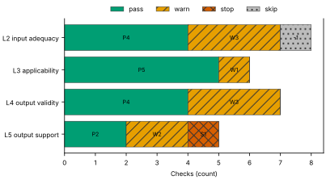
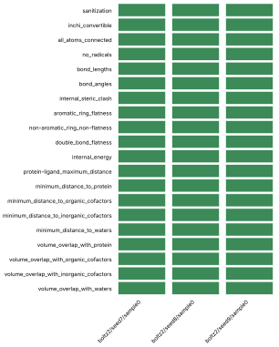
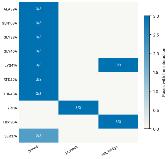
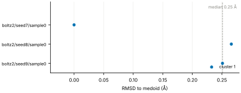
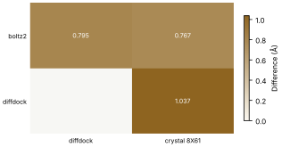
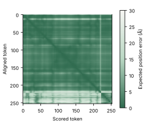

# Run report · Ligand pose in a known pocket

Prediction assurance · run `ligand_pose-751bbcabfb81` · 2026-10-17 19:22:10 UTC

**Refused** for the claim "Predicted pose of ATP in FtsE is valid".

Refused over layers 2,3,4,5: 15 pass, 9 warn, 1 stop, 1 skip. Stopped by l5.controls.redocking. Warnings from l2.receptor.protonation, l2.ligand.protonation, l2.docking.box, l3.exposure.ligand_prevalence, l4.torsion_strain, l4.interactions.unsatisfied_polars, l4.minimisation_drift, l5.sampling.seeds, l5.agreement.cross_family.

Stops: `l5.controls.redocking`.

Warnings: `l2.receptor.protonation`, `l2.ligand.protonation`, `l2.docking.box`, `l3.exposure.ligand_prevalence`, `l4.torsion_strain`, `l4.interactions.unsatisfied_polars`, `l4.minimisation_drift`, `l5.sampling.seeds`, `l5.agreement.cross_family`.

| Field | Value |
| --- | --- |
| Task | Ligand pose in a known pocket (`ligand_pose`) |
| Tools | Boltz-2 2.2.1 (co-folding), DiffDock-L (docking) |
| Target | `protein` |
| Ligand | `c1nc(c2c(n1)n(cn2)[C@H]3[C@@H]([C@@H]([C@H](O3)CO[P@@](=O)(O)O[P@](=O)(O)OP(=O)(O)O)O)O)N` |
| Reference | `8X61` |
| pH | 7.4 |
| Seeds | 3 |
| Layers run | 2, 3, 4, 5 |
| Run | `ligand_pose-751bbcabfb81` |
| Created | 2026-10-17 19:22:10 UTC |
| Finished | 2026-10-17 19:23:15 UTC |
| pah version | 0.1.0 |
| Report schema | 1 |

## Layers

| Layer | Status | Result | pass | warn | stop | skip | Time |
| --- | --- | --- | --- | --- | --- | --- | --- |
| L0 Provenance | not run | n/a | n/a | n/a | n/a | n/a | n/a |
| L1 Input integrity | not run | n/a | n/a | n/a | n/a | n/a | n/a |
| L2 Input adequacy | done | warn | 4 | 3 | 0 | 1 | 1.4 s |
| L3 Applicability | done | warn | 5 | 1 | 0 | 0 | 416 ms |
| L4 Output validity | done | warn | 4 | 3 | 0 | 0 | 63.1 s |
| L5 Output support | done | stop | 2 | 2 | 1 | 0 | 248 ms |

## Figures

Fig. 1 · Check outcomes per layer for run ligand_pose-751bbcabfb81. Totals: pass 15, warn 9, stop 1, skip 1.
Files: data [figures/gates_by_layer.csv](figures/gates_by_layer.csv).

## Structures

68 PyMOL renders.

8X61 mmCIF (source_structure), whole structure. Chains A, B, C, D; organic components ATP. sha256 ba2b64fd50fa3880. PyMOL session: [renders/8X61.pse](renders/8X61.pse).

8X61 mmCIF (source_structure), ligand environment within 5 Å. Chains A, B, C, D; organic components ATP. sha256 ba2b64fd50fa3880. PyMOL session: [renders/8X61.pse](renders/8X61.pse).

boltz2/seed7/sample0 (prediction_structure), whole structure. Chains A, L; organic components LIG1. sha256 b389f14f2fd827eb. PyMOL session: [renders/boltz2_seed7_sample0.pse](renders/boltz2_seed7_sample0.pse).

boltz2/seed7/sample0 (prediction_structure), ligand environment within 5 Å. Chains A, L; organic components LIG1. sha256 b389f14f2fd827eb. PyMOL session: [renders/boltz2_seed7_sample0.pse](renders/boltz2_seed7_sample0.pse).

boltz2/seed8/sample0 (prediction_structure), whole structure. Chains A, L; organic components LIG1. sha256 bc7d7167b5d1727a. PyMOL session: [renders/boltz2_seed8_sample0.pse](renders/boltz2_seed8_sample0.pse).

boltz2/seed8/sample0 (prediction_structure), ligand environment within 5 Å. Chains A, L; organic components LIG1. sha256 bc7d7167b5d1727a. PyMOL session: [renders/boltz2_seed8_sample0.pse](renders/boltz2_seed8_sample0.pse).

boltz2/seed9/sample0 (prediction_structure), whole structure. Chains A, L; organic components LIG1. sha256 9395de93530941c2. PyMOL session: [renders/boltz2_seed9_sample0.pse](renders/boltz2_seed9_sample0.pse).

boltz2/seed9/sample0 (prediction_structure), ligand environment within 5 Å. Chains A, L; organic components LIG1. sha256 9395de93530941c2. PyMOL session: [renders/boltz2_seed9_sample0.pse](renders/boltz2_seed9_sample0.pse).

diffdock/seed7/mode0 (prediction_structure), whole structure. Chains A, L; organic components LIG. sha256 a94eee5f2346e7fd. PyMOL session: [renders/diffdock_seed7_mode0.pse](renders/diffdock_seed7_mode0.pse).

diffdock/seed7/mode0 (prediction_structure), ligand environment within 5 Å. Chains A, L; organic components LIG. sha256 a94eee5f2346e7fd. PyMOL session: [renders/diffdock_seed7_mode0.pse](renders/diffdock_seed7_mode0.pse).

diffdock/seed7/mode1 (prediction_structure), whole structure. Chains A, L; organic components LIG. sha256 deda5c88a6a078b5. PyMOL session: [renders/diffdock_seed7_mode1.pse](renders/diffdock_seed7_mode1.pse).

diffdock/seed7/mode1 (prediction_structure), ligand environment within 5 Å. Chains A, L; organic components LIG. sha256 deda5c88a6a078b5. PyMOL session: [renders/diffdock_seed7_mode1.pse](renders/diffdock_seed7_mode1.pse).

diffdock/seed7/mode2 (prediction_structure), whole structure. Chains A, L; organic components LIG. sha256 85771ba7fa26be28. PyMOL session: [renders/diffdock_seed7_mode2.pse](renders/diffdock_seed7_mode2.pse).

diffdock/seed7/mode2 (prediction_structure), ligand environment within 5 Å. Chains A, L; organic components LIG. sha256 85771ba7fa26be28. PyMOL session: [renders/diffdock_seed7_mode2.pse](renders/diffdock_seed7_mode2.pse).

diffdock/seed7/mode3 (prediction_structure), whole structure. Chains A, L; organic components LIG. sha256 d2ac4c942a2f0a5d. PyMOL session: [renders/diffdock_seed7_mode3.pse](renders/diffdock_seed7_mode3.pse).

diffdock/seed7/mode3 (prediction_structure), ligand environment within 5 Å. Chains A, L; organic components LIG. sha256 d2ac4c942a2f0a5d. PyMOL session: [renders/diffdock_seed7_mode3.pse](renders/diffdock_seed7_mode3.pse).

diffdock/seed7/mode4 (prediction_structure), whole structure. Chains A, L; organic components LIG. sha256 a999f548f7fb4450. PyMOL session: [renders/diffdock_seed7_mode4.pse](renders/diffdock_seed7_mode4.pse).

diffdock/seed7/mode4 (prediction_structure), ligand environment within 5 Å. Chains A, L; organic components LIG. sha256 a999f548f7fb4450. PyMOL session: [renders/diffdock_seed7_mode4.pse](renders/diffdock_seed7_mode4.pse).

diffdock/seed7/mode5 (prediction_structure), whole structure. Chains A, L; organic components LIG. sha256 3020da65d7b19029. PyMOL session: [renders/diffdock_seed7_mode5.pse](renders/diffdock_seed7_mode5.pse).

diffdock/seed7/mode5 (prediction_structure), ligand environment within 5 Å. Chains A, L; organic components LIG. sha256 3020da65d7b19029. PyMOL session: [renders/diffdock_seed7_mode5.pse](renders/diffdock_seed7_mode5.pse).

diffdock/seed7/mode6 (prediction_structure), whole structure. Chains A, L; organic components LIG. sha256 dfcd9122813cfdc5. PyMOL session: [renders/diffdock_seed7_mode6.pse](renders/diffdock_seed7_mode6.pse).

diffdock/seed7/mode6 (prediction_structure), ligand environment within 5 Å. Chains A, L; organic components LIG. sha256 dfcd9122813cfdc5. PyMOL session: [renders/diffdock_seed7_mode6.pse](renders/diffdock_seed7_mode6.pse).

diffdock/seed7/mode7 (prediction_structure), whole structure. Chains A, L; organic components LIG. sha256 82a098c9d52f6621. PyMOL session: [renders/diffdock_seed7_mode7.pse](renders/diffdock_seed7_mode7.pse).

diffdock/seed7/mode7 (prediction_structure), ligand environment within 5 Å. Chains A, L; organic components LIG. sha256 82a098c9d52f6621. PyMOL session: [renders/diffdock_seed7_mode7.pse](renders/diffdock_seed7_mode7.pse).

diffdock/seed7/mode8 (prediction_structure), whole structure. Chains A, L; organic components LIG. sha256 e2f2ed9ea4da7920. PyMOL session: [renders/diffdock_seed7_mode8.pse](renders/diffdock_seed7_mode8.pse).

diffdock/seed7/mode8 (prediction_structure), ligand environment within 5 Å. Chains A, L; organic components LIG. sha256 e2f2ed9ea4da7920. PyMOL session: [renders/diffdock_seed7_mode8.pse](renders/diffdock_seed7_mode8.pse).

diffdock/seed7/mode9 (prediction_structure), whole structure. Chains A, L; organic components LIG. sha256 588514c3aa3e1d7e. PyMOL session: [renders/diffdock_seed7_mode9.pse](renders/diffdock_seed7_mode9.pse).

diffdock/seed7/mode9 (prediction_structure), ligand environment within 5 Å. Chains A, L; organic components LIG. sha256 588514c3aa3e1d7e. PyMOL session: [renders/diffdock_seed7_mode9.pse](renders/diffdock_seed7_mode9.pse).

diffdock/seed8/mode0 (prediction_structure), whole structure. Chains A, L; organic components LIG. sha256 e53de8ea73d189a9. PyMOL session: [renders/diffdock_seed8_mode0.pse](renders/diffdock_seed8_mode0.pse).

diffdock/seed8/mode0 (prediction_structure), ligand environment within 5 Å. Chains A, L; organic components LIG. sha256 e53de8ea73d189a9. PyMOL session: [renders/diffdock_seed8_mode0.pse](renders/diffdock_seed8_mode0.pse).

diffdock/seed8/mode1 (prediction_structure), whole structure. Chains A, L; organic components LIG. sha256 d81ad9f533c2e010. PyMOL session: [renders/diffdock_seed8_mode1.pse](renders/diffdock_seed8_mode1.pse).

diffdock/seed8/mode1 (prediction_structure), ligand environment within 5 Å. Chains A, L; organic components LIG. sha256 d81ad9f533c2e010. PyMOL session: [renders/diffdock_seed8_mode1.pse](renders/diffdock_seed8_mode1.pse).

diffdock/seed8/mode2 (prediction_structure), whole structure. Chains A, L; organic components LIG. sha256 e22f63e42462c3cc. PyMOL session: [renders/diffdock_seed8_mode2.pse](renders/diffdock_seed8_mode2.pse).

diffdock/seed8/mode2 (prediction_structure), ligand environment within 5 Å. Chains A, L; organic components LIG. sha256 e22f63e42462c3cc. PyMOL session: [renders/diffdock_seed8_mode2.pse](renders/diffdock_seed8_mode2.pse).

diffdock/seed8/mode3 (prediction_structure), whole structure. Chains A, L; organic components LIG. sha256 850f296376e414ca. PyMOL session: [renders/diffdock_seed8_mode3.pse](renders/diffdock_seed8_mode3.pse).

diffdock/seed8/mode3 (prediction_structure), ligand environment within 5 Å. Chains A, L; organic components LIG. sha256 850f296376e414ca. PyMOL session: [renders/diffdock_seed8_mode3.pse](renders/diffdock_seed8_mode3.pse).

diffdock/seed8/mode4 (prediction_structure), whole structure. Chains A, L; organic components LIG. sha256 14a39a03496c7df8. PyMOL session: [renders/diffdock_seed8_mode4.pse](renders/diffdock_seed8_mode4.pse).

diffdock/seed8/mode4 (prediction_structure), ligand environment within 5 Å. Chains A, L; organic components LIG. sha256 14a39a03496c7df8. PyMOL session: [renders/diffdock_seed8_mode4.pse](renders/diffdock_seed8_mode4.pse).

diffdock/seed8/mode5 (prediction_structure), whole structure. Chains A, L; organic components LIG. sha256 020498dc6ee1da8f. PyMOL session: [renders/diffdock_seed8_mode5.pse](renders/diffdock_seed8_mode5.pse).

diffdock/seed8/mode5 (prediction_structure), ligand environment within 5 Å. Chains A, L; organic components LIG. sha256 020498dc6ee1da8f. PyMOL session: [renders/diffdock_seed8_mode5.pse](renders/diffdock_seed8_mode5.pse).

diffdock/seed8/mode6 (prediction_structure), whole structure. Chains A, L; organic components LIG. sha256 350251bd9d1779fe. PyMOL session: [renders/diffdock_seed8_mode6.pse](renders/diffdock_seed8_mode6.pse).

diffdock/seed8/mode6 (prediction_structure), ligand environment within 5 Å. Chains A, L; organic components LIG. sha256 350251bd9d1779fe. PyMOL session: [renders/diffdock_seed8_mode6.pse](renders/diffdock_seed8_mode6.pse).

diffdock/seed8/mode7 (prediction_structure), whole structure. Chains A, L; organic components LIG. sha256 422f545d0c52b4e8. PyMOL session: [renders/diffdock_seed8_mode7.pse](renders/diffdock_seed8_mode7.pse).

diffdock/seed8/mode7 (prediction_structure), ligand environment within 5 Å. Chains A, L; organic components LIG. sha256 422f545d0c52b4e8. PyMOL session: [renders/diffdock_seed8_mode7.pse](renders/diffdock_seed8_mode7.pse).

diffdock/seed8/mode8 (prediction_structure), whole structure. Chains A, L; organic components LIG. sha256 0b4780ba00bd0ef6. PyMOL session: [renders/diffdock_seed8_mode8.pse](renders/diffdock_seed8_mode8.pse).

diffdock/seed8/mode8 (prediction_structure), ligand environment within 5 Å. Chains A, L; organic components LIG. sha256 0b4780ba00bd0ef6. PyMOL session: [renders/diffdock_seed8_mode8.pse](renders/diffdock_seed8_mode8.pse).

diffdock/seed8/mode9 (prediction_structure), whole structure. Chains A, L; organic components LIG. sha256 9d994871874001a1. PyMOL session: [renders/diffdock_seed8_mode9.pse](renders/diffdock_seed8_mode9.pse).

diffdock/seed8/mode9 (prediction_structure), ligand environment within 5 Å. Chains A, L; organic components LIG. sha256 9d994871874001a1. PyMOL session: [renders/diffdock_seed8_mode9.pse](renders/diffdock_seed8_mode9.pse).

diffdock/seed9/mode0 (prediction_structure), whole structure. Chains A, L; organic components LIG. sha256 a924b35d5fc878c9. PyMOL session: [renders/diffdock_seed9_mode0.pse](renders/diffdock_seed9_mode0.pse).

diffdock/seed9/mode0 (prediction_structure), ligand environment within 5 Å. Chains A, L; organic components LIG. sha256 a924b35d5fc878c9. PyMOL session: [renders/diffdock_seed9_mode0.pse](renders/diffdock_seed9_mode0.pse).

diffdock/seed9/mode1 (prediction_structure), whole structure. Chains A, L; organic components LIG. sha256 231496bdb8da4859. PyMOL session: [renders/diffdock_seed9_mode1.pse](renders/diffdock_seed9_mode1.pse).

diffdock/seed9/mode1 (prediction_structure), ligand environment within 5 Å. Chains A, L; organic components LIG. sha256 231496bdb8da4859. PyMOL session: [renders/diffdock_seed9_mode1.pse](renders/diffdock_seed9_mode1.pse).

diffdock/seed9/mode2 (prediction_structure), whole structure. Chains A, L; organic components LIG. sha256 930258c5b4a86b19. PyMOL session: [renders/diffdock_seed9_mode2.pse](renders/diffdock_seed9_mode2.pse).

diffdock/seed9/mode2 (prediction_structure), ligand environment within 5 Å. Chains A, L; organic components LIG. sha256 930258c5b4a86b19. PyMOL session: [renders/diffdock_seed9_mode2.pse](renders/diffdock_seed9_mode2.pse).

diffdock/seed9/mode3 (prediction_structure), whole structure. Chains A, L; organic components LIG. sha256 8ef92ab78164b87e. PyMOL session: [renders/diffdock_seed9_mode3.pse](renders/diffdock_seed9_mode3.pse).

diffdock/seed9/mode3 (prediction_structure), ligand environment within 5 Å. Chains A, L; organic components LIG. sha256 8ef92ab78164b87e. PyMOL session: [renders/diffdock_seed9_mode3.pse](renders/diffdock_seed9_mode3.pse).

diffdock/seed9/mode4 (prediction_structure), whole structure. Chains A, L; organic components LIG. sha256 f1ad3e8edf96fac1. PyMOL session: [renders/diffdock_seed9_mode4.pse](renders/diffdock_seed9_mode4.pse).

diffdock/seed9/mode4 (prediction_structure), ligand environment within 5 Å. Chains A, L; organic components LIG. sha256 f1ad3e8edf96fac1. PyMOL session: [renders/diffdock_seed9_mode4.pse](renders/diffdock_seed9_mode4.pse).

diffdock/seed9/mode5 (prediction_structure), whole structure. Chains A, L; organic components LIG. sha256 52ea8a6d2d4690ba. PyMOL session: [renders/diffdock_seed9_mode5.pse](renders/diffdock_seed9_mode5.pse).

diffdock/seed9/mode5 (prediction_structure), ligand environment within 5 Å. Chains A, L; organic components LIG. sha256 52ea8a6d2d4690ba. PyMOL session: [renders/diffdock_seed9_mode5.pse](renders/diffdock_seed9_mode5.pse).

diffdock/seed9/mode6 (prediction_structure), whole structure. Chains A, L; organic components LIG. sha256 928ed62dadceb5a7. PyMOL session: [renders/diffdock_seed9_mode6.pse](renders/diffdock_seed9_mode6.pse).

diffdock/seed9/mode6 (prediction_structure), ligand environment within 5 Å. Chains A, L; organic components LIG. sha256 928ed62dadceb5a7. PyMOL session: [renders/diffdock_seed9_mode6.pse](renders/diffdock_seed9_mode6.pse).

diffdock/seed9/mode7 (prediction_structure), whole structure. Chains A, L; organic components LIG. sha256 5c42cde12c12c5eb. PyMOL session: [renders/diffdock_seed9_mode7.pse](renders/diffdock_seed9_mode7.pse).

diffdock/seed9/mode7 (prediction_structure), ligand environment within 5 Å. Chains A, L; organic components LIG. sha256 5c42cde12c12c5eb. PyMOL session: [renders/diffdock_seed9_mode7.pse](renders/diffdock_seed9_mode7.pse).

diffdock/seed9/mode8 (prediction_structure), whole structure. Chains A, L; organic components LIG. sha256 e9cc8de1acc1058e. PyMOL session: [renders/diffdock_seed9_mode8.pse](renders/diffdock_seed9_mode8.pse).

diffdock/seed9/mode8 (prediction_structure), ligand environment within 5 Å. Chains A, L; organic components LIG. sha256 e9cc8de1acc1058e. PyMOL session: [renders/diffdock_seed9_mode8.pse](renders/diffdock_seed9_mode8.pse).

diffdock/seed9/mode9 (prediction_structure), whole structure. Chains A, L; organic components LIG. sha256 4f6186667ab9ee17. PyMOL session: [renders/diffdock_seed9_mode9.pse](renders/diffdock_seed9_mode9.pse).

diffdock/seed9/mode9 (prediction_structure), ligand environment within 5 Å. Chains A, L; organic components LIG. sha256 4f6186667ab9ee17. PyMOL session: [renders/diffdock_seed9_mode9.pse](renders/diffdock_seed9_mode9.pse).

## L0 Provenance

Where did every input come from?

Status: not run.

## L1 Input integrity

Did the run receive exactly what was declared?

Status: not run.

## L2 Input adequacy

Does the input carry enough information?

Status: done. Checks: pass 4 · warn 3 · stop 0 · skip 1. Time: 1.4 s.

#### Key figures

| Figure | Value |
| --- | --- |
| near site | 0 |
| missing | 0 |
| uniprot cofactors | 0 |
| pocket residues | 30 |
| incomplete | 0 |
| sequence gaps | 0 |
| state | holo |
| site ligands | 1 |

#### Docking

| Field | Value |
| --- | --- |
| center | 137.651, 149.997, 122.463 Å |
| size | 16.823 × 14.232 × 20.687 Å |
| origin | derived from ATP (+4 Å) |

#### Checks

| Check | Result | Measured cmp threshold | Evidence | Id · time |
| --- | --- | --- | --- | --- |
| Alignment depth, distinct sequences, Neff and gap fraction | skip | n/a | no MSA declared for a co-folding model · not applicable | `l2.msa.depth` |
| Required cofactors, ions and partners present | pass | `pocket_distance <= 8` | components within 8.0 Å of ATP: none · near_site=0, missing=0, uniprot_cofactors=0 | `l2.context.cofactors` · 191 ms |
| Pocket residues resolved, no missing loops lining the pocket | pass | `pocket_distance <= 6` | 30 pocket residues complete in 8X61.cif · pocket_residues=30, incomplete=0, sequence_gaps=0 | `l2.pocket.resolved` · 13 ms |
| Receptor state apo or holo | pass | n/a | 8X61.cif holo: ATP in the site · state=holo, site_ligands=1 | `l2.receptor.state` · 15 ms |
| Receptor protonation at the stated pH | warn | `pka_margin > 1` | receptor has no hydrogens (protonation not assigned); pKa within 1.0 of pH 7.4: HIS36A pKa 6.97 · hydrogens_present=False, ph=7.4, pocket_titratable=10 | `l2.receptor.protonation` · 215 ms |
| Ligand protonation and tautomers enumerated at the stated pH | warn | `ph 7.4 == 1` | ligand: 2 states; ligand: declared form Nc1ncnc2c1ncn2[C@@H]1O[C@H](CO[P@@](=O)(O)O[P@](=O)(O)OP(=O)(O)O)[C@@H](O)[C@H]1O differs from enumerated Nc1ncnc2c1ncn2[C@@H]1O[C@H](CO[P@@](=O)([O-])O[P@](=O)([O-])OP(=O)([O-])O)[C@@H](O)[C@H]1O, Nc1ncnc2c1ncn2[C@@H]1O[C@H](CO[P@@](=O)([O-])O[P@](=O)([O-])OP(=O)([O-])[O-])[C@@H](O)[C@H]1O · ph=7.4, max_states=2, declared_not_enumerated=1 | `l2.ligand.protonation` · 59 ms |
| Ligand conformers generated and minimised | pass | `conformers >= 10` | 10 ETKDG conformers per ligand, MMFF minimised · ligands=1, failed=0, min_embedded=10 | `l2.ligand.conformers` · 868 ms |
| Docking box encloses the pocket with margin | warn | `margin >= 2` | no box declared; derived box encloses 21 contact residues and the ATP ligand with 2.0 Å margin · volume_A3=4953, ligand_atoms_inside_margin=31, ligand_atoms=31 | `l2.docking.box` · 14 ms |

## L3 Applicability

Is the tool inside its validated regime?

Status: done. Checks: pass 5 · warn 1 · stop 0 · skip 0. Time: 416 ms.

#### Key figures

| Figure | Value |
| --- | --- |
| executors | 2 |
| unknown | 0 |
| reference released | 2024-05-08 |
| cutoff | 2019-01-01 |
| entries compared | 0 |
| pocket residues | 23 |
| systems | 3474 |
| analogue components | 19 |

#### Checks

| Check | Result | Measured cmp threshold | Evidence | Id · time |
| --- | --- | --- | --- | --- |
| Model training cutoff recorded | pass | `training_cutoff == recorded` | boltz2 2023-06-01; diffdock 2019-01-01; reference 8X61 released 2024-05-08 · executors=2, unknown=0, reference_released=2024-05-08 | `l3.model.training_cutoff` · 0 ms |
| Pocket similarity to pre-cutoff complexes (SuCOS times pocket coverage) | pass | `similarity <= 50` | no pre-cutoff holo entry with an analogue found (cutoff 2019-01-01) · cutoff=2019-01-01, entries_compared=0, max_similarity=None | `l3.exposure.pocket` · 400 ms |
| Ligand analogues in pre-cutoff training systems | warn | `tanimoto > 0.9` | 3474 PDB entries released before 2019-01-01 (diffdock cutoff) contain analogues of ligand above Tanimoto 0.9: 5FA, ADP, AQP, ATP, HEJ, LA8 · cutoff=2019-01-01, systems=3474, analogue_components=19 | `l3.exposure.ligand_prevalence` · 0 ms |
| Chain sequence identity to pre-cutoff entries (secondary measure) | pass | `identity < 0.4` | protein: 0 entries at 95 percent identity, 6 at 40 percent, released before 2019-01-01 (reported, not gating) · cutoff=2019-01-01, entries_95=0, entries_40=6 | `l3.exposure.sequence` · 0 ms |
| Modality inside the validated set; token count against the training crop | pass | n/a | modalities protein, protein_ligand inside the validated set; 253 tokens · modalities=2, tokens=253, outside=0 | `l3.regime.modality` · 12 ms |
| Endpoint fits the tool | pass | `endpoint pose in pose` | endpoint pose produced by boltz2, diffdock · endpoint=pose, executors=2, not_fitting=0 | `l3.metric.endpoint` · 0 ms |

## L4 Output validity

Is the result physically and chemically sensible?

Status: done. Checks: pass 4 · warn 3 · stop 0 · skip 0. Time: 63.1 s.

#### Key figures

| Figure | Value |
| --- | --- |
| poses | 3 |
| passed | 20 |
| total | 20 |
| poses all pass | 3 |
| unlikely torsions | 2 |
| torsions | 14 |
| strain kcal | 16.38 |
| poses with unlikely | 3 |

#### PoseBusters · 20/20 tests pass

| test | result | value |
| --- | --- | --- |
| sanitization | pass | pass |
| inchi_convertible | pass | pass |
| all_atoms_connected | pass | pass |
| no_radicals | pass | pass |
| bond_lengths | pass | 0 long outliers |
| bond_angles | pass | 0 outliers |
| internal_steric_clash | pass | 0 |
| aromatic_ring_flatness | pass | 0.00 Å |
| non-aromatic_ring_non-flatness | pass | pass |
| double_bond_flatness | pass | pass |
| internal_energy | pass | 3.1 times the ensemble mean |
| protein-ligand_maximum_distance | pass | 2.56 Å |
| minimum_distance_to_protein | pass | 2.56 Å |
| minimum_distance_to_organic_cofactors | pass | pass |
| minimum_distance_to_inorganic_cofactors | pass | pass |
| minimum_distance_to_waters | pass | pass |
| volume_overlap_with_protein | pass | 0.016 |
| volume_overlap_with_organic_cofactors | pass | pass |
| volume_overlap_with_inorganic_cofactors | pass | pass |
| volume_overlap_with_waters | pass | pass |

#### Per-pose physical checks

| pose | seed | drift Å | converged | unlikely torsions | unsat. polars | buried charged | PoseBusters |
| --- | --- | --- | --- | --- | --- | --- | --- |
| boltz2/seed7/sample0 | 7 | 2.2 | true | 2/14 | 2 | 0 | 20/20 |
| boltz2/seed8/sample0 | 8 | 1.56 | true | 1/14 | 2 | 0 | 20/20 |
| boltz2/seed9/sample0 | 9 | 1.74 | true | 1/14 | 2 | 0 | 20/20 |
| median | n/a | 1.74 | n/a | 1 | 2 | 0 | 20/20 |

#### Interaction fingerprint · representative pose boltz2/seed7/sample0

| residue | type | distance | poses |
| --- | --- | --- | --- |
| ALA39A | hbond | 3.15 Å | 3/3 |
| GLN163A | hbond | 2.78 Å | 3/3 |
| GLY38A | hbond | 2.87 Å | 3/3 |
| GLY40A | hbond | 3.07 Å | 3/3 |
| LYS41A | hbond | 3.04 Å | 3/3 |
| SER42A | hbond | 2.87 Å | 3/3 |
| THR43A | hbond | 2.59 Å | 3/3 |
| TYR11A | pi_stack | 3.57 Å | 3/3 |
| HIS195A | salt_bridge | 5.04 Å | 3/3 |
| LYS41A | salt_bridge | 3.95 Å | 3/3 |
| SER37A | hbond | 2.56 Å | 2/3 |

Fig. 2 · PoseBusters tests (20) by pose (3). Failed cells marked x: 0 of 60.
Files: data [figures/posebusters_grid.csv](figures/posebusters_grid.csv).

Fig. 3 · Interactions by residue (10) and type (3); cell label: poses with the interaction over poses assessed.
Files: data [figures/interactions.csv](figures/interactions.csv).

#### Checks

| Check | Result | Measured cmp threshold | Evidence | Id · time |
| --- | --- | --- | --- | --- |
| PoseBusters geometry, stereochemistry, clashes and protein contact | pass | `tests_failed == 0` | 20 of 20 tests pass for boltz2/seed7/sample0; 3 of 3 poses pass all · poses=3, passed=20, total=20 | `l4.posebusters` · 2.1 s |
| Torsional strain of the ligand pose | warn | `torsion_energy <= 2.5` | 2 of 14 torsions above 2.5 kcal/mol in boltz2/seed7/sample0 · poses=3, unlikely_torsions=2, torsions=14 | `l4.torsion_strain` · 3.9 s |
| Interaction fingerprint (PLIP) | pass | n/a | 14 interactions in boltz2/seed7/sample0 (hbond, pi_stack, salt_bridge); 11 distinct across 3 poses (reported) · poses=3, interactions_representative=14, distinct=11 | `l4.interactions.fingerprint` · 1.1 s |
| Buried ligand polar atoms without a hydrogen-bond partner | warn | `relative_sasa < 0.1` | 2 of 8 buried polar ligand atoms without a partner in boltz2/seed7/sample0 · poses=3, unsatisfied=2, buried_charged=0 | `l4.interactions.unsatisfied_polars` · 184 ms |
| Hydrophobic complementarity of buried ligand surface | pass | `fraction >= 0.35` | nonpolar fraction of protein contacts around 2 buried nonpolar ligand atoms in boltz2/seed7/sample0: 0.646 · poses=3, complementarity=0.646, buried_nonpolar=2 | `l4.interactions.hydrophobic` · 179 ms |
| Interactions of the crystal ligand reproduced by the pose | pass | `reproduced 9 >= 1` | boltz2/seed7/sample0 reproduces 9 of 16 ATP interactions: hbond ALA39A, hbond GLN163A, hbond GLY38A, hbond GLY40A, hbond LYS41A, hbond SER42A, hbond THR43A, pi_stack TYR11A, salt_bridge LYS41A · key_interactions=16, reproduced=9, poses_reproducing_all=0 | `l4.interactions.known_binders` · 420 ms |
| Pose stability under short restrained minimisation (OpenMM, AMBER14 and OpenFF) | warn | `drift_A 2.2 <= 2` | boltz2/seed7/sample0 moves 2.198 Å under restrained minimisation · poses=3, drift_A=2.198, max_drift_A=2.198 | `l4.minimisation_drift` · 55.3 s |

## L5 Output support

Is a valid result corroborated?

Status: done. Checks: pass 2 · warn 2 · stop 1 · skip 0. Time: 248 ms.

#### Key figures

| Figure | Value |
| --- | --- |
| poses | 3 |
| pocket plddt | 94.4 |
| global plddt | 93.6 |
| iptm | 0.966 |
| ptm | 0.947 |
| confidence score | 0.938 |
| independent seeds | 3 |
| samples | 3 |

#### Sampling

| Field | Value |
| --- | --- |
| site placement | 3 of 3 poses within 4.0 Å of the site (ATP in 8X61) |
| pose accuracy | 3 of 3 poses within 2.0 Å of the medoid |
| pairwise RMSD median | 0.41 Å |
| pairwise RMSD IQR | 0.32 to 0.42 Å |
| pairs | 3 |
| medoid | boltz2/seed7/sample0 |

#### Clusters

| Field | Value |
| --- | --- |
| cluster 1 | 3/3 poses (boltz2/seed7/sample0) |

#### Per-seed statistics

| seed | pose | cluster | RMSD to medoid | confidence |
| --- | --- | --- | --- | --- |
| 7 | boltz2/seed7/sample0 | 1 | 0 Å | 0.94 |
| 8 | boltz2/seed8/sample0 | 1 | 0.41 Å | 0.94 |
| 9 | boltz2/seed9/sample0 | 1 | 0.23 Å | 0.94 |
| median | n/a | n/a | 0.23 Å | 0.94 |

#### Ensemble

| structure | kind | source | RMSD to medoid | cluster | pocket pLDDT | ipTM |
| --- | --- | --- | --- | --- | --- | --- |
| boltz2/seed7/sample0 | medoid | boltz2 | 0 Å | 1 | 94.4 | 0.97 |
| boltz2/seed8/sample0 | seed | boltz2 | 0.41 Å | 1 | 94.5 | 0.97 |
| boltz2/seed9/sample0 | seed | boltz2 | 0.23 Å | 1 | 94.2 | 0.97 |

#### Agreement between methods

| method | diffdock | crystal 8X61 |
| --- | --- | --- |
| boltz2 | 2.46 Å (high) | 2.66 Å (decisive) |
| diffdock | n/a | 1.04 Å (decisive) |

#### Confidence metrics

| metric | value | read as | tool |
| --- | --- | --- | --- |
| affinity_pred_value | 0.18006673455238342 | ranking within a series, never pose quality | boltz2 |
| affinity_probability_binary | 0.44404059648513794 | ranking within a series, never pose quality | boltz2 |
| affinity_pred_value | 0.21140490472316742 | ranking within a series, never pose quality | boltz2 |
| affinity_probability_binary | 0.44225674867630005 | ranking within a series, never pose quality | boltz2 |
| affinity_pred_value | 0.15530666708946228 | ranking within a series, never pose quality | boltz2 |
| affinity_probability_binary | 0.4472087025642395 | ranking within a series, never pose quality | boltz2 |

Fig. 4 · RMSD to the medoid for 3 poses, coloured by cluster (1 clusters). Dashed line: median 0.23 Å; range 0.00 to 0.41 Å.
Files: data [figures/seed_spread.csv](figures/seed_spread.csv).

Fig. 5 · Agreement between 2 methods and 2 comparators; range 1.037 to 2.662 Å.
Files: data [figures/agreement.csv](figures/agreement.csv).

Fig. 6 · Predicted aligned error for pose boltz2/seed7/sample0, 253 by 253 tokens; values 0.2 to 28.5 Å, mean 4.4 Å.
Files: data [figures/pae.csv](figures/pae.csv).

#### Checks

| Check | Result | Measured cmp threshold | Evidence | Id · time |
| --- | --- | --- | --- | --- |
| Confidence restricted to the pocket; per-model thresholds | pass | `boltz2.pocket_plddt >= 70` | boltz2/seed7/sample0: pocket_plddt 94.4 · poses=3, pocket_plddt=94.4, global_plddt=93.6 | `l5.confidence.local` · 17 ms |
| Independent seeds counted separately from samples; duplicates flagged | warn | `seeds_cofolding >= 5` | 3 independent seeds (3 poses); task default 5 · independent_seeds=3, samples=3, duplicated_outputs=0 | `l5.sampling.seeds` · 0 ms |
| Medoid of the largest cluster, populations, pairwise spread, site and pose accuracy | pass | `cluster_rmsd <= 2` | medoid boltz2/seed7/sample0; 1 clusters, largest 3 of 3; pairwise RMSD median 0.41 Å (IQR 0.32 to 0.42); 3 of 3 poses within 4.0 Å of the site (ATP in 8X61); 3 of 3 poses within 2.0 Å of the medoid · poses=3, clusters=1, largest_cluster=3 | `l5.sampling.clusters` · 53 ms |
| Agreement between methods, weighted by independence | warn | `rmsd_to_crystal_A 2.66 <= 2` | boltz2 vs diffdock 2.455 Å (high); boltz2 vs crystal 8X61 2.662 Å (decisive); diffdock vs crystal 8X61 1.037 Å (decisive) · methods=2, comparisons=3, disagreeing=2 | `l5.agreement.cross_family` · 173 ms |
| Redocking control reproduces the crystal pose | stop | `rmsd <= 2` | redocking control required by the task and not supplied (controls.redocking) | `l5.controls.redocking` · 0 ms |

## Controls

| control | status | result |
| --- | --- | --- |
| redocking | incomplete | redocking control required by the task and not supplied (controls.redocking) |

## Provenance

50 objects · 50 cached · 0 network.

| Source | Accession | Release | SHA-256 | Retrieved | Bytes | Cache | Used by |
| --- | --- | --- | --- | --- | --- | --- | --- |
| rcsb_files | 8X61 | n/a | `ba2b64fd50fa` | 2026-10-17 16:56:13 UTC | 669464 | hit | l2.context.cofactors, l2.pocket.resolved, l2.receptor.state, l2.docking.box, l3.exposure.pocket, l3.regime.modality, l4.interactions.fingerprint, l4.interactions.known_binders, l5.sampling.clusters, l5.agreement.cross_family |
| ccd | ATP | 2011-06-04 | `a7dfd66192d9` | 2026-10-17 16:42:55 UTC | 14836 | hit | l2.context.cofactors, l3.exposure.pocket |
| rcsb | 8X61 | 1.2 | `40597bd4cb89` | 2026-10-17 16:56:15 UTC | 12259 | hit | l3.model.training_cutoff |
| rcsb_search | chem:c1nc(c2c(n1)n(cn2)[C@H]3[C@@H]([C@@H]([C@H](O3)CO[P@@](=O)(O)O[P@](=O)(O)OP(=O)(O)O)O)O)N | n/a | `c9ecdf87b8e2` | 2026-10-17 16:42:57 UTC | 1797 | hit | l3.exposure.pocket |
| ccd | 5FA | 2011-06-04 | `141da43b1fd4` | 2026-10-17 16:42:57 UTC | 5208 | hit | l3.exposure.pocket |
| ccd | ADP | 2025-10-10 | `9ebf239d6ded` | 2026-10-17 16:42:57 UTC | 5741 | hit | l3.exposure.pocket |
| ccd | AQP | 2011-06-04 | `d1f31df6170c` | 2026-10-17 16:42:57 UTC | 4700 | hit | l3.exposure.pocket |
| ccd | HEJ | 2021-03-01 | `3793d61303f5` | 2026-10-17 16:42:57 UTC | 4603 | hit | l3.exposure.pocket |
| ccd | LA8 | 2020-06-17 | `3c66f53baf33` | 2026-10-17 16:42:57 UTC | 4178 | hit | l3.exposure.pocket |
| ccd | ZF9 | 2024-03-08 | `b48f6ea5a0a0` | 2026-10-17 16:42:57 UTC | 4686 | hit | l3.exposure.pocket |
| ccd | ZSF | 2024-03-29 | `dde5989ea661` | 2026-10-17 16:42:57 UTC | 4903 | hit | l3.exposure.pocket |
| ccd | 50T | 2026-09-16 | `6be53fbf78af` | 2026-10-17 16:42:57 UTC | 4275 | hit | l3.exposure.pocket |
| ccd | AD9 | 2026-09-16 | `c8798e579e0a` | 2026-10-17 16:42:58 UTC | 4205 | hit | l3.exposure.pocket |
| ccd | AOV | 2026-09-16 | `300b793745cf` | 2026-10-17 16:42:58 UTC | 4330 | hit | l3.exposure.pocket |
| ccd | CX0 | 2022-03-25 | `fbc78ded25cd` | 2026-10-17 16:42:58 UTC | 3595 | hit | l3.exposure.pocket |
| ccd | CXC | 2022-03-25 | `d89a7023bd05` | 2026-10-17 16:42:58 UTC | 3941 | hit | l3.exposure.pocket |
| ccd | 0A | 2015-04-24 | `7f0b456f42e0` | 2026-10-17 16:42:58 UTC | 3972 | hit | l3.exposure.pocket |
| ccd | 3AN | 2011-06-04 | `a3d4d17a4a3e` | 2026-10-17 16:42:58 UTC | 4390 | hit | l3.exposure.pocket |
| ccd | 7DD | 2016-06-10 | `2265ea597be9` | 2026-10-17 16:42:58 UTC | 3425 | hit | l3.exposure.pocket |
| ccd | 7DT | 2016-06-10 | `c346b8a79ec0` | 2026-10-17 16:42:58 UTC | 3725 | hit | l3.exposure.pocket |
| ccd | AAM | 2011-06-04 | `ade365fd93cd` | 2026-10-17 16:42:58 UTC | 4244 | hit | l3.exposure.pocket |
| ccd | PAP | 2011-06-04 | `1a6bb6874f6f` | 2026-10-17 16:42:58 UTC | 4734 | hit | l3.exposure.pocket |
| ccd | XNY | 2021-04-30 | `7cb26ca44908` | 2026-10-17 16:42:58 UTC | 3977 | hit | l3.exposure.pocket |
| ccd | AP5 | 2011-06-04 | `43e554f584b7` | 2026-10-17 16:42:58 UTC | 6473 | hit | l3.exposure.pocket |
| ccd | T99 | 2018-06-01 | `68a3d15f3b6f` | 2026-10-17 16:42:58 UTC | 3399 | hit | l3.exposure.pocket |
| ccd | TAT | 2012-01-25 | `55287be9857e` | 2026-10-17 16:42:58 UTC | 4858 | hit | l3.exposure.pocket |
| ccd | A1L15 | 2025-01-24 | `57864c05fab0` | 2026-10-17 16:42:58 UTC | 5608 | hit | l3.exposure.pocket |
| ccd | AGS | 2020-06-17 | `dcdd428b77e4` | 2026-10-17 16:42:58 UTC | 10128 | hit | l3.exposure.pocket |
| rcsb_search | comp:5FA:2019-01-01 | n/a | `c60bf45b266d` | 2026-10-17 16:42:58 UTC | 282 | hit | l3.exposure.pocket |
| rcsb_search | comp:ADP:2019-01-01 | n/a | `d0ea634975e9` | 2026-10-17 16:42:58 UTC | 52129 | hit | l3.exposure.pocket |
| rcsb_search | comp:AQP:2019-01-01 | n/a | `94a619102faa` | 2026-10-17 16:42:58 UTC | 230 | hit | l3.exposure.pocket |
| rcsb_search | comp:ATP:2019-01-01 | n/a | `88190701e349` | 2026-10-17 16:42:59 UTC | 52129 | hit | l3.exposure.pocket |
| rcsb_search | comp:HEJ:2019-01-01 | n/a | `494129c6512c` | 2026-10-17 16:42:59 UTC | 178 | hit | l3.exposure.pocket |
| rcsb_search | comp:LA8:2019-01-01 | n/a | `185329a63a40` | 2026-10-17 16:42:59 UTC | 230 | hit | l3.exposure.pocket |
| rcsb_search | comp:ZF9:2019-01-01 | n/a | `e3b0c44298fc` | 2026-10-17 16:42:59 UTC | 0 | hit | l3.exposure.sequence |
| rcsb_search | comp:ZSF:2019-01-01 | n/a | `e3b0c44298fc` | 2026-10-17 16:42:59 UTC | 0 | hit | l3.exposure.sequence |
| rcsb_search | comp:50T:2019-01-01 | n/a | `927f39839b9d` | 2026-10-17 16:42:59 UTC | 178 | hit | l3.exposure.pocket |
| rcsb_search | comp:AD9:2019-01-01 | n/a | `ac65056f9aef` | 2026-10-17 16:42:59 UTC | 490 | hit | l3.exposure.pocket |
| rcsb_search | comp:AOV:2019-01-01 | n/a | `d8dd9b5a5778` | 2026-10-17 16:42:59 UTC | 334 | hit | l3.exposure.pocket |
| rcsb_search | comp:CX0:2019-01-01 | n/a | `e3b0c44298fc` | 2026-10-17 16:42:59 UTC | 0 | hit | l3.exposure.sequence |
| rcsb_search | comp:CXC:2019-01-01 | n/a | `e3b0c44298fc` | 2026-10-17 16:42:59 UTC | 0 | hit | l3.exposure.sequence |
| rcsb_search | comp:0A:2019-01-01 | n/a | `e3b0c44298fc` | 2026-10-17 16:42:59 UTC | 0 | hit | l3.exposure.sequence |
| rcsb_search | comp:PAP:2019-01-01 | n/a | `ded69bf4bbb0` | 2026-10-17 16:42:59 UTC | 542 | hit | l3.exposure.pocket |
| rcsb_search | comp:AP5:2019-01-01 | n/a | `ab39d336ec91` | 2026-10-17 16:42:59 UTC | 3247 | hit | l3.exposure.pocket |
| rcsb_search | comp:T99:2019-01-01 | n/a | `690266055a03` | 2026-10-17 16:42:59 UTC | 178 | hit | l3.exposure.pocket |
| rcsb_search | comp:TAT:2019-01-01 | n/a | `84486689d32b` | 2026-10-17 16:42:59 UTC | 438 | hit | l3.exposure.pocket |
| rcsb_search | comp:AGS:2019-01-01 | n/a | `aef54bf1fe1d` | 2026-10-17 16:42:59 UTC | 8188 | hit | l3.exposure.pocket |
| rcsb_search | seq0.9:2019-01-01:222 | n/a | `e3b0c44298fc` | 2026-10-17 16:56:17 UTC | 0 | hit | l3.exposure.sequence |
| rcsb_search | seq0.95:2019-01-01:222 | n/a | `e3b0c44298fc` | 2026-10-17 16:56:18 UTC | 0 | hit | l3.exposure.sequence |
| rcsb_search | seq0.4:2019-01-01:222 | n/a | `06f7c6a17aff` | 2026-10-17 16:56:19 UTC | 457 | hit | l3.exposure.sequence |

Provenance graph: [json](graph.json), [mmd](graph.mmd), [svg](graph.svg).

## Thresholds

| Check | Threshold | Value | Origin | Evidence level |
| --- | --- | --- | --- | --- |
| `l2.context.cofactors` | pocket_distance | <= 8 | Harness rule: a component of the reference entry within 8 Å of the declared ligand is required context; not yet calibrated | uncalibrated |
| `l2.pocket.resolved` | pocket_distance | <= 6 | Harness rule: pocket residues have a heavy atom within 6 Å of the ligand; not yet calibrated | uncalibrated |
| `l2.pocket.resolved` | missing_pocket_residues | == 0 | Specification layer 2: stop when the pocket is incomplete | published |
| `l2.receptor.protonation` | pka_margin | > 1 | Harness rule: a titratable pocket residue with PROPKA pKa within 1 unit of the stated pH has an ambiguous state; not yet calibrated | uncalibrated |
| `l2.ligand.protonation` | ph_window | == 1 | Harness rule: states enumerated by Dimorphite-DL within 1 pH unit of the stated pH; not yet calibrated | uncalibrated |
| `l2.ligand.protonation` | states | == 1 | Specification layer 2: warn when more than one plausible state | published |
| `l2.ligand.conformers` | conformers | >= 10 | Harness default number of ETKDG conformers; not yet calibrated | uncalibrated |
| `l2.docking.box` | margin | >= 2 | Harness rule: every pocket heavy atom lies at least 2 Å inside the box; not yet calibrated | uncalibrated |
| `l2.docking.box` | contact_distance | <= 4 | Harness rule: contact residues (heavy atom within 4 Å of the reference ligand) must have an atom inside the box; not yet calibrated | uncalibrated |
| `l3.model.training_cutoff` | training_cutoff | == recorded | Specification, Layer 3 (applicability): stop when unknown | published |
| `l3.exposure.pocket` | similarity | <= 50 | Specification layer 3: warn above a pocket similarity (SuCOS times pocket coverage) of 50 | published |
| `l3.exposure.pocket` | entries | <= 5 | Harness budget: pre-cutoff holo entries compared per run | uncalibrated |
| `l3.exposure.ligand_prevalence` | tanimoto | > 0.9 | Specification layer 3: analogues above 0.9 Tanimoto (RDKit topological fingerprint) | published |
| `l3.exposure.ligand_prevalence` | systems | <= 100 | Specification layer 3: prevalent when analogues occur in more than 100 training systems | published |
| `l3.exposure.sequence` | identity | < 0.4 | Specification layer 3: conventional 40 percent identity leakage threshold, reported as a secondary measure only | published |
| `l3.metric.endpoint` | endpoint | in pose | Specification, Layer 3 (applicability): no affinity from interface confidence, no protein-protein affinity from Boltz-2 | published |
| `l4.posebusters` | tests_failed | == 0 | Specification, Layer 4 (output validity): stop on failure | published |
| `l4.torsion_strain` | torsion_energy | <= 2.5 | Harness rule: a rotatable torsion whose MMFF energy lies more than 2.5 kcal/mol above the minimum of its rigid scan is unlikely; not yet calibrated | uncalibrated |
| `l4.interactions.unsatisfied_polars` | relative_sasa | < 0.1 | Harness rule: a ligand polar atom with relative SASA below 0.1 in the complex is buried; not yet calibrated | uncalibrated |
| `l4.interactions.unsatisfied_polars` | hbond_distance | <= 3.5 | PLIP hydrogen bond distance cut-off (donor-acceptor 4.1 Å; harness uses 3.5 Å heavy-atom distance) | published |
| `l4.interactions.hydrophobic` | fraction | >= 0.35 | Harness default anchored on 3PTB: the crystal benzamidine scores 0.51, Vina and Boltz-2 poses within 0.5 Å of it score 0.45 and 0.49; not calibrated on the benchmark | uncalibrated |
| `l4.interactions.hydrophobic` | relative_sasa | < 0.1 | Harness rule: a ligand polar atom with relative SASA below 0.1 in the complex is buried; not yet calibrated | uncalibrated |
| `l4.interactions.known_binders` | reproduced | >= 1 | Specification layer 4: warn when no key interaction is reproduced | published |
| `l4.minimisation_drift` | drift | <= 2 | Specification layer 4: warn when the pose moves beyond 2 Å under restrained minimisation | published |
| `l5.confidence.local` | boltz2.pocket_plddt | >= 70 | AlphaFold DB pLDDT bands (70 and above: confident backbone), applied to pocket residues; not calibrated for ligand pose | published |
| `l5.sampling.seeds` | seeds_cofolding | >= 5 | Specification layer 5: default of five seeds per co-folding prediction | published |
| `l5.sampling.clusters` | cluster_rmsd | <= 2 | Specification layer 5: 2 Å symmetry-aware ligand RMSD (spyrmsd) separates pose clusters | published |
| `l5.sampling.clusters` | site_distance | <= 4 | Harness rule: a ligand centroid within 4 Å of the reference site centroid is placed in the site; not yet calibrated | uncalibrated |
| `l5.sampling.clusters` | largest_fraction | >= 0.5 | Harness rule: the largest cluster holds at least half of the poses; not yet calibrated | uncalibrated |
| `l5.agreement.cross_family` | rmsd | <= 2 | Specification layer 5: pose agreement by symmetry-aware ligand RMSD at 2 Å | published |
| `l5.controls.redocking` | rmsd | <= 2 | Specification layer 5: redocking must reproduce the crystal pose (2 Å ligand RMSD) | published |

Tool versions: dimorphite_dl 2.1.0, freesasa 2.2.1, gemmi 0.7.5, numpy 1.26.4, openbabel 3.2.1, openmm 8.6.1, plip 3.0.1, posebusters 0.6.5, propka 3.5.1, rdkit 2026.9.1, scipy 1.17.1, spyrmsd 0.9.0.

## Limitations

- This report covers layers 2, 3, 4, 5. Layers not run: 0, 1.
- The harness establishes when a result should not be trusted. Passing checks are not evidence that a prediction is correct.
- Thresholds marked uncalibrated come from the specification or harness defaults and have not been recalibrated on the harness benchmark.

## Files

| Path | Kind | Bytes | SHA-256 |
| --- | --- | --- | --- |
| artifacts/sources/8X61.cif | source_structure | 669464 | `ba2b64fd50fa` |
| /home/user/harness-hackathon/bench/runs/2026-10-17T1859Z-849c856/predictions/ftse_wt/boltz2/seed_7/boltz_results_ftse_wt/predictions/ftse_wt/ftse_wt_model_0.cif | prediction_structure | 154785 | `b389f14f2fd8` |
| predictions/00_boltz2/boltz2/seed7/sample0/ligand.sdf | data | 2682 | `a47785d598a3` |
| /home/user/harness-hackathon/bench/runs/2026-10-17T1859Z-849c856/predictions/ftse_wt/boltz2/seed_8/boltz_results_ftse_wt/predictions/ftse_wt/ftse_wt_model_0.cif | prediction_structure | 154759 | `bc7d7167b5d1` |
| predictions/00_boltz2/boltz2/seed8/sample0/ligand.sdf | data | 2682 | `e0e59031a424` |
| /home/user/harness-hackathon/bench/runs/2026-10-17T1859Z-849c856/predictions/ftse_wt/boltz2/seed_9/boltz_results_ftse_wt/predictions/ftse_wt/ftse_wt_model_0.cif | prediction_structure | 154817 | `9395de935309` |
| predictions/00_boltz2/boltz2/seed9/sample0/ligand.sdf | data | 2682 | `ee48cab3e59f` |
| predictions/01_diffdock/diffdock/seed7/mode0/complex.pdb | prediction_structure | 139239 | `a94eee5f2346` |
| predictions/01_diffdock/diffdock/seed7/mode0/ligand.sdf | data | 2682 | `4dee9e500a9b` |
| predictions/01_diffdock/diffdock/seed7/mode1/complex.pdb | prediction_structure | 139239 | `deda5c88a6a0` |
| predictions/01_diffdock/diffdock/seed7/mode1/ligand.sdf | data | 2682 | `2f099d3800d5` |
| predictions/01_diffdock/diffdock/seed7/mode2/complex.pdb | prediction_structure | 139239 | `85771ba7fa26` |
| predictions/01_diffdock/diffdock/seed7/mode2/ligand.sdf | data | 2682 | `7ad2e0a0e648` |
| predictions/01_diffdock/diffdock/seed7/mode3/complex.pdb | prediction_structure | 139239 | `d2ac4c942a2f` |
| predictions/01_diffdock/diffdock/seed7/mode3/ligand.sdf | data | 2682 | `5b528556cab6` |
| predictions/01_diffdock/diffdock/seed7/mode4/complex.pdb | prediction_structure | 139239 | `a999f548f7fb` |
| predictions/01_diffdock/diffdock/seed7/mode4/ligand.sdf | data | 2682 | `de1c1a4d4ddb` |
| predictions/01_diffdock/diffdock/seed7/mode5/complex.pdb | prediction_structure | 139239 | `3020da65d7b1` |
| predictions/01_diffdock/diffdock/seed7/mode5/ligand.sdf | data | 2682 | `fcfcde7f6d1a` |
| predictions/01_diffdock/diffdock/seed7/mode6/complex.pdb | prediction_structure | 139239 | `dfcd9122813c` |
| predictions/01_diffdock/diffdock/seed7/mode6/ligand.sdf | data | 2682 | `2ec255af5c38` |
| predictions/01_diffdock/diffdock/seed7/mode7/complex.pdb | prediction_structure | 139239 | `82a098c9d52f` |
| predictions/01_diffdock/diffdock/seed7/mode7/ligand.sdf | data | 2682 | `da76c104742a` |
| predictions/01_diffdock/diffdock/seed7/mode8/complex.pdb | prediction_structure | 139239 | `e2f2ed9ea4da` |
| predictions/01_diffdock/diffdock/seed7/mode8/ligand.sdf | data | 2682 | `1df0ae995fcb` |
| predictions/01_diffdock/diffdock/seed7/mode9/complex.pdb | prediction_structure | 139239 | `588514c3aa3e` |
| predictions/01_diffdock/diffdock/seed7/mode9/ligand.sdf | data | 2682 | `b31eb091374b` |
| predictions/01_diffdock/diffdock/seed8/mode0/complex.pdb | prediction_structure | 139239 | `e53de8ea73d1` |
| predictions/01_diffdock/diffdock/seed8/mode0/ligand.sdf | data | 2682 | `c183c4218e58` |
| predictions/01_diffdock/diffdock/seed8/mode1/complex.pdb | prediction_structure | 139239 | `d81ad9f533c2` |
| predictions/01_diffdock/diffdock/seed8/mode1/ligand.sdf | data | 2682 | `76606c437dc1` |
| predictions/01_diffdock/diffdock/seed8/mode2/complex.pdb | prediction_structure | 139239 | `e22f63e42462` |
| predictions/01_diffdock/diffdock/seed8/mode2/ligand.sdf | data | 2682 | `5587b7de95db` |
| predictions/01_diffdock/diffdock/seed8/mode3/complex.pdb | prediction_structure | 139239 | `850f296376e4` |
| predictions/01_diffdock/diffdock/seed8/mode3/ligand.sdf | data | 2682 | `6c32f7c6c7ba` |
| predictions/01_diffdock/diffdock/seed8/mode4/complex.pdb | prediction_structure | 139239 | `14a39a03496c` |
| predictions/01_diffdock/diffdock/seed8/mode4/ligand.sdf | data | 2682 | `cd1638c32fbb` |
| predictions/01_diffdock/diffdock/seed8/mode5/complex.pdb | prediction_structure | 139239 | `020498dc6ee1` |
| predictions/01_diffdock/diffdock/seed8/mode5/ligand.sdf | data | 2682 | `f277b60886aa` |
| predictions/01_diffdock/diffdock/seed8/mode6/complex.pdb | prediction_structure | 139239 | `350251bd9d17` |
| predictions/01_diffdock/diffdock/seed8/mode6/ligand.sdf | data | 2682 | `54fbde41ba18` |
| predictions/01_diffdock/diffdock/seed8/mode7/complex.pdb | prediction_structure | 139239 | `422f545d0c52` |
| predictions/01_diffdock/diffdock/seed8/mode7/ligand.sdf | data | 2682 | `dce5d05eff89` |
| predictions/01_diffdock/diffdock/seed8/mode8/complex.pdb | prediction_structure | 139239 | `0b4780ba00bd` |
| predictions/01_diffdock/diffdock/seed8/mode8/ligand.sdf | data | 2682 | `95bdd09dad4d` |
| predictions/01_diffdock/diffdock/seed8/mode9/complex.pdb | prediction_structure | 139239 | `9d9948718740` |
| predictions/01_diffdock/diffdock/seed8/mode9/ligand.sdf | data | 2682 | `89adc4d40471` |
| predictions/01_diffdock/diffdock/seed9/mode0/complex.pdb | prediction_structure | 139239 | `a924b35d5fc8` |
| predictions/01_diffdock/diffdock/seed9/mode0/ligand.sdf | data | 2682 | `fe3520b26b50` |
| predictions/01_diffdock/diffdock/seed9/mode1/complex.pdb | prediction_structure | 139239 | `231496bdb8da` |
| predictions/01_diffdock/diffdock/seed9/mode1/ligand.sdf | data | 2682 | `851fced8c204` |
| predictions/01_diffdock/diffdock/seed9/mode2/complex.pdb | prediction_structure | 139239 | `930258c5b4a8` |
| predictions/01_diffdock/diffdock/seed9/mode2/ligand.sdf | data | 2682 | `94051a973253` |
| predictions/01_diffdock/diffdock/seed9/mode3/complex.pdb | prediction_structure | 139239 | `8ef92ab78164` |
| predictions/01_diffdock/diffdock/seed9/mode3/ligand.sdf | data | 2682 | `94936d9a4e23` |
| predictions/01_diffdock/diffdock/seed9/mode4/complex.pdb | prediction_structure | 139239 | `f1ad3e8edf96` |
| predictions/01_diffdock/diffdock/seed9/mode4/ligand.sdf | data | 2682 | `89ff3a6a0553` |
| predictions/01_diffdock/diffdock/seed9/mode5/complex.pdb | prediction_structure | 139239 | `52ea8a6d2d46` |
| predictions/01_diffdock/diffdock/seed9/mode5/ligand.sdf | data | 2682 | `afa4ae256488` |
| predictions/01_diffdock/diffdock/seed9/mode6/complex.pdb | prediction_structure | 139239 | `928ed62dadce` |
| predictions/01_diffdock/diffdock/seed9/mode6/ligand.sdf | data | 2682 | `01a7560708f1` |
| predictions/01_diffdock/diffdock/seed9/mode7/complex.pdb | prediction_structure | 139239 | `5c42cde12c12` |
| predictions/01_diffdock/diffdock/seed9/mode7/ligand.sdf | data | 2682 | `e4a3a6ed7bd3` |
| predictions/01_diffdock/diffdock/seed9/mode8/complex.pdb | prediction_structure | 139239 | `e9cc8de1acc1` |
| predictions/01_diffdock/diffdock/seed9/mode8/ligand.sdf | data | 2682 | `f7dfd596e028` |
| predictions/01_diffdock/diffdock/seed9/mode9/complex.pdb | prediction_structure | 139239 | `4f6186667ab9` |
| predictions/01_diffdock/diffdock/seed9/mode9/ligand.sdf | data | 2682 | `47de461604af` |
| renders/8X61_overview.png | render | 225386 | `5d1a3e17a0a4` |
| renders/8X61_pocket.png | render | 479865 | `08024ea747c8` |
| renders/8X61.pse | session | 2022247 | `e127cc207552` |
| renders/boltz2_seed7_sample0_overview.png | render | 227653 | `52b936f18089` |
| renders/boltz2_seed7_sample0_pocket.png | render | 214693 | `832b65be2838` |
| renders/boltz2_seed7_sample0.pse | session | 577660 | `e98e1b9527dc` |
| renders/boltz2_seed8_sample0_overview.png | render | 188380 | `5c2244f87883` |
| renders/boltz2_seed8_sample0_pocket.png | render | 248955 | `f95559cff349` |
| renders/boltz2_seed8_sample0.pse | session | 577660 | `02b336040c60` |
| renders/boltz2_seed9_sample0_overview.png | render | 195010 | `0997a55bfe3b` |
| renders/boltz2_seed9_sample0_pocket.png | render | 241258 | `d42ee99bcb71` |
| renders/boltz2_seed9_sample0.pse | session | 577654 | `c085366d367b` |
| renders/diffdock_seed7_mode0_overview.png | render | 195820 | `4029f3ec06e6` |
| renders/diffdock_seed7_mode0_pocket.png | render | 224601 | `7daa4055632d` |
| renders/diffdock_seed7_mode0.pse | session | 486315 | `1d9d71e3d30f` |
| renders/diffdock_seed7_mode1_overview.png | render | 196053 | `2de3764e1f61` |
| renders/diffdock_seed7_mode1_pocket.png | render | 222760 | `e2ab6f676de4` |
| renders/diffdock_seed7_mode1.pse | session | 486315 | `cd86c369e8fa` |
| renders/diffdock_seed7_mode2_overview.png | render | 196074 | `2124892ca81a` |
| renders/diffdock_seed7_mode2_pocket.png | render | 208850 | `128080ac7fa0` |
| renders/diffdock_seed7_mode2.pse | session | 486313 | `07ab7feb06dd` |
| renders/diffdock_seed7_mode3_overview.png | render | 195762 | `7bc8a1d19558` |
| renders/diffdock_seed7_mode3_pocket.png | render | 225358 | `a04d399b1a2d` |
| renders/diffdock_seed7_mode3.pse | session | 486313 | `778e1f24dba0` |
| renders/diffdock_seed7_mode4_overview.png | render | 196644 | `4637dd802769` |
| renders/diffdock_seed7_mode4_pocket.png | render | 203519 | `63220ec9d2df` |
| renders/diffdock_seed7_mode4.pse | session | 486307 | `f29bc43a59f5` |
| renders/diffdock_seed7_mode5_overview.png | render | 195865 | `3b565bd6f954` |
| renders/diffdock_seed7_mode5_pocket.png | render | 226188 | `3ec797ecf4d1` |
| renders/diffdock_seed7_mode5.pse | session | 486313 | `fedb693709d2` |
| renders/diffdock_seed7_mode6_overview.png | render | 195596 | `dbcdeb548407` |
| renders/diffdock_seed7_mode6_pocket.png | render | 218250 | `dfad0010cdb3` |
| renders/diffdock_seed7_mode6.pse | session | 486318 | `d5965c65e56f` |
| renders/diffdock_seed7_mode7_overview.png | render | 196003 | `ba6afc51b77d` |
| renders/diffdock_seed7_mode7_pocket.png | render | 225383 | `fb73e87c12c1` |
| renders/diffdock_seed7_mode7.pse | session | 486315 | `2717d963b672` |
| renders/diffdock_seed7_mode8_overview.png | render | 195104 | `32f34968179d` |
| renders/diffdock_seed7_mode8_pocket.png | render | 212344 | `f0e097126fac` |
| renders/diffdock_seed7_mode8.pse | session | 486315 | `4cd3faf846cc` |
| renders/diffdock_seed7_mode9_overview.png | render | 196621 | `60d55bce3e9c` |
| renders/diffdock_seed7_mode9_pocket.png | render | 217082 | `a918106903f1` |
| renders/diffdock_seed7_mode9.pse | session | 486313 | `2c150013726f` |
| renders/diffdock_seed8_mode0_overview.png | render | 195780 | `e98123456c54` |
| renders/diffdock_seed8_mode0_pocket.png | render | 220982 | `6a764a05a672` |
| renders/diffdock_seed8_mode0.pse | session | 486309 | `715d1c9c709d` |
| renders/diffdock_seed8_mode1_overview.png | render | 196676 | `713ef18584b2` |
| renders/diffdock_seed8_mode1_pocket.png | render | 209183 | `d6444174e438` |
| renders/diffdock_seed8_mode1.pse | session | 486319 | `1c7c90698201` |
| renders/diffdock_seed8_mode2_overview.png | render | 196541 | `023364ef286b` |
| renders/diffdock_seed8_mode2_pocket.png | render | 216349 | `973eb9d61e70` |
| renders/diffdock_seed8_mode2.pse | session | 486313 | `6a2b7e10b7fa` |
| renders/diffdock_seed8_mode3_overview.png | render | 195839 | `af2144c4ad9a` |
| renders/diffdock_seed8_mode3_pocket.png | render | 223195 | `2c7472cae23b` |
| renders/diffdock_seed8_mode3.pse | session | 486309 | `2cca225168bc` |
| renders/diffdock_seed8_mode4_overview.png | render | 196077 | `820e18a39d7b` |
| renders/diffdock_seed8_mode4_pocket.png | render | 227706 | `e709a27c2c71` |
| renders/diffdock_seed8_mode4.pse | session | 486309 | `9c61b76e714f` |
| renders/diffdock_seed8_mode5_overview.png | render | 195829 | `7ea5fd009249` |
| renders/diffdock_seed8_mode5_pocket.png | render | 223000 | `b5e110fd924e` |
| renders/diffdock_seed8_mode5.pse | session | 486309 | `e0b5c82b2022` |
| renders/diffdock_seed8_mode6_overview.png | render | 196104 | `90c3a5a62121` |
| renders/diffdock_seed8_mode6_pocket.png | render | 219202 | `a1c04faf9c6a` |
| renders/diffdock_seed8_mode6.pse | session | 486311 | `27999b1a4933` |
| renders/diffdock_seed8_mode7_overview.png | render | 196325 | `95b557738f60` |
| renders/diffdock_seed8_mode7_pocket.png | render | 216437 | `9c82b0079456` |
| renders/diffdock_seed8_mode7.pse | session | 486313 | `0093dfc9a7f1` |
| renders/diffdock_seed8_mode8_overview.png | render | 196070 | `e72bb3da4537` |
| renders/diffdock_seed8_mode8_pocket.png | render | 218444 | `992eb054fda0` |
| renders/diffdock_seed8_mode8.pse | session | 486313 | `125d9b2831c2` |
| renders/diffdock_seed8_mode9_overview.png | render | 196698 | `2bbe8746ff56` |
| renders/diffdock_seed8_mode9_pocket.png | render | 221725 | `2b7c39fa10ce` |
| renders/diffdock_seed8_mode9.pse | session | 486313 | `210f4265a8fe` |
| renders/diffdock_seed9_mode0_overview.png | render | 195782 | `69988b35a05e` |
| renders/diffdock_seed9_mode0_pocket.png | render | 216909 | `fc5df343e26a` |
| renders/diffdock_seed9_mode0.pse | session | 486313 | `9c0dfffdfa4a` |
| renders/diffdock_seed9_mode1_overview.png | render | 195985 | `794d7309b474` |
| renders/diffdock_seed9_mode1_pocket.png | render | 215737 | `24bf17d41bee` |
| renders/diffdock_seed9_mode1.pse | session | 486313 | `2c775b3b4c23` |
| renders/diffdock_seed9_mode2_overview.png | render | 196388 | `878148e4bc92` |
| renders/diffdock_seed9_mode2_pocket.png | render | 213808 | `519d955fcb37` |
| renders/diffdock_seed9_mode2.pse | session | 486313 | `68fa0e5bf21f` |
| renders/diffdock_seed9_mode3_overview.png | render | 196175 | `06e80d56e9f5` |
| renders/diffdock_seed9_mode3_pocket.png | render | 212718 | `d4a1230ac372` |
| renders/diffdock_seed9_mode3.pse | session | 486309 | `5252caa6b19e` |
| renders/diffdock_seed9_mode4_overview.png | render | 196674 | `1ddcb2db8ca4` |
| renders/diffdock_seed9_mode4_pocket.png | render | 223145 | `7c562a8d64b0` |
| renders/diffdock_seed9_mode4.pse | session | 486313 | `794248d84b14` |
| renders/diffdock_seed9_mode5_overview.png | render | 197095 | `a08fdbcfd01f` |
| renders/diffdock_seed9_mode5_pocket.png | render | 209572 | `5bd8359390a6` |
| renders/diffdock_seed9_mode5.pse | session | 486319 | `3c4faa033f10` |
| renders/diffdock_seed9_mode6_overview.png | render | 196783 | `a64ff261a846` |
| renders/diffdock_seed9_mode6_pocket.png | render | 208100 | `fda92a85a61f` |
| renders/diffdock_seed9_mode6.pse | session | 486307 | `b08d80bb99b6` |
| renders/diffdock_seed9_mode7_overview.png | render | 195462 | `db790c3f9849` |
| renders/diffdock_seed9_mode7_pocket.png | render | 201254 | `c330c8d10649` |
| renders/diffdock_seed9_mode7.pse | session | 486319 | `554ff9209740` |
| renders/diffdock_seed9_mode8_overview.png | render | 195517 | `071b745e8fff` |
| renders/diffdock_seed9_mode8_pocket.png | render | 219794 | `81ecf5820742` |
| renders/diffdock_seed9_mode8.pse | session | 486319 | `9c84d4630218` |
| renders/diffdock_seed9_mode9_overview.png | render | 195559 | `9c9be4a0ce5b` |
| renders/diffdock_seed9_mode9_pocket.png | render | 220888 | `19563cb6b5e9` |
| renders/diffdock_seed9_mode9.pse | session | 486307 | `9e06dd8db183` |
| figures/gates_by_layer.svg | figure | 89214 | `a6e92487bca3` |
| figures/gates_by_layer.csv | data | 135 | `dadeb5065801` |
| figures/seed_spread.svg | figure | 10104 | `4a661402bdbc` |
| figures/seed_spread.csv | data | 158 | `11a47ce47273` |
| figures/posebusters_grid.svg | figure | 26731 | `f05142330dd9` |
| figures/posebusters_grid.csv | data | 888 | `46599f3ff9af` |
| figures/interactions.svg | figure | 18471 | `bae64d729d0e` |
| figures/interactions.csv | data | 304 | `4cfca8ed840f` |
| figures/agreement.svg | figure | 10412 | `28834f3d5f64` |
| figures/agreement.csv | data | 140 | `6539135db410` |
| figures/pae.svg | figure | 87033 | `c12c4e949653` |
| figures/pae.csv | data | 391537 | `5e5392d5ffc6` |
| graph.json | graph | 69213 | `6ff11d935e05` |
| graph.mmd | graph | 10758 | `aa28d7447265` |
| graph.svg | graph | 151460 | `98cf60ba6d0d` |
