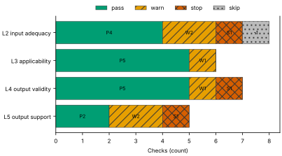
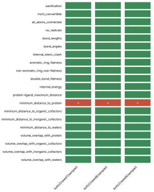
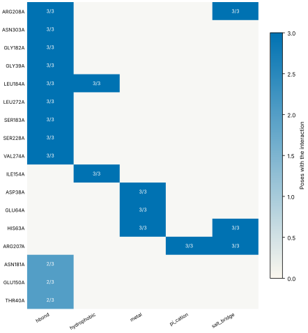
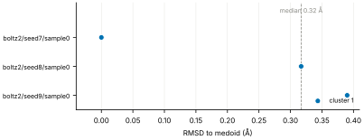
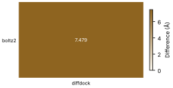
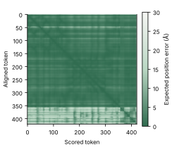

# Run report · Ligand pose in a known pocket

Prediction assurance · run `ligand_pose-0271a3963a16` · 2026-10-17 19:23:44 UTC

**Refused** for the claim "Predicted pose of BGC in glucose dehydrogenase (glucose-binding) is valid".

Refused over layers 2,3,4,5: 16 pass, 6 warn, 3 stop, 1 skip. Stopped by l2.context.cofactors, l4.posebusters, l5.controls.redocking. Warnings from l2.receptor.protonation, l2.docking.box, l3.exposure.pocket, l4.torsion_strain, l5.sampling.seeds, l5.agreement.cross_family.

Stops: `l2.context.cofactors`, `l4.posebusters`, `l5.controls.redocking`.

Warnings: `l2.receptor.protonation`, `l2.docking.box`, `l3.exposure.pocket`, `l4.torsion_strain`, `l5.sampling.seeds`, `l5.agreement.cross_family`.

| Field | Value |
| --- | --- |
| Task | Ligand pose in a known pocket (`ligand_pose`) |
| Tools | Boltz-2 2.2.1 (co-folding), DiffDock-L (docking) |
| Target | `protein` |
| Ligand | `CO[C@@H]1[C@@H](OC)[C@H](O)O[C@H](CO)[C@H]1OC` |
| Reference | `2VWH` |
| pH | 7.4 |
| Seeds | 3 |
| Layers run | 2, 3, 4, 5 |
| Run | `ligand_pose-0271a3963a16` |
| Created | 2026-10-17 19:23:44 UTC |
| Finished | 2026-10-17 19:24:58 UTC |
| pah version | 0.1.0 |
| Report schema | 1 |

## Layers

| Layer | Status | Result | pass | warn | stop | skip | Time |
| --- | --- | --- | --- | --- | --- | --- | --- |
| L0 Provenance | not run | n/a | n/a | n/a | n/a | n/a | n/a |
| L1 Input integrity | not run | n/a | n/a | n/a | n/a | n/a | n/a |
| L2 Input adequacy | done | stop | 4 | 2 | 1 | 1 | 1.3 s |
| L3 Applicability | done | warn | 5 | 1 | 0 | 0 | 307 ms |
| L4 Output validity | done | stop | 5 | 1 | 1 | 0 | 72.4 s |
| L5 Output support | done | stop | 2 | 2 | 1 | 0 | 135 ms |

## Figures

Fig. 1 · Check outcomes per layer for run ligand_pose-0271a3963a16. Totals: pass 16, warn 6, stop 3, skip 1.
Files: data [figures/gates_by_layer.csv](figures/gates_by_layer.csv).

## Structures

68 PyMOL renders.

2VWH mmCIF (source_structure), whole structure. Chains A; organic components BGC, NAP. sha256 563276ca06d2a22a. PyMOL session: [renders/2VWH.pse](renders/2VWH.pse).

2VWH mmCIF (source_structure), ligand environment within 5 Å. Chains A; organic components BGC, NAP. sha256 563276ca06d2a22a. PyMOL session: [renders/2VWH.pse](renders/2VWH.pse).

boltz2/seed7/sample0 (prediction_structure), whole structure. Chains A, C1, C2, L; organic components LIG1, NAP. sha256 1c72788de7715609. PyMOL session: [renders/boltz2_seed7_sample0.pse](renders/boltz2_seed7_sample0.pse).

boltz2/seed7/sample0 (prediction_structure), ligand environment within 5 Å. Chains A, C1, C2, L; organic components LIG1, NAP. sha256 1c72788de7715609. PyMOL session: [renders/boltz2_seed7_sample0.pse](renders/boltz2_seed7_sample0.pse).

boltz2/seed8/sample0 (prediction_structure), whole structure. Chains A, C1, C2, L; organic components LIG1, NAP. sha256 e71c4fcfce5fb8cb. PyMOL session: [renders/boltz2_seed8_sample0.pse](renders/boltz2_seed8_sample0.pse).

boltz2/seed8/sample0 (prediction_structure), ligand environment within 5 Å. Chains A, C1, C2, L; organic components LIG1, NAP. sha256 e71c4fcfce5fb8cb. PyMOL session: [renders/boltz2_seed8_sample0.pse](renders/boltz2_seed8_sample0.pse).

boltz2/seed9/sample0 (prediction_structure), whole structure. Chains A, C1, C2, L; organic components LIG1, NAP. sha256 35d585809d1cf134. PyMOL session: [renders/boltz2_seed9_sample0.pse](renders/boltz2_seed9_sample0.pse).

boltz2/seed9/sample0 (prediction_structure), ligand environment within 5 Å. Chains A, C1, C2, L; organic components LIG1, NAP. sha256 35d585809d1cf134. PyMOL session: [renders/boltz2_seed9_sample0.pse](renders/boltz2_seed9_sample0.pse).

diffdock/seed7/mode0 (prediction_structure), whole structure. Chains A, L; organic components LIG. sha256 f7273b800791d30b. PyMOL session: [renders/diffdock_seed7_mode0.pse](renders/diffdock_seed7_mode0.pse).

diffdock/seed7/mode0 (prediction_structure), ligand environment within 5 Å. Chains A, L; organic components LIG. sha256 f7273b800791d30b. PyMOL session: [renders/diffdock_seed7_mode0.pse](renders/diffdock_seed7_mode0.pse).

diffdock/seed7/mode1 (prediction_structure), whole structure. Chains A, L; organic components LIG. sha256 5158be6f888ab5b8. PyMOL session: [renders/diffdock_seed7_mode1.pse](renders/diffdock_seed7_mode1.pse).

diffdock/seed7/mode1 (prediction_structure), ligand environment within 5 Å. Chains A, L; organic components LIG. sha256 5158be6f888ab5b8. PyMOL session: [renders/diffdock_seed7_mode1.pse](renders/diffdock_seed7_mode1.pse).

diffdock/seed7/mode2 (prediction_structure), whole structure. Chains A, L; organic components LIG. sha256 fdbed7878acf1490. PyMOL session: [renders/diffdock_seed7_mode2.pse](renders/diffdock_seed7_mode2.pse).

diffdock/seed7/mode2 (prediction_structure), ligand environment within 5 Å. Chains A, L; organic components LIG. sha256 fdbed7878acf1490. PyMOL session: [renders/diffdock_seed7_mode2.pse](renders/diffdock_seed7_mode2.pse).

diffdock/seed7/mode3 (prediction_structure), whole structure. Chains A, L; organic components LIG. sha256 4404bd1f1c3dde4f. PyMOL session: [renders/diffdock_seed7_mode3.pse](renders/diffdock_seed7_mode3.pse).

diffdock/seed7/mode3 (prediction_structure), ligand environment within 5 Å. Chains A, L; organic components LIG. sha256 4404bd1f1c3dde4f. PyMOL session: [renders/diffdock_seed7_mode3.pse](renders/diffdock_seed7_mode3.pse).

diffdock/seed7/mode4 (prediction_structure), whole structure. Chains A, L; organic components LIG. sha256 10a1f61f83dc4d30. PyMOL session: [renders/diffdock_seed7_mode4.pse](renders/diffdock_seed7_mode4.pse).

diffdock/seed7/mode4 (prediction_structure), ligand environment within 5 Å. Chains A, L; organic components LIG. sha256 10a1f61f83dc4d30. PyMOL session: [renders/diffdock_seed7_mode4.pse](renders/diffdock_seed7_mode4.pse).

diffdock/seed7/mode5 (prediction_structure), whole structure. Chains A, L; organic components LIG. sha256 047d8c9e7c243650. PyMOL session: [renders/diffdock_seed7_mode5.pse](renders/diffdock_seed7_mode5.pse).

diffdock/seed7/mode5 (prediction_structure), ligand environment within 5 Å. Chains A, L; organic components LIG. sha256 047d8c9e7c243650. PyMOL session: [renders/diffdock_seed7_mode5.pse](renders/diffdock_seed7_mode5.pse).

diffdock/seed7/mode6 (prediction_structure), whole structure. Chains A, L; organic components LIG. sha256 eaf5996111df9ee6. PyMOL session: [renders/diffdock_seed7_mode6.pse](renders/diffdock_seed7_mode6.pse).

diffdock/seed7/mode6 (prediction_structure), ligand environment within 5 Å. Chains A, L; organic components LIG. sha256 eaf5996111df9ee6. PyMOL session: [renders/diffdock_seed7_mode6.pse](renders/diffdock_seed7_mode6.pse).

diffdock/seed7/mode7 (prediction_structure), whole structure. Chains A, L; organic components LIG. sha256 2c07ac95bd3827e9. PyMOL session: [renders/diffdock_seed7_mode7.pse](renders/diffdock_seed7_mode7.pse).

diffdock/seed7/mode7 (prediction_structure), ligand environment within 5 Å. Chains A, L; organic components LIG. sha256 2c07ac95bd3827e9. PyMOL session: [renders/diffdock_seed7_mode7.pse](renders/diffdock_seed7_mode7.pse).

diffdock/seed7/mode8 (prediction_structure), whole structure. Chains A, L; organic components LIG. sha256 353c092b99a1e0b1. PyMOL session: [renders/diffdock_seed7_mode8.pse](renders/diffdock_seed7_mode8.pse).

diffdock/seed7/mode8 (prediction_structure), ligand environment within 5 Å. Chains A, L; organic components LIG. sha256 353c092b99a1e0b1. PyMOL session: [renders/diffdock_seed7_mode8.pse](renders/diffdock_seed7_mode8.pse).

diffdock/seed7/mode9 (prediction_structure), whole structure. Chains A, L; organic components LIG. sha256 1d1e203c89132e19. PyMOL session: [renders/diffdock_seed7_mode9.pse](renders/diffdock_seed7_mode9.pse).

diffdock/seed7/mode9 (prediction_structure), ligand environment within 5 Å. Chains A, L; organic components LIG. sha256 1d1e203c89132e19. PyMOL session: [renders/diffdock_seed7_mode9.pse](renders/diffdock_seed7_mode9.pse).

diffdock/seed8/mode0 (prediction_structure), whole structure. Chains A, L; organic components LIG. sha256 cd3b0211ba26f06e. PyMOL session: [renders/diffdock_seed8_mode0.pse](renders/diffdock_seed8_mode0.pse).

diffdock/seed8/mode0 (prediction_structure), ligand environment within 5 Å. Chains A, L; organic components LIG. sha256 cd3b0211ba26f06e. PyMOL session: [renders/diffdock_seed8_mode0.pse](renders/diffdock_seed8_mode0.pse).

diffdock/seed8/mode1 (prediction_structure), whole structure. Chains A, L; organic components LIG. sha256 c5472b85b966f235. PyMOL session: [renders/diffdock_seed8_mode1.pse](renders/diffdock_seed8_mode1.pse).

diffdock/seed8/mode1 (prediction_structure), ligand environment within 5 Å. Chains A, L; organic components LIG. sha256 c5472b85b966f235. PyMOL session: [renders/diffdock_seed8_mode1.pse](renders/diffdock_seed8_mode1.pse).

diffdock/seed8/mode2 (prediction_structure), whole structure. Chains A, L; organic components LIG. sha256 a2e0f4112130a18e. PyMOL session: [renders/diffdock_seed8_mode2.pse](renders/diffdock_seed8_mode2.pse).

diffdock/seed8/mode2 (prediction_structure), ligand environment within 5 Å. Chains A, L; organic components LIG. sha256 a2e0f4112130a18e. PyMOL session: [renders/diffdock_seed8_mode2.pse](renders/diffdock_seed8_mode2.pse).

diffdock/seed8/mode3 (prediction_structure), whole structure. Chains A, L; organic components LIG. sha256 ddf05adbf377f5f3. PyMOL session: [renders/diffdock_seed8_mode3.pse](renders/diffdock_seed8_mode3.pse).

diffdock/seed8/mode3 (prediction_structure), ligand environment within 5 Å. Chains A, L; organic components LIG. sha256 ddf05adbf377f5f3. PyMOL session: [renders/diffdock_seed8_mode3.pse](renders/diffdock_seed8_mode3.pse).

diffdock/seed8/mode4 (prediction_structure), whole structure. Chains A, L; organic components LIG. sha256 c2946762dfff09b3. PyMOL session: [renders/diffdock_seed8_mode4.pse](renders/diffdock_seed8_mode4.pse).

diffdock/seed8/mode4 (prediction_structure), ligand environment within 5 Å. Chains A, L; organic components LIG. sha256 c2946762dfff09b3. PyMOL session: [renders/diffdock_seed8_mode4.pse](renders/diffdock_seed8_mode4.pse).

diffdock/seed8/mode5 (prediction_structure), whole structure. Chains A, L; organic components LIG. sha256 fa17a00da98c0993. PyMOL session: [renders/diffdock_seed8_mode5.pse](renders/diffdock_seed8_mode5.pse).

diffdock/seed8/mode5 (prediction_structure), ligand environment within 5 Å. Chains A, L; organic components LIG. sha256 fa17a00da98c0993. PyMOL session: [renders/diffdock_seed8_mode5.pse](renders/diffdock_seed8_mode5.pse).

diffdock/seed8/mode6 (prediction_structure), whole structure. Chains A, L; organic components LIG. sha256 3e645ac7fdb1abf6. PyMOL session: [renders/diffdock_seed8_mode6.pse](renders/diffdock_seed8_mode6.pse).

diffdock/seed8/mode6 (prediction_structure), ligand environment within 5 Å. Chains A, L; organic components LIG. sha256 3e645ac7fdb1abf6. PyMOL session: [renders/diffdock_seed8_mode6.pse](renders/diffdock_seed8_mode6.pse).

diffdock/seed8/mode7 (prediction_structure), whole structure. Chains A, L; organic components LIG. sha256 0c22dfea7d2e4f3b. PyMOL session: [renders/diffdock_seed8_mode7.pse](renders/diffdock_seed8_mode7.pse).

diffdock/seed8/mode7 (prediction_structure), ligand environment within 5 Å. Chains A, L; organic components LIG. sha256 0c22dfea7d2e4f3b. PyMOL session: [renders/diffdock_seed8_mode7.pse](renders/diffdock_seed8_mode7.pse).

diffdock/seed8/mode8 (prediction_structure), whole structure. Chains A, L; organic components LIG. sha256 68f8c66657f79e55. PyMOL session: [renders/diffdock_seed8_mode8.pse](renders/diffdock_seed8_mode8.pse).

diffdock/seed8/mode8 (prediction_structure), ligand environment within 5 Å. Chains A, L; organic components LIG. sha256 68f8c66657f79e55. PyMOL session: [renders/diffdock_seed8_mode8.pse](renders/diffdock_seed8_mode8.pse).

diffdock/seed8/mode9 (prediction_structure), whole structure. Chains A, L; organic components LIG. sha256 3dd8ac3d3a2d248f. PyMOL session: [renders/diffdock_seed8_mode9.pse](renders/diffdock_seed8_mode9.pse).

diffdock/seed8/mode9 (prediction_structure), ligand environment within 5 Å. Chains A, L; organic components LIG. sha256 3dd8ac3d3a2d248f. PyMOL session: [renders/diffdock_seed8_mode9.pse](renders/diffdock_seed8_mode9.pse).

diffdock/seed9/mode0 (prediction_structure), whole structure. Chains A, L; organic components LIG. sha256 4f212faa283fd943. PyMOL session: [renders/diffdock_seed9_mode0.pse](renders/diffdock_seed9_mode0.pse).

diffdock/seed9/mode0 (prediction_structure), ligand environment within 5 Å. Chains A, L; organic components LIG. sha256 4f212faa283fd943. PyMOL session: [renders/diffdock_seed9_mode0.pse](renders/diffdock_seed9_mode0.pse).

diffdock/seed9/mode1 (prediction_structure), whole structure. Chains A, L; organic components LIG. sha256 beb8f7569065fc44. PyMOL session: [renders/diffdock_seed9_mode1.pse](renders/diffdock_seed9_mode1.pse).

diffdock/seed9/mode1 (prediction_structure), ligand environment within 5 Å. Chains A, L; organic components LIG. sha256 beb8f7569065fc44. PyMOL session: [renders/diffdock_seed9_mode1.pse](renders/diffdock_seed9_mode1.pse).

diffdock/seed9/mode2 (prediction_structure), whole structure. Chains A, L; organic components LIG. sha256 c59a56c47e805684. PyMOL session: [renders/diffdock_seed9_mode2.pse](renders/diffdock_seed9_mode2.pse).

diffdock/seed9/mode2 (prediction_structure), ligand environment within 5 Å. Chains A, L; organic components LIG. sha256 c59a56c47e805684. PyMOL session: [renders/diffdock_seed9_mode2.pse](renders/diffdock_seed9_mode2.pse).

diffdock/seed9/mode3 (prediction_structure), whole structure. Chains A, L; organic components LIG. sha256 81b8c2f9330ec084. PyMOL session: [renders/diffdock_seed9_mode3.pse](renders/diffdock_seed9_mode3.pse).

diffdock/seed9/mode3 (prediction_structure), ligand environment within 5 Å. Chains A, L; organic components LIG. sha256 81b8c2f9330ec084. PyMOL session: [renders/diffdock_seed9_mode3.pse](renders/diffdock_seed9_mode3.pse).

diffdock/seed9/mode4 (prediction_structure), whole structure. Chains A, L; organic components LIG. sha256 da3b3f1733f33e76. PyMOL session: [renders/diffdock_seed9_mode4.pse](renders/diffdock_seed9_mode4.pse).

diffdock/seed9/mode4 (prediction_structure), ligand environment within 5 Å. Chains A, L; organic components LIG. sha256 da3b3f1733f33e76. PyMOL session: [renders/diffdock_seed9_mode4.pse](renders/diffdock_seed9_mode4.pse).

diffdock/seed9/mode5 (prediction_structure), whole structure. Chains A, L; organic components LIG. sha256 d3b7729523875301. PyMOL session: [renders/diffdock_seed9_mode5.pse](renders/diffdock_seed9_mode5.pse).

diffdock/seed9/mode5 (prediction_structure), ligand environment within 5 Å. Chains A, L; organic components LIG. sha256 d3b7729523875301. PyMOL session: [renders/diffdock_seed9_mode5.pse](renders/diffdock_seed9_mode5.pse).

diffdock/seed9/mode6 (prediction_structure), whole structure. Chains A, L; organic components LIG. sha256 4896f27afeb7942c. PyMOL session: [renders/diffdock_seed9_mode6.pse](renders/diffdock_seed9_mode6.pse).

diffdock/seed9/mode6 (prediction_structure), ligand environment within 5 Å. Chains A, L; organic components LIG. sha256 4896f27afeb7942c. PyMOL session: [renders/diffdock_seed9_mode6.pse](renders/diffdock_seed9_mode6.pse).

diffdock/seed9/mode7 (prediction_structure), whole structure. Chains A, L; organic components LIG. sha256 65b07c43518fa12b. PyMOL session: [renders/diffdock_seed9_mode7.pse](renders/diffdock_seed9_mode7.pse).

diffdock/seed9/mode7 (prediction_structure), ligand environment within 5 Å. Chains A, L; organic components LIG. sha256 65b07c43518fa12b. PyMOL session: [renders/diffdock_seed9_mode7.pse](renders/diffdock_seed9_mode7.pse).

diffdock/seed9/mode8 (prediction_structure), whole structure. Chains A, L; organic components LIG. sha256 a0bb51d1caf119be. PyMOL session: [renders/diffdock_seed9_mode8.pse](renders/diffdock_seed9_mode8.pse).

diffdock/seed9/mode8 (prediction_structure), ligand environment within 5 Å. Chains A, L; organic components LIG. sha256 a0bb51d1caf119be. PyMOL session: [renders/diffdock_seed9_mode8.pse](renders/diffdock_seed9_mode8.pse).

diffdock/seed9/mode9 (prediction_structure), whole structure. Chains A, L; organic components LIG. sha256 1e7c656ae29580ef. PyMOL session: [renders/diffdock_seed9_mode9.pse](renders/diffdock_seed9_mode9.pse).

diffdock/seed9/mode9 (prediction_structure), ligand environment within 5 Å. Chains A, L; organic components LIG. sha256 1e7c656ae29580ef. PyMOL session: [renders/diffdock_seed9_mode9.pse](renders/diffdock_seed9_mode9.pse).

## L0 Provenance

Where did every input come from?

Status: not run.

## L1 Input integrity

Did the run receive exactly what was declared?

Status: not run.

## L2 Input adequacy

Does the input carry enough information?

Status: done. Checks: pass 4 · warn 2 · stop 1 · skip 1. Time: 1.3 s.

#### Key figures

| Figure | Value |
| --- | --- |
| near site | 2 |
| missing | 2 |
| uniprot cofactors | 0 |
| pocket residues | 19 |
| incomplete | 0 |
| sequence gaps | 0 |
| state | holo |
| site ligands | 2 |

#### Docking

| Field | Value |
| --- | --- |
| center | 9.319, 36.788, 18.307 Å |
| size | 11.671 × 12.814 × 12.093 Å |
| origin | derived from BGC (+4 Å) |

#### Checks

| Check | Result | Measured cmp threshold | Evidence | Id · time |
| --- | --- | --- | --- | --- |
| Alignment depth, distinct sequences, Neff and gap fraction | skip | n/a | no MSA declared for a co-folding model · not applicable | `l2.msa.depth` |
| Required cofactors, ions and partners present | stop | `pocket_distance <= 8` | components within 8.0 Å of BGC in 2VWH not supplied: NAP, ZN · near_site=2, missing=2, uniprot_cofactors=0 | `l2.context.cofactors` · 184 ms |
| Pocket residues resolved, no missing loops lining the pocket | pass | `pocket_distance <= 6` | 19 pocket residues complete in 2VWH.cif · pocket_residues=19, incomplete=0, sequence_gaps=0 | `l2.pocket.resolved` · 9 ms |
| Receptor state apo or holo | pass | n/a | 2VWH.cif holo: BGC, NAP in the site · state=holo, site_ligands=2 | `l2.receptor.state` · 7 ms |
| Receptor protonation at the stated pH | warn | `pka_margin > 1` | receptor has no hydrogens (protonation not assigned); pKa within 1.0 of pH 7.4: GLU64A pKa 6.96, GLU150A pKa 8.39 · hydrogens_present=False, ph=7.4, pocket_titratable=13 | `l2.receptor.protonation` · 579 ms |
| Ligand protonation and tautomers enumerated at the stated pH | pass | `ph 7.4 == 1` | one state at pH 7.4 for every ligand · ph=7.4, max_states=1, declared_not_enumerated=0 | `l2.ligand.protonation` · 40 ms |
| Ligand conformers generated and minimised | pass | `conformers >= 10` | 10 ETKDG conformers per ligand, MMFF minimised · ligands=1, failed=0, min_embedded=10 | `l2.ligand.conformers` · 497 ms |
| Docking box encloses the pocket with margin | warn | `margin >= 2` | no box declared; derived box encloses 11 contact residues and the BGC ligand with 2.0 Å margin · volume_A3=1808.5, ligand_atoms_inside_margin=12, ligand_atoms=12 | `l2.docking.box` · 9 ms |

## L3 Applicability

Is the tool inside its validated regime?

Status: done. Checks: pass 5 · warn 1 · stop 0 · skip 0. Time: 307 ms.

#### Key figures

| Figure | Value |
| --- | --- |
| executors | 2 |
| unknown | 0 |
| reference released | 2009-01-13 |
| cutoff | 2019-01-01 |
| entries compared | 1 |
| max similarity | 60.8 |
| pocket residues | 17 |
| systems | 1 |

#### Checks

| Check | Result | Measured cmp threshold | Evidence | Id · time |
| --- | --- | --- | --- | --- |
| Model training cutoff recorded | pass | `training_cutoff == recorded` | boltz2 2023-06-01; diffdock 2019-01-01; reference 2VWH released 2009-01-13, before the cutoff of boltz2, diffdock · executors=2, unknown=0, reference_released=2009-01-13 | `l3.model.training_cutoff` · 1 ms |
| Pocket similarity to pre-cutoff complexes (SuCOS times pocket coverage) | warn | `similarity <= 50` | max similarity 60.8 to 2VWH (BGC, SuCOS 0.646, coverage 0.941), released before 2019-01-01 · cutoff=2019-01-01, entries_compared=1, max_similarity=60.8 | `l3.exposure.pocket` · 298 ms |
| Ligand analogues in pre-cutoff training systems | pass | `tanimoto > 0.9` | 1 PDB entries released before 2019-01-01 (diffdock cutoff) contain analogues of ligand above Tanimoto 0.9: B8D, ZB0, 2GS, ZB2, GU8, GU9 · cutoff=2019-01-01, systems=1, analogue_components=6 | `l3.exposure.ligand_prevalence` · 0 ms |
| Chain sequence identity to pre-cutoff entries (secondary measure) | pass | `identity < 0.4` | protein: 6 entries at 95 percent identity, 6 at 40 percent, released before 2019-01-01 (reported, not gating) · cutoff=2019-01-01, entries_95=6, entries_40=6 | `l3.exposure.sequence` · 0 ms |
| Modality inside the validated set; token count against the training crop | pass | n/a | modalities protein, protein_ligand inside the validated set; 372 tokens · modalities=2, tokens=372, outside=0 | `l3.regime.modality` · 5 ms |
| Endpoint fits the tool | pass | `endpoint pose in pose` | endpoint pose produced by boltz2, diffdock · endpoint=pose, executors=2, not_fitting=0 | `l3.metric.endpoint` · 0 ms |

## L4 Output validity

Is the result physically and chemically sensible?

Status: done. Checks: pass 5 · warn 1 · stop 1 · skip 0. Time: 72.4 s.

#### Key figures

| Figure | Value |
| --- | --- |
| poses | 3 |
| passed | 19 |
| total | 20 |
| poses all pass | 0 |
| unlikely torsions | 1 |
| torsions | 9 |
| strain kcal | 17.99 |
| poses with unlikely | 1 |

#### PoseBusters · 19/20 tests pass

| test | result | value |
| --- | --- | --- |
| sanitization | pass | pass |
| inchi_convertible | pass | pass |
| all_atoms_connected | pass | pass |
| no_radicals | pass | pass |
| bond_lengths | pass | 0 long outliers |
| bond_angles | pass | 0 outliers |
| internal_steric_clash | pass | 0 |
| aromatic_ring_flatness | pass | pass |
| non-aromatic_ring_non-flatness | pass | pass |
| double_bond_flatness | pass | pass |
| internal_energy | pass | 2.4 times the ensemble mean |
| protein-ligand_maximum_distance | pass | 2.39 Å |
| minimum_distance_to_protein | fail | 2.39 Å |
| minimum_distance_to_organic_cofactors | pass | pass |
| minimum_distance_to_inorganic_cofactors | pass | pass |
| minimum_distance_to_waters | pass | pass |
| volume_overlap_with_protein | pass | 0.030 |
| volume_overlap_with_organic_cofactors | pass | pass |
| volume_overlap_with_inorganic_cofactors | pass | pass |
| volume_overlap_with_waters | pass | pass |

#### Per-pose physical checks

| pose | seed | drift Å | converged | unlikely torsions | unsat. polars | buried charged | PoseBusters |
| --- | --- | --- | --- | --- | --- | --- | --- |
| boltz2/seed7/sample0 | 7 | 1.77 | true | 1/9 | 0 | 0 | 19/20 |
| boltz2/seed8/sample0 | 8 | 1.6 | true | 0/9 | 0 | 0 | 19/20 |
| boltz2/seed9/sample0 | 9 | 1.82 | true | 0/9 | 0 | 0 | 19/20 |
| median | n/a | 1.77 | n/a | 0 | 0 | 0 | 19/20 |

#### Interaction fingerprint · representative pose boltz2/seed7/sample0

| residue | type | distance | poses |
| --- | --- | --- | --- |
| ARG208A | hbond | 3.33 Å | 3/3 |
| ASN303A | hbond | 2.75 Å | 3/3 |
| GLY182A | hbond | 3.85 Å | 3/3 |
| GLY39A | hbond | 3.13 Å | 3/3 |
| LEU184A | hbond | 3.14 Å | 3/3 |
| LEU272A | hbond | 3.05 Å | 3/3 |
| SER183A | hbond | 3.8 Å | 3/3 |
| SER228A | hbond | 2.92 Å | 3/3 |
| VAL274A | hbond | 3.24 Å | 3/3 |
| ILE154A | hydrophobic | 3.61 Å | 3/3 |
| LEU184A | hydrophobic | 3.64 Å | 3/3 |
| ASP38A | metal | 2.1 Å | 3/3 |
| GLU64A | metal | 1.76 Å | 3/3 |
| HIS63A | metal | 2.2 Å | 3/3 |
| ARG207A | pi_cation | 3.67 Å | 3/3 |
| ARG207A | salt_bridge | 4.37 Å | 3/3 |
| ARG208A | salt_bridge | 4.11 Å | 3/3 |
| HIS63A | salt_bridge | 4.83 Å | 3/3 |
| ASN181A | hbond | 4.05 Å | 2/3 |
| GLU150A | hbond | 2.84 Å | 2/3 |
| THR40A | hbond | 2.91 Å | 2/3 |

Fig. 2 · PoseBusters tests (20) by pose (3). Failed cells marked x: 3 of 60.
Files: data [figures/posebusters_grid.csv](figures/posebusters_grid.csv).

Fig. 3 · Interactions by residue (17) and type (5); cell label: poses with the interaction over poses assessed.
Files: data [figures/interactions.csv](figures/interactions.csv).

#### Checks

| Check | Result | Measured cmp threshold | Evidence | Id · time |
| --- | --- | --- | --- | --- |
| PoseBusters geometry, stereochemistry, clashes and protein contact | stop | `tests_failed == 0` | representative pose boltz2/seed7/sample0 fails minimum_distance_to_protein · poses=3, passed=19, total=20 | `l4.posebusters` · 1.2 s |
| Torsional strain of the ligand pose | warn | `torsion_energy <= 2.5` | 1 of 9 torsions above 2.5 kcal/mol in boltz2/seed7/sample0 · poses=3, unlikely_torsions=1, torsions=9 | `l4.torsion_strain` · 1.2 s |
| Interaction fingerprint (PLIP) | pass | n/a | 22 interactions in boltz2/seed7/sample0 (hbond, hydrophobic, metal, pi_cation, salt_bridge); 21 distinct across 3 poses (reported) · poses=3, interactions_representative=22, distinct=21 | `l4.interactions.fingerprint` · 2.3 s |
| Buried ligand polar atoms without a hydrogen-bond partner | pass | `relative_sasa < 0.1` | 4 buried polar ligand atoms, all with a partner within 3.5 Å in boltz2/seed7/sample0 · poses=3, unsatisfied=0, buried_charged=0 | `l4.interactions.unsatisfied_polars` · 326 ms |
| Hydrophobic complementarity of buried ligand surface | pass | `fraction >= 0.35` | nonpolar fraction of protein contacts around 4 buried nonpolar ligand atoms in boltz2/seed7/sample0: 0.562 · poses=3, complementarity=0.562, buried_nonpolar=4 | `l4.interactions.hydrophobic` · 323 ms |
| Interactions of the crystal ligand reproduced by the pose | pass | `reproduced 3 >= 1` | boltz2/seed7/sample0 reproduces 3 of 6 BGC interactions: hbond ASN303A, hbond THR40A, salt_bridge HIS63A · key_interactions=6, reproduced=3, poses_reproducing_all=0 | `l4.interactions.known_binders` · 170 ms |
| Pose stability under short restrained minimisation (OpenMM, AMBER14 and OpenFF) | pass | `drift_A 1.77 <= 2` | boltz2/seed7/sample0 moves 1.772 Å under restrained minimisation; 0 of 3 poses above 2.0 Å · poses=3, drift_A=1.772, max_drift_A=1.824 | `l4.minimisation_drift` · 66.9 s |

## L5 Output support

Is a valid result corroborated?

Status: done. Checks: pass 2 · warn 2 · stop 1 · skip 0. Time: 135 ms.

#### Key figures

| Figure | Value |
| --- | --- |
| poses | 3 |
| pocket plddt | 97.8 |
| global plddt | 97.7 |
| iptm | 0.984 |
| ptm | 0.985 |
| confidence score | 0.968 |
| independent seeds | 3 |
| samples | 3 |

#### Sampling

| Field | Value |
| --- | --- |
| site placement | 3 of 3 poses within 4.0 Å of the site (BGC in 2VWH) |
| pose accuracy | 3 of 3 poses within 2.0 Å of the medoid |
| pairwise RMSD median | 0.39 Å |
| pairwise RMSD IQR | 0.35 to 0.41 Å |
| pairs | 3 |
| medoid | boltz2/seed7/sample0 |

#### Clusters

| Field | Value |
| --- | --- |
| cluster 1 | 3/3 poses (boltz2/seed7/sample0) |

#### Per-seed statistics

| seed | pose | cluster | RMSD to medoid | confidence |
| --- | --- | --- | --- | --- |
| 7 | boltz2/seed7/sample0 | 1 | 0 Å | 0.97 |
| 8 | boltz2/seed8/sample0 | 1 | 0.32 Å | 0.97 |
| 9 | boltz2/seed9/sample0 | 1 | 0.39 Å | 0.97 |
| median | n/a | n/a | 0.32 Å | 0.97 |

#### Ensemble

| structure | kind | source | RMSD to medoid | cluster | pocket pLDDT | ipTM |
| --- | --- | --- | --- | --- | --- | --- |
| boltz2/seed7/sample0 | medoid | boltz2 | 0 Å | 1 | 97.8 | 0.98 |
| boltz2/seed8/sample0 | seed | boltz2 | 0.32 Å | 1 | 97.8 | 0.98 |
| boltz2/seed9/sample0 | seed | boltz2 | 0.39 Å | 1 | 97.8 | 0.99 |

#### Agreement between methods

| method | diffdock |
| --- | --- |
| boltz2 | 7.48 Å (high) |

#### Confidence metrics

| metric | value | read as | tool |
| --- | --- | --- | --- |
| affinity_pred_value | 1.983166217803955 | ranking within a series, never pose quality | boltz2 |
| affinity_probability_binary | 0.23379245400428772 | ranking within a series, never pose quality | boltz2 |
| affinity_pred_value | 1.7560733556747437 | ranking within a series, never pose quality | boltz2 |
| affinity_probability_binary | 0.2139069139957428 | ranking within a series, never pose quality | boltz2 |
| affinity_pred_value | 2.0396509170532227 | ranking within a series, never pose quality | boltz2 |
| affinity_probability_binary | 0.22495540976524353 | ranking within a series, never pose quality | boltz2 |

Fig. 4 · RMSD to the medoid for 3 poses, coloured by cluster (1 clusters). Dashed line: median 0.32 Å; range 0.00 to 0.39 Å.
Files: data [figures/seed_spread.csv](figures/seed_spread.csv).

Fig. 5 · Agreement between 1 methods and 1 comparators; range 7.479 to 7.479 Å.
Files: data [figures/agreement.csv](figures/agreement.csv).

Fig. 6 · Predicted aligned error for pose boltz2/seed7/sample0, 421 by 421 tokens; values 0.2 to 27.8 Å, mean 3.3 Å.
Files: data [figures/pae.csv](figures/pae.csv).

#### Checks

| Check | Result | Measured cmp threshold | Evidence | Id · time |
| --- | --- | --- | --- | --- |
| Confidence restricted to the pocket; per-model thresholds | pass | `boltz2.pocket_plddt >= 70` | boltz2/seed7/sample0: pocket_plddt 97.8 · poses=3, pocket_plddt=97.8, global_plddt=97.7 | `l5.confidence.local` · 16 ms |
| Independent seeds counted separately from samples; duplicates flagged | warn | `seeds_cofolding >= 5` | 3 independent seeds (3 poses); task default 5 · independent_seeds=3, samples=3, duplicated_outputs=0 | `l5.sampling.seeds` · 0 ms |
| Medoid of the largest cluster, populations, pairwise spread, site and pose accuracy | pass | `cluster_rmsd <= 2` | medoid boltz2/seed7/sample0; 1 clusters, largest 3 of 3; pairwise RMSD median 0.39 Å (IQR 0.35 to 0.41); 3 of 3 poses within 4.0 Å of the site (BGC in 2VWH); 3 of 3 poses within 2.0 Å of the medoid · poses=3, clusters=1, largest_cluster=3 | `l5.sampling.clusters` · 31 ms |
| Agreement between methods, weighted by independence | warn | `rmsd_to_crystal_A None <= 2` | boltz2 vs diffdock 7.479 Å (high) · methods=2, comparisons=1, disagreeing=1 | `l5.agreement.cross_family` · 86 ms |
| Redocking control reproduces the crystal pose | stop | `rmsd <= 2` | redocking control required by the task and not supplied (controls.redocking) | `l5.controls.redocking` · 0 ms |

## Controls

| control | status | result |
| --- | --- | --- |
| redocking | incomplete | redocking control required by the task and not supplied (controls.redocking) |

## Provenance

34 objects · 34 cached · 0 network.

| Source | Accession | Release | SHA-256 | Retrieved | Bytes | Cache | Used by |
| --- | --- | --- | --- | --- | --- | --- | --- |
| rcsb_files | 2VWH | n/a | `563276ca06d2` | 2026-10-17 16:59:50 UTC | 364136 | hit | l2.context.cofactors, l2.pocket.resolved, l2.receptor.state, l2.docking.box, l3.exposure.pocket, l3.regime.modality, l4.interactions.fingerprint, l4.interactions.known_binders, l5.sampling.clusters, l5.agreement.cross_family |
| ccd | BGC | 2026-01-27 | `faaa9f919f4c` | 2026-10-17 16:59:50 UTC | 30741 | hit | l2.context.cofactors |
| rcsb | 2VWH | 1.5 | `5a990581b1c2` | 2026-10-17 16:59:51 UTC | 22370 | hit | l3.model.training_cutoff |
| rcsb_search | chem:CO[C@@H]1[C@@H](OC)[C@H](O)O[C@H](CO)[C@H]1OC | n/a | `abf2f0f21729` | 2026-10-17 16:59:52 UTC | 1583 | hit | l3.exposure.pocket |
| ccd | B8D | 2020-07-17 | `e5e54aeb141a` | 2026-10-17 16:59:52 UTC | 5891 | hit | l3.exposure.pocket |
| ccd | ZB0 | 2020-07-17 | `04a273063ebb` | 2026-10-17 16:59:52 UTC | 4670 | hit | l3.exposure.pocket |
| ccd | 2GS | 2020-07-17 | `f4c84b4386b2` | 2026-10-17 16:59:52 UTC | 6028 | hit | l3.exposure.pocket |
| ccd | ZB2 | 2020-07-17 | `ef6fe76c4398` | 2026-10-17 16:59:52 UTC | 4631 | hit | l3.exposure.pocket |
| ccd | 3MG | 2020-07-17 | `8459c0fa74f7` | 2026-10-17 16:59:52 UTC | 5661 | hit | l3.exposure.pocket |
| ccd | U90 | 2022-09-16 | `e5c8aa7c4958` | 2026-10-17 16:59:52 UTC | 3318 | hit | l3.exposure.pocket |
| ccd | ZB1 | 2020-07-17 | `27d026ba7397` | 2026-10-17 16:59:52 UTC | 4910 | hit | l3.exposure.pocket |
| ccd | X6N | 2024-10-04 | `d6183b2ee5d1` | 2026-10-17 16:59:52 UTC | 3255 | hit | l3.exposure.pocket |
| ccd | GU8 | 2020-07-17 | `8e0ab7528c76` | 2026-10-17 16:59:52 UTC | 6191 | hit | l3.exposure.pocket |
| ccd | GU9 | 2020-07-17 | `e66a84318f2b` | 2026-10-17 16:59:52 UTC | 6196 | hit | l3.exposure.pocket |
| ccd | 5TK | 2020-07-17 | `bc65062b9f8e` | 2026-10-17 16:59:53 UTC | 5226 | hit | l3.exposure.pocket |
| ccd | TWA | 2020-07-17 | `61fd3fb2d26e` | 2026-10-17 16:59:53 UTC | 4762 | hit | l3.exposure.pocket |
| ccd | PRD_900001 | n/a | `3d3cd6b11abe` | 2026-10-17 16:59:53 UTC | 5035 | hit | l3.exposure.pocket |
| ccd | PRD_900004 | n/a | `171b04f8d1a9` | 2026-10-17 16:59:53 UTC | 5785 | hit | l3.exposure.pocket |
| ccd | PRD_900005 | n/a | `c3d489ef5eea` | 2026-10-17 16:59:53 UTC | 6356 | hit | l3.exposure.pocket |
| ccd | PRD_900008 | n/a | `60144a234fc1` | 2026-10-17 16:59:53 UTC | 6742 | hit | l3.exposure.pocket |
| ccd | PRD_900016 | n/a | `4143a065d062` | 2026-10-17 16:59:53 UTC | 7667 | hit | l3.exposure.pocket |
| ccd | PRD_900018 | n/a | `19a0c6ba9772` | 2026-10-17 16:59:53 UTC | 5409 | hit | l3.exposure.pocket |
| ccd | PRD_900020 | n/a | `8dbf9d540311` | 2026-10-17 16:59:53 UTC | 8403 | hit | l3.exposure.pocket |
| ccd | PRD_900021 | n/a | `1e743d35bb91` | 2026-10-17 16:59:53 UTC | 5696 | hit | l3.exposure.pocket |
| ccd | PRD_900023 | n/a | `a736cb72100f` | 2026-10-17 16:59:53 UTC | 5423 | hit | l3.exposure.pocket |
| rcsb_search | comp:B8D:2019-01-01 | n/a | `e3b0c44298fc` | 2026-10-17 16:59:53 UTC | 0 | hit | l3.exposure.pocket |
| rcsb_search | comp:ZB0:2019-01-01 | n/a | `e3b0c44298fc` | 2026-10-17 16:59:53 UTC | 0 | hit | l3.exposure.pocket |
| rcsb_search | comp:2GS:2019-01-01 | n/a | `2ad8fb542fa9` | 2026-10-17 16:59:53 UTC | 178 | hit | l3.exposure.pocket |
| rcsb_search | comp:ZB2:2019-01-01 | n/a | `e3b0c44298fc` | 2026-10-17 16:59:53 UTC | 0 | hit | l3.exposure.pocket |
| rcsb_search | comp:GU8:2019-01-01 | n/a | `e3b0c44298fc` | 2026-10-17 16:59:53 UTC | 0 | hit | l3.exposure.pocket |
| rcsb_search | comp:GU9:2019-01-01 | n/a | `e3b0c44298fc` | 2026-10-17 16:59:53 UTC | 0 | hit | l3.exposure.pocket |
| rcsb_search | seq0.9:2019-01-01:357 | n/a | `5cf9c6d3e615` | 2026-10-17 16:59:54 UTC | 438 | hit | l3.exposure.pocket |
| rcsb_search | seq0.95:2019-01-01:357 | n/a | `2ded139e03ea` | 2026-10-17 16:59:55 UTC | 386 | hit | l3.exposure.sequence |
| rcsb_search | seq0.4:2019-01-01:357 | n/a | `d1c1f4adb44b` | 2026-10-17 16:59:55 UTC | 386 | hit | l3.exposure.sequence |

Provenance graph: [json](graph.json), [mmd](graph.mmd), [svg](graph.svg).

## Thresholds

| Check | Threshold | Value | Origin | Evidence level |
| --- | --- | --- | --- | --- |
| `l2.context.cofactors` | pocket_distance | <= 8 | Harness rule: a component of the reference entry within 8 Å of the declared ligand is required context; not yet calibrated | uncalibrated |
| `l2.pocket.resolved` | pocket_distance | <= 6 | Harness rule: pocket residues have a heavy atom within 6 Å of the ligand; not yet calibrated | uncalibrated |
| `l2.pocket.resolved` | missing_pocket_residues | == 0 | Specification layer 2: stop when the pocket is incomplete | published |
| `l2.receptor.protonation` | pka_margin | > 1 | Harness rule: a titratable pocket residue with PROPKA pKa within 1 unit of the stated pH has an ambiguous state; not yet calibrated | uncalibrated |
| `l2.ligand.protonation` | ph_window | == 1 | Harness rule: states enumerated by Dimorphite-DL within 1 pH unit of the stated pH; not yet calibrated | uncalibrated |
| `l2.ligand.protonation` | states | == 1 | Specification layer 2: warn when more than one plausible state | published |
| `l2.ligand.conformers` | conformers | >= 10 | Harness default number of ETKDG conformers; not yet calibrated | uncalibrated |
| `l2.docking.box` | margin | >= 2 | Harness rule: every pocket heavy atom lies at least 2 Å inside the box; not yet calibrated | uncalibrated |
| `l2.docking.box` | contact_distance | <= 4 | Harness rule: contact residues (heavy atom within 4 Å of the reference ligand) must have an atom inside the box; not yet calibrated | uncalibrated |
| `l3.model.training_cutoff` | training_cutoff | == recorded | Specification, Layer 3 (applicability): stop when unknown | published |
| `l3.exposure.pocket` | similarity | <= 50 | Specification layer 3: warn above a pocket similarity (SuCOS times pocket coverage) of 50 | published |
| `l3.exposure.pocket` | entries | <= 5 | Harness budget: pre-cutoff holo entries compared per run | uncalibrated |
| `l3.exposure.ligand_prevalence` | tanimoto | > 0.9 | Specification layer 3: analogues above 0.9 Tanimoto (RDKit topological fingerprint) | published |
| `l3.exposure.ligand_prevalence` | systems | <= 100 | Specification layer 3: prevalent when analogues occur in more than 100 training systems | published |
| `l3.exposure.sequence` | identity | < 0.4 | Specification layer 3: conventional 40 percent identity leakage threshold, reported as a secondary measure only | published |
| `l3.metric.endpoint` | endpoint | in pose | Specification, Layer 3 (applicability): no affinity from interface confidence, no protein-protein affinity from Boltz-2 | published |
| `l4.posebusters` | tests_failed | == 0 | Specification, Layer 4 (output validity): stop on failure | published |
| `l4.torsion_strain` | torsion_energy | <= 2.5 | Harness rule: a rotatable torsion whose MMFF energy lies more than 2.5 kcal/mol above the minimum of its rigid scan is unlikely; not yet calibrated | uncalibrated |
| `l4.interactions.unsatisfied_polars` | relative_sasa | < 0.1 | Harness rule: a ligand polar atom with relative SASA below 0.1 in the complex is buried; not yet calibrated | uncalibrated |
| `l4.interactions.unsatisfied_polars` | hbond_distance | <= 3.5 | PLIP hydrogen bond distance cut-off (donor-acceptor 4.1 Å; harness uses 3.5 Å heavy-atom distance) | published |
| `l4.interactions.hydrophobic` | fraction | >= 0.35 | Harness default anchored on 3PTB: the crystal benzamidine scores 0.51, Vina and Boltz-2 poses within 0.5 Å of it score 0.45 and 0.49; not calibrated on the benchmark | uncalibrated |
| `l4.interactions.hydrophobic` | relative_sasa | < 0.1 | Harness rule: a ligand polar atom with relative SASA below 0.1 in the complex is buried; not yet calibrated | uncalibrated |
| `l4.interactions.known_binders` | reproduced | >= 1 | Specification layer 4: warn when no key interaction is reproduced | published |
| `l4.minimisation_drift` | drift | <= 2 | Specification layer 4: warn when the pose moves beyond 2 Å under restrained minimisation | published |
| `l5.confidence.local` | boltz2.pocket_plddt | >= 70 | AlphaFold DB pLDDT bands (70 and above: confident backbone), applied to pocket residues; not calibrated for ligand pose | published |
| `l5.sampling.seeds` | seeds_cofolding | >= 5 | Specification layer 5: default of five seeds per co-folding prediction | published |
| `l5.sampling.clusters` | cluster_rmsd | <= 2 | Specification layer 5: 2 Å symmetry-aware ligand RMSD (spyrmsd) separates pose clusters | published |
| `l5.sampling.clusters` | site_distance | <= 4 | Harness rule: a ligand centroid within 4 Å of the reference site centroid is placed in the site; not yet calibrated | uncalibrated |
| `l5.sampling.clusters` | largest_fraction | >= 0.5 | Harness rule: the largest cluster holds at least half of the poses; not yet calibrated | uncalibrated |
| `l5.agreement.cross_family` | rmsd | <= 2 | Specification layer 5: pose agreement by symmetry-aware ligand RMSD at 2 Å | published |
| `l5.controls.redocking` | rmsd | <= 2 | Specification layer 5: redocking must reproduce the crystal pose (2 Å ligand RMSD) | published |

Tool versions: dimorphite_dl 2.1.0, freesasa 2.2.1, gemmi 0.7.5, numpy 1.26.4, openbabel 3.2.1, openmm 8.6.1, plip 3.0.1, posebusters 0.6.5, propka 3.5.1, rdkit 2026.9.1, scipy 1.17.1, spyrmsd 0.9.0.

## Limitations

- This report covers layers 2, 3, 4, 5. Layers not run: 0, 1.
- The harness establishes when a result should not be trusted. Passing checks are not evidence that a prediction is correct.
- Thresholds marked uncalibrated come from the specification or harness defaults and have not been recalibrated on the harness benchmark.

## Files

| Path | Kind | Bytes | SHA-256 |
| --- | --- | --- | --- |
| artifacts/sources/2VWH.cif | source_structure | 364136 | `563276ca06d2` |
| /home/user/harness-hackathon/bench/runs/2026-10-17T1859Z-849c856/predictions/glc_pert/boltz2/seed_7/boltz_results_glc_pert/predictions/glc_pert/glc_pert_model_0.cif | prediction_structure | 251093 | `1c72788de771` |
| predictions/00_boltz2/boltz2/seed7/sample0/ligand.sdf | data | 1328 | `52c09daad8fd` |
| /home/user/harness-hackathon/bench/runs/2026-10-17T1859Z-849c856/predictions/glc_pert/boltz2/seed_8/boltz_results_glc_pert/predictions/glc_pert/glc_pert_model_0.cif | prediction_structure | 251086 | `e71c4fcfce5f` |
| predictions/00_boltz2/boltz2/seed8/sample0/ligand.sdf | data | 1328 | `5b1d558787ca` |
| /home/user/harness-hackathon/bench/runs/2026-10-17T1859Z-849c856/predictions/glc_pert/boltz2/seed_9/boltz_results_glc_pert/predictions/glc_pert/glc_pert_model_0.cif | prediction_structure | 251246 | `35d585809d1c` |
| predictions/00_boltz2/boltz2/seed9/sample0/ligand.sdf | data | 1328 | `b708ccd265af` |
| predictions/01_diffdock/diffdock/seed7/mode0/complex.pdb | prediction_structure | 225893 | `f7273b800791` |
| predictions/01_diffdock/diffdock/seed7/mode0/ligand.sdf | data | 1328 | `500080c22a1d` |
| predictions/01_diffdock/diffdock/seed7/mode1/complex.pdb | prediction_structure | 225893 | `5158be6f888a` |
| predictions/01_diffdock/diffdock/seed7/mode1/ligand.sdf | data | 1328 | `53405168b361` |
| predictions/01_diffdock/diffdock/seed7/mode2/complex.pdb | prediction_structure | 225893 | `fdbed7878acf` |
| predictions/01_diffdock/diffdock/seed7/mode2/ligand.sdf | data | 1328 | `a57fdc2459aa` |
| predictions/01_diffdock/diffdock/seed7/mode3/complex.pdb | prediction_structure | 225893 | `4404bd1f1c3d` |
| predictions/01_diffdock/diffdock/seed7/mode3/ligand.sdf | data | 1328 | `ef3a3fa94d2b` |
| predictions/01_diffdock/diffdock/seed7/mode4/complex.pdb | prediction_structure | 225893 | `10a1f61f83dc` |
| predictions/01_diffdock/diffdock/seed7/mode4/ligand.sdf | data | 1328 | `1f703bc2caba` |
| predictions/01_diffdock/diffdock/seed7/mode5/complex.pdb | prediction_structure | 225893 | `047d8c9e7c24` |
| predictions/01_diffdock/diffdock/seed7/mode5/ligand.sdf | data | 1328 | `ed9b4a7565aa` |
| predictions/01_diffdock/diffdock/seed7/mode6/complex.pdb | prediction_structure | 225893 | `eaf5996111df` |
| predictions/01_diffdock/diffdock/seed7/mode6/ligand.sdf | data | 1328 | `2fd181537cf8` |
| predictions/01_diffdock/diffdock/seed7/mode7/complex.pdb | prediction_structure | 225893 | `2c07ac95bd38` |
| predictions/01_diffdock/diffdock/seed7/mode7/ligand.sdf | data | 1328 | `2a6e6e1ec5d5` |
| predictions/01_diffdock/diffdock/seed7/mode8/complex.pdb | prediction_structure | 225893 | `353c092b99a1` |
| predictions/01_diffdock/diffdock/seed7/mode8/ligand.sdf | data | 1328 | `c44178a14283` |
| predictions/01_diffdock/diffdock/seed7/mode9/complex.pdb | prediction_structure | 225893 | `1d1e203c8913` |
| predictions/01_diffdock/diffdock/seed7/mode9/ligand.sdf | data | 1328 | `eddb1dae85ba` |
| predictions/01_diffdock/diffdock/seed8/mode0/complex.pdb | prediction_structure | 225893 | `cd3b0211ba26` |
| predictions/01_diffdock/diffdock/seed8/mode0/ligand.sdf | data | 1328 | `16a2282d7642` |
| predictions/01_diffdock/diffdock/seed8/mode1/complex.pdb | prediction_structure | 225893 | `c5472b85b966` |
| predictions/01_diffdock/diffdock/seed8/mode1/ligand.sdf | data | 1328 | `f557cdcd34aa` |
| predictions/01_diffdock/diffdock/seed8/mode2/complex.pdb | prediction_structure | 225893 | `a2e0f4112130` |
| predictions/01_diffdock/diffdock/seed8/mode2/ligand.sdf | data | 1328 | `58116d99e2a0` |
| predictions/01_diffdock/diffdock/seed8/mode3/complex.pdb | prediction_structure | 225893 | `ddf05adbf377` |
| predictions/01_diffdock/diffdock/seed8/mode3/ligand.sdf | data | 1328 | `5b780ba387f9` |
| predictions/01_diffdock/diffdock/seed8/mode4/complex.pdb | prediction_structure | 225893 | `c2946762dfff` |
| predictions/01_diffdock/diffdock/seed8/mode4/ligand.sdf | data | 1328 | `2816e33d1bb4` |
| predictions/01_diffdock/diffdock/seed8/mode5/complex.pdb | prediction_structure | 225893 | `fa17a00da98c` |
| predictions/01_diffdock/diffdock/seed8/mode5/ligand.sdf | data | 1328 | `b73912c4fa64` |
| predictions/01_diffdock/diffdock/seed8/mode6/complex.pdb | prediction_structure | 225893 | `3e645ac7fdb1` |
| predictions/01_diffdock/diffdock/seed8/mode6/ligand.sdf | data | 1328 | `d1713b214b41` |
| predictions/01_diffdock/diffdock/seed8/mode7/complex.pdb | prediction_structure | 225893 | `0c22dfea7d2e` |
| predictions/01_diffdock/diffdock/seed8/mode7/ligand.sdf | data | 1328 | `510b1c7e63de` |
| predictions/01_diffdock/diffdock/seed8/mode8/complex.pdb | prediction_structure | 225893 | `68f8c66657f7` |
| predictions/01_diffdock/diffdock/seed8/mode8/ligand.sdf | data | 1328 | `5f513a2112a8` |
| predictions/01_diffdock/diffdock/seed8/mode9/complex.pdb | prediction_structure | 225893 | `3dd8ac3d3a2d` |
| predictions/01_diffdock/diffdock/seed8/mode9/ligand.sdf | data | 1328 | `01bfd4ab49bd` |
| predictions/01_diffdock/diffdock/seed9/mode0/complex.pdb | prediction_structure | 225893 | `4f212faa283f` |
| predictions/01_diffdock/diffdock/seed9/mode0/ligand.sdf | data | 1328 | `9d526e4552d4` |
| predictions/01_diffdock/diffdock/seed9/mode1/complex.pdb | prediction_structure | 225893 | `beb8f7569065` |
| predictions/01_diffdock/diffdock/seed9/mode1/ligand.sdf | data | 1328 | `498cb9800583` |
| predictions/01_diffdock/diffdock/seed9/mode2/complex.pdb | prediction_structure | 225893 | `c59a56c47e80` |
| predictions/01_diffdock/diffdock/seed9/mode2/ligand.sdf | data | 1328 | `5afc2025a5a3` |
| predictions/01_diffdock/diffdock/seed9/mode3/complex.pdb | prediction_structure | 225893 | `81b8c2f9330e` |
| predictions/01_diffdock/diffdock/seed9/mode3/ligand.sdf | data | 1328 | `554ea499b23f` |
| predictions/01_diffdock/diffdock/seed9/mode4/complex.pdb | prediction_structure | 225893 | `da3b3f1733f3` |
| predictions/01_diffdock/diffdock/seed9/mode4/ligand.sdf | data | 1328 | `fb2cb4f70153` |
| predictions/01_diffdock/diffdock/seed9/mode5/complex.pdb | prediction_structure | 225893 | `d3b772952387` |
| predictions/01_diffdock/diffdock/seed9/mode5/ligand.sdf | data | 1328 | `11e0c76f7398` |
| predictions/01_diffdock/diffdock/seed9/mode6/complex.pdb | prediction_structure | 225893 | `4896f27afeb7` |
| predictions/01_diffdock/diffdock/seed9/mode6/ligand.sdf | data | 1328 | `8e0d6fc6d1e6` |
| predictions/01_diffdock/diffdock/seed9/mode7/complex.pdb | prediction_structure | 225893 | `65b07c43518f` |
| predictions/01_diffdock/diffdock/seed9/mode7/ligand.sdf | data | 1328 | `4d32ebd6161c` |
| predictions/01_diffdock/diffdock/seed9/mode8/complex.pdb | prediction_structure | 225893 | `a0bb51d1caf1` |
| predictions/01_diffdock/diffdock/seed9/mode8/ligand.sdf | data | 1328 | `4f3ecbb4c8b8` |
| predictions/01_diffdock/diffdock/seed9/mode9/complex.pdb | prediction_structure | 225893 | `1e7c656ae295` |
| predictions/01_diffdock/diffdock/seed9/mode9/ligand.sdf | data | 1328 | `b6a5b485fa3a` |
| renders/2VWH_overview.png | render | 234730 | `b20baba3b461` |
| renders/2VWH_pocket.png | render | 448203 | `12a718262bbe` |
| renders/2VWH.pse | session | 942280 | `47120f14e331` |
| renders/boltz2_seed7_sample0_overview.png | render | 250875 | `e464f2f66b67` |
| renders/boltz2_seed7_sample0_pocket.png | render | 454308 | `5e28be5a8b6c` |
| renders/boltz2_seed7_sample0.pse | session | 938972 | `252e1240fd66` |
| renders/boltz2_seed8_sample0_overview.png | render | 257981 | `4f19d4912864` |
| renders/boltz2_seed8_sample0_pocket.png | render | 456650 | `033885a88540` |
| renders/boltz2_seed8_sample0.pse | session | 938967 | `a22c6ecb4365` |
| renders/boltz2_seed9_sample0_overview.png | render | 219851 | `c54db94ad827` |
| renders/boltz2_seed9_sample0_pocket.png | render | 460191 | `5bc1839cc2ec` |
| renders/boltz2_seed9_sample0.pse | session | 938975 | `f2f2d9a9cce3` |
| renders/diffdock_seed7_mode0_overview.png | render | 225740 | `2e2986149999` |
| renders/diffdock_seed7_mode0_pocket.png | render | 243664 | `c5cce6dfd976` |
| renders/diffdock_seed7_mode0.pse | session | 794640 | `b024ff9821b2` |
| renders/diffdock_seed7_mode1_overview.png | render | 225985 | `3d0bada08999` |
| renders/diffdock_seed7_mode1_pocket.png | render | 200018 | `d408403acdae` |
| renders/diffdock_seed7_mode1.pse | session | 794525 | `d02edb0484b9` |
| renders/diffdock_seed7_mode2_overview.png | render | 225154 | `b4bc4e9e0156` |
| renders/diffdock_seed7_mode2_pocket.png | render | 251616 | `8eb6aef31c8e` |
| renders/diffdock_seed7_mode2.pse | session | 794609 | `637ccf36f18c` |
| renders/diffdock_seed7_mode3_overview.png | render | 225646 | `4bf22e174138` |
| renders/diffdock_seed7_mode3_pocket.png | render | 252252 | `4d430ad4e0e7` |
| renders/diffdock_seed7_mode3.pse | session | 794686 | `d0eb63246115` |
| renders/diffdock_seed7_mode4_overview.png | render | 225523 | `dd62132485fc` |
| renders/diffdock_seed7_mode4_pocket.png | render | 295430 | `d08ffe5daadb` |
| renders/diffdock_seed7_mode4.pse | session | 794712 | `23a3e6a84da5` |
| renders/diffdock_seed7_mode5_overview.png | render | 225122 | `d3626ba821b2` |
| renders/diffdock_seed7_mode5_pocket.png | render | 287234 | `553b664e874f` |
| renders/diffdock_seed7_mode5.pse | session | 794663 | `2c2e9381b959` |
| renders/diffdock_seed7_mode6_overview.png | render | 223762 | `7ec33de4b043` |
| renders/diffdock_seed7_mode6_pocket.png | render | 207911 | `13046dfcf3a0` |
| renders/diffdock_seed7_mode6.pse | session | 794567 | `eb267041239f` |
| renders/diffdock_seed7_mode7_overview.png | render | 224528 | `2a0d7631c84e` |
| renders/diffdock_seed7_mode7_pocket.png | render | 280216 | `26aebac35353` |
| renders/diffdock_seed7_mode7.pse | session | 794685 | `16b300758064` |
| renders/diffdock_seed7_mode8_overview.png | render | 224099 | `6ac7c4bf4648` |
| renders/diffdock_seed7_mode8_pocket.png | render | 173562 | `1f3e74c6ea8d` |
| renders/diffdock_seed7_mode8.pse | session | 794677 | `e946295477e1` |
| renders/diffdock_seed7_mode9_overview.png | render | 224918 | `e0721f54be0c` |
| renders/diffdock_seed7_mode9_pocket.png | render | 275709 | `10313a4ca4be` |
| renders/diffdock_seed7_mode9.pse | session | 794663 | `4a7b4d87e012` |
| renders/diffdock_seed8_mode0_overview.png | render | 225425 | `4b8a5f6186ee` |
| renders/diffdock_seed8_mode0_pocket.png | render | 247726 | `c81899619815` |
| renders/diffdock_seed8_mode0.pse | session | 794575 | `410c672904b8` |
| renders/diffdock_seed8_mode1_overview.png | render | 226407 | `b44172681dee` |
| renders/diffdock_seed8_mode1_pocket.png | render | 274994 | `86a010170ca5` |
| renders/diffdock_seed8_mode1.pse | session | 794857 | `f3e5beb769b5` |
| renders/diffdock_seed8_mode2_overview.png | render | 225930 | `84c7730e39a4` |
| renders/diffdock_seed8_mode2_pocket.png | render | 292366 | `2540b3aa2ee6` |
| renders/diffdock_seed8_mode2.pse | session | 794882 | `c2730202680c` |
| renders/diffdock_seed8_mode3_overview.png | render | 224620 | `4fcf99695b0b` |
| renders/diffdock_seed8_mode3_pocket.png | render | 298120 | `6dc9964fbccc` |
| renders/diffdock_seed8_mode3.pse | session | 794680 | `3e22a3f8f3f0` |
| renders/diffdock_seed8_mode4_overview.png | render | 225210 | `b0465e5cc78e` |
| renders/diffdock_seed8_mode4_pocket.png | render | 277382 | `8e8f21160063` |
| renders/diffdock_seed8_mode4.pse | session | 794809 | `0971725f3316` |
| renders/diffdock_seed8_mode5_overview.png | render | 224905 | `d5d072c60d85` |
| renders/diffdock_seed8_mode5_pocket.png | render | 279429 | `83253a671401` |
| renders/diffdock_seed8_mode5.pse | session | 794663 | `6980a917f7a2` |
| renders/diffdock_seed8_mode6_overview.png | render | 226398 | `ff50fe8de48d` |
| renders/diffdock_seed8_mode6_pocket.png | render | 255265 | `f5e566cc0341` |
| renders/diffdock_seed8_mode6.pse | session | 794855 | `875278be84a0` |
| renders/diffdock_seed8_mode7_overview.png | render | 223935 | `2975cc0e55ae` |
| renders/diffdock_seed8_mode7_pocket.png | render | 214411 | `47254d344441` |
| renders/diffdock_seed8_mode7.pse | session | 794602 | `adf4e01847ef` |
| renders/diffdock_seed8_mode8_overview.png | render | 225339 | `fb1f00c4891e` |
| renders/diffdock_seed8_mode8_pocket.png | render | 273948 | `55e5646fffb6` |
| renders/diffdock_seed8_mode8.pse | session | 794658 | `b6c61ce25756` |
| renders/diffdock_seed8_mode9_overview.png | render | 224167 | `69dc33c2130a` |
| renders/diffdock_seed8_mode9_pocket.png | render | 234812 | `5f29a8b11a00` |
| renders/diffdock_seed8_mode9.pse | session | 794694 | `46a730cdcaa4` |
| renders/diffdock_seed9_mode0_overview.png | render | 225699 | `921f028926e6` |
| renders/diffdock_seed9_mode0_pocket.png | render | 247177 | `03cdb9097705` |
| renders/diffdock_seed9_mode0.pse | session | 794659 | `300cdcc34dfc` |
| renders/diffdock_seed9_mode1_overview.png | render | 224339 | `3071f208bbd1` |
| renders/diffdock_seed9_mode1_pocket.png | render | 234011 | `793262505b9f` |
| renders/diffdock_seed9_mode1.pse | session | 794672 | `63d5a595264b` |
| renders/diffdock_seed9_mode2_overview.png | render | 224692 | `b60e439c7607` |
| renders/diffdock_seed9_mode2_pocket.png | render | 247856 | `fe29b992bc72` |
| renders/diffdock_seed9_mode2.pse | session | 794663 | `4293985bf2f8` |
| renders/diffdock_seed9_mode3_overview.png | render | 226620 | `cec91553887f` |
| renders/diffdock_seed9_mode3_pocket.png | render | 298023 | `15413ab5f79b` |
| renders/diffdock_seed9_mode3.pse | session | 794660 | `8e035e4158eb` |
| renders/diffdock_seed9_mode4_overview.png | render | 224699 | `1a8515c3b8e0` |
| renders/diffdock_seed9_mode4_pocket.png | render | 279086 | `9aee7e12738e` |
| renders/diffdock_seed9_mode4.pse | session | 794663 | `ea9f44b3b9fe` |
| renders/diffdock_seed9_mode5_overview.png | render | 225033 | `53431c5f70be` |
| renders/diffdock_seed9_mode5_pocket.png | render | 268625 | `f0f8408dbd01` |
| renders/diffdock_seed9_mode5.pse | session | 794694 | `47c70ecdd8c0` |
| renders/diffdock_seed9_mode6_overview.png | render | 227330 | `b4a76f6ea181` |
| renders/diffdock_seed9_mode6_pocket.png | render | 264364 | `b573e8250003` |
| renders/diffdock_seed9_mode6.pse | session | 794787 | `aa9f60e3350e` |
| renders/diffdock_seed9_mode7_overview.png | render | 224523 | `88d8a75c651d` |
| renders/diffdock_seed9_mode7_pocket.png | render | 303074 | `6233eb74783c` |
| renders/diffdock_seed9_mode7.pse | session | 794686 | `a7e3eff6be67` |
| renders/diffdock_seed9_mode8_overview.png | render | 224704 | `5756796b0369` |
| renders/diffdock_seed9_mode8_pocket.png | render | 278538 | `c8bdd129d52b` |
| renders/diffdock_seed9_mode8.pse | session | 794685 | `07ea8c630315` |
| renders/diffdock_seed9_mode9_overview.png | render | 225392 | `713b9c05f3b6` |
| renders/diffdock_seed9_mode9_pocket.png | render | 291925 | `d6c4b48932d9` |
| renders/diffdock_seed9_mode9.pse | session | 794663 | `03505f6d43d7` |
| figures/gates_by_layer.svg | figure | 89918 | `6096cdd590f7` |
| figures/gates_by_layer.csv | data | 135 | `fcf0e36874ad` |
| figures/seed_spread.svg | figure | 13179 | `d8696da97634` |
| figures/seed_spread.csv | data | 158 | `b3a1040835f6` |
| figures/posebusters_grid.svg | figure | 27830 | `7307abaa45c3` |
| figures/posebusters_grid.csv | data | 888 | `3a1a4465de66` |
| figures/interactions.svg | figure | 27604 | `7e94a1ba1bf3` |
| figures/interactions.csv | data | 563 | `7609aba99cdb` |
| figures/agreement.svg | figure | 7312 | `59674fc7cb37` |
| figures/agreement.csv | data | 60 | `e3d07316b7c1` |
| figures/pae.svg | figure | 90219 | `d90e87933ad7` |
| figures/pae.csv | data | 1079740 | `587cb3811e22` |
| graph.json | graph | 52768 | `28322d68c006` |
| graph.mmd | graph | 9406 | `4a75f31ccc35` |
| graph.svg | graph | 134883 | `64a404f713a2` |
