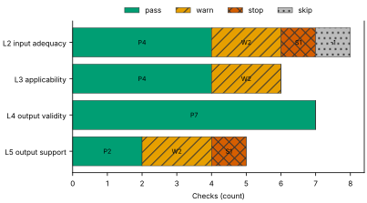
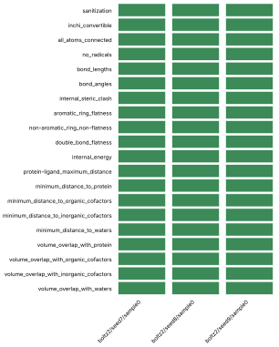
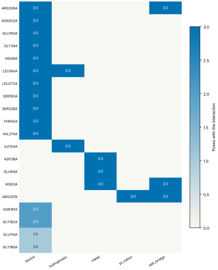
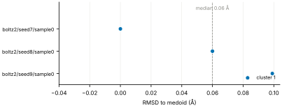
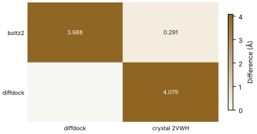
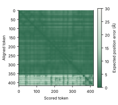

# Run report · Ligand pose in a known pocket

Prediction assurance · run `ligand_pose-816c3a9eb1cb` · 2026-10-17 19:25:41 UTC

**Refused** for the claim "Predicted pose of BGC in glucose dehydrogenase (glucose-binding) is valid".

Refused over layers 2,3,4,5: 17 pass, 6 warn, 2 stop, 1 skip. Stopped by l2.context.cofactors, l5.controls.redocking. Warnings from l2.receptor.protonation, l2.docking.box, l3.exposure.pocket, l3.exposure.ligand_prevalence, l5.sampling.seeds, l5.agreement.cross_family.

Stops: `l2.context.cofactors`, `l5.controls.redocking`.

Warnings: `l2.receptor.protonation`, `l2.docking.box`, `l3.exposure.pocket`, `l3.exposure.ligand_prevalence`, `l5.sampling.seeds`, `l5.agreement.cross_family`.

| Field | Value |
| --- | --- |
| Task | Ligand pose in a known pocket (`ligand_pose`) |
| Tools | Boltz-2 2.2.1 (co-folding), DiffDock-L (docking) |
| Target | `protein` |
| Ligand | `C([C@@H]1[C@H]([C@@H]([C@H]([C@@H](O1)O)O)O)O)O` |
| Reference | `2VWH` |
| pH | 7.4 |
| Seeds | 3 |
| Layers run | 2, 3, 4, 5 |
| Run | `ligand_pose-816c3a9eb1cb` |
| Created | 2026-10-17 19:25:41 UTC |
| Finished | 2026-10-17 19:27:00 UTC |
| pah version | 0.1.0 |
| Report schema | 1 |

## Layers

| Layer | Status | Result | pass | warn | stop | skip | Time |
| --- | --- | --- | --- | --- | --- | --- | --- |
| L0 Provenance | not run | n/a | n/a | n/a | n/a | n/a | n/a |
| L1 Input integrity | not run | n/a | n/a | n/a | n/a | n/a | n/a |
| L2 Input adequacy | done | stop | 4 | 2 | 1 | 1 | 1.5 s |
| L3 Applicability | done | warn | 4 | 2 | 0 | 0 | 388 ms |
| L4 Output validity | done | pass | 7 | 0 | 0 | 0 | 77.5 s |
| L5 Output support | done | stop | 2 | 2 | 1 | 0 | 144 ms |

## Figures

Fig. 1 · Check outcomes per layer for run ligand_pose-816c3a9eb1cb. Totals: pass 17, warn 6, stop 2, skip 1.
Files: data [figures/gates_by_layer.csv](figures/gates_by_layer.csv).

## Structures

68 PyMOL renders.

2VWH mmCIF (source_structure), whole structure. Chains A; organic components BGC, NAP. sha256 563276ca06d2a22a. PyMOL session: [renders/2VWH.pse](renders/2VWH.pse).

2VWH mmCIF (source_structure), ligand environment within 5 Å. Chains A; organic components BGC, NAP. sha256 563276ca06d2a22a. PyMOL session: [renders/2VWH.pse](renders/2VWH.pse).

boltz2/seed7/sample0 (prediction_structure), whole structure. Chains A, C1, C2, L; organic components LIG1, NAP. sha256 01e263e37d018544. PyMOL session: [renders/boltz2_seed7_sample0.pse](renders/boltz2_seed7_sample0.pse).

boltz2/seed7/sample0 (prediction_structure), ligand environment within 5 Å. Chains A, C1, C2, L; organic components LIG1, NAP. sha256 01e263e37d018544. PyMOL session: [renders/boltz2_seed7_sample0.pse](renders/boltz2_seed7_sample0.pse).

boltz2/seed8/sample0 (prediction_structure), whole structure. Chains A, C1, C2, L; organic components LIG1, NAP. sha256 5edd6e2f812900ba. PyMOL session: [renders/boltz2_seed8_sample0.pse](renders/boltz2_seed8_sample0.pse).

boltz2/seed8/sample0 (prediction_structure), ligand environment within 5 Å. Chains A, C1, C2, L; organic components LIG1, NAP. sha256 5edd6e2f812900ba. PyMOL session: [renders/boltz2_seed8_sample0.pse](renders/boltz2_seed8_sample0.pse).

boltz2/seed9/sample0 (prediction_structure), whole structure. Chains A, C1, C2, L; organic components LIG1, NAP. sha256 df1e8ea7385abcab. PyMOL session: [renders/boltz2_seed9_sample0.pse](renders/boltz2_seed9_sample0.pse).

boltz2/seed9/sample0 (prediction_structure), ligand environment within 5 Å. Chains A, C1, C2, L; organic components LIG1, NAP. sha256 df1e8ea7385abcab. PyMOL session: [renders/boltz2_seed9_sample0.pse](renders/boltz2_seed9_sample0.pse).

diffdock/seed7/mode0 (prediction_structure), whole structure. Chains A, L; organic components LIG. sha256 34aa2a0ff8b4c0f8. PyMOL session: [renders/diffdock_seed7_mode0.pse](renders/diffdock_seed7_mode0.pse).

diffdock/seed7/mode0 (prediction_structure), ligand environment within 5 Å. Chains A, L; organic components LIG. sha256 34aa2a0ff8b4c0f8. PyMOL session: [renders/diffdock_seed7_mode0.pse](renders/diffdock_seed7_mode0.pse).

diffdock/seed7/mode1 (prediction_structure), whole structure. Chains A, L; organic components LIG. sha256 684b77638bfdf0d1. PyMOL session: [renders/diffdock_seed7_mode1.pse](renders/diffdock_seed7_mode1.pse).

diffdock/seed7/mode1 (prediction_structure), ligand environment within 5 Å. Chains A, L; organic components LIG. sha256 684b77638bfdf0d1. PyMOL session: [renders/diffdock_seed7_mode1.pse](renders/diffdock_seed7_mode1.pse).

diffdock/seed7/mode2 (prediction_structure), whole structure. Chains A, L; organic components LIG. sha256 80b80c29b5228cb8. PyMOL session: [renders/diffdock_seed7_mode2.pse](renders/diffdock_seed7_mode2.pse).

diffdock/seed7/mode2 (prediction_structure), ligand environment within 5 Å. Chains A, L; organic components LIG. sha256 80b80c29b5228cb8. PyMOL session: [renders/diffdock_seed7_mode2.pse](renders/diffdock_seed7_mode2.pse).

diffdock/seed7/mode3 (prediction_structure), whole structure. Chains A, L; organic components LIG. sha256 1a3b6960d7ba54fc. PyMOL session: [renders/diffdock_seed7_mode3.pse](renders/diffdock_seed7_mode3.pse).

diffdock/seed7/mode3 (prediction_structure), ligand environment within 5 Å. Chains A, L; organic components LIG. sha256 1a3b6960d7ba54fc. PyMOL session: [renders/diffdock_seed7_mode3.pse](renders/diffdock_seed7_mode3.pse).

diffdock/seed7/mode4 (prediction_structure), whole structure. Chains A, L; organic components LIG. sha256 1ae3654b239f89fa. PyMOL session: [renders/diffdock_seed7_mode4.pse](renders/diffdock_seed7_mode4.pse).

diffdock/seed7/mode4 (prediction_structure), ligand environment within 5 Å. Chains A, L; organic components LIG. sha256 1ae3654b239f89fa. PyMOL session: [renders/diffdock_seed7_mode4.pse](renders/diffdock_seed7_mode4.pse).

diffdock/seed7/mode5 (prediction_structure), whole structure. Chains A, L; organic components LIG. sha256 34a7dd51982c61eb. PyMOL session: [renders/diffdock_seed7_mode5.pse](renders/diffdock_seed7_mode5.pse).

diffdock/seed7/mode5 (prediction_structure), ligand environment within 5 Å. Chains A, L; organic components LIG. sha256 34a7dd51982c61eb. PyMOL session: [renders/diffdock_seed7_mode5.pse](renders/diffdock_seed7_mode5.pse).

diffdock/seed7/mode6 (prediction_structure), whole structure. Chains A, L; organic components LIG. sha256 c9e09f66957f6359. PyMOL session: [renders/diffdock_seed7_mode6.pse](renders/diffdock_seed7_mode6.pse).

diffdock/seed7/mode6 (prediction_structure), ligand environment within 5 Å. Chains A, L; organic components LIG. sha256 c9e09f66957f6359. PyMOL session: [renders/diffdock_seed7_mode6.pse](renders/diffdock_seed7_mode6.pse).

diffdock/seed7/mode7 (prediction_structure), whole structure. Chains A, L; organic components LIG. sha256 9956992a48d852f7. PyMOL session: [renders/diffdock_seed7_mode7.pse](renders/diffdock_seed7_mode7.pse).

diffdock/seed7/mode7 (prediction_structure), ligand environment within 5 Å. Chains A, L; organic components LIG. sha256 9956992a48d852f7. PyMOL session: [renders/diffdock_seed7_mode7.pse](renders/diffdock_seed7_mode7.pse).

diffdock/seed7/mode8 (prediction_structure), whole structure. Chains A, L; organic components LIG. sha256 406348bf09f3bf28. PyMOL session: [renders/diffdock_seed7_mode8.pse](renders/diffdock_seed7_mode8.pse).

diffdock/seed7/mode8 (prediction_structure), ligand environment within 5 Å. Chains A, L; organic components LIG. sha256 406348bf09f3bf28. PyMOL session: [renders/diffdock_seed7_mode8.pse](renders/diffdock_seed7_mode8.pse).

diffdock/seed7/mode9 (prediction_structure), whole structure. Chains A, L; organic components LIG. sha256 8ee28da99404b685. PyMOL session: [renders/diffdock_seed7_mode9.pse](renders/diffdock_seed7_mode9.pse).

diffdock/seed7/mode9 (prediction_structure), ligand environment within 5 Å. Chains A, L; organic components LIG. sha256 8ee28da99404b685. PyMOL session: [renders/diffdock_seed7_mode9.pse](renders/diffdock_seed7_mode9.pse).

diffdock/seed8/mode0 (prediction_structure), whole structure. Chains A, L; organic components LIG. sha256 24cfbd176fd6e463. PyMOL session: [renders/diffdock_seed8_mode0.pse](renders/diffdock_seed8_mode0.pse).

diffdock/seed8/mode0 (prediction_structure), ligand environment within 5 Å. Chains A, L; organic components LIG. sha256 24cfbd176fd6e463. PyMOL session: [renders/diffdock_seed8_mode0.pse](renders/diffdock_seed8_mode0.pse).

diffdock/seed8/mode1 (prediction_structure), whole structure. Chains A, L; organic components LIG. sha256 9d5d631ea84e46ec. PyMOL session: [renders/diffdock_seed8_mode1.pse](renders/diffdock_seed8_mode1.pse).

diffdock/seed8/mode1 (prediction_structure), ligand environment within 5 Å. Chains A, L; organic components LIG. sha256 9d5d631ea84e46ec. PyMOL session: [renders/diffdock_seed8_mode1.pse](renders/diffdock_seed8_mode1.pse).

diffdock/seed8/mode2 (prediction_structure), whole structure. Chains A, L; organic components LIG. sha256 adbe6d0a9b87c03c. PyMOL session: [renders/diffdock_seed8_mode2.pse](renders/diffdock_seed8_mode2.pse).

diffdock/seed8/mode2 (prediction_structure), ligand environment within 5 Å. Chains A, L; organic components LIG. sha256 adbe6d0a9b87c03c. PyMOL session: [renders/diffdock_seed8_mode2.pse](renders/diffdock_seed8_mode2.pse).

diffdock/seed8/mode3 (prediction_structure), whole structure. Chains A, L; organic components LIG. sha256 681c4abdd95b0517. PyMOL session: [renders/diffdock_seed8_mode3.pse](renders/diffdock_seed8_mode3.pse).

diffdock/seed8/mode3 (prediction_structure), ligand environment within 5 Å. Chains A, L; organic components LIG. sha256 681c4abdd95b0517. PyMOL session: [renders/diffdock_seed8_mode3.pse](renders/diffdock_seed8_mode3.pse).

diffdock/seed8/mode4 (prediction_structure), whole structure. Chains A, L; organic components LIG. sha256 085b1dad2728ef93. PyMOL session: [renders/diffdock_seed8_mode4.pse](renders/diffdock_seed8_mode4.pse).

diffdock/seed8/mode4 (prediction_structure), ligand environment within 5 Å. Chains A, L; organic components LIG. sha256 085b1dad2728ef93. PyMOL session: [renders/diffdock_seed8_mode4.pse](renders/diffdock_seed8_mode4.pse).

diffdock/seed8/mode5 (prediction_structure), whole structure. Chains A, L; organic components LIG. sha256 f7c641c8fc6a97be. PyMOL session: [renders/diffdock_seed8_mode5.pse](renders/diffdock_seed8_mode5.pse).

diffdock/seed8/mode5 (prediction_structure), ligand environment within 5 Å. Chains A, L; organic components LIG. sha256 f7c641c8fc6a97be. PyMOL session: [renders/diffdock_seed8_mode5.pse](renders/diffdock_seed8_mode5.pse).

diffdock/seed8/mode6 (prediction_structure), whole structure. Chains A, L; organic components LIG. sha256 30592a365dab88ee. PyMOL session: [renders/diffdock_seed8_mode6.pse](renders/diffdock_seed8_mode6.pse).

diffdock/seed8/mode6 (prediction_structure), ligand environment within 5 Å. Chains A, L; organic components LIG. sha256 30592a365dab88ee. PyMOL session: [renders/diffdock_seed8_mode6.pse](renders/diffdock_seed8_mode6.pse).

diffdock/seed8/mode7 (prediction_structure), whole structure. Chains A, L; organic components LIG. sha256 2eb8c3fc42981ad2. PyMOL session: [renders/diffdock_seed8_mode7.pse](renders/diffdock_seed8_mode7.pse).

diffdock/seed8/mode7 (prediction_structure), ligand environment within 5 Å. Chains A, L; organic components LIG. sha256 2eb8c3fc42981ad2. PyMOL session: [renders/diffdock_seed8_mode7.pse](renders/diffdock_seed8_mode7.pse).

diffdock/seed8/mode8 (prediction_structure), whole structure. Chains A, L; organic components LIG. sha256 ff6ae7e4aa70d802. PyMOL session: [renders/diffdock_seed8_mode8.pse](renders/diffdock_seed8_mode8.pse).

diffdock/seed8/mode8 (prediction_structure), ligand environment within 5 Å. Chains A, L; organic components LIG. sha256 ff6ae7e4aa70d802. PyMOL session: [renders/diffdock_seed8_mode8.pse](renders/diffdock_seed8_mode8.pse).

diffdock/seed8/mode9 (prediction_structure), whole structure. Chains A, L; organic components LIG. sha256 d3e6cbdeff71f420. PyMOL session: [renders/diffdock_seed8_mode9.pse](renders/diffdock_seed8_mode9.pse).

diffdock/seed8/mode9 (prediction_structure), ligand environment within 5 Å. Chains A, L; organic components LIG. sha256 d3e6cbdeff71f420. PyMOL session: [renders/diffdock_seed8_mode9.pse](renders/diffdock_seed8_mode9.pse).

diffdock/seed9/mode0 (prediction_structure), whole structure. Chains A, L; organic components LIG. sha256 403032895c9ec6f9. PyMOL session: [renders/diffdock_seed9_mode0.pse](renders/diffdock_seed9_mode0.pse).

diffdock/seed9/mode0 (prediction_structure), ligand environment within 5 Å. Chains A, L; organic components LIG. sha256 403032895c9ec6f9. PyMOL session: [renders/diffdock_seed9_mode0.pse](renders/diffdock_seed9_mode0.pse).

diffdock/seed9/mode1 (prediction_structure), whole structure. Chains A, L; organic components LIG. sha256 a6c69ab7b34fe1d0. PyMOL session: [renders/diffdock_seed9_mode1.pse](renders/diffdock_seed9_mode1.pse).

diffdock/seed9/mode1 (prediction_structure), ligand environment within 5 Å. Chains A, L; organic components LIG. sha256 a6c69ab7b34fe1d0. PyMOL session: [renders/diffdock_seed9_mode1.pse](renders/diffdock_seed9_mode1.pse).

diffdock/seed9/mode2 (prediction_structure), whole structure. Chains A, L; organic components LIG. sha256 93f70b1984c9d89b. PyMOL session: [renders/diffdock_seed9_mode2.pse](renders/diffdock_seed9_mode2.pse).

diffdock/seed9/mode2 (prediction_structure), ligand environment within 5 Å. Chains A, L; organic components LIG. sha256 93f70b1984c9d89b. PyMOL session: [renders/diffdock_seed9_mode2.pse](renders/diffdock_seed9_mode2.pse).

diffdock/seed9/mode3 (prediction_structure), whole structure. Chains A, L; organic components LIG. sha256 7a4fa5d8a6a46aed. PyMOL session: [renders/diffdock_seed9_mode3.pse](renders/diffdock_seed9_mode3.pse).

diffdock/seed9/mode3 (prediction_structure), ligand environment within 5 Å. Chains A, L; organic components LIG. sha256 7a4fa5d8a6a46aed. PyMOL session: [renders/diffdock_seed9_mode3.pse](renders/diffdock_seed9_mode3.pse).

diffdock/seed9/mode4 (prediction_structure), whole structure. Chains A, L; organic components LIG. sha256 8d92b43640693f42. PyMOL session: [renders/diffdock_seed9_mode4.pse](renders/diffdock_seed9_mode4.pse).

diffdock/seed9/mode4 (prediction_structure), ligand environment within 5 Å. Chains A, L; organic components LIG. sha256 8d92b43640693f42. PyMOL session: [renders/diffdock_seed9_mode4.pse](renders/diffdock_seed9_mode4.pse).

diffdock/seed9/mode5 (prediction_structure), whole structure. Chains A, L; organic components LIG. sha256 d87f3b9965e6d721. PyMOL session: [renders/diffdock_seed9_mode5.pse](renders/diffdock_seed9_mode5.pse).

diffdock/seed9/mode5 (prediction_structure), ligand environment within 5 Å. Chains A, L; organic components LIG. sha256 d87f3b9965e6d721. PyMOL session: [renders/diffdock_seed9_mode5.pse](renders/diffdock_seed9_mode5.pse).

diffdock/seed9/mode6 (prediction_structure), whole structure. Chains A, L; organic components LIG. sha256 68cd050522b35970. PyMOL session: [renders/diffdock_seed9_mode6.pse](renders/diffdock_seed9_mode6.pse).

diffdock/seed9/mode6 (prediction_structure), ligand environment within 5 Å. Chains A, L; organic components LIG. sha256 68cd050522b35970. PyMOL session: [renders/diffdock_seed9_mode6.pse](renders/diffdock_seed9_mode6.pse).

diffdock/seed9/mode7 (prediction_structure), whole structure. Chains A, L; organic components LIG. sha256 3c0cfd1cc5019f40. PyMOL session: [renders/diffdock_seed9_mode7.pse](renders/diffdock_seed9_mode7.pse).

diffdock/seed9/mode7 (prediction_structure), ligand environment within 5 Å. Chains A, L; organic components LIG. sha256 3c0cfd1cc5019f40. PyMOL session: [renders/diffdock_seed9_mode7.pse](renders/diffdock_seed9_mode7.pse).

diffdock/seed9/mode8 (prediction_structure), whole structure. Chains A, L; organic components LIG. sha256 24a5ae509453e0b2. PyMOL session: [renders/diffdock_seed9_mode8.pse](renders/diffdock_seed9_mode8.pse).

diffdock/seed9/mode8 (prediction_structure), ligand environment within 5 Å. Chains A, L; organic components LIG. sha256 24a5ae509453e0b2. PyMOL session: [renders/diffdock_seed9_mode8.pse](renders/diffdock_seed9_mode8.pse).

diffdock/seed9/mode9 (prediction_structure), whole structure. Chains A, L; organic components LIG. sha256 a11438fa833e87a4. PyMOL session: [renders/diffdock_seed9_mode9.pse](renders/diffdock_seed9_mode9.pse).

diffdock/seed9/mode9 (prediction_structure), ligand environment within 5 Å. Chains A, L; organic components LIG. sha256 a11438fa833e87a4. PyMOL session: [renders/diffdock_seed9_mode9.pse](renders/diffdock_seed9_mode9.pse).

## L0 Provenance

Where did every input come from?

Status: not run.

## L1 Input integrity

Did the run receive exactly what was declared?

Status: not run.

## L2 Input adequacy

Does the input carry enough information?

Status: done. Checks: pass 4 · warn 2 · stop 1 · skip 1. Time: 1.5 s.

#### Key figures

| Figure | Value |
| --- | --- |
| near site | 2 |
| missing | 2 |
| uniprot cofactors | 0 |
| pocket residues | 19 |
| incomplete | 0 |
| sequence gaps | 0 |
| state | holo |
| site ligands | 2 |

#### Docking

| Field | Value |
| --- | --- |
| center | 9.319, 36.788, 18.307 Å |
| size | 11.671 × 12.814 × 12.093 Å |
| origin | derived from BGC (+4 Å) |

#### Checks

| Check | Result | Measured cmp threshold | Evidence | Id · time |
| --- | --- | --- | --- | --- |
| Alignment depth, distinct sequences, Neff and gap fraction | skip | n/a | no MSA declared for a co-folding model · not applicable | `l2.msa.depth` |
| Required cofactors, ions and partners present | stop | `pocket_distance <= 8` | components within 8.0 Å of BGC in 2VWH not supplied: NAP, ZN · near_site=2, missing=2, uniprot_cofactors=0 | `l2.context.cofactors` · 181 ms |
| Pocket residues resolved, no missing loops lining the pocket | pass | `pocket_distance <= 6` | 19 pocket residues complete in 2VWH.cif · pocket_residues=19, incomplete=0, sequence_gaps=0 | `l2.pocket.resolved` · 8 ms |
| Receptor state apo or holo | pass | n/a | 2VWH.cif holo: BGC, NAP in the site · state=holo, site_ligands=2 | `l2.receptor.state` · 9 ms |
| Receptor protonation at the stated pH | warn | `pka_margin > 1` | receptor has no hydrogens (protonation not assigned); pKa within 1.0 of pH 7.4: GLU64A pKa 6.96, GLU150A pKa 8.39 · hydrogens_present=False, ph=7.4, pocket_titratable=13 | `l2.receptor.protonation` · 658 ms |
| Ligand protonation and tautomers enumerated at the stated pH | pass | `ph 7.4 == 1` | one state at pH 7.4 for every ligand · ph=7.4, max_states=1, declared_not_enumerated=0 | `l2.ligand.protonation` · 48 ms |
| Ligand conformers generated and minimised | pass | `conformers >= 10` | 10 ETKDG conformers per ligand, MMFF minimised · ligands=1, failed=0, min_embedded=10 | `l2.ligand.conformers` · 577 ms |
| Docking box encloses the pocket with margin | warn | `margin >= 2` | no box declared; derived box encloses 11 contact residues and the BGC ligand with 2.0 Å margin · volume_A3=1808.5, ligand_atoms_inside_margin=12, ligand_atoms=12 | `l2.docking.box` · 11 ms |

## L3 Applicability

Is the tool inside its validated regime?

Status: done. Checks: pass 4 · warn 2 · stop 0 · skip 0. Time: 388 ms.

#### Key figures

| Figure | Value |
| --- | --- |
| executors | 2 |
| unknown | 0 |
| reference released | 2009-01-13 |
| cutoff | 2019-01-01 |
| entries compared | 1 |
| max similarity | 87.4 |
| pocket residues | 19 |
| systems | 1079 |

#### Checks

| Check | Result | Measured cmp threshold | Evidence | Id · time |
| --- | --- | --- | --- | --- |
| Model training cutoff recorded | pass | `training_cutoff == recorded` | boltz2 2023-06-01; diffdock 2019-01-01; reference 2VWH released 2009-01-13, before the cutoff of boltz2, diffdock · executors=2, unknown=0, reference_released=2009-01-13 | `l3.model.training_cutoff` · 1 ms |
| Pocket similarity to pre-cutoff complexes (SuCOS times pocket coverage) | warn | `similarity <= 50` | max similarity 87.4 to 2VWH (BGC, SuCOS 0.922, coverage 0.947), released before 2019-01-01 · cutoff=2019-01-01, entries_compared=1, max_similarity=87.4 | `l3.exposure.pocket` · 378 ms |
| Ligand analogues in pre-cutoff training systems | warn | `tanimoto > 0.9` | 1079 PDB entries released before 2019-01-01 (diffdock cutoff) contain analogues of ligand above Tanimoto 0.9: 3MK, 4GL, 4N2, A1EKO, AFD, ALL · cutoff=2019-01-01, systems=1079, analogue_components=25 | `l3.exposure.ligand_prevalence` · 0 ms |
| Chain sequence identity to pre-cutoff entries (secondary measure) | pass | `identity < 0.4` | protein: 6 entries at 95 percent identity, 6 at 40 percent, released before 2019-01-01 (reported, not gating) · cutoff=2019-01-01, entries_95=6, entries_40=6 | `l3.exposure.sequence` · 1 ms |
| Modality inside the validated set; token count against the training crop | pass | n/a | modalities protein, protein_ligand inside the validated set; 369 tokens · modalities=2, tokens=369, outside=0 | `l3.regime.modality` · 6 ms |
| Endpoint fits the tool | pass | `endpoint pose in pose` | endpoint pose produced by boltz2, diffdock · endpoint=pose, executors=2, not_fitting=0 | `l3.metric.endpoint` · 0 ms |

## L4 Output validity

Is the result physically and chemically sensible?

Status: done. Checks: pass 7 · warn 0 · stop 0 · skip 0. Time: 77.5 s.

#### Key figures

| Figure | Value |
| --- | --- |
| poses | 3 |
| passed | 20 |
| total | 20 |
| poses all pass | 3 |
| unlikely torsions | 0 |
| torsions | 6 |
| strain kcal | 3.14 |
| poses with unlikely | 1 |

#### PoseBusters · 20/20 tests pass

| test | result | value |
| --- | --- | --- |
| sanitization | pass | pass |
| inchi_convertible | pass | pass |
| all_atoms_connected | pass | pass |
| no_radicals | pass | pass |
| bond_lengths | pass | 0 long outliers |
| bond_angles | pass | 0 outliers |
| internal_steric_clash | pass | 0 |
| aromatic_ring_flatness | pass | pass |
| non-aromatic_ring_non-flatness | pass | pass |
| double_bond_flatness | pass | pass |
| internal_energy | pass | 0.8 times the ensemble mean |
| protein-ligand_maximum_distance | pass | 2.55 Å |
| minimum_distance_to_protein | pass | 2.55 Å |
| minimum_distance_to_organic_cofactors | pass | pass |
| minimum_distance_to_inorganic_cofactors | pass | pass |
| minimum_distance_to_waters | pass | pass |
| volume_overlap_with_protein | pass | 0.034 |
| volume_overlap_with_organic_cofactors | pass | pass |
| volume_overlap_with_inorganic_cofactors | pass | pass |
| volume_overlap_with_waters | pass | pass |

#### Per-pose physical checks

| pose | seed | drift Å | converged | unlikely torsions | unsat. polars | buried charged | PoseBusters |
| --- | --- | --- | --- | --- | --- | --- | --- |
| boltz2/seed7/sample0 | 7 | 0.4 | true | 0/6 | 0 | 0 | 20/20 |
| boltz2/seed8/sample0 | 8 | 0.31 | true | 0/6 | 0 | 0 | 20/20 |
| boltz2/seed9/sample0 | 9 | 0.34 | true | 2/6 | 0 | 0 | 20/20 |
| median | n/a | 0.34 | n/a | 0 | 0 | 0 | 20/20 |

#### Interaction fingerprint · representative pose boltz2/seed7/sample0

| residue | type | distance | poses |
| --- | --- | --- | --- |
| ARG208A | hbond | 3.36 Å | 3/3 |
| ASN303A | hbond | 2.83 Å | 3/3 |
| GLU150A | hbond | 2.8 Å | 3/3 |
| GLY39A | hbond | 2.85 Å | 3/3 |
| HIS49A | hbond | 2.87 Å | 3/3 |
| LEU184A | hbond | 3.11 Å | 3/3 |
| LEU272A | hbond | 2.98 Å | 3/3 |
| SER183A | hbond | 3.59 Å | 3/3 |
| SER228A | hbond | 2.92 Å | 3/3 |
| THR40A | hbond | 2.81 Å | 3/3 |
| VAL274A | hbond | 3.23 Å | 3/3 |
| ILE154A | hydrophobic | 3.62 Å | 3/3 |
| LEU184A | hydrophobic | 3.63 Å | 3/3 |
| ASP38A | metal | 2 Å | 3/3 |
| GLU64A | metal | 2.54 Å | 3/3 |
| HIS63A | metal | 2.05 Å | 3/3 |
| ARG207A | pi_cation | 3.66 Å | 3/3 |
| ARG207A | salt_bridge | 4.36 Å | 3/3 |
| ARG208A | salt_bridge | 4.1 Å | 3/3 |
| HIS63A | salt_bridge | 4.37 Å | 3/3 |
| ASN181A | hbond | 4.05 Å | 2/3 |
| GLY182A | hbond | 3.85 Å | 2/3 |
| GLU114A | hbond | 3.64 Å | 1/3 |
| GLY185A | hbond | 4.1 Å | 1/3 |

Fig. 2 · PoseBusters tests (20) by pose (3). Failed cells marked x: 0 of 60.
Files: data [figures/posebusters_grid.csv](figures/posebusters_grid.csv).

Fig. 3 · Interactions by residue (20) and type (5); cell label: poses with the interaction over poses assessed.
Files: data [figures/interactions.csv](figures/interactions.csv).

#### Checks

| Check | Result | Measured cmp threshold | Evidence | Id · time |
| --- | --- | --- | --- | --- |
| PoseBusters geometry, stereochemistry, clashes and protein contact | pass | `tests_failed == 0` | 20 of 20 tests pass for boltz2/seed7/sample0; 3 of 3 poses pass all · poses=3, passed=20, total=20 | `l4.posebusters` · 1.2 s |
| Torsional strain of the ligand pose | pass | `torsion_energy <= 2.5` | 0 of 6 torsions above 2.5 kcal/mol in boltz2/seed7/sample0; strain 3.14 kcal/mol · poses=3, unlikely_torsions=0, torsions=6 | `l4.torsion_strain` · 571 ms |
| Interaction fingerprint (PLIP) | pass | n/a | 28 interactions in boltz2/seed7/sample0 (hbond, hydrophobic, metal, pi_cation, salt_bridge); 24 distinct across 3 poses (reported) · poses=3, interactions_representative=28, distinct=24 | `l4.interactions.fingerprint` · 2.5 s |
| Buried ligand polar atoms without a hydrogen-bond partner | pass | `relative_sasa < 0.1` | 6 buried polar ligand atoms, all with a partner within 3.5 Å in boltz2/seed7/sample0 · poses=3, unsatisfied=0, buried_charged=0 | `l4.interactions.unsatisfied_polars` · 363 ms |
| Hydrophobic complementarity of buried ligand surface | pass | `fraction >= 0.35` | nonpolar fraction of protein contacts around 4 buried nonpolar ligand atoms in boltz2/seed7/sample0: 0.535 · poses=3, complementarity=0.535, buried_nonpolar=4 | `l4.interactions.hydrophobic` · 380 ms |
| Interactions of the crystal ligand reproduced by the pose | pass | `reproduced 5 >= 1` | boltz2/seed7/sample0 reproduces 5 of 6 BGC interactions: hbond ASN303A, hbond GLU150A, hbond HIS49A, hbond THR40A, salt_bridge HIS63A · key_interactions=6, reproduced=5, poses_reproducing_all=1 | `l4.interactions.known_binders` · 183 ms |
| Pose stability under short restrained minimisation (OpenMM, AMBER14 and OpenFF) | pass | `drift_A 0.4 <= 2` | boltz2/seed7/sample0 moves 0.397 Å under restrained minimisation; 0 of 3 poses above 2.0 Å · poses=3, drift_A=0.397, max_drift_A=0.397 | `l4.minimisation_drift` · 72.4 s |

## L5 Output support

Is a valid result corroborated?

Status: done. Checks: pass 2 · warn 2 · stop 1 · skip 0. Time: 144 ms.

#### Key figures

| Figure | Value |
| --- | --- |
| poses | 3 |
| pocket plddt | 97.4 |
| global plddt | 98 |
| iptm | 0.991 |
| ptm | 0.988 |
| confidence score | 0.982 |
| independent seeds | 3 |
| samples | 3 |

#### Sampling

| Field | Value |
| --- | --- |
| site placement | 3 of 3 poses within 4.0 Å of the site (BGC in 2VWH) |
| pose accuracy | 3 of 3 poses within 2.0 Å of the medoid |
| pairwise RMSD median | 0.1 Å |
| pairwise RMSD IQR | 0.08 to 0.12 Å |
| pairs | 3 |
| medoid | boltz2/seed7/sample0 |

#### Clusters

| Field | Value |
| --- | --- |
| cluster 1 | 3/3 poses (boltz2/seed7/sample0) |

#### Per-seed statistics

| seed | pose | cluster | RMSD to medoid | confidence |
| --- | --- | --- | --- | --- |
| 7 | boltz2/seed7/sample0 | 1 | 0 Å | 0.98 |
| 8 | boltz2/seed8/sample0 | 1 | 0.06 Å | 0.98 |
| 9 | boltz2/seed9/sample0 | 1 | 0.1 Å | 0.98 |
| median | n/a | n/a | 0.06 Å | 0.98 |

#### Ensemble

| structure | kind | source | RMSD to medoid | cluster | pocket pLDDT | ipTM |
| --- | --- | --- | --- | --- | --- | --- |
| boltz2/seed7/sample0 | medoid | boltz2 | 0 Å | 1 | 97.4 | 0.99 |
| boltz2/seed8/sample0 | seed | boltz2 | 0.06 Å | 1 | 97.2 | 0.99 |
| boltz2/seed9/sample0 | seed | boltz2 | 0.1 Å | 1 | 97.3 | 0.99 |

#### Agreement between methods

| method | diffdock | crystal 2VWH |
| --- | --- | --- |
| boltz2 | 3.99 Å (high) | 0.29 Å (decisive) |
| diffdock | n/a | 4.08 Å (decisive) |

#### Confidence metrics

| metric | value | read as | tool |
| --- | --- | --- | --- |
| affinity_pred_value | 1.7947049140930176 | ranking within a series, never pose quality | boltz2 |
| affinity_probability_binary | 0.478027880191803 | ranking within a series, never pose quality | boltz2 |
| affinity_pred_value | 1.8125581741333008 | ranking within a series, never pose quality | boltz2 |
| affinity_probability_binary | 0.4784361720085144 | ranking within a series, never pose quality | boltz2 |
| affinity_pred_value | 1.839261770248413 | ranking within a series, never pose quality | boltz2 |
| affinity_probability_binary | 0.46853524446487427 | ranking within a series, never pose quality | boltz2 |

Fig. 4 · RMSD to the medoid for 3 poses, coloured by cluster (1 clusters). Dashed line: median 0.06 Å; range 0.00 to 0.10 Å.
Files: data [figures/seed_spread.csv](figures/seed_spread.csv).

Fig. 5 · Agreement between 2 methods and 2 comparators; range 0.291 to 4.079 Å.
Files: data [figures/agreement.csv](figures/agreement.csv).

Fig. 6 · Predicted aligned error for pose boltz2/seed7/sample0, 418 by 418 tokens; values 0.2 to 27.8 Å, mean 2.9 Å.
Files: data [figures/pae.csv](figures/pae.csv).

#### Checks

| Check | Result | Measured cmp threshold | Evidence | Id · time |
| --- | --- | --- | --- | --- |
| Confidence restricted to the pocket; per-model thresholds | pass | `boltz2.pocket_plddt >= 70` | boltz2/seed7/sample0: pocket_plddt 97.4 · poses=3, pocket_plddt=97.4, global_plddt=98 | `l5.confidence.local` · 17 ms |
| Independent seeds counted separately from samples; duplicates flagged | warn | `seeds_cofolding >= 5` | 3 independent seeds (3 poses); task default 5 · independent_seeds=3, samples=3, duplicated_outputs=0 | `l5.sampling.seeds` · 0 ms |
| Medoid of the largest cluster, populations, pairwise spread, site and pose accuracy | pass | `cluster_rmsd <= 2` | medoid boltz2/seed7/sample0; 1 clusters, largest 3 of 3; pairwise RMSD median 0.10 Å (IQR 0.08 to 0.12); 3 of 3 poses within 4.0 Å of the site (BGC in 2VWH); 3 of 3 poses within 2.0 Å of the medoid · poses=3, clusters=1, largest_cluster=3 | `l5.sampling.clusters` · 32 ms |
| Agreement between methods, weighted by independence | warn | `rmsd_to_crystal_A 0.29 <= 2` | boltz2 vs diffdock 3.988 Å (high); boltz2 vs crystal 2VWH 0.291 Å (decisive); diffdock vs crystal 2VWH 4.079 Å (decisive) · methods=2, comparisons=3, disagreeing=2 | `l5.agreement.cross_family` · 92 ms |
| Redocking control reproduces the crystal pose | stop | `rmsd <= 2` | redocking control required by the task and not supplied (controls.redocking) | `l5.controls.redocking` · 0 ms |

## Controls

| control | status | result |
| --- | --- | --- |
| redocking | incomplete | redocking control required by the task and not supplied (controls.redocking) |

## Provenance

56 objects · 56 cached · 0 network.

| Source | Accession | Release | SHA-256 | Retrieved | Bytes | Cache | Used by |
| --- | --- | --- | --- | --- | --- | --- | --- |
| rcsb_files | 2VWH | n/a | `563276ca06d2` | 2026-10-17 16:59:50 UTC | 364136 | hit | l2.context.cofactors, l2.pocket.resolved, l2.receptor.state, l2.docking.box, l3.exposure.pocket, l3.regime.modality, l4.interactions.fingerprint, l4.interactions.known_binders, l5.sampling.clusters, l5.agreement.cross_family |
| ccd | BGC | 2026-01-27 | `faaa9f919f4c` | 2026-10-17 16:59:50 UTC | 30741 | hit | l2.context.cofactors, l3.exposure.pocket |
| rcsb | 2VWH | 1.5 | `5a990581b1c2` | 2026-10-17 16:59:51 UTC | 22370 | hit | l3.model.training_cutoff |
| rcsb_search | chem:C([C@@H]1[C@H]([C@@H]([C@H]([C@@H](O1)O)O)O)O)O | n/a | `0d5756d1e58b` | 2026-10-17 16:59:54 UTC | 1413 | hit | l3.exposure.pocket |
| ccd | 3MK | 2020-07-17 | `d97d4b552654` | 2026-10-17 16:59:54 UTC | 6432 | hit | l3.exposure.pocket |
| ccd | 4GL | 2020-07-17 | `54e556dfe7fd` | 2026-10-17 16:59:54 UTC | 6325 | hit | l3.exposure.pocket |
| ccd | 4N2 | 2024-09-27 | `f79b18096323` | 2026-10-17 16:59:54 UTC | 6840 | hit | l3.exposure.pocket |
| ccd | A1EKO | 2025-05-23 | `ad979697d06a` | 2026-10-17 16:59:54 UTC | 3352 | hit | l3.exposure.pocket |
| ccd | AFD | 2020-07-17 | `187112f21ade` | 2026-10-17 16:59:54 UTC | 6206 | hit | l3.exposure.pocket |
| ccd | ALL | 2020-07-17 | `598282a36137` | 2026-10-17 16:59:54 UTC | 7344 | hit | l3.exposure.pocket |
| ccd | BMA | 2024-09-27 | `7e30cba9c3f2` | 2026-10-17 16:59:55 UTC | 10486 | hit | l3.exposure.pocket |
| ccd | GIV | 2020-07-17 | `4569744b581c` | 2026-10-17 16:59:55 UTC | 6584 | hit | l3.exposure.pocket |
| ccd | GL0 | 2020-07-17 | `bbebd0ca21bb` | 2026-10-17 16:59:55 UTC | 6595 | hit | l3.exposure.pocket |
| ccd | GLA | 2024-09-27 | `7a00d8420d56` | 2026-10-17 16:59:55 UTC | 7618 | hit | l3.exposure.pocket |
| ccd | GLC | 2024-09-27 | `254da3afcadc` | 2026-10-17 16:59:55 UTC | 13396 | hit | l3.exposure.pocket |
| ccd | GUP | 2020-07-17 | `f89db705d642` | 2026-10-17 16:59:55 UTC | 6234 | hit | l3.exposure.pocket |
| ccd | GXL | 2020-07-17 | `b767fcdfce95` | 2026-10-17 16:59:55 UTC | 6457 | hit | l3.exposure.pocket |
| ccd | MAN | 2024-09-27 | `7152473b81ed` | 2026-10-17 16:59:55 UTC | 12288 | hit | l3.exposure.pocket |
| ccd | SDY | 2020-07-17 | `5d1e5b6ff718` | 2026-10-17 16:59:55 UTC | 5813 | hit | l3.exposure.pocket |
| ccd | SHD | 2020-07-17 | `f6d17409069d` | 2026-10-17 16:59:55 UTC | 6081 | hit | l3.exposure.pocket |
| ccd | WOO | 2020-07-17 | `9a8678927d94` | 2026-10-17 16:59:55 UTC | 6363 | hit | l3.exposure.pocket |
| ccd | Z0F | 2020-07-17 | `c55706645922` | 2026-10-17 16:59:55 UTC | 6421 | hit | l3.exposure.pocket |
| ccd | Z2D | 2020-07-17 | `689a6bb06802` | 2026-10-17 16:59:55 UTC | 6434 | hit | l3.exposure.pocket |
| ccd | Z6H | 2020-07-17 | `5a83d4f3e767` | 2026-10-17 16:59:55 UTC | 5982 | hit | l3.exposure.pocket |
| ccd | Z8H | 2020-07-17 | `2610342cf9e7` | 2026-10-17 16:59:55 UTC | 6321 | hit | l3.exposure.pocket |
| ccd | Z8T | 2020-07-17 | `379bdd554936` | 2026-10-17 16:59:55 UTC | 6328 | hit | l3.exposure.pocket |
| ccd | ZCD | 2020-07-17 | `0db91c424e63` | 2026-10-17 16:59:55 UTC | 6421 | hit | l3.exposure.pocket |
| ccd | ZEE | 2020-07-17 | `68a25c060a01` | 2026-10-17 16:59:55 UTC | 6839 | hit | l3.exposure.pocket |
| rcsb_search | comp:3MK:2019-01-01 | n/a | `e3b0c44298fc` | 2026-10-17 16:59:55 UTC | 0 | hit | l3.exposure.pocket |
| rcsb_search | comp:4GL:2019-01-01 | n/a | `e3b0c44298fc` | 2026-10-17 16:59:56 UTC | 0 | hit | l3.exposure.pocket |
| rcsb_search | comp:4N2:2019-01-01 | n/a | `1a398c0b2118` | 2026-10-17 16:59:56 UTC | 178 | hit | l3.exposure.pocket |
| rcsb_search | comp:A1EKO:2019-01-01 | n/a | `e3b0c44298fc` | 2026-10-17 16:59:56 UTC | 0 | hit | l3.exposure.pocket |
| rcsb_search | comp:AFD:2019-01-01 | n/a | `1b753220c03e` | 2026-10-17 16:59:56 UTC | 178 | hit | l3.exposure.pocket |
| rcsb_search | comp:ALL:2019-01-01 | n/a | `aa7eed16d698` | 2026-10-17 16:59:56 UTC | 282 | hit | l3.exposure.pocket |
| rcsb_search | comp:BGC:2019-01-01 | n/a | `39279015c780` | 2026-10-17 16:59:56 UTC | 16456 | hit | l3.exposure.pocket |
| rcsb_search | comp:BMA:2019-01-01 | n/a | `8abdb19b69b6` | 2026-10-17 16:59:56 UTC | 5223 | hit | l3.exposure.pocket |
| rcsb_search | comp:GIV:2019-01-01 | n/a | `180958654842` | 2026-10-17 16:59:56 UTC | 230 | hit | l3.exposure.pocket |
| rcsb_search | comp:GL0:2019-01-01 | n/a | `9b62fec3623e` | 2026-10-17 16:59:56 UTC | 230 | hit | l3.exposure.pocket |
| rcsb_search | comp:GLA:2019-01-01 | n/a | `02cfe2e610ae` | 2026-10-17 16:59:56 UTC | 3039 | hit | l3.exposure.pocket |
| rcsb_search | comp:GLC:2019-01-01 | n/a | `5e0520a8a72a` | 2026-10-17 16:59:56 UTC | 14064 | hit | l3.exposure.pocket |
| rcsb_search | comp:GUP:2019-01-01 | n/a | `e3b0c44298fc` | 2026-10-17 16:59:56 UTC | 0 | hit | l3.exposure.pocket |
| rcsb_search | comp:GXL:2019-01-01 | n/a | `76ee6d0d9de4` | 2026-10-17 16:59:56 UTC | 230 | hit | l3.exposure.pocket |
| rcsb_search | comp:MAN:2019-01-01 | n/a | `03c4da7e978a` | 2026-10-17 16:59:56 UTC | 17340 | hit | l3.exposure.pocket |
| rcsb_search | comp:SDY:2019-01-01 | n/a | `e3b0c44298fc` | 2026-10-17 16:59:56 UTC | 0 | hit | l3.exposure.pocket |
| rcsb_search | comp:SHD:2019-01-01 | n/a | `e3b0c44298fc` | 2026-10-17 16:59:56 UTC | 0 | hit | l3.exposure.pocket |
| rcsb_search | comp:WOO:2019-01-01 | n/a | `c2bb176d61ff` | 2026-10-17 16:59:56 UTC | 178 | hit | l3.exposure.pocket |
| rcsb_search | comp:Z0F:2019-01-01 | n/a | `e3b0c44298fc` | 2026-10-17 16:59:56 UTC | 0 | hit | l3.exposure.pocket |
| rcsb_search | comp:Z2D:2019-01-01 | n/a | `e3b0c44298fc` | 2026-10-17 16:59:56 UTC | 0 | hit | l3.exposure.pocket |
| rcsb_search | comp:Z6H:2019-01-01 | n/a | `e3b0c44298fc` | 2026-10-17 16:59:57 UTC | 0 | hit | l3.exposure.pocket |
| rcsb_search | comp:Z8H:2019-01-01 | n/a | `e3b0c44298fc` | 2026-10-17 16:59:57 UTC | 0 | hit | l3.exposure.pocket |
| rcsb_search | comp:Z8T:2019-01-01 | n/a | `e3b0c44298fc` | 2026-10-17 16:59:57 UTC | 0 | hit | l3.exposure.pocket |
| rcsb_search | comp:ZCD:2019-01-01 | n/a | `e3b0c44298fc` | 2026-10-17 16:59:57 UTC | 0 | hit | l3.exposure.pocket |
| rcsb_search | comp:ZEE:2019-01-01 | n/a | `e3b0c44298fc` | 2026-10-17 16:59:57 UTC | 0 | hit | l3.exposure.pocket |
| rcsb_search | seq0.9:2019-01-01:357 | n/a | `5cf9c6d3e615` | 2026-10-17 16:59:54 UTC | 438 | hit | l3.exposure.pocket |
| rcsb_search | seq0.95:2019-01-01:357 | n/a | `2ded139e03ea` | 2026-10-17 16:59:55 UTC | 386 | hit | l3.exposure.sequence |
| rcsb_search | seq0.4:2019-01-01:357 | n/a | `d1c1f4adb44b` | 2026-10-17 16:59:55 UTC | 386 | hit | l3.exposure.sequence |

Provenance graph: [json](graph.json), [mmd](graph.mmd), [svg](graph.svg).

## Thresholds

| Check | Threshold | Value | Origin | Evidence level |
| --- | --- | --- | --- | --- |
| `l2.context.cofactors` | pocket_distance | <= 8 | Harness rule: a component of the reference entry within 8 Å of the declared ligand is required context; not yet calibrated | uncalibrated |
| `l2.pocket.resolved` | pocket_distance | <= 6 | Harness rule: pocket residues have a heavy atom within 6 Å of the ligand; not yet calibrated | uncalibrated |
| `l2.pocket.resolved` | missing_pocket_residues | == 0 | Specification layer 2: stop when the pocket is incomplete | published |
| `l2.receptor.protonation` | pka_margin | > 1 | Harness rule: a titratable pocket residue with PROPKA pKa within 1 unit of the stated pH has an ambiguous state; not yet calibrated | uncalibrated |
| `l2.ligand.protonation` | ph_window | == 1 | Harness rule: states enumerated by Dimorphite-DL within 1 pH unit of the stated pH; not yet calibrated | uncalibrated |
| `l2.ligand.protonation` | states | == 1 | Specification layer 2: warn when more than one plausible state | published |
| `l2.ligand.conformers` | conformers | >= 10 | Harness default number of ETKDG conformers; not yet calibrated | uncalibrated |
| `l2.docking.box` | margin | >= 2 | Harness rule: every pocket heavy atom lies at least 2 Å inside the box; not yet calibrated | uncalibrated |
| `l2.docking.box` | contact_distance | <= 4 | Harness rule: contact residues (heavy atom within 4 Å of the reference ligand) must have an atom inside the box; not yet calibrated | uncalibrated |
| `l3.model.training_cutoff` | training_cutoff | == recorded | Specification, Layer 3 (applicability): stop when unknown | published |
| `l3.exposure.pocket` | similarity | <= 50 | Specification layer 3: warn above a pocket similarity (SuCOS times pocket coverage) of 50 | published |
| `l3.exposure.pocket` | entries | <= 5 | Harness budget: pre-cutoff holo entries compared per run | uncalibrated |
| `l3.exposure.ligand_prevalence` | tanimoto | > 0.9 | Specification layer 3: analogues above 0.9 Tanimoto (RDKit topological fingerprint) | published |
| `l3.exposure.ligand_prevalence` | systems | <= 100 | Specification layer 3: prevalent when analogues occur in more than 100 training systems | published |
| `l3.exposure.sequence` | identity | < 0.4 | Specification layer 3: conventional 40 percent identity leakage threshold, reported as a secondary measure only | published |
| `l3.metric.endpoint` | endpoint | in pose | Specification, Layer 3 (applicability): no affinity from interface confidence, no protein-protein affinity from Boltz-2 | published |
| `l4.posebusters` | tests_failed | == 0 | Specification, Layer 4 (output validity): stop on failure | published |
| `l4.torsion_strain` | torsion_energy | <= 2.5 | Harness rule: a rotatable torsion whose MMFF energy lies more than 2.5 kcal/mol above the minimum of its rigid scan is unlikely; not yet calibrated | uncalibrated |
| `l4.interactions.unsatisfied_polars` | relative_sasa | < 0.1 | Harness rule: a ligand polar atom with relative SASA below 0.1 in the complex is buried; not yet calibrated | uncalibrated |
| `l4.interactions.unsatisfied_polars` | hbond_distance | <= 3.5 | PLIP hydrogen bond distance cut-off (donor-acceptor 4.1 Å; harness uses 3.5 Å heavy-atom distance) | published |
| `l4.interactions.hydrophobic` | fraction | >= 0.35 | Harness default anchored on 3PTB: the crystal benzamidine scores 0.51, Vina and Boltz-2 poses within 0.5 Å of it score 0.45 and 0.49; not calibrated on the benchmark | uncalibrated |
| `l4.interactions.hydrophobic` | relative_sasa | < 0.1 | Harness rule: a ligand polar atom with relative SASA below 0.1 in the complex is buried; not yet calibrated | uncalibrated |
| `l4.interactions.known_binders` | reproduced | >= 1 | Specification layer 4: warn when no key interaction is reproduced | published |
| `l4.minimisation_drift` | drift | <= 2 | Specification layer 4: warn when the pose moves beyond 2 Å under restrained minimisation | published |
| `l5.confidence.local` | boltz2.pocket_plddt | >= 70 | AlphaFold DB pLDDT bands (70 and above: confident backbone), applied to pocket residues; not calibrated for ligand pose | published |
| `l5.sampling.seeds` | seeds_cofolding | >= 5 | Specification layer 5: default of five seeds per co-folding prediction | published |
| `l5.sampling.clusters` | cluster_rmsd | <= 2 | Specification layer 5: 2 Å symmetry-aware ligand RMSD (spyrmsd) separates pose clusters | published |
| `l5.sampling.clusters` | site_distance | <= 4 | Harness rule: a ligand centroid within 4 Å of the reference site centroid is placed in the site; not yet calibrated | uncalibrated |
| `l5.sampling.clusters` | largest_fraction | >= 0.5 | Harness rule: the largest cluster holds at least half of the poses; not yet calibrated | uncalibrated |
| `l5.agreement.cross_family` | rmsd | <= 2 | Specification layer 5: pose agreement by symmetry-aware ligand RMSD at 2 Å | published |
| `l5.controls.redocking` | rmsd | <= 2 | Specification layer 5: redocking must reproduce the crystal pose (2 Å ligand RMSD) | published |

Tool versions: dimorphite_dl 2.1.0, freesasa 2.2.1, gemmi 0.7.5, numpy 1.26.4, openbabel 3.2.1, openmm 8.6.1, plip 3.0.1, posebusters 0.6.5, propka 3.5.1, rdkit 2026.9.1, scipy 1.17.1, spyrmsd 0.9.0.

## Limitations

- This report covers layers 2, 3, 4, 5. Layers not run: 0, 1.
- The harness establishes when a result should not be trusted. Passing checks are not evidence that a prediction is correct.
- Thresholds marked uncalibrated come from the specification or harness defaults and have not been recalibrated on the harness benchmark.

## Files

| Path | Kind | Bytes | SHA-256 |
| --- | --- | --- | --- |
| artifacts/sources/2VWH.cif | source_structure | 364136 | `563276ca06d2` |
| /home/user/harness-hackathon/bench/runs/2026-10-17T1859Z-849c856/predictions/glc_wt/boltz2/seed_7/boltz_results_glc_wt/predictions/glc_wt/glc_wt_model_0.cif | prediction_structure | 250818 | `01e263e37d01` |
| predictions/00_boltz2/boltz2/seed7/sample0/ligand.sdf | data | 1079 | `4a4b709b3a4e` |
| /home/user/harness-hackathon/bench/runs/2026-10-17T1859Z-849c856/predictions/glc_wt/boltz2/seed_8/boltz_results_glc_wt/predictions/glc_wt/glc_wt_model_0.cif | prediction_structure | 250815 | `5edd6e2f8129` |
| predictions/00_boltz2/boltz2/seed8/sample0/ligand.sdf | data | 1079 | `160b15ef9ea7` |
| /home/user/harness-hackathon/bench/runs/2026-10-17T1859Z-849c856/predictions/glc_wt/boltz2/seed_9/boltz_results_glc_wt/predictions/glc_wt/glc_wt_model_0.cif | prediction_structure | 251127 | `df1e8ea7385a` |
| predictions/00_boltz2/boltz2/seed9/sample0/ligand.sdf | data | 1079 | `1b6fe25639d1` |
| predictions/01_diffdock/diffdock/seed7/mode0/complex.pdb | prediction_structure | 225590 | `34aa2a0ff8b4` |
| predictions/01_diffdock/diffdock/seed7/mode0/ligand.sdf | data | 1079 | `b9fa32d3c627` |
| predictions/01_diffdock/diffdock/seed7/mode1/complex.pdb | prediction_structure | 225590 | `684b77638bfd` |
| predictions/01_diffdock/diffdock/seed7/mode1/ligand.sdf | data | 1079 | `80ea44c1e0bb` |
| predictions/01_diffdock/diffdock/seed7/mode2/complex.pdb | prediction_structure | 225590 | `80b80c29b522` |
| predictions/01_diffdock/diffdock/seed7/mode2/ligand.sdf | data | 1079 | `69265c740b00` |
| predictions/01_diffdock/diffdock/seed7/mode3/complex.pdb | prediction_structure | 225590 | `1a3b6960d7ba` |
| predictions/01_diffdock/diffdock/seed7/mode3/ligand.sdf | data | 1079 | `81c5f89872d1` |
| predictions/01_diffdock/diffdock/seed7/mode4/complex.pdb | prediction_structure | 225590 | `1ae3654b239f` |
| predictions/01_diffdock/diffdock/seed7/mode4/ligand.sdf | data | 1079 | `9d7062fb0ffc` |
| predictions/01_diffdock/diffdock/seed7/mode5/complex.pdb | prediction_structure | 225590 | `34a7dd51982c` |
| predictions/01_diffdock/diffdock/seed7/mode5/ligand.sdf | data | 1079 | `13960350b26a` |
| predictions/01_diffdock/diffdock/seed7/mode6/complex.pdb | prediction_structure | 225590 | `c9e09f66957f` |
| predictions/01_diffdock/diffdock/seed7/mode6/ligand.sdf | data | 1079 | `ef28e12baf50` |
| predictions/01_diffdock/diffdock/seed7/mode7/complex.pdb | prediction_structure | 225590 | `9956992a48d8` |
| predictions/01_diffdock/diffdock/seed7/mode7/ligand.sdf | data | 1079 | `98ec0c35780a` |
| predictions/01_diffdock/diffdock/seed7/mode8/complex.pdb | prediction_structure | 225590 | `406348bf09f3` |
| predictions/01_diffdock/diffdock/seed7/mode8/ligand.sdf | data | 1079 | `0bff86e0fefd` |
| predictions/01_diffdock/diffdock/seed7/mode9/complex.pdb | prediction_structure | 225590 | `8ee28da99404` |
| predictions/01_diffdock/diffdock/seed7/mode9/ligand.sdf | data | 1079 | `6209b3190024` |
| predictions/01_diffdock/diffdock/seed8/mode0/complex.pdb | prediction_structure | 225590 | `24cfbd176fd6` |
| predictions/01_diffdock/diffdock/seed8/mode0/ligand.sdf | data | 1079 | `abdbb7907d48` |
| predictions/01_diffdock/diffdock/seed8/mode1/complex.pdb | prediction_structure | 225590 | `9d5d631ea84e` |
| predictions/01_diffdock/diffdock/seed8/mode1/ligand.sdf | data | 1079 | `04791c267ac1` |
| predictions/01_diffdock/diffdock/seed8/mode2/complex.pdb | prediction_structure | 225590 | `adbe6d0a9b87` |
| predictions/01_diffdock/diffdock/seed8/mode2/ligand.sdf | data | 1079 | `7ef9cac1e911` |
| predictions/01_diffdock/diffdock/seed8/mode3/complex.pdb | prediction_structure | 225590 | `681c4abdd95b` |
| predictions/01_diffdock/diffdock/seed8/mode3/ligand.sdf | data | 1079 | `012a97c81ed0` |
| predictions/01_diffdock/diffdock/seed8/mode4/complex.pdb | prediction_structure | 225590 | `085b1dad2728` |
| predictions/01_diffdock/diffdock/seed8/mode4/ligand.sdf | data | 1079 | `2ed667e8b2e8` |
| predictions/01_diffdock/diffdock/seed8/mode5/complex.pdb | prediction_structure | 225590 | `f7c641c8fc6a` |
| predictions/01_diffdock/diffdock/seed8/mode5/ligand.sdf | data | 1079 | `3adc4c77c5d8` |
| predictions/01_diffdock/diffdock/seed8/mode6/complex.pdb | prediction_structure | 225590 | `30592a365dab` |
| predictions/01_diffdock/diffdock/seed8/mode6/ligand.sdf | data | 1079 | `f1c9825df713` |
| predictions/01_diffdock/diffdock/seed8/mode7/complex.pdb | prediction_structure | 225590 | `2eb8c3fc4298` |
| predictions/01_diffdock/diffdock/seed8/mode7/ligand.sdf | data | 1079 | `9720eb7c0039` |
| predictions/01_diffdock/diffdock/seed8/mode8/complex.pdb | prediction_structure | 225590 | `ff6ae7e4aa70` |
| predictions/01_diffdock/diffdock/seed8/mode8/ligand.sdf | data | 1079 | `ed17394f7a9b` |
| predictions/01_diffdock/diffdock/seed8/mode9/complex.pdb | prediction_structure | 225590 | `d3e6cbdeff71` |
| predictions/01_diffdock/diffdock/seed8/mode9/ligand.sdf | data | 1079 | `da2f9fcb09f2` |
| predictions/01_diffdock/diffdock/seed9/mode0/complex.pdb | prediction_structure | 225590 | `403032895c9e` |
| predictions/01_diffdock/diffdock/seed9/mode0/ligand.sdf | data | 1079 | `c278aec0ff6c` |
| predictions/01_diffdock/diffdock/seed9/mode1/complex.pdb | prediction_structure | 225590 | `a6c69ab7b34f` |
| predictions/01_diffdock/diffdock/seed9/mode1/ligand.sdf | data | 1079 | `36e5450ff6fe` |
| predictions/01_diffdock/diffdock/seed9/mode2/complex.pdb | prediction_structure | 225590 | `93f70b1984c9` |
| predictions/01_diffdock/diffdock/seed9/mode2/ligand.sdf | data | 1079 | `01fae3841a55` |
| predictions/01_diffdock/diffdock/seed9/mode3/complex.pdb | prediction_structure | 225590 | `7a4fa5d8a6a4` |
| predictions/01_diffdock/diffdock/seed9/mode3/ligand.sdf | data | 1079 | `af0c7baa4af0` |
| predictions/01_diffdock/diffdock/seed9/mode4/complex.pdb | prediction_structure | 225590 | `8d92b4364069` |
| predictions/01_diffdock/diffdock/seed9/mode4/ligand.sdf | data | 1079 | `9c3b93855301` |
| predictions/01_diffdock/diffdock/seed9/mode5/complex.pdb | prediction_structure | 225590 | `d87f3b9965e6` |
| predictions/01_diffdock/diffdock/seed9/mode5/ligand.sdf | data | 1079 | `3ae8a070763c` |
| predictions/01_diffdock/diffdock/seed9/mode6/complex.pdb | prediction_structure | 225590 | `68cd050522b3` |
| predictions/01_diffdock/diffdock/seed9/mode6/ligand.sdf | data | 1079 | `0e012c28ef07` |
| predictions/01_diffdock/diffdock/seed9/mode7/complex.pdb | prediction_structure | 225590 | `3c0cfd1cc501` |
| predictions/01_diffdock/diffdock/seed9/mode7/ligand.sdf | data | 1079 | `30415017a5d2` |
| predictions/01_diffdock/diffdock/seed9/mode8/complex.pdb | prediction_structure | 225590 | `24a5ae509453` |
| predictions/01_diffdock/diffdock/seed9/mode8/ligand.sdf | data | 1079 | `e12065f8b193` |
| predictions/01_diffdock/diffdock/seed9/mode9/complex.pdb | prediction_structure | 225590 | `a11438fa833e` |
| predictions/01_diffdock/diffdock/seed9/mode9/ligand.sdf | data | 1079 | `cafce7a293d5` |
| renders/2VWH_overview.png | render | 234730 | `b20baba3b461` |
| renders/2VWH_pocket.png | render | 448203 | `12a718262bbe` |
| renders/2VWH.pse | session | 942280 | `47120f14e331` |
| renders/boltz2_seed7_sample0_overview.png | render | 244885 | `a322cff49942` |
| renders/boltz2_seed7_sample0_pocket.png | render | 453521 | `5454221cd327` |
| renders/boltz2_seed7_sample0.pse | session | 937964 | `8ac1a093daee` |
| renders/boltz2_seed8_sample0_overview.png | render | 251779 | `ff12702ff77d` |
| renders/boltz2_seed8_sample0_pocket.png | render | 458059 | `c07f85917ff1` |
| renders/boltz2_seed8_sample0.pse | session | 937964 | `723243bf5243` |
| renders/boltz2_seed9_sample0_overview.png | render | 222673 | `a6d3ec24fe54` |
| renders/boltz2_seed9_sample0_pocket.png | render | 456032 | `a61d0ca2fde4` |
| renders/boltz2_seed9_sample0.pse | session | 937964 | `97f11a6d70a6` |
| renders/diffdock_seed7_mode0_overview.png | render | 223764 | `53067b4b8279` |
| renders/diffdock_seed7_mode0_pocket.png | render | 309615 | `83c4de110c8d` |
| renders/diffdock_seed7_mode0.pse | session | 793695 | `76ffa09d439c` |
| renders/diffdock_seed7_mode1_overview.png | render | 224872 | `37a0c0f5adf2` |
| renders/diffdock_seed7_mode1_pocket.png | render | 234171 | `9fca3aac59f0` |
| renders/diffdock_seed7_mode1.pse | session | 793705 | `0b13bc6ac4ba` |
| renders/diffdock_seed7_mode2_overview.png | render | 224342 | `15b0b7a76993` |
| renders/diffdock_seed7_mode2_pocket.png | render | 155521 | `c1554c5c0fcd` |
| renders/diffdock_seed7_mode2.pse | session | 793733 | `a640e2a58b7d` |
| renders/diffdock_seed7_mode3_overview.png | render | 225900 | `6140fcd2898e` |
| renders/diffdock_seed7_mode3_pocket.png | render | 269495 | `1feeb4e825a8` |
| renders/diffdock_seed7_mode3.pse | session | 794009 | `c0335e71915e` |
| renders/diffdock_seed7_mode4_overview.png | render | 224662 | `4e9ce814114c` |
| renders/diffdock_seed7_mode4_pocket.png | render | 255318 | `99f0487cc918` |
| renders/diffdock_seed7_mode4.pse | session | 793958 | `8a0ed7dd1174` |
| renders/diffdock_seed7_mode5_overview.png | render | 225973 | `7ba05c32f293` |
| renders/diffdock_seed7_mode5_pocket.png | render | 260618 | `63626a88577d` |
| renders/diffdock_seed7_mode5.pse | session | 793991 | `d95521327301` |
| renders/diffdock_seed7_mode6_overview.png | render | 223652 | `5e614fb95acc` |
| renders/diffdock_seed7_mode6_pocket.png | render | 282865 | `a6c0af4cce2e` |
| renders/diffdock_seed7_mode6.pse | session | 793747 | `2f9ea8e73991` |
| renders/diffdock_seed7_mode7_overview.png | render | 226389 | `0c5071b6e6bf` |
| renders/diffdock_seed7_mode7_pocket.png | render | 244289 | `5e39f25b0263` |
| renders/diffdock_seed7_mode7.pse | session | 793959 | `44490969184a` |
| renders/diffdock_seed7_mode8_overview.png | render | 225311 | `25d4aa25c345` |
| renders/diffdock_seed7_mode8_pocket.png | render | 234356 | `ffb7027714fe` |
| renders/diffdock_seed7_mode8.pse | session | 794014 | `d315becdc16b` |
| renders/diffdock_seed7_mode9_overview.png | render | 225362 | `8f83b4e6e993` |
| renders/diffdock_seed7_mode9_pocket.png | render | 237895 | `626ad03b455f` |
| renders/diffdock_seed7_mode9.pse | session | 793878 | `f5630235f072` |
| renders/diffdock_seed8_mode0_overview.png | render | 225736 | `6e9200eda428` |
| renders/diffdock_seed8_mode0_pocket.png | render | 184985 | `a49675b6c808` |
| renders/diffdock_seed8_mode0.pse | session | 793734 | `caed52eea6c2` |
| renders/diffdock_seed8_mode1_overview.png | render | 225745 | `98b783b436aa` |
| renders/diffdock_seed8_mode1_pocket.png | render | 190914 | `804caa0c8d77` |
| renders/diffdock_seed8_mode1.pse | session | 793712 | `2bb2e2279826` |
| renders/diffdock_seed8_mode2_overview.png | render | 226529 | `ebf2ddce7972` |
| renders/diffdock_seed8_mode2_pocket.png | render | 209777 | `a0a6b149cf76` |
| renders/diffdock_seed8_mode2.pse | session | 793747 | `4605b979c1bc` |
| renders/diffdock_seed8_mode3_overview.png | render | 224426 | `c5ba130a8322` |
| renders/diffdock_seed8_mode3_pocket.png | render | 303183 | `3c502358782a` |
| renders/diffdock_seed8_mode3.pse | session | 793861 | `54d201214d3e` |
| renders/diffdock_seed8_mode4_overview.png | render | 226269 | `c1f99dc44604` |
| renders/diffdock_seed8_mode4_pocket.png | render | 240242 | `93a46ea293fb` |
| renders/diffdock_seed8_mode4.pse | session | 793802 | `4137401f8be2` |
| renders/diffdock_seed8_mode5_overview.png | render | 226706 | `3991551069f6` |
| renders/diffdock_seed8_mode5_pocket.png | render | 242790 | `88bee7231bf4` |
| renders/diffdock_seed8_mode5.pse | session | 794199 | `5854cb7d37d6` |
| renders/diffdock_seed8_mode6_overview.png | render | 225163 | `7a46180f429a` |
| renders/diffdock_seed8_mode6_pocket.png | render | 261329 | `2aab49d1a722` |
| renders/diffdock_seed8_mode6.pse | session | 794036 | `b3699efef5ee` |
| renders/diffdock_seed8_mode7_overview.png | render | 225880 | `d7b5d258878e` |
| renders/diffdock_seed8_mode7_pocket.png | render | 256750 | `5e6bf9daa14b` |
| renders/diffdock_seed8_mode7.pse | session | 793931 | `be8dbe4ed721` |
| renders/diffdock_seed8_mode8_overview.png | render | 225936 | `9bad5b235d40` |
| renders/diffdock_seed8_mode8_pocket.png | render | 237118 | `84b74204c3a9` |
| renders/diffdock_seed8_mode8.pse | session | 793937 | `69756e268077` |
| renders/diffdock_seed8_mode9_overview.png | render | 225720 | `0c53c74ecb2d` |
| renders/diffdock_seed8_mode9_pocket.png | render | 241183 | `7cfc34d8cd3d` |
| renders/diffdock_seed8_mode9.pse | session | 794036 | `a1c45ac2866b` |
| renders/diffdock_seed9_mode0_overview.png | render | 224807 | `4b1e37b87126` |
| renders/diffdock_seed9_mode0_pocket.png | render | 212421 | `1d79bbb87961` |
| renders/diffdock_seed9_mode0.pse | session | 793734 | `3e8f25cf4453` |
| renders/diffdock_seed9_mode1_overview.png | render | 225333 | `8e30db35c62c` |
| renders/diffdock_seed9_mode1_pocket.png | render | 262629 | `49e8646804a9` |
| renders/diffdock_seed9_mode1.pse | session | 793936 | `9b3a46952164` |
| renders/diffdock_seed9_mode2_overview.png | render | 226182 | `465532b26c11` |
| renders/diffdock_seed9_mode2_pocket.png | render | 266813 | `6107bc04fcd6` |
| renders/diffdock_seed9_mode2.pse | session | 793968 | `e80246fe79cf` |
| renders/diffdock_seed9_mode3_overview.png | render | 227084 | `3e70a56538a1` |
| renders/diffdock_seed9_mode3_pocket.png | render | 206523 | `9b75bb0ed0d9` |
| renders/diffdock_seed9_mode3.pse | session | 793852 | `6c1e945346df` |
| renders/diffdock_seed9_mode4_overview.png | render | 225483 | `b776cd5f2b04` |
| renders/diffdock_seed9_mode4_pocket.png | render | 279251 | `2bda366301d9` |
| renders/diffdock_seed9_mode4.pse | session | 794035 | `f4858c98dbf3` |
| renders/diffdock_seed9_mode5_overview.png | render | 226191 | `394d43d54f96` |
| renders/diffdock_seed9_mode5_pocket.png | render | 274752 | `b0d9c1c1095d` |
| renders/diffdock_seed9_mode5.pse | session | 793949 | `01f673e42dbe` |
| renders/diffdock_seed9_mode6_overview.png | render | 226083 | `8e9a443cbb60` |
| renders/diffdock_seed9_mode6_pocket.png | render | 263453 | `aac9cff6264d` |
| renders/diffdock_seed9_mode6.pse | session | 794090 | `f1b6e521b71d` |
| renders/diffdock_seed9_mode7_overview.png | render | 225997 | `b5a4f6b67c73` |
| renders/diffdock_seed9_mode7_pocket.png | render | 263587 | `035b430b229f` |
| renders/diffdock_seed9_mode7.pse | session | 794009 | `c7a2c4ded3fb` |
| renders/diffdock_seed9_mode8_overview.png | render | 226222 | `b715b06eacc1` |
| renders/diffdock_seed9_mode8_pocket.png | render | 257197 | `932945f82c1a` |
| renders/diffdock_seed9_mode8.pse | session | 794018 | `41d72ed8fdb0` |
| renders/diffdock_seed9_mode9_overview.png | render | 226117 | `091fa9ad9e66` |
| renders/diffdock_seed9_mode9_pocket.png | render | 236314 | `e3622c6ba974` |
| renders/diffdock_seed9_mode9.pse | session | 794045 | `b94c6f3d704e` |
| figures/gates_by_layer.svg | figure | 89212 | `1e479e94301b` |
| figures/gates_by_layer.csv | data | 135 | `7f28de480ef3` |
| figures/seed_spread.svg | figure | 12404 | `eb1f2baf1e4b` |
| figures/seed_spread.csv | data | 158 | `e3110a19fbce` |
| figures/posebusters_grid.svg | figure | 26731 | `cc5e20a129ea` |
| figures/posebusters_grid.csv | data | 888 | `46599f3ff9af` |
| figures/interactions.svg | figure | 30407 | `0c2a23de35ca` |
| figures/interactions.csv | data | 633 | `1a5d6e7ee026` |
| figures/agreement.svg | figure | 9819 | `5fd44cc7c304` |
| figures/agreement.csv | data | 140 | `1ca01ffc6c37` |
| figures/pae.svg | figure | 87345 | `b49de047f131` |
| figures/pae.csv | data | 1062329 | `0fce323b0519` |
| graph.json | graph | 76616 | `b1af3d05cdf1` |
| graph.mmd | graph | 11251 | `6efe5490e702` |
| graph.svg | graph | 157684 | `a37eb1398b63` |
