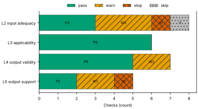
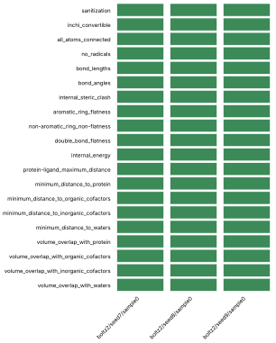
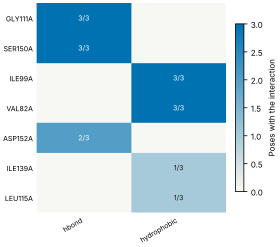
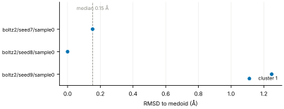
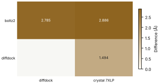
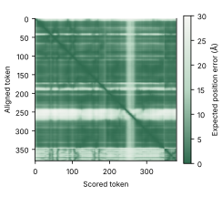

# Run report · Ligand pose in a known pocket

Prediction assurance · run `ligand_pose-61553da1595e` · 2026-10-17 23:46:50 UTC

**Refused** for the claim "Predicted pose of FZC in MEK1 is valid".

Refused over layers 2,3,4,5: 16 pass, 7 warn, 2 stop, 1 skip. Stopped by l2.context.cofactors, l5.controls.redocking. Warnings from l2.receptor.protonation, l2.ligand.protonation, l2.docking.box, l4.interactions.unsatisfied_polars, l4.interactions.known_binders, l5.sampling.seeds, l5.agreement.cross_family.

Stops: `l2.context.cofactors`, `l5.controls.redocking`.

Warnings: `l2.receptor.protonation`, `l2.ligand.protonation`, `l2.docking.box`, `l4.interactions.unsatisfied_polars`, `l4.interactions.known_binders`, `l5.sampling.seeds`, `l5.agreement.cross_family`.

| Field | Value |
| --- | --- |
| Task | Ligand pose in a known pocket (`ligand_pose`) |
| Tools | Boltz-2 2.2.1 (co-folding), DiffDock-L (docking) |
| Target | `protein` |
| Ligand | `Cc1ccnc(n1)Oc2ccc(c(c2)Cl)c3cc4c(c(n[nH]4)C)c(c3)O[C@H]5CCC[C@H](C5)N` |
| Reference | `7XLP` |
| pH | 7.4 |
| Seeds | 3 |
| Layers run | 2, 3, 4, 5 |
| Run | `ligand_pose-61553da1595e` |
| Created | 2026-10-17 23:46:50 UTC |
| Finished | 2026-10-17 23:48:23 UTC |
| pah version | 0.1.0 |
| Report schema | 1 |

## Layers

| Layer | Status | Result | pass | warn | stop | skip | Time |
| --- | --- | --- | --- | --- | --- | --- | --- |
| L0 Provenance | not run | n/a | n/a | n/a | n/a | n/a | n/a |
| L1 Input integrity | not run | n/a | n/a | n/a | n/a | n/a | n/a |
| L2 Input adequacy | done | stop | 3 | 3 | 1 | 1 | 2.0 s |
| L3 Applicability | done | pass | 6 | 0 | 0 | 0 | 1.9 s |
| L4 Output validity | done | warn | 5 | 2 | 0 | 0 | 89.2 s |
| L5 Output support | done | stop | 2 | 2 | 1 | 0 | 196 ms |

## Figures

Fig. 1 · Check outcomes per layer for run ligand_pose-61553da1595e. Totals: pass 16, warn 7, stop 2, skip 1.
Files: data [figures/gates_by_layer.csv](figures/gates_by_layer.csv).

## Structures

78 PyMOL renders.

7XLP mmCIF (source_structure), whole structure. Chains A; organic components DMS, FZC. sha256 48ffbc34e5fd126d. PyMOL session: [renders/7XLP.pse](renders/7XLP.pse).

7XLP mmCIF (source_structure), ligand environment within 5 Å. Chains A; organic components DMS, FZC. sha256 48ffbc34e5fd126d. PyMOL session: [renders/7XLP.pse](renders/7XLP.pse).

boltz2/seed7/sample0 (prediction_structure), whole structure. Chains A, L; organic components LIG1. sha256 d4189536cd0f3508. PyMOL session: [renders/boltz2_seed7_sample0.pse](renders/boltz2_seed7_sample0.pse).

boltz2/seed7/sample0 (prediction_structure), ligand environment within 5 Å. Chains A, L; organic components LIG1. sha256 d4189536cd0f3508. PyMOL session: [renders/boltz2_seed7_sample0.pse](renders/boltz2_seed7_sample0.pse).

boltz2/seed8/sample0 (prediction_structure), whole structure. Chains A, L; organic components LIG1. sha256 8b1f1ff5cc426848. PyMOL session: [renders/boltz2_seed8_sample0.pse](renders/boltz2_seed8_sample0.pse).

boltz2/seed8/sample0 (prediction_structure), ligand environment within 5 Å. Chains A, L; organic components LIG1. sha256 8b1f1ff5cc426848. PyMOL session: [renders/boltz2_seed8_sample0.pse](renders/boltz2_seed8_sample0.pse).

boltz2/seed9/sample0 (prediction_structure), whole structure. Chains A, L; organic components LIG1. sha256 1229b8a0106347fb. PyMOL session: [renders/boltz2_seed9_sample0.pse](renders/boltz2_seed9_sample0.pse).

boltz2/seed9/sample0 (prediction_structure), ligand environment within 5 Å. Chains A, L; organic components LIG1. sha256 1229b8a0106347fb. PyMOL session: [renders/boltz2_seed9_sample0.pse](renders/boltz2_seed9_sample0.pse).

diffdock/seed7/mode0 (prediction_structure), whole structure. Chains A, L; organic components LIG. sha256 ff803566ba1239ac. PyMOL session: [renders/diffdock_seed7_mode0.pse](renders/diffdock_seed7_mode0.pse).

diffdock/seed7/mode0 (prediction_structure), ligand environment within 5 Å. Chains A, L; organic components LIG. sha256 ff803566ba1239ac. PyMOL session: [renders/diffdock_seed7_mode0.pse](renders/diffdock_seed7_mode0.pse).

diffdock/seed7/mode1 (prediction_structure), whole structure. Chains A, L; organic components LIG. sha256 d2d95a22be9eaeef. PyMOL session: [renders/diffdock_seed7_mode1.pse](renders/diffdock_seed7_mode1.pse).

diffdock/seed7/mode1 (prediction_structure), ligand environment within 5 Å. Chains A, L; organic components LIG. sha256 d2d95a22be9eaeef. PyMOL session: [renders/diffdock_seed7_mode1.pse](renders/diffdock_seed7_mode1.pse).

diffdock/seed7/mode2 (prediction_structure), whole structure. Chains A, L; organic components LIG. sha256 769bf1840b02e35f. PyMOL session: [renders/diffdock_seed7_mode2.pse](renders/diffdock_seed7_mode2.pse).

diffdock/seed7/mode2 (prediction_structure), ligand environment within 5 Å. Chains A, L; organic components LIG. sha256 769bf1840b02e35f. PyMOL session: [renders/diffdock_seed7_mode2.pse](renders/diffdock_seed7_mode2.pse).

diffdock/seed7/mode3 (prediction_structure), whole structure. Chains A, L; organic components LIG. sha256 588a5ebac07781ff. PyMOL session: [renders/diffdock_seed7_mode3.pse](renders/diffdock_seed7_mode3.pse).

diffdock/seed7/mode3 (prediction_structure), ligand environment within 5 Å. Chains A, L; organic components LIG. sha256 588a5ebac07781ff. PyMOL session: [renders/diffdock_seed7_mode3.pse](renders/diffdock_seed7_mode3.pse).

diffdock/seed7/mode4 (prediction_structure), whole structure. Chains A, L; organic components LIG. sha256 8b55d1bd7e9a7e6e. PyMOL session: [renders/diffdock_seed7_mode4.pse](renders/diffdock_seed7_mode4.pse).

diffdock/seed7/mode4 (prediction_structure), ligand environment within 5 Å. Chains A, L; organic components LIG. sha256 8b55d1bd7e9a7e6e. PyMOL session: [renders/diffdock_seed7_mode4.pse](renders/diffdock_seed7_mode4.pse).

diffdock/seed7/mode5 (prediction_structure), whole structure. Chains A, L; organic components LIG. sha256 c1681b77ad421d96. PyMOL session: [renders/diffdock_seed7_mode5.pse](renders/diffdock_seed7_mode5.pse).

diffdock/seed7/mode5 (prediction_structure), ligand environment within 5 Å. Chains A, L; organic components LIG. sha256 c1681b77ad421d96. PyMOL session: [renders/diffdock_seed7_mode5.pse](renders/diffdock_seed7_mode5.pse).

diffdock/seed7/mode6 (prediction_structure), whole structure. Chains A, L; organic components LIG. sha256 8f0802ab5f8ce63e. PyMOL session: [renders/diffdock_seed7_mode6.pse](renders/diffdock_seed7_mode6.pse).

diffdock/seed7/mode6 (prediction_structure), ligand environment within 5 Å. Chains A, L; organic components LIG. sha256 8f0802ab5f8ce63e. PyMOL session: [renders/diffdock_seed7_mode6.pse](renders/diffdock_seed7_mode6.pse).

diffdock/seed7/mode7 (prediction_structure), whole structure. Chains A, L; organic components LIG. sha256 276d20ef4238ec91. PyMOL session: [renders/diffdock_seed7_mode7.pse](renders/diffdock_seed7_mode7.pse).

diffdock/seed7/mode7 (prediction_structure), ligand environment within 5 Å. Chains A, L; organic components LIG. sha256 276d20ef4238ec91. PyMOL session: [renders/diffdock_seed7_mode7.pse](renders/diffdock_seed7_mode7.pse).

diffdock/seed7/mode8 (prediction_structure), whole structure. Chains A, L; organic components LIG. sha256 2662152eb71f0dda. PyMOL session: [renders/diffdock_seed7_mode8.pse](renders/diffdock_seed7_mode8.pse).

diffdock/seed7/mode8 (prediction_structure), ligand environment within 5 Å. Chains A, L; organic components LIG. sha256 2662152eb71f0dda. PyMOL session: [renders/diffdock_seed7_mode8.pse](renders/diffdock_seed7_mode8.pse).

diffdock/seed7/mode9 (prediction_structure), whole structure. Chains A, L; organic components LIG. sha256 96ce65cec6eefc1e. PyMOL session: [renders/diffdock_seed7_mode9.pse](renders/diffdock_seed7_mode9.pse).

diffdock/seed7/mode9 (prediction_structure), ligand environment within 5 Å. Chains A, L; organic components LIG. sha256 96ce65cec6eefc1e. PyMOL session: [renders/diffdock_seed7_mode9.pse](renders/diffdock_seed7_mode9.pse).

diffdock/seed8/mode0 (prediction_structure), whole structure. Chains A, L; organic components LIG. sha256 bf9a56c4da249781. PyMOL session: [renders/diffdock_seed8_mode0.pse](renders/diffdock_seed8_mode0.pse).

diffdock/seed8/mode0 (prediction_structure), ligand environment within 5 Å. Chains A, L; organic components LIG. sha256 bf9a56c4da249781. PyMOL session: [renders/diffdock_seed8_mode0.pse](renders/diffdock_seed8_mode0.pse).

diffdock/seed8/mode1 (prediction_structure), whole structure. Chains A, L; organic components LIG. sha256 f3972696459a79a4. PyMOL session: [renders/diffdock_seed8_mode1.pse](renders/diffdock_seed8_mode1.pse).

diffdock/seed8/mode1 (prediction_structure), ligand environment within 5 Å. Chains A, L; organic components LIG. sha256 f3972696459a79a4. PyMOL session: [renders/diffdock_seed8_mode1.pse](renders/diffdock_seed8_mode1.pse).

diffdock/seed8/mode2 (prediction_structure), whole structure. Chains A, L; organic components LIG. sha256 061b1ee48b152c8c. PyMOL session: [renders/diffdock_seed8_mode2.pse](renders/diffdock_seed8_mode2.pse).

diffdock/seed8/mode2 (prediction_structure), ligand environment within 5 Å. Chains A, L; organic components LIG. sha256 061b1ee48b152c8c. PyMOL session: [renders/diffdock_seed8_mode2.pse](renders/diffdock_seed8_mode2.pse).

diffdock/seed8/mode3 (prediction_structure), whole structure. Chains A, L; organic components LIG. sha256 35b4eebfae35c9eb. PyMOL session: [renders/diffdock_seed8_mode3.pse](renders/diffdock_seed8_mode3.pse).

diffdock/seed8/mode3 (prediction_structure), ligand environment within 5 Å. Chains A, L; organic components LIG. sha256 35b4eebfae35c9eb. PyMOL session: [renders/diffdock_seed8_mode3.pse](renders/diffdock_seed8_mode3.pse).

diffdock/seed8/mode4 (prediction_structure), whole structure. Chains A, L; organic components LIG. sha256 4d746cbe7a2b96e5. PyMOL session: [renders/diffdock_seed8_mode4.pse](renders/diffdock_seed8_mode4.pse).

diffdock/seed8/mode4 (prediction_structure), ligand environment within 5 Å. Chains A, L; organic components LIG. sha256 4d746cbe7a2b96e5. PyMOL session: [renders/diffdock_seed8_mode4.pse](renders/diffdock_seed8_mode4.pse).

diffdock/seed8/mode5 (prediction_structure), whole structure. Chains A, L; organic components LIG. sha256 0bbfa057daaaf3d9. PyMOL session: [renders/diffdock_seed8_mode5.pse](renders/diffdock_seed8_mode5.pse).

diffdock/seed8/mode5 (prediction_structure), ligand environment within 5 Å. Chains A, L; organic components LIG. sha256 0bbfa057daaaf3d9. PyMOL session: [renders/diffdock_seed8_mode5.pse](renders/diffdock_seed8_mode5.pse).

diffdock/seed8/mode6 (prediction_structure), whole structure. Chains A, L; organic components LIG. sha256 473db7d144c2ecfc. PyMOL session: [renders/diffdock_seed8_mode6.pse](renders/diffdock_seed8_mode6.pse).

diffdock/seed8/mode6 (prediction_structure), ligand environment within 5 Å. Chains A, L; organic components LIG. sha256 473db7d144c2ecfc. PyMOL session: [renders/diffdock_seed8_mode6.pse](renders/diffdock_seed8_mode6.pse).

diffdock/seed8/mode7 (prediction_structure), whole structure. Chains A, L; organic components LIG. sha256 3d49244f4ea37ea5. PyMOL session: [renders/diffdock_seed8_mode7.pse](renders/diffdock_seed8_mode7.pse).

diffdock/seed8/mode7 (prediction_structure), ligand environment within 5 Å. Chains A, L; organic components LIG. sha256 3d49244f4ea37ea5. PyMOL session: [renders/diffdock_seed8_mode7.pse](renders/diffdock_seed8_mode7.pse).

diffdock/seed8/mode8 (prediction_structure), whole structure. Chains A, L; organic components LIG. sha256 0328fdd95060075d. PyMOL session: [renders/diffdock_seed8_mode8.pse](renders/diffdock_seed8_mode8.pse).

diffdock/seed8/mode8 (prediction_structure), ligand environment within 5 Å. Chains A, L; organic components LIG. sha256 0328fdd95060075d. PyMOL session: [renders/diffdock_seed8_mode8.pse](renders/diffdock_seed8_mode8.pse).

diffdock/seed8/mode9 (prediction_structure), whole structure. Chains A, L; organic components LIG. sha256 e3eacf781fdee1b8. PyMOL session: [renders/diffdock_seed8_mode9.pse](renders/diffdock_seed8_mode9.pse).

diffdock/seed8/mode9 (prediction_structure), ligand environment within 5 Å. Chains A, L; organic components LIG. sha256 e3eacf781fdee1b8. PyMOL session: [renders/diffdock_seed8_mode9.pse](renders/diffdock_seed8_mode9.pse).

diffdock/seed9/mode0 (prediction_structure), whole structure. Chains A, L; organic components LIG. sha256 fb24ba4441392823. PyMOL session: [renders/diffdock_seed9_mode0.pse](renders/diffdock_seed9_mode0.pse).

diffdock/seed9/mode0 (prediction_structure), ligand environment within 5 Å. Chains A, L; organic components LIG. sha256 fb24ba4441392823. PyMOL session: [renders/diffdock_seed9_mode0.pse](renders/diffdock_seed9_mode0.pse).

diffdock/seed9/mode1 (prediction_structure), whole structure. Chains A, L; organic components LIG. sha256 07280ebd7973c47f. PyMOL session: [renders/diffdock_seed9_mode1.pse](renders/diffdock_seed9_mode1.pse).

diffdock/seed9/mode1 (prediction_structure), ligand environment within 5 Å. Chains A, L; organic components LIG. sha256 07280ebd7973c47f. PyMOL session: [renders/diffdock_seed9_mode1.pse](renders/diffdock_seed9_mode1.pse).

diffdock/seed9/mode2 (prediction_structure), whole structure. Chains A, L; organic components LIG. sha256 4419cc57faf65e5a. PyMOL session: [renders/diffdock_seed9_mode2.pse](renders/diffdock_seed9_mode2.pse).

diffdock/seed9/mode2 (prediction_structure), ligand environment within 5 Å. Chains A, L; organic components LIG. sha256 4419cc57faf65e5a. PyMOL session: [renders/diffdock_seed9_mode2.pse](renders/diffdock_seed9_mode2.pse).

diffdock/seed9/mode3 (prediction_structure), whole structure. Chains A, L; organic components LIG. sha256 1db9dc88cd080c7f. PyMOL session: [renders/diffdock_seed9_mode3.pse](renders/diffdock_seed9_mode3.pse).

diffdock/seed9/mode3 (prediction_structure), ligand environment within 5 Å. Chains A, L; organic components LIG. sha256 1db9dc88cd080c7f. PyMOL session: [renders/diffdock_seed9_mode3.pse](renders/diffdock_seed9_mode3.pse).

diffdock/seed9/mode4 (prediction_structure), whole structure. Chains A, L; organic components LIG. sha256 8321cbe62b6ed161. PyMOL session: [renders/diffdock_seed9_mode4.pse](renders/diffdock_seed9_mode4.pse).

diffdock/seed9/mode4 (prediction_structure), ligand environment within 5 Å. Chains A, L; organic components LIG. sha256 8321cbe62b6ed161. PyMOL session: [renders/diffdock_seed9_mode4.pse](renders/diffdock_seed9_mode4.pse).

diffdock/seed9/mode5 (prediction_structure), whole structure. Chains A, L; organic components LIG. sha256 dc93d5d6f2631089. PyMOL session: [renders/diffdock_seed9_mode5.pse](renders/diffdock_seed9_mode5.pse).

diffdock/seed9/mode5 (prediction_structure), ligand environment within 5 Å. Chains A, L; organic components LIG. sha256 dc93d5d6f2631089. PyMOL session: [renders/diffdock_seed9_mode5.pse](renders/diffdock_seed9_mode5.pse).

diffdock/seed9/mode6 (prediction_structure), whole structure. Chains A, L; organic components LIG. sha256 0b27f7c350300ca2. PyMOL session: [renders/diffdock_seed9_mode6.pse](renders/diffdock_seed9_mode6.pse).

diffdock/seed9/mode6 (prediction_structure), ligand environment within 5 Å. Chains A, L; organic components LIG. sha256 0b27f7c350300ca2. PyMOL session: [renders/diffdock_seed9_mode6.pse](renders/diffdock_seed9_mode6.pse).

diffdock/seed9/mode7 (prediction_structure), whole structure. Chains A, L; organic components LIG. sha256 7c3f29dcc50b9f4e. PyMOL session: [renders/diffdock_seed9_mode7.pse](renders/diffdock_seed9_mode7.pse).

diffdock/seed9/mode7 (prediction_structure), ligand environment within 5 Å. Chains A, L; organic components LIG. sha256 7c3f29dcc50b9f4e. PyMOL session: [renders/diffdock_seed9_mode7.pse](renders/diffdock_seed9_mode7.pse).

diffdock/seed9/mode8 (prediction_structure), whole structure. Chains A, L; organic components LIG. sha256 62ccbe21a92de791. PyMOL session: [renders/diffdock_seed9_mode8.pse](renders/diffdock_seed9_mode8.pse).

diffdock/seed9/mode8 (prediction_structure), ligand environment within 5 Å. Chains A, L; organic components LIG. sha256 62ccbe21a92de791. PyMOL session: [renders/diffdock_seed9_mode8.pse](renders/diffdock_seed9_mode8.pse).

diffdock/seed9/mode9 (prediction_structure), whole structure. Chains A, L; organic components LIG. sha256 ee24ad678eeb94a0. PyMOL session: [renders/diffdock_seed9_mode9.pse](renders/diffdock_seed9_mode9.pse).

diffdock/seed9/mode9 (prediction_structure), ligand environment within 5 Å. Chains A, L; organic components LIG. sha256 ee24ad678eeb94a0. PyMOL session: [renders/diffdock_seed9_mode9.pse](renders/diffdock_seed9_mode9.pse).

3ZLS mmCIF (source_structure), whole structure. Chains A; organic components 92P. sha256 ae30cf1ed7b4035f. PyMOL session: [renders/3ZLS.pse](renders/3ZLS.pse).

3ZLS mmCIF (source_structure), ligand environment within 5 Å. Chains A; organic components 92P. sha256 ae30cf1ed7b4035f. PyMOL session: [renders/3ZLS.pse](renders/3ZLS.pse).

3ZLX mmCIF (source_structure), whole structure. Chains A; organic components 5EZ. sha256 1334dfc31103f3e6. PyMOL session: [renders/3ZLX.pse](renders/3ZLX.pse).

3ZLX mmCIF (source_structure), ligand environment within 5 Å. Chains A; organic components 5EZ. sha256 1334dfc31103f3e6. PyMOL session: [renders/3ZLX.pse](renders/3ZLX.pse).

3ZM4 mmCIF (source_structure), whole structure. Chains A; organic components 22T. sha256 eccb79a35cb7a9f2. PyMOL session: [renders/3ZM4.pse](renders/3ZM4.pse).

3ZM4 mmCIF (source_structure), ligand environment within 5 Å. Chains A; organic components 22T. sha256 eccb79a35cb7a9f2. PyMOL session: [renders/3ZM4.pse](renders/3ZM4.pse).

5BX0 mmCIF (source_structure), whole structure. Chains A; organic components 4W5. sha256 7ef25dd3b72e153e. PyMOL session: [renders/5BX0.pse](renders/5BX0.pse).

5BX0 mmCIF (source_structure), ligand environment within 5 Å. Chains A; organic components 4W5. sha256 7ef25dd3b72e153e. PyMOL session: [renders/5BX0.pse](renders/5BX0.pse).

3ZLY mmCIF (source_structure), whole structure. Chains A; organic components YSO. sha256 e858c796adc5339d. PyMOL session: [renders/3ZLY.pse](renders/3ZLY.pse).

3ZLY mmCIF (source_structure), ligand environment within 5 Å. Chains A; organic components YSO. sha256 e858c796adc5339d. PyMOL session: [renders/3ZLY.pse](renders/3ZLY.pse).

## L0 Provenance

Where did every input come from?

Status: not run.

## L1 Input integrity

Did the run receive exactly what was declared?

Status: not run.

## L2 Input adequacy

Does the input carry enough information?

Status: done. Checks: pass 3 · warn 3 · stop 1 · skip 1. Time: 2.0 s.

#### Key figures

| Figure | Value |
| --- | --- |
| near site | 1 |
| missing | 1 |
| uniprot cofactors | 0 |
| pocket residues | 37 |
| incomplete | 0 |
| sequence gaps | 0 |
| state | holo |
| site ligands | 1 |

#### Docking

| Field | Value |
| --- | --- |
| center | -3.608, 64.879, 34.516 Å |
| size | 19.183 × 21.381 × 13.89 Å |
| origin | derived from FZC (+4 Å) |

#### Checks

| Check | Result | Measured cmp threshold | Evidence | Id · time |
| --- | --- | --- | --- | --- |
| Alignment depth, distinct sequences, Neff and gap fraction | skip | n/a | no MSA declared for a co-folding model · not applicable | `l2.msa.depth` |
| Required cofactors, ions and partners present | stop | `pocket_distance <= 8` | components within 8.0 Å of FZC in 7XLP not supplied: CA · near_site=1, missing=1, uniprot_cofactors=0 | `l2.context.cofactors` · 315 ms |
| Pocket residues resolved, no missing loops lining the pocket | pass | `pocket_distance <= 6` | 37 pocket residues complete in 7XLP.cif · pocket_residues=37, incomplete=0, sequence_gaps=0 | `l2.pocket.resolved` · 14 ms |
| Receptor state apo or holo | pass | n/a | 7XLP.cif holo: FZC in the site · state=holo, site_ligands=1 | `l2.receptor.state` · 15 ms |
| Receptor protonation at the stated pH | warn | `pka_margin > 1` | receptor has no hydrogens (protonation not assigned) · hydrogens_present=False, ph=7.4, pocket_titratable=12 | `l2.receptor.protonation` · 334 ms |
| Ligand protonation and tautomers enumerated at the stated pH | warn | `ph 7.4 == 1` | ligand: 16 states · ph=7.4, max_states=16, declared_not_enumerated=0 | `l2.ligand.protonation` · 88 ms |
| Ligand conformers generated and minimised | pass | `conformers >= 10` | 10 ETKDG conformers per ligand, MMFF minimised · ligands=1, failed=0, min_embedded=10 | `l2.ligand.conformers` · 1.2 s |
| Docking box encloses the pocket with margin | warn | `margin >= 2` | no box declared; derived box encloses 19 contact residues and the FZC ligand with 2.0 Å margin · volume_A3=5697, ligand_atoms_inside_margin=33, ligand_atoms=33 | `l2.docking.box` · 13 ms |

## L3 Applicability

Is the tool inside its validated regime?

Status: done. Checks: pass 6 · warn 0 · stop 0 · skip 0. Time: 1.9 s.

#### Key figures

| Figure | Value |
| --- | --- |
| executors | 2 |
| unknown | 0 |
| reference released | 2023-03-01 |
| cutoff | 2019-01-01 |
| entries compared | 5 |
| max similarity | 16.7 |
| pocket residues | 39 |
| systems | 0 |

#### Checks

| Check | Result | Measured cmp threshold | Evidence | Id · time |
| --- | --- | --- | --- | --- |
| Model training cutoff recorded | pass | `training_cutoff == recorded` | boltz2 2023-06-01; diffdock 2019-01-01; reference 7XLP released 2023-03-01, before the cutoff of boltz2 · executors=2, unknown=0, reference_released=2023-03-01 | `l3.model.training_cutoff` · 1 ms |
| Pocket similarity to pre-cutoff complexes (SuCOS times pocket coverage) | pass | `similarity <= 50` | max similarity 16.7 to 3ZLY (YSO, SuCOS 0.591, coverage 0.282), released before 2019-01-01 · cutoff=2019-01-01, entries_compared=5, max_similarity=16.7 | `l3.exposure.pocket` · 1.8 s |
| Ligand analogues in pre-cutoff training systems | pass | `tanimoto > 0.9` | 0 PDB entries released before 2019-01-01 (diffdock cutoff) contain analogues of ligand above Tanimoto 0.9: FZC · cutoff=2019-01-01, systems=0, analogue_components=1 | `l3.exposure.ligand_prevalence` · 0 ms |
| Chain sequence identity to pre-cutoff entries (secondary measure) | pass | `identity < 0.4` | protein: 35 entries at 95 percent identity, 44 at 40 percent, released before 2019-01-01 (reported, not gating) · cutoff=2019-01-01, entries_95=35, entries_40=44 | `l3.exposure.sequence` · 2 ms |
| Modality inside the validated set; token count against the training crop | pass | n/a | modalities protein, protein_ligand inside the validated set; 381 tokens · modalities=2, tokens=381, outside=0 | `l3.regime.modality` · 9 ms |
| Endpoint fits the tool | pass | `endpoint pose in pose` | endpoint pose produced by boltz2, diffdock · endpoint=pose, executors=2, not_fitting=0 | `l3.metric.endpoint` · 0 ms |

## L4 Output validity

Is the result physically and chemically sensible?

Status: done. Checks: pass 5 · warn 2 · stop 0 · skip 0. Time: 89.2 s.

#### Key figures

| Figure | Value |
| --- | --- |
| poses | 3 |
| passed | 20 |
| total | 20 |
| poses all pass | 3 |
| unlikely torsions | 0 |
| torsions | 7 |
| strain kcal | 1.13 |
| poses with unlikely | 0 |

#### PoseBusters · 20/20 tests pass

| test | result | value |
| --- | --- | --- |
| sanitization | pass | pass |
| inchi_convertible | pass | pass |
| all_atoms_connected | pass | pass |
| no_radicals | pass | pass |
| bond_lengths | pass | 0 long outliers |
| bond_angles | pass | 0 outliers |
| internal_steric_clash | pass | 0 |
| aromatic_ring_flatness | pass | 0.01 Å |
| non-aromatic_ring_non-flatness | pass | pass |
| double_bond_flatness | pass | pass |
| internal_energy | pass | 1.1 times the ensemble mean |
| protein-ligand_maximum_distance | pass | 2.56 Å |
| minimum_distance_to_protein | pass | 2.56 Å |
| minimum_distance_to_organic_cofactors | pass | pass |
| minimum_distance_to_inorganic_cofactors | pass | pass |
| minimum_distance_to_waters | pass | pass |
| volume_overlap_with_protein | pass | 0.012 |
| volume_overlap_with_organic_cofactors | pass | pass |
| volume_overlap_with_inorganic_cofactors | pass | pass |
| volume_overlap_with_waters | pass | pass |

#### Per-pose physical checks

| pose | seed | drift Å | converged | unlikely torsions | unsat. polars | buried charged | PoseBusters |
| --- | --- | --- | --- | --- | --- | --- | --- |
| boltz2/seed7/sample0 | 7 | 0.63 | true | 0/7 | 2 | 0 | 20/20 |
| boltz2/seed8/sample0 | 8 | 0.68 | true | 0/7 | 2 | 0 | 20/20 |
| boltz2/seed9/sample0 | 9 | 0.45 | true | 0/7 | 1 | 0 | 20/20 |
| median | n/a | 0.63 | n/a | 0 | 2 | 0 | 20/20 |

#### Interaction fingerprint · representative pose boltz2/seed8/sample0

| residue | type | distance | poses |
| --- | --- | --- | --- |
| GLY111A | hbond | 3.07 Å | 3/3 |
| SER150A | hbond | 2.99 Å | 3/3 |
| ILE99A | hydrophobic | 3.18 Å | 3/3 |
| VAL82A | hydrophobic | 3.49 Å | 3/3 |
| ASP152A | hbond | 2.98 Å | 2/3 |
| ILE139A | hydrophobic | 3.42 Å | 1/3 |
| LEU115A | hydrophobic | 3.81 Å | 1/3 |

Fig. 2 · PoseBusters tests (20) by pose (3). Failed cells marked x: 0 of 60.
Files: data [figures/posebusters_grid.csv](figures/posebusters_grid.csv).

Fig. 3 · Interactions by residue (7) and type (2); cell label: poses with the interaction over poses assessed.
Files: data [figures/interactions.csv](figures/interactions.csv).

#### Checks

| Check | Result | Measured cmp threshold | Evidence | Id · time |
| --- | --- | --- | --- | --- |
| PoseBusters geometry, stereochemistry, clashes and protein contact | pass | `tests_failed == 0` | 20 of 20 tests pass for boltz2/seed8/sample0; 3 of 3 poses pass all · poses=3, passed=20, total=20 | `l4.posebusters` · 3.0 s |
| Torsional strain of the ligand pose | pass | `torsion_energy <= 2.5` | 0 of 7 torsions above 2.5 kcal/mol in boltz2/seed8/sample0; strain 1.13 kcal/mol · poses=3, unlikely_torsions=0, torsions=7 | `l4.torsion_strain` · 6.4 s |
| Interaction fingerprint (PLIP) | pass | n/a | 8 interactions in boltz2/seed8/sample0 (hbond, hydrophobic); 7 distinct across 3 poses (reported) · poses=3, interactions_representative=8, distinct=7 | `l4.interactions.fingerprint` · 1.0 s |
| Buried ligand polar atoms without a hydrogen-bond partner | warn | `relative_sasa < 0.1` | 2 of 5 buried polar ligand atoms without a partner in boltz2/seed8/sample0 · poses=3, unsatisfied=2, buried_charged=0 | `l4.interactions.unsatisfied_polars` · 277 ms |
| Hydrophobic complementarity of buried ligand surface | pass | `fraction >= 0.35` | nonpolar fraction of protein contacts around 18 buried nonpolar ligand atoms in boltz2/seed8/sample0: 0.634 · poses=3, complementarity=0.634, buried_nonpolar=18 | `l4.interactions.hydrophobic` · 284 ms |
| Interactions of the crystal ligand reproduced by the pose | warn | `reproduced 0 >= 1` | boltz2/seed8/sample0 reproduces none of 3 FZC interactions · key_interactions=3, reproduced=0, poses_reproducing_all=0 | `l4.interactions.known_binders` · 233 ms |
| Pose stability under short restrained minimisation (OpenMM, AMBER14 and OpenFF) | pass | `drift_A 0.68 <= 2` | boltz2/seed8/sample0 moves 0.675 Å under restrained minimisation; 0 of 3 poses above 2.0 Å · poses=3, drift_A=0.675, max_drift_A=0.675 | `l4.minimisation_drift` · 77.9 s |

## L5 Output support

Is a valid result corroborated?

Status: done. Checks: pass 2 · warn 2 · stop 1 · skip 0. Time: 196 ms.

#### Key figures

| Figure | Value |
| --- | --- |
| poses | 3 |
| pocket plddt | 91.2 |
| global plddt | 91.1 |
| iptm | 0.968 |
| ptm | 0.913 |
| confidence score | 0.916 |
| independent seeds | 3 |
| samples | 3 |

#### Sampling

| Field | Value |
| --- | --- |
| site placement | 3 of 3 poses within 4.0 Å of the site (FZC in 7XLP) |
| pose accuracy | 3 of 3 poses within 2.0 Å of the medoid |
| pairwise RMSD median | 1.25 Å |
| pairwise RMSD IQR | 0.7 to 1.26 Å |
| pairs | 3 |
| medoid | boltz2/seed8/sample0 |

#### Clusters

| Field | Value |
| --- | --- |
| cluster 1 | 3/3 poses (boltz2/seed8/sample0) |

#### Per-seed statistics

| seed | pose | cluster | RMSD to medoid | confidence |
| --- | --- | --- | --- | --- |
| 7 | boltz2/seed7/sample0 | 1 | 0.15 Å | 0.92 |
| 8 | boltz2/seed8/sample0 | 1 | 0 Å | 0.92 |
| 9 | boltz2/seed9/sample0 | 1 | 1.25 Å | 0.92 |
| median | n/a | n/a | 0.15 Å | 0.92 |

#### Ensemble

| structure | kind | source | RMSD to medoid | cluster | pocket pLDDT | ipTM |
| --- | --- | --- | --- | --- | --- | --- |
| boltz2/seed7/sample0 | seed | boltz2 | 0.15 Å | 1 | 92 | 0.97 |
| boltz2/seed8/sample0 | medoid | boltz2 | 0 Å | 1 | 91.2 | 0.97 |
| boltz2/seed9/sample0 | seed | boltz2 | 1.25 Å | 1 | 91.9 | 0.97 |

#### Agreement between methods

| method | diffdock | crystal 7XLP |
| --- | --- | --- |
| boltz2 | 2.79 Å (high) | 2.89 Å (decisive) |
| diffdock | n/a | 1.49 Å (decisive) |

#### Confidence metrics

| metric | value | read as | tool |
| --- | --- | --- | --- |
| affinity_pred_value | -0.29657554626464844 | ranking within a series, never pose quality | boltz2 |
| affinity_probability_binary | 0.11149941384792328 | ranking within a series, never pose quality | boltz2 |
| affinity_pred_value | -0.31320804357528687 | ranking within a series, never pose quality | boltz2 |
| affinity_probability_binary | 0.10506543517112732 | ranking within a series, never pose quality | boltz2 |
| affinity_pred_value | -0.3164307475090027 | ranking within a series, never pose quality | boltz2 |
| affinity_probability_binary | 0.1089172214269638 | ranking within a series, never pose quality | boltz2 |

Fig. 4 · RMSD to the medoid for 3 poses, coloured by cluster (1 clusters). Dashed line: median 0.15 Å; range 0.00 to 1.25 Å.
Files: data [figures/seed_spread.csv](figures/seed_spread.csv).

Fig. 5 · Agreement between 2 methods and 2 comparators; range 1.494 to 2.886 Å.
Files: data [figures/agreement.csv](figures/agreement.csv).

Fig. 6 · Predicted aligned error for pose boltz2/seed7/sample0, 381 by 381 tokens; values 0.2 to 30.0 Å, mean 6.7 Å.
Files: data [figures/pae.csv](figures/pae.csv).

#### Checks

| Check | Result | Measured cmp threshold | Evidence | Id · time |
| --- | --- | --- | --- | --- |
| Confidence restricted to the pocket; per-model thresholds | pass | `boltz2.pocket_plddt >= 70` | boltz2/seed8/sample0: pocket_plddt 91.2 · poses=3, pocket_plddt=91.2, global_plddt=91.1 | `l5.confidence.local` · 25 ms |
| Independent seeds counted separately from samples; duplicates flagged | warn | `seeds_cofolding >= 5` | 3 independent seeds (3 poses); task default 5 · independent_seeds=3, samples=3, duplicated_outputs=0 | `l5.sampling.seeds` · 0 ms |
| Medoid of the largest cluster, populations, pairwise spread, site and pose accuracy | pass | `cluster_rmsd <= 2` | medoid boltz2/seed8/sample0; 1 clusters, largest 3 of 3; pairwise RMSD median 1.25 Å (IQR 0.70 to 1.26); 3 of 3 poses within 4.0 Å of the site (FZC in 7XLP); 3 of 3 poses within 2.0 Å of the medoid · poses=3, clusters=1, largest_cluster=3 | `l5.sampling.clusters` · 41 ms |
| Agreement between methods, weighted by independence | warn | `rmsd_to_crystal_A 2.89 <= 2` | boltz2 vs diffdock 2.785 Å (high); boltz2 vs crystal 7XLP 2.886 Å (decisive); diffdock vs crystal 7XLP 1.494 Å (decisive) · methods=2, comparisons=3, disagreeing=2 | `l5.agreement.cross_family` · 121 ms |
| Redocking control reproduces the crystal pose | stop | `rmsd <= 2` | redocking control required by the task and not supplied (controls.redocking) | `l5.controls.redocking` · 0 ms |

## Controls

| control | status | result |
| --- | --- | --- |
| redocking | incomplete | redocking control required by the task and not supplied (controls.redocking) |

## Provenance

13 objects · 13 cached · 0 network.

| Source | Accession | Release | SHA-256 | Retrieved | Bytes | Cache | Used by |
| --- | --- | --- | --- | --- | --- | --- | --- |
| rcsb_files | 7XLP | n/a | `48ffbc34e5fd` | 2026-10-17 17:04:21 UTC | 527387 | hit | l2.context.cofactors, l2.pocket.resolved, l2.receptor.state, l2.docking.box, l3.exposure.pocket, l3.regime.modality, l4.interactions.fingerprint, l4.interactions.known_binders, l5.sampling.clusters, l5.agreement.cross_family |
| ccd | FZC | 2023-02-24 | `6ce219c20fef` | 2026-10-17 17:04:21 UTC | 3599 | hit | l2.context.cofactors, l3.exposure.pocket |
| rcsb | 7XLP | 1.2 | `66dacec771f9` | 2026-10-17 17:04:23 UTC | 12056 | hit | l3.model.training_cutoff |
| rcsb_search | chem:Cc1ccnc(n1)Oc2ccc(c(c2)Cl)c3cc4c(c(n[nH]4)C)c(c3)O[C@H]5CCC[C@H](C5)N | n/a | `b46bdf444038` | 2026-10-17 17:04:25 UTC | 186 | hit | l3.exposure.pocket |
| rcsb_search | comp:FZC:2019-01-01 | n/a | `e3b0c44298fc` | 2026-10-17 17:04:24 UTC | 0 | hit | l3.exposure.pocket |
| rcsb_search | seq0.9:2019-01-01:348 | n/a | `940237010733` | 2026-10-17 17:10:16 UTC | 2411 | hit | l3.exposure.pocket |
| rcsb_files | 3ZLS | n/a | `ae30cf1ed7b4` | 2026-10-17 17:10:16 UTC | 315218 | hit | l3.exposure.pocket |
| rcsb_files | 3ZLX | n/a | `1334dfc31103` | 2026-10-17 17:10:17 UTC | 313366 | hit | l3.exposure.pocket |
| rcsb_files | 3ZM4 | n/a | `eccb79a35cb7` | 2026-10-17 17:10:17 UTC | 321513 | hit | l3.exposure.pocket |
| rcsb_files | 5BX0 | n/a | `7ef25dd3b72e` | 2026-10-17 17:10:17 UTC | 312068 | hit | l3.exposure.pocket |
| rcsb_files | 3ZLY | n/a | `e858c796adc5` | 2026-10-17 17:10:17 UTC | 310846 | hit | l3.exposure.pocket |
| rcsb_search | seq0.95:2019-01-01:348 | n/a | `137b5572110a` | 2026-10-17 17:04:26 UTC | 402 | hit | l3.exposure.sequence |
| rcsb_search | seq0.4:2019-01-01:348 | n/a | `d6df9b9b71ba` | 2026-10-17 17:04:27 UTC | 402 | hit | l3.exposure.sequence |

Provenance graph: [json](graph.json), [mmd](graph.mmd), [svg](graph.svg).

## Thresholds

| Check | Threshold | Value | Origin | Evidence level |
| --- | --- | --- | --- | --- |
| `l2.context.cofactors` | pocket_distance | <= 8 | Harness rule: a component of the reference entry within 8 Å of the declared ligand is required context; not yet calibrated | uncalibrated |
| `l2.pocket.resolved` | pocket_distance | <= 6 | Harness rule: pocket residues have a heavy atom within 6 Å of the ligand; not yet calibrated | uncalibrated |
| `l2.pocket.resolved` | missing_pocket_residues | == 0 | Specification layer 2: stop when the pocket is incomplete | published |
| `l2.receptor.protonation` | pka_margin | > 1 | Harness rule: a titratable pocket residue with PROPKA pKa within 1 unit of the stated pH has an ambiguous state; not yet calibrated | uncalibrated |
| `l2.ligand.protonation` | ph_window | == 1 | Harness rule: states enumerated by Dimorphite-DL within 1 pH unit of the stated pH; not yet calibrated | uncalibrated |
| `l2.ligand.protonation` | states | == 1 | Specification layer 2: warn when more than one plausible state | published |
| `l2.ligand.conformers` | conformers | >= 10 | Harness default number of ETKDG conformers; not yet calibrated | uncalibrated |
| `l2.docking.box` | margin | >= 2 | Harness rule: every pocket heavy atom lies at least 2 Å inside the box; not yet calibrated | uncalibrated |
| `l2.docking.box` | contact_distance | <= 4 | Harness rule: contact residues (heavy atom within 4 Å of the reference ligand) must have an atom inside the box; not yet calibrated | uncalibrated |
| `l3.model.training_cutoff` | training_cutoff | == recorded | Specification, Layer 3 (applicability): stop when unknown | published |
| `l3.exposure.pocket` | similarity | <= 50 | Specification layer 3: warn above a pocket similarity (SuCOS times pocket coverage) of 50 | published |
| `l3.exposure.pocket` | entries | <= 5 | Harness budget: pre-cutoff holo entries compared per run | uncalibrated |
| `l3.exposure.ligand_prevalence` | tanimoto | > 0.9 | Specification layer 3: analogues above 0.9 Tanimoto (RDKit topological fingerprint) | published |
| `l3.exposure.ligand_prevalence` | systems | <= 100 | Specification layer 3: prevalent when analogues occur in more than 100 training systems | published |
| `l3.exposure.sequence` | identity | < 0.4 | Specification layer 3: conventional 40 percent identity leakage threshold, reported as a secondary measure only | published |
| `l3.metric.endpoint` | endpoint | in pose | Specification, Layer 3 (applicability): no affinity from interface confidence, no protein-protein affinity from Boltz-2 | published |
| `l4.posebusters` | tests_failed | == 0 | Specification, Layer 4 (output validity): stop on failure | published |
| `l4.torsion_strain` | torsion_energy | <= 2.5 | Harness rule: a rotatable torsion whose MMFF energy lies more than 2.5 kcal/mol above the minimum of its rigid scan is unlikely; not yet calibrated | uncalibrated |
| `l4.interactions.unsatisfied_polars` | relative_sasa | < 0.1 | Harness rule: a ligand polar atom with relative SASA below 0.1 in the complex is buried; not yet calibrated | uncalibrated |
| `l4.interactions.unsatisfied_polars` | hbond_distance | <= 3.5 | PLIP hydrogen bond distance cut-off (donor-acceptor 4.1 Å; harness uses 3.5 Å heavy-atom distance) | published |
| `l4.interactions.hydrophobic` | fraction | >= 0.35 | Harness default anchored on 3PTB: the crystal benzamidine scores 0.51, Vina and Boltz-2 poses within 0.5 Å of it score 0.45 and 0.49; not calibrated on the benchmark | uncalibrated |
| `l4.interactions.hydrophobic` | relative_sasa | < 0.1 | Harness rule: a ligand polar atom with relative SASA below 0.1 in the complex is buried; not yet calibrated | uncalibrated |
| `l4.interactions.known_binders` | reproduced | >= 1 | Specification layer 4: warn when no key interaction is reproduced | published |
| `l4.minimisation_drift` | drift | <= 2 | Specification layer 4: warn when the pose moves beyond 2 Å under restrained minimisation | published |
| `l5.confidence.local` | boltz2.pocket_plddt | >= 70 | AlphaFold DB pLDDT bands (70 and above: confident backbone), applied to pocket residues; not calibrated for ligand pose | published |
| `l5.sampling.seeds` | seeds_cofolding | >= 5 | Specification layer 5: default of five seeds per co-folding prediction | published |
| `l5.sampling.clusters` | cluster_rmsd | <= 2 | Specification layer 5: 2 Å symmetry-aware ligand RMSD (spyrmsd) separates pose clusters | published |
| `l5.sampling.clusters` | site_distance | <= 4 | Harness rule: a ligand centroid within 4 Å of the reference site centroid is placed in the site; not yet calibrated | uncalibrated |
| `l5.sampling.clusters` | largest_fraction | >= 0.5 | Harness rule: the largest cluster holds at least half of the poses; not yet calibrated | uncalibrated |
| `l5.agreement.cross_family` | rmsd | <= 2 | Specification layer 5: pose agreement by symmetry-aware ligand RMSD at 2 Å | published |
| `l5.controls.redocking` | rmsd | <= 2 | Specification layer 5: redocking must reproduce the crystal pose (2 Å ligand RMSD) | published |

Tool versions: dimorphite_dl 2.1.0, freesasa 2.2.1, gemmi 0.7.5, numpy 1.26.4, openbabel 3.2.1, openmm 8.6.1, plip 3.0.1, posebusters 0.6.5, propka 3.5.1, rdkit 2026.9.1, scipy 1.17.1, spyrmsd 0.9.0.

## Limitations

- This report covers layers 2, 3, 4, 5. Layers not run: 0, 1.
- The harness establishes when a result should not be trusted. Passing checks are not evidence that a prediction is correct.
- Thresholds marked uncalibrated come from the specification or harness defaults and have not been recalibrated on the harness benchmark.

## Files

| Path | Kind | Bytes | SHA-256 |
| --- | --- | --- | --- |
| artifacts/sources/7XLP.cif | source_structure | 527387 | `48ffbc34e5fd` |
| /home/user/harness-hackathon/bench/runs/2026-10-17T1859Z-849c856/predictions/mek1_pert/boltz2/seed_7/boltz_results_mek1_pert/predictions/mek1_pert/mek1_pert_model_0.cif | prediction_structure | 240670 | `d4189536cd0f` |
| predictions/00_boltz2/boltz2/seed7/sample0/ligand.sdf | data | 2874 | `d67f2d9e796b` |
| /home/user/harness-hackathon/bench/runs/2026-10-17T1859Z-849c856/predictions/mek1_pert/boltz2/seed_8/boltz_results_mek1_pert/predictions/mek1_pert/mek1_pert_model_0.cif | prediction_structure | 240657 | `8b1f1ff5cc42` |
| predictions/00_boltz2/boltz2/seed8/sample0/ligand.sdf | data | 2874 | `4a5eef879f6e` |
| /home/user/harness-hackathon/bench/runs/2026-10-17T1859Z-849c856/predictions/mek1_pert/boltz2/seed_9/boltz_results_mek1_pert/predictions/mek1_pert/mek1_pert_model_0.cif | prediction_structure | 240966 | `1229b8a01063` |
| predictions/00_boltz2/boltz2/seed9/sample0/ligand.sdf | data | 2874 | `332d151a23a0` |
| predictions/01_diffdock/diffdock/seed7/mode0/complex.pdb | prediction_structure | 190005 | `ff803566ba12` |
| predictions/01_diffdock/diffdock/seed7/mode0/ligand.sdf | data | 2874 | `3abba65c2b90` |
| predictions/01_diffdock/diffdock/seed7/mode1/complex.pdb | prediction_structure | 190005 | `d2d95a22be9e` |
| predictions/01_diffdock/diffdock/seed7/mode1/ligand.sdf | data | 2874 | `b39f61232942` |
| predictions/01_diffdock/diffdock/seed7/mode2/complex.pdb | prediction_structure | 190005 | `769bf1840b02` |
| predictions/01_diffdock/diffdock/seed7/mode2/ligand.sdf | data | 2874 | `854d3c9a990e` |
| predictions/01_diffdock/diffdock/seed7/mode3/complex.pdb | prediction_structure | 190005 | `588a5ebac077` |
| predictions/01_diffdock/diffdock/seed7/mode3/ligand.sdf | data | 2874 | `79531f7b5add` |
| predictions/01_diffdock/diffdock/seed7/mode4/complex.pdb | prediction_structure | 190005 | `8b55d1bd7e9a` |
| predictions/01_diffdock/diffdock/seed7/mode4/ligand.sdf | data | 2874 | `39b4d0c729c4` |
| predictions/01_diffdock/diffdock/seed7/mode5/complex.pdb | prediction_structure | 190005 | `c1681b77ad42` |
| predictions/01_diffdock/diffdock/seed7/mode5/ligand.sdf | data | 2874 | `396fcbbfbdd9` |
| predictions/01_diffdock/diffdock/seed7/mode6/complex.pdb | prediction_structure | 190005 | `8f0802ab5f8c` |
| predictions/01_diffdock/diffdock/seed7/mode6/ligand.sdf | data | 2874 | `85bce61f277c` |
| predictions/01_diffdock/diffdock/seed7/mode7/complex.pdb | prediction_structure | 190005 | `276d20ef4238` |
| predictions/01_diffdock/diffdock/seed7/mode7/ligand.sdf | data | 2874 | `b020b350d99a` |
| predictions/01_diffdock/diffdock/seed7/mode8/complex.pdb | prediction_structure | 190005 | `2662152eb71f` |
| predictions/01_diffdock/diffdock/seed7/mode8/ligand.sdf | data | 2874 | `daa971bd1890` |
| predictions/01_diffdock/diffdock/seed7/mode9/complex.pdb | prediction_structure | 190005 | `96ce65cec6ee` |
| predictions/01_diffdock/diffdock/seed7/mode9/ligand.sdf | data | 2874 | `cc3c0a225ed5` |
| predictions/01_diffdock/diffdock/seed8/mode0/complex.pdb | prediction_structure | 190005 | `bf9a56c4da24` |
| predictions/01_diffdock/diffdock/seed8/mode0/ligand.sdf | data | 2874 | `9758971368c1` |
| predictions/01_diffdock/diffdock/seed8/mode1/complex.pdb | prediction_structure | 190005 | `f3972696459a` |
| predictions/01_diffdock/diffdock/seed8/mode1/ligand.sdf | data | 2874 | `cf20a5fa0d0c` |
| predictions/01_diffdock/diffdock/seed8/mode2/complex.pdb | prediction_structure | 190005 | `061b1ee48b15` |
| predictions/01_diffdock/diffdock/seed8/mode2/ligand.sdf | data | 2874 | `313108c606f7` |
| predictions/01_diffdock/diffdock/seed8/mode3/complex.pdb | prediction_structure | 190005 | `35b4eebfae35` |
| predictions/01_diffdock/diffdock/seed8/mode3/ligand.sdf | data | 2874 | `51193635f55e` |
| predictions/01_diffdock/diffdock/seed8/mode4/complex.pdb | prediction_structure | 190005 | `4d746cbe7a2b` |
| predictions/01_diffdock/diffdock/seed8/mode4/ligand.sdf | data | 2874 | `13c49a056ed4` |
| predictions/01_diffdock/diffdock/seed8/mode5/complex.pdb | prediction_structure | 190005 | `0bbfa057daaa` |
| predictions/01_diffdock/diffdock/seed8/mode5/ligand.sdf | data | 2874 | `661d6e27a823` |
| predictions/01_diffdock/diffdock/seed8/mode6/complex.pdb | prediction_structure | 190005 | `473db7d144c2` |
| predictions/01_diffdock/diffdock/seed8/mode6/ligand.sdf | data | 2874 | `9b24dda1b48c` |
| predictions/01_diffdock/diffdock/seed8/mode7/complex.pdb | prediction_structure | 190005 | `3d49244f4ea3` |
| predictions/01_diffdock/diffdock/seed8/mode7/ligand.sdf | data | 2874 | `becad042ce5a` |
| predictions/01_diffdock/diffdock/seed8/mode8/complex.pdb | prediction_structure | 190005 | `0328fdd95060` |
| predictions/01_diffdock/diffdock/seed8/mode8/ligand.sdf | data | 2874 | `a5d5b23673ab` |
| predictions/01_diffdock/diffdock/seed8/mode9/complex.pdb | prediction_structure | 190005 | `e3eacf781fde` |
| predictions/01_diffdock/diffdock/seed8/mode9/ligand.sdf | data | 2874 | `9c90fe21fcc6` |
| predictions/01_diffdock/diffdock/seed9/mode0/complex.pdb | prediction_structure | 190005 | `fb24ba444139` |
| predictions/01_diffdock/diffdock/seed9/mode0/ligand.sdf | data | 2874 | `465dbfbadd32` |
| predictions/01_diffdock/diffdock/seed9/mode1/complex.pdb | prediction_structure | 190005 | `07280ebd7973` |
| predictions/01_diffdock/diffdock/seed9/mode1/ligand.sdf | data | 2874 | `cc7493fefd5b` |
| predictions/01_diffdock/diffdock/seed9/mode2/complex.pdb | prediction_structure | 190005 | `4419cc57faf6` |
| predictions/01_diffdock/diffdock/seed9/mode2/ligand.sdf | data | 2874 | `da57aa9c7b51` |
| predictions/01_diffdock/diffdock/seed9/mode3/complex.pdb | prediction_structure | 190005 | `1db9dc88cd08` |
| predictions/01_diffdock/diffdock/seed9/mode3/ligand.sdf | data | 2874 | `18d53a6da3a1` |
| predictions/01_diffdock/diffdock/seed9/mode4/complex.pdb | prediction_structure | 190005 | `8321cbe62b6e` |
| predictions/01_diffdock/diffdock/seed9/mode4/ligand.sdf | data | 2874 | `112c8c1a1f0d` |
| predictions/01_diffdock/diffdock/seed9/mode5/complex.pdb | prediction_structure | 190005 | `dc93d5d6f263` |
| predictions/01_diffdock/diffdock/seed9/mode5/ligand.sdf | data | 2874 | `53404d0fc9a4` |
| predictions/01_diffdock/diffdock/seed9/mode6/complex.pdb | prediction_structure | 190005 | `0b27f7c35030` |
| predictions/01_diffdock/diffdock/seed9/mode6/ligand.sdf | data | 2874 | `d4fbee304a5d` |
| predictions/01_diffdock/diffdock/seed9/mode7/complex.pdb | prediction_structure | 190005 | `7c3f29dcc50b` |
| predictions/01_diffdock/diffdock/seed9/mode7/ligand.sdf | data | 2874 | `c42d8e4978df` |
| predictions/01_diffdock/diffdock/seed9/mode8/complex.pdb | prediction_structure | 190005 | `62ccbe21a92d` |
| predictions/01_diffdock/diffdock/seed9/mode8/ligand.sdf | data | 2874 | `62e6acd1017a` |
| predictions/01_diffdock/diffdock/seed9/mode9/complex.pdb | prediction_structure | 190005 | `ee24ad678eeb` |
| predictions/01_diffdock/diffdock/seed9/mode9/ligand.sdf | data | 2874 | `6e3080331aa5` |
| artifacts/sources/3ZLS.cif | source_structure | 315218 | `ae30cf1ed7b4` |
| artifacts/sources/3ZLX.cif | source_structure | 313366 | `1334dfc31103` |
| artifacts/sources/3ZM4.cif | source_structure | 321513 | `eccb79a35cb7` |
| artifacts/sources/5BX0.cif | source_structure | 312068 | `7ef25dd3b72e` |
| artifacts/sources/3ZLY.cif | source_structure | 310846 | `e858c796adc5` |
| renders/7XLP_overview.png | render | 242097 | `42c1ad451238` |
| renders/7XLP_pocket.png | render | 242052 | `793b8c8a67e7` |
| renders/7XLP.pse | session | 804538 | `aa39cf0ddb90` |
| renders/boltz2_seed7_sample0_overview.png | render | 242984 | `2c013de51fdb` |
| renders/boltz2_seed7_sample0_pocket.png | render | 419472 | `2fe57879a12e` |
| renders/boltz2_seed7_sample0.pse | session | 899847 | `65ae37228471` |
| renders/boltz2_seed8_sample0_overview.png | render | 230416 | `2c8e3b983f5d` |
| renders/boltz2_seed8_sample0_pocket.png | render | 431581 | `5203b31b939b` |
| renders/boltz2_seed8_sample0.pse | session | 899825 | `348d15cb26e5` |
| renders/boltz2_seed9_sample0_overview.png | render | 228401 | `f174983eb64b` |
| renders/boltz2_seed9_sample0_pocket.png | render | 441322 | `9b8d509a55eb` |
| renders/boltz2_seed9_sample0.pse | session | 899863 | `cd41a91600af` |
| renders/diffdock_seed7_mode0_overview.png | render | 231504 | `7bd39ac888b4` |
| renders/diffdock_seed7_mode0_pocket.png | render | 359318 | `ae080e9713dd` |
| renders/diffdock_seed7_mode0.pse | session | 666475 | `5fc925cfe169` |
| renders/diffdock_seed7_mode1_overview.png | render | 231233 | `d1a9735e9b27` |
| renders/diffdock_seed7_mode1_pocket.png | render | 359636 | `23650213f93d` |
| renders/diffdock_seed7_mode1.pse | session | 666472 | `b967a64d9e25` |
| renders/diffdock_seed7_mode2_overview.png | render | 232485 | `a67845bc23dd` |
| renders/diffdock_seed7_mode2_pocket.png | render | 356460 | `f50ffe52fb02` |
| renders/diffdock_seed7_mode2.pse | session | 666481 | `ef4175af2133` |
| renders/diffdock_seed7_mode3_overview.png | render | 231134 | `c99e30cd277b` |
| renders/diffdock_seed7_mode3_pocket.png | render | 356728 | `1607c20f9ddb` |
| renders/diffdock_seed7_mode3.pse | session | 666480 | `7c7b726c616e` |
| renders/diffdock_seed7_mode4_overview.png | render | 229101 | `42764e5defe9` |
| renders/diffdock_seed7_mode4_pocket.png | render | 367411 | `ef43b533186d` |
| renders/diffdock_seed7_mode4.pse | session | 666550 | `3202ed4435a5` |
| renders/diffdock_seed7_mode5_overview.png | render | 229530 | `cc698de46d82` |
| renders/diffdock_seed7_mode5_pocket.png | render | 375616 | `ff7602b91a68` |
| renders/diffdock_seed7_mode5.pse | session | 666529 | `a5dcc0de531d` |
| renders/diffdock_seed7_mode6_overview.png | render | 229528 | `661b8144d84a` |
| renders/diffdock_seed7_mode6_pocket.png | render | 369367 | `9c9c51b1ec99` |
| renders/diffdock_seed7_mode6.pse | session | 666507 | `963ababf998f` |
| renders/diffdock_seed7_mode7_overview.png | render | 229110 | `79db9248bc6b` |
| renders/diffdock_seed7_mode7_pocket.png | render | 361298 | `501d02fd51f6` |
| renders/diffdock_seed7_mode7.pse | session | 666578 | `782df27d90d3` |
| renders/diffdock_seed7_mode8_overview.png | render | 229346 | `909f0145421b` |
| renders/diffdock_seed7_mode8_pocket.png | render | 369519 | `29d610702e85` |
| renders/diffdock_seed7_mode8.pse | session | 666661 | `fd9aa97fa149` |
| renders/diffdock_seed7_mode9_overview.png | render | 229016 | `6ecf91b15ad2` |
| renders/diffdock_seed7_mode9_pocket.png | render | 358609 | `4b23e18aec24` |
| renders/diffdock_seed7_mode9.pse | session | 666504 | `eeb878d19e41` |
| renders/diffdock_seed8_mode0_overview.png | render | 231947 | `67046e470d00` |
| renders/diffdock_seed8_mode0_pocket.png | render | 361072 | `bc73116f1a78` |
| renders/diffdock_seed8_mode0.pse | session | 666472 | `93810e69036b` |
| renders/diffdock_seed8_mode1_overview.png | render | 231143 | `e8688738f3b5` |
| renders/diffdock_seed8_mode1_pocket.png | render | 368207 | `664ca775c8da` |
| renders/diffdock_seed8_mode1.pse | session | 666486 | `d6345c0407c0` |
| renders/diffdock_seed8_mode2_overview.png | render | 232395 | `ef8c8acb3c66` |
| renders/diffdock_seed8_mode2_pocket.png | render | 355907 | `1a3946a48355` |
| renders/diffdock_seed8_mode2.pse | session | 666484 | `2eba0089b40a` |
| renders/diffdock_seed8_mode3_overview.png | render | 229578 | `2d43c025b8ee` |
| renders/diffdock_seed8_mode3_pocket.png | render | 367680 | `690564cda5be` |
| renders/diffdock_seed8_mode3.pse | session | 666556 | `f979b5eb8903` |
| renders/diffdock_seed8_mode4_overview.png | render | 230772 | `095d2f4dcce0` |
| renders/diffdock_seed8_mode4_pocket.png | render | 354491 | `2b16a0891ae5` |
| renders/diffdock_seed8_mode4.pse | session | 666509 | `5f3398a4c609` |
| renders/diffdock_seed8_mode5_overview.png | render | 229332 | `e7b4b1b4cd7b` |
| renders/diffdock_seed8_mode5_pocket.png | render | 368593 | `98ffa335d38c` |
| renders/diffdock_seed8_mode5.pse | session | 666502 | `7b6c15720194` |
| renders/diffdock_seed8_mode6_overview.png | render | 230513 | `47145090fbb4` |
| renders/diffdock_seed8_mode6_pocket.png | render | 355385 | `092450eaf194` |
| renders/diffdock_seed8_mode6.pse | session | 666488 | `0ac7317115f4` |
| renders/diffdock_seed8_mode7_overview.png | render | 228996 | `55826990012d` |
| renders/diffdock_seed8_mode7_pocket.png | render | 364071 | `fa8729139f44` |
| renders/diffdock_seed8_mode7.pse | session | 666575 | `532747aa6dc4` |
| renders/diffdock_seed8_mode8_overview.png | render | 230837 | `4014271a3a25` |
| renders/diffdock_seed8_mode8_pocket.png | render | 356225 | `b378731132ec` |
| renders/diffdock_seed8_mode8.pse | session | 666505 | `a59fea88d5d9` |
| renders/diffdock_seed8_mode9_overview.png | render | 226900 | `3ba814d66a5a` |
| renders/diffdock_seed8_mode9_pocket.png | render | 323075 | `23a5e796cce7` |
| renders/diffdock_seed8_mode9.pse | session | 666692 | `7c9211ecfafe` |
| renders/diffdock_seed9_mode0_overview.png | render | 231473 | `0fe7ef166f75` |
| renders/diffdock_seed9_mode0_pocket.png | render | 357721 | `8fdd555dc6df` |
| renders/diffdock_seed9_mode0.pse | session | 666477 | `18fd91a121a0` |
| renders/diffdock_seed9_mode1_overview.png | render | 231862 | `faa2f3129131` |
| renders/diffdock_seed9_mode1_pocket.png | render | 366034 | `450910bbdaee` |
| renders/diffdock_seed9_mode1.pse | session | 666475 | `7ca48b2d73a5` |
| renders/diffdock_seed9_mode2_overview.png | render | 231800 | `5dbaebc040af` |
| renders/diffdock_seed9_mode2_pocket.png | render | 359978 | `ae9b85e97fc4` |
| renders/diffdock_seed9_mode2.pse | session | 666473 | `3b85bf802d4c` |
| renders/diffdock_seed9_mode3_overview.png | render | 230182 | `27570247f747` |
| renders/diffdock_seed9_mode3_pocket.png | render | 366246 | `12ed1ca0456f` |
| renders/diffdock_seed9_mode3.pse | session | 666517 | `23b2cbf6a9aa` |
| renders/diffdock_seed9_mode4_overview.png | render | 228599 | `e8cff4a64988` |
| renders/diffdock_seed9_mode4_pocket.png | render | 362044 | `cc4d195054fc` |
| renders/diffdock_seed9_mode4.pse | session | 666504 | `bdf4b7d00e81` |
| renders/diffdock_seed9_mode5_overview.png | render | 228296 | `45534c500a15` |
| renders/diffdock_seed9_mode5_pocket.png | render | 337992 | `be6630b870f6` |
| renders/diffdock_seed9_mode5.pse | session | 666502 | `9271f9550330` |
| renders/diffdock_seed9_mode6_overview.png | render | 230253 | `2730673e7546` |
| renders/diffdock_seed9_mode6_pocket.png | render | 340573 | `ec961994c4ff` |
| renders/diffdock_seed9_mode6.pse | session | 666559 | `bf2c50e63a2a` |
| renders/diffdock_seed9_mode7_overview.png | render | 229228 | `1c071e2d51e5` |
| renders/diffdock_seed9_mode7_pocket.png | render | 361047 | `155d8e742841` |
| renders/diffdock_seed9_mode7.pse | session | 666484 | `4de527a2107a` |
| renders/diffdock_seed9_mode8_overview.png | render | 229710 | `56417b089688` |
| renders/diffdock_seed9_mode8_pocket.png | render | 365812 | `60351e7df508` |
| renders/diffdock_seed9_mode8.pse | session | 666492 | `d3e6df21f16a` |
| renders/diffdock_seed9_mode9_overview.png | render | 230916 | `5fed46a1b6e5` |
| renders/diffdock_seed9_mode9_pocket.png | render | 379727 | `488d45f70357` |
| renders/diffdock_seed9_mode9.pse | session | 666544 | `60eddd1bc346` |
| renders/3ZLS_overview.png | render | 233512 | `a782d06ae9a5` |
| renders/3ZLS_pocket.png | render | 298397 | `20833fb9de54` |
| renders/3ZLS.pse | session | 835492 | `0d9c9ce9ecdc` |
| renders/3ZLX_overview.png | render | 240762 | `1c58b309a897` |
| renders/3ZLX_pocket.png | render | 279354 | `2db88aaa54a0` |
| renders/3ZLX.pse | session | 828753 | `e61eba4ec136` |
| renders/3ZM4_overview.png | render | 239209 | `1cf4ea12da51` |
| renders/3ZM4_pocket.png | render | 255583 | `ef506ce0128c` |
| renders/3ZM4.pse | session | 821169 | `73087a05075e` |
| renders/5BX0_overview.png | render | 236172 | `047d521d360b` |
| renders/5BX0_pocket.png | render | 270947 | `50da71002d4d` |
| renders/5BX0.pse | session | 832059 | `6e7fc62059db` |
| renders/3ZLY_overview.png | render | 241239 | `a623f621bd35` |
| renders/3ZLY_pocket.png | render | 242331 | `7d736153f811` |
| renders/3ZLY.pse | session | 821599 | `82e874ba7192` |
| figures/gates_by_layer.svg | figure | 89216 | `dc6a6e4ec19e` |
| figures/gates_by_layer.csv | data | 135 | `1ffb22f0c17c` |
| figures/seed_spread.svg | figure | 11626 | `21c76168528b` |
| figures/seed_spread.csv | data | 159 | `c28f8b96aecc` |
| figures/posebusters_grid.svg | figure | 26731 | `782fcdf29892` |
| figures/posebusters_grid.csv | data | 888 | `46599f3ff9af` |
| figures/interactions.svg | figure | 14775 | `bbd32fd4534f` |
| figures/interactions.csv | data | 224 | `82864799a66e` |
| figures/agreement.svg | figure | 10412 | `4e33990a70d8` |
| figures/agreement.csv | data | 140 | `b9590f88436a` |
| figures/pae.svg | figure | 96664 | `15966fc1afc4` |
| figures/pae.csv | data | 905549 | `0c3d134a5d1d` |
| graph.json | graph | 42323 | `a5ba38434637` |
| graph.mmd | graph | 8245 | `cd420aafc760` |
| graph.svg | graph | 119055 | `5bc9a3a66d74` |
