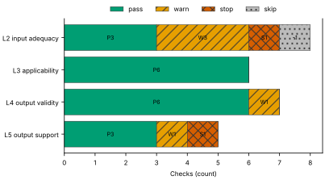
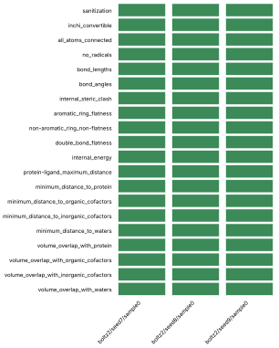
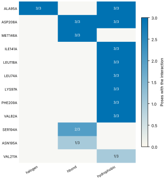
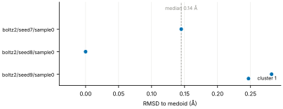
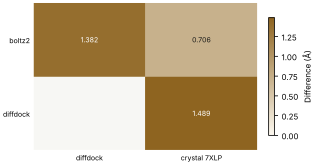
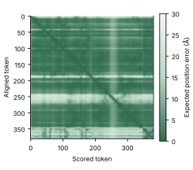

# Run report · Ligand pose in a known pocket

Prediction assurance · run `ligand_pose-f089aceba16e` · 2026-10-17 19:31:15 UTC

**Refused** for the claim "Predicted pose of FZC in MEK1 is valid".

Refused over layers 2,3,4,5: 18 pass, 5 warn, 2 stop, 1 skip. Stopped by l2.context.cofactors, l5.controls.redocking. Warnings from l2.receptor.protonation, l2.ligand.protonation, l2.docking.box, l4.interactions.unsatisfied_polars, l5.sampling.seeds.

Stops: `l2.context.cofactors`, `l5.controls.redocking`.

Warnings: `l2.receptor.protonation`, `l2.ligand.protonation`, `l2.docking.box`, `l4.interactions.unsatisfied_polars`, `l5.sampling.seeds`.

| Field | Value |
| --- | --- |
| Task | Ligand pose in a known pocket (`ligand_pose`) |
| Tools | Boltz-2 2.2.1 (co-folding), DiffDock-L (docking) |
| Target | `protein` |
| Ligand | `Cc1ccnc(n1)Oc2ccc(c(c2)Cl)c3cc4c(c(n[nH]4)C)c(c3)O[C@H]5CCC[C@H](C5)N` |
| Reference | `7XLP` |
| pH | 7.4 |
| Seeds | 3 |
| Layers run | 2, 3, 4, 5 |
| Run | `ligand_pose-f089aceba16e` |
| Created | 2026-10-17 19:31:15 UTC |
| Finished | 2026-10-17 19:32:32 UTC |
| pah version | 0.1.0 |
| Report schema | 1 |

## Layers

| Layer | Status | Result | pass | warn | stop | skip | Time |
| --- | --- | --- | --- | --- | --- | --- | --- |
| L0 Provenance | not run | n/a | n/a | n/a | n/a | n/a | n/a |
| L1 Input integrity | not run | n/a | n/a | n/a | n/a | n/a | n/a |
| L2 Input adequacy | done | stop | 3 | 3 | 1 | 1 | 2.1 s |
| L3 Applicability | done | pass | 6 | 0 | 0 | 0 | 460 ms |
| L4 Output validity | done | warn | 6 | 1 | 0 | 0 | 74.6 s |
| L5 Output support | done | stop | 3 | 1 | 1 | 0 | 184 ms |

## Figures

Fig. 1 · Check outcomes per layer for run ligand_pose-f089aceba16e. Totals: pass 18, warn 5, stop 2, skip 1.
Files: data [figures/gates_by_layer.csv](figures/gates_by_layer.csv).

## Structures

78 PyMOL renders.

7XLP mmCIF (source_structure), whole structure. Chains A; organic components DMS, FZC. sha256 48ffbc34e5fd126d. PyMOL session: [renders/7XLP.pse](renders/7XLP.pse).

7XLP mmCIF (source_structure), ligand environment within 5 Å. Chains A; organic components DMS, FZC. sha256 48ffbc34e5fd126d. PyMOL session: [renders/7XLP.pse](renders/7XLP.pse).

boltz2/seed7/sample0 (prediction_structure), whole structure. Chains A, L; organic components LIG1. sha256 82ef3af064ad3bec. PyMOL session: [renders/boltz2_seed7_sample0.pse](renders/boltz2_seed7_sample0.pse).

boltz2/seed7/sample0 (prediction_structure), ligand environment within 5 Å. Chains A, L; organic components LIG1. sha256 82ef3af064ad3bec. PyMOL session: [renders/boltz2_seed7_sample0.pse](renders/boltz2_seed7_sample0.pse).

boltz2/seed8/sample0 (prediction_structure), whole structure. Chains A, L; organic components LIG1. sha256 0bfda34a63040ba0. PyMOL session: [renders/boltz2_seed8_sample0.pse](renders/boltz2_seed8_sample0.pse).

boltz2/seed8/sample0 (prediction_structure), ligand environment within 5 Å. Chains A, L; organic components LIG1. sha256 0bfda34a63040ba0. PyMOL session: [renders/boltz2_seed8_sample0.pse](renders/boltz2_seed8_sample0.pse).

boltz2/seed9/sample0 (prediction_structure), whole structure. Chains A, L; organic components LIG1. sha256 1cb75a673991eca3. PyMOL session: [renders/boltz2_seed9_sample0.pse](renders/boltz2_seed9_sample0.pse).

boltz2/seed9/sample0 (prediction_structure), ligand environment within 5 Å. Chains A, L; organic components LIG1. sha256 1cb75a673991eca3. PyMOL session: [renders/boltz2_seed9_sample0.pse](renders/boltz2_seed9_sample0.pse).

diffdock/seed7/mode0 (prediction_structure), whole structure. Chains A, L; organic components LIG. sha256 bfe45d2d68743175. PyMOL session: [renders/diffdock_seed7_mode0.pse](renders/diffdock_seed7_mode0.pse).

diffdock/seed7/mode0 (prediction_structure), ligand environment within 5 Å. Chains A, L; organic components LIG. sha256 bfe45d2d68743175. PyMOL session: [renders/diffdock_seed7_mode0.pse](renders/diffdock_seed7_mode0.pse).

diffdock/seed7/mode1 (prediction_structure), whole structure. Chains A, L; organic components LIG. sha256 4596d0a6d23ef25d. PyMOL session: [renders/diffdock_seed7_mode1.pse](renders/diffdock_seed7_mode1.pse).

diffdock/seed7/mode1 (prediction_structure), ligand environment within 5 Å. Chains A, L; organic components LIG. sha256 4596d0a6d23ef25d. PyMOL session: [renders/diffdock_seed7_mode1.pse](renders/diffdock_seed7_mode1.pse).

diffdock/seed7/mode2 (prediction_structure), whole structure. Chains A, L; organic components LIG. sha256 3bbe4321ebf93171. PyMOL session: [renders/diffdock_seed7_mode2.pse](renders/diffdock_seed7_mode2.pse).

diffdock/seed7/mode2 (prediction_structure), ligand environment within 5 Å. Chains A, L; organic components LIG. sha256 3bbe4321ebf93171. PyMOL session: [renders/diffdock_seed7_mode2.pse](renders/diffdock_seed7_mode2.pse).

diffdock/seed7/mode3 (prediction_structure), whole structure. Chains A, L; organic components LIG. sha256 858be39c75e3a42e. PyMOL session: [renders/diffdock_seed7_mode3.pse](renders/diffdock_seed7_mode3.pse).

diffdock/seed7/mode3 (prediction_structure), ligand environment within 5 Å. Chains A, L; organic components LIG. sha256 858be39c75e3a42e. PyMOL session: [renders/diffdock_seed7_mode3.pse](renders/diffdock_seed7_mode3.pse).

diffdock/seed7/mode4 (prediction_structure), whole structure. Chains A, L; organic components LIG. sha256 137714693d486f9f. PyMOL session: [renders/diffdock_seed7_mode4.pse](renders/diffdock_seed7_mode4.pse).

diffdock/seed7/mode4 (prediction_structure), ligand environment within 5 Å. Chains A, L; organic components LIG. sha256 137714693d486f9f. PyMOL session: [renders/diffdock_seed7_mode4.pse](renders/diffdock_seed7_mode4.pse).

diffdock/seed7/mode5 (prediction_structure), whole structure. Chains A, L; organic components LIG. sha256 801a3afcd3feef70. PyMOL session: [renders/diffdock_seed7_mode5.pse](renders/diffdock_seed7_mode5.pse).

diffdock/seed7/mode5 (prediction_structure), ligand environment within 5 Å. Chains A, L; organic components LIG. sha256 801a3afcd3feef70. PyMOL session: [renders/diffdock_seed7_mode5.pse](renders/diffdock_seed7_mode5.pse).

diffdock/seed7/mode6 (prediction_structure), whole structure. Chains A, L; organic components LIG. sha256 bee2d0334a0f5546. PyMOL session: [renders/diffdock_seed7_mode6.pse](renders/diffdock_seed7_mode6.pse).

diffdock/seed7/mode6 (prediction_structure), ligand environment within 5 Å. Chains A, L; organic components LIG. sha256 bee2d0334a0f5546. PyMOL session: [renders/diffdock_seed7_mode6.pse](renders/diffdock_seed7_mode6.pse).

diffdock/seed7/mode7 (prediction_structure), whole structure. Chains A, L; organic components LIG. sha256 c0fa8b886837d6bc. PyMOL session: [renders/diffdock_seed7_mode7.pse](renders/diffdock_seed7_mode7.pse).

diffdock/seed7/mode7 (prediction_structure), ligand environment within 5 Å. Chains A, L; organic components LIG. sha256 c0fa8b886837d6bc. PyMOL session: [renders/diffdock_seed7_mode7.pse](renders/diffdock_seed7_mode7.pse).

diffdock/seed7/mode8 (prediction_structure), whole structure. Chains A, L; organic components LIG. sha256 59feaa947c9c659b. PyMOL session: [renders/diffdock_seed7_mode8.pse](renders/diffdock_seed7_mode8.pse).

diffdock/seed7/mode8 (prediction_structure), ligand environment within 5 Å. Chains A, L; organic components LIG. sha256 59feaa947c9c659b. PyMOL session: [renders/diffdock_seed7_mode8.pse](renders/diffdock_seed7_mode8.pse).

diffdock/seed7/mode9 (prediction_structure), whole structure. Chains A, L; organic components LIG. sha256 8ea1aba3f1422180. PyMOL session: [renders/diffdock_seed7_mode9.pse](renders/diffdock_seed7_mode9.pse).

diffdock/seed7/mode9 (prediction_structure), ligand environment within 5 Å. Chains A, L; organic components LIG. sha256 8ea1aba3f1422180. PyMOL session: [renders/diffdock_seed7_mode9.pse](renders/diffdock_seed7_mode9.pse).

diffdock/seed8/mode0 (prediction_structure), whole structure. Chains A, L; organic components LIG. sha256 8a8af4529985d1ca. PyMOL session: [renders/diffdock_seed8_mode0.pse](renders/diffdock_seed8_mode0.pse).

diffdock/seed8/mode0 (prediction_structure), ligand environment within 5 Å. Chains A, L; organic components LIG. sha256 8a8af4529985d1ca. PyMOL session: [renders/diffdock_seed8_mode0.pse](renders/diffdock_seed8_mode0.pse).

diffdock/seed8/mode1 (prediction_structure), whole structure. Chains A, L; organic components LIG. sha256 3a090173db099930. PyMOL session: [renders/diffdock_seed8_mode1.pse](renders/diffdock_seed8_mode1.pse).

diffdock/seed8/mode1 (prediction_structure), ligand environment within 5 Å. Chains A, L; organic components LIG. sha256 3a090173db099930. PyMOL session: [renders/diffdock_seed8_mode1.pse](renders/diffdock_seed8_mode1.pse).

diffdock/seed8/mode2 (prediction_structure), whole structure. Chains A, L; organic components LIG. sha256 cbfde0c4d75310dd. PyMOL session: [renders/diffdock_seed8_mode2.pse](renders/diffdock_seed8_mode2.pse).

diffdock/seed8/mode2 (prediction_structure), ligand environment within 5 Å. Chains A, L; organic components LIG. sha256 cbfde0c4d75310dd. PyMOL session: [renders/diffdock_seed8_mode2.pse](renders/diffdock_seed8_mode2.pse).

diffdock/seed8/mode3 (prediction_structure), whole structure. Chains A, L; organic components LIG. sha256 73bf1a8679962af6. PyMOL session: [renders/diffdock_seed8_mode3.pse](renders/diffdock_seed8_mode3.pse).

diffdock/seed8/mode3 (prediction_structure), ligand environment within 5 Å. Chains A, L; organic components LIG. sha256 73bf1a8679962af6. PyMOL session: [renders/diffdock_seed8_mode3.pse](renders/diffdock_seed8_mode3.pse).

diffdock/seed8/mode4 (prediction_structure), whole structure. Chains A, L; organic components LIG. sha256 13241e00cd11666c. PyMOL session: [renders/diffdock_seed8_mode4.pse](renders/diffdock_seed8_mode4.pse).

diffdock/seed8/mode4 (prediction_structure), ligand environment within 5 Å. Chains A, L; organic components LIG. sha256 13241e00cd11666c. PyMOL session: [renders/diffdock_seed8_mode4.pse](renders/diffdock_seed8_mode4.pse).

diffdock/seed8/mode5 (prediction_structure), whole structure. Chains A, L; organic components LIG. sha256 e27d1c8c4c6107b6. PyMOL session: [renders/diffdock_seed8_mode5.pse](renders/diffdock_seed8_mode5.pse).

diffdock/seed8/mode5 (prediction_structure), ligand environment within 5 Å. Chains A, L; organic components LIG. sha256 e27d1c8c4c6107b6. PyMOL session: [renders/diffdock_seed8_mode5.pse](renders/diffdock_seed8_mode5.pse).

diffdock/seed8/mode6 (prediction_structure), whole structure. Chains A, L; organic components LIG. sha256 91740dac941b64e6. PyMOL session: [renders/diffdock_seed8_mode6.pse](renders/diffdock_seed8_mode6.pse).

diffdock/seed8/mode6 (prediction_structure), ligand environment within 5 Å. Chains A, L; organic components LIG. sha256 91740dac941b64e6. PyMOL session: [renders/diffdock_seed8_mode6.pse](renders/diffdock_seed8_mode6.pse).

diffdock/seed8/mode7 (prediction_structure), whole structure. Chains A, L; organic components LIG. sha256 97c0c1a849cdb74a. PyMOL session: [renders/diffdock_seed8_mode7.pse](renders/diffdock_seed8_mode7.pse).

diffdock/seed8/mode7 (prediction_structure), ligand environment within 5 Å. Chains A, L; organic components LIG. sha256 97c0c1a849cdb74a. PyMOL session: [renders/diffdock_seed8_mode7.pse](renders/diffdock_seed8_mode7.pse).

diffdock/seed8/mode8 (prediction_structure), whole structure. Chains A, L; organic components LIG. sha256 b2fe9a2ce9800e98. PyMOL session: [renders/diffdock_seed8_mode8.pse](renders/diffdock_seed8_mode8.pse).

diffdock/seed8/mode8 (prediction_structure), ligand environment within 5 Å. Chains A, L; organic components LIG. sha256 b2fe9a2ce9800e98. PyMOL session: [renders/diffdock_seed8_mode8.pse](renders/diffdock_seed8_mode8.pse).

diffdock/seed8/mode9 (prediction_structure), whole structure. Chains A, L; organic components LIG. sha256 aa0fc23b07aa1184. PyMOL session: [renders/diffdock_seed8_mode9.pse](renders/diffdock_seed8_mode9.pse).

diffdock/seed8/mode9 (prediction_structure), ligand environment within 5 Å. Chains A, L; organic components LIG. sha256 aa0fc23b07aa1184. PyMOL session: [renders/diffdock_seed8_mode9.pse](renders/diffdock_seed8_mode9.pse).

diffdock/seed9/mode0 (prediction_structure), whole structure. Chains A, L; organic components LIG. sha256 78c0a9bbaa8dc12d. PyMOL session: [renders/diffdock_seed9_mode0.pse](renders/diffdock_seed9_mode0.pse).

diffdock/seed9/mode0 (prediction_structure), ligand environment within 5 Å. Chains A, L; organic components LIG. sha256 78c0a9bbaa8dc12d. PyMOL session: [renders/diffdock_seed9_mode0.pse](renders/diffdock_seed9_mode0.pse).

diffdock/seed9/mode1 (prediction_structure), whole structure. Chains A, L; organic components LIG. sha256 f9d9e4b14c286efa. PyMOL session: [renders/diffdock_seed9_mode1.pse](renders/diffdock_seed9_mode1.pse).

diffdock/seed9/mode1 (prediction_structure), ligand environment within 5 Å. Chains A, L; organic components LIG. sha256 f9d9e4b14c286efa. PyMOL session: [renders/diffdock_seed9_mode1.pse](renders/diffdock_seed9_mode1.pse).

diffdock/seed9/mode2 (prediction_structure), whole structure. Chains A, L; organic components LIG. sha256 d14c99facc04b968. PyMOL session: [renders/diffdock_seed9_mode2.pse](renders/diffdock_seed9_mode2.pse).

diffdock/seed9/mode2 (prediction_structure), ligand environment within 5 Å. Chains A, L; organic components LIG. sha256 d14c99facc04b968. PyMOL session: [renders/diffdock_seed9_mode2.pse](renders/diffdock_seed9_mode2.pse).

diffdock/seed9/mode3 (prediction_structure), whole structure. Chains A, L; organic components LIG. sha256 9305cb9420a9a9ee. PyMOL session: [renders/diffdock_seed9_mode3.pse](renders/diffdock_seed9_mode3.pse).

diffdock/seed9/mode3 (prediction_structure), ligand environment within 5 Å. Chains A, L; organic components LIG. sha256 9305cb9420a9a9ee. PyMOL session: [renders/diffdock_seed9_mode3.pse](renders/diffdock_seed9_mode3.pse).

diffdock/seed9/mode4 (prediction_structure), whole structure. Chains A, L; organic components LIG. sha256 61a6d29f4e7e242d. PyMOL session: [renders/diffdock_seed9_mode4.pse](renders/diffdock_seed9_mode4.pse).

diffdock/seed9/mode4 (prediction_structure), ligand environment within 5 Å. Chains A, L; organic components LIG. sha256 61a6d29f4e7e242d. PyMOL session: [renders/diffdock_seed9_mode4.pse](renders/diffdock_seed9_mode4.pse).

diffdock/seed9/mode5 (prediction_structure), whole structure. Chains A, L; organic components LIG. sha256 7bf0872dc82cee13. PyMOL session: [renders/diffdock_seed9_mode5.pse](renders/diffdock_seed9_mode5.pse).

diffdock/seed9/mode5 (prediction_structure), ligand environment within 5 Å. Chains A, L; organic components LIG. sha256 7bf0872dc82cee13. PyMOL session: [renders/diffdock_seed9_mode5.pse](renders/diffdock_seed9_mode5.pse).

diffdock/seed9/mode6 (prediction_structure), whole structure. Chains A, L; organic components LIG. sha256 f241277d42ae40eb. PyMOL session: [renders/diffdock_seed9_mode6.pse](renders/diffdock_seed9_mode6.pse).

diffdock/seed9/mode6 (prediction_structure), ligand environment within 5 Å. Chains A, L; organic components LIG. sha256 f241277d42ae40eb. PyMOL session: [renders/diffdock_seed9_mode6.pse](renders/diffdock_seed9_mode6.pse).

diffdock/seed9/mode7 (prediction_structure), whole structure. Chains A, L; organic components LIG. sha256 619e8840b5afa853. PyMOL session: [renders/diffdock_seed9_mode7.pse](renders/diffdock_seed9_mode7.pse).

diffdock/seed9/mode7 (prediction_structure), ligand environment within 5 Å. Chains A, L; organic components LIG. sha256 619e8840b5afa853. PyMOL session: [renders/diffdock_seed9_mode7.pse](renders/diffdock_seed9_mode7.pse).

diffdock/seed9/mode8 (prediction_structure), whole structure. Chains A, L; organic components LIG. sha256 23b541caf7128710. PyMOL session: [renders/diffdock_seed9_mode8.pse](renders/diffdock_seed9_mode8.pse).

diffdock/seed9/mode8 (prediction_structure), ligand environment within 5 Å. Chains A, L; organic components LIG. sha256 23b541caf7128710. PyMOL session: [renders/diffdock_seed9_mode8.pse](renders/diffdock_seed9_mode8.pse).

diffdock/seed9/mode9 (prediction_structure), whole structure. Chains A, L; organic components LIG. sha256 3e985dc426c58495. PyMOL session: [renders/diffdock_seed9_mode9.pse](renders/diffdock_seed9_mode9.pse).

diffdock/seed9/mode9 (prediction_structure), ligand environment within 5 Å. Chains A, L; organic components LIG. sha256 3e985dc426c58495. PyMOL session: [renders/diffdock_seed9_mode9.pse](renders/diffdock_seed9_mode9.pse).

3ZLS mmCIF (source_structure), whole structure. Chains A; organic components 92P. sha256 ae30cf1ed7b4035f. PyMOL session: [renders/3ZLS.pse](renders/3ZLS.pse).

3ZLS mmCIF (source_structure), ligand environment within 5 Å. Chains A; organic components 92P. sha256 ae30cf1ed7b4035f. PyMOL session: [renders/3ZLS.pse](renders/3ZLS.pse).

3ZLX mmCIF (source_structure), whole structure. Chains A; organic components 5EZ. sha256 1334dfc31103f3e6. PyMOL session: [renders/3ZLX.pse](renders/3ZLX.pse).

3ZLX mmCIF (source_structure), ligand environment within 5 Å. Chains A; organic components 5EZ. sha256 1334dfc31103f3e6. PyMOL session: [renders/3ZLX.pse](renders/3ZLX.pse).

3ZM4 mmCIF (source_structure), whole structure. Chains A; organic components 22T. sha256 eccb79a35cb7a9f2. PyMOL session: [renders/3ZM4.pse](renders/3ZM4.pse).

3ZM4 mmCIF (source_structure), ligand environment within 5 Å. Chains A; organic components 22T. sha256 eccb79a35cb7a9f2. PyMOL session: [renders/3ZM4.pse](renders/3ZM4.pse).

5BX0 mmCIF (source_structure), whole structure. Chains A; organic components 4W5. sha256 7ef25dd3b72e153e. PyMOL session: [renders/5BX0.pse](renders/5BX0.pse).

5BX0 mmCIF (source_structure), ligand environment within 5 Å. Chains A; organic components 4W5. sha256 7ef25dd3b72e153e. PyMOL session: [renders/5BX0.pse](renders/5BX0.pse).

3ZLY mmCIF (source_structure), whole structure. Chains A; organic components YSO. sha256 e858c796adc5339d. PyMOL session: [renders/3ZLY.pse](renders/3ZLY.pse).

3ZLY mmCIF (source_structure), ligand environment within 5 Å. Chains A; organic components YSO. sha256 e858c796adc5339d. PyMOL session: [renders/3ZLY.pse](renders/3ZLY.pse).

## L0 Provenance

Where did every input come from?

Status: not run.

## L1 Input integrity

Did the run receive exactly what was declared?

Status: not run.

## L2 Input adequacy

Does the input carry enough information?

Status: done. Checks: pass 3 · warn 3 · stop 1 · skip 1. Time: 2.1 s.

#### Key figures

| Figure | Value |
| --- | --- |
| near site | 1 |
| missing | 1 |
| uniprot cofactors | 0 |
| pocket residues | 37 |
| incomplete | 0 |
| sequence gaps | 0 |
| state | holo |
| site ligands | 1 |

#### Docking

| Field | Value |
| --- | --- |
| center | -3.608, 64.879, 34.516 Å |
| size | 19.183 × 21.381 × 13.89 Å |
| origin | derived from FZC (+4 Å) |

#### Checks

| Check | Result | Measured cmp threshold | Evidence | Id · time |
| --- | --- | --- | --- | --- |
| Alignment depth, distinct sequences, Neff and gap fraction | skip | n/a | no MSA declared for a co-folding model · not applicable | `l2.msa.depth` |
| Required cofactors, ions and partners present | stop | `pocket_distance <= 8` | components within 8.0 Å of FZC in 7XLP not supplied: CA · near_site=1, missing=1, uniprot_cofactors=0 | `l2.context.cofactors` · 186 ms |
| Pocket residues resolved, no missing loops lining the pocket | pass | `pocket_distance <= 6` | 37 pocket residues complete in 7XLP.cif · pocket_residues=37, incomplete=0, sequence_gaps=0 | `l2.pocket.resolved` · 12 ms |
| Receptor state apo or holo | pass | n/a | 7XLP.cif holo: FZC in the site · state=holo, site_ligands=1 | `l2.receptor.state` · 14 ms |
| Receptor protonation at the stated pH | warn | `pka_margin > 1` | receptor has no hydrogens (protonation not assigned) · hydrogens_present=False, ph=7.4, pocket_titratable=15 | `l2.receptor.protonation` · 325 ms |
| Ligand protonation and tautomers enumerated at the stated pH | warn | `ph 7.4 == 1` | ligand: 16 states · ph=7.4, max_states=16, declared_not_enumerated=0 | `l2.ligand.protonation` · 90 ms |
| Ligand conformers generated and minimised | pass | `conformers >= 10` | 10 ETKDG conformers per ligand, MMFF minimised · ligands=1, failed=0, min_embedded=10 | `l2.ligand.conformers` · 1.4 s |
| Docking box encloses the pocket with margin | warn | `margin >= 2` | no box declared; derived box encloses 19 contact residues and the FZC ligand with 2.0 Å margin · volume_A3=5697, ligand_atoms_inside_margin=33, ligand_atoms=33 | `l2.docking.box` · 14 ms |

## L3 Applicability

Is the tool inside its validated regime?

Status: done. Checks: pass 6 · warn 0 · stop 0 · skip 0. Time: 460 ms.

#### Key figures

| Figure | Value |
| --- | --- |
| executors | 2 |
| unknown | 0 |
| reference released | 2023-03-01 |
| cutoff | 2019-01-01 |
| entries compared | 5 |
| max similarity | 35.4 |
| pocket residues | 35 |
| systems | 0 |

#### Checks

| Check | Result | Measured cmp threshold | Evidence | Id · time |
| --- | --- | --- | --- | --- |
| Model training cutoff recorded | pass | `training_cutoff == recorded` | boltz2 2023-06-01; diffdock 2019-01-01; reference 7XLP released 2023-03-01, before the cutoff of boltz2 · executors=2, unknown=0, reference_released=2023-03-01 | `l3.model.training_cutoff` · 0 ms |
| Pocket similarity to pre-cutoff complexes (SuCOS times pocket coverage) | pass | `similarity <= 50` | max similarity 35.4 to 3ZM4 (22T, SuCOS 0.564, coverage 0.629), released before 2019-01-01 · cutoff=2019-01-01, entries_compared=5, max_similarity=35.4 | `l3.exposure.pocket` · 446 ms |
| Ligand analogues in pre-cutoff training systems | pass | `tanimoto > 0.9` | 0 PDB entries released before 2019-01-01 (diffdock cutoff) contain analogues of ligand above Tanimoto 0.9: FZC · cutoff=2019-01-01, systems=0, analogue_components=1 | `l3.exposure.ligand_prevalence` · 0 ms |
| Chain sequence identity to pre-cutoff entries (secondary measure) | pass | `identity < 0.4` | protein: 35 entries at 95 percent identity, 46 at 40 percent, released before 2019-01-01 (reported, not gating) · cutoff=2019-01-01, entries_95=35, entries_40=46 | `l3.exposure.sequence` · 1 ms |
| Modality inside the validated set; token count against the training crop | pass | n/a | modalities protein, protein_ligand inside the validated set; 381 tokens · modalities=2, tokens=381, outside=0 | `l3.regime.modality` · 9 ms |
| Endpoint fits the tool | pass | `endpoint pose in pose` | endpoint pose produced by boltz2, diffdock · endpoint=pose, executors=2, not_fitting=0 | `l3.metric.endpoint` · 0 ms |

## L4 Output validity

Is the result physically and chemically sensible?

Status: done. Checks: pass 6 · warn 1 · stop 0 · skip 0. Time: 74.6 s.

#### Key figures

| Figure | Value |
| --- | --- |
| poses | 3 |
| passed | 20 |
| total | 20 |
| poses all pass | 3 |
| unlikely torsions | 0 |
| torsions | 7 |
| strain kcal | 1.32 |
| poses with unlikely | 0 |

#### PoseBusters · 20/20 tests pass

| test | result | value |
| --- | --- | --- |
| sanitization | pass | pass |
| inchi_convertible | pass | pass |
| all_atoms_connected | pass | pass |
| no_radicals | pass | pass |
| bond_lengths | pass | 0 long outliers |
| bond_angles | pass | 0 outliers |
| internal_steric_clash | pass | 0 |
| aromatic_ring_flatness | pass | 0.02 Å |
| non-aromatic_ring_non-flatness | pass | pass |
| double_bond_flatness | pass | pass |
| internal_energy | pass | 1.1 times the ensemble mean |
| protein-ligand_maximum_distance | pass | 2.44 Å |
| minimum_distance_to_protein | pass | 2.44 Å |
| minimum_distance_to_organic_cofactors | pass | pass |
| minimum_distance_to_inorganic_cofactors | pass | pass |
| minimum_distance_to_waters | pass | pass |
| volume_overlap_with_protein | pass | 0.009 |
| volume_overlap_with_organic_cofactors | pass | pass |
| volume_overlap_with_inorganic_cofactors | pass | pass |
| volume_overlap_with_waters | pass | pass |

#### Per-pose physical checks

| pose | seed | drift Å | converged | unlikely torsions | unsat. polars | buried charged | PoseBusters |
| --- | --- | --- | --- | --- | --- | --- | --- |
| boltz2/seed7/sample0 | 7 | 0.28 | true | 0/7 | 4 | 0 | 20/20 |
| boltz2/seed8/sample0 | 8 | 0.28 | true | 0/7 | 4 | 0 | 20/20 |
| boltz2/seed9/sample0 | 9 | 0.34 | true | 0/7 | 4 | 0 | 20/20 |
| median | n/a | 0.28 | n/a | 0 | 4 | 0 | 20/20 |

#### Interaction fingerprint · representative pose boltz2/seed8/sample0

| residue | type | distance | poses |
| --- | --- | --- | --- |
| ALA95A | halogen | 3.26 Å | 3/3 |
| ASP208A | hbond | 3.64 Å | 3/3 |
| MET146A | hbond | 2.91 Å | 3/3 |
| ALA95A | hydrophobic | 3.69 Å | 3/3 |
| ASP208A | hydrophobic | 3.81 Å | 3/3 |
| ILE141A | hydrophobic | 3.82 Å | 3/3 |
| LEU118A | hydrophobic | 3.89 Å | 3/3 |
| LEU74A | hydrophobic | 3.91 Å | 3/3 |
| LYS97A | hydrophobic | 3.47 Å | 3/3 |
| PHE209A | hydrophobic | 3.54 Å | 3/3 |
| VAL82A | hydrophobic | 3.74 Å | 3/3 |
| SER194A | hbond | 2.59 Å | 2/3 |
| ASN195A | hbond | 3.87 Å | 1/3 |
| VAL211A | hydrophobic | 3.94 Å | 1/3 |

Fig. 2 · PoseBusters tests (20) by pose (3). Failed cells marked x: 0 of 60.
Files: data [figures/posebusters_grid.csv](figures/posebusters_grid.csv).

Fig. 3 · Interactions by residue (12) and type (3); cell label: poses with the interaction over poses assessed.
Files: data [figures/interactions.csv](figures/interactions.csv).

#### Checks

| Check | Result | Measured cmp threshold | Evidence | Id · time |
| --- | --- | --- | --- | --- |
| PoseBusters geometry, stereochemistry, clashes and protein contact | pass | `tests_failed == 0` | 20 of 20 tests pass for boltz2/seed8/sample0; 3 of 3 poses pass all · poses=3, passed=20, total=20 | `l4.posebusters` · 3.0 s |
| Torsional strain of the ligand pose | pass | `torsion_energy <= 2.5` | 0 of 7 torsions above 2.5 kcal/mol in boltz2/seed8/sample0; strain 1.32 kcal/mol · poses=3, unlikely_torsions=0, torsions=7 | `l4.torsion_strain` · 7.2 s |
| Interaction fingerprint (PLIP) | pass | n/a | 14 interactions in boltz2/seed8/sample0 (halogen, hbond, hydrophobic); 14 distinct across 3 poses (reported) · poses=3, interactions_representative=14, distinct=14 | `l4.interactions.fingerprint` · 1.2 s |
| Buried ligand polar atoms without a hydrogen-bond partner | warn | `relative_sasa < 0.1` | 4 of 7 buried polar ligand atoms without a partner in boltz2/seed8/sample0 · poses=3, unsatisfied=4, buried_charged=0 | `l4.interactions.unsatisfied_polars` · 330 ms |
| Hydrophobic complementarity of buried ligand surface | pass | `fraction >= 0.35` | nonpolar fraction of protein contacts around 22 buried nonpolar ligand atoms in boltz2/seed8/sample0: 0.767 · poses=3, complementarity=0.767, buried_nonpolar=22 | `l4.interactions.hydrophobic` · 305 ms |
| Interactions of the crystal ligand reproduced by the pose | pass | `reproduced 2 >= 1` | boltz2/seed8/sample0 reproduces 2 of 3 FZC interactions: halogen ALA95A, hbond MET146A · key_interactions=3, reproduced=2, poses_reproducing_all=2 | `l4.interactions.known_binders` · 278 ms |
| Pose stability under short restrained minimisation (OpenMM, AMBER14 and OpenFF) | pass | `drift_A 0.28 <= 2` | boltz2/seed8/sample0 moves 0.279 Å under restrained minimisation; 0 of 3 poses above 2.0 Å · poses=3, drift_A=0.279, max_drift_A=0.345 | `l4.minimisation_drift` · 62.3 s |

## L5 Output support

Is a valid result corroborated?

Status: done. Checks: pass 3 · warn 1 · stop 1 · skip 0. Time: 184 ms.

#### Key figures

| Figure | Value |
| --- | --- |
| poses | 3 |
| pocket plddt | 96.9 |
| global plddt | 92.2 |
| iptm | 0.988 |
| ptm | 0.934 |
| confidence score | 0.938 |
| independent seeds | 3 |
| samples | 3 |

#### Sampling

| Field | Value |
| --- | --- |
| site placement | 3 of 3 poses within 4.0 Å of the site (FZC in 7XLP) |
| pose accuracy | 3 of 3 poses within 2.0 Å of the medoid |
| pairwise RMSD median | 0.28 Å |
| pairwise RMSD IQR | 0.21 to 0.34 Å |
| pairs | 3 |
| medoid | boltz2/seed8/sample0 |

#### Clusters

| Field | Value |
| --- | --- |
| cluster 1 | 3/3 poses (boltz2/seed8/sample0) |

#### Per-seed statistics

| seed | pose | cluster | RMSD to medoid | confidence |
| --- | --- | --- | --- | --- |
| 7 | boltz2/seed7/sample0 | 1 | 0.14 Å | 0.94 |
| 8 | boltz2/seed8/sample0 | 1 | 0 Å | 0.94 |
| 9 | boltz2/seed9/sample0 | 1 | 0.28 Å | 0.94 |
| median | n/a | n/a | 0.14 Å | 0.94 |

#### Ensemble

| structure | kind | source | RMSD to medoid | cluster | pocket pLDDT | ipTM |
| --- | --- | --- | --- | --- | --- | --- |
| boltz2/seed7/sample0 | seed | boltz2 | 0.14 Å | 1 | 96.8 | 0.99 |
| boltz2/seed8/sample0 | medoid | boltz2 | 0 Å | 1 | 96.9 | 0.99 |
| boltz2/seed9/sample0 | seed | boltz2 | 0.28 Å | 1 | 96.4 | 0.99 |

#### Agreement between methods

| method | diffdock | crystal 7XLP |
| --- | --- | --- |
| boltz2 | 1.38 Å (high) | 0.71 Å (decisive) |
| diffdock | n/a | 1.49 Å (decisive) |

#### Confidence metrics

| metric | value | read as | tool |
| --- | --- | --- | --- |
| affinity_pred_value | -2.230149984359741 | ranking within a series, never pose quality | boltz2 |
| affinity_probability_binary | 0.8667938709259033 | ranking within a series, never pose quality | boltz2 |
| affinity_pred_value | -2.2522222995758057 | ranking within a series, never pose quality | boltz2 |
| affinity_probability_binary | 0.8677095174789429 | ranking within a series, never pose quality | boltz2 |
| affinity_pred_value | -2.2040772438049316 | ranking within a series, never pose quality | boltz2 |
| affinity_probability_binary | 0.8683358430862427 | ranking within a series, never pose quality | boltz2 |

Fig. 4 · RMSD to the medoid for 3 poses, coloured by cluster (1 clusters). Dashed line: median 0.14 Å; range 0.00 to 0.28 Å.
Files: data [figures/seed_spread.csv](figures/seed_spread.csv).

Fig. 5 · Agreement between 2 methods and 2 comparators; range 0.706 to 1.489 Å.
Files: data [figures/agreement.csv](figures/agreement.csv).

Fig. 6 · Predicted aligned error for pose boltz2/seed7/sample0, 381 by 381 tokens; values 0.2 to 29.1 Å, mean 5.1 Å.
Files: data [figures/pae.csv](figures/pae.csv).

#### Checks

| Check | Result | Measured cmp threshold | Evidence | Id · time |
| --- | --- | --- | --- | --- |
| Confidence restricted to the pocket; per-model thresholds | pass | `boltz2.pocket_plddt >= 70` | boltz2/seed8/sample0: pocket_plddt 96.9 · poses=3, pocket_plddt=96.9, global_plddt=92.2 | `l5.confidence.local` · 20 ms |
| Independent seeds counted separately from samples; duplicates flagged | warn | `seeds_cofolding >= 5` | 3 independent seeds (3 poses); task default 5 · independent_seeds=3, samples=3, duplicated_outputs=0 | `l5.sampling.seeds` · 0 ms |
| Medoid of the largest cluster, populations, pairwise spread, site and pose accuracy | pass | `cluster_rmsd <= 2` | medoid boltz2/seed8/sample0; 1 clusters, largest 3 of 3; pairwise RMSD median 0.28 Å (IQR 0.21 to 0.34); 3 of 3 poses within 4.0 Å of the site (FZC in 7XLP); 3 of 3 poses within 2.0 Å of the medoid · poses=3, clusters=1, largest_cluster=3 | `l5.sampling.clusters` · 39 ms |
| Agreement between methods, weighted by independence | pass | `rmsd_to_crystal_A 0.71 <= 2` | boltz2 vs diffdock 1.382 Å (high); boltz2 vs crystal 7XLP 0.706 Å (decisive); diffdock vs crystal 7XLP 1.489 Å (decisive) · methods=2, comparisons=3, disagreeing=0 | `l5.agreement.cross_family` · 123 ms |
| Redocking control reproduces the crystal pose | stop | `rmsd <= 2` | redocking control required by the task and not supplied (controls.redocking) | `l5.controls.redocking` · 0 ms |

## Controls

| control | status | result |
| --- | --- | --- |
| redocking | incomplete | redocking control required by the task and not supplied (controls.redocking) |

## Provenance

13 objects · 13 cached · 0 network.

| Source | Accession | Release | SHA-256 | Retrieved | Bytes | Cache | Used by |
| --- | --- | --- | --- | --- | --- | --- | --- |
| rcsb_files | 7XLP | n/a | `48ffbc34e5fd` | 2026-10-17 17:04:21 UTC | 527387 | hit | l2.context.cofactors, l2.pocket.resolved, l2.receptor.state, l2.docking.box, l3.exposure.pocket, l3.regime.modality, l4.interactions.fingerprint, l4.interactions.known_binders, l5.sampling.clusters, l5.agreement.cross_family |
| ccd | FZC | 2023-02-24 | `6ce219c20fef` | 2026-10-17 17:04:21 UTC | 3599 | hit | l2.context.cofactors, l3.exposure.pocket |
| rcsb | 7XLP | 1.2 | `66dacec771f9` | 2026-10-17 17:04:23 UTC | 12056 | hit | l3.model.training_cutoff |
| rcsb_search | chem:Cc1ccnc(n1)Oc2ccc(c(c2)Cl)c3cc4c(c(n[nH]4)C)c(c3)O[C@H]5CCC[C@H](C5)N | n/a | `b46bdf444038` | 2026-10-17 17:04:25 UTC | 186 | hit | l3.exposure.pocket |
| rcsb_search | comp:FZC:2019-01-01 | n/a | `e3b0c44298fc` | 2026-10-17 17:04:24 UTC | 0 | hit | l3.exposure.pocket |
| rcsb_search | seq0.9:2019-01-01:348 | n/a | `e51f7972830a` | 2026-10-17 17:10:16 UTC | 2568 | hit | l3.exposure.pocket |
| rcsb_files | 3ZLS | n/a | `ae30cf1ed7b4` | 2026-10-17 17:10:16 UTC | 315218 | hit | l3.exposure.pocket |
| rcsb_files | 3ZLX | n/a | `1334dfc31103` | 2026-10-17 17:10:17 UTC | 313366 | hit | l3.exposure.pocket |
| rcsb_files | 3ZM4 | n/a | `eccb79a35cb7` | 2026-10-17 17:10:17 UTC | 321513 | hit | l3.exposure.pocket |
| rcsb_files | 5BX0 | n/a | `7ef25dd3b72e` | 2026-10-17 17:10:17 UTC | 312068 | hit | l3.exposure.pocket |
| rcsb_files | 3ZLY | n/a | `e858c796adc5` | 2026-10-17 17:10:17 UTC | 310846 | hit | l3.exposure.pocket |
| rcsb_search | seq0.95:2019-01-01:348 | n/a | `1d2d688f2f0a` | 2026-10-17 17:04:34 UTC | 402 | hit | l3.exposure.sequence |
| rcsb_search | seq0.4:2019-01-01:348 | n/a | `baa9d256b8ae` | 2026-10-17 17:04:35 UTC | 393 | hit | l3.exposure.sequence |

Provenance graph: [json](graph.json), [mmd](graph.mmd), [svg](graph.svg).

## Thresholds

| Check | Threshold | Value | Origin | Evidence level |
| --- | --- | --- | --- | --- |
| `l2.context.cofactors` | pocket_distance | <= 8 | Harness rule: a component of the reference entry within 8 Å of the declared ligand is required context; not yet calibrated | uncalibrated |
| `l2.pocket.resolved` | pocket_distance | <= 6 | Harness rule: pocket residues have a heavy atom within 6 Å of the ligand; not yet calibrated | uncalibrated |
| `l2.pocket.resolved` | missing_pocket_residues | == 0 | Specification layer 2: stop when the pocket is incomplete | published |
| `l2.receptor.protonation` | pka_margin | > 1 | Harness rule: a titratable pocket residue with PROPKA pKa within 1 unit of the stated pH has an ambiguous state; not yet calibrated | uncalibrated |
| `l2.ligand.protonation` | ph_window | == 1 | Harness rule: states enumerated by Dimorphite-DL within 1 pH unit of the stated pH; not yet calibrated | uncalibrated |
| `l2.ligand.protonation` | states | == 1 | Specification layer 2: warn when more than one plausible state | published |
| `l2.ligand.conformers` | conformers | >= 10 | Harness default number of ETKDG conformers; not yet calibrated | uncalibrated |
| `l2.docking.box` | margin | >= 2 | Harness rule: every pocket heavy atom lies at least 2 Å inside the box; not yet calibrated | uncalibrated |
| `l2.docking.box` | contact_distance | <= 4 | Harness rule: contact residues (heavy atom within 4 Å of the reference ligand) must have an atom inside the box; not yet calibrated | uncalibrated |
| `l3.model.training_cutoff` | training_cutoff | == recorded | Specification, Layer 3 (applicability): stop when unknown | published |
| `l3.exposure.pocket` | similarity | <= 50 | Specification layer 3: warn above a pocket similarity (SuCOS times pocket coverage) of 50 | published |
| `l3.exposure.pocket` | entries | <= 5 | Harness budget: pre-cutoff holo entries compared per run | uncalibrated |
| `l3.exposure.ligand_prevalence` | tanimoto | > 0.9 | Specification layer 3: analogues above 0.9 Tanimoto (RDKit topological fingerprint) | published |
| `l3.exposure.ligand_prevalence` | systems | <= 100 | Specification layer 3: prevalent when analogues occur in more than 100 training systems | published |
| `l3.exposure.sequence` | identity | < 0.4 | Specification layer 3: conventional 40 percent identity leakage threshold, reported as a secondary measure only | published |
| `l3.metric.endpoint` | endpoint | in pose | Specification, Layer 3 (applicability): no affinity from interface confidence, no protein-protein affinity from Boltz-2 | published |
| `l4.posebusters` | tests_failed | == 0 | Specification, Layer 4 (output validity): stop on failure | published |
| `l4.torsion_strain` | torsion_energy | <= 2.5 | Harness rule: a rotatable torsion whose MMFF energy lies more than 2.5 kcal/mol above the minimum of its rigid scan is unlikely; not yet calibrated | uncalibrated |
| `l4.interactions.unsatisfied_polars` | relative_sasa | < 0.1 | Harness rule: a ligand polar atom with relative SASA below 0.1 in the complex is buried; not yet calibrated | uncalibrated |
| `l4.interactions.unsatisfied_polars` | hbond_distance | <= 3.5 | PLIP hydrogen bond distance cut-off (donor-acceptor 4.1 Å; harness uses 3.5 Å heavy-atom distance) | published |
| `l4.interactions.hydrophobic` | fraction | >= 0.35 | Harness default anchored on 3PTB: the crystal benzamidine scores 0.51, Vina and Boltz-2 poses within 0.5 Å of it score 0.45 and 0.49; not calibrated on the benchmark | uncalibrated |
| `l4.interactions.hydrophobic` | relative_sasa | < 0.1 | Harness rule: a ligand polar atom with relative SASA below 0.1 in the complex is buried; not yet calibrated | uncalibrated |
| `l4.interactions.known_binders` | reproduced | >= 1 | Specification layer 4: warn when no key interaction is reproduced | published |
| `l4.minimisation_drift` | drift | <= 2 | Specification layer 4: warn when the pose moves beyond 2 Å under restrained minimisation | published |
| `l5.confidence.local` | boltz2.pocket_plddt | >= 70 | AlphaFold DB pLDDT bands (70 and above: confident backbone), applied to pocket residues; not calibrated for ligand pose | published |
| `l5.sampling.seeds` | seeds_cofolding | >= 5 | Specification layer 5: default of five seeds per co-folding prediction | published |
| `l5.sampling.clusters` | cluster_rmsd | <= 2 | Specification layer 5: 2 Å symmetry-aware ligand RMSD (spyrmsd) separates pose clusters | published |
| `l5.sampling.clusters` | site_distance | <= 4 | Harness rule: a ligand centroid within 4 Å of the reference site centroid is placed in the site; not yet calibrated | uncalibrated |
| `l5.sampling.clusters` | largest_fraction | >= 0.5 | Harness rule: the largest cluster holds at least half of the poses; not yet calibrated | uncalibrated |
| `l5.agreement.cross_family` | rmsd | <= 2 | Specification layer 5: pose agreement by symmetry-aware ligand RMSD at 2 Å | published |
| `l5.controls.redocking` | rmsd | <= 2 | Specification layer 5: redocking must reproduce the crystal pose (2 Å ligand RMSD) | published |

Tool versions: dimorphite_dl 2.1.0, freesasa 2.2.1, gemmi 0.7.5, numpy 1.26.4, openbabel 3.2.1, openmm 8.6.1, plip 3.0.1, posebusters 0.6.5, propka 3.5.1, rdkit 2026.9.1, scipy 1.17.1, spyrmsd 0.9.0.

## Limitations

- This report covers layers 2, 3, 4, 5. Layers not run: 0, 1.
- The harness establishes when a result should not be trusted. Passing checks are not evidence that a prediction is correct.
- Thresholds marked uncalibrated come from the specification or harness defaults and have not been recalibrated on the harness benchmark.

## Files

| Path | Kind | Bytes | SHA-256 |
| --- | --- | --- | --- |
| artifacts/sources/7XLP.cif | source_structure | 527387 | `48ffbc34e5fd` |
| /home/user/harness-hackathon/bench/runs/2026-10-17T1859Z-849c856/predictions/mek1_wt/boltz2/seed_7/boltz_results_mek1_wt/predictions/mek1_wt/mek1_wt_model_0.cif | prediction_structure | 243877 | `82ef3af064ad` |
| predictions/00_boltz2/boltz2/seed7/sample0/ligand.sdf | data | 2874 | `ae76ce6261d1` |
| /home/user/harness-hackathon/bench/runs/2026-10-17T1859Z-849c856/predictions/mek1_wt/boltz2/seed_8/boltz_results_mek1_wt/predictions/mek1_wt/mek1_wt_model_0.cif | prediction_structure | 244034 | `0bfda34a6304` |
| predictions/00_boltz2/boltz2/seed8/sample0/ligand.sdf | data | 2874 | `e7864addf753` |
| /home/user/harness-hackathon/bench/runs/2026-10-17T1859Z-849c856/predictions/mek1_wt/boltz2/seed_9/boltz_results_mek1_wt/predictions/mek1_wt/mek1_wt_model_0.cif | prediction_structure | 243974 | `1cb75a673991` |
| predictions/00_boltz2/boltz2/seed9/sample0/ligand.sdf | data | 2874 | `e3e98ee4116d` |
| predictions/01_diffdock/diffdock/seed7/mode0/complex.pdb | prediction_structure | 193326 | `bfe45d2d6874` |
| predictions/01_diffdock/diffdock/seed7/mode0/ligand.sdf | data | 2874 | `78365177dbb1` |
| predictions/01_diffdock/diffdock/seed7/mode1/complex.pdb | prediction_structure | 193326 | `4596d0a6d23e` |
| predictions/01_diffdock/diffdock/seed7/mode1/ligand.sdf | data | 2874 | `72a576539f6d` |
| predictions/01_diffdock/diffdock/seed7/mode2/complex.pdb | prediction_structure | 193326 | `3bbe4321ebf9` |
| predictions/01_diffdock/diffdock/seed7/mode2/ligand.sdf | data | 2874 | `e6829ec4fead` |
| predictions/01_diffdock/diffdock/seed7/mode3/complex.pdb | prediction_structure | 193326 | `858be39c75e3` |
| predictions/01_diffdock/diffdock/seed7/mode3/ligand.sdf | data | 2874 | `7a0ecbc1e4b3` |
| predictions/01_diffdock/diffdock/seed7/mode4/complex.pdb | prediction_structure | 193326 | `137714693d48` |
| predictions/01_diffdock/diffdock/seed7/mode4/ligand.sdf | data | 2874 | `36815ca5e688` |
| predictions/01_diffdock/diffdock/seed7/mode5/complex.pdb | prediction_structure | 193326 | `801a3afcd3fe` |
| predictions/01_diffdock/diffdock/seed7/mode5/ligand.sdf | data | 2874 | `8dde526f7a21` |
| predictions/01_diffdock/diffdock/seed7/mode6/complex.pdb | prediction_structure | 193326 | `bee2d0334a0f` |
| predictions/01_diffdock/diffdock/seed7/mode6/ligand.sdf | data | 2874 | `4bbc32ac4f9c` |
| predictions/01_diffdock/diffdock/seed7/mode7/complex.pdb | prediction_structure | 193326 | `c0fa8b886837` |
| predictions/01_diffdock/diffdock/seed7/mode7/ligand.sdf | data | 2874 | `9ef0b2f7a76c` |
| predictions/01_diffdock/diffdock/seed7/mode8/complex.pdb | prediction_structure | 193326 | `59feaa947c9c` |
| predictions/01_diffdock/diffdock/seed7/mode8/ligand.sdf | data | 2874 | `76df6b276ef1` |
| predictions/01_diffdock/diffdock/seed7/mode9/complex.pdb | prediction_structure | 193326 | `8ea1aba3f142` |
| predictions/01_diffdock/diffdock/seed7/mode9/ligand.sdf | data | 2874 | `1cc8ba7d0fa1` |
| predictions/01_diffdock/diffdock/seed8/mode0/complex.pdb | prediction_structure | 193326 | `8a8af4529985` |
| predictions/01_diffdock/diffdock/seed8/mode0/ligand.sdf | data | 2874 | `6ceb173c666c` |
| predictions/01_diffdock/diffdock/seed8/mode1/complex.pdb | prediction_structure | 193326 | `3a090173db09` |
| predictions/01_diffdock/diffdock/seed8/mode1/ligand.sdf | data | 2874 | `8758e1b9d7ff` |
| predictions/01_diffdock/diffdock/seed8/mode2/complex.pdb | prediction_structure | 193326 | `cbfde0c4d753` |
| predictions/01_diffdock/diffdock/seed8/mode2/ligand.sdf | data | 2874 | `564d245edff4` |
| predictions/01_diffdock/diffdock/seed8/mode3/complex.pdb | prediction_structure | 193326 | `73bf1a867996` |
| predictions/01_diffdock/diffdock/seed8/mode3/ligand.sdf | data | 2874 | `6238bcb1604a` |
| predictions/01_diffdock/diffdock/seed8/mode4/complex.pdb | prediction_structure | 193326 | `13241e00cd11` |
| predictions/01_diffdock/diffdock/seed8/mode4/ligand.sdf | data | 2874 | `b2f4e3ec84c4` |
| predictions/01_diffdock/diffdock/seed8/mode5/complex.pdb | prediction_structure | 193326 | `e27d1c8c4c61` |
| predictions/01_diffdock/diffdock/seed8/mode5/ligand.sdf | data | 2874 | `294ae30a9749` |
| predictions/01_diffdock/diffdock/seed8/mode6/complex.pdb | prediction_structure | 193326 | `91740dac941b` |
| predictions/01_diffdock/diffdock/seed8/mode6/ligand.sdf | data | 2874 | `9f23d3f7ff65` |
| predictions/01_diffdock/diffdock/seed8/mode7/complex.pdb | prediction_structure | 193326 | `97c0c1a849cd` |
| predictions/01_diffdock/diffdock/seed8/mode7/ligand.sdf | data | 2874 | `83632d902dd7` |
| predictions/01_diffdock/diffdock/seed8/mode8/complex.pdb | prediction_structure | 193326 | `b2fe9a2ce980` |
| predictions/01_diffdock/diffdock/seed8/mode8/ligand.sdf | data | 2874 | `cc1d86f97eea` |
| predictions/01_diffdock/diffdock/seed8/mode9/complex.pdb | prediction_structure | 193326 | `aa0fc23b07aa` |
| predictions/01_diffdock/diffdock/seed8/mode9/ligand.sdf | data | 2874 | `3f39060fb101` |
| predictions/01_diffdock/diffdock/seed9/mode0/complex.pdb | prediction_structure | 193326 | `78c0a9bbaa8d` |
| predictions/01_diffdock/diffdock/seed9/mode0/ligand.sdf | data | 2874 | `0fa417e1029e` |
| predictions/01_diffdock/diffdock/seed9/mode1/complex.pdb | prediction_structure | 193326 | `f9d9e4b14c28` |
| predictions/01_diffdock/diffdock/seed9/mode1/ligand.sdf | data | 2874 | `65669b828084` |
| predictions/01_diffdock/diffdock/seed9/mode2/complex.pdb | prediction_structure | 193326 | `d14c99facc04` |
| predictions/01_diffdock/diffdock/seed9/mode2/ligand.sdf | data | 2874 | `a2806dbd5957` |
| predictions/01_diffdock/diffdock/seed9/mode3/complex.pdb | prediction_structure | 193326 | `9305cb9420a9` |
| predictions/01_diffdock/diffdock/seed9/mode3/ligand.sdf | data | 2874 | `3984198d10e1` |
| predictions/01_diffdock/diffdock/seed9/mode4/complex.pdb | prediction_structure | 193326 | `61a6d29f4e7e` |
| predictions/01_diffdock/diffdock/seed9/mode4/ligand.sdf | data | 2874 | `a8fe0ea3cbd9` |
| predictions/01_diffdock/diffdock/seed9/mode5/complex.pdb | prediction_structure | 193326 | `7bf0872dc82c` |
| predictions/01_diffdock/diffdock/seed9/mode5/ligand.sdf | data | 2874 | `46fcd25b4891` |
| predictions/01_diffdock/diffdock/seed9/mode6/complex.pdb | prediction_structure | 193326 | `f241277d42ae` |
| predictions/01_diffdock/diffdock/seed9/mode6/ligand.sdf | data | 2874 | `bde02f1bd925` |
| predictions/01_diffdock/diffdock/seed9/mode7/complex.pdb | prediction_structure | 193326 | `619e8840b5af` |
| predictions/01_diffdock/diffdock/seed9/mode7/ligand.sdf | data | 2874 | `b6aaa09f02a2` |
| predictions/01_diffdock/diffdock/seed9/mode8/complex.pdb | prediction_structure | 193326 | `23b541caf712` |
| predictions/01_diffdock/diffdock/seed9/mode8/ligand.sdf | data | 2874 | `ae5beb147bcc` |
| predictions/01_diffdock/diffdock/seed9/mode9/complex.pdb | prediction_structure | 193326 | `3e985dc426c5` |
| predictions/01_diffdock/diffdock/seed9/mode9/ligand.sdf | data | 2874 | `dced5ca7822c` |
| artifacts/sources/3ZLS.cif | source_structure | 315218 | `ae30cf1ed7b4` |
| artifacts/sources/3ZLX.cif | source_structure | 313366 | `1334dfc31103` |
| artifacts/sources/3ZM4.cif | source_structure | 321513 | `eccb79a35cb7` |
| artifacts/sources/5BX0.cif | source_structure | 312068 | `7ef25dd3b72e` |
| artifacts/sources/3ZLY.cif | source_structure | 310846 | `e858c796adc5` |
| renders/7XLP_overview.png | render | 242097 | `42c1ad451238` |
| renders/7XLP_pocket.png | render | 242052 | `793b8c8a67e7` |
| renders/7XLP.pse | session | 804538 | `aa39cf0ddb90` |
| renders/boltz2_seed7_sample0_overview.png | render | 220043 | `a3d8bba8d817` |
| renders/boltz2_seed7_sample0_pocket.png | render | 425075 | `b8543f482c01` |
| renders/boltz2_seed7_sample0.pse | session | 913508 | `5f74b8a3f8c1` |
| renders/boltz2_seed8_sample0_overview.png | render | 245948 | `27f269b13294` |
| renders/boltz2_seed8_sample0_pocket.png | render | 422181 | `2db737101630` |
| renders/boltz2_seed8_sample0.pse | session | 913458 | `0ba21b75c17e` |
| renders/boltz2_seed9_sample0_overview.png | render | 229311 | `0f84d71387e5` |
| renders/boltz2_seed9_sample0_pocket.png | render | 423101 | `c4c5ba751578` |
| renders/boltz2_seed9_sample0.pse | session | 913458 | `0c91ef81ee1e` |
| renders/diffdock_seed7_mode0_overview.png | render | 232112 | `094bdf7d3a21` |
| renders/diffdock_seed7_mode0_pocket.png | render | 364183 | `4ff9f7081696` |
| renders/diffdock_seed7_mode0.pse | session | 678206 | `5d7ba2e72c0b` |
| renders/diffdock_seed7_mode1_overview.png | render | 232631 | `73862b15e36c` |
| renders/diffdock_seed7_mode1_pocket.png | render | 312307 | `dfd97e655575` |
| renders/diffdock_seed7_mode1.pse | session | 678256 | `9c39f2c14eb8` |
| renders/diffdock_seed7_mode2_overview.png | render | 231494 | `759516e6f811` |
| renders/diffdock_seed7_mode2_pocket.png | render | 302888 | `671f7b531752` |
| renders/diffdock_seed7_mode2.pse | session | 678305 | `0b0e76cf6ef3` |
| renders/diffdock_seed7_mode3_overview.png | render | 231903 | `5352b2586090` |
| renders/diffdock_seed7_mode3_pocket.png | render | 304780 | `dc43c6adc216` |
| renders/diffdock_seed7_mode3.pse | session | 678301 | `f33ba21c514a` |
| renders/diffdock_seed7_mode4_overview.png | render | 233450 | `9bc7a8158837` |
| renders/diffdock_seed7_mode4_pocket.png | render | 305050 | `88b3c09d019f` |
| renders/diffdock_seed7_mode4.pse | session | 678279 | `650ff4afc051` |
| renders/diffdock_seed7_mode5_overview.png | render | 228981 | `073fe2121339` |
| renders/diffdock_seed7_mode5_pocket.png | render | 346305 | `6f376a03a2da` |
| renders/diffdock_seed7_mode5.pse | session | 678466 | `243815f86a30` |
| renders/diffdock_seed7_mode6_overview.png | render | 231802 | `2cb23d18a863` |
| renders/diffdock_seed7_mode6_pocket.png | render | 306619 | `e1d4c776e004` |
| renders/diffdock_seed7_mode6.pse | session | 678302 | `8803c40b0da1` |
| renders/diffdock_seed7_mode7_overview.png | render | 228548 | `f0e6bbd4c946` |
| renders/diffdock_seed7_mode7_pocket.png | render | 391863 | `090c357bc6e1` |
| renders/diffdock_seed7_mode7.pse | session | 678653 | `0aa1818b131d` |
| renders/diffdock_seed7_mode8_overview.png | render | 231686 | `adcf396df6dc` |
| renders/diffdock_seed7_mode8_pocket.png | render | 366285 | `96cee939a028` |
| renders/diffdock_seed7_mode8.pse | session | 678545 | `4ace274341c9` |
| renders/diffdock_seed7_mode9_overview.png | render | 232105 | `3c0a2c20aeca` |
| renders/diffdock_seed7_mode9_pocket.png | render | 385150 | `1983e5bf6330` |
| renders/diffdock_seed7_mode9.pse | session | 678502 | `036cc862d529` |
| renders/diffdock_seed8_mode0_overview.png | render | 232141 | `4254d0867500` |
| renders/diffdock_seed8_mode0_pocket.png | render | 361601 | `29f0655f3f37` |
| renders/diffdock_seed8_mode0.pse | session | 678206 | `551da6e55593` |
| renders/diffdock_seed8_mode1_overview.png | render | 230497 | `e7f28560ece3` |
| renders/diffdock_seed8_mode1_pocket.png | render | 367909 | `d1fccdc9b6e1` |
| renders/diffdock_seed8_mode1.pse | session | 678209 | `fcba2503784f` |
| renders/diffdock_seed8_mode2_overview.png | render | 232992 | `6bfe8983893e` |
| renders/diffdock_seed8_mode2_pocket.png | render | 305774 | `ada82a75a21f` |
| renders/diffdock_seed8_mode2.pse | session | 678270 | `1d552427657a` |
| renders/diffdock_seed8_mode3_overview.png | render | 232735 | `c4766dd913e7` |
| renders/diffdock_seed8_mode3_pocket.png | render | 299115 | `69062c465191` |
| renders/diffdock_seed8_mode3.pse | session | 678302 | `d81f48872ab9` |
| renders/diffdock_seed8_mode4_overview.png | render | 231040 | `033594fe7746` |
| renders/diffdock_seed8_mode4_pocket.png | render | 301285 | `1ff2bf67cfe8` |
| renders/diffdock_seed8_mode4.pse | session | 678305 | `6eebc667aba5` |
| renders/diffdock_seed8_mode5_overview.png | render | 233197 | `5c5ced664f90` |
| renders/diffdock_seed8_mode5_pocket.png | render | 314069 | `4c55689a7e7a` |
| renders/diffdock_seed8_mode5.pse | session | 678294 | `1f2d2c54e71f` |
| renders/diffdock_seed8_mode6_overview.png | render | 232318 | `5b268a791d6b` |
| renders/diffdock_seed8_mode6_pocket.png | render | 302467 | `29d5ef687a1c` |
| renders/diffdock_seed8_mode6.pse | session | 678298 | `9cc658c4cfb2` |
| renders/diffdock_seed8_mode7_overview.png | render | 231618 | `6bbd3ed46191` |
| renders/diffdock_seed8_mode7_pocket.png | render | 316357 | `f54ee4a1faad` |
| renders/diffdock_seed8_mode7.pse | session | 678278 | `94b22fdd13bd` |
| renders/diffdock_seed8_mode8_overview.png | render | 228897 | `6d6166be417e` |
| renders/diffdock_seed8_mode8_pocket.png | render | 393548 | `062d22e300f8` |
| renders/diffdock_seed8_mode8.pse | session | 678707 | `97bcd15813ea` |
| renders/diffdock_seed8_mode9_overview.png | render | 230922 | `95f764f84e07` |
| renders/diffdock_seed8_mode9_pocket.png | render | 367436 | `52630958c04e` |
| renders/diffdock_seed8_mode9.pse | session | 678493 | `3c3f78e8b2a8` |
| renders/diffdock_seed9_mode0_overview.png | render | 231791 | `b0d6c2150552` |
| renders/diffdock_seed9_mode0_pocket.png | render | 362217 | `f5728a1b933c` |
| renders/diffdock_seed9_mode0.pse | session | 678206 | `e8dbc9198211` |
| renders/diffdock_seed9_mode1_overview.png | render | 231403 | `98dc056c1c91` |
| renders/diffdock_seed9_mode1_pocket.png | render | 354573 | `b638f5d28aab` |
| renders/diffdock_seed9_mode1.pse | session | 678209 | `2d5694ce1301` |
| renders/diffdock_seed9_mode2_overview.png | render | 230471 | `1752b97ba10d` |
| renders/diffdock_seed9_mode2_pocket.png | render | 365030 | `e1ebe63ec052` |
| renders/diffdock_seed9_mode2.pse | session | 678209 | `e3573f3fd915` |
| renders/diffdock_seed9_mode3_overview.png | render | 232140 | `83632f6fc934` |
| renders/diffdock_seed9_mode3_pocket.png | render | 313337 | `ce4881842508` |
| renders/diffdock_seed9_mode3.pse | session | 678271 | `9b1491a2e85e` |
| renders/diffdock_seed9_mode4_overview.png | render | 232101 | `23391fc03676` |
| renders/diffdock_seed9_mode4_pocket.png | render | 313887 | `a8cd5750e9f1` |
| renders/diffdock_seed9_mode4.pse | session | 678274 | `a368b57a594e` |
| renders/diffdock_seed9_mode5_overview.png | render | 233839 | `dc8d20d97447` |
| renders/diffdock_seed9_mode5_pocket.png | render | 308639 | `edc722f615fc` |
| renders/diffdock_seed9_mode5.pse | session | 678273 | `a9b2bb0cfa2d` |
| renders/diffdock_seed9_mode6_overview.png | render | 231751 | `c3418fa6bd46` |
| renders/diffdock_seed9_mode6_pocket.png | render | 297121 | `46773807fd13` |
| renders/diffdock_seed9_mode6.pse | session | 678301 | `63822b257c38` |
| renders/diffdock_seed9_mode7_overview.png | render | 233178 | `f243a31d86bb` |
| renders/diffdock_seed9_mode7_pocket.png | render | 312007 | `8910133803de` |
| renders/diffdock_seed9_mode7.pse | session | 678328 | `3c52d4c70be4` |
| renders/diffdock_seed9_mode8_overview.png | render | 231280 | `cb43ce82f945` |
| renders/diffdock_seed9_mode8_pocket.png | render | 363073 | `beebc5974438` |
| renders/diffdock_seed9_mode8.pse | session | 678404 | `6e1df218ce75` |
| renders/diffdock_seed9_mode9_overview.png | render | 231445 | `a02442c22b44` |
| renders/diffdock_seed9_mode9_pocket.png | render | 368880 | `edc43d8ad8e6` |
| renders/diffdock_seed9_mode9.pse | session | 678691 | `b4d0c5237269` |
| renders/3ZLS_overview.png | render | 233512 | `a782d06ae9a5` |
| renders/3ZLS_pocket.png | render | 298397 | `20833fb9de54` |
| renders/3ZLS.pse | session | 835492 | `0d9c9ce9ecdc` |
| renders/3ZLX_overview.png | render | 240762 | `1c58b309a897` |
| renders/3ZLX_pocket.png | render | 279354 | `2db88aaa54a0` |
| renders/3ZLX.pse | session | 828753 | `e61eba4ec136` |
| renders/3ZM4_overview.png | render | 239209 | `1cf4ea12da51` |
| renders/3ZM4_pocket.png | render | 255583 | `ef506ce0128c` |
| renders/3ZM4.pse | session | 821169 | `73087a05075e` |
| renders/5BX0_overview.png | render | 236172 | `047d521d360b` |
| renders/5BX0_pocket.png | render | 270947 | `50da71002d4d` |
| renders/5BX0.pse | session | 832059 | `6e7fc62059db` |
| renders/3ZLY_overview.png | render | 241239 | `a623f621bd35` |
| renders/3ZLY_pocket.png | render | 242331 | `7d736153f811` |
| renders/3ZLY.pse | session | 821599 | `82e874ba7192` |
| figures/gates_by_layer.svg | figure | 89216 | `7e9a56915fcb` |
| figures/gates_by_layer.csv | data | 135 | `79d9563eaab1` |
| figures/seed_spread.svg | figure | 10882 | `b53c31f07804` |
| figures/seed_spread.csv | data | 159 | `480b493e4d85` |
| figures/posebusters_grid.svg | figure | 26731 | `8b1c248b76b8` |
| figures/posebusters_grid.csv | data | 888 | `46599f3ff9af` |
| figures/interactions.svg | figure | 20876 | `ee98b776de88` |
| figures/interactions.csv | data | 421 | `5dbc95ab7bed` |
| figures/agreement.svg | figure | 10421 | `b1c7ca7d731b` |
| figures/agreement.csv | data | 140 | `4dba7a1199ac` |
| figures/pae.svg | figure | 93392 | `137bbc292a9f` |
| figures/pae.csv | data | 894963 | `235907c57234` |
| graph.json | graph | 42293 | `b7355ae3a022` |
| graph.mmd | graph | 8239 | `cb1514dc8ee0` |
| graph.svg | graph | 119039 | `84f0964d31b6` |
