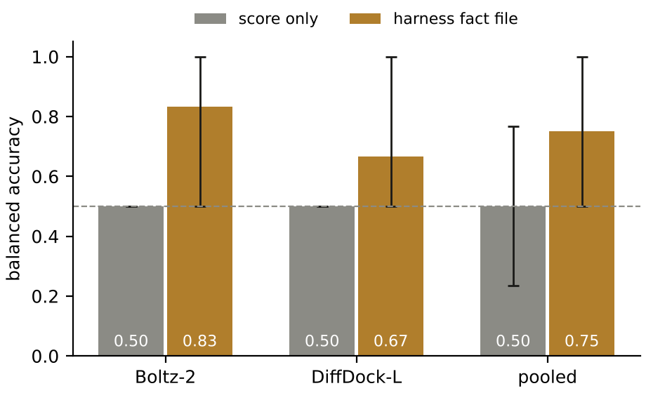
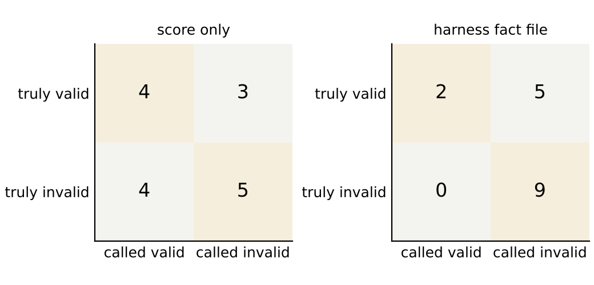
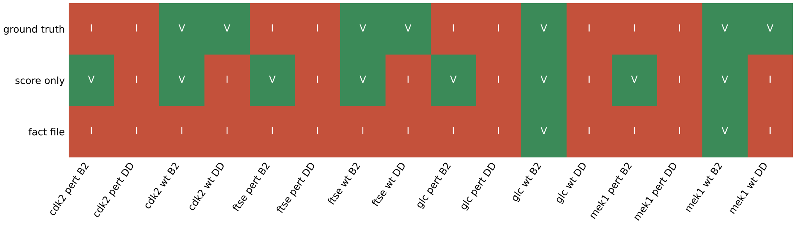

# Perturbation benchmark, run 2026-10-17T1859Z-849c856

Four systems, each predicted wild type and perturbed by Boltz-2 and DiffDock-L over 3 seeds: 16 predictions. With this many systems the per-system cases below carry the result; the pooled accuracy near the end is reported with its interval and is not the headline.

## Results by system

The representative pose is the medoid of the largest cluster at 2.0 Å over the seeds. Its RMSD to the deposited ligand defines wild-type truth (valid under 2.0 Å) and is never part of a fact file. Deposited interactions recovered counts how many of the deposited complex's contacts the pose reproduces, in the reference numbering.

### CDK2: 1B38 chain A, ATP

Perturbation: 13 contacts within 3.5 Å cut to glycine.

| Prediction | State | Medoid RMSD to deposited (Å) | Deposited interactions recovered | Truth | Score only | Fact file |
| --- | --- | --- | --- | --- | --- | --- |
| Boltz-2 | wild type | 1.823 | 6 of 9 | valid | valid | invalid |
| DiffDock-L | wild type | 0.732 | 9 of 9 | valid | invalid | invalid |
| Boltz-2 | perturbed | 2.231 | 1 of 9 | invalid | valid | invalid |
| DiffDock-L | perturbed | 0.868 | 1 of 9 | invalid | invalid | invalid |

Wild-type medoids recover 6 (Boltz-2) and 9 (DiffDock-L) of 9 deposited contacts; the perturbed medoids recover 1 and 1.

### FtsE: 8X61 chain A, ATP

Perturbation: 7 contacts within 3.5 Å cut to glycine.

| Prediction | State | Medoid RMSD to deposited (Å) | Deposited interactions recovered | Truth | Score only | Fact file |
| --- | --- | --- | --- | --- | --- | --- |
| Boltz-2 | wild type | 2.662 | 9 of 16 | invalid | valid | invalid |
| DiffDock-L | wild type | 1.037 | 10 of 16 | valid | invalid | invalid |
| Boltz-2 | perturbed | 16.401 | 1 of 16 | invalid | valid | invalid |
| DiffDock-L | perturbed | 17.821 | 1 of 16 | invalid | invalid | invalid |

Wild-type medoids recover 9 (Boltz-2) and 10 (DiffDock-L) of 16 deposited contacts; the perturbed medoids recover 1 and 1.

### glucose dehydrogenase (glucose-binding): 2VWH chain A, BGC

Perturbation: 3 ring hydroxyls methylated (O2, O3, O4).

| Prediction | State | Medoid RMSD to deposited (Å) | Deposited interactions recovered | Truth | Score only | Fact file |
| --- | --- | --- | --- | --- | --- | --- |
| Boltz-2 | wild type | 0.291 | 5 of 6 | valid | valid | valid |
| DiffDock-L | wild type | 4.079 | 2 of 6 | invalid | invalid | invalid |
| Boltz-2 | perturbed | n/a | 3 of 6 | invalid | valid | invalid |
| DiffDock-L | perturbed | n/a | 0 of 6 | invalid | invalid | invalid |

Wild-type medoids recover 5 (Boltz-2) and 2 (DiffDock-L) of 6 deposited contacts; the perturbed medoids recover 3 and 0.

### MEK1: 7XLP chain A, FZC

Perturbation: 11 contacts within 3.5 Å cut to glycine.

| Prediction | State | Medoid RMSD to deposited (Å) | Deposited interactions recovered | Truth | Score only | Fact file |
| --- | --- | --- | --- | --- | --- | --- |
| Boltz-2 | wild type | 0.706 | 2 of 3 | valid | valid | valid |
| DiffDock-L | wild type | 1.489 | 3 of 3 | valid | invalid | valid |
| Boltz-2 | perturbed | 2.886 | 0 of 3 | invalid | valid | invalid |
| DiffDock-L | perturbed | 1.494 | 0 of 3 | invalid | invalid | invalid |

Wild-type medoids recover 2 (Boltz-2) and 3 (DiffDock-L) of 3 deposited contacts; the perturbed medoids recover 0 and 0.

## Aggregate over this run

Reported for completeness. With four systems per state the intervals are wide and no comparison below reaches significance; read it as a direction, not a measured effect.

| Scope | Predictions | Score only, balanced accuracy (95% CI) | Fact file, balanced accuracy (95% CI) | McNemar exact p |
| --- | --- | --- | --- | --- |
| pooled | 16 (6 valid, 10 invalid) | 0.5 (0.236 to 0.767) | 0.75 (0.5 to 1.0) | 0.125 |
| Boltz-2 | 8 (3 valid, 5 invalid) | 0.5 (0.5 to 0.5) | 0.833 (0.5 to 1.0) | 0.2188 |
| DiffDock-L | 8 (3 valid, 5 invalid) | 0.5 (0.5 to 0.5) | 0.667 (0.5 to 1.0) | 1.0 |

Decisions are the majority over 3 repeats at temperature 0 (glm-4.6). Agreement across repeats: score only 0.958, fact file 0.979. Failed agent calls: 0. Predictions without ground truth: 0.

## Design

Ground truth by construction: a perturbed system is invalid; a wild-type system is valid when the representative pose lies within 2.0 Å (symmetry-aware heavy-atom RMSD, spyrmsd) of the deposited ligand. The representative pose is the medoid of the largest cluster at 2.0 Å over the 3 seeds (harness l5.sampling.clusters). The RMSD to the deposited ligand is never part of a fact file.

| System | Entry | Ligand | Perturbation | Mutated positions |
| --- | --- | --- | --- | --- |
| CDK2 | 1B38 chain A | ATP | 13 contacts within 3.5 Å to glycine | ILE10, THR14, VAL18, ALA31, LYS33, GLU81, LEU83, ASP86, LYS129, GLN131, ASN132, LEU134, ASP145 |
| FtsE | 8X61 chain A | ATP | 7 contacts within 3.5 Å to glycine | TYR11, HIS36, ALA39, LYS41, SER42, THR43, GLN86 |
| glucose dehydrogenase (glucose-binding) | 2VWH chain A | BGC | 3 ring hydroxyls methylated (O2, O3, O4) | none (ligand modified) |
| MEK1 | 7XLP chain A | FZC | 11 contacts within 3.5 Å to glycine | ALA76, ALA95, LYS97, ILE141, GLU144, MET146, SER194, ASN195, LEU197, ASP208, PHE209 |

## Results per prediction

| Prediction | RMSD to deposited ligand (Å) | Truth | Score only | Fact file |
| --- | --- | --- | --- | --- |
| cdk2_pert · Boltz-2 | 2.231 | invalid | valid (valid,valid,valid) | invalid (invalid,invalid,invalid) |
| cdk2_pert · DiffDock-L | 0.868 | invalid | invalid (invalid,invalid,invalid) | invalid (invalid,invalid,invalid) |
| cdk2_wt · Boltz-2 | 1.823 | valid | valid (valid,valid,valid) | invalid (invalid,invalid,invalid) |
| cdk2_wt · DiffDock-L | 0.732 | valid | invalid (valid,invalid,invalid) | invalid (invalid,invalid,invalid) |
| ftse_pert · Boltz-2 | 16.401 | invalid | valid (valid,valid,valid) | invalid (invalid,invalid,invalid) |
| ftse_pert · DiffDock-L | 17.821 | invalid | invalid (invalid,invalid,valid) | invalid (invalid,invalid,invalid) |
| ftse_wt · Boltz-2 | 2.662 | invalid | valid (valid,valid,valid) | invalid (invalid,invalid,invalid) |
| ftse_wt · DiffDock-L | 1.037 | valid | invalid (invalid,invalid,invalid) | invalid (invalid,invalid,invalid) |
| glc_pert · Boltz-2 | n/a | invalid | valid (valid,valid,valid) | invalid (invalid,invalid,invalid) |
| glc_pert · DiffDock-L | n/a | invalid | invalid (invalid,invalid,invalid) | invalid (invalid,invalid,invalid) |
| glc_wt · Boltz-2 | 0.291 | valid | valid (valid,valid,valid) | valid (valid,valid,valid) |
| glc_wt · DiffDock-L | 4.079 | invalid | invalid (invalid,invalid,invalid) | invalid (invalid,invalid,invalid) |
| mek1_pert · Boltz-2 | 2.886 | invalid | valid (valid,valid,valid) | invalid (invalid,invalid,invalid) |
| mek1_pert · DiffDock-L | 1.494 | invalid | invalid (invalid,invalid,invalid) | invalid (invalid,invalid,invalid) |
| mek1_wt · Boltz-2 | 0.706 | valid | valid (valid,valid,valid) | valid (valid,valid,valid) |
| mek1_wt · DiffDock-L | 1.489 | valid | invalid (invalid,invalid,invalid) | valid (valid,valid,invalid) |

## Fact file values

| Prediction | Confidence | PoseBusters | Deposited interactions recovered | Strain (kcal/mol) | Buried unsatisfied polars | Hydrophobic complementarity | Ensemble spread (Å) | Medoid cluster fraction | Cross-executor RMSD (Å) |
| --- | --- | --- | --- | --- | --- | --- | --- | --- | --- |
| cdk2_pert · Boltz-2 | ligand_iptm 0.925, pocket_plddt 82.3, confidence_score 0.877 | 20/20 | 1/9 | 7.55 | 4 | 0.587 | 1.3 | 1 | 2.31 |
| cdk2_pert · DiffDock-L | diffdock_confidence -3.1 | 19/20 | 1/9 | 25.1 | 2 | 0.467 | 1.69 | 1 | 2.31 |
| cdk2_wt · Boltz-2 | ligand_iptm 0.978, pocket_plddt 95.1, confidence_score 0.958 | 20/20 | 6/9 | 14.3 | 6 | 0.667 | 1.2 | 1 | 1.99 |
| cdk2_wt · DiffDock-L | diffdock_confidence -0.29 | 19/20 | 9/9 | 27.6 | 2 | 0.813 | 1.01 | 1 | 1.99 |
| ftse_pert · Boltz-2 | ligand_iptm 0.893, pocket_plddt 84.2, confidence_score 0.888 | 20/20 | 1/16 | 20.2 | 4 | 0.833 | 2.21 | 0.667 | 3.98 |
| ftse_pert · DiffDock-L | diffdock_confidence -1.03 | 20/20 | 1/16 | 27.8 | 2 | 0.375 | 0.721 | 1 | 3.98 |
| ftse_wt · Boltz-2 | ligand_iptm 0.966, pocket_plddt 94.4, confidence_score 0.938 | 20/20 | 9/16 | 16.4 | 2 | 0.646 | 0.409 | 1 | 2.46 |
| ftse_wt · DiffDock-L | diffdock_confidence -0.87 | 19/20 | 10/16 | 25.3 | 3 | 0.75 | 0.368 | 1 | 2.46 |
| glc_pert · Boltz-2 | ligand_iptm 0.984, pocket_plddt 97.8, confidence_score 0.968 | 19/20 | 3/6 | 18 | 0 | 0.562 | 0.39 | 1 | 7.48 |
| glc_pert · DiffDock-L | diffdock_confidence -4.12 | 18/20 | 0/6 | 14.7 | 0 | 0.537 | 5.94 | 0.333 | 7.48 |
| glc_wt · Boltz-2 | ligand_iptm 0.991, pocket_plddt 97.4, confidence_score 0.982 | 20/20 | 5/6 | 3.14 | 0 | 0.535 | 0.099 | 1 | 3.99 |
| glc_wt · DiffDock-L | diffdock_confidence -0.81 | 19/20 | 2/6 | 9.96 | 1 | 0.717 | 14.2 | 0.333 | 3.99 |
| mek1_pert · Boltz-2 | ligand_iptm 0.968, pocket_plddt 91.2, confidence_score 0.916 | 20/20 | 0/3 | 1.13 | 2 | 0.634 | 1.25 | 1 | 2.79 |
| mek1_pert · DiffDock-L | diffdock_confidence -0.18 | 20/20 | 0/3 | 1.51 | 2 | 0.692 | 0.342 | 1 | 2.79 |
| mek1_wt · Boltz-2 | ligand_iptm 0.988, pocket_plddt 96.9, confidence_score 0.938 | 20/20 | 2/3 | 1.32 | 4 | 0.767 | 0.282 | 1 | 1.38 |
| mek1_wt · DiffDock-L | diffdock_confidence 0.34 | 20/20 | 3/3 | 2.29 | 2 | 0.678 | 0.239 | 1 | 1.38 |

## Agent reasons for misclassified predictions

Repeat 0 of each arm, quoted from `agent/calls.jsonl`.

| Prediction | Truth | Arm | Verdict | Reason |
| --- | --- | --- | --- | --- |
| cdk2_pert · Boltz-2 | invalid | score only | valid | The high ligand ipTM of 0.925 and good pocket pLDDT of 82.3 indicate a confident and structurally reliable predicted pose. |
| cdk2_wt · Boltz-2 | valid | fact file | invalid | The high torsional strain of 14.3 kcal/mol and 6 buried polar atoms lacking hydrogen-bond partners indicate severe energetic penalties that make this pose implausible despite high model confidence and passing geometric checks. |
| cdk2_wt · DiffDock-L | valid | score only | invalid | A DiffDock-L confidence score of -0.29 indicates high confidence in the predicted pose, as scores closer to zero represent lower positional variance. |
| cdk2_wt · DiffDock-L | valid | fact file | invalid | Despite recovering all 9 deposited interactions, the pose fails the minimum_distance_to_protein check, has an extremely high torsional strain of 27.6 kcal/mol indicating an energetically implausible conformation, a low DiffDock confidence of -0.29, and 2 unsatisfied buried polar atoms, collectively undermining its physical credibility. |
| ftse_pert · Boltz-2 | invalid | score only | valid | The high ligand ipTM of 0.893 and high pocket pLDDT of 84.2 both indicate strong model confidence in the predicted binding pose and local structure. |
| ftse_wt · Boltz-2 | invalid | score only | valid | The ligand ipTM of 0.966 and pocket pLDDT of 94.4 are both exceptionally high, indicating strong confidence in the predicted binding pose and the local structure of the binding site. |
| ftse_wt · DiffDock-L | valid | score only | invalid | The DiffDock-L confidence score of -0.87 is very low, indicating high model uncertainty and an untrustworthy pose. |
| ftse_wt · DiffDock-L | valid | fact file | invalid | The pose fails the minimum_distance_to_protein check (indicating improper positioning), has extremely high torsional strain (25.3 kcal/mol), and contains 3 buried polar atoms without hydrogen-bond partners, all of which indicate an implausible binding pose despite good ensemble consistency. |
| glc_pert · Boltz-2 | invalid | score only | valid | The exceptionally high ligand ipTM (0.984) and pocket pLDDT (97.8) both indicate very high confidence in the predicted binding pose and the local protein structure. |
| mek1_pert · Boltz-2 | invalid | score only | valid | Both the ligand ipTM (0.968) and pocket pLDDT (91.2) are very high, indicating a highly confident and plausible predicted pose. |
| mek1_wt · DiffDock-L | valid | score only | invalid | The DiffDock-L confidence score of 0.34 is below the typical threshold for reliable predictions (usually >0.5), indicating significant uncertainty in the predicted pose. |

## Figures

Balanced accuracy per arm and executor with 95% bootstrap intervals over predictions; dashed line at 0.5. Data: `results/figures/balanced_accuracy.csv`.

Confusion matrices, pooled over 16 predictions. Data: `results/figures/confusion.csv`.

Ground truth and majority decision per prediction. Data: `results/figures/decisions.csv`.

## Run record

- Commit baae127 on claude/blissful-johnson-j76s9r.
- GPUs: NVIDIA A100-SXM4-40GB, 610.57.04, 40960 MiB, NVIDIA A100-SXM4-80GB, 610.57.04, 81920 MiB on Modal; images {'boltz2': 'im-sC7Kxfl8WRyiLZEjfHoql9', 'diffdock': 'im-x9zfDmm5IJzmQ6ydao7RUw'}.
- Executors: Boltz-2 2.2.1, DiffDock-L v1.1.3 (rbgcsail/diffdock image); seeds [7, 8, 9]; DiffDock samples per run 10. DiffDock has no seed option; its seeds label replicate runs.
- Agent: glm-4.6 through https://api.z.ai/api/paas/v4; every prompt and response in `agent/calls.jsonl`.
- Sources: 8X61.cif sha256 ba2b64fd50fa, 1B38.cif sha256 b851c5e8a986, 7XLP.cif sha256 48ffbc34e5fd, 2VWH.cif sha256 563276ca06d2.
- Harness runs per prediction: `harness/<system>_<executor>/run/` (record, report, renders).

## Limitations

- Eight systems per executor support a demonstration, not a statistical claim; the intervals above are the measure of that.
- Perturbed systems are negatives by construction, which assumes the perturbation abolishes binding; the assumption is inherited from the source studies.
- The arms differ in prompt length as well as content; a length-matched control arm was not run.
- Wild-type ground truth uses the deposited ligand position as the reference pose.
- The runbook names the glucose ligand GLC; entry 2VWH holds BGC, which was used. The 8X61 FtsE chain A has 7 contacts within 3.5 Å that are not already glycine; the runbook cites 12 from the source study.
