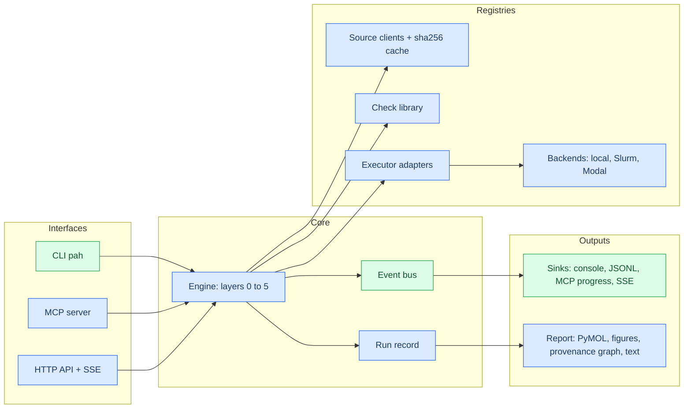

# Architecture

## Components

Green: implemented in milestone 1. Blue: planned.

## Extension points

Each extension point is a protocol plus a registry, so a new tool, source or check means adding
a file and a YAML entry. Core modules are not edited.

| Protocol | Registry | Data file | Milestone |
| --- | --- | --- | --- |
| `Probe` | `pah.doctor.catalog.register(kind)` | `configs/{sources,tools,executors}.yaml` | 1 |
| `Sink` | passed to `EventBus` | none | 1 |
| `Installer` | `pah.externals.installers.INSTALLERS` keyed by asset kind | `configs/externals.yaml` | 1 |
| `SourceClient` | source registry keyed by `id` | `configs/sources.yaml` | 2 |
| `Check` | check registry keyed by `check_id` | `configs/tasks/*.yaml` | 2 |
| `Executor` | executor registry keyed by `id` | `configs/executors.yaml`, `docs/EXECUTORS.md` | 3 |
| `Backend` | backend registry keyed by profile `backend` | `configs/profiles/*.yaml` | 3 |
| `Renderer` | report renderers | none | 4 |

## Event stream

Every component reports through `EventBus.emit`. Events carry a run id, a strictly increasing
sequence number, a kind, a stage and a data payload. Sinks receive each event as it is emitted.

| Kind | Emitted when |
| --- | --- |
| `run_start`, `run_end` | A run begins or ends, with totals |
| `stage_start`, `stage_end` | A layer or doctor category begins or ends, with counts |
| `result` | A probe completes |
| `finding` | A check completes, with gate, measurements and thresholds |
| `artifact` | A file is written (report, render, graph) |
| `progress`, `log` | Intermediate status |

`--format jsonl` writes the same events to stdout, one JSON object per line, for agents and pipes.
`runs/<id>/events.jsonl` keeps the full stream for every run.

## Executors and assessment-only use

An executor adapter has three parts: `build_inputs`, `command` and `parse_outputs`. An agent
benchmark that runs DiffDock, Boltz-2, AlphaFold3 or another tool itself only needs
`parse_outputs`. It passes the output directory to the harness and receives findings for
layers 4 and 5. File layouts and field names for each tool are in `docs/EXECUTORS.md`.

## Deployment

| Profile | Backend | Checks run on | Executors run on | Network on workers |
| --- | --- | --- | --- | --- |
| `local` | in-process | local CPU | not run | yes |
| `csf3` | Slurm + Apptainer | compute node CPU | GPU partition, one container per executor | assumed none; cache filled on login node |
| `modal` | Modal functions | CPU function | GPU function, one image per executor | yes |

The content cache is keyed by sha256. With `offline: true` a cache miss is a stop finding.
It never falls back to a fresh fetch.

## Failure isolation

| Unit | On failure |
| --- | --- |
| Registry entry (YAML row) | Becomes an `error` result for that entry; other entries load |
| Registry file or category | One `error` result for the category; other categories run |
| Probe | Exception caught by the runner; recorded as `error` |
| Fetch asset | Recorded as `blocked`, `failed`, `skipped` or `manual`; next asset proceeds; no partial files |
| Profile or output directory | Command stops with exit code 2 and a one-line message |
