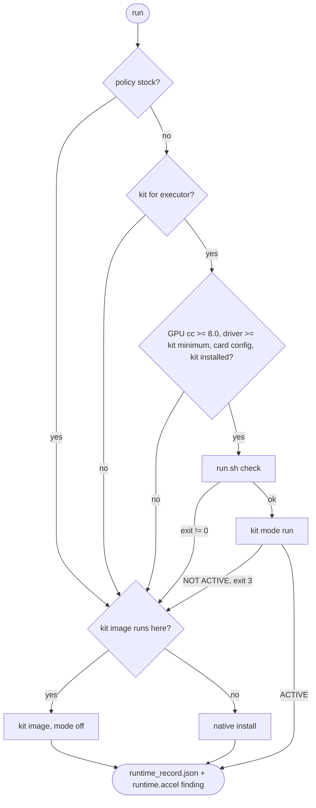

# Executor runtimes

`pah runtimes` installs, boots and runs the co-folding and docking engines on GPU hosts. Data
lives in `configs/runtimes.yaml` (routes, images, commands, weights) and `configs/accel.yaml`
(optimisation kit policy). Code lives in `src/pah/runtimes/`. Input and output formats for each
tool are in [EXECUTORS.md](EXECUTORS.md).

## Executors

| id | Tool | Kit | Stock route | Stock version |
| --- | --- | --- | --- | --- |
| `boltz2` | Boltz-2 | `boltz2` | pip | boltz 2.2.1 |
| `boltz1` | Boltz-1 | none | pip | boltz 2.2.1, `--model boltz1` |
| `protenix` | Protenix v1 | `protenix_v1` | pip | protenix 1.1.0 |
| `protenix_v2` | Protenix v2 | `protenix_v2` | pip | protenix 2.0.0 (checkpoint placed by hand) |
| `chai1` | Chai-1 | `chai1` | pip | chai_lab 0.6.1 |
| `alphafold3` | AlphaFold3, DeepMind weights | none | image built from upstream | commit `03f4f48` |
| `alphafold3_of3` | AlphaFold3 architecture, OpenFold3-preview2 weights | `af3_jax` | kit image, mode `off` | sokrypton/alphafold3 v3.1.4 |
| `colabfold` | ColabFold, AF2-multimer v3 | `colabfold` | pip | colabfold 1.6.1 |
| `openfold3` | OpenFold3 preview-2 | `openfold3` | pip | openfold3 0.4.1 |
| `diffdock` | DiffDock-L | none | image pull | rbgcsail/diffdock v1.1.3 (digest pinned) |
| `gnina` | Gnina | none | binary | v1.3 (sha256 pinned) |
| `vina` | AutoDock Vina | none | binary | v1.2.5 (sha256 pinned) |
| `autodock_gpu` | AutoDock-GPU with AutoGrid4 | none | image built from source | v1.6 (`e63e6f6`) |

`pah runtimes list` prints the same table from the YAML. Every stock version equals the version
the kit carries as stock, so kit and stock runs use the same tool and weights.

## Optimisation kits

The kits come from `github.com/anthropics/uplifting-biomolecular-modeling` at the commit pinned
in `accel.yaml`. Each kit runs the upstream release in one of four modes, described in the kit
READMEs as `off` (stock), `exact` (identical outputs, faster), `fast` (differences within stock's
seed-to-seed variation) and `big` (lowest GPU memory).

| Policy | Behaviour |
| --- | --- |
| `auto` (default) | Kit in `fast` when it can engage, otherwise stock with the reasons recorded |
| `kit` | Kit required; a run that cannot engage it stops |
| `stock` | Kit never used |

Set per run with `--accel` and `--mode`, per shell with `PAH_ACCEL` and `PAH_ACCEL_MODE`, or
globally in `accel.yaml`.



Under `kit`, every arrow into the stock branch is an error instead. Each stock reason is printed
as it is decided, written to `runtime_record.json` and carried in the `runtime.accel` finding
(layer 3). A kit run in `fast` or `big` yields `warn`, following the specification row
"Accelerated mode verified against stock on this hardware", as does a kit run that printed no
ACTIVE line; `exact` and stock yield `pass`.

Cards map to kit configs by name first (H200, B300, B200, H100, A100), then by compute
capability: 10.x to `b200` or `h100`, 9.x to `h100`, 8.x to `a100` (this covers the L40S, 8.9).
The kit's `run.sh check` has the final word on whether a mode engages on that card.

`alphafold3` never uses the `af3_jax` kit: that kit runs OpenFold3 weights, which is a different
model, so it is registered separately as `alphafold3_of3`.

## Launchers

| Launcher | Used by | Kit available when | Stock available when |
| --- | --- | --- | --- |
| `host` | `local`, `modal` profiles | kit checkout present and its package imports in `<envs_root>/<kit>-kit` or on PATH (`modal`: checkout present) | tool in `<envs_root>/<id>/bin` or on PATH |
| `docker` | `--launcher docker` | image `<kit>-kit:dev` present | stock image present |
| `apptainer` | `csf3` profile | `<images_root>/<kit>-kit.sif` present | `<images_root>/<id>.sif` present |

A kit image holds the pinned stack and the kit, so it also serves stock as mode `off`. Stock
falls back to the native route only when the kit image cannot run on the host (driver older than
the kit's minimum) or is absent.

## Commands

```bash
pah runtimes list                                     # executors, kits, stock routes
pah runtimes hardware                                 # GPUs here and the route each executor would take
pah runtimes kits fetch                               # sparse checkout of the kits at the pinned commit
pah runtimes install boltz2                           # stock tool into .tools/executors/boltz2 (pip or binary)
pah runtimes build boltz2 --target docker             # kit image (serves kit modes and stock)
pah runtimes build diffdock --route native --target apptainer
pah runtimes weights boltz2                           # kit installer (digest-checked) or the tool's own downloader
pah runtimes plan boltz2 -p input=x.yaml --out runs/b2       # route and exact argv, nothing run
pah runtimes run boltz2 -p input=x.yaml --out runs/b2        # run, streaming events
pah runtimes run chai1 -p input=x.fasta --out runs/c1 --mode exact -- --num-trunk-recycles 3
```

`--dry-run` on `install`, `build`, `weights` and `kits fetch` prints the commands only. A run
writes `runtime_record.json` (decision, argv, environment, kit line, attempts, finding),
`executor.<route>.log`, `kit_check.log` and `events.jsonl` into `--out`.

## Deployment

### CSF3

On the login node:

```bash
source deploy/csf3/env.sh
deploy/csf3/prepare_executor.sh boltz2        # kits checkout, stock .sif, weights
```

The kits' `apptainer.def` files convert the kit image from a local Docker daemon
(`Bootstrap: docker-daemon`). If the login node has no Docker, build the `.sif` on a Docker host
with `pah runtimes build <id> --target apptainer` and copy `.tools/images/<kit>-kit.sif` to
`~/scratch/pah/images/`. Then:

```bash
sbatch deploy/csf3/executor.sbatch boltz2 $PAH_ROOT/runs/b2-001 --param input=$PWD/x.yaml
sbatch --array=1-200%16 deploy/csf3/executor_array.sbatch manifest.txt
```

Partition names and the GPU request syntax in the sbatch files are unverified; confirm them
with `sinfo -s`.

### Modal

```bash
pah runtimes kits fetch
PAH_EXECUTOR=boltz2 modal run deploy/modal/executors_app.py::fetch_weights
PAH_EXECUTOR=boltz2 modal run deploy/modal/executors_app.py --param input=x.yaml
PAH_EXECUTOR=vina PAH_MODAL_GPU=L4 modal run deploy/modal/executors_app.py --param receptor=r.pdbqt,ligand=l.pdbqt,box=box.txt
```

One app per executor. Kit executors build from the kit Dockerfile; others pull, build from
upstream, or render a CUDA image with the pinned pip packages or binary. The harness is installed
into its own venv in the image so the executor's stack is left as built. The app has not been run:
how Modal's own runtime requirements interact with each kit's pinned Python stack is untested. If
a kit's `check` reports a broken stack, rebuild with `PAH_MODAL_IMAGE=native`.

### Local GPU workstation

`pah runtimes install <id>` for pip and binary tools, or `--launcher docker` with images from
`pah runtimes build`. To run kits without containers, follow the Stack section of the kit's
`STOCK.md` into `.tools/executors/<kit>-kit`.

## State on 2026-10-17

The development sandbox has no GPU. Docker is installed but its daemon is not running at start.
Verified there:

| What | Result |
| --- | --- |
| Kits repository at `f4f62fa` | Cloned; sparse checkout of the 7 kits used and `common/` |
| Stock pins, entry points and flags | Read from the PyPI wheels (boltz 2.2.1, chai_lab 0.6.1, protenix 1.1.0 and 2.0.0, openfold3 0.4.1, colabfold 1.6.1), the kit READMEs and STOCK.md files, AlphaFold3 `docker/Dockerfile` at `03f4f48`, the AutoDock-GPU README and Makefiles at `e63e6f6`, DiffDock `inference.py` at `85c49b6`, and the DiffDock image layers on Docker Hub |
| Vina v1.2.5 binary | Installed with `pah runtimes install vina`; `vina --version` prints `AutoDock Vina v1.2.5` |
| Gnina v1.3 binary | Installed with `pah runtimes install gnina`; does not start here (`libcudart.so.12` missing). The rendered image uses a CUDA 12.6 runtime base; that image was not built |
| Weight and image hosts reachable from the sandbox | Hugging Face (Boltz), chaiassets.com (Chai-1), OpenFold S3 (OpenFold3, af3_jax), Google Cloud Storage (AlphaFold2 params), GitHub releases, Docker Hub |
| Hosts blocked from the sandbox | `protenix.tos-cn-beijing.volces.com` (Protenix weights) |
| Image builds, weight downloads, GPU runs | Not run |

`verified` in each `runtimes.yaml` entry records the same per executor.
